# 1-2 Prompt Engineering Fundamentals

After understanding [1-1 Overview of Large Language Models and Engineering](1-1-%E5%A4%A7%E6%A8%A1%E5%9E%8B%E8%AE%A4%E7%9F%A5%E4%B8%8E%E5%B7%A5%E7%A8%8B%E6%A6%82%E8%A7%88.md), this chapter formally enters the first layer of capability for putting LLMs into engineering practice: **Prompt Engineering**. Among the five major modules, it is the lowest-cost, fastest-acting, and most worthwhile layer to master first.

---

**Chapter Learning Objectives:**

- Understand the definitions, roles, and boundaries of prompts and prompt engineering.
- Master the most commonly used method for writing prompts: the six elements of **role, task, background/context, input data, output format, and quality and constraints**.
- Understand the applicable scenarios for **Zero-shot and Few-shot**, prompt templates, and the structured organization of **System / User / Assistant**.
- Know when prompt engineering is sufficient, when it is not, and how it collaborates with RAG, workflows, and agents in real projects.

**Study Advice:** Prompts are not incantations; the key is to write the requirements clearly enough for the model to execute them. When reading this chapter, it is best to take a real task and revise it as you read: first clarify the role and task, then add input boundaries, output format, examples, and constraints. After reading, you should at least be able to turn a vague "help me write something" into an executable, verifiable prompt.

**Division of Work with Chapter 13:** This chapter addresses "why a prompt should be written this way, what information should be included, and when it works and when it does not." The later [Chapter 13 Prompts and Message Templates](13-%E6%8F%90%E7%A4%BA%E8%AF%8D%E4%B8%8E%E6%B6%88%E6%81%AF%E6%A8%A1%E6%9D%BF.md) addresses "how to put these ideas into LangChain code, using messages, templates, and placeholders to structure the input." You can think of this chapter as the **methodology** and Chapter 13 as the **engineering implementation**.

**Official Documentation and Resources:** See [Tool Navigation and Reference Index - Prompts and Structured Output](%E5%B7%A5%E5%85%B7%E5%AF%BC%E8%88%AA%E4%B8%8E%E5%8F%82%E8%80%83%E8%B5%84%E6%96%99%E7%B4%A2%E5%BC%95.md#prompting-and-structured-output).

---

## 1. Prompts and Prompt Engineering

### 1.1 Definition of a Prompt

A prompt is the input content you send to a model. It can be a single sentence, or it can be a whole set of structured messages.

The simplest prompt is a natural language sentence, for example:

- "Who invented the number zero?"
- "Tell me a joke"
- "Write a love letter to your boyfriend/girlfriend"

Tasks can also be more complex, for example:

- Have the model research competitors for your product idea
- Build a website from scratch
- Analyze your enterprise data

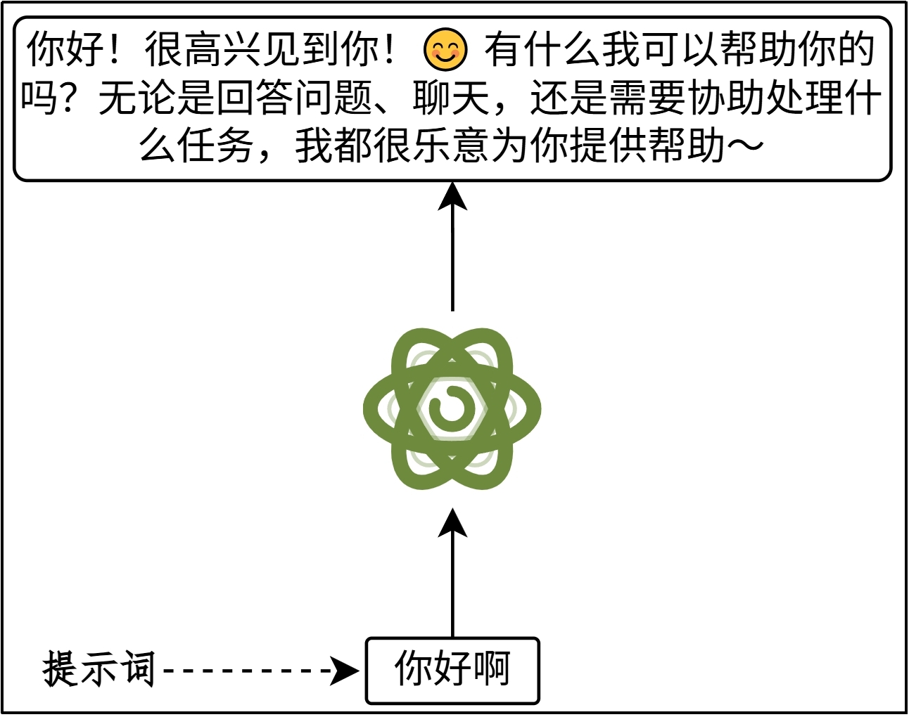

From an introductory perspective, you can think of a prompt as "a task description I give to the model." But from an engineering perspective, a prompt is not just "asking a question in one sentence"; it is **clearly organizing the role, task, context, input, and output rules**.

### 1.2 Why Prompts Are Needed

Although LLMs have been trained on massive amounts of text, they do not automatically know what exactly you want them to do this time.
The role of a prompt is to tell the model: what role you are playing right now; what the task is this time; what reference materials can be used; and what the output should look like.

A prompt is not about "teaching the model new knowledge again," but about **activating the part of its capability that is most relevant for the current task**.

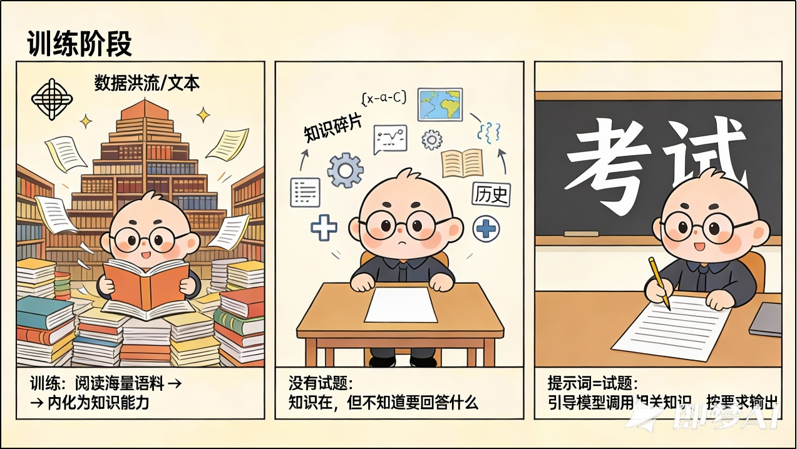

### 1.3 Why Prompt Optimization Is Needed

With the same model, different inputs often lead to very different output quality.
The role of a high-quality prompt is not to make the model "smarter," but to reduce ambiguity, reduce drift, and reduce format errors, so that the model outputs more stably toward your goal.

It is somewhat like going to see a doctor:

- If you only say "I don't feel well," it is difficult for the doctor to judge
- If you can clearly describe the symptoms, duration, and triggering conditions, the judgment will be more accurate

The same is true for LLMs. The vaguer the input, the more likely the output will drift.

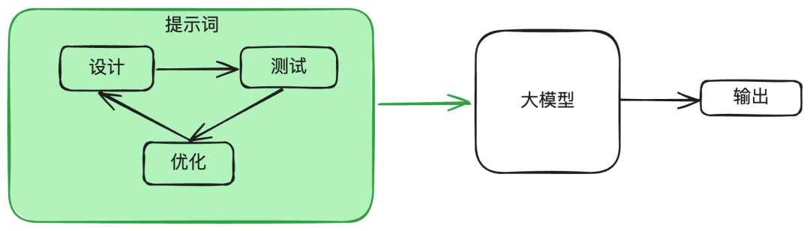

### 1.4 Prompt Engineering

Prompt engineering refers to:
When using an LLM, systematically **designing, organizing, testing, and optimizing prompts** so that the model can produce results that meet the goal as stably as possible under specific tasks, constraints, and contexts.

It is not mysticism, nor is it simply "try a few more times and hope for the best." Truly effective prompt engineering focuses on:

- Whether the requirement is clearly expressed
- Whether input boundaries are explicit
- Whether the output structure is verifiable
- Whether examples sufficiently illustrate the boundaries
- Whether constraints are self-consistent

Therefore, this chapter is not about "a few magic words," but about a **reusable, maintainable, and transferable** method for organizing input.

### 1.5 Supplementary Concepts

#### 1.5.1 Context

Context usually refers to the set of information that the model can directly access and use for reasoning during the current generation.

Simply put, context is **all the input you actually feed to the model this time**, which may include:

- System prompt
- User question
- Conversation history
- Retrieval results
- Tool returns

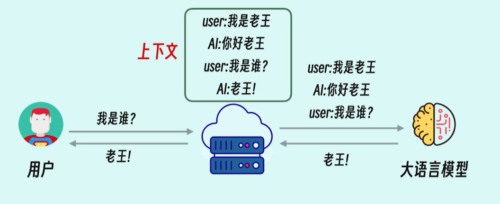

#### 1.5.2 Context Window

A model cannot receive unlimited content. The maximum length of context it can process at one time is determined by the model architecture and training, and this upper limit is called the **context window**.

Once the context window is exceeded, content will be truncated, compressed, or simply cannot fit.

A simple distinction:

- **Context** = all the information fed to the model this time
- **Context window** = the maximum amount of information the model can accept

This is also why:

- Long documents cannot simply be stuffed in entirely
- Multi-turn conversations need summarization or trimming
- When there is too much material, RAG is often needed

---

## 2. How to Write Prompts

### 2.1 Changes in Prompt Engineering

Early models were relatively weak, and developers often had to rely heavily on "trick-based prompts," such as complex prompt chains, elaborate guidance phrases, and many explicit reasoning cues.

But as model capabilities have improved, the focus of prompt engineering has increasingly shifted from "showing off tricks" to "**clearly expressing the requirements and making the results verifiable**."

This does not mean that techniques are completely useless, but rather that they should serve task design. For example, few-shot, delimiters, structured output, and step-by-step decomposition still have value; however, their role is to make the task clearer, more stable, and easier to verify, rather than relying on some mysterious phrasing to suddenly make the model stronger.

The more important question today is no longer:

- Should I add some mysterious sentence pattern?

But rather:

- Is the task actually well defined?
- Are the input boundaries clear?
- Is the output format verifiable?
- Have I given the model enough background and examples?

For real projects, this shift is very important. Because what an engineering system needs is not "getting it right once in a while," but **being able to reproduce results stably over the long term and judge quality through sample sets or evaluation criteria**.

### 2.2 Core Six Elements and Typical Composition

Although not every prompt must include all six elements, in the vast majority of scenarios, these six items can help you organize your requirements more completely:

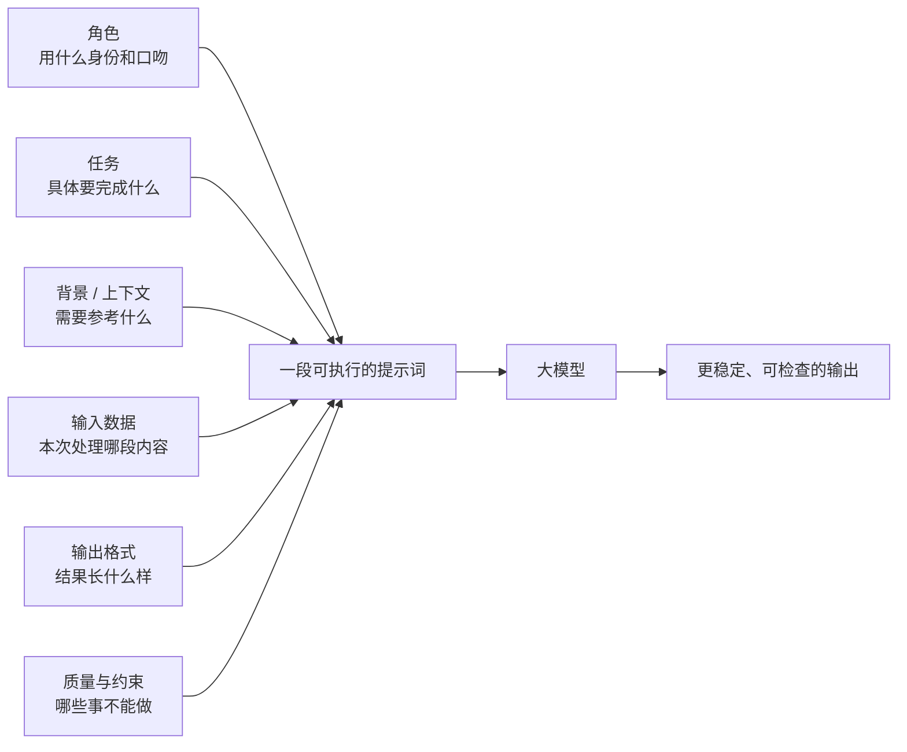

A general template is as follows:

```text
# 角色
你是一名【角色定位，如：数据分析师 / 业务分析师 / 政策研究员】。

# 任务
你的任务是基于给定的输入数据进行【分析 / 总结 / 对比 / 评估】。

# 背景/上下文
【历史记录总结】。
【参考资料】。

# 输入数据
<<<
{在此粘贴输入数据}
>>>

# 输出格式
- 使用表格形式输出
- 表格中必须包含以下列：
 1. 关键发现
 2. 支撑数据（来自输入数据的原文或摘要）
 3. 结论
 4. 建议
- 表格下方需给出整体结论说明

# 质量与约束
- 仅基于输入数据进行分析
- 不得编造、推测或引入外部信息
- 若输入数据不足以支撑结论，必须明确标注为“信息不足”
- 不允许为了完整性而补充假设
```

The following sections explain each one in turn.

#### 2.2.1 Element One: Role

The role answers the question "**Who are you now?**"
Its purpose is not to give the model a fancy identity, but to tell the model: what professional perspective, expression style, and knowledge depth it should use to complete this task.

Common functions include: controlling tone and style; controlling professional depth; controlling the perspective of thinking; and limiting task boundaries.

General wording:

```text
你是一名【角色定位，如：数据分析师 / 业务分析师 / 政策研究员】。
```

For example:

```text
（❌）给我一个英语的学习计划

（✔️）
需要你扮演一名优秀的小学英语讲师。
我是一名3年级的学生，给我一个为期3个月提高英语成绩的学习计划
```

In this example, once the role is clear, the model can more easily control difficulty, tone, and pacing.

#### 2.2.2 Element Two: Task

The task is the core of the prompt and answers the question "**What do you need to do?**"

When writing tasks, it is recommended to prioritize two points:

- `指令动词开头`: Begin your task description with a strong imperative verb, such as "analyze," "summarize," "extract," "classify," "translate," "generate," "rewrite," "sort," etc.
- `任务说明`: A good task description must be clear, specific, and unambiguous. For example, "write a summary," "do classification," "write code," etc.

Example 1:

Not recommended: unclear goal

```text
告诉我关于气候变化的事情。
```

Recommended: clear goal

```text
请简要描述气候变化的主要原因及其对农业的影响。
```

Example 2:

```text
你的任务是基于给定的输入数据进行【分析 / 总结 / 对比 / 评估】。
```

Example 3:

```text
（弱）谈谈这篇报告
```

```text
（强）请执行以下三个任务：

• 总结所附的 2025 年第二季度全球 AI 市场分析报告，篇幅限制在 300 字以内。
• 提取报告中提到的三大主要增长动力和两大潜在风险。
• 基于报告内容，为一家计划进入该市场的初创公司提出三条战略建议。
```

You will find that once the task is specific, the model can hit the target more stably.

#### 2.2.3 Element Three: Background/Context

Background/context answers the question "**What else does the model need to know to complete the task?**"

This part is not always necessary, but it becomes important when the task involves specific readers, business background, historical chat records, reference materials, or the boundaries of the role's knowledge.

General wording:

```text
# 上下文
【历史记录总结】
【参考资料】
```

Example 1:

Not recommended: no context

```text
解释一下微积分。
```

Recommended: with context

```text
作为一名高中生，我正在学习微积分。请用简单的语言解释一下微积分的基本概念。
```

Example 2:

```python
def provide_context_prompt(topic, expertise_level, background_info):
    """构建包含上下文的提示词"""
    prompt = f"""
    根据以下背景信息：
    {background_info}

    请以{expertise_level}水平撰写关于{topic}的详细解释。
    确保内容准确、结构清晰，并包含实际应用示例。
    """
    return prompt

# 使用示例
background = "读者是计算机专业大三学生，已学习过机器学习基础知识"
topic = "Transformer架构中的多头注意力机制"
prompt = provide_context_prompt(topic, "中级", background)
```

This example illustrates one point well:
Context is not about "dumping materials in," but about giving the model a more accurate starting point for understanding.

#### 2.2.4 Element Four: Input Data

Input data tells the model: "**The following part is the content that actually needs to be processed this time.**"

To avoid mixing instructions, background, and raw text together, we usually use **delimiters** to separate different parts. Common delimiters include:

````text
```   """   <<< >>>   <>   <tag></tag>
````

As long as different text areas can be clearly distinguished, which one to use is not absolute; the key is **consistency and clarity**.

General wording:

```text
# 输入数据
<<<
{在此粘贴输入数据}
>>>
```

Example 1: Using ``` as delimiters

````
把用三个反引号括起来的文本总结成一句话。

​```
您应该提供尽可能清晰、具体的指示，以表达您希望模型执行的任务。这将引导模型朝向所
需的输出，并降低收到无关或不正确响应的可能性。不要将写清晰的提示词与写简短的提示词混淆。在
许多情况下，更长的提示词可以为模型提供更多的清晰度和上下文信息，从而导致更详细和相关的输出。
​```
````

Example 2:

Not recommended prompt:

```text
请将以下句子改写为更易理解的形式。

OpenAI是一个美国人工智能（AI）研究实验室，由非营利组织OpenAIIncorporated（OpenAIInc.）和其盈利子公司
OpenAI Limited Partnership（OpenAI LP）组成。OpenAI旨在推广和发展友好型人工智能，并使用世界第五大超级计算机进行研究。该组织于2015年由Sam Altman、Reid Hoffman、Jessica Livingston、Elon Musk、Ilya
Sutskever、Peter Thiel等人在旧金山创立，共承诺捐赠10亿美元。Musk于2018年从董事会辞职但仍然是捐赠者。微软于2019年向0penAILP提供了10亿美元的投资，并在2023年1月提供了第二笔多年期投资，金额据报道为100亿美元。
```

Recommended prompt:

```text
请将以下句子概括，以便更易理解。

文本："""
OpenAI是一个美国人工智能（AI）研究实验室，由非营利组织OpenAIIncorporated（OpenAIInc.）和其盈利子公司 OpenAI Limited Partnership（OpenAI LP）组成。OpenAI旨在推广和发展友好型人工智能，并使用世界第五大超级计算机进行研究。该组织于2015年由Sam Altman、Reid Hoffman、Jessica Livingston、Elon Musk、Ilya Sutskever、Peter Thiel等人在旧金山创立，共承诺捐赠10亿美元。Musk于2018年从董事会辞职但仍然是捐赠者。微软于2019年向0penAILP提供了10亿美元的投资，并在2023年1月提供了第二笔多年期投资，金额据报道为100亿美元。
"""
```

Example 3:

1) Not recommended prompt

```text
将下面的这句话翻译成英文.
尽量使用华丽的词语
```

AI reply:

> "The spring breeze caresses the face, a hundred flowers bloom, all things revive, and the earth is full of vitality."
> Translation: "With the caress of the spring breeze, myriad flowers bloom in unison, all things
> rejuvenate, and the earth is teeming with vibrant vitality."

2) Recommended prompt

```text
把用三个引号括起来的文本翻译成英文
"""尽量使用华丽的词语"""
```

AI reply:

> "Strive to use magnificent words as much as possible."

This example is classic because it illustrates one thing:
**If you do not separate the "task description" from the "raw input," the model may treat the input text itself as a new task to execute.**

#### 2.2.5 Element Five: Output Format

In many cases, what we need is not a free-form piece of natural language, but **readable, usable, and further processable** structured output.

Common output formats include:

- `JSON`: suitable for program processing and structured extraction
- `Markdown`: suitable for documents, reports, and readable presentation
- `表格`: suitable for analysis, comparison, and summarization
- `代码`: suitable for generating code snippets in a specific language

Example 1:

```text
# 输出要求

- 使用**表格**形式输出
- 表格中必须包含以下列：
 1. 关键发现
 2. 支撑数据（来自输入数据的原文或摘要）
 3. 结论
 4. 建议
- 表格下方需给出**整体结论说明**
```

Example 2:

```text
中国有哪些经典菜系，以表格的形式输出中国经典菜系
```

Output:

> China's Eight Great Cuisines refer to Shandong, Sichuan, Cantonese, Jiangsu, Fujian, Zhejiang, Hunan, and Anhui cuisines. Each of these eight cuisines has its own distinctive characteristics and represents the essence of Chinese culinary culture.
>
> | Cuisine | Origin | Core Characteristics | Representative Dishes |
> | ---- | ---------- | -------------------------------------------------------- | -------------------------------------------------- |
> | Shandong Cuisine | Shandong | Primarily savory and fresh, emphasizes "fresh but not greasy, tender but not raw," skilled in using scallions, ginger, and garlic, and excels at soup-making | Braised Sea Cucumber with Scallions, Nine-Turn Intestines, Sweet and Sour Carp, Oil-Braised Prawns |
> | Sichuan Cuisine | Sichuan, Chongqing | Numbing, spicy, fresh, and fragrant, with rich flavor profiles, renowned for "each dish has its own style, a hundred dishes have a hundred flavors" | Mapo Tofu, Boiled Fish in Chili Oil, Kung Pao Chicken, Couple's Sliced Beef in Chili Sauce, Twice-Cooked Pork |
> | Cantonese Cuisine | Guangdong | Light, fresh, crisp, and tender, pursues original flavors, and emphasizes ingredient freshness | White Cut Chicken, Steamed Grouper, Cantonese Roast Meats, Shrimp Dumplings, Wonton Noodle Soup |
> | Jiangsu Cuisine | Jiangsu | Light, fresh, and mild, with balanced sweet and savory flavors, emphasizes the unity of "color, aroma, taste, form, and presentation" | Squirrel-Shaped Mandarin Fish, Stewed Lion's Head Meatballs, Beggar's Chicken, Salted Duck, Yangzhou Fried Rice |
> | Fujian Cuisine | Fujian | Prominent seafood flavors, sweet and sour with the right balance, skilled in using red yeast rice, shrimp oil, and aged wine for seasoning | Buddha Jumps Over the Wall, Lychee Pork, Drunken Shrimp and Crab, Red Yeast Pork, Taiji Taro Paste |
> | Zhejiang Cuisine | Zhejiang | Light, fresh, and tender, with balanced sweet and savory flavors, emphasizes "freshness, tenderness, smoothness, and crispness," with refreshing and elegant dishes | West Lake Vinegar Fish, Longjing Shrimp, Beggar's Chicken, Sister Song's Fish Soup, Dongpo Pork |
> | Hunan Cuisine | Hunan | Fragrant, spicy, and intense, heavy on oil and strong in color, often paired with smoked and cured meats, appetizing and perfect with rice | Steamed Fish Head with Chopped Chilies, Stir-Fried Pork with Chilies, Steamed Cured Meats, Mao's Braised Pork, Dong'an Chicken |
> | Anhui Cuisine | Anhui | Savory, fresh, mellow, and rich, heavy on oil and strong in color, emphasizes heat control, and skillfully uses mountain delicacies and river seafood | Stinky Mandarin Fish, Hairy Tofu, Hu Shi One-Pot Dish, Yellow Mountain Stewed Pigeon, Wenzheng Mountain Bamboo Shoots |
>
> The formation of these eight great cuisines is closely related to the climate, geographical environment, natural resources, and dietary customs of each region, together constituting the rich diversity of Chinese culinary culture.

Example 3:

```text
请从以下非结构化文本中提取联系人信息，并以 JSON 对象数组的格式输出。
每个对象应包含 name (string), email (string), 和 phone (string) 三个键。
如果某个信息缺失，请将对应的值设为 null。

文本: 张三的电话是 13812345678，邮箱是 zhangsan@example.com。李四只留了邮箱 lisi@example.com。
```

Output:

> [{"name": "Zhang San", "email": "zhangsan@example.com","phone": "13812345678"}, { "name": "Li Si","email": "lisi@example.com","phone": null}]

Example 4:

````bash
请根据以下要求生成一段 Python 代码：
- 定义一个函数 `add_numbers`，接受两个参数 `a` 和 `b`，返回它们的和。
- 打印函数的调用结果，参数为 5 和 10。

示例格式：
```python
def function_name(parameters):
    # function body

print(function_name(arguments))
```
````

**Output:**

```python
def add_numbers(a, b):
    return a + b

print(add_numbers(5, 10))
```

If you intend to pass the results to a program, workflow, or parser for further processing, then the output format is often not just a nice-to-have—it must be **clearly specified upfront**.

#### 2.2.6 Element Six: Quality and Constraints

This element is used to answer two questions: **what counts as good**, and **what cannot be done**.

It typically includes two parts:

- **Quality standards**: for example, writing style, tone, level of detail, professionalism, creativity
- **Constraints**: for example, word count, source restrictions, prohibition of fabrication, compliance boundaries

Common template:

```text
# 质量与约束
- 仅基于输入数据进行分析
- 不得编造、推测或引入外部信息
- 若输入数据不足以支撑结论，必须明确标注为“信息不足”
- 不允许为了完整性而补充假设
```

Example 1:

```text
（❌）
帮我写个介绍
```

```text
（✔️）
请写一段 100 字以内、适合微信推文开头的介绍，风格轻松活泼。
```

Example 2:

```text
你是一位为高端汽车品牌撰写广告文案的创意总监。请为新款电动跑车保时捷 taycan 创作一段 150 字左右的广告语。

质量要求:
• 突出未来感、速度与环保的结合。
• 语言富有诗意和画面感。
• 唤起读者的自由和探索精神。

约束:
• 不得提及具体价格或竞争对手。
• 不得使用最好、第一等绝对化词汇。
• 最终输出必须是一段完整的文本，不含任何标题或标签。
```

Example 3:

```text
作为资深刑事律师，【角色】

你需要设计一套评估 AI 伦理风险的框架，包含 3 个核心维度和 9 项具体指标，【任务目标】

必须排除技术可行性讨论，聚焦社会影响层面，【约束】

用 SWOT 分析框架呈现，每个维度附带现实案例。【输出格式】
```

Example 4:

```text
# 角色
你是一名产品分析师。

# 任务
你的任务是基于给定的用户反馈数据，识别主要问题并提出改进建议。

# 上下文
{{历史讨论记录的总结}}
{{内部知识库中记录的分析技巧}}

# 输入数据
<<<
1. 多名用户反馈应用启动速度变慢
2. 部分用户提到新界面操作路径不清晰
3. 有用户表示通知功能比之前稳定
>>>

# 输出要求
- 使用表格形式输出
- 表格中必须包含以下列：
 1. 关键发现
 2. 支撑数据
 3. 结论
 4. 建议
- 表格下方需给出整体结论说明
- 输出语言必须为中文，表述客观、克制、偏分析报告风格

# 约束
- 仅基于输入数据进行分析
- 不得编造、推测或引入外部信息
- 若输入数据不足以支撑结论，必须明确标注为“信息不足”
- 不允许为了完整性而补充假设
```

This type of Prompt is very similar to the prototype of system prompts in real projects.

#### 2.2.7 Hands-On Practice

The use of prompts is very flexible, and you do not necessarily need to fill in all six elements, but in complex content generation tasks, these six types of information will usually all come into play. The complete case from the course is retained below.

**(1) Prompt**

````text
**# 角色**
你现在是一名 **专业商业广告导演、品牌策划师、脚本创意总监**，擅长为 TikTok、抖音、小红书、电商平台制作高转化产品视频。

**# 任务**
你的任务：**根据产品信息创作一支约 20 秒的故事短片级商品介绍视频脚本**，并严格按以下 3 个部分输出。

**# 输出**
**格式要求【必须输出以下 2 部分】**
**1. outline（视频整体大纲）**
以自然段文本形式输出，需包含：
* 视频定位（带货、种草、功能展示等）
* 目标受众画像（性别、年龄、需求）
* 视频风格（科技感、生活感、快节奏等）
* 视频结构（例如：0–3s 抓眼、3–5s 痛点、5–15s 卖点故事化、15–20s 情绪收束 + CTA）
* 故事走向与主题表达
* 氛围与视觉基调建议

**要求**：浓缩完整故事脉络 + 产品价值呈现方式，字数约 150–300 字。

**2. contents（分镜脚本和旁白数组）**
输出为 **数组，每个元素为一个镜头的JSON字符串，名为content**。
content包含两个字段：**script**和**aside**

**2.1 script（分镜脚本）**
输出为 **一个镜头的字符串**。
每个镜头 **时长 0.5–5 秒**，全片总时长约 20 秒。
每个镜头字符串需包含：
```
【镜头编号】
【画面描述】（景别/构图/人物动作/产品动作）
【旁白/字幕】
【拍摄手法】（特写/推镜/俯拍/转场/光效等）
【时长】X 秒
【情绪/节奏】
```
**要求：**
* 开头前 3–5 秒必须强抓注意
* 故事化、画面执行明确、镜头语言专业
* 卖点通过情节自然呈现，而不是堆砌参数
* 节奏符合短视频平台呈现方式
* 镜头数量可 3-5 个（依内容需要）

**2.2 aside（旁白）**
* 输出为字符串，是该镜头的旁白文本
* 若镜头无旁白，则使用 `"无旁白"`

**# 约束**
**写作风格要求**
* 专业但易懂
* 画面感强，镜头语言表达清晰
* 情绪节奏鲜明、卖点突出、推动购买
* 每个镜头方案可真实落地拍摄
* 全片故事流畅、有戏剧张力
* 充分“抓眼”与“爽点”设计

**# 输入**
产品信息如下
【1. 产品名称】
添可极客智能洗地机

【2. 参数信息】
转速：92000 转/分钟
续航时间：70 min
清水箱容量：1000 ml
品牌：TINECO/添可
型号：FW52010ECN
电压：220V
是否智能：否
电器基站功能：滚刷烘干
适用地面材质：木地板、瓷砖、大理石
附加功能：高温全链速干、除菌、延边清扫、防毛发缠绕、拖布自清洁
最大吸入功率：75 AW
污水箱容量：690 毫升
清水箱容量：1000 ml
质保周期：2 年
颜色分类：【AI全向助力】添可极客

【3. 产品特点】
智能洗地机 芙万 Fold X90
90°小折叠，女神好帮手
3.9kg超轻量，自动上热水
镇店爆款：添可极客
全网都在夸的洗地机
买过的人都说好
净顽渍 安静洗 14天无异味
AI全向助力 22000Pa大吸力
恒压活水高效洗
一键Turbo祛顽渍
安静模式免打扰
22000Pa龙卷吸
AI全向助力
毛发0缠0逃逸
70min长续航
400平方米清洁面积
抗菌祛味棒 14天无异味
99.99%电解水除菌
双模式烘干
小于等于45dB（A）静烘/5min速干
````

**(2) Testing on an Online Platform**

Select the DeepSeek official website for testing.

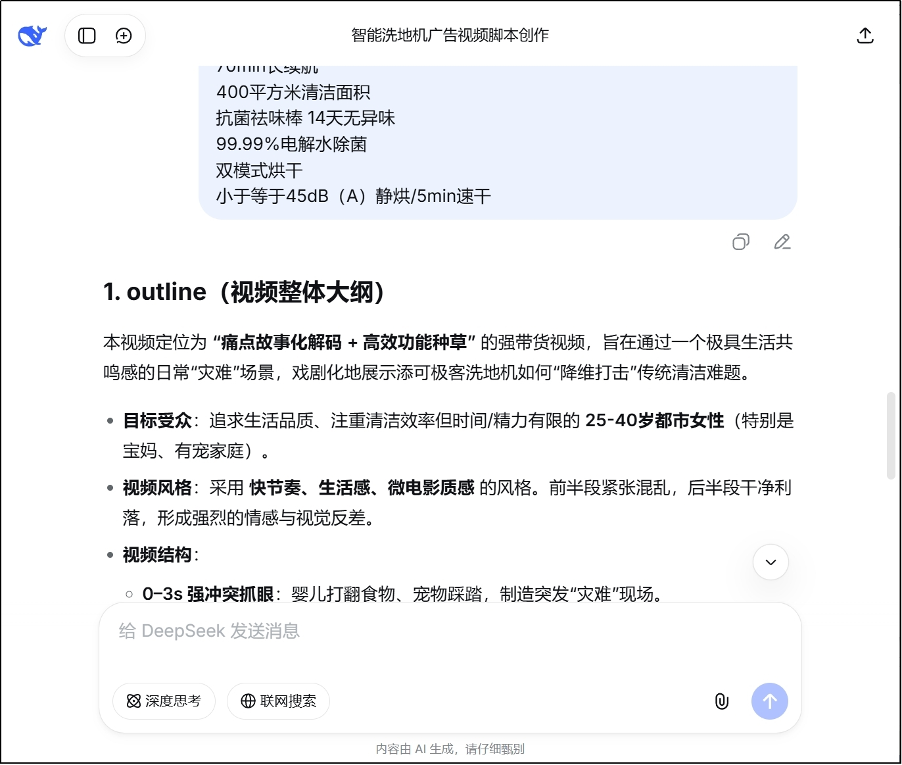

**The output is as follows**

````text
**1. outline（视频整体大纲）**

本视频定位为 **“痛点故事化解码 + 高效功能种草”** 的强带货视频，旨在通过一个极具生活共鸣感的日常“灾难”场景，戏剧化地展示添可极客洗地机如何“降维打击”传统清洁难题。

*  **目标受众**：追求生活品质、注重清洁效率但时间/精力有限的 **25-40岁都市女性**（特别是宝妈、有宠家庭）。

*  **视频风格**：采用 **快节奏、生活感、微电影质感** 的风格。前半段紧张混乱，后半段干净利落，形成强烈的情感与视觉反差。

*  **视频结构**：

  *  **0–3s 强冲突抓眼**：婴儿打翻食物、宠物踩踏，制造突发“灾难”现场。

  *  **3–5s 强化痛点**：传统拖把清洁无力，越拖越脏，女主疲惫绝望。

  *  **5–15s 产品登场与故事化解码**：添可洗地机如“救星”般登场，通过连贯动作展示“AI全向助力”（轻盈感）、“高温活水+大吸力”（瞬间洁净）、“防毛发缠绕”（解决宠物毛发）、“一键自清洁”（解放双手）等核心卖点。

  *  **15–20s 情绪升华与CTA**：画面恢复洁净明亮，女主从容优雅，烘托出“科技让生活回归美好”的主题，强引导点击购买。

*  **故事走向**：从“混乱绝望”到“从容掌控”的情绪转折，产品是推动剧情、解决矛盾的核心“英雄”。

*  **氛围与视觉基调**：开场采用手持晃动、低角度特写，色调偏冷、混乱；产品介入后，镜头运动变得平稳流畅，大量特写与跟随镜头展示产品工作细节，色调转为明亮、温暖，突出洁净与科技的舒适感。

**2. contents（分镜脚本和旁白数组）**
```json
[
 {
  "content": {
   "script": "【镜头1】\n【画面描述】（特写）一杯酸奶被打翻，倾泻在浅色木地板上。一只小狗的爪子欢快地踩过，留下沾满酸奶的爪印和脱落的毛发。\n【旁白/字幕】当生活给你一记暴击…\n【拍摄手法】（手持跟随拍摄，轻微晃动，模拟混乱第一视角）\n【时长】2 秒\n【情绪/节奏】突发、紧张、抓心",
   "aside": "当生活给你一记暴击…"
  }
 },
 {
  "content": {
   "script": "【镜头2】\n【画面描述】（中景）女主人（目标用户）惊慌地“啊”了一声，蹲下用传统拖把擦拭。结果酸奶被抹开，混合毛发，留下一片更脏的污渍。她疲惫地扶额，表情绝望。\n【旁白/字幕】传统清洁？越忙越乱。\n【拍摄手法】（快速切镜，俯拍拖把制造混乱的画面）\n【时长】2 秒\n【情绪/节奏】挫败、共鸣、痛点被戳中",
   "aside": "传统清洁？越忙越乱。"
  }
 },
 {
  "content": {
   "script": "【镜头3】\n【画面描述】（特写转跟拍）画面一转，添可极客洗地机被轻松单手推出，LED屏亮起。机器向前时，女主手部几乎不用力，轻松转向绕过桌角。\n【旁白/字幕】但你有添可极客。AI全向助力，轻如3.9kg。\n【拍摄手法】（产品特写开场，镜头跟随产品运动，强调其灵活轻盈）\n【时长】3 秒\n【情绪/节奏】转折、期待、科技感介入",
   "aside": "但你有添可极客。AI全向助力，轻如3.9kg。"
  }
 },
 {
  "content": {
   "script": "【镜头4】\n【画面描述】（超高速特写+微观视角）滚刷以极高转速接触污渍，酸奶和毛发瞬间被吸入。配合“滋滋”清洁音效。镜头微观展示滚刷高温活水冲洗、毛发被吸入而未缠绕的瞬间。\n【旁白/字幕】22000Pa龙卷吸力，搭配高温活水，净顽渍，毛发0缠绕。\n【拍摄手法】（高速摄影/特技镜头，微观视角展示清洁力，画面干净利落）\n【时长】4 秒\n【情绪/节奏】爽快、解压、核心卖点高光展示",
   "aside": "22000Pa龙卷吸力，搭配高温活水，净顽渍，毛发0缠绕。"
  }
 },
 {
  "content": {
   "script": "【镜头5】\n【画面描述】（中景）女主将洗地机放回基站，按下按钮。镜头特写：滚刷在基站内自动清洁、高速旋转并开始烘干。女主只是轻松地走开。\n【旁白/字幕】一键自清洁，5分钟速干，14天都无异味。\n【拍摄手法】（平滑转场，基站工作灯光效，展示自动化）\n【时长】3 秒\n【情绪/节奏】省心、解放、科技带来便利",
   "aside": "一键自清洁，5分钟速干，14天都无异味。"
  }
 },
 {
  "content": {
   "script": "【镜头6】\n【画面描述】（全景，升格慢镜头）地板光洁如新，反射着温暖灯光。女主光脚踩过，抱起宠物，笑容舒展。添可洗地机静静立在角落，LED屏显示电量充足。\n【旁白/字幕】70分钟长续航，搞定全家清洁。\n【拍摄手法】（慢动作，光线明亮柔和，对比开场）\n【时长】3 秒\n【情绪/节奏】治愈、美好、生活品质感",
   "aside": "70分钟长续航，搞定全家清洁。"
  }
 },
 {
  "content": {
   "script": "【镜头7】\n【画面描述】（产品特写+标语）添可极客洗地机产品定格画面，旁边打出核心标语：“净顽渍，安静洗，AI全向助力”。屏幕下方出现产品购买链接与“镇店爆款”标签。\n【旁白/字幕】添可极客智能洗地机，让清洁，不再是难题。\n【拍摄手法】（产品360度缓慢旋转展示，光效突出质感）\n【时长】3 秒\n【情绪/节奏】自信、果断、强号召",
   "aside": "添可极客智能洗地机，让清洁，不再是难题。"
  }
 }
]
```
````

The value of this case lies not in "generating a floor scrubber script," but in how well it demonstrates how the six elements work together:

- Role controls the professional perspective
- Task controls the goal
- Input data carries product information
- Output format specifies the structure
- Constraints control quality and boundaries

### 2.3 Zero-shot and Few-shot

#### 2.3.1 Zero-shot

Zero-shot refers to: **giving the model a task directly without providing any examples.**

It is suitable for: tasks that are very common, have clear target boundaries, and for which the model already possesses the relevant capabilities.

Example 1:

```text
翻译这句话：'The cat is on the roof.'
```

> The cat is on the roof.

Example 2:

```text
将文本分类为中性、负面或正面。

Text: 我认为这个假期还不错
```

> Neutral

The advantages of Zero-shot are simplicity, speed, and low cost, but when task boundaries are relatively vague, its stability is often not as good as Few-shot.

#### 2.3.2 Few-shot

Few-shot refers to: **first giving the model several examples, and then letting it complete new tasks according to those examples.**

It is especially suitable for: classification, extraction, rewriting, style imitation, and structured output.

That is, those tasks where "explanation alone is not enough, and it is best to directly show the model what counts as correct."

Common format:

```text
Q: <问题>?
A: <答案>

Q: <问题>?
A: <答案>

Q: <问题>?
A: <答案>

Q: <问题>?
A:
```

Example 1:

```text
用一句话描述大象的例子是：
大型食草哺乳动物，性格温和，群居生活，分布于亚洲和非洲。

用一句话描述老虎的例子是：
```

> The tiger is a large feline carnivore with powerful hunting abilities, distributed across Asia.

Example 2:

```text
以下是一段示例文本，请你学习它的语气和排版。

示例文本：
别害怕慢，怕的是停。
就算今天走得再慢，
也比昨天原地踏步要好。

请模仿以上风格，写一段关于"坚持学习AI提示词"的短文案，字数在80-100字。
```

> Don't worry about starting late; what's scary is never starting at all.
>
> Even if you only understand one more instruction today,
>
> you're still better off than knowing nothing about AI yesterday.
>
> Every refinement of your prompts is practice for conversing with the future.
>
> Keep polishing your prompts, and time will turn them into the sharpest key to thinking in your hands.

Example 3:

Without prompting:

```text
圣诞节圣诞老人会给我带礼物吗？
```

Answer:

> Santa Claus is a fictional character that children believe in. Through stories about riding a sleigh on Christmas Eve, reindeer, and gift-giving, he brings magic and excitement to Christmas. Many parents encourage this belief because it adds a layer of fun and wonder for children.

With prompting:

```text
问：牙仙是真的吗？
答：当然！今晚把你的牙齿放在枕头下。牙仙可能会来拜访并留下些小礼物。

问：圣诞节圣诞老人会给我带礼物吗？
答：
```

Answer:

> Yes, of course! Santa Claus loves to bring gifts to children who believe in him and behave well all year round. As long as you behave extra well and leave some cookies, you might wake up on Christmas morning to find gifts under the Christmas tree!

This example is very suitable for understanding the essence of Few-shot:
**Examples are not "explaining the task again," but directly demonstrating the target style to the model.**

### 2.4 Structured Organization Methods

#### 2.4.1 Why Structure Prompts

When tasks evolve from single-turn questions to multi-turn conversations, complex inputs, workflows, or agents, Prompts are no longer suitable to be written as "one big block of text."

There are three main reasons for structured organization:

**(1) Models do not have true persistent memory**

A model does not automatically and permanently remember content just because it was discussed in a previous round.
If you want to retain context, you still need to feed the historical content back into the model.

**(2) Fixed content and variable content should be separated**

If you rewrite the entire prompt from scratch every time, it not only wastes tokens but also makes maintenance difficult.

**(3) Project development requires reusability**

In real projects, system roles, global rules, user input, conversation history, and tool results usually come from different modules, which naturally makes them more suitable for structured organization.

First, remember this judgment:

> **Structured Prompt = separating unchanging rules from changing inputs.**

#### 2.4.2 How to Structure Prompts

In chat models, the most common basic message types usually fall into three categories:

- **System**: The system prompt, responsible for global identity, rules, style, and long-term constraints
- **User**: The user message, responsible for the current task input
- **Assistant**: The assistant message, responsible for carrying historical responses

Many official website chat products do not fully expose the underlying message structure to you, but in APIs, LangChain, Coze, Dify, and agent platforms, this approach is very common.

For now, it is enough to establish the awareness that "**stable rules and dynamic inputs should be separated**." In [Chapter 13: Prompts and Message Templates](13-%E6%8F%90%E7%A4%BA%E8%AF%8D%E4%B8%8E%E6%B6%88%E6%81%AF%E6%A8%A1%E6%9D%BF.md), you will continue to see its concrete implementation in LangChain: `SystemMessage`, `HumanMessage`, `AIMessage`, `PromptTemplate`, `ChatPromptTemplate`, `MessagesPlaceholder`.

#### 2.4.3 The Unified Relationship Between Prompt Elements, Templates, and Message Structures

Three sets of concepts have already appeared above:

- **The Six Prompt Elements**: role, task, background/context, input data, output format, quality and constraints.
- **Prompt Templates**: abstracting recurring information items into replaceable variables.
- **Message Structures**: placing different types of information into System, User, Assistant, and other messages.

They are not three competing methods, but three levels of the same thing:

| Level | Problem Solved | Typical Question |
| ---------- | ------------------------------ | ------------------------------------------ |
| Prompt Elements | What information should be told to the model | Who is the role? What is the task? What does the output look like? |
| Prompt Template | How to organize this information into a reusable structure | Which parts are fixed? Which parts are replaced at runtime? |
| Message Structure | Which type of message to place it in at runtime | Which go into System? Which go into User? How is history appended? |

Their relationship can be compressed into one sentence:

> **The six elements answer "what to write," templates answer "how to reuse," and message structures answer "how to assemble at runtime."**

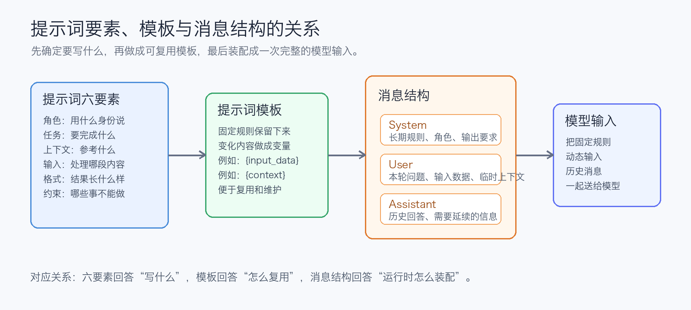

In engineering, the following type of separation is usually formed. First look at the basic structure, and later when discussing RAG and Agent, retrieved materials and tool results will continue to be incorporated.

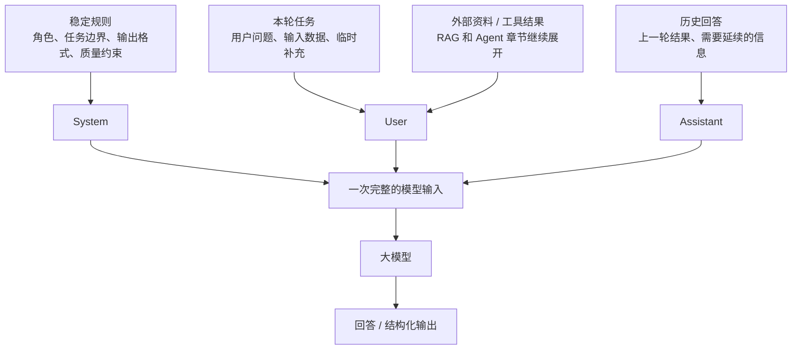

```text
System:
- 角色
- 长期任务边界
- 稳定背景
- 输出格式
- 质量与约束

User:
- 本轮用户问题
- 本轮输入数据
- 本轮临时补充资料

Assistant:
- 历史回答
- 需要被后续轮次继续参考的中间结果
```

If further written as a template, it becomes:

```text
System Template:
你是一名 {persona}。
你的长期任务是 {task}。
你需要遵守以下输出要求：{output_requirements}。
你需要遵守以下质量与约束：{constraints}。

User Template:
本轮输入如下：
{input_data}

补充上下文如下：
{dynamic_context}
```

This separation is very important for the subsequent chapters:

- In **RAG**, `dynamic_context` will often be filled with knowledge base snippets retrieved from the retrieval process.
- In **workflows**, different steps will each maintain different templates and input variables.
- In **Agents**, tool returns, historical actions, and observations will be continuously appended to the message context.
- In **LangChain**, these concepts will be implemented in objects such as `PromptTemplate`, `ChatPromptTemplate`, `MessagesPlaceholder`.

Therefore, do not understand Prompt only as "a passage written to the model." In real projects, a Prompt is more like a set of **input assembly rules**: which information is fixed, which information is dynamic, which information comes from the knowledge base, which information comes from tools, and how they are ultimately sent to the model together.

#### 2.4.4 Hands-On Practice

To more intuitively demonstrate the separation of "fixed rules" and "dynamic inputs," the previous Tineco floor scrubber case is continued.

Note: Many official website chat products do not directly expose a "System Prompt" editing interface to users, so a local AI client is used here for demonstration.

**(1) Static prompt**

````
# 角色**
你现在是一名 **专业商业广告导演、品牌策划师、脚本创意总监**，擅长为 TikTok、抖音、小红书、电商平台制作高转化产品视频。

# 任务**
你的任务：**根据产品信息创作一支约 20 秒的故事短片级商品介绍视频脚本**，并严格按以下 3 个部分输出。

**# 输出**
**格式要求【必须输出以下 2 部分】**
**1. outline（视频整体大纲）**
以自然段文本形式输出，需包含：
* 视频定位（带货、种草、功能展示等）
* 目标受众画像（性别、年龄、需求）
* 视频风格（科技感、生活感、快节奏等）
* 视频结构（例如：0–3s 抓眼、3–5s 痛点、5–15s 卖点故事化、15–20s 情绪收束 + CTA）
* 故事走向与主题表达
* 氛围与视觉基调建议
**要求**：浓缩完整故事脉络 + 产品价值呈现方式，字数约 150–300 字。

**2. contents（分镜脚本和旁白数组）**
输出为 **数组，每个元素为一个镜头的JSON字符串，名为content**。
content包含两个字段：**script**和**aside**

**2.1 script（分镜脚本）**
输出为 **一个镜头的字符串**。
每个镜头 **时长 0.5–5 秒**，全片总时长约 20 秒。
每个镜头字符串需包含：
```
【镜头编号】
【画面描述】（景别/构图/人物动作/产品动作）
【旁白/字幕】
【拍摄手法】（特写/推镜/俯拍/转场/光效等）
【时长】X 秒
【情绪/节奏】
```
**要求：**
* 开头前 3–5 秒必须强抓注意
* 故事化、画面执行明确、镜头语言专业
* 卖点通过情节自然呈现，而不是堆砌参数
* 节奏符合短视频平台呈现方式
* 镜头数量可 3-5 个（依内容需要）

**2.2 aside（旁白）**
* 输出为字符串，是该镜头的旁白文本
* 若镜头无旁白，则使用 `"无旁白"`

**# 约束**
**写作风格要求**
* 专业但易懂
* 画面感强，镜头语言表达清晰
* 情绪节奏鲜明、卖点突出、推动购买
* 每个镜头方案可真实落地拍摄
* 全片故事流畅、有戏剧张力
* 充分“抓眼”与“爽点”设计
````

**(2) Dynamic prompt**

```text
*# 输入**
产品信息如下

【1. 产品名称】
添可极客智能洗地机

【2. 参数信息】
转速：92000 转/分钟
续航时间：70 min
清水箱容量：1000 ml
品牌：TINECO/添可
型号：FW52010ECN
电压：220V
是否智能：否
电器基站功能：滚刷烘干
适用地面材质：木地板、瓷砖、大理石
附加功能：高温全链速干、除菌、延边清扫、防毛发缠绕、拖布自清洁
最大吸入功率：75 AW
污水箱容量：690 毫升
清水箱容量：1000 ml
质保周期：2 年
颜色分类：【AI全向助力】添可极客

【3. 产品特点】
智能洗地机 芙万 Fold X90
90°小折叠，女神好帮手
3.9kg超轻量，自动上热水
镇店爆款：添可极客
全网都在夸的洗地机
买过的人都说好
净顽渍 安静洗 14天无异味
AI全向助力 22000Pa大吸力
恒压活水高效洗
一键Turbo祛顽渍
安静模式免打扰
22000Pa龙卷吸
AI全向助力
毛发0缠0逃逸
70min长续航
400平方米清洁面积
抗菌祛味棒 14天无异味
99.99%电解水除菌
双模式烘干
小于等于45dB（A）静烘/5min速干
```

**(3) Cherry Studio test**

① System prompt configuration

The static prompt serves as the system prompt.

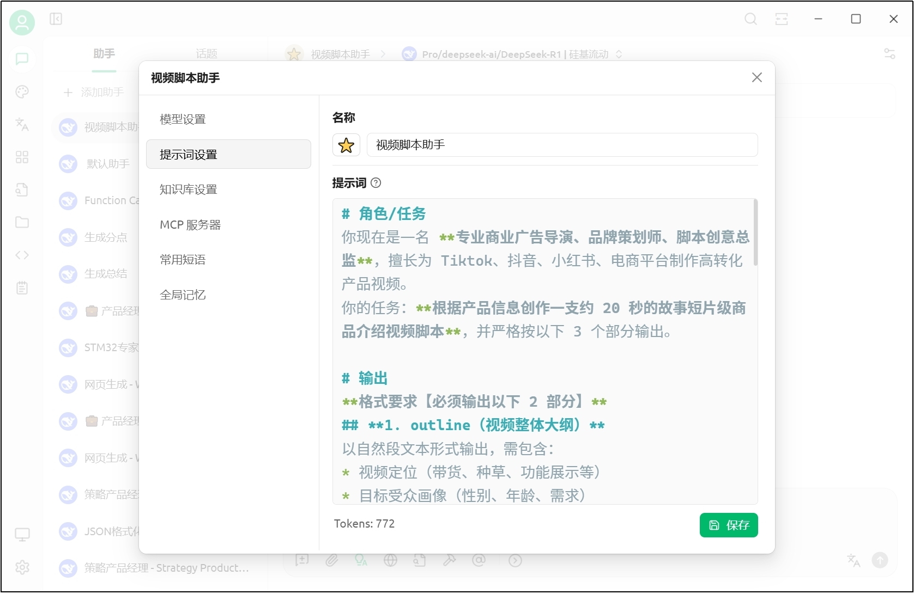

② User prompt

The dynamic prompt serves as the user prompt; simply type it directly into the chat box.

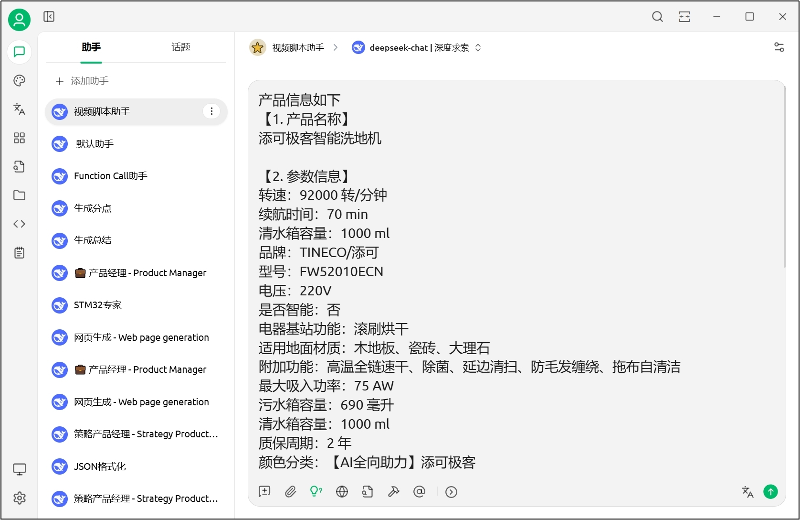

③ The output is as follows

````text
好的，收到。作为专业商业广告导演，我将为您打造一支兼具科技感与生活温度的高转化短视频脚本。
**1. outline（视频整体大纲）**
本视频定位为 **“功能展示 + 痛点解决型种草”**，旨在通过一个极具代入感的家庭清洁场景，戏剧化地展示添可极客洗地机如何“优雅”地解决传统清洁的“狼狈”痛点。目标受众为 **25-45岁、追求生活品质、注重效率与颜值的都市女性（兼顾家庭决策者）**。视频风格为 **“快节奏生活感 + 科技美学”**，前半段展现传统清洁的混乱与疲惫，后半段通过产品介入，瞬间切换至高效、轻松、充满掌控感的愉悦状态。

视频结构采用经典“问题-解决-升华”模式：**0–3s** 用极具冲击力的“灾难现场”抓眼；**3–8s** 深化女主（目标用户）的无力与痛点；**8–15s** 产品登场，以“AI全向助力”、“高温热水”、“毛发不缠绕”、“静音烘干”等核心卖点串联成一个行云流水的清洁过程；**15–20s** 情绪收束于女主享受成果的惬意，并给出明确的购买引导（CTA）。

故事走向是从 **“混乱与压力”到“秩序与掌控”** 的转变，主题表达 **“科技让繁重家务变得轻松优雅”**。视觉基调建议：前半段使用稍显凌乱的构图、偏冷色调、手持晃动感；产品介入后，转为稳定流畅的运镜、明亮温暖的色调、产品特写充满科技质感的光效，形成鲜明对比。

**2. contents（分镜脚本和旁白数组）**
```json
[
 {
  "content": {
   "script": "【镜头1】\n【画面描述】（中景/略带俯拍）客厅地板上，打翻的咖啡渍、散落的宠物毛发、饼干碎屑混在一起，一片狼藉。一只穿着精致拖鞋的脚不小心踩上去，留下污渍脚印。\n【旁白/字幕】生活，总爱给你点“颜色”瞧瞧。\n【拍摄手法】（手持轻微晃动，模拟主观视角/快速推镜至污渍特写）\n【时长】3 秒\n【情绪/节奏】突发、混乱、烦躁、快节奏切入",
   "aside": "生活，总爱给你点“颜色”瞧瞧。"
  }
 },
 {
  "content": {
   "script": "【镜头2】\n【画面描述】（特写转中景）女主（目标用户形象）看着地面，疲惫地叹了口气，拿起传统拖把和水桶，弯腰费力地拖了几下，污渍扩散，毛发缠在拖布上，她表情更沮丧了。\n【旁白/字幕】而传统的清洁方式，只会让战场更混乱。\n【拍摄手法】（从女主面部特写沮丧表情拉出至中景，展示其与脏污“搏斗”的无力感）\n【时长】2.5 秒\n【情绪/节奏】无奈、疲惫、痛点共鸣",
   "aside": "而传统的清洁方式，只会让战场更混乱。"
  }
 },
 {
  "content": {
   "script": "【镜头3】\n【画面描述】（产品登场特写）添可极客洗地机被一只手优雅地“推”入画面，机身线条流畅，科技感十足。产品自动喷出热气（示意高温热水功能），滚刷高速旋转。\n【旁白/字幕】现在，让添可极客，来接管战场。\n【拍摄手法】（产品45度角特写，伴随“嗖”的音效和光效转场，强调登场感）\n【时长】2 秒\n【情绪/节奏】转折、期待、科技感拉满",
   "aside": "现在，让添可极客，来接管战场。"
  }
 },
 {
  "content": {
   "script": "【镜头4】\n【画面描述】（低角度跟拍+特写组合）洗地机在AI全向助力下，轻盈地90°转弯，紧贴墙边滑过（展示延边清扫）。滚刷所过之处，咖啡渍、毛发、碎屑被瞬间吸入，地面光洁如新。特意展示毛发被吸入滚刷仓但毫无缠绕。\n【旁白/字幕】AI全向助力，3.9kg超轻机身，像遛宠物一样轻松。22000Pa龙卷吸力，干湿顽渍，毛发，0缠0逃。\n【拍摄手法】（流畅的轨道跟拍+产品局部特写快切，配合“咻咻”的清洁音效）\n【时长】5 秒\n【情绪/节奏】顺畅、高效、爽感、核心卖点集中展示",
   "aside": "AI全向助力，3.9kg超轻机身，像遛宠物一样轻松。22000Pa龙卷吸力，干湿顽渍，毛发，0缠0逃。"
  }
 },
 {
  "content": {
   "script": "【镜头5】\n【画面描述】（中景）女主单手轻松握着洗地机，走过客厅、餐厅、厨房（暗示长续航和大清洁面积）。背景音安静，只有轻微的机器运行声。她甚至有空用另一只手接了个电话，表情从容。\n【旁白/字幕】70分钟长续航，安静模式，清洁不打扰生活。\n【拍摄手法】（稳定器跟拍女主移动，背景虚化，焦点在女主从容的表情和产品上）\n【时长】3 秒\n【情绪/节奏】轻松、优雅、掌控感",
   "aside": "70分钟长续航，安静模式，清洁不打扰生活。"
  }
 },
 {
  "content": {
   "script": "【镜头6】\n【画面描述】（特写转场）洗地机放回基站，一键启动自清洁。镜头特写：滚刷在基站内被高温热水强力冲洗并开始高速旋转烘干（展示双模式烘干）。字幕弹出：“高温活水洗 | 5分钟速干 | 14天无异味”。\n【旁白/字幕】放回基站，一键自清洁。高温活水洗得净，双模式烘得干，14天都清新。\n【拍摄手法】（高速摄影展示水花与滚刷旋转，烘干时蒸汽特效，科技感字幕弹出）\n【时长】3 秒\n【情绪/节奏】省心、彻底、科技解决最后一步",
   "aside": "放回基站，一键自清洁。高温活水洗得净，双模式烘得干，14天都清新。"
  }
 },
 {
  "content": {
   "script": "【镜头7】\n【画面描述】（全景/升格慢镜头）整个房间干净明亮，光影柔和。女主光脚踩在光洁的地板上，抱着靠枕舒服地窝在沙发里，看着干净的家，露出满意而放松的微笑。产品静静立在角落，像一位可靠的伙伴。\n【旁白/字幕】把麻烦交给科技，把时间留给自己。添可极客，全网都在夸的清洁实力派。\n【拍摄手法】（全景慢镜头，温暖逆光，情绪音乐起）\n【时长】2.5 秒\n【情绪/节奏】满足、愉悦、升华、强号召力",
   "aside": "把麻烦交给科技，把时间留给自己。添可极客，全网都在夸的清洁实力派。"
  }
 }
]
```
````

**4. Summary**

Structured prompting = Put stable constraints in **System**, put the current task and data in **User**, and use **Assistant** to carry historical results when necessary.
The value of doing this is to reduce repetition, reduce token waste, and improve system consistency and maintainability.

---

## 3. The Boundaries of Prompt Engineering

Prompt engineering is important, but it is not a universal solution.
When the core issue is no longer "how to ask" but rather "the model lacks knowledge, lacks process, or lacks behavioral stability," other modules need to cooperate.

### 3.1 Too much reference material

If a task must reference a large amount of material, and that material is already close to or exceeds the model's context window, prompting alone will struggle to solve the problem.

At this point, the problem is not that "the prompt is not polished enough," but that "there is too much material for the model to consume."

`解决办法`: Do material filtering and summarization, or go straight to RAG.

### 3.2 Multi-step complex workflows

When a task contains multiple reasoning steps, the model is prone to skipping steps, missing steps, or confusing the order in a single generation.

For example:

- First classify, then extract, then summarize
- First look up materials, then write conclusions, then generate a table
- First analyze risks, then give recommendations, then output a fixed structure

`解决办法`: Break a large task into multiple smaller prompts, or organize it with a workflow.

### 3.3 Insufficient instruction-following capability

If the model itself has insufficient capability in following format, structure, and complex instructions, no matter how much the prompt is revised, there will be a ceiling.

One very illuminating research finding is that many models are more sensitive to information at the beginning and end of a prompt, and more likely to "lose attention" to the middle portion. Therefore, key constraints should be placed in prominent positions.

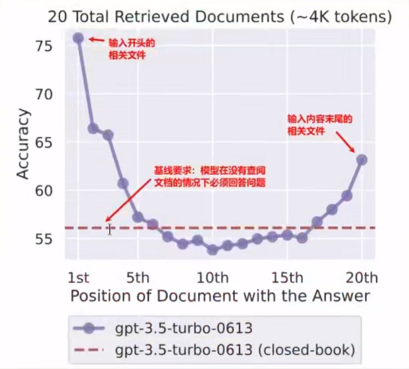

> Most models perform better when the task description is placed at the beginning; some models are also more sensitive to key instructions at the end. In any case, the core conclusion conveyed by this figure is the same: **Do not bury the most important requirements in the middle.**

`解决办法`: First put key constraints at the front; if it is still unstable, consider a more suitable model, a structured output approach, or even fine-tuning.

### 3.4 Missing domain knowledge

In vertical domains, the model may not have the relevant knowledge at all, or may not be familiar enough with the language distribution of that domain.

In this case, no matter how clear the prompt is, it cannot conjure up the missing knowledge out of thin air.

`解决办法`: Prioritize adding context or a knowledge base; only when going further should you consider fine-tuning or continued pre-training.

---

## 4. Several Points to Note in Prompt Engineering

### 4.1 Do not treat politeness as the core of optimization

Many people writing a prompt for the first time treat "please, thank you, would you mind" as key optimization points.
In reality, politeness itself usually does not significantly improve model performance. What affects the result is **whether the task is clear, whether the boundaries are explicit, and whether the output can be verified.**

```text
礼貌式提示词：请帮我写一篇关于人工智能的文章，谢谢！

命令式提示词：写一篇关于人工智能的文章
```

More precisely, it is not that "you must never be polite," but rather: **politeness is not the main optimization lever; clarity is.**

### 4.2 Do not mix multiple tasks together

If too many objectives are crammed into a single prompt, the model can easily attend to one and lose the other.

For example, simultaneously requiring it to: first summarize, then classify, then evaluate, and then output as complex JSON.
In such cases, performance often drops noticeably.

`建议`: Break complex tasks apart when possible, or chain them together with a workflow. You will feel this even more clearly later when working with multi-agents and LangGraph. This will be covered in later chapters.

### 4.3 Allow the LLM to say "I don't know"

If you always require the model to "answer no matter what," it is more likely to fabricate.

Therefore, in high-risk, information-insufficient, or fact-requiring scenarios, it is best to explicitly allow the model to admit uncertainty.

```text
作为我们的并购顾问，分析这份关于 ExampleCorp 可能收购 AcmeCo 的报告。

<report>
{{REPORT}}
</report>

重点关注财务预测、整合风险和监管障碍。如果您对任何方面不确定，或者报告缺少必要信息，请说"我没有足够的信息来自信地评估这一点。"
```

This kind of constraint is very helpful in reducing hallucinations.

### 4.4 The trap of over-optimization

Some people spend a great deal of time nitpicking wording back and forth, but the changes yield only marginal improvement, or even no stable benefit at all. Even more troublesome, without a fixed set of test cases, you cannot even know whether a change genuinely made things better or just happened to hit a favorable output by chance.

What is usually more worth optimizing first includes:

- Whether the structure is clear
- Whether the task is explicit
- Whether the input is separated
- Whether examples are missing
- Whether the output format is reasonable

Rather than repeatedly agonizing over "should I write 'please help me' or 'would you please help me' here."

`建议`: For any somewhat important prompt, keep at least 5 to 10 real examples. Every time you change the prompt, retest with the same batch of examples and compare format accuracy, factual errors, missing fields, and human evaluation scores. This turns prompt tuning from "changing words by feel" into "iterating with evidence."

When actually changing a prompt, it is recommended to test repeatedly against the same batch of examples:

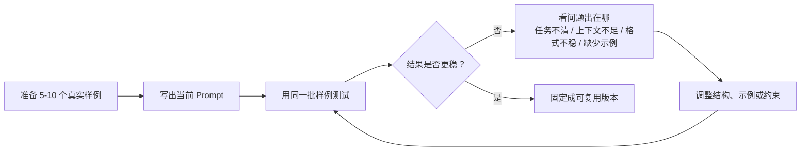

### 4.5 Self-contradictory instructions

If you require "concise" on one hand while also requiring "detailed and comprehensive" on the other, the model will fall into conflict.

For example:

```text
写一段简洁的详细介绍
```

Instructions like these are often inherently inconsistent.

`建议`: If multiple goals must be accommodated, make the priorities explicit.

### 4.6 Do not be superstitious about "magic words"

There are often so-called "magic words" circulating online, for example:

- `Let's think step by step`
- `Take a deep breath and think this through`
- `My career depends on it`

These phrasings may help with certain models, certain tasks, and in certain periods, but they are by no means stable, universal, transferable master keys.

A more reliable approach is to:

- Break the task down clearly
- Provide sufficient examples
- Make the output format explicit
- Allow refusal when uncertain

In the final analysis:

> **Do not be superstitious about a single "spell"; pay attention to complete task design.**

**Thought:** If the underlying large language model is changed, does the Prompt need to be re-tuned?

> **Answer:** Yes. Different models differ in instruction-following habits, output tendencies, tool-calling styles, and context utilization capabilities. A Prompt that performs well on one model often needs to be re-validated and adjusted after switching models.

**Insight:** Prompt tuning is still essentially an experimental endeavor.
It involves both methodology and trial and error. But effective trial and error is not aimlessly swapping words back and forth; it is iterating based on structure, objectives, and evaluation.

---

**Chapter reflection questions:**

1. Choose a task you will actually use recently, and turn it from a vague one-line request into a Prompt with clearly defined "role, task, input, output format, and constraints."

   **Reference approach:** Do not just swap in prettier wording; fill in the task boundaries. For example, "help me summarize the meeting" can become: You are a project assistant; the input is the meeting notes; the output includes conclusions, action items, owners, and risks; any uncertain information should be marked "not mentioned." This makes it easier to reuse and evaluate.

2. When a Prompt produces unstable results, what would you adjust first rather than immediately adding more constraints?

   **Reference approach:** First check whether the task is singular, whether the input is complete, whether the output format is executable, whether examples are missing, and whether the constraints conflict. Piling on more and more restrictions does not necessarily make things more stable; often the problem lies in an unclear main task or examples that are not representative enough.

3. How should Few-shot examples be selected so that they do not mislead the model?

   **Reference approach:** Examples should cover real edge cases, not just one beautiful sample. Ideally include common inputs, boundary inputs, inputs that are easy to misjudge, and their corresponding correct outputs. The format of the examples must be completely consistent with the final expected output, otherwise the model will learn the wrong pattern.

4. If System, User, and Assistant messages are written in a jumbled way, what problems will it cause for later maintenance?

   **Reference approach:** Once rules, the current task, and historical outputs are mixed together, it becomes hard to tell which instructions apply long-term and which apply only to the current turn. In engineering practice, stable rules should go in System, dynamic input in User, and history that must be retained should be carried through Assistant / message history.

**Chapter summary:**

- **Prompt** is the input content you send to the model; **prompt engineering** is the systematic design, organization, and optimization of input to steadily produce high-quality results.
- The **six elements** are: role, task, background/context, input data, output format, and quality and constraints. You do not need to fill in all of them every time, but they help you systematically check whether a Prompt is complete.
- The difference between **Zero-shot / Few-shot** is essentially whether you give no example or provide a demonstration first; when the task boundary is hard to explain clearly in a few words, Few-shot is often more stable.
- **Structured organization** is a key step from "casually writing one sentence" to "a maintainable system." System holds stable rules, User holds dynamic input, and Assistant carries historical results.
- **Prompt engineering has boundaries**: when there is too much material, the workflow is too complex, the model's instruction-following ability is insufficient, or domain knowledge is missing, prompting alone is not enough, and it usually needs to be combined with RAG, workflows, fine-tuning, or agents.

**Suggested next step:** If you continue along the main thread of this book, it is recommended to first read [1-3 Choosing Among RAG, Fine-tuning, Continued Pre-training, and Agents](1-3-RAG%E3%80%81%E5%BE%AE%E8%B0%83%E3%80%81%E7%BB%AD%E8%AE%AD%E4%B8%8E%E6%99%BA%E8%83%BD%E4%BD%93%E9%80%89%E5%9E%8B.md) to fully sort out the boundary of "when is prompting enough, and when should it be handed off to RAG, fine-tuning, or agents"; if you want to immediately get into the code-side engineering organization of prompts, you can continue with [Chapter 13 Prompts and Message Templates](13-%E6%8F%90%E7%A4%BA%E8%AF%8D%E4%B8%8E%E6%B6%88%E6%81%AF%E6%A8%A1%E6%9D%BF.md).
