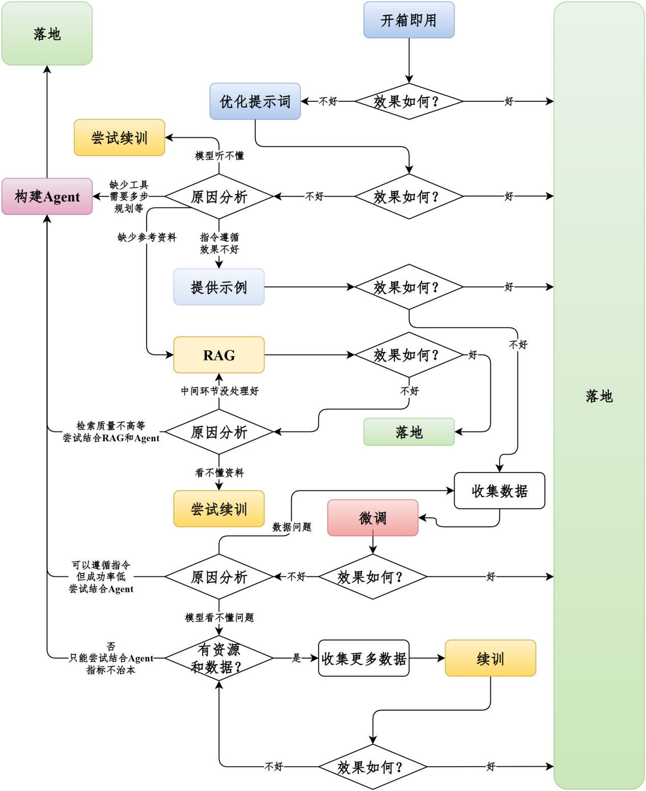
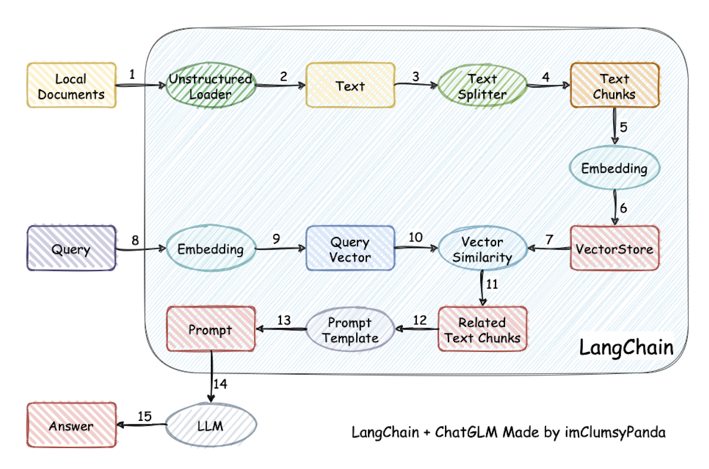
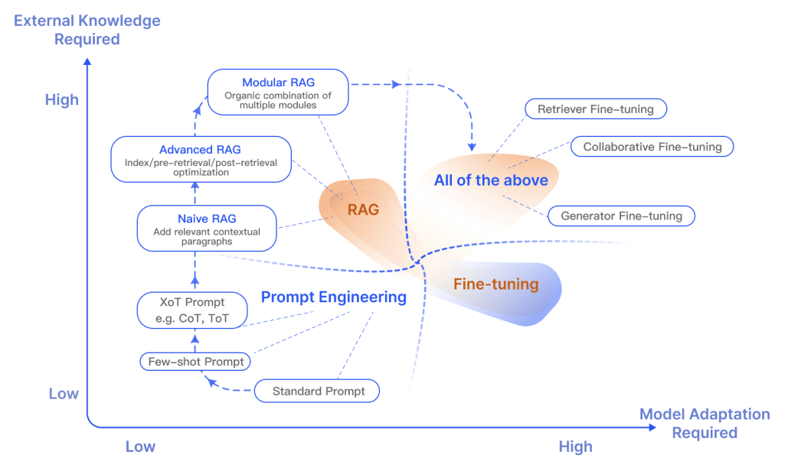
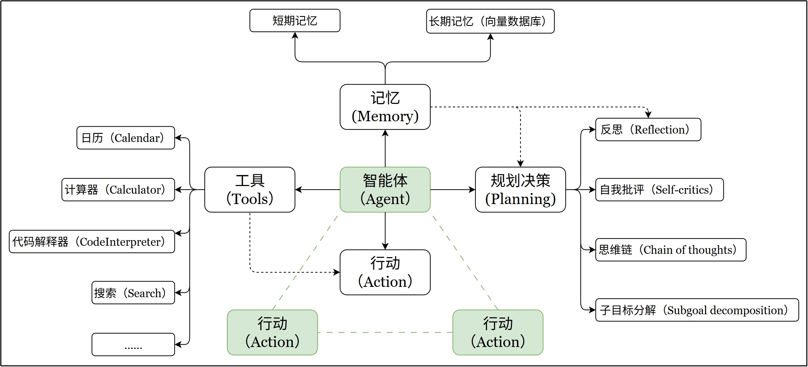
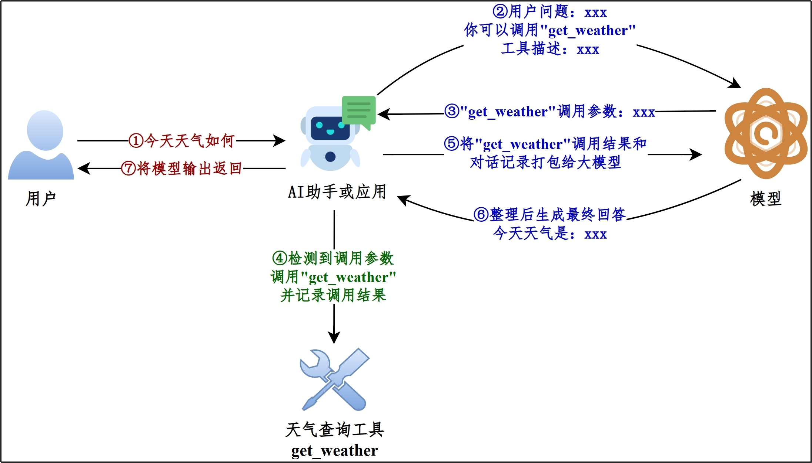
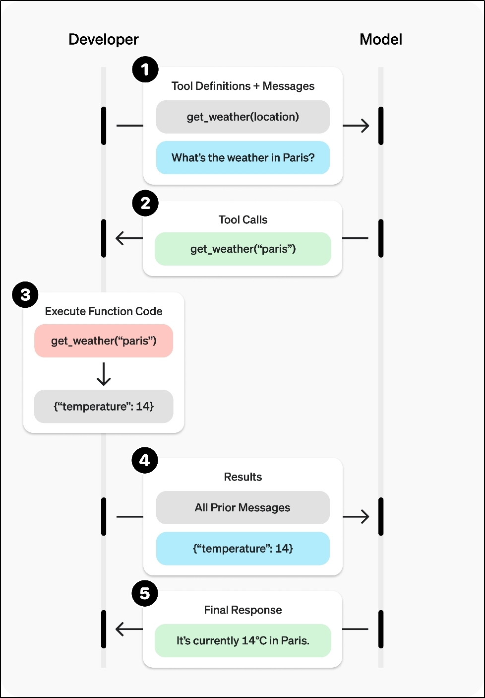
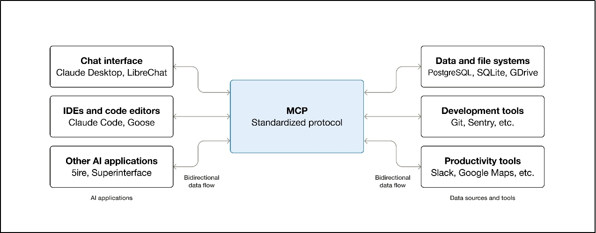
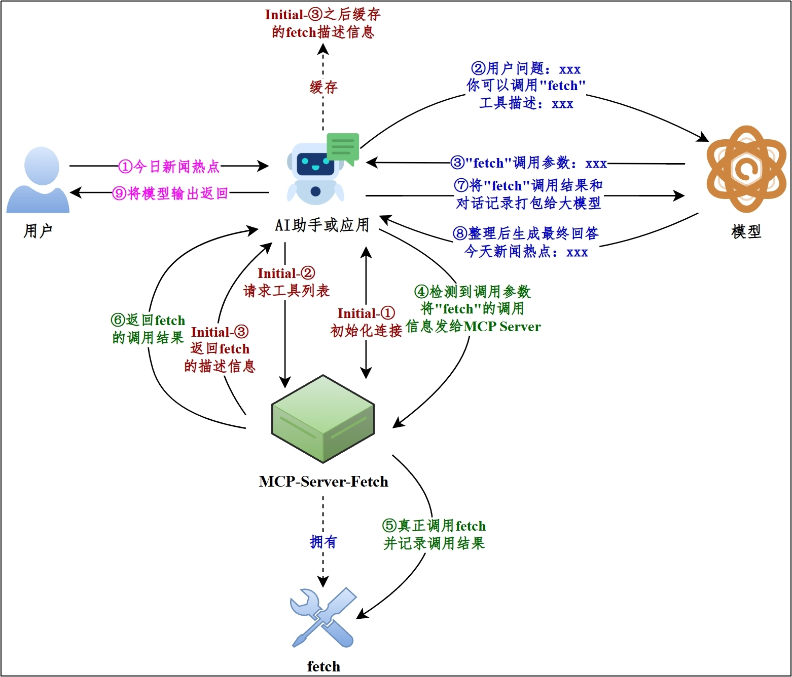
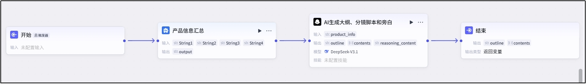

# 1-3 RAG, Fine-tuning, Continued Pre-training, and Agent Selection

When prompt engineering alone cannot meet the requirements, you need to start considering more advanced engineering approaches. This article covers the latter four of the five major modules: **RAG, fine-tuning, continued pre-training, and agent development**. On the surface, they all "enhance model capabilities," but the actual problems they solve are different.

---

**Chapter learning objectives:**

- Establish a clear selection map: know what problems **RAG, fine-tuning, continued pre-training, and agents** respectively solve.
- Understand that the core value of RAG is **adding knowledge**, the core value of fine-tuning is **changing behavior**, and the core value of continued pre-training is **supplementing domain distribution**.
- Understand that an agent is not a "stronger LLM," but a system of **LLM + tools + state + execution flow**.
- Be able to judge in real projects: when to continue optimizing prompts, when to use RAG, when to consider fine-tuning, and when to introduce workflows or agents.

**Study suggestion:** When studying this chapter, it is recommended to always evaluate solutions along three lines: **Is the knowledge sufficient? Is the behavior stable? Will the process change?** If what is missing is knowledge, look at RAG first; if what is missing is output style, format, or instruction following, look at fine-tuning first; if what is missing is deeper domain language capability, only then consider continued pre-training; if what is missing is multi-step decision-making, external tool calling, and execution capability, then look at agents. This way, you will not mix up these approaches.

**Official documentation and resources**: See [Tool Navigation and Reference Material Index - Fine-tuning and Model Alignment](%E5%B7%A5%E5%85%B7%E5%AF%BC%E8%88%AA%E4%B8%8E%E5%8F%82%E8%80%83%E8%B5%84%E6%96%99%E7%B4%A2%E5%BC%95.md#fine-tuning-and-model-alignment), [Tool Navigation and Reference Material Index - RAG and Vector Retrieval](%E5%B7%A5%E5%85%B7%E5%AF%BC%E8%88%AA%E4%B8%8E%E5%8F%82%E8%80%83%E8%B5%84%E6%96%99%E7%B4%A2%E5%BC%95.md#rag-and-vector-retrieval), [Tool Navigation and Reference Material Index - Tool Calling, MCP, and Agents](%E5%B7%A5%E5%85%B7%E5%AF%BC%E8%88%AA%E4%B8%8E%E5%8F%82%E8%80%83%E8%B5%84%E6%96%99%E7%B4%A2%E5%BC%95.md#工具调用、MCP与智能体).

---

## 1. Problem Diagnosis

In real projects, when an AI application answers poorly, the most common mistake is immediately saying "should we fine-tune" or "should we use an Agent" without first identifying the root cause of the problem.

It is much more stable to first ask four questions:

| Diagnostic question | Common symptoms | Priority consideration |
| ---------------------------------- | ---------------------------------------------------- | ----------------------- |
| Has the model not seen the material? | Does not know company policies, product manuals, or latest announcements; answers lack cited evidence | RAG |
| Is the model's behavior unstable? | Inconsistent formatting, inconsistent wording, unstable classification labels, frequent JSON errors | Prompt optimization; fine-tuning if necessary |
| Does the model not understand the language distribution of this domain? | Cannot understand even when given the material; professional terminology and industry logic are often wrong | Continued pre-training, usually combined with RAG |
| Does the task require multi-step execution? | Needs to look up materials, call APIs, verify, retry, and write to systems | Workflow or Agent |



1. **Prompt first**: If the problem is simply unclear requirement expression, first write the inputs, outputs, and constraints clearly.
2. **Then RAG**: If what is missing is material, evidence, latest information, or private knowledge, prioritize building a knowledge base.
3. **Then fine-tuning**: If behavior is unstable over the long term, and you have high-quality samples and evaluation standards, then consider fine-tuning.
4. **Use continued pre-training cautiously**: Only when the model is systematically unfamiliar with the domain language and knowledge distribution should you consider continued pre-training.
5. **Fixed process first, use workflow**: When steps are clear and stability and auditability are required, prioritize Workflow.
6. **Open process, then Agent**: When steps will change and there is a need to dynamically select tools and adjust the route based on intermediate results, then use an Agent.

The later approaches are not "less advanced"; they simply have higher costs, risks, and maintenance pressure. Do not prematurely introduce heavy solutions when a lighter solution can stably solve the problem.

## 2. RAG

### 2.1 What is RAG

**1) Definition**

RAG (Retrieval-Augmented Generation) is an application architecture that combines **information retrieval** with **LLM generation**.

The basic flow is not complicated:

1. The user first asks a question.
2. The system first retrieves relevant materials from an external knowledge base.
3. Then it sends the "question + retrieval results" together to the LLM.
4. The model generates an answer based on these materials.

The key point of RAG is not "modifying model parameters," but **supplementing the model with the context it currently needs at runtime**.

First, remember this shortest definition: **RAG = retrieve materials first, then answer the question.**

The difference from [1-2 Prompt Engineering Basics](1-2-%E6%8F%90%E7%A4%BA%E8%AF%8D%E5%B7%A5%E7%A8%8B%E5%9F%BA%E7%A1%80.md) is also important:

- **Prompt engineering** mainly relies on prompts you write in advance.
- **RAG** mainly relies on external materials retrieved by the system in real time when the question is asked.



### 2.2 Why RAG is often the first choice in projects

From an engineering perspective, the reason RAG often comes before fine-tuning and continued pre-training is not because it is "the most advanced," but because it **best matches the real causes of a large number of knowledge-based business problems**.

In real projects, there are usually three common types of reasons why an LLM answers poorly:

- **Outdated knowledge**: For example, the latest policies, product descriptions, or announcements.
- **Private knowledge**: For example, company policies, internal API documentation, project manuals, customer materials.
- **Insufficient evidence**: The model has general knowledge, but does not have the specific material you want it to reference, so it is prone to hallucination.

These three types of problems are essentially more like "the model did not see the material" rather than "the model cannot speak." At this point, what should usually be verified first is not training the model, but **whether the material can be fed correctly**. RAG is precisely the solution to this problem.

Its practical advantages mainly include:

- **Fast updates**: After the knowledge base is updated, the index can be rebuilt without retraining the model.
- **Low cost**: Compared with fine-tuning and continued pre-training, the implementation threshold and trial-and-error cost are usually lower.
- **Traceable**: Retrieval results can retain sources, page numbers, and file names for easy verification.
- **Closer to business systems**: Documents, databases, FAQs, API documentation, and so on can all become external knowledge sources.

In this repository, RAG is not an isolated concept, but the main capability thread running through many later chapters:

- [2-RAG-Building Enterprise Private & Personal Knowledge Bases](2-RAG-%E6%90%AD%E5%BB%BA%E4%BC%81%E4%B8%9A%E7%A7%81%E6%9C%89&%E4%B8%AA%E4%BA%BA%E7%9F%A5%E8%AF%86%E5%BA%93.md) will guide you in building a knowledge base from a platform perspective.
- [19-RAG Retrieval-Augmented Generation](19-RAG%E6%A3%80%E7%B4%A2%E5%A2%9E%E5%BC%BA%E7%94%9F%E6%88%90.md) will guide you through the technical chain of RAG from the LangChain code perspective.
- In the `电商问数` project, the system does not "directly hand the question to the model," but first performs multi-route retrieval through a metadata knowledge base composed of **MySQL + Qdrant + Elasticsearch**, and then generates SQL. This is a RAG-oriented approach for structured data Q&A scenarios.

### 2.3 RAG Workflow

Although RAG is often summarized in one sentence as "retrieve first, then generate," in engineering it is usually divided into two stages:

**Stage 1: Knowledge base construction (offline)**

- Read raw documents
- Perform cleaning and chunking
- Use an embedding model to convert text chunks into vectors
- Write text chunks, vectors, and metadata into a vector database

**Stage 2: Retrieval and generation (online)**

- The user asks a question
- Vectorize the question
- Recall relevant segments from the knowledge base
- Assemble the segments and the question into the prompt
- Hand them to the LLM to generate the final answer

This chain can be divided into:

- **Indexing stage**, which solves "how to prepare the material"
- **Q&A stage**, which solves "how the material is found and used when the question is asked"

Therefore, RAG is never as simple as "vector database + LLM." Document quality, chunking strategy, retrieval method, reranking strategy, and prompt organization all affect the final result.

### 2.4 When RAG Is Needed

When you encounter the following scenarios, it is usually safer to prioritize validating RAG:

- Need to connect to **enterprise internal materials**, product documents, FAQs, policy manuals, API documentation, and other private knowledge
- Need to answer questions about **the latest information** with strong timeliness requirements
- Want answers to include **evidence and sources**
- Want to quickly iterate knowledge content without changing model parameters

Typical scenarios include:

- Enterprise knowledge base Q&A
- Intelligent customer service and after-sales assistants
- R&D document Q&A
- O&M troubleshooting assistants
- Document Q&A for contracts, policies, regulations, course handouts, and so on

### 2.5 Implementation Methods

RAG implementation methods can be roughly divided into three categories:

**(1) Online platforms**

For example, Cherry Studio, ima, Dify, FastGPT, RAGFlow, and so on. The advantages are quick onboarding, visualization, and fast validation, making them suitable for getting started or quickly building prototypes.

**(2) Offline clients**

For example, local knowledge base clients and desktop AI tools, suitable for personal knowledge management and lightweight experiments.

**(3) Implementation with frameworks or pure code**

For example, building a complete document loading, chunking, vectorization, retrieval, and generation pipeline yourself based on LangChain, LangGraph, or pure Python. This approach offers the highest flexibility and is closest to real project development.

### 2.6 Common Misconceptions About RAG

**Misconception 1: With a knowledge base, there will definitely be no hallucinations**

Not true. RAG can only significantly reduce hallucinations, not guarantee 100% correctness. If retrieval is wrong, there is too much recall noise, or the prompt is not well constrained, the model can still answer incorrectly.

**Misconception 2: Just stuff all documents in and it will work**

Not true. The key to RAG is not "the number of documents," but "**whether the relevant few segments can be reliably found**."

**Misconception 3: RAG = vector retrieval**

Also not entirely correct. Vector retrieval is only a common method. In real projects, it is often combined with keyword retrieval, filtering, reranking, and metadata constraints.

**Misconception 4: RAG can replace all training**

It cannot. RAG solves the problem of "the model has not seen the knowledge," but it is not good at solving the problem of "the model cannot output in a fixed style/format."

### 2.7 When RAG performs poorly, where to look first

If RAG does not perform well after going live, do not immediately conclude that "RAG does not work" or "fine-tuning is necessary." First break the problem down along the pipeline:

| Problem location | Typical symptoms | Priority checks |
| ----------- | ------------------------------------- | --------------------------------------------- |
| Document quality | Outdated source text, conflicts, missing pages, OCR errors in scanned documents | Update materials, clean documents, retain versions and sources |
| Document parsing | Tables, headings, hierarchy, and image captions are parsed incorrectly | Replace the parser, and introduce manual verification if necessary |
| Text chunking | Retrieved segments are too fragmented or too long, and answer context is incomplete | Adjust chunk size, overlap, and chunk by heading hierarchy |
| Retrieval strategy | Cannot find the correct segment, or recalls a pile of irrelevant content | Adjust Embedding, Top-K, keyword retrieval, and metadata filtering |
| Reranking | The correct segment is ranked later | Introduce a Reranker or adjust the reranking model |
| Prompt enhancement | The material was retrieved, but the model did not answer according to it | Explicitly require citing the material, and state "uncertain" when evidence is lacking |
| Generation model | The material is correct but reasoning is still wrong | Switch models, strengthen constraints, and only then consider fine-tuning or continued pre-training if necessary |

The principle behind this table is:

> **When RAG fails, fix the retrieval pipeline first, then look at the generation model; don't blame everything on a "model that isn't strong enough."**

---

## 3. Fine-tuning

### 3.1 What is fine-tuning

Fine-tuning refers to continuing to train an already trained base model with specific data, so that the model performs more stably on a certain type of task, style, or output format.

In an engineering context, remember this: **Fine-tuning mainly changes the model's "way of behaving," rather than attaching an external knowledge base to the model.**

Its most common goals include:

- Making the model follow instructions more stably
- Making the model output fixed formats, such as JSON, SQL, tags, and classification results
- Making the model better match a certain business style, brand tone, or terminology habits
- Making the model more stable on a certain type of task, such as classification, extraction, code completion, and customer service replies

It is especially important to note that although fine-tuning may also allow the model to "remember some examples," it **is not suitable for carrying frequently changing knowledge**. If knowledge changes often, you should still prioritize RAG or external knowledge sources.

> **You may ask:** Does fine-tuning mean "pouring enterprise materials into the model"?
> A more accurate way to put it is: fine-tuning is better at making the model "do things the way you want," rather than "remembering all the latest materials." For scenarios where knowledge changes frequently, prioritize RAG; for scenarios where style, format, or task behavior has been unstable over the long term, consider fine-tuning.

### 3.2 When fine-tuning is needed

When you encounter the following problems, fine-tuning is more likely to be the right approach:

**(1) Unstable model behavior**

For example:

- Even though the output format is specified, the model still often fails to follow it
- Outputs such as JSON, SQL, and classification labels often drift
- Fields or steps are still frequently missed even after multiple rounds of prompting

**(2) Style and wording need to be fixed for the long term**

For example:

- Customer service replies need to maintain a consistent tone over the long term
- Industry reports need to always follow the same writing standards
- Brand copy needs to consistently reflect the brand voice

**(3) Prompts are already heavy, but results are still unstable**

If you have repeatedly optimized prompts, added examples, and applied structural constraints, but the results are still unsatisfactory, the problem may not just be that "the prompt is not well written," but that the model's behavioral patterns for this type of task are still not stable enough.

### 3.3 When fine-tuning is feasible

Not every team is suited to start fine-tuning right away. Generally, at least the following two prerequisites should be met:

**（1）Sufficient data**

Fine-tuning depends on **high-quality, task-relevant, and clearly labeled** data. Without good data, fine-tuning can easily become "training noise into the model."

**（2）Clear evaluation criteria**

If you cannot even articulate "what counts as better," it is very difficult to know whether fine-tuning has any value. In real projects, first establishing a clear evaluation set and acceptance criteria is often more important than starting training immediately.

**（3）Acceptable compute and budget**

Although fine-tuning is far cheaper than continued pre-training, it still requires training resources, data cleaning, and evaluation costs.

### 3.4 Technical methods for fine-tuning

As models become larger, full-parameter fine-tuning is no longer the first choice for most teams. In engineering, parameter-efficient fine-tuning is more common.

**（1）Full Fine-tuning**

Updating all model parameters theoretically has a higher ceiling, but the training resource and memory overhead are very large, making it suitable for scenarios with sufficient resources and clear objectives.

**（2）PEFT, Parameter-Efficient Fine-Tuning**

The core idea of this type of method is: **change as few parameters as possible and achieve acceptable results at lower cost.**

The two most common approaches are:

- **LoRA**: Freeze most of the original model's parameters and train only newly added low-rank adaptation parameters.
- **QLoRA**: Combine LoRA with low-bit quantization to further reduce memory usage.

**（3）Other efficient methods**

- `Adapter Tuning`: Insert small adapter modules between model layers
- `Prefix Tuning`: Add learnable virtual prefixes before the input
- `P-Tuning v2`: Add trainable prompt vectors to each layer of the model

At the entry stage, you do not need to memorize the formulas for these methods, but you should establish one engineering understanding:
**Today, if most teams fine-tune models themselves, they usually consider PEFT approaches such as LoRA / QLoRA first, rather than full fine-tuning.**

### 3.5 Main risks

Fine-tuning is not simply "train it a bit and it will become stronger." Its common risks include:

- **Overfitting**: The model performs very well on the training set but is a mess in real scenarios
- **Catastrophic forgetting**: The model learns a new task, but its original capabilities are washed away
- **Sample bias**: The team's own biases, noise, and incorrect formats are all learned into the model
- **Evaluation illusion**: Looking at only a few examples makes it feel like "the results are good," but there is no systematic evaluation

So before and after fine-tuning, ask yourself:
**Am I solving a long-term, stable, measurable behavioral problem, or do I just temporarily feel that the prompt is not convenient enough to write?**

### 3.6 RAG vs fine-tuning

RAG and fine-tuning are often confused with each other. In engineering, first look at this division of responsibilities:

- **RAG is more about supplementing knowledge**
- **Fine-tuning is more about changing behavior**



First use the following engineering comparison table to establish your judgment:

| Dimension           | RAG                        | Fine-tuning        |
| -------------- | -------------------------- | -------------------------- |
| Core goal       | Supplement external knowledge for the model         | Make the model do things more stably according to the target   |
| Whether parameters are modified   | No                         | Yes                         |
| More suitable for solving what | Private knowledge, latest knowledge, traceability | Style, format, instruction following, classification |
| Update speed       | Fast, just modify the knowledge base           | Slow, requires retraining           |
| Cost structure       | Mainly system development costs           | Mainly data, training, and evaluation costs   |
| Typical scenarios       | Document Q&A, knowledge bases, customer service knowledge | Structured output, unified wording       |

The most common decision rule is:

- **Lacking knowledge**: First look at RAG
- **Lacking behavior**: Then look at fine-tuning

---

## 4. Continued Training

### 4.1 What is continued training

Continued training usually corresponds to **Continued Pretraining**, that is, after the model has completed general pretraining, continuing to train it with large-scale raw corpora from a specific domain, so that the model becomes more familiar with the language distribution, terminology system, and knowledge structure of that domain.

In brief: **Continued training makes the model "understand a certain world better," while fine-tuning makes the model "better at doing things as required."**

Compared with fine-tuning, continued training is closer to the pretraining logic and usually uses **massive amounts of unlabeled text**, rather than carefully curated "instruction-answer" samples.

### 4.2 When continued training is needed

Continued training is worth considering only in the following types of scenarios:

- The model has an obvious systematic deficiency in the language distribution of a certain domain
- It is not just a lack of a few terms, but the entire domain's way of expression "does not sound like people in this industry"
- Neither RAG nor fine-tuning can adequately compensate for this underlying gap

For example:

- Domain adaptation for large-scale legal, medical, financial, and code corpora
- Long-term capability enhancement for new languages, niche programming languages, and professional literature systems
- The need to give the model more natural foundational expression and comprehension ability in a certain vertical domain

### 4.3 When continued training is feasible

Continued training has much higher resource requirements than fine-tuning, and usually requires all of the following:

**（1）Sufficient data**

What is needed is a large amount of high-quality raw text, rather than a small number of instruction samples. The scale is often at the GB to TB level.

**（2）Sufficient hardware**

Continued training usually requires longer training time, more memory, and stronger data processing capability.

**（3）Sufficiently large business benefit**

Most enterprise projects do not need continued training. Because it is costly, risky, and slow to iterate, many problems can already be solved with `RAG + Prompt` or `RAG + 微调`.

### 4.4 Common misconceptions in engineering practice

**Misconception 1: Using SFT samples for continued training**

Continued training is closer to language modeling, not force-feeding "Q&A pairs" into the model.

**Misconception 2: Handing all domain knowledge gaps to fine-tuning**

If the model is not even familiar with how people "talk" in the domain, fine-tuning alone is often not stable enough.

**Misconception 3: Enterprise projects always want to do continued training**

This is the most common misconception. For the vast majority of business problems, there is no need to touch continued training right away.

### 4.5 Fine-tuning vs continued training

Many teams "did training but got mediocre results" precisely because they used fine-tuning for a problem that should have been solved by continued training, or vice versa.

**1) First distinguish the two**

Fine-tuning: Make the model "do things the way you want." Specifically: behavior alignment / style alignment / task alignment.

Continued training: Make the model "know a world it originally did not know." Specifically: knowledge expansion / language distribution completion / capability grounding.

**2) Core comparison overview**

| Dimension         | Fine-tuning      | Continued Pre-training |
| ------------ | ------------------------ | ------------------------------ |
| Training goal     | Change behavior   | Change knowledge distribution / language distribution          |
| Data format     | Instruction data, dialogue data, labels | Large-scale raw text                 |
| Whether annotation is required | Strongly dependent                   | Usually not dependent                     |
| Data scale     | Thousands, tens of thousands, hundreds of thousands       | Hundreds of thousands, millions, massive corpora       |
| Compute cost     | Low to medium                   | High                             |
| Common methods     | LoRA / QLoRA / PEFT      | Closer to the pretraining pipeline               |
| Typical problems     | Format, style, instruction following     | Domain language understanding and distribution bias         |

**3) Comparison of typical application scenarios**

| Scenario                         | Correct choice                                   |
| :--------------------------- | :----------------------------------------- |
| Customer service bot that sounds more like "Company X's style" | Fine-tuning                                       |
| Model learns an industry's jargon           | Continued training                                       |
| Improve SQL generation stability          | Fine-tuning                                       |
| Enable the model to understand industry documents           | Usually RAG first; evaluate continued training when the model cannot read domain language |
| New language / new programming language            | Continued training                                       |
| More stable tool-calling intent and parameter format | Fine-tuning or a stronger tool-calling model                     |

**4) Engineering combinations**

In real projects, it is rarely "choose one or the other." Instead:

A common training route can be understood as: general base model → domain continued training (fill domain distribution) → instruction fine-tuning (align behavior) → RLHF / RLAIF (optimize preferences)

This is not a fixed process that every enterprise project must walk through completely, but a reference route for understanding training layers. A more common path for most application teams is: first choose a suitable base model, then use `Prompt + RAG + 工作流 / Agent` for application-layer enhancement; only when behavioral stability, domain language distribution, or tool-calling data truly become bottlenecks should they enter fine-tuning or continued training.

If you do need to combine training, the order usually cannot be reversed arbitrarily. Because if you fine-tune first and then do large-scale continued training, the behavioral patterns learned earlier may be washed away.

> **Mnemonic:** **Continued pre-training** = making the model more familiar with the language and distribution of a specific domain; **Fine-tuning** = making the model more consistently behave the way you want; **RAG** = supplying the model with materials and evidence at runtime. In engineering practice, for most knowledge-related scenarios, first validate with "RAG + prompts"; evaluate fine-tuning for behavior-related problems; continued pre-training is reserved for heavier, later stages.

---

## 5. Agent Development

### 5.1 What Is an Agent?

In the classical AI context, an agent refers to a system that can perceive its environment, make decisions, and execute actions to achieve a goal.

In the context of large language model application development, a more engineering-oriented definition is:

> **Agent = LLM + tools + state + execution flow**

An agent is not merely "a model that can chat"; it is a system that can:

- Understand the user's goal
- Decide what to do next
- Choose whether to call a tool
- Receive tool results
- Continue making decisions based on results
- Until the task is completed

The five core elements usually include:

- Large language model (LLM)
- Memory system
- Tool calling
- Planning and decision-making
- Action execution

The former head of OpenAI's safety systems team `翁丽莲` systematically summarized the typical LLM Agent architecture that was popular at the time in a personal blog post in June 2023.



**Essential difference from a plain LLM:**

- A large language model is mainly responsible for "generating answers"
- An agent is responsible for "continuously making decisions around the goal and executing actions"

For example:

- A plain LLM will tell you "you can check the weather API"
- An agent will actually call the weather API and then organize the results into an answer

### 5.2 When Do You Need an Agent

When a task begins to exhibit the following characteristics, you should seriously consider using an agent:

- The task is **multi-step**, rather than something answerable in a single sentence
- It requires **calling external tools**, such as weather, search, databases, browsers, or sending messages
- Intermediate results affect subsequent actions, and the flow is not completely fixed
- It requires a certain degree of state management, planning, failure retry, or reflection mechanisms

For example:

- "First query the knowledge base, then query the database, then generate a report"
- "First check inventory, then check price, then decide which product to recommend"
- "First retrieve user information, then call an external system to complete an operation, then return the result"

In this repository, the agent track will continue to unfold later: [3-Agent Development Based on Coze&Dify Platforms](3-%E5%9F%BA%E4%BA%8ECoze&Dify%E5%B9%B3%E5%8F%B0%E7%9A%84%E6%99%BA%E8%83%BD%E4%BD%93%E5%BC%80%E5%8F%91.md), [20-MCP Model Context Protocol](20-MCP%E6%A8%A1%E5%9E%8B%E4%B8%8A%E4%B8%8B%E6%96%87%E5%8D%8F%E8%AE%AE.md), [21-Agent](21-Agent%E6%99%BA%E8%83%BD%E4%BD%93.md), [22-LangGraph Overview and Quick Start](22-LangGraph%E6%A6%82%E8%BF%B0%E4%B8%8E%E5%BF%AB%E9%80%9F%E5%85%A5%E9%97%A8.md)

In the `电商问数` project, although the main body is a workflow oriented toward SQL generation, it also essentially embodies the multi-step agent / workflow approach of "retrieval, filtering, generation, validation, and execution."

> **Rough distinction:** Prompt is more like "clarifying the question", RAG is more like "providing the model with supplementary materials first", and Agent is more like "getting something done."

### 5.3 How Tool Calling Is Implemented

#### 5.3.1 Tool Calls / Function Calling

**1. Definition**

Tool Calls / Function Calling is a standard capability for models to interact with external tools. The model does not actually call a weather API, database, or email-sending API itself; instead, based on the tool description, it first outputs "which tool should be called and what parameters should be passed", and then your code actually executes it.

The division of labor here is:

- **The model is responsible for deciding**
- **The program is responsible for executing**

This is the essence of Function Calling.

**2. Flow**





**3. Demonstration**

Use the official DeepSeek API as an example to demonstrate Tool Calls / Function Calling. The overall flow has five steps:

① Tell the model "what tools are available and what the user said";

② The model decides "which tool to call and what parameters to pass" and returns it;

③ Our code actually executes the tool and obtains the result;

④ Put the tool result back into the conversation and send it to the model;

⑤ The model generates the final reply based on the result.

(1) Step 1: **Define the tool + send the user message**

**Purpose:** Hand over "what the user asked" and "which tools the model is currently allowed to use" to the model in one go. The model has no built-in weather API; only when you pass the name, description, and parameters of `get_weather` through `tools` does it know that it can call this tool.

```bash
curl https://api.deepseek.com/chat/completions \
 -H "Content-Type: application/json" \
 -H "Authorization: Bearer ${API_KEY}" \
 -d '{
 "model": "deepseek-v4-flash",
 "messages": [
    {
     "role": "system",
     "content": "你是个智能天气查询助手，根据用户的提问自主调用工具"
    },
    {
     "role": "user",
     "content": "北京市天气如何？"
    }
  ],
   "tools": [
    {
     "type": "function",
     "function": {
      "name": "get_weather",
      "description": "根据用户输入的城市信息，获取该城市的天气",
      "parameters": {
       "type": "object",
       "properties": {
        "city": {
         "type": "string",
         "description": "城市名称，只保留最细粒度的地区名称"
        }
       },
       "required": ["city"]
      }
     }
    }
   ]
  }'
```

(2) Step 2: **The model returns "which tool to call and what the parameters are"**

**Purpose:** Based on the context, the model determines that a weather query is needed, so it returns `tool_calls`. Note that at this point it is merely "making a call request" and has not actually executed the weather API.

```json
{
  "id": "7cccd00d-f0a5-4b2e-872c-a54bdb767796",
  "object": "chat.completion",
  "created": 1767176438,
  "model": "deepseek-v4-flash",
  "choices": [
    {
      "index": 0,
      "message": {
        "role": "assistant",
        "content": "我来帮您查询北京市的天气情况。",
        "tool_calls": [
          {
            "index": 0,
            "id": "call_00_Kpq3g6mPl9BYlZIe1NSNm3Cs",
            "type": "function",
            "function": {
              "name": "get_weather",
              "arguments": "{\"city\": \"北京\"}"
            }
          }
        ]
      },
      "logprobs": null,
      "finish_reason": "tool_calls"
    }
  ],
  "usage": {
    "prompt_tokens": 336,
    "completion_tokens": 52,
    "total_tokens": 388,
    "prompt_tokens_details": {
      "cached_tokens": 0
    },
    "prompt_cache_hit_tokens": 0,
    "prompt_cache_miss_tokens": 336
  },
  "system_fingerprint": "fp_eaab8d114b_prod0820_fp8_kvcache"
}
```

(3) Step 3: **Actually execute the tool locally / on the server**

**Purpose:** Based on `name` and `arguments` from Step 2, your program actually executes the weather function or third-party API request and obtains the real result. For teaching purposes, an assumed return value is provided directly here.

```json
{
  "temp": "2℃",
  "text": "晴",
  "wind": "西北风3级"
}
```

(4) Step 4: **Put the tool result back into the conversation and request the model again**

**Purpose:** The model must "see" the tool execution result in order to generate a final natural-language answer for the user.

```bash
curl https://api.deepseek.com/chat/completions \
  -H "Content-Type: application/json" \
  -H "Authorization: Bearer ${API_KEY}" \
  -d '{
  "model": "deepseek-v4-flash",
  "messages": [
        {
          "role": "system",
          "content": "你是个智能天气查询助手，根据用户的提问自主调用工具"
        },
        {
          "role": "user",
          "content": "北京市天气如何？"
        },
        {
            "role": "assistant",
            "content": "我来帮您查询北京市的天气情况。",
            "tool_calls": [
                {
                    "index": 0,
                    "id": "call_00_Kpq3g6mPl9BYlZIe1NSNm3Cs",
                    "type": "function",
                    "function": {
                        "name": "get_weather",
                        "arguments": "{\"city\": \"北京\"}"
                    }
                }
            ]
        },
        {
          "role": "tool",
          "tool_call_id": "call_00_Kpq3g6mPl9BYlZIe1NSNm3Cs",
          "content": "{\"temp\":\"2℃\",\"text\":\"晴\",\"wind\":\"西北风3级\"}"
        }
      ],
      "tools": [
        {
          "type": "function",
          "function": {
            "name": "get_weather",
            "description": "根据用户输入的城市信息，获取该城市的天气",
            "parameters": {
              "type": "object",
              "properties": {
                "city": {
                  "type": "string",
                  "description": "城市名称，只保留最细粒度的地区名称"
                }
              },
              "required": ["city"]
            }
          }
        }
      ]
    }'
```

(5) Step 5: **The model generates the final reply based on the tool result**

**Purpose:** At this step, the model no longer returns `tool_calls`, but directly gives the user the final answer.

```json
{
  "id": "4f5f2133-6519-497e-aecc-2bd25a37c747",
  "object": "chat.completion",
  "created": 1767177264,
  "model": "deepseek-v4-flash",
  "choices": [
    {
      "index": 0,
      "message": {
        "role": "assistant",
        "content": "根据查询结果，北京市当前的天气情况如下：\n\n- **温度**：2℃\n- **天气状况**：晴\n- **风力**：西北风3级\n\n今天北京天气晴朗，温度在2℃左右，风力不大，是个不错的天气。建议您外出时适当保暖，虽然天气晴朗但温度还是偏低的。"
      },
      "logprobs": null,
      "finish_reason": "stop"
    }
  ],
  "usage": {
    "prompt_tokens": 422,
    "completion_tokens": 70,
    "total_tokens": 492,
    "prompt_tokens_details": {
      "cached_tokens": 384
    },
    "prompt_cache_hit_tokens": 384,
    "prompt_cache_miss_tokens": 38
  },
  "system_fingerprint": "fp_eaab8d114b_prod0820_fp8_kvcache"
}
```

**4) Limitations of Function Calling**

**(1) High implementation and reuse cost for tools**

Many tools are defined for a specific project and are tightly coupled to a business environment, making them difficult to reuse across teams and clients.

**(2) Fragmented specifications**

Different model vendors have varying tool-calling formats, field naming, and detailed behavior, which gradually increases maintenance costs.

**(3) Reliability depends on the quality of tool descriptions**

When tool descriptions are unclear or parameter schemas are incomplete, the model is more likely to call the wrong tool or pass the wrong parameters.

#### 5.3.2 MCP

**1. Definition**

MCP (Model Context Protocol) is an open protocol for connecting AI applications with external capabilities. Its core meaning is:

> **MCP is a standard interface layer that exposes capabilities such as "tools, resources, and prompt templates" in a unified way.**

MCP focuses more on "**how to uniformly access and reuse external capabilities**", rather than merely on "whether the model can call a specific function."

MCP is like the USB-C port of the AI world. As long as a capability is exposed according to the MCP standard, different AI applications that support MCP can more easily discover and use it.



**Relationship and difference between Function Calling and MCP**

Function Calling and MCP are not the same thing, but they often appear together.

|            | **Function Calling**         | **MCP**                            |
| ---------- | ---------------------------- | ---------------------------------- |
| **What it is** | The model's capability to call tools | A standardized communication protocol |
| **Focus** | How the model expresses "which tool I want to call" | How tools and resources are uniformly exposed, discovered, and reused |
| **Role**   | Enables the model to call external capabilities | Enables external capabilities to be uniformly integrated by different AI applications |
| **Applicable layer** | More on the model calling layer | More on the application integration layer / tool ecosystem layer |

An easier way to remember:

- **Function Calling**: the calling capability on the model side
- **MCP**: the standardized exposure method on the tool side

**2. Flow**



In essence, MCP further standardizes "tool integration." In addition to Tools, it also supports Resources and Prompts.

The most commonly used is **Tools**, but its coverage is broader than traditional Function Calling.

**Understanding MCP usage (using Cherry Studio + weather as an example)**

The relationship can be understood as follows:

- **MCP is the protocol**
- **The weather MCP Server is a service that implements this protocol**
- **Cherry Studio is a client that supports this protocol**
- **DeepSeek / other models are still responsible for understanding user intent and deciding whether to call tools**

So when you connect a weather MCP Server in Cherry Studio and ask "How is the weather in Beijing?", what happens behind the scenes is not that the model suddenly learns the weather API on its own, but rather:

1. The client tells the model the list of available tools
2. The model decides to call `get_weather`
3. The client calls the corresponding Server through MCP
4. The Server returns the weather result
5. The model then organizes the result into natural language

**How does the LLM know "when to call" and "which one to call"?**

- **When to call?**
  Because the client sends all currently available tools and their descriptions to the model, the model determines whether a call is needed based on the user's question and the tool descriptions.

- **Which one to call?**
  Because each tool has a `name`, `description`, and `parameters`, the model matches them against the user's question and the tool descriptions.

Therefore, the model does not actually "know MCP" itself; rather, it knows "which tools are available in this request."

**3. Advantages over Function Calling**

MCP somewhat compensates for the ecosystem-level shortcomings of Function Calling:

- **Stronger reusability**: one MCP Server can be reused by multiple clients
- **More unified adaptation**: different AI applications connect capabilities through the same protocol
- **More conducive to forming a tool ecosystem**: tools no longer serve only a single application

### 5.4 Agent Development Approaches

Currently, the common approaches to agent development are mainly of two types:

**(1) Online platform development**

For example, Dify and Coze. This approach has a low barrier to entry and is suitable for visual orchestration and rapid prototyping.

**(2) Framework-based development**

For example, LangChain and LangGraph. This approach offers more freedom and is more suitable for real project development and the implementation of complex business logic.

### 5.5 Workflow

**1. What is a workflow**

A workflow is a design pattern that places more emphasis on **fixed steps and controllable execution**. It is typically used to break down complex tasks into a series of explicit steps and execute them in a preset order.



For example: first classify, then retrieve, then generate, then validate, then output.

This type of scenario does not necessarily require the agent to make free on-the-spot decisions, and is more suitable for a workflow.

For example: iFlytek Spark Agent platform: https://agent.xfyun.cn/home

**2. How to distinguish a workflow from an agent**

This is a common judgment in real projects.

| Scenario characteristics                             | More suitable for     |
| ------------------------------------ | ------------------ |
| Fixed steps, clear order, emphasis on controllability and stability | Workflow |
| Unfixed steps, need to dynamically select tools and continuously decide | Agent              |

Therefore, many real systems are not "agent only" or "workflow only", but rather:

**Use a workflow for the fixed parts, and delegate the dynamic parts to an agent.**

`电商问数` is perfect for understanding this. It does not let the model act completely freely. Instead, it performs retrieval first, then generation, then validation and execution. Overall, it is closer to an engineering approach of **workflow-driven orchestration with the large model participating in key node decisions**.

**3. Workflow Development Methods**

(1) Develop workflows on online platforms such as Dify and Coze.

(2) Develop workflows based on frameworks such as LangChain / LangGraph.

---

**Chapter Reflection Questions:**

1. When an AI application answers poorly, how do you determine whether the problem is "lack of knowledge," "unstable behavior," or "poorly designed process"?

   **Suggested approach:** First look at the error type: if it does not know company materials or cites outdated information, it is likely a lack of knowledge, so prioritize RAG. If the format, tone, or classification criteria keep drifting, the behavior is likely unstable; optimize the prompt first, then evaluate fine-tuning. If it requires multi-step lookup, validation, and execution, then it is a process problem, so prioritize workflows or Agents.

2. Why should internal knowledge base Q&A usually not start with fine-tuning right away?

   **Suggested approach:** Internal materials change frequently, and fine-tuning writes knowledge into the model parameters, making updates costly and traceability weak. RAG can preserve the source of the materials, and updating the documents takes effect immediately, making it more suitable for scenarios involving private knowledge, policies, FAQs, and product manuals.

3. Continued pre-training, fine-tuning, and RAG can all make a model "understand the business better," but how do their costs and risks differ?

   **Suggested approach:** RAG has the lowest cost, with the main risk lying in retrieval quality. Fine-tuning has a medium cost, with risks in data quality and behavioral generalization. Continued pre-training is the heaviest, involving large-scale corpora, computing power, stability, and evaluation. When selecting a project approach, first validate with lightweight solutions, then consider heavier ones.

4. When is a fixed workflow more suitable than an Agent?

   **Suggested approach:** When the steps are stable, responsibilities are clear, and auditing and explainability are required, a workflow is more suitable, such as retrieval first, then filtering, then generation, then validation. Agents are better suited to tasks where the steps are not fixed and require on-the-spot tool selection and route adjustments based on intermediate results.

**Chapter Summary:**

- **RAG** solves the problem that "the model has not seen the knowledge," and is especially suitable for private knowledge, the latest knowledge, and traceable Q&A. It does not change model parameters, but supplements context at runtime.
- **Fine-tuning** solves the problem of "unstable model behavior," and is more suitable for scenarios with high requirements for long-term consistency in style, format, instruction following, and structured output.
- **Continued pre-training** solves the problem that "the model is unfamiliar with the underlying domain distribution." It is costly and has a high barrier to entry, and should not be the first choice for most projects.
- **Agents** solve the problem of "how to make multi-step decisions around a goal and call external capabilities." Function Calling leans toward model invocation capability, MCP leans toward a unified access protocol, and workflow leans toward fixed process orchestration.
- In terms of selection order, a relatively reliable approach is usually: **prompt first, then consider RAG, then fine-tuning, with continued pre-training left for later; use a workflow first when the process is fixed, and move to an Agent when the process is open.**

**Suggested next steps:** It is recommended to continue along the capability line you care about most: if you want to put RAG into code, see [Chapter 19: RAG Retrieval-Augmented Generation](19-RAG%E6%A3%80%E7%B4%A2%E5%A2%9E%E5%BC%BA%E7%94%9F%E6%88%90.md); if you want to understand tool integration and the protocol layer, see [Chapter 20: MCP Model Context Protocol](20-MCP%E6%A8%A1%E5%9E%8B%E4%B8%8A%E4%B8%8B%E6%96%87%E5%8D%8F%E8%AE%AE.md); if you want to understand multi-step decision-making and execution, see [Chapter 21: Agent](21-Agent%E6%99%BA%E8%83%BD%E4%BD%93.md).
