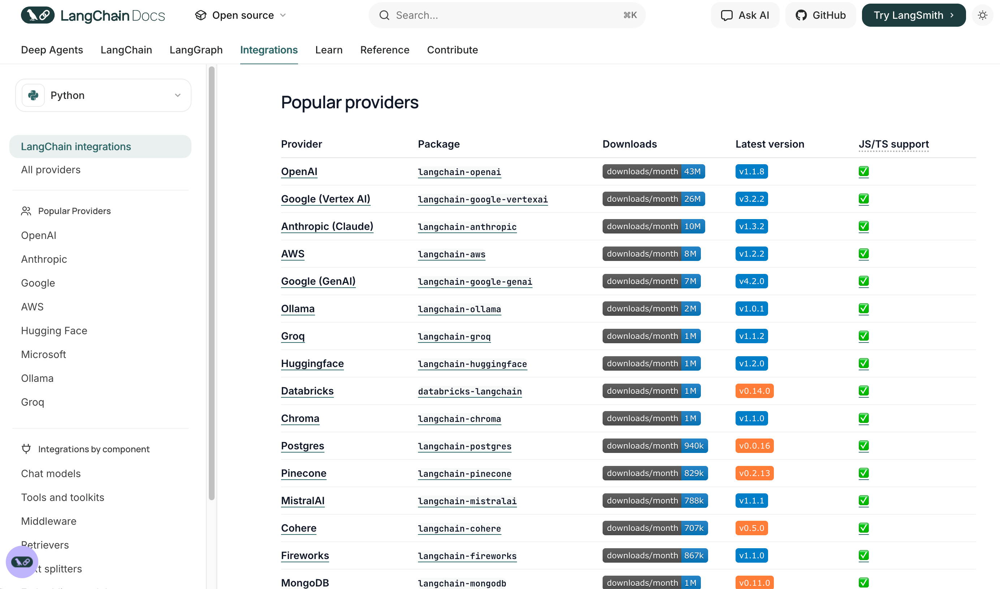
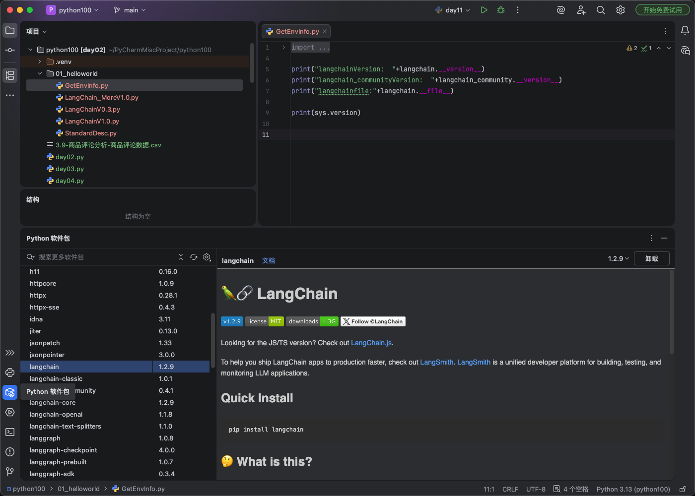
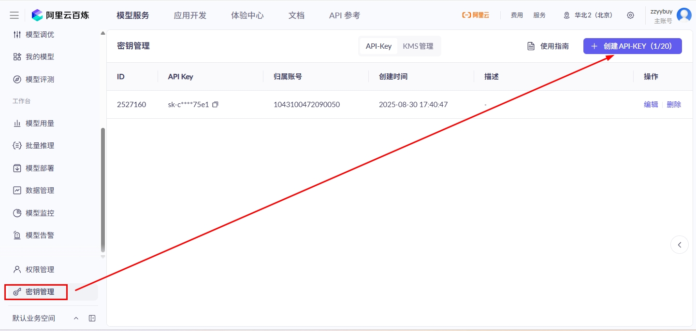
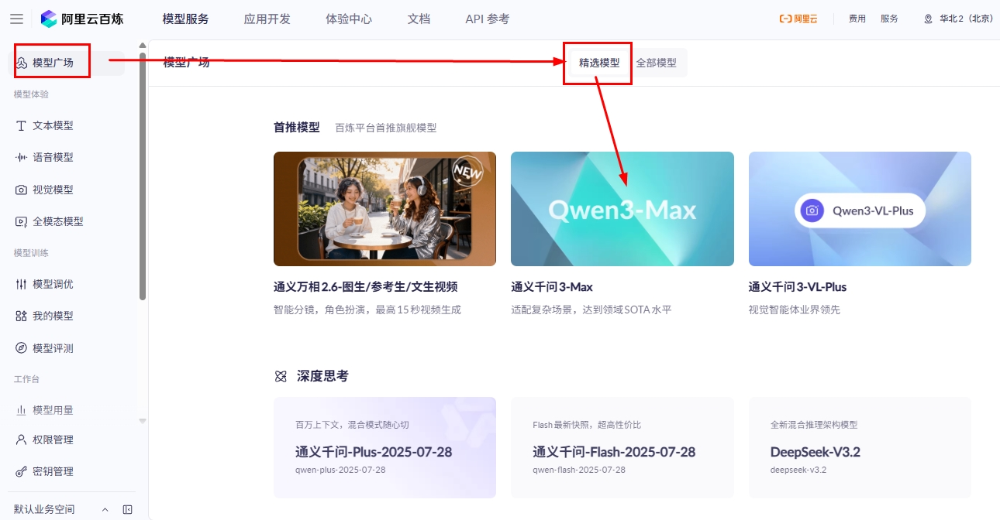
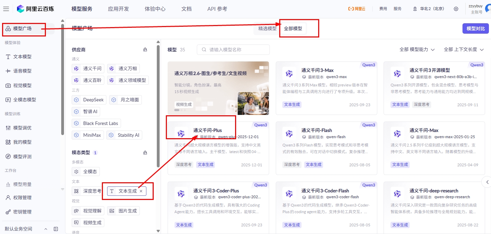
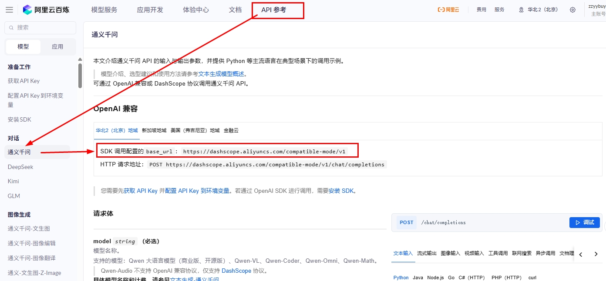
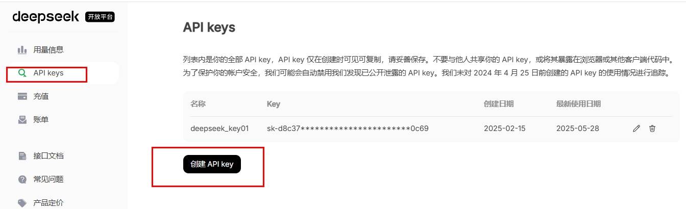
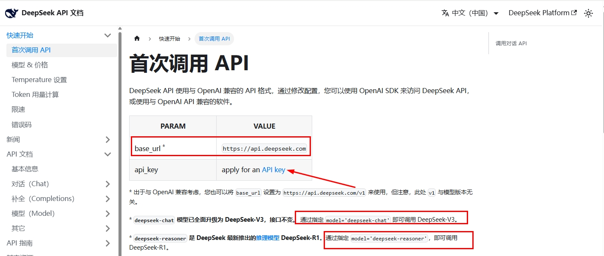
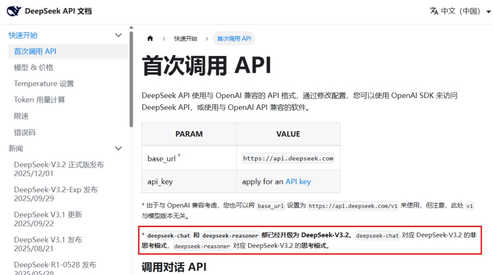

# 10 - LangChain Quick Start and HelloWorld

---

**Chapter goals:**

- Move from "knowing what LangChain is" to truly "**running your first LangChain call with your own hands**", completing the closed loop from environment setup to HelloWorld.
- Understand the most important **calling trio** for connecting to large language models: **API Key, model name, and Base URL**, with LangChain **1.x** syntax as the main line, while also being able to read the classic syntax in older materials.
- Be able to run and understand all the examples in this chapter: **environment check, HelloWorld, coexistence of multiple models, enterprise-level encapsulation, and streaming output**, laying the foundation for later chapters on [Model I/O](11-Model-I-O%E4%B8%8E%E6%A8%A1%E5%9E%8B%E6%8E%A5%E5%85%A5.md), [Ollama local invocation](12-Ollama%E6%9C%AC%E5%9C%B0%E9%83%A8%E7%BD%B2%E4%B8%8E%E8%B0%83%E7%94%A8.md), [prompts and message templates](13-%E6%8F%90%E7%A4%BA%E8%AF%8D%E4%B8%8E%E6%B6%88%E6%81%AF%E6%A8%A1%E6%9D%BF.md), and [output parsers](14-%E8%BE%93%E5%87%BA%E8%A7%A3%E6%9E%90%E5%99%A8.md).

**Learning advice:** The goal of this chapter is very simple: first make a model call actually work. When studying, first confirm dependencies, model name, API Key, and Base URL, then look at the code structure; after the first success, compare coexistence of multiple models and engineering-oriented encapsulation. When you encounter 0.x syntax in older tutorials, focus on how it differs from the 1.x syntax in this chapter in terms of entry points and object organization.

**Official documentation and resources:** See [Tool Navigation and Reference Index - LangChain](%E5%B7%A5%E5%85%B7%E5%AF%BC%E8%88%AA%E4%B8%8E%E5%8F%82%E8%80%83%E8%B5%84%E6%96%99%E7%B4%A2%E5%BC%95.md#_LangChain).

---

## 1. LangChain environment and conventions

### 1.1 Supported large language models and course selection

LangChain can connect to many model providers through different integration packages. The official documentation provides a complete provider list:

- **Providers Overview**: https://docs.langchain.com/oss/python/integrations/providers/overview



The selection for this course is:

- **Primary model**: Alibaba Bailian / Qwen
- **Auxiliary model**: DeepSeek
- **Extended platforms**: OpenRouter, SiliconFlow, Ollama, etc.

There are two practical reasons for this arrangement:

1. **More friendly for domestic developers**: registration, obtaining an API Key, access stability, and cost control are usually easier.
2. **Easier to understand for migration**: whether it is Bailian, DeepSeek, or other OpenAI-compatible platforms, you ultimately cannot get around the calling logic of **API Key, model name, and Base URL**.

Therefore, although this chapter mainly uses **Alibaba Bailian + DeepSeek** as examples, what you really need to learn is "**how to connect a model using LangChain**", not just how to use one specific platform.

### 1.2 Python version and project environment conventions

Let me clarify this first, because it directly determines whether you will run into a chain of compatibility issues later.

According to the **official LangChain 1.x installation documentation** and the current dependency conventions of this project, it is recommended that you use:

- **Recommended version**: Python **3.10**
- **Supported range**: Python **3.10–3.13**
- **Not recommended**: Python **3.14**

The `requirements.txt` in the root directory of this repository already clearly states: the project currently recommends **Python 3.10** and explains that **dependencies such as `langchain-redis` are not yet compatible with 3.14**. Therefore, this chapter no longer repeats the common statement in older materials about "Python 3.8+", but instead recommends that you follow this project's conventions directly, which will save you trouble in later chapters.

If this is your first time running the examples in this repository, the recommended approach is:

1. Create a virtual environment in the project root directory
2. Activate the virtual environment
3. Install the complete dependencies of this project

For more detailed environment setup steps, you can also refer to [Getting Started and FAQ](%E6%96%B0%E6%89%8B%E5%85%A5%E9%97%A8%E4%B8%8E%E5%B8%B8%E8%A7%81%E9%97%AE%E9%A2%98.md).

### 1.3 Precautions before running the examples

Let's first look at two runtime conventions. Many people fail on their first run not because of code problems, but because they did not pay attention to the following two points.

**Convention 1: Run examples from the project root directory whenever possible.**  
This makes it easier to uniformly manage the virtual environment, dependencies, and output files. When a regular Python script directly calls `load_dotenv()`, it usually searches upward from the script location for `.env` and does not strictly depend on the current working directory; however, in an IDE, REPL, or debugger, the search starting point may be affected by the working directory configuration. If the API Key is empty, first confirm that `.env` exists in the root directory and that the variable name matches the code, then check the working directory of the IDE or debugger.

Recommended usage:

```bash
python 案例与源码-2-LangChain框架/01-helloworld/LangChainV1.0.py
```

**Convention 2: Configure `.env` first; do not hardcode the API Key in your code.**  
The project root directory provides `.env-example`. You can copy it and rename it to `.env`, then fill in your real key. This is both secure and convenient for switching environments.

---

## 2. An introduction to common LLM service platforms

### 2.1 What is the calling trio

No matter whether you ultimately connect to Alibaba Bailian, DeepSeek, OpenAI, or other OpenAI-compatible platforms, most scenarios cannot get around these three pieces of information:

- **API Key**: who you are, used for authentication
- **Model name**: which model you want to call
- **Base URL**: where the request should be sent

I refer to these three items as the "**calling trio**".

You can think of them as the three things you must know when "making a phone call":

- **API Key**: equivalent to your identity credential
- **Model name**: equivalent to which expert you want to contact
- **Base URL**: equivalent to which number you dial

Without an API Key, the platform does not know who you are; without a model name, the platform does not know which model you want to call; without a Base URL, the request does not even know where to go. Therefore, the HelloWorld later in this chapter revolves around this trio.

### 2.2 Overview of common platforms

The following lists the platforms that are more common in current learning scenarios. You do not need to register for all of them at the beginning, but you should at least understand their roles:

| Platform | Entry | API Key management | Documentation | Models | Description |
| -------------- | ------------------------------------------------------ | ------------------------------------------------------------------- | --------------------------------------------------------------------------------- | ---------------------------------------------------------------------------- | -------------------------------------------------- |
| **Alibaba Bailian** | [Platform](https://bailian.console.aliyun.com/) | [API-Key](https://bailian.console.aliyun.com/?tab=model#/api-key) | [Documentation](https://bailian.console.aliyun.com/?tab=doc#/doc/?type=model) | [Models](https://bailian.console.aliyun.com/?tab=model#/model-market/all) | The main platform of this course, mainly used for Qwen and OpenAI-compatible access |
| **DeepSeek** | [Platform](https://platform.deepseek.com/) | [API-Key](https://platform.deepseek.com/api_keys) | [Documentation](https://api-docs.deepseek.com/zh-cn/) | [Models](https://platform.deepseek.com/usage) | Strong reasoning and coding capabilities; used in this chapter for the multi-model coexistence example |
| **OpenRouter** | [Platform](https://openrouter.ai/) | [API-Key](https://openrouter.ai/settings/keys) | [Documentation](https://openrouter.ai/docs/community/frameworks-and-integrations-overview) | [Models](https://openrouter.ai/models) | A unified multi-model aggregation platform, suitable for "one entry to multiple models" |
| **SiliconFlow** | [Platform](https://www.siliconflow.cn/) | [API-Key](https://cloud.siliconflow.cn/me/account/ak) | [Documentation](https://docs.siliconflow.cn/cn/userguide/capabilities/text-generation) | [Models](https://cloud.siliconflow.cn/me/models) | A common domestic AI API platform, suitable for practice and accessing open-source models |
| **Baidu Qianfan** | [Platform](https://console.bce.baidu.com/qianfan/overview) | [API-Key](https://console.bce.baidu.com/qianfan/ais/console/apiKey) | [Documentation](https://cloud.baidu.com/doc/qianfan-docs/s/Mm8r1mejk) | [Models](https://console.bce.baidu.com/qianfan/modelcenter/model/buildIn/list) | Baidu's model platform |
| **CloseAI** | [Platform](https://platform.closeai-asia.com/) | [API-Key](https://platform.closeai-asia.com/) | [Documentation](https://doc.closeai-asia.com/tutorial/api/openai.html) | [Models](https://doc.closeai-asia.com/) | One of the OpenAI / international model compatible access platforms |

---

## 3. Installing dependencies

### 3.1 Recommended approach

If you are following this repository chapter by chapter, **the most recommended approach is not to manually install packages one by one, but to directly install the project dependencies**:

```bash
pip install -r requirements.txt
```

It keeps things consistent with the examples in this repository, so you will not need to frequently install additional dependencies later when learning about Prompt, Parser, LCEL, Memory, RAG, and Agent, and it avoids the situation where "the current chapter runs fine, but the next chapter suddenly lacks a package".

If the network is slow, you can use a domestic mirror:

```bash
pip install -r requirements.txt -i https://pypi.tuna.tsinghua.edu.cn/simple
```

### 3.2 Manually installing the minimal dependencies

If you only want to get the HelloWorld in this chapter running first, you can also install a minimal set of dependencies.
For the examples in this chapter, it is recommended to install at least:

```bash
# LangChain 主包
pip install langchain -i https://pypi.tuna.tsinghua.edu.cn/simple

# OpenAI 兼容接入（阿里百炼、OpenAI 兼容网关等常用）
pip install langchain-openai -i https://pypi.tuna.tsinghua.edu.cn/simple
pip install openai -i https://pypi.tuna.tsinghua.edu.cn/simple

# 读取 .env
pip install python-dotenv -i https://pypi.tuna.tsinghua.edu.cn/simple

# 本项目后续大量案例会用到的核心抽象
pip install langchain-core -i https://pypi.tuna.tsinghua.edu.cn/simple
```

If you want to run the **DeepSeek multi-model coexistence example** in this chapter, it is also recommended to install:

```bash
pip install langchain-deepseek -i https://pypi.tuna.tsinghua.edu.cn/simple
```

> **Note**: The `requirements.txt` of this project already includes `langchain-deepseek`, so if you have already run `pip install -r requirements.txt`, you usually do not need to install it separately here.

### 3.3 Verifying the installation

After installation, it is recommended to verify the environment first. This can help you discover issues such as "installed the wrong Python", "installed into a different virtual environment", or "version mismatch" early on.

**Method 1: Run the environment check script**

[Example source code] Environment check script: `案例与源码-2-LangChain框架/01-helloworld/GetEnvInfo.py`

[GetEnvInfo.py](../../%E6%A1%88%E4%BE%8B%E4%B8%8E%E6%BA%90%E7%A0%81-2-LangChain%E6%A1%86%E6%9E%B6/01-helloworld/GetEnvInfo.py ":include :type=code")

This script outputs:

- `langchain` version
- `langchain_community` version
- The actual installation path of LangChain
- The current Python version

Its value in real projects is very high, because many of the "the package is clearly installed but it says it cannot be found" problems ultimately occur because you are not using the same Python environment when running the script.

**Method 2: View installed packages in PyCharm**

In PyCharm's **Python Packages** panel, you can directly confirm whether packages such as `langchain`, `langchain-core`, and `langchain-openai` exist and what versions they are.



---

## 4. Example: HelloWorld based on Alibaba Bailian

### 4.1 The calling trio

No matter whether you connect to Bailian or another platform, you cannot get around the trio when actually writing code. Here we use Bailian for a complete explanation.

#### 4.1.1 Obtaining an API Key

In the **API-KEY management** section of the Bailian console, create and copy a key, usually in the form of `sk-xxx`.



#### 4.1.2 Obtaining the model name

In the model gallery or model details page, confirm the actual model identifier you want to call, such as `qwen-plus`, `qwen3-max`, etc.






#### 4.1.3 Obtaining the Base URL

If you are using the OpenAI-compatible approach, you need the corresponding compatible endpoint address, for example:



The most common Bailian Base URL used in this course is:

```text
https://dashscope.aliyuncs.com/compatible-mode/v1
```

**Section Summary**

| Item         | Example / Description                                     |
| ------------ | --------------------------------------------------------- |
| **API Key**  | `sk-xxx` (created in the console)                         |
| **Model name**   | Such as `qwen-plus`, `qwen3-max`                     |
| **Base URL** | `https://dashscope.aliyuncs.com/compatible-mode/v1` |

### 4.2 The Minimal Call Chain for HelloWorld

Before writing code, first make the minimal chain clear:

```text
准备三件套 → 初始化模型 → invoke("问题") → 读取 response.content
```

There are two keywords to understand first:

- `invoke()`: Synchronously calls the model and returns a message object
- `.content`: Extracts the body text from the message object

In other words:

- `invoke()` = "Sending the question out"
- `.content` = "Extracting the text that the model actually answered"

This is the core minimal call chain of this chapter.

### 4.3 Example Code (Two Styles for 0.3 and 1.x)

This section keeps both styles, not because you will use both in new projects, but because in reality you will certainly encounter two types of materials:

- Old tutorials and old projects: often still use the 0.x / classic style
- New projects and the official mainline: more often use the 1.x unified entry style

#### 4.3.1 Method 1: LangChain 0.3 / Classic Style

[Case source code]`案例与源码-2-LangChain框架/01-helloworld/LangChainV0.3.py`

[LangChainV0.3.py](../../%E6%A1%88%E4%BE%8B%E4%B8%8E%E6%BA%90%E7%A0%81-2-LangChain%E6%A1%86%E6%9E%B6/01-helloworld/LangChainV0.3.py ":include :type=code")

There are three most valuable points in this case:

- It demonstrates the classic OpenAI-compatible connection using **`ChatOpenAI` + `base_url`**
- It explicitly compares three configuration methods: **hard-coded Key → environment variable → `.env`**
- It shows you that `invoke()` returns an object, not just a string

Develop a habit here: **Do not hard-code the API Key in your code**.

#### 4.3.2 Method 2: LangChain 1.x Recommended Style

[Case source code]`案例与源码-2-LangChain框架/01-helloworld/LangChainV1.0.py`

[LangChainV1.0.py](../../%E6%A1%88%E4%BE%8B%E4%B8%8E%E6%BA%90%E7%A0%81-2-LangChain%E6%A1%86%E6%9E%B6/01-helloworld/LangChainV1.0.py ":include :type=code")

This case is the style currently recommended for you to focus on mastering. Its greatest significance is that through the **`init_chat_model` unified entry**, you no longer need to memorize a different initialization method for each model vendor. Instead, you first remember the same calling skeleton, and then switch between different models and providers through parameters.

In the 1.x mainline, first remember this minimal relationship:

| Style                                   | Suitable scenarios                       | How you should learn |
| --------------------------------------- | ---------------------------------------- | -------------------- |
| `init_chat_model(...)`                  | New projects, multi-model switching, course mainline | Master first         |
| `ChatOpenAI(...)` / `ChatDeepSeek(...)` | Old projects, provider-specific capabilities | Be able to read and migrate |
| Vendor-native SDK                       | Only one API call, not integrated into a LangChain chain | Know the boundaries |

### 4.4 Differences Between 0.3 and 1.x Styles

This question must be explained clearly first, otherwise reading old code later will be very confusing.

**The 0.3 / classic style approach** is:

- Import classes directly from specific integration packages, such as `ChatOpenAI`
- The class name itself carries the semantics of "which protocol I am connecting through"
- The code is very intuitive, but different vendors and different class names make projects increasingly fragmented

**The 1.x approach** is:

- Use `init_chat_model` as the unified entry
- Describe "who I want to connect to" through parameters such as `model`, `model_provider`, `api_key`, `base_url`
- The same code skeleton is easier to migrate, unify, and maintain

You can remember it this way:

| Dimension      | 0.3 / Classic style             | 1.x / Recommended style |
| -------------- | ------------------------------- | ----------------------- |
| **Entry**      | Specific classes such as `ChatOpenAI(...)` | `init_chat_model(...)` |
| **Characteristics** | Simple and direct, common in old materials | Unified entry, suitable for new projects |
| **Suitable for** | Reading old tutorials and being compatible with old code | Serving as the current primary learning path |

Here is a real project suggestion worth adding:

> If you are starting a new project from scratch now, prioritize learning the **1.x style**; if you are maintaining an existing project, you should also be able to read the **0.3 / classic style**.

---

## 5. Case Study: Multi-Model Coexistence (Qwen + DeepSeek)

### 5.1 Multi-Model Coexistence Scenarios

In real projects, multi-model coexistence is actually the norm. The reasons are simple:

- Different models have different costs
- Different models have different strengths
- Different business scenarios have different requirements for stability, speed, and reasoning ability

For example:

- For daily customer service Q&A, use a cheap and stable model
- For complex reasoning or code generation, use a model more proficient at reasoning
- Some enterprises also keep both online models and local models as backups

Therefore, multi-model coexistence is not an "advanced technique" but a very practical engineering requirement.

### 5.2 The Three Essentials for Calling

#### 5.2.1 Obtaining an API Key

Create and copy a Key in the DeepSeek console.



#### 5.2.2 Obtaining the Model Name

The model names currently officially promoted by the DeepSeek API include:

- `deepseek-v4-flash`: Suitable as a default example model, balancing speed and cost.
- `deepseek-v4-pro`: Suitable for more complex reasoning, code, and high-quality generation scenarios.

> Note: The DeepSeek official documentation has marked `deepseek-chat` and `deepseek-reasoner` as compatibility aliases, and they will be deprecated on 2026-07-24. When writing new code, prioritize model names such as `deepseek-v4-flash` and `deepseek-v4-pro` from the official current model list.



#### 5.2.3 Obtaining the Base URL

A common way to write it is:

```text
https://api.deepseek.com
```

The specifics should still follow the official DeepSeek documentation.



### 5.3 Multi-Model Coexistence Example Code

[Case source code]`案例与源码-2-LangChain框架/01-helloworld/LangChain_MoreV1.0.py`

[LangChain_MoreV1.0.py](../../%E6%A1%88%E4%BE%8B%E4%B8%8E%E6%BA%90%E7%A0%81-2-LangChain%E6%A1%86%E6%9E%B6/01-helloworld/LangChain_MoreV1.0.py ":include :type=code")

This case has three particularly important knowledge points:

1. **Multiple model instances can be created simultaneously in the same script**
2. **Each instance can have its own model name, API Key, Base URL, and provider**
3. **Variable names must be clearly distinguished**, such as `llm_qwen` and `llm_deepseek`, to avoid the latter overwriting the former

It is actually already very close to a real project. Because in formal projects, we rarely keep only one model object. Instead, we encapsulate multiple models by purpose, for example:

- Default Q&A model
- Advanced reasoning model
- Cheap and fast model
- Backup fallback model

---

## 6. Hands-On: Enterprise-Grade Encapsulation and Streaming Output

### 6.1 From HelloWorld to Project-Style Code

If you are only writing a temporary script, the HelloWorld style of "writing a few lines of code to call the model directly" is sufficient.  
But as soon as you want to put it into a real project, you will immediately encounter these problems:

- Is the API Key configured correctly
- Where should logs be written
- When an error occurs, how to distinguish "configuration error" from "model invocation error"
- Does model initialization need to be repeated in every file
- Can the web interface or terminal display output while it is being generated

This is why the last section of this chapter introduces "**enterprise-grade encapsulation**" and "**streaming output**".

### 6.2 The Difference Between invoke() and stream()

These are the two calling methods beginners will use first.

`invoke()`: Returns the complete result at once.  
Suitable for:

- Simple Q&A
- Background processing
- Scenarios where real-time display of intermediate output is not needed

`stream()`: Returns output while generating.  
Suitable for:

- Real-time command-line output
- Typewriter effect in chat interfaces
- Long text generation
- Scenarios more sensitive to user waiting experience

Minimal example:

```python
for chunk in model.stream("请介绍一下 LangGraph"):
    print(chunk.content, end="")
```

You can remember it this way:

- `invoke()`: Wait for the model to finish thinking, then tell you the answer all at once
- `stream()`: The model thinks and speaks at the same time, and you receive and display it as it comes

### 6.3 Example Code (Encapsulation, Exceptions, Streaming)

[Case source code]`案例与源码-2-LangChain框架/01-helloworld/StandardDesc.py`

[StandardDesc.py](../../%E6%A1%88%E4%BE%8B%E4%B8%8E%E6%BA%90%E7%A0%81-2-LangChain%E6%A1%86%E6%9E%B6/01-helloworld/StandardDesc.py ":include :type=code")

This case is closer to a real project than the previous HelloWorld, mainly reflected in:

- **Encapsulating model initialization into a function** to avoid repeating configuration everywhere
- **Explicitly checking environment variables** to reduce low-level mistakes like "Key is empty but still making a request"
- **Using logs** instead of relying only on `print`
- **Distinguishing exception types** to facilitate troubleshooting
- **Demonstrating both `invoke()` and `stream()`**

If the previous cases were teaching you "how to get the call working", this case is teaching you "how to write it like a real project".

---

**Chapter Reflection Questions:**

1. When your first LangChain call fails, in what order would you troubleshoot?

   **Reference approach:** First check whether dependencies are installed, then check environment variables, Base URL, model name, network, and quota, and finally look at code objects and calling methods. Do not immediately suspect LangChain; many HelloWorld problems are actually configuration issues that were not properly connected.

2. Why should this chapter pay attention to both `invoke()` and `stream()`?

   **Reference approach:** `invoke()` is suitable for first verifying the complete result, while `stream()` is closer to a real product experience and can display output while generating. One addresses "whether the connection works", and the other addresses "how to show the process while users are waiting".

3. When multiple models coexist, which configurations are most likely to get mixed up?

   **Reference approach:** The model name, Base URL, API Key, provider package, and default parameters are most likely to get mixed up. In engineering, configurations for different models should be centrally managed to avoid scattering them throughout business code.

4. What is the biggest difference between a teaching demo and real project code?

   **Reference approach:** A demo only needs to run successfully, while a real project must also handle configuration validation, logging, exceptions, timeouts, retries, streaming output, and hiding sensitive information. The engineering-oriented approach later in this chapter is about moving from "it runs" to "it can be maintained".

**Chapter Summary:**

- **The essence of HelloWorld** is not "writing a very simple example" but verifying that the entire call chain is connected. For LangChain, this minimal chain is: **prepare API Key, model name, and Base URL → initialize the model → call `invoke()` → retrieve the reply with `.content`**.
- This chapter is recommended to be studied in the context of **LangChain 1.x**, following the current project environment conventions: **Python 3.10–3.13, with 3.10 recommended**. If you are following this repository, prioritize running `pip install -r requirements.txt`; if you only want to run the minimal examples in this chapter, at least install `langchain`, `langchain-openai`, `openai`, `python-dotenv`, and `langchain-core`. When running DeepSeek multi-model examples, it is recommended to also install `langchain-deepseek`.
- All examples retained in this chapter correspond to different learning objectives: `GetEnvInfo.py` is used to **check the environment**, `LangChainV0.3.py` and `LangChainV1.0.py` are used to understand **classic usage and 1.x usage**, `LangChain_MoreV1.0.py` is used to master **multi-model coexistence**, and `StandardDesc.py` lets you take the first step from "teaching demos" toward "engineering-style code".

**Suggested next step:** First, run at least two scripts from this chapter yourself. The recommended order is: `GetEnvInfo.py` → `LangChainV1.0.py` → `LangChain_MoreV1.0.py` → `StandardDesc.py`. After they run successfully, move on to [Chapter 11: Model I/O and Model Integration](11-Model-I-O%E4%B8%8E%E6%A8%A1%E5%9E%8B%E6%8E%A5%E5%85%A5.md), where you can upgrade the "knowing how to use it" parts from this chapter into "truly understanding why it is connected this way and how different models are integrated uniformly." Then, as you continue with [Chapter 13: Prompts and Message Templates](13-%E6%8F%90%E7%A4%BA%E8%AF%8D%E4%B8%8E%E6%B6%88%E6%81%AF%E6%A8%A1%E6%9D%BF.md) and [Chapter 14: Output Parsers](14-%E8%BE%93%E5%87%BA%E8%A7%A3%E6%9E%90%E5%99%A8.md), you will form a complete **input → model → output** learning loop.
