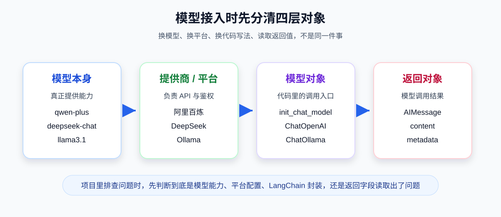
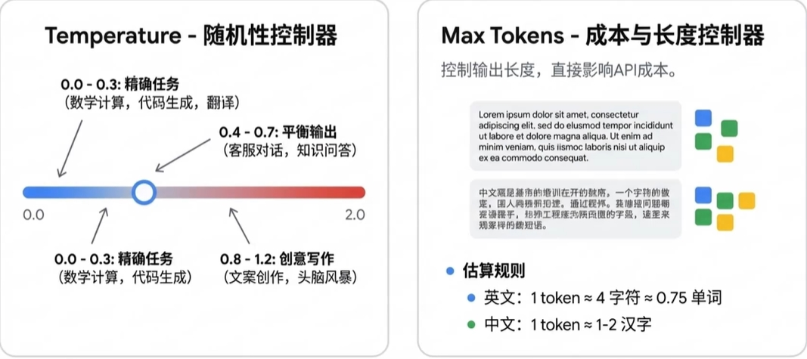
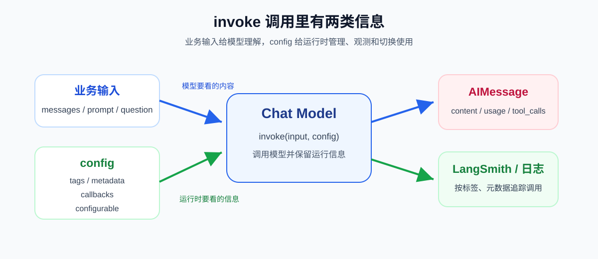

# 11 - Model I/O and Model Integration

---

**Chapter Learning Objectives:**

- Understand what **Model I/O** is and why it is the most fundamental and core layer in LangChain.
- Understand LangChain's **Model I/O** module: the trio of input prompting (Prompt), model invocation (Model), and output parsing (Parser).
- Master the most common **model categories**, **standardized parameters**, and **return value structures** in LangChain, especially Chat Model and `AIMessage`.

**Study Advice:** Chapter 10 addresses "can you get it working"; this chapter addresses "how to write model calls so they are swappable, manageable, and reusable." When reading, follow the flow of input, parameters, return values, and integration methods, and pay attention to which code is tied to specific model providers and which can remain generic. When you later read [Chapter 13](13-%E6%8F%90%E7%A4%BA%E8%AF%8D%E4%B8%8E%E6%B6%88%E6%81%AF%E6%A8%A1%E6%9D%BF.md) and [Chapter 14](14-%E8%BE%93%E5%87%BA%E8%A7%A3%E6%9E%90%E5%99%A8.md), reconnect them to the main Model I/O thread.

**Official Documentation and Resources**: See [Tool Navigation and Reference Materials Index - Model Integration and Local Execution](%E5%B7%A5%E5%85%B7%E5%AF%BC%E8%88%AA%E4%B8%8E%E5%8F%82%E8%80%83%E8%B5%84%E6%96%99%E7%B4%A2%E5%BC%95.md#model-integration-and-local-execution).

---

## 1. Introduction to Model I/O

### 1.1 Definition

**Model I/O** is the module in LangChain specifically responsible for "**how to interact with models**." It deals with exactly these three things: **how model input is organized, how models are invoked, and how model output is processed**. Together, these three are Model I/O.

One-sentence definition:

> **Model I/O = Format (Input Formatting) → Predict (Model Invocation) → Parse (Output Parsing)**

These three words will run throughout your subsequent LangChain learning.

- **Format (Input Formatting)**: Organize raw business input into a form that is easier for the model to understand, such as Prompt templates, multi-role messages, variable filling, etc.
- **Predict (Model Invocation)**: Invoke different model providers through LangChain's unified interface, such as OpenAI, DeepSeek, Alibaba Bailian, Ollama, etc.
- **Parse (Output Parsing)**: Convert the natural language results returned by the model into a more stable form that is easier for programs to handle, such as strings, JSON, structured objects, etc.


You can think of this diagram as the overall map for the next few chapters:

- **Format** will be expanded in detail mainly in [Chapter 13: Prompts and Message Templates](13-%E6%8F%90%E7%A4%BA%E8%AF%8D%E4%B8%8E%E6%B6%88%E6%81%AF%E6%A8%A1%E6%9D%BF.md)
- **Predict** is the focus of this chapter
- **Parse** will be expanded in detail mainly in [Chapter 14: Output Parsers](14-%E8%BE%93%E5%87%BA%E8%A7%A3%E6%9E%90%E5%99%A8.md)

### 1.2 Why Model I/O Is Needed

After finishing HelloWorld, many people think: "I already know how to use `invoke()`, so why do I need to study this chapter separately?"

The reason is simple: **being able to invoke a model once does not mean you truly understand model integration.** In real projects, you will sooner or later encounter these questions:

- The same project needs to connect to multiple models, so how do you unify the code?
- Why are `ChatOpenAI` used in some places and `init_chat_model` in others?
- Why do some results return strings while others return `AIMessage`?
- What exactly do parameters like `temperature`, `max_tokens`, and `timeout` control?
- What is the actual relationship among the OpenAI official SDK, LangChain provider packages, and OpenAI-compatible interfaces?

These questions cannot be fully explained by HelloWorld alone, and they are precisely what Model I/O is meant to address.

### 1.3 Understanding the Three Steps with an Everyday Analogy

You can also think of Model I/O as a "food delivery" process:

- **Format**: Like writing down your requirements clearly before placing an order, such as whether you want it spicy, how many servings, and where it should be delivered. The clearer you write, the less likely the model is to go off track.
- **Predict**: Like handing the order to a restaurant to handle. You can switch to different restaurants (different models), but you want the ordering process to be as consistent as possible.
- **Parse**: Like portioning and labeling the food after it arrives. The raw answer may be long, but the system often needs structured data to continue processing.

Although this analogy is simple, it is suitable for building intuition at the beginner stage. What LangChain does is make "ordering as consistent as possible," "switching restaurants with as little code change as possible," and "processing results more conveniently after receiving them."

---

## 2. LangChain Model Categories, Parameters, and Returns

This section focuses on the core part of Model I/O: **Predict (Model Invocation)**. You need to understand three things first:

1. What model types exist in LangChain
2. What the common parameters mean when invoking models
3. What exactly is returned after invoking a model

### 2.1 First Distinguish: The Model Itself, the Model Provider, and the LangChain Model Object

This is the most confusing part. In engineering, these three are not the same thing:

| Concept                   | What it is                 | Example                                                                      |
| ---------------------- | ------------------------ | ------------------------------------------------------------------------- |
| **The model itself**           | The model that actually provides the capability       | `qwen-plus`, `deepseek-v4-flash`, `glm-4`                                 |
| **Model provider / platform**  | The vendor or platform providing the API    | Alibaba Bailian, DeepSeek, OpenAI, Zhipu                                          |
| **LangChain model object** | The wrapper object you operate on in code | `ChatOpenAI`, `ChatDeepSeek`, `ChatTongyi`, `init_chat_model(...)` return values |

A most intuitive example:

- `deepseek-v4-flash` is the **model name**
- `DeepSeek` is the **provider**
- The object returned by `ChatDeepSeek(...)` or `init_chat_model(...)` is the **model object you actually invoke in code**

Only by clearly distinguishing these three layers will you avoid confusing "switching models," "switching platforms," and "switching LangChain code style" as the same thing later on.



### 2.2 Common LangChain Model Categories

LangChain does not provide model weights themselves; what it provides is a unified abstraction for "**how to integrate these models**." LangChain categorizes large language models into multiple types by use case, and **the most commonly used in actual development is the "chat model"** (ChatModel), used for multi-turn conversations, system roles, user messages, and similar scenarios.

From the perspective of this course and real-world projects, the three types you will encounter most often are:

| Model type       | Input form         | Output form    | Main characteristics                                 | Typical scenarios                        |
| -------------- | ---------------- | ----------- | ---------------------------------------- | ------------------------------- |
| **LLM**        | Plain text string     | Text string  | Closer to the traditional "text completion" interface, with no inherent multi-role structure | Single-turn generation, summarization, rewriting, completion      |
| **Chat Model** | String or message list | `AIMessage` | Closer to conversation, supports multi-role messages and richer metadata | Intelligent assistants, customer service, multi-turn dialogue, Agent |
| **Embeddings** | Text or text list   | Vector        | Converts text into semantic vectors and does not generate text       | RAG, retrieval, similarity calculation, clustering     |

From the perspective of "the focus of this course," just remember one sentence: **The most commonly used in actual development, and the main focus of this course, is Chat Model.**

Because the later topics of Prompt, Message, Tools, Agent, and Memory are essentially mostly built on top of the message-based interaction of Chat Models.

### 2.3 Differences Between LLM and Chat Model

Many students are puzzled when they first see this: "Aren't they all called large models, so why does LangChain still distinguish between LLM and Chat Model?"

They both belong to the broad category of "generative models," but the interface philosophy is different:

- **LLM**: More like "give a piece of text and let the model complete or generate the next part"
- **Chat Model**: More like "give a piece of dialogue context and let the model reply according to roles"

For example:

**LLM style:**

```python
prompt = "请用一句话解释什么是 LangChain"
```

**Chat Model style:**

```python
messages = [
    {"role": "system", "content": "你是一个技术助教"},
    {"role": "user", "content": "请用一句话解释什么是 LangChain"},
]
```

From a real project perspective, Chat Model is usually more suitable for modern AI applications because it:

- More naturally supports system / user / assistant roles
- Is better suited for multi-turn dialogue
- Usually returns results with more metadata
- Is easier to combine with Tools, Agents, and Structured Output

### 2.4 Why Embedding Is Included Here

Embedding is not a model that "speaks," but it still belongs to the Model I/O system because it is likewise an "integration of model capabilities."

The difference is:

- Chat Model is responsible for "generating answers"
- Embedding Model is responsible for "converting text into vectors"

You will study it in depth later in [Chapter 18: Vector Databases and Embedding in Practice](18-%E5%90%91%E9%87%8F%E6%95%B0%E6%8D%AE%E5%BA%93%E4%B8%8EEmbedding%E5%AE%9E%E6%88%98.md) and [Chapter 19: RAG Retrieval-Augmented Generation](19-RAG%E6%A3%80%E7%B4%A2%E5%A2%9E%E5%BC%BA%E7%94%9F%E6%88%90.md). For now, just establish one concept: **Embedding is also a model, except its output is not natural language but vectors.**

### 2.5 Common Model Parameters

When building chat models, commonly used are **`init_chat_model` (LangChain 1.0+)** or model classes in various integration packages. LangChain defines a set of **standardized parameters** for chat models, and the names remain basically consistent across different code styles, making it easier to change providers with minimal code changes.

- **Official documentation**: https://docs.langchain.com/oss/python/langchain/models#parameters (English); https://docs.langchain.org.cn/oss/python/langchain/models#parameters (Chinese)

The following set of parameters is the most common and most worth mastering first:

| Parameter name           | Purpose                | How to understand it                                                        |
| ---------------- | ------------------- | ------------------------------------------------------------------- |
| `model`          | Model name or identifier    | Which model you want to invoke, such as `qwen-plus`, `deepseek-v4-flash`               |
| `model_provider` | Provider / protocol source   | Which provider or protocol to use to create the underlying client, such as `"openai"`, `"deepseek"` |
| `api_key`        | API authentication credential    | Without it, invocation is usually impossible                                                  |
| `base_url`       | API root URL          | Where requests are sent, especially common with compatible interfaces                                    |
| `temperature`    | Randomness / creativity control | Lower means more stable, higher means more divergent                                              |
| `max_tokens`     | Maximum generation length        | The maximum number of tokens for the answer, which also affects cost                                  |
| `timeout`        | Timeout            | The maximum wait time for a request                                                      |
| `max_retries`    | Failure retry count        | The number of automatic retries on temporary exceptions                                              |
| `stop`           | Stop words              | Force generation to stop at certain points                                            |

The following diagram is very helpful for building initial intuition:



- **`temperature`** controls "style and divergence"
- **`max_tokens`** controls "length and cost"

In real projects, these two parameters are often the first to be adjusted.

### 2.6 The Relationship Between Token, max_tokens, and Billing

Large language models internally split text into **tokens** before computation and generation. You can think of tokens as fragments that may be finer or coarser than "characters" (depending on the tokenizer): output is usually **generated token by token in sequence**. Provider billing, context length limits, and usage statistics returned by the API are also usually measured in **token counts**.

Empirical conversion (for intuition only, **subject to each platform's tokenizer measurements**):

- Chinese: approximately **1 token ≈ 1–1.8 Chinese characters** (varies by model and tokenizer).
- English: approximately **1 token ≈ 3–4 letters**, or shorter/common words are merged into fewer tokens.

Therefore, when setting `max_tokens`, you are simultaneously limiting the **response length** and directly affecting the **cost ceiling of a single call** (when billing is based on output tokens).

**Token / character ↔ token visualization tools (online estimation)**

- OpenAI: [Tokenizer](https://platform.openai.com/tokenizer) (mainly applicable to the OpenAI series tokenization rules).
- Baidu AI Cloud: [Tokenizer](https://console.bce.baidu.com/support/#/tokenizer).

### 2.7 How to choose parameters more suitable for real projects

Parameters are not "the more the better", nor should they always be pushed to the maximum. A more practical approach is to choose according to the business scenario:

- **Customer service Q&A / rule-based answers / translation**: `temperature` is often set lower, for example `0`–`0.3`
- **Knowledge Q&A / general assistant**: can be set at `0.2`–`0.7`
- **Copywriting, creative writing, brainstorming**: can be set appropriately higher, for example `0.8`–`1.2`

The same applies to `max_tokens`:

- If it is only a short Q&A, you can limit it to a smaller value to avoid meaningless long responses
- If it is summarization, analysis, or long-form output, you can increase it appropriately

But there is one point to always remember:

> **Parameters are only seasoning. The underlying model capability, prompt design, and context quality are usually more important than simply adjusting `temperature`.**

### 2.8 Basic example

[Example source code] `案例与源码-2-LangChain框架/02-models_io/ModelIO_Params.py`

[ModelIO_Params.py](../../%E6%A1%88%E4%BE%8B%E4%B8%8E%E6%BA%90%E7%A0%81-2-LangChain%E6%A1%86%E6%9E%B6/02-models_io/ModelIO_Params.py ":include :type=code")

This example is mainly used to do three things:

1. Observe the differences in multiple outputs after changing `temperature`
2. Observe the actual structure of the object returned by `model.invoke(...)`
3. Observe what `type(model)`, `type(response)`, and `type(response.content)` respectively are

It is not a "functional example", but a teaching example for "understanding model parameters and return values".

### 2.9 Return information after invocation

In the context of LangChain's Chat Model, the most common return object is `AIMessage`.

For example:

```python
response = model.invoke("写一句关于春天的诗，14 字以内")

print(type(model))             # 模型客户端对象
print(type(response))          # AIMessage
print(type(response.content))  # str
```

The most critical understanding here is:

- `model` is not a string; it is a model client object
- `response` is also not just a string; it is usually a **message object**
- The actual body text is generally in `response.content`

### 2.10 Common fields on AIMessage

At the introductory stage, the following fields are most worth mastering first:

| Field / Attribute       | Purpose                              | How you usually use it                         |
| ----------------------- | ------------------------------------ | ---------------------------------------------- |
| `content`           | Model response body text             | Most common; most business logic reads it first |
| `response_metadata` | Raw metadata returned by the provider | View model name, finish_reason, token_usage, etc. |
| `usage_metadata`    | Usage information unified by LangChain | View input/output/total tokens                |
| `tool_calls`        | Tool call information                | Critical when building Tools / Agents          |
| `additional_kwargs` | Provider-specific extension fields   | Use as needed                                  |

A typical `AIMessage` can initially be understood as:

```text
AIMessage(
  content='《鹧鸪天·春》\n一篙绿涨江南岸，…',   # 用户可见回复
  response_metadata={
    'token_usage': {
      'prompt_tokens': 14,
      'completion_tokens': 109,
      'total_tokens': 123,
      ...
    },
    'model_name': 'deepseek-v4-flash',
    'finish_reason': 'stop',
    ...
  },
  usage_metadata={
    'input_tokens': 14,
    'output_tokens': 109,
    'total_tokens': 123,
    ...
  },
  tool_calls=[],
  ...
)
```

Therefore, the two most common operations are:

- To view the body text: `response.content`
- To view tokens, model name, and finish reason: `response.response_metadata` or `response.usage_metadata`

> **Note**: Under different LangChain versions and vendor integrations, whether the fields are complete will vary; if `usage_metadata` is empty, you can first check the raw structures such as `token_usage` in `response_metadata`.

### 2.11 The role of Messages

This chapter only touches the surface; it will be expanded in [Chapter 13: Prompts and Message Templates](13-%E6%8F%90%E7%A4%BA%E8%AF%8D%E4%B8%8E%E6%B6%88%E6%81%AF%E6%A8%A1%E6%9D%BF.md). For now, you only need to establish one concept:

> **The input and output of a Chat Model are essentially all "Messages".**

The most common message types include: `SystemMessage`, `HumanMessage`, `AIMessage`, `ToolMessage`.

Therefore, from the perspective of Model I/O, **Prompt is only one way of organizing input, while Message is the more fundamental unified representation of Chat Models.**

---

## 3. Connecting Large Language Models

The previous section covered "the general patterns at the invocation layer". This section begins the most practical part: **how to connect different models.**

### 3.1 Three common integration approaches

In real projects, the most common model integration methods can actually be summarized into three categories:

| Approach                             | Typical representative                         | Suitable for                                                     |
| ------------------------------------ | --------------------------------------------- | ---------------------------------------------------------------- |
| **Official SDK direct connection**   | `openai.OpenAI`                            | Only making low-level API calls, not planning to use LangChain orchestration |
| **LangChain provider / model class** | `ChatOpenAI`, `ChatDeepSeek`, `ChatTongyi` | Already decided to use a specific provider package and want to combine it with the LangChain ecosystem |
| **LangChain unified entry point**    | `init_chat_model(...)`                            | Recommended for new projects; suitable for unifying style and reducing dependence on specific class names |

They can be viewed as three different levels:

- **OpenAI SDK**: lower-level, closest to the native API
- **Specific model class**: provider encapsulation within the LangChain ecosystem
- **Unified entry point**: the higher-level entry point more recommended in LangChain 1.x

### 3.2 Connecting OpenAI and compatible interfaces

This category is the most worth explaining clearly first, because many domestic platforms, gateway platforms, and local services ultimately follow the "**OpenAI-compatible interface**" path.

#### 3.2.1 Definition

The meaning is simple: although a platform is not OpenAI, it designs its API to be very similar to the OpenAI interface, so you can reuse many OpenAI-style clients and invocation methods.

Typical examples include:

- Alibaba Bailian compatible interface
- DeepSeek compatible interface
- OpenRouter
- Some local proxy / gateway services

This is why you often see in code:

- `base_url=...`
- `api_key=...`
- `model="xxx"`

These parameters together essentially mean using an "OpenAI-protocol-compatible" endpoint to call the model.

#### 3.2.2 The difference between openai.OpenAI and ChatOpenAI

This is a very common interview question and also the point most likely to confuse beginners.

| Comparison Item   | `openai.OpenAI`            | `langchain_openai.ChatOpenAI`        |
| ----------------- | --------------------------- | ------------------------------------ |
| **Ecosystem**     | OpenAI official Python SDK  | LangChain ecosystem                   |
| **Positioning**   | Lower-level, sends requests directly | Chat model encapsulation within LangChain |
| **Return result** | Closer to the OpenAI native response structure | Closer to LangChain structures such as `AIMessage` |
| **Suitable scenario** | Only want to call the API simply | Want to continue with Prompt, Parser, LCEL, Agent |

The difference between the two can be summarized as:

- **`openai.OpenAI`** is more like "the official SDK version that directly makes HTTP calls"
- **`ChatOpenAI`** is more like "a model object that has already been integrated into the LangChain system"

Therefore:

- If you only want to call the API once, `openai.OpenAI` is completely sufficient
- If you later need to connect Prompt, output parsing, LCEL, or Agent, you usually prioritize LangChain model objects

#### 3.2.3 Example 1: OpenAI official SDK

[Example source code] `案例与源码-2-LangChain框架/02-models_io/ModelIO_OpenAI.py`

[ModelIO_OpenAI.py](../../%E6%A1%88%E4%BE%8B%E4%B8%8E%E6%BA%90%E7%A0%81-2-LangChain%E6%A1%86%E6%9E%B6/02-models_io/ModelIO_OpenAI.py ":include :type=code")

The teaching focus of this example is:

- Let you see that "you can also directly call the model without going through LangChain"
- Help you distinguish the boundary between "native SDK invocation" and "LangChain invocation"

#### 3.2.4 Example 2: Using ChatOpenAI

[Example source code] `案例与源码-2-LangChain框架/02-models_io/ModelIO_ChatOpenAI.py`

[ModelIO_ChatOpenAI.py](../../%E6%A1%88%E4%BE%8B%E4%B8%8E%E6%BA%90%E7%A0%81-2-LangChain%E6%A1%86%E6%9E%B6/02-models_io/ModelIO_ChatOpenAI.py ":include :type=code")

The focus of this example is:

- Use `ChatOpenAI + base_url` to call an OpenAI-compatible endpoint
- Input can directly be a list of messages
- Return is a message object in LangChain semantics

This style is very common in older tutorials and a large number of existing projects, so you need to be able to read it.

#### 3.2.5 Example 3: Using init_chat_model

[Example source code] `案例与源码-2-LangChain框架/02-models_io/ModelIO_Init_chat_model.py`

[ModelIO_Init_chat_model.py](../../%E6%A1%88%E4%BE%8B%E4%B8%8E%E6%BA%90%E7%A0%81-2-LangChain%E6%A1%86%E6%9E%B6/02-models_io/ModelIO_Init_chat_model.py ":include :type=code")

This is the 1.x unified entry-point style that is more recommended for you to master now.

Its value lies in: the same skeleton is easier to switch providers; it is more conducive to unifying project style; and you do not need to memorize different class names for each provider.

But there is also a practical issue to be aware of:

> **`init_chat_model` does not mean "you do not need to care about the provider at all", but rather that the provider details are consolidated into parameters.**

In other words, you still need to know:

- Which model is being called
- Which provider / protocol is being used
- Whether an additional corresponding provider package needs to be installed

#### 3.2.6 Recommendations for real projects

If giving recommendations based on real project development, you can choose as follows:

- **Only want to call the API once and write a minimal demo**: `openai.OpenAI`
- **Already in the LangChain system and maintaining many existing projects**: `ChatOpenAI`
- **New project and want to unify the model integration style**: `init_chat_model`

The main direction of this course will lean more toward `init_chat_model`, but it will not ignore `ChatOpenAI`, because the latter is still very common in real projects and older materials.

### 3.3 Connecting DeepSeek

#### 3.3.1 Common connection methods

In LangChain, DeepSeek commonly has two connection methods:

1. **Connect via the OpenAI-compatible interface**
2. **Connect via the `langchain-deepseek` native provider package**

Both methods work. The differences mainly lie in:

- **Compatible interface approach**: more unified, suitable for sharing one style across multiple models
- **Native provider approach**: closer to DeepSeek's own integration, and some features are expressed more naturally

#### 3.3.2 ChatDeepSeek native integration

[Example source code] `案例与源码-2-LangChain框架/02-models_io/ModelIO_DeepSeek.py`

[ModelIO_DeepSeek.py](../../%E6%A1%88%E4%BE%8B%E4%B8%8E%E6%BA%90%E7%A0%81-2-LangChain%E6%A1%86%E6%9E%B6/02-models_io/ModelIO_DeepSeek.py ":include :type=code")

This example demonstrates:

- Installing `langchain-deepseek`
- Using `ChatDeepSeek`
- Not manually writing `base_url`
- **Documentation**:
  - https://docs.langchain.com/oss/python/integrations/providers/deepseek (English)
  - https://docs.langchain.org.cn/oss/python/integrations/providers/deepseek (Chinese)

#### 3.3.3 Connecting DeepSeek with init_chat_model

If you prefer to maintain a unified style, you can also continue to use `init_chat_model`.

There are two common approaches:

**Method 1: Connect via the OpenAI-compatible interface**

```python
import os
from langchain.chat_models import init_chat_model

model = init_chat_model(
    model="deepseek-v4-flash",
    model_provider="openai",
    api_key=os.getenv("deepseek-api"),
    base_url="https://api.deepseek.com",
)

print(model.invoke("你是谁？").content)
```

**Method 2: If the current environment has installed and registered the DeepSeek provider package, you can also connect by provider method**

```python
import os
from langchain.chat_models import init_chat_model

model = init_chat_model(
    model="deepseek-v4-flash",
    model_provider="deepseek",
    api_key=os.getenv("deepseek-api"),
)
```

### 3.4 Connecting Qwen

#### 3.4.1 Common connection methods

Similar to DeepSeek, Qwen also commonly has two routes:

1. **OpenAI-compatible API approach**
2. **Alibaba Cloud native integration approach**

If your goal is to unify the coding style and reduce the number of class names to remember, this course recommends understanding the first approach first; if your goal is to use only Qwen and integrate natively, you should also be familiar with the second approach.

Official references:

- **Alibaba Cloud provider page**: https://docs.langchain.com/oss/python/integrations/providers/alibaba_cloud

#### 3.4.2 Compatible API approach: ChatOpenAI / init_chat_model

In essence, this approach is:

- `api_key` uses the Alibaba Bailian key
- `base_url` uses the Bailian-compatible API endpoint
- `model` specifies model names such as `qwen-plus`

This is also the main style you already encountered in [Chapter 10 HelloWorld](10-LangChain%E5%BF%AB%E9%80%9F%E4%B8%8A%E6%89%8B%E4%B8%8EHelloWorld.md).

The corresponding cases for this chapter are:

[Case source code] `案例与源码-2-LangChain框架/02-models_io/ModelIO_ChatOpenAI.py`
[Case source code] `案例与源码-2-LangChain框架/02-models_io/ModelIO_Init_chat_model.py`

#### 3.4.3 Native approach: ChatTongyi

[Case source code] `案例与源码-2-LangChain框架/02-models_io/ModelIO_Qwen.py`

[ModelIO_Qwen.py](../../%E6%A1%88%E4%BE%8B%E4%B8%8E%E6%BA%90%E7%A0%81-2-LangChain%E6%A1%86%E6%9E%B6/02-models_io/ModelIO_Qwen.py ":include :type=code")

This case demonstrates the Alibaba Cloud native integration:

- Uses `ChatTongyi` from `langchain_community`
- Does not go through the OpenAI-compatible API
- Stays closer to Alibaba Cloud's own native integration style

### 3.5 Integrating ZhipuAI

#### 3.5.1 Positioning

ZhipuAI is an independent provider. When you integrate it in LangChain, you normally do not use the OpenAI-compatible approach like Alibaba Bailian; instead, you use its own integration method.

Official references:

- **ZhipuAI Chat integration documentation**: https://docs.langchain.com/oss/python/integrations/chat/zhipuai

#### 3.5.2 Documentation example

```python
# 需先安装对应包；.env 中配置 ZHIPUAI_API_KEY
import os
from langchain_zhipuai import ChatZhipuAI

model = ChatZhipuAI(
    model="glm-4",
    temperature=0.7,
    api_key=os.getenv("ZHIPUAI_API_KEY"),
)

print(model.invoke("你是谁？").content)
```

The main point of this section is to help you understand that:

- LangChain supports more than just OpenAI-compatible APIs
- Many providers follow a **native integration** approach
- Later, when you switch vendors, the core thinking remains the same: **install the corresponding provider package → configure the key → initialize the model object → `invoke()`**

### 3.6 Selection recommendations for real projects

From the perspective of enterprise projects or long-term personal projects, here is a relatively reliable set of suggestions:

**First-level decision: decide whether to enter the LangChain ecosystem at all.**

- For simple calls only: the native SDK is sufficient
- If you plan to work with prompts, parsers, LCEL, or agents: enter the LangChain model object as early as possible

**Second-level decision: within LangChain, decide whether to use provider classes or the unified entry point.**

- For new projects, prefer `init_chat_model`
- When maintaining legacy projects or existing provider class code, using `ChatOpenAI` / `ChatDeepSeek` / `ChatTongyi` directly is also entirely reasonable

**Third-level decision: decide whether to use the compatible API approach or the native provider approach.**

- For a unified style and fewer class names to remember: the compatible API approach is simpler
- For closer access to vendor-native capabilities: the native provider approach is usually more complete

### 3.7 After you have a model object, what else should you pay attention to

Model initialization is only the first step. Once you enter the LangChain 1.x mainstream workflow, a Chat Model usually continues to support the following capabilities:

| Capability       | Common usage                               | Later chapters           |
| ---------- | -------------------------------------- | ------------------ |
| Regular invocation   | `model.invoke(messages)`               | This chapter, Chapter 13     |
| Streaming output   | `model.stream(messages)`               | Chapter 10, Chapter 21 |
| Structured output | `model.with_structured_output(schema)` | Chapter 14           |
| Binding tools   | `model.bind_tools(tools)`              | Chapter 17           |
| Entering a chain   | `prompt → model → parser`              | Chapter 15           |

So in this chapter, do not think of the model object as merely a request client. In the upcoming prompts, parsers, LCEL, tools, and agents, it will continue to appear as a core component.

### 3.8 Invocation configuration and runtime information

In addition to model parameters such as `model`, `temperature`, and `max_tokens` that are passed during initialization, each LangChain invocation can also accept `config`. This is not business content for the model to understand; it is information for the LangChain runtime to read.

Common uses are as follows:

| Configuration item         | Purpose             | Common scenarios                               |
| -------------- | ---------------- | -------------------------------------- |
| `tags`         | Tags this invocation | Distinguishing different chains such as `rag`, `agent`, and `demo` |
| `metadata`     | Records additional context   | Recording user, business, experiment version, and other information         |
| `callbacks`    | Attaches callback handlers   | Debugging, logging, and observing the invocation process               |
| `configurable` | Runtime switch of configuration   | Switching models or parameters within the same piece of code           |



A minimal example:

```python
response = model.invoke(
    "用一句话解释 LangChain 的作用",
    config={
        "tags": ["model-io", "demo"],
        "metadata": {"course": "ai-agents-from-zero"},
    },
)
```

If you later integrate LangSmith, these `tags` and `metadata` will be very useful, because you can quickly filter a certain type of invocation in the trace records.

A more advanced use is switching models at runtime. For example, first create a configurable model object, and then specify the specific model at invocation time:

```python
from langchain.chat_models import init_chat_model

configurable_model = init_chat_model(temperature=0)

response = configurable_model.invoke(
    "你好，请简单介绍一下你自己",
    config={"configurable": {"model": "gpt-4o-mini"}},
)
```

This kind of approach is suitable for multi-model comparison, gradual rollout, or selecting different models for different tasks. At the beginning, there is no need to build complex wrappers in a hurry; just grasp this rule first: **model initialization determines the default behavior, while `config` is more about runtime management and observation.**

---

**Chapter discussion questions:**

1. In the workflow `Format -> Predict -> Parse`, which step is most easily overlooked by beginners? What are the consequences?

   **Reference thoughts:** Many people only focus on Predict, that is, the model invocation itself, while ignoring input formatting and output parsing. As a result, the input is messy and the output cannot be handled downstream. The system may appear to work, but it is actually difficult to connect to real business.

2. What design problems can arise when "model capability," "service provider," and "LangChain model object" are mixed together?

   **Reference thoughts:** It confuses capability, access method, and code encapsulation. For example, how powerful a model is one matter, how the provider API authenticates is another, and how the LangChain object is invoked is a third. Separating them makes it easier to switch models, providers, or wrapper layers.

3. Why is it better for a chat model to return `AIMessage` rather than a plain string in an engineering pipeline?

   **Reference thoughts:** Because the actual return contains not only text, but also roles, tool calls, metadata, token usage, and stop reasons. Keeping the structured message makes subsequent tool calls, logging, and parsing more robust.

4. When integrating a new model platform, would you prefer the unified entry point or the provider-native class?

   **Reference thoughts:** For standard chat invocations, the unified entry point is more convenient; if you need vendor-specific parameters, special capabilities, or the existing project is already bound to a provider class, native wrapping is more suitable. The criterion is the requirement, not which style looks newer.

**Chapter summary:**

- **Model I/O** is the most fundamental and core layer in LangChain, responsible for three steps: **Format → Predict → Parse**. This chapter focuses on **Predict (model invocation)**: how models are classified, how parameters are configured, how results are returned, and how different providers are integrated.
- From the perspective of this course and real projects, the most important thing to master is the **Chat Model**. It is more suitable than traditional LLMs for multi-turn conversations, message structures, tool calls, and agent scenarios. Its return result is usually **`AIMessage`**, and the most commonly used fields are `content`, `response_metadata`, and `usage_metadata`.

**Suggested next step:** First run through the `02-models_io` directory in this chapter in order. The recommended order is: `ModelIO_OpenAI.py` → `ModelIO_ChatOpenAI.py` → `ModelIO_Init_chat_model.py` → `ModelIO_Params.py` → `ModelIO_DeepSeek.py` → `ModelIO_Qwen.py`. After that, move on to [Chapter 12 Ollama Local Deployment and Invocation](12-Ollama%E6%9C%AC%E5%9C%B0%E9%83%A8%E7%BD%B2%E4%B8%8E%E8%B0%83%E7%94%A8.md), [Chapter 13 Prompts and Message Templates](13-%E6%8F%90%E7%A4%BA%E8%AF%8D%E4%B8%8E%E6%B6%88%E6%81%AF%E6%A8%A1%E6%9D%BF.md), and [Chapter 14 Output Parsers](14-%E8%BE%93%E5%87%BA%E8%A7%A3%E6%9E%90%E5%99%A8.md) to connect the "model integration" in this chapter with the subsequent "input organization" and "output parsing" into a complete loop.
