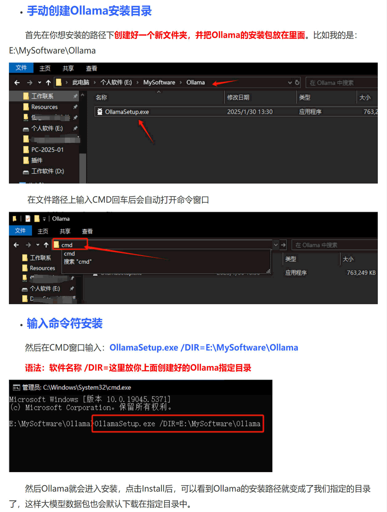
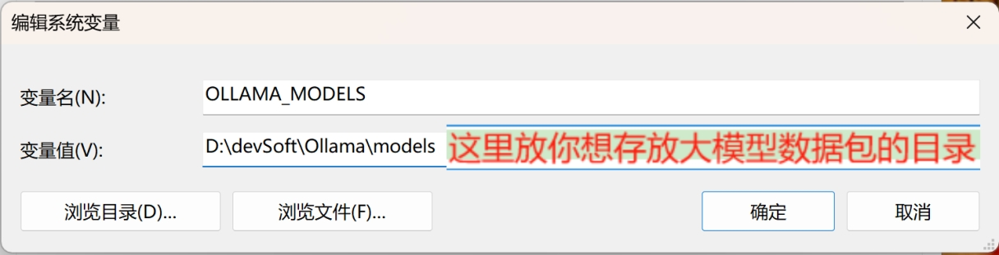
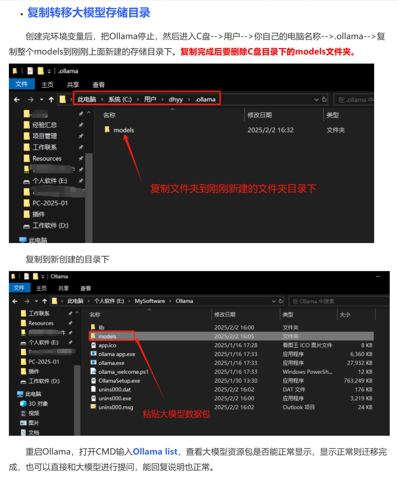
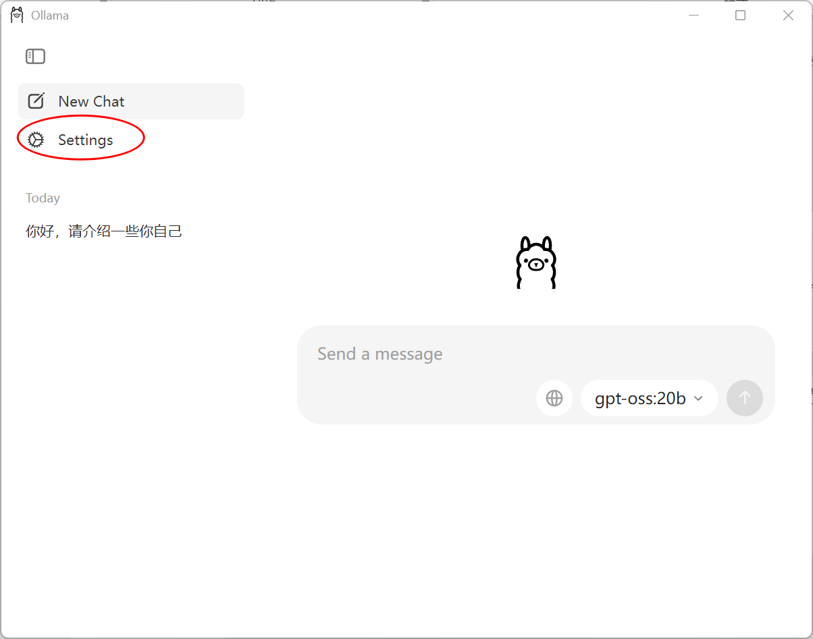
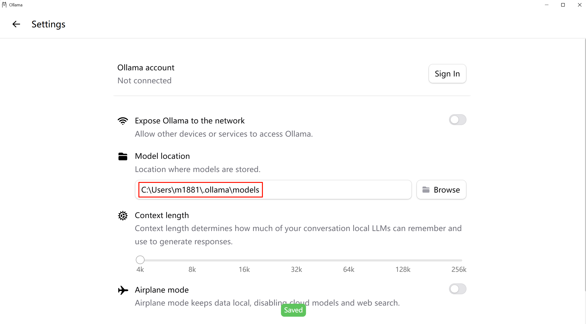
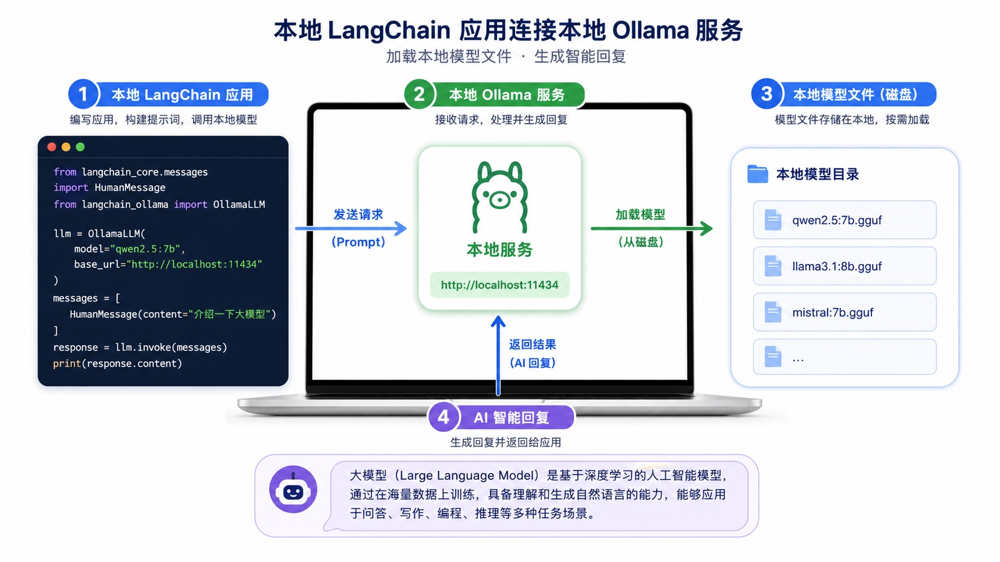

# 12 - Local Deployment and Invocation with Ollama

---

**Chapter Objectives:**

- Understand what **Ollama** is, what problems it solves, and its position within the overall LangChain / Agent learning path.
- Master Ollama's **installation, model directory configuration, common commands, model pulling and verification**, and establish a complete understanding of the "running models locally" workflow.
- Learn how to use the `ChatOllama` in **LangChain** to call the local Ollama service, and understand its similarities and differences compared to the cloud model invocation covered in [Chapter 11: Model I/O and Model Integration](11-Model-I-O%E4%B8%8E%E6%A8%A1%E5%9E%8B%E6%8E%A5%E5%85%A5.md).

**Study Suggestions:** The key point of Ollama is not memorizing a few extra commands, but personally confirming that "local models can be invoked as a service." First install Ollama, pull a small model, verify it can respond using the command line, and then connect it to LangChain's `ChatOllama`. When reading the code, make a note of the model name, model storage location, and machine resource limitations, as these are the most common entry points for troubleshooting local deployments.

**Official Documentation and Resources**: See [Tool Navigation and Reference Index - Model Integration and Local Execution](%E5%B7%A5%E5%85%B7%E5%AF%BC%E8%88%AA%E4%B8%8E%E5%8F%82%E8%80%83%E8%B5%84%E6%96%99%E7%B4%A2%E5%BC%95.md#model-integration-and-local-execution).

---

## 1. Introduction to Ollama

### 1.1 Definition

**Ollama** is a tool for **running open-source large language models locally**. Essentially, it is a local runtime environment for LLMs that encapsulates model downloading, management, loading, execution, and API exposure.

In one sentence:

> **Ollama = lets you run open-source large language models on your own computer with very few commands.**

Once installed, you typically just need to enter a command like the following:

```bash
ollama run qwen:4b
```

If the model is not already present locally, Ollama will download it first; once the download is complete, it will start directly and enter interactive mode. From a beginner's perspective, this is much simpler than manually handling model weights, inference frameworks, starting services, and configuring inference ports.


### 1.2 What Problems Does Ollama Solve

If you have already studied the cloud model invocation in the previous two chapters, you should know that calling models through platforms like Alibaba Bailian, DeepSeek, and OpenAI has the advantages of being simple, stable, and ready to use out of the box. However, it also has clear limitations: it requires an internet connection; it requires an API Key; it incurs usage costs; and in certain scenarios, data cannot leave the local machine or corporate intranet.

Ollama addresses precisely the other approach: **running the model on your own computer.**

Therefore, the most direct problems it solves are:

- **Wanting to use models offline**
- **Wanting to reduce dependence on cloud APIs**
- **Wanting to do local development and local testing**
- **Wanting sensitive data to stay on the local machine as much as possible**
- **Wanting to learn the basic workflow of open-source models and local inference**

You can think of it and cloud API invocation as two different "model integration approaches":

- **Cloud API**: The model runs on someone else's server, and you invoke it over the network.
- **Ollama local execution**: The model runs on your machine, and you invoke it through a local service.

### 1.3 Differences Between Ollama and Cloud APIs

It is important to clarify this point: many students learning Ollama instinctively treat it as "another model platform," but it is more accurately a **local runtime layer**.

| Dimension | Cloud API (e.g., Alibaba Bailian, DeepSeek) | Ollama |
| -------------------- | ------------------------------------ | --------------------------------------------------------- |
| **Where the model is** | On the vendor's servers | On your own computer |
| **Is an API Key required?** | Usually yes | Usually not for local execution |
| **Does it require internet?** | Yes | Local invocation does not require external network access, but the initial model download usually does |
| **Cost** | Billed per invocation | Local model inference is not billed per token, but consumes local compute, memory, and disk |
| **Best suited for** | Quick integration, stable services, no local hardware burden | Local development, privacy-sensitive scenarios, offline testing, learning open-source models |

From a real-world project perspective, these two are not mutually exclusive but are often used together:

- During local development, use Ollama to run small models to validate logic
- During production deployment, switch to stronger, more stable cloud models
- Or, in corporate intranet environments, use a mix of local/private models and cloud models

### 1.4 Use Cases

From a project perspective, a fairly solid recommendation is:

- **Local development / course exercises**: suitable for using Ollama
- **Corporate intranet prototypes / privacy-sensitive validation**: also well-suited
- **Formal inference services with high performance, stability, and concurrency requirements**: evaluate based on business needs whether to continue using Ollama or switch to a more specialized inference deployment solution

But reasonable expectations are also necessary:

- It does not mean "any model can run smoothly on your computer"
- It does not mean "running locally is necessarily cheaper or more powerful than cloud"
- It is more of a **local inference entry point**, suitable for development, experimentation, teaching, and some light to medium applications

### 1.5 Advantages and Limitations

When learning, it is best to see both its advantages and its boundaries.

**Advantages:**

- Low barrier to installation and use
- Simple commands, suitable for beginners
- Convenient model management; the `pull / run / list / rm` command is all you need
- Local invocation typically does not require an API Key
- Mature integration with LangChain's `ChatOllama`

**Limitations:**

- Whether it runs well depends heavily on your machine configuration
- Model files are large and consume memory and disk space
- The capability of local models usually depends on how large a model you can run
- For high-concurrency, enterprise-level inference service scenarios, Ollama may not be the first choice

Therefore, the most accurate positioning for this chapter should be:

> **Ollama is well-suited for learning local models, development debugging, and lightweight local services, but it is not the only solution for all production scenarios.**

---

## 2. Installation and Configuration

### 2.1 Two Things to Know Before Installation

Before actually installing, two things are most easily overlooked:

1. **The Ollama program itself is not large; what really takes up space are the models**
2. **You may download multiple models in the future, so it is best to decide on the model directory from the beginning**

This is also why many tutorials quickly cover `OLLAMA_MODELS` right after installation.  
Because once model files get large, they can easily fill up the system drive.

### 2.2 Download Methods

You can download the version for your platform from the Ollama official website:

- **Main download portal**: https://ollama.com/download
- **Windows download page**: https://ollama.com/download/windows
- **macOS download page**: https://ollama.com/download/mac
- **Linux download page**: https://ollama.com/download/linux

The Linux download page also provides a very common one-line installation method:

```bash
curl -fsSL https://ollama.com/install.sh | sh
```

For Windows and macOS, graphical installer packages are more common.  
Additionally, the official LangChain ChatOllama documentation mentions:

- macOS users can also install via Homebrew: `brew install ollama`
- And start the service with `brew services start ollama`

Installation methods can be chosen by operating system:

- **Windows**: installer package is most common
- **macOS**: installer package or Homebrew
- **Linux**: installation script / manual installation / systemd service

### 2.3 Runtime Environment and Hardware Expectations

Let's clarify hardware expectations first, because "whether it can run" is not just a software installation issue but also a hardware issue.

Whether Ollama runs smoothly is mainly affected by three things:

- **Model size**
- **System memory / VRAM**
- **Whether usable GPU acceleration is available**

You can first note a rough but practical conclusion:

- **The larger the model, the more memory / VRAM it consumes**
- **Smaller models are more suitable for local learning**
- **Not every computer is suitable for running 14B, 32B, or 70B-class models right away**

Based on experience, it is better to start with smaller models, such as:

- `qwen:4b`
- Models in the 7B / 8B parameter range

Rather than pursuing larger models from the start. This is also why the project examples in this course use tags more suitable for local experience, such as `qwen:4b`.

The model names and tags here are teaching examples. The Ollama model library is updated frequently; for actual pullable names, parameter sizes, and capability labels, please refer to the current results on the [Ollama model search page](https://ollama.com/search).

**1) Memory (RAM)**

Generally, more parameters mean more memory consumption. Common scales can be roughly estimated as follows:

- **Approximately 7B (7 billion parameters)**: at least **8GB of available memory** is recommended for running 7B-class models (the OS and other software also consume some; leaving extra headroom is safer).
- **Approximately 13B**: around **16GB** of memory is recommended.
- **Approximately 33B**: around **32GB** of memory is recommended.

If memory is insufficient, loading failures, extremely slow performance, or frequent page swapping and stuttering are likely.

**2) Disk Space**

Model files are often quite large. In addition to the program itself, it is recommended to reserve **at least about 50GB** of free space overall for Ollama and models (add more if installing multiple models).

**3) CPU**

A higher-performance, **multi-core** CPU is more conducive to inference and parallelism, and the difference in experience is more noticeable when running models purely on CPU.

**4) Graphics Card (GPU)**

Ollama **can run using only the CPU**. On **NVIDIA GPUs** with a properly configured driver/CUDA environment, it typically uses GPU acceleration, which is generally significantly faster than CPU-only execution. On **Apple Silicon (M-series)**, Ollama usually leverages **Metal** for acceleration, and there is similarly no need to manually configure a training framework. Whether acceleration is used and which device is utilized should be determined by the local runtime logs and activity monitor.

### 2.4 Custom Installation Path and Model Directory

If you want to install Ollama or model files to a non-default path, such as the D drive, a high-capacity drive, or a dedicated data drive, it is recommended to plan the model directory early.

**On Windows, it is especially recommended not to keep large models on the system drive long-term.**

You can first prepare a directory, for example:

```text
D:\devSoft\Ollama\models
```

Then tell Ollama through environment variables or graphical settings that future models should be stored here.



### 2.5 Changing the Model Storage Directory

If you want to store models outside the default directory, you can set an environment variable:

- **Variable name**: `OLLAMA_MODELS`
- **Variable value**: the directory path where you want to store models

For example:

```text
OLLAMA_MODELS=D:\devSoft\Ollama\models
```



According to the Ollama official FAQ, the default model directories are typically:

- **macOS**: `~/.ollama/models`
- **Linux**: `/usr/share/ollama/.ollama/models`
- **Windows**: `C:\Users\%username%\.ollama\models`

If you need to change the path, the official recommendation is also to use `OLLAMA_MODELS`. Also note:

- **Windows**: Ollama inherits system / user environment variables
- **Linux (standard installation)**: if using a systemd service, environment variables typically need to be configured through systemd
- **macOS (running as an application)**: the official FAQ recommends using `launchctl setenv`

These platform differences are all explained in the official Ollama FAQ:

- https://docs.ollama.com/faq

### 2.6 Migrating or Reusing an Existing Model Directory

If you have previously downloaded models to another directory, you can migrate the existing model directory there directly to avoid downloading them again.



This is very useful in real-world development, for example:

- Changing the drive letter on a computer
- Restoring models after reinstalling the system
- Reusing the same set of models across multiple course directories

### 2.7 Modifying the Model Directory via the GUI

Some versions of the Ollama desktop application support changing the model storage location through the settings interface. If you are using the desktop client, you can check the settings for a **Model location** or similar option.





After making the change, it is recommended to:

1. Restart Ollama
2. Open a new terminal
3. Run `ollama list` to confirm whether the model is correctly recognized

### 2.8 Platform Differences in Setting Environment Variables

This section mainly addresses a common troubleshooting point: the path is clearly changed but does not take effect, often because the environment variable is not set correctly.

According to the official Ollama FAQ:

**Windows:**

1. First, exit Ollama
2. Open the system environment variable settings
3. Create or modify `OLLAMA_MODELS` for the user or system
4. Save and then restart Ollama

**macOS:**

If Ollama runs as an application, the official recommendation is to set it via `launchctl`, for example:

```bash
launchctl setenv OLLAMA_HOST "0.0.0.0:11434"
```

Similarly, `OLLAMA_MODELS` can also be set in the same way, and then the application can be restarted.

**Linux:**

If Ollama runs as a systemd service, the official FAQ suggests using:

```bash
systemctl edit ollama.service
```

Then add a line for each variable under `[Service]`, for example `Environment="OLLAMA_MODELS=/path/to/models"` (can have multiple `Environment=`), and finally execute:

```bash
systemctl daemon-reload
systemctl restart ollama
```

So you can remember a practical conclusion:

> **For Windows, change system environment variables; for macOS application mode, commonly use `launchctl`; for Linux service mode, commonly use `systemd`.**

---

## 3. Common Commands

### 3.1 The Most Commonly Used Set of Commands

After installation, the commands you will actually use most often are just the following:

| Command | Description |
| ------------------------------------- | ----------------------------- |
| `ollama pull llama3` | Download the specified model |
| `ollama run llama3` | Run the model and enter interactive conversation |
| `ollama list` | View locally downloaded models |
| `ollama rm llama3` | Delete a model |
| `ollama show llama3` | View model details |
| `ollama ps` | View currently loaded models |
| `ollama stop llama3` | Stop the currently running model |
| `ollama serve` | Start the local Ollama service |
| `ollama create my-model -f Modelfile` | Create a custom model based on a Modelfile |

**Exiting the `ollama run` interactive conversation**

After entering the chat with `ollama run <模型名>`, to return to the normal terminal prompt:

- Enter `/bye` in the conversation (the exit command provided by Ollama);
- Or use the shortcut **Ctrl+D** (sends an “end of input” to the terminal, which is common on macOS / Linux; new Windows terminals often also support it. If it does not work, you can try **Ctrl+Z** followed by Enter, or simply close that terminal tab).

### 3.2 Explanation of the ollama ps Command

This command is extremely practical in real projects because it not only tells you “whether the model is running,” but also often helps you determine:

- Whether the model is actually loaded
- Whether it is running on CPU or GPU
- Which models are currently resident in memory

The official Ollama FAQ also explicitly mentions that `ollama ps` can help you see whether the model is loaded onto the GPU:

- `100% GPU`
- `100% CPU`
- Or the CPU / GPU hybrid ratio

This is particularly helpful for troubleshooting “why is it so slow locally.”

### 3.3 What Are create and Modelfile

This is advanced knowledge, but it is recommended that you know about it first. Ollama supports creating custom models through **Modelfile**. You can understand a Modelfile as:

> **A configuration blueprint in Ollama for “how to define rules such as system prompts, parameters, and templates based on an existing model.”**

This chapter will not go into the details of custom model building, but you should at least know that `ollama create my-model -f Modelfile` is **not** retraining a model, but rather more like **runtime encapsulation based on an existing model** (system prompts, parameters, templates, etc.).

---

## 4. Installing and Verifying Models

### 4.1 Verifying That Ollama Is Installed Successfully

After installation, it is recommended to first perform two basic checks: 1. whether the command is available; 2. whether the local service is actually listening

#### 4.1.1 Check the Version Number

Execute in the terminal:

```bash
ollama --version
```

If the command is available, it will output something like:

```text
ollama version is 0.x.x
```

This at least indicates two things:

- Ollama is installed
- The `ollama` command can be found in the terminal

#### 4.1.2 Check Whether the Default Port Is Listening

The default port for the Ollama local API is **11434**.  
If the service starts normally, it will usually listen on this port.

A common verification method on Windows:

```bash
netstat -ano | findstr 11434
```

If you see something like:

```text
TCP    127.0.0.1:11434        0.0.0.0:0              LISTENING
```

It means the Ollama service is already listening on the local machine.

According to the official Ollama API documentation, the default address of the local API is:

```text
http://localhost:11434/api
```

But one point should be noted:

- **When calling the native Ollama API directly**, you will usually see `/api/...`
- **LangChain's `ChatOllama`** generally only requires the root address, for example `http://localhost:11434`

This distinction is critical and will be used again later when writing LangChain code.

By default, Ollama only listens on **127.0.0.1** (the local loopback). If other devices on the LAN need to access the local Ollama, you must bind an address through the **OLLAMA_HOST** environment variable before starting (such as `0.0.0.0:11434`). For the specific syntax, see the “How do I configure Ollama server?” section in the [Ollama FAQ](https://docs.ollama.com/faq).

### 4.2 Where to Find Models

If you want to know which models are available in Ollama, the most direct way is to go to the official model library:

- **Model search / Model library**: https://ollama.com/search

There you can see:

- Model names
- Tags
- Parameter sizes
- Whether features such as vision / tools / thinking are supported

When invoking models in Ollama, the model name and tag need to be written completely.
For example:

- `qwen:4b`
- `qwen3:8b`
- `deepseek-r1:14b`

These tags are all “model name + specification.”

### 4.3 Running a Model Using Qwen as an Example

When executing `ollama run <模型名>`, **if the model is not yet available locally, Ollama will automatically pull it first and then start the conversation**, without the need to separately execute `ollama pull` first; if it has already been pulled, it will directly enter interactive mode. After the download is complete, it will enter an interactive conversation.

A common example command:

```bash
ollama run qwen:4b
ollama run qwen3:8b
```

If you see that the official model library already recommends a newer Qwen tag, you can give priority to the lightweight version on the current page that fits your machine configuration.

One reminder here:

> **Whether a model tag is available should be based on the actual name in the official model library at that time.**

Do not memorize a tag from a tutorial; it is best to learn to check the model library yourself.

### 4.4 Using Offline Models from Course Materials

If the course materials or your own disk already contain an existing `models` directory, you can also directly point Ollama to that directory through:

- `OLLAMA_MODELS`
- Or **Model location** in the graphical interface

and then execute:

```bash
ollama list
```

This can often avoid repeated downloads.

### 4.5 How to Determine Whether the Model Is Actually Running

From a learning and troubleshooting perspective, there are three most commonly used methods:

1. `ollama run <模型名>` can enter the conversation normally
2. `ollama list` can show that the model has been downloaded
3. `ollama ps` can show that the model is currently in memory

At the introductory stage, these three are basically sufficient.

---

## 5. Integrating Ollama with LangChain

### 5.1 From the Command Line to Project Integration

Because only being able to `ollama run` in the terminal does not mean you can integrate it into your own project.

The real development goals are usually:

- Call local models from Python code
- Allow local models to also work with Prompt, Parser, LCEL, and Agent
- Allow local models to enter the unified LangChain ecosystem just like cloud models

This is also the core purpose of this section:

> **Upgrade Ollama from a “tool that can chat on the command line” to a “model endpoint that can be called in a project.”**



### 5.2 What Is ChatOllama

`ChatOllama` is a class in LangChain used to connect to the local Ollama chat model. It is responsible for:

> **A Chat Model client for the local model version.**

This means its usage experience has many things in common with what you learned earlier:

- `ChatOpenAI`
- `init_chat_model(...)`

They share many commonalities:

- They can all use `invoke()`
- They all return `AIMessage`
- They can all be connected to Prompt, LCEL, and Agent

The only difference is:

- The previous ones mostly connect to cloud models
- `ChatOllama` connects to the local Ollama service

The two model integration routes can be compared as follows:

| Route | Where the model runs | Main advantages | Main limitations |
| -------- | ---------------- | -------------------------------- | ------------------------------------------- |
| Cloud API | Service provider servers | Saves local resources, strong model capabilities, low maintenance | Data leaves the local machine, depends on network, quota, and platform stability |
| Ollama | Local machine or self-managed server | Strong control, suitable for local experiments and private environments | Limited by local GPU memory / RAM, speed and concurrency are your own responsibility |

So Ollama is not meant to “replace cloud models,” but rather gives you an additional locally controllable model integration route.

### 5.3 Minimal Usage: Passing a String Directly

The simplest way to write it is as follows:

```python
from langchain_ollama import ChatOllama

model = ChatOllama(
    model="qwen:4b",
    base_url="http://localhost:11434",
)

print(model.invoke("什么是 LangChain，100 字以内").content)
```

This is almost the same as the “string `invoke()`” you learned in previous chapters, except that the endpoint has changed from the cloud to local.

### 5.4 Message List Syntax: More Consistent with Later Chapters

If you want to stay consistent with [Chapter 13: Prompts and Message Templates](13-%E6%8F%90%E7%A4%BA%E8%AF%8D%E4%B8%8E%E6%B6%88%E6%81%AF%E6%A8%A1%E6%9D%BF.md), you can also pass a message list:

```python
from langchain_core.messages import HumanMessage
from langchain_ollama import ChatOllama

ollama_llm = ChatOllama(model="qwen3:8b")
messages = [HumanMessage(content="你好，请介绍一下你自己")]
resp = ollama_llm.invoke(messages)
print(resp.content)
```

The value of this syntax is that:  
Later, when you learn Prompt, Messages, multi-turn history, and Agent, the thinking will be continuous.

### 5.5 Why Explicitly Write base_url

Many people wonder: why does the code sometimes write `base_url="http://localhost:11434"`, and sometimes not?

This can be handled according to the following rule:

- **Not written**: the default local address is used
- **Wrote it explicitly**: clearer and more explicit, and it also makes it easier for you to switch to a remote Ollama instance or a different port later

For example:

```python
ChatOllama(
    model="qwen3:8b",
    base_url="http://localhost:11434",
)
```

This is also more intuitive from a teaching perspective, because you can clearly know which service address you are connecting to.

### 5.6 Basic Example

[Example source code]`案例与源码-2-LangChain框架/03-ollama/LangChain_Ollama.py`

[LangChain_Ollama.py](../../%E6%A1%88%E4%BE%8B%E4%B8%8E%E6%BA%90%E7%A0%81-2-LangChain%E6%A1%86%E6%9E%B6/03-ollama/LangChain_Ollama.py ":include :type=code")

This example is the most important code landing point in this chapter.  
It corresponds to:

- Using `ChatOllama`
- Pointing to the local machine `http://localhost:11434`
- Directly `invoke()` a question
- Observing the returned result

Although it is very short, it is very meaningful, because it accomplishes the following:

> **Turn Ollama from a "local model in the terminal" into a "model object in LangChain code."**

---

**Chapter reflection questions:**

1. Compared with calling a cloud API, what does running Ollama locally actually change?

   **Reference thoughts:** Model weights, inference computation, and data flow mainly stay on the local machine, giving stronger privacy and control, but you also have to take on local resources, model downloads, performance, and operations. Cloud APIs save resources, but data leaves your machine.

2. If `ollama run` can answer, but the LangChain code call fails, how would you troubleshoot?

   **Reference thoughts:** First confirm whether the Ollama service is running on port `11434`, then check whether the model name matches, whether the `ChatOllama` configuration is correct, whether the dependencies are installed, and whether the code can access the local address. The command line working does not necessarily mean the code-side configuration is correct.

3. When a local model performs poorly, would you first switch models, or first check the task and prompt?

   **Reference thoughts:** First check whether the task is suitable for the current model size, whether the Prompt is clear, and whether the input is too long or missing context. Small models have limited capabilities, so directly switching to a larger model may work, but you should also confirm that the problem is not in the task design.

4. Why do you need to care about model size, memory, VRAM, and concurrency when deploying locally?

   **Reference thoughts:** Local machine resources are limited. The larger the model, the higher the resource usage, the slower the response, and the more likely concurrency will stall. Whether it can be used for personal experiments and whether it can support serving multiple users are two different things.

**Chapter summary:**

- **Ollama** is a local open-source LLM runtime environment. Its core value is that it lets you download, manage, and run models on your own computer, and provide services to the outside through a local API. It is not a replacement for the cloud API calls in the previous two chapters, but another "model integration route": **cloud models run on someone else's servers, while local models run on your own machine.**
- This chapter has two main practical threads: the first is **installation and model management**, including downloading Ollama, planning the model directory, understanding `OLLAMA_MODELS`, and mastering common commands such as `pull / run / list / rm / ps`; the second is **LangChain integration**, which means using `ChatOllama` to bring the local model into the same programming approach as cloud models, continuing to use the unified abstraction of `invoke()`, message lists, and `AIMessage`.
- More important than memorizing all the commands in this chapter is building a complete understanding: **Ollama is responsible for running the model locally, and LangChain is responsible for connecting the local model into code and application workflows.** Once you understand this, you can continue practicing Prompt, LCEL, Agent, and RAG on local models in the following chapters.

**Suggested next step:** First complete this minimal chain yourself: install Ollama → run a local model once with `ollama run qwen:4b` → use `案例与源码-2-LangChain框架/03-ollama/LangChain_Ollama.py` to call the local model in Python. Once that works, move on to [Chapter 13 Prompts and Message Templates](13-%E6%8F%90%E7%A4%BA%E8%AF%8D%E4%B8%8E%E6%B6%88%E6%81%AF%E6%A8%A1%E6%9D%BF.md), [Chapter 14 Output Parsers](14-%E8%BE%93%E5%87%BA%E8%A7%A3%E6%9E%90%E5%99%A8.md), and [Chapter 15 LCEL and Chain Invocation](15-LCEL%E4%B8%8E%E9%93%BE%E5%BC%8F%E8%B0%83%E7%94%A8.md) to weave the local model into a complete LangChain workflow as well.
