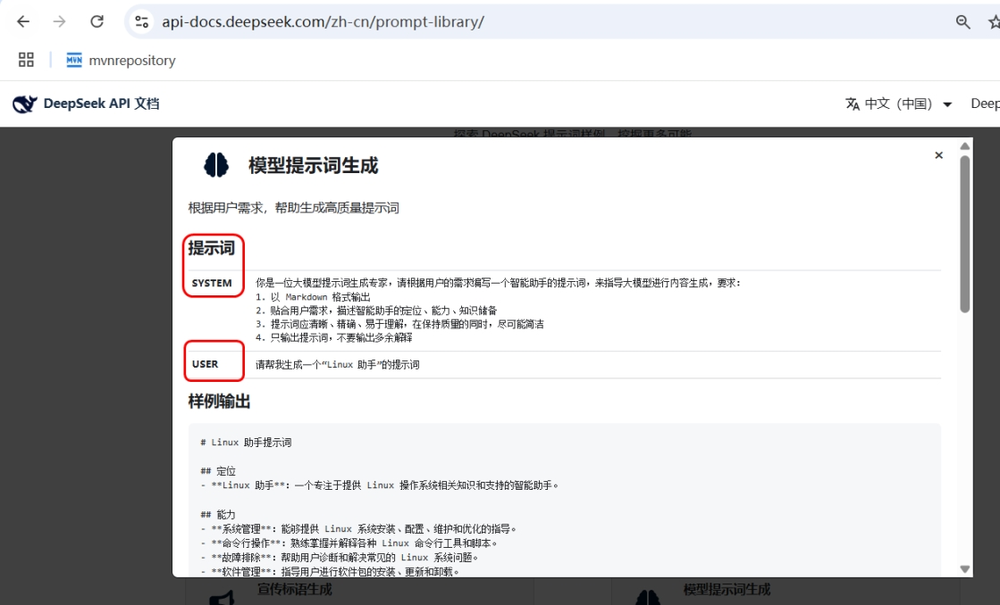
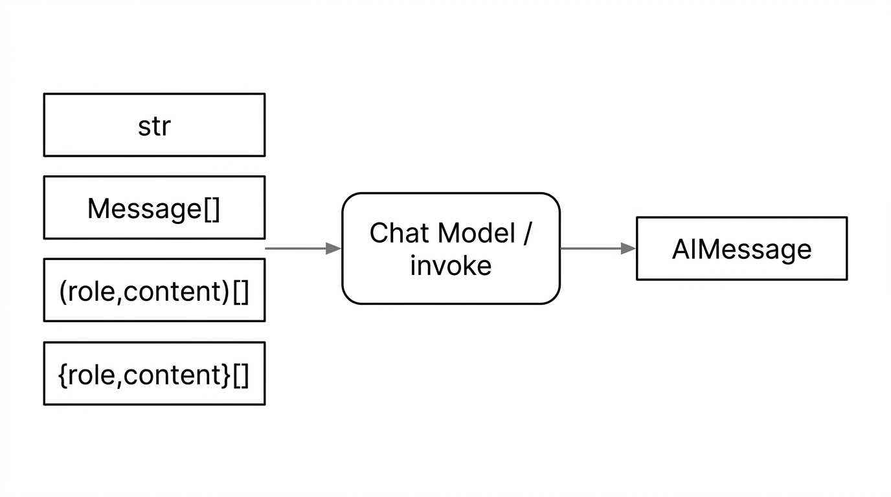
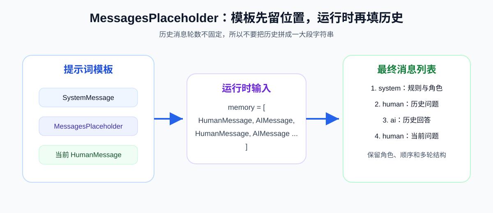

# 13 - Prompts and Message Templates

---

**Learning objectives for this chapter:**

- Understand what a **Prompt** is and why it has gradually evolved from "a string" into "multi-role messages + templates + placeholders".
- Master the three most important parts of LangChain related to input organization: **message types (Message)**, **model invocation methods (invoke / stream / batch)**, and **prompt templates (PromptTemplate / ChatPromptTemplate)**.
- Be able to run and understand all examples in this chapter: **input types, synchronous and asynchronous calls, text templates, chat templates, message placeholders, and loading prompts from JSON / YAML**, laying the foundation for the later chapters on [output parsers](14-%E8%BE%93%E5%87%BA%E8%A7%A3%E6%9E%90%E5%99%A8.md), [LCEL and chained invocation](15-LCEL%E4%B8%8E%E9%93%BE%E5%BC%8F%E8%B0%83%E7%94%A8.md), and [memory and conversation history](16-%E8%AE%B0%E5%BF%86%E4%B8%8E%E5%AF%B9%E8%AF%9D%E5%8E%86%E5%8F%B2%EF%BC%88%E5%90%ABRedis%E5%9F%BA%E7%A1%80%EF%BC%89.md).

**Study advice:** When reading this chapter, take an ordinary user question and turn it into a message list: put rules in the system message, the task in the user message, and context in the history messages. First understand what exactly the model receives, and then look at how `PromptTemplate`, `ChatPromptTemplate`, and `MessagesPlaceholder` help you reuse these structures. After reading, you should ideally be able to decide: when to hardcode a prompt, when to extract it into a template, and when to put the template in a file.

**Official documentation and resources**: See [Tool Navigation and Reference Index - Prompts and Structured Output](%E5%B7%A5%E5%85%B7%E5%AF%BC%E8%88%AA%E4%B8%8E%E5%8F%82%E8%80%83%E8%B5%84%E6%96%99%E7%B4%A2%E5%BC%95.md#prompting-and-structured-output).

---

## 1. Introduction to Prompts

This chapter corresponds to the **input formatting (Format)** and **model invocation (Predict)** parts of [Chapter 11 Model I/O](11-Model-I-O%E4%B8%8E%E6%A8%A1%E5%9E%8B%E6%8E%A5%E5%85%A5.md). Models do not "think out of thin air"; they always produce output after reading the input we provide. Prompts, Messages, and Templates are the core tools for organizing that input.

If you have already studied [1-2 Prompt Engineering Basics](1-2-%E6%8F%90%E7%A4%BA%E8%AF%8D%E5%B7%A5%E7%A8%8B%E5%9F%BA%E7%A1%80.md), you can treat this chapter as its code implementation: the previous chapter explained "how to clearly state roles, tasks, context, input, output, and constraints"; this chapter explains "what input form these elements should take once they enter LangChain, how to reuse them, how to insert multi-turn history, and how to externalize them into files".

### 1.1 Definition

A **Prompt** is the input content you send to a large language model.

The simplest Prompt is a natural language sentence, such as "What is LangChain?". Going a step further, you can give it a role, such as "You are a legal advisor. Please introduce the advertising law in 50 words." And later, to make the code reusable, maintainable, and collaborative, you will write this input as a template and replace the changing parts with placeholders. This is the process of moving from "casual questioning" to "engineered input management".

At the introductory stage, you can keep one basic judgment in mind: **A Prompt is not just about wording a sentence well; it is about organizing the model input clearly.**

In real projects, a Prompt usually does several things:

- Tells the model who it is and what role it should play.
- Tells the model what the current task is and what the boundaries of its answer are.
- Tells the model what the output format should look like.
- Combines the user question, conversation history, retrieved results, and tool results into one complete input.

This is also why, as project complexity increases, a Prompt gradually evolves from "a string" into "multi-role messages + templates + placeholders + external configuration files".



### 1.2 The Role of Prompts

Many people learning LangChain focus on "which model to connect to", "which platform to switch to", and "how to configure an API key". But in real projects, what most often makes a system unstable is not the model integration, but rather **input that is not organized clearly enough**.

The following real development scenarios all depend on the content of this chapter:

- **Intelligent customer service**: needs system prompts to define tone, identity, and refusal policy.
- **Enterprise knowledge base Q&A**: needs to combine "retrieved context + user question" into a clear prompt.
- **Multi-turn chat**: needs to insert conversation history back into the current input, rather than starting from scratch each turn.
- **Structured output**: needs to specify the output format requirements in the Prompt in advance, so that it can be handed to a parser later.
- **Team collaboration and A/B testing**: needs to extract prompt templates from code and manage their versions in JSON / YAML.

In one sentence: **Model capability determines the upper limit; Prompt design determines whether you can reliably approach that upper limit.**

### 1.3 Where This Chapter Fits in a Project

This chapter corresponds to the `案例与源码-2-LangChain框架/04-prompt` directory in the repository. By learning order, it can be divided into four categories:

| Directory                    | Purpose         | What you will learn                               |
| ----------------------- | ------------ | ------------------------------------------ |
| `invoke/`               | Model invocation methods | `invoke`, `stream`, `batch`, and their asynchronous versions     |
| `prompt_templates/`     | Text templates     | Creation, formatting, and reuse of `PromptTemplate`      |
| `chat_prompt_template/` | Chat templates     | `ChatPromptTemplate`, message parameters, message placeholders |
| `load_external/`        | Loading from external files | How to load prompts from JSON / YAML             |

This chapter is not a scattered API introduction. Rather, it answers one question: **When developing LLM applications, how do you organize the techniques and principles learned in [1-2 Prompt Engineering Basics](1-2-%E6%8F%90%E7%A4%BA%E8%AF%8D%E5%B7%A5%E7%A8%8B%E5%9F%BA%E7%A1%80.md) into a structure that is reusable, maintainable, and scalable?**

---

## 2. Input Types for Calling Large Language Models

Beginners often mistakenly assume that when calling a chat model, the input can only ever be "a string". In practice, LangChain chat models usually support multiple input forms to accommodate real conversation scenarios. These ways of writing look different on the surface, but their core is the same: **deliver the roles, tasks, context, input, and constraints discussed in [Chapter 1-2](1-2-%E6%8F%90%E7%A4%BA%E8%AF%8D%E5%B7%A5%E7%A8%8B%E5%9F%BA%E7%A1%80.md) to the model in an appropriate message structure.**

### 2.1 Overview of Input Forms

For the same `invoke`, the left side can be several different input types, the middle is processed by the chat model, and the typical return value on the right is `AIMessage`. This is also why you will often see in [Chapter 11](11-Model-I-O%E4%B8%8E%E6%A8%A1%E5%9E%8B%E6%8E%A5%E5%85%A5.md) that "the main content is generally read through `.content`".



Common correspondences are as follows:

| Input form                                     | What the call roughly looks like                                      | Suitable scenarios                           |
| -------------------------------------------- | ------------------------------------------------------- | ---------------------------------- |
| `str`                                        | `model.invoke("请解释什么是 LangChain")`                | Single-turn, lightweight, quick API testing             |
| String after `PromptTemplate.format(...)`      | `model.invoke(prompt_str)`                              | Fixed phrasing + a few variable substitutions            |
| List of message objects                                 | `model.invoke([SystemMessage(...), HumanMessage(...)])` | Recommended approach; suitable for system prompts and multi-turn conversations   |
| List of `(role, content)` tuples                   | `[("system", "..."), ("user", "...")]`                  | Concise; close to the ChatPromptTemplate style |
| List of `{"role": "...", "content": "..."}` dictionaries | `[{"role":"system","content":"..."}, ...]`              | Close to OpenAI-style JSON data         |

[Example source code] `案例与源码-2-LangChain框架/04-prompt/invoke/LLM_Invoke_InputTypes.py`

[LLM_Invoke_InputTypes.py](../../%E6%A1%88%E4%BE%8B%E4%B8%8E%E6%BA%90%E7%A0%81-2-LangChain%E6%A1%86%E6%9E%B6/04-prompt/invoke/LLM_Invoke_InputTypes.py ":include :type=code")

### 2.2 Method One: Plain String

The simplest input method: put the entire explanation in a single string and hand it to the model. It is suitable for quickly testing an API or for single-turn, one-sentence tasks.

```python
resp = model.invoke("用一句话解释什么是 LangChain")
print(resp.content)
```

However, in real projects, plain strings also have obvious limitations: it is inconvenient to express the boundary between the system role and the user question; it is inconvenient to insert conversation history; and it is not conducive to later maintenance and multi-person collaboration.

Therefore, **plain strings are good for getting started, but they are not suitable for long-term use in complex conversation scenarios.**

### 2.3 Method Two: Template + Placeholders

If only a few variables in a prompt change, there is no need to handwrite the entire long text each time. A more reasonable approach is to write the fixed parts as a template and leave the changing parts as placeholders.

This section is still essentially "string input"; it is just that we have engineered the process of generating the string.

```python
from langchain_core.prompts import PromptTemplate

template = PromptTemplate.from_template(
    "用不超过 50 字介绍：{topic} 是什么？"
)
prompt_str = template.format(topic="LangChain")
resp = model.invoke(prompt_str)
print(resp.content)
```

In other words:

- **`PromptTemplate` is responsible for producing the input**
- **`model.invoke(...)` is responsible for sending the input to the model**

The difference from 2.2 is not that the model receives a different type, but rather **whether we write the string by hand or generate it through a template**.

### 2.4 Method Three: Multi-Role Message List

When you start building chatbots, Q&A assistants, enterprise knowledge bases, or code assistants, the most recommended input form is usually not a string but a **message list**.

The reason is simple: chat models are better at understanding "who is speaking". By splitting the input into roles such as `SystemMessage`, `HumanMessage`, and `AIMessage`, the model can more easily understand the context structure correctly, instead of treating everything as one large block of flat text.

```python
from langchain_core.messages import SystemMessage, HumanMessage, AIMessage

messages = [
    SystemMessage(content="你是只回答技术问题的助手，回答要简短。"),
    HumanMessage(content="什么是 LangChain？"),
    # 多轮示例：
    # AIMessage(content="LangChain 是用于编排 LLM 应用的框架……"),
    # HumanMessage(content="它和直接调 API 有什么区别？"),
]
resp = model.invoke(messages)
print(resp.content)
```

In actual projects, this approach is especially common:

- **System prompt** goes in `SystemMessage`
- **User question** goes in `HumanMessage`
- **Historical replies** can be placed back in `AIMessage`
- **Tool execution results** can later be represented with `ToolMessage`

If you later work on multi-turn conversations, Agents, or RAG, this message-list mindset will be used again and again.

There is also an equivalent wrapper called `ChatPromptValue`: in chain orchestration it is more common to obtain `ChatPromptValue` from `ChatPromptTemplate.invoke(...)`. The object is constructed directly below to make it easier to understand the connection of "`PromptValue` → `to_messages()` → `model.invoke`".

```python
from langchain_core.messages import SystemMessage, HumanMessage, AIMessage
from langchain_core.prompt_values import ChatPromptValue

prompt_value = ChatPromptValue(
    messages=[
        SystemMessage(content="You are a helpful AI bot. Your name is Bob."),
        HumanMessage(content="Hello, how are you doing?"),
        AIMessage(content="I'm doing well, thanks!"),
        HumanMessage(content="What is your name?"),
    ]
)
resp = model.invoke(prompt_value.to_messages())
```

### 2.5 Method Four: Tuple Lists and Dictionary Lists

In addition to explicitly using classes such as `SystemMessage` and `HumanMessage`, LangChain chat models usually also support two common shorthand forms.

- **Tuple list**: each item is written as `(role, content)`
- **Dictionary list**: each item is written as `{"role": "...", "content": "..."}`

These two forms are semantically almost equivalent to a list of message objects. They are just closer to handwritten lists or OpenAI-style data structures.

```python
import os
from langchain_openai import ChatOpenAI

llm = ChatOpenAI(
    model="gpt-4o-mini",
    temperature=0.0,
    base_url=os.getenv("OPENAI_BASE_URL"),
    api_key=os.getenv("OPENAI_API_KEY"),
)

messages_as_tuples = [
    ("system", "你是一个专业的数学助手"),
    ("user", "你好，你是谁"),
]
messages_as_dicts = [
    {"role": "system", "content": "你是一个专业的数学助手"},
    {"role": "user", "content": "你好，你是谁"},
]

resp = llm.invoke(messages_as_tuples)
print(type(resp))
print(resp.content)

resp2 = llm.invoke(messages_as_dicts)
print(resp2.content)
```

As for selection strategy, it can be understood through the following reasoning:

- **To understand things most clearly**: prefer using the `Message` class.
- **To write in the most concise way**: use tuple lists.
- **To align with OpenAI-style request bodies**: use dictionary lists.

Regardless of the approach, the return value of synchronous `invoke` is usually still `AIMessage`.

### 2.6 Extension: Multi-Role in the Java Ecosystem

The "System / User / Assistant / Tool" approach is not unique to LangChain Python. **LangChain4J** and **Spring AI** in the Java ecosystem have similar designs. This is valuable to understand because it shows that:

**Multi-role messages are not a syntactic trick of a particular framework; they are a general abstraction for modern chat model interaction.**

**LangChain4J:**

```java
package dev.langchain4j.data.message;

public enum ChatMessageType {
    SYSTEM(SystemMessage.class),
    USER(UserMessage.class),
    AI(AiMessage.class),
    TOOL_EXECUTION_RESULT(ToolExecutionResultMessage.class),
    CUSTOM(CustomMessage.class);

    private final Class<? extends ChatMessage> messageClass;

    ChatMessageType(Class<? extends ChatMessage> messageClass) {
        this.messageClass = messageClass;
    }

    public Class<? extends ChatMessage> messageClass() {
        return messageClass;
    }
}
```

**Spring AI:**

```java
package org.springframework.ai.chat.messages;

public enum MessageType {
    USER("user"),
    ASSISTANT("assistant"),
    SYSTEM("system"),
    TOOL("tool");

    private final String value;

    MessageType(String value) {
        this.value = value;
    }

    public static MessageType fromValue(String value) { ... }

    public String getValue() {
        return this.value;
    }
}
```

---

## 3. Message Types for Input

Once you organize the input into a "message list", you need to know what each message type represents. In the official LangChain context, the most important message types are: **SystemMessage**, **HumanMessage**, **AIMessage**, and **ToolMessage**.

**Docs**: https://docs.langchain.com/oss/python/langchain/messages (English); https://docs.langchain.org.cn/oss/python/langchain/messages (Chinese)

### 3.1 Four Core Message Types

| Type            | Description                                             | Most Common Use in Projects                  |
| --------------- | ------------------------------------------------ | ----------------------------------- |
| `SystemMessage` | System message, usually used to specify role, style, boundaries, and output format | Setting persona, answering rules, refusal policies        |
| `HumanMessage`  | User message, corresponding to the user's current input                       | Placing user questions, supplementary conditions, follow-up questions      |
| `AIMessage`     | Model reply message                                     | Saving the previous round's reply to support multi-turn context      |
| `ToolMessage`   | Tool execution result message                                 | Returning results from external tools/functions to the model |

Two details are worth noting:

1. **LangChain's class is called `HumanMessage`, but many platforms use `user` for the role field.** This is not a conflict, but rather naming conventions at different layers. You can think of them as the same role.

2. **Older materials may still show `FunctionMessage`.** In the LangChain 1.x context, `ToolMessage` is more common. If you encounter such differences while reading older tutorials or code, just understand it as the old name for tool call results.

### 3.2 The Role of SystemMessage

Many beginners mix the system prompt and the user question into a single string. While this works, it is difficult to maintain. A more robust approach is to separate "rules" from "questions":

- **SystemMessage** is responsible for defining system-level rules
- **HumanMessage** is responsible for carrying the current user question

For example:

- "You are a legal assistant and only answer legal questions"
- "Keep your output within 80 characters"
- "If the request is out of scope, clearly refuse to answer"

These items are better placed in `SystemMessage` because they are "long-term rules" rather than a specific question for a single round.

This corresponds to the principle emphasized in [1-2 Prompt Engineering Basics](1-2-%E6%8F%90%E7%A4%BA%E8%AF%8D%E5%B7%A5%E7%A8%8B%E5%9F%BA%E7%A1%80.md): **stable constraints and dynamic input should be written separately.** In LangChain, the most direct way to apply this principle is to put stable rules in `SystemMessage` and the current task in `HumanMessage`.

In real projects, SystemMessage often determines:

- Whether the tone of the response is professional
- Whether speculation is allowed
- Whether context must be cited
- Whether output must be in JSON
- Whether conservative refusal is required

This is also why prompt engineering often says: **the system prompt defines behavioral boundaries, while the user prompt defines the current task.**

### 3.3 When ToolMessage Appears

`ToolMessage` does not appear frequently in ordinary Q&A. It is more common in function calling, tool calling, and Agent orchestration scenarios.

A simple way to understand it:

- The model first expresses "I want to call a certain tool" in `AIMessage`
- The code actually executes the tool
- The tool result is then passed back to the model as a `ToolMessage`

This allows the model to continue answering based on the tool result.

Below is a simplified example:

```python
from langchain_core.messages import SystemMessage, HumanMessage, AIMessage, ToolMessage

messages = [
    SystemMessage(content="你是一位乐于助人的智能小助手"),
    HumanMessage(content="你好，请你介绍一下你自己"),
    AIMessage(content="我是一名人工智能助手，请问您有什么想问的吗？"),
    ToolMessage(
        content='{"population": 21540000, "area": "16410平方公里"}',
        tool_call_id="call_abc123",
    ),
]
print(messages)
```

For this chapter, you only need a basic impression: **System / Human / AI are the three most commonly used types; ToolMessage is an important foundation for later chapters on Agents and tool calling.**

---

## 4. Methods for Calling Large Language Models

Once the input is organized, the next step is to pass it to the model. LangChain chat models commonly support four calling methods: regular invocation, streaming invocation, batch invocation, and their asynchronous counterparts.

This section may look like an API memorization exercise, but it can be understood more intuitively:

- **invoke / ainvoke**: send one message at a time
- **stream / astream**: return results as they are generated
- **batch / abatch**: send many messages at once

### 4.1 Regular Invocation (invoke / ainvoke)

[Example source code] `案例与源码-2-LangChain框架/04-prompt/invoke/LLM_Invoke.py`, `LLM_aInvoke.py`

- `invoke`: synchronous invocation, the most common, suitable for single-turn Q&A and script demonstrations.
- `ainvoke`: asynchronous invocation, suitable for async web services, concurrent tasks, and high-throughput scenarios.

```python
import os
from langchain.chat_models import init_chat_model
from langchain_core.messages import HumanMessage, SystemMessage

model = init_chat_model(
    model="qwen-plus",
    model_provider="openai",
    api_key=os.getenv("aliQwen-api"),
    base_url="https://dashscope.aliyuncs.com/compatible-mode/v1"
)
messages = [
    SystemMessage(content="你是一个法律助手，只回答法律问题，超出范围回答：非法律问题无可奉告"),
    HumanMessage(content="简单介绍下广告法，一句话 50 字以内")
]
response = model.invoke(messages)
print(type(response))
print(response.content)
```

How to choose in real projects:

- **CLI scripts, teaching examples, simple background tasks**: prefer `invoke`
- **FastAPI, async services, concurrent requests**: prefer `ainvoke`
- **Local open-source models (Ollama, etc.)**: instantiation and endpoint configuration are covered in [Chapter 12: Ollama Local Deployment and Invocation](12-Ollama%E6%9C%AC%E5%9C%B0%E9%83%A8%E7%BD%B2%E4%B8%8E%E8%B0%83%E7%94%A8.md). The `invoke` / `stream` / `batch` usage in this chapter applies equally.

[LLM_Invoke.py](../../%E6%A1%88%E4%BE%8B%E4%B8%8E%E6%BA%90%E7%A0%81-2-LangChain%E6%A1%86%E6%9E%B6/04-prompt/invoke/LLM_Invoke.py ":include :type=code")

[LLM_aInvoke.py](../../%E6%A1%88%E4%BE%8B%E4%B8%8E%E6%BA%90%E7%A0%81-2-LangChain%E6%A1%86%E6%9E%B6/04-prompt/invoke/LLM_aInvoke.py ":include :type=code")

### 4.2 Streaming Invocation (stream / astream)

[Example source code] `案例与源码-2-LangChain框架/04-prompt/invoke/LLM_Stream.py`, `LLM_aStream.py`

- **stream**: synchronous streaming output
- **astream**: asynchronous streaming output

The biggest value of streaming is not "computing faster," but **displaying generated content to the user sooner**. In scenarios such as chatbots, report generation, and code generation, the user experience is noticeably better.

```python
messages = [
    SystemMessage(content="你叫小问，是一个乐于助人的AI助手"),
    HumanMessage(content="你是谁")
]
for chunk in model.stream(messages):
    print(chunk.content, end="", flush=True)
print()
```

In real projects, `stream` / `astream` are commonly used for:

- A "typewriter effect" in chat interfaces
- Early display of long responses
- Reducing user waiting anxiety

[LLM_Stream.py](../../%E6%A1%88%E4%BE%8B%E4%B8%8E%E6%BA%90%E7%A0%81-2-LangChain%E6%A1%86%E6%9E%B6/04-prompt/invoke/LLM_Stream.py ":include :type=code")

[LLM_aStream.py](../../%E6%A1%88%E4%BE%8B%E4%B8%8E%E6%BA%90%E7%A0%81-2-LangChain%E6%A1%86%E6%9E%B6/04-prompt/invoke/LLM_aStream.py ":include :type=code")

### 4.3 Batch Processing (batch / abatch)

[Example source code] `案例与源码-2-LangChain框架/04-prompt/invoke/LLM_Batch.py`, `LLM_aBatch.py`

- **batch**: submit multiple inputs at once and receive multiple results together
- **abatch**: asynchronous batch processing

It is especially suitable for offline tasks rather than interactive chat. For example:

- Batch summarizing a set of documents
- Batch cleaning Q&A data
- Batch evaluating prompt performance
- Batch labeling and classifying products, comments, or tickets

```python
questions = [
    "什么是 Redis？简洁 100 字以内",
    "Python 的生成器是做什么的？简洁 100 字以内",
]
response = model.batch(questions)
for q, r in zip(questions, response):
    print(f"问题：{q}\n回答：{r.content}\n")
```

[LLM_Batch.py](../../%E6%A1%88%E4%BE%8B%E4%B8%8E%E6%BA%90%E7%A0%81-2-LangChain%E6%A1%86%E6%9E%B6/04-prompt/invoke/LLM_Batch.py ":include :type=code")

[LLM_aBatch.py](../../%E6%A1%88%E4%BE%8B%E4%B8%8E%E6%BA%90%E7%A0%81-2-LangChain%E6%A1%86%E6%9E%B6/04-prompt/invoke/LLM_aBatch.py ":include :type=code")

### 4.4 Summary

| Scenario     | Synchronous     | Asynchronous      | Suitable for        |
| -------- | -------- | --------- | ------------------- |
| Single invocation | `invoke` | `ainvoke` | Single-turn Q&A, API services  |
| Streaming output | `stream` | `astream` | Chat UI, long text generation |
| Batch processing | `batch`  | `abatch`  | Offline tasks, batch evaluation  |

If you cannot remember all of them at once, that is fine. Just remember this basic rule first:

**Learn `invoke` first, then `stream`, and finally add `batch` and the asynchronous versions.**

---

## 5. Overview of Prompt Templates

### 5.1 Introduction to Prompts

In real projects, prompts can almost never be permanently hardcoded. The reasons are practical:

- User questions change
- Persona settings change
- Output requirements change
- Business strategies are adjusted
- Team members need to maintain prompts together

If you manually write a full prompt every time, it is not only repetitive but also very difficult to maintain. The role of prompt templates is to **retain the fixed parts and turn the changing parts into variables**, allowing the same prompting logic to be reused repeatedly.

This is very similar to Python's `f-string`:

```python
def hello(name: str) -> None:
    print(f"你好：{name}")

if __name__ == "__main__":
    hello("李四")
```

Here, `{name}` is like a placeholder in a prompt template. You can simply think of it as "reserve a slot first, fill in the value later."

### 5.2 Types of Prompt Templates

Common prompt templates in LangChain fall into the following categories. This course focuses mainly on the first two:

| Type                      | Description                                         | Coverage in this course |
| ------------------------- | -------------------------------------------- | ---------- |
| **PromptTemplate**        | For plain text templates; after filling values, usually produces a string     | Key focus   |
| **ChatPromptTemplate**    | For multi-role templates targeting chat models; after filling values, produces multiple messages | Key focus   |
| **FewShotPromptTemplate** | Embeds several "example input-output" pairs into the prompt              | Awareness only   |
| **PipelinePrompt**        | Combines multiple sub-prompts in sequence                       | Awareness only   |

At the beginner stage, you can use a simplified understanding:

- **Single text tasks**: start with `PromptTemplate`
- **Chat models, multiple roles, multi-turn dialogue**: focus on `ChatPromptTemplate`

### 5.3 Few-shot Templates

Few-shot means: do not only tell the model "what rules to follow," but also give it several examples of "how input should become output."

It is suitable for the following scenarios:

- Classification labels are easily confused and need a few standard examples
- Output style has requirements that text descriptions alone cannot stabilize
- Task rules are not complex, but you want the model to imitate a fixed format

At the beginner stage, you do not need to memorize all parameters of `FewShotPromptTemplate`. Just remember one sentence: **Few-shot turns examples into part of the prompt so the model can follow them.** Later, when you work on classification, extraction, or customer service response generation, you can use it as a stability-enhancing technique.

---

## 6. Text Prompt Template (PromptTemplate)

### 6.1 Introduction

`PromptTemplate` is the most basic template class in LangChain, suitable for turning a text prompt into a "fixed skeleton + dynamic variables" form.

It is best suited for scenarios such as:

- Single-turn text tasks like summarization, rewriting, translation, and classification
- Cases where there is no need yet to explicitly distinguish system / user roles
- Cases requiring frequent replacement of a small number of variables

If you connect this with Section 2, it becomes easier to understand: **the result of PromptTemplate is still usually a string, except that this string is no longer handwritten but generated by a template.**

### 6.2 Common Parameters

| Parameter                | Description                                     |
| ------------------- | ---------------------------------------- |
| `template`          | Template string, which can contain `{变量名}` placeholders |
| `input_variables`   | List of variable names that must be passed when invoking               |
| `partial_variables` | A subset of variables fixed in advance at template creation time     |

Among these, `partial_variables` is especially worth understanding. Its purpose is straightforward:

**Fix the variables that "rarely change" in advance, so that each subsequent call only passes the parts that actually vary.**

A typical example:

- The system role is permanently fixed as "Python engineer"
- But the user question changes every time

This way, you do not need to repeatedly pass `role="Python 工程师"` every time.

### 6.3 Common Methods

| Method            | Return value                | Suitable scenario                                     | Example source code                          |
| --------------- | --------------------- | -------------------------------------------- | --------------------------------- |
| `format(...)`   | `str`                 | Most common; after getting the string, pass it directly to the model or continue concatenating it yourself | `PromptTemplate_FormatMethod.py`  |
| `invoke({...})` | `PromptValue`         | More natural when integrating into LangChain chains                | `PromptTemplate_InvokeMethod.py`  |
| `partial(...)`  | New `PromptTemplate` | Fix some variables first, then reuse multiple times                   | `PromptTemplate_PartialMethod.py` |

```python
from langchain_core.prompts import PromptTemplate

template = PromptTemplate.from_template(
    "你是一个专业的{role}工程师，请回答我的问题，我的问题是：{question}"
)

# 1）format：得到 str
prompt_str = template.format(role="python开发", question="二分查找怎么写？")

# 2）invoke：得到 PromptValue
prompt_value = template.invoke({"role": "python开发", "question": "冒泡排序怎么写？"})
prompt_value.to_string()
prompt_value.to_messages()

# 3）partial：固定 role，得到新模板
new_template = template.partial(role="python开发")
prompt_str = new_template.format(question="快速排序怎么写？")
```

Practical suggestions for beginners are:

- **When starting out, prioritize `format`**
- **When working with LCEL or chained calls, gradually build an understanding of `invoke`**
- **Only consider `partial` when the same template is reused over a long period**

[Example source code]  
format: `案例与源码-2-LangChain框架/04-prompt/prompt_templates/method/PromptTemplate_FormatMethod.py`  
invoke: `案例与源码-2-LangChain框架/04-prompt/prompt_templates/method/PromptTemplate_InvokeMethod.py`  
partial: `案例与源码-2-LangChain框架/04-prompt/prompt_templates/method/PromptTemplate_PartialMethod.py`

[PromptTemplate_FormatMethod.py](../../%E6%A1%88%E4%BE%8B%E4%B8%8E%E6%BA%90%E7%A0%81-2-LangChain%E6%A1%86%E6%9E%B6/04-prompt/prompt_templates/method/PromptTemplate_FormatMethod.py ":include :type=code")

[PromptTemplate_InvokeMethod.py](../../%E6%A1%88%E4%BE%8B%E4%B8%8E%E6%BA%90%E7%A0%81-2-LangChain%E6%A1%86%E6%9E%B6/04-prompt/prompt_templates/method/PromptTemplate_InvokeMethod.py ":include :type=code")

[PromptTemplate_PartialMethod.py](../../%E6%A1%88%E4%BE%8B%E4%B8%8E%E6%BA%90%E7%A0%81-2-LangChain%E6%A1%86%E6%9E%B6/04-prompt/prompt_templates/method/PromptTemplate_PartialMethod.py ":include :type=code")

### 6.4 Creation Methods

`PromptTemplate` has two common creation methods:

- Constructor: manually specify `template` and `input_variables`
- `from_template(...)`: let LangChain infer the variable names automatically

```python
from langchain_core.prompts import PromptTemplate

# 方式一：构造函数
template = PromptTemplate(
    template="你是一个专业的{role}工程师，请回答：{question}",
    input_variables=["role", "question"]
)
prompt = template.format(role="python开发", question="快速排序怎么写？")

# 方式二：from_template
template = PromptTemplate.from_template("请给我一个关于{topic}的{type}解释。")
prompt = template.format(topic="量子力学", type="详细")
```

Based on experience, you can choose as follows:

- **Simple template**: prioritize `from_template(...)`
- **You want to explicitly express variable names**: use the constructor

[Example source code] Constructor: `案例与源码-2-LangChain框架/04-prompt/prompt_templates/PromptTemplate_Constructor.py`  
[Example source code] `from_template`: `案例与源码-2-LangChain框架/04-prompt/prompt_templates/PromptTemplate_FromTemplate.py`

[PromptTemplate_Constructor.py](../../%E6%A1%88%E4%BE%8B%E4%B8%8E%E6%BA%90%E7%A0%81-2-LangChain%E6%A1%86%E6%9E%B6/04-prompt/prompt_templates/PromptTemplate_Constructor.py ":include :type=code")

[PromptTemplate_FromTemplate.py](../../%E6%A1%88%E4%BE%8B%E4%B8%8E%E6%BA%90%E7%A0%81-2-LangChain%E6%A1%86%E6%9E%B6/04-prompt/prompt_templates/PromptTemplate_FromTemplate.py ":include :type=code")

In addition to the creation methods, this chapter retains two supplementary examples.

**First, combining multiple templates.**  
When a prompt is assembled from multiple sub-parts, you can combine templates via `+` instead of writing an excessively long string by hand. In real projects, this is very useful for the segmented organization of "role description + business rules + current task".

[Example source code] `案例与源码-2-LangChain框架/04-prompt/prompt_templates/PromptTemplate_Combined.py`

[PromptTemplate_Combined.py](../../%E6%A1%88%E4%BE%8B%E4%B8%8E%E6%BA%90%E7%A0%81-2-LangChain%E6%A1%86%E6%9E%B6/04-prompt/prompt_templates/PromptTemplate_Combined.py ":include :type=code")

**Second, comparing `partial_variables` with `partial()`.**  
Both can achieve "fixing a part of the variables first and only passing the remaining variables later", but one occurs during template creation, while the other occurs on top of an existing template.

[Example source code] `案例与源码-2-LangChain框架/04-prompt/prompt_templates/PromptTemplate_PartialVariables.py`

[PromptTemplate_PartialVariables.py](../../%E6%A1%88%E4%BE%8B%E4%B8%8E%E6%BA%90%E7%A0%81-2-LangChain%E6%A1%86%E6%9E%B6/04-prompt/prompt_templates/PromptTemplate_PartialVariables.py ":include :type=code")

---

## 7. Chat Prompt Template (ChatPromptTemplate)

### 7.1 Introduction

If `PromptTemplate` is more suitable for "single text input", then `ChatPromptTemplate` is the template class prepared for "chat model scenarios".

It is more closely aligned with real projects than `PromptTemplate`, because real chat applications are often not just "one sentence", but:

- A system setting
- One or more user messages
- Possibly historical AI replies
- Possibly inserted tool results or historical context

At this point, writing everything as one large block of plain text can still work, but it is not as clear as splitting it into messages with roles.

```python
from langchain_core.messages import SystemMessage, HumanMessage, AIMessage

messages = [
    SystemMessage(content="你是一个AI开发工程师"),
    HumanMessage(content="你能开发哪些AI应用?"),
    AIMessage(content="我能开发很多AI应用，比如聊天机器人、图像识别等")
]
```

Therefore, you can simply understand `ChatPromptTemplate` as: **"a template system for multi-role messages."**

### 7.2 Common Parameters

The core of `ChatPromptTemplate` is not a single `template` string, but a set of "message templates". Each item can be one of the following forms:

| Type                  | Description                                                      | Example source code                             |
| --------------------- | --------------------------------------------------------- | ------------------------------------ |
| Tuple                  | `("system", "你是{name}")`                                | `ChatPromptTemplate_TupleParam.py`   |
| Dict                  | `{"role": "system", "content": "你是{name}"}`             | `ChatPromptTemplate_DictParam.py`    |
| Message template class        | `SystemMessagePromptTemplate.from_template("你是{name}")` | `ChatPromptTemplate_MessageParam.py` |
| `MessagesPlaceholder` | Reserve a "message list placeholder" in the template                            | See Section 7.5                            |

Among the three conventional writing styles, there is no absolute right or wrong; you can choose based on the following experience:

- **Tuple**: the most concise, very common in teaching and business code
- **Dict**: closer to OpenAI-style JSON, convenient for aligning with gateway data structures
- **Message template class**: the clearest role types, and supports filling variables at runtime

> Note: `SystemMessage` and `HumanMessage` are fixed messages that have already been generated. When placed directly into `ChatPromptTemplate`, their `{name}` and other content will not be treated as placeholders for replacement; when dynamic value filling is needed, the corresponding Message template class should be used.

[Example source code]  
Tuple: `案例与源码-2-LangChain框架/04-prompt/chat_prompt_template/parameter/ChatPromptTemplate_TupleParam.py`  
Dict: `案例与源码-2-LangChain框架/04-prompt/chat_prompt_template/parameter/ChatPromptTemplate_DictParam.py`  
Message template class: `案例与源码-2-LangChain框架/04-prompt/chat_prompt_template/parameter/ChatPromptTemplate_MessageParam.py`

[ChatPromptTemplate_TupleParam.py](../../%E6%A1%88%E4%BE%8B%E4%B8%8E%E6%BA%90%E7%A0%81-2-LangChain%E6%A1%86%E6%9E%B6/04-prompt/chat_prompt_template/parameter/ChatPromptTemplate_TupleParam.py ":include :type=code")

[ChatPromptTemplate_DictParam.py](../../%E6%A1%88%E4%BE%8B%E4%B8%8E%E6%BA%90%E7%A0%81-2-LangChain%E6%A1%86%E6%9E%B6/04-prompt/chat_prompt_template/parameter/ChatPromptTemplate_DictParam.py ":include :type=code")

[ChatPromptTemplate_MessageParam.py](../../%E6%A1%88%E4%BE%8B%E4%B8%8E%E6%BA%90%E7%A0%81-2-LangChain%E6%A1%86%E6%9E%B6/04-prompt/chat_prompt_template/parameter/ChatPromptTemplate_MessageParam.py ":include :type=code")

The basic example below can help you intuitively see the commonality of the three writing styles: they are all defining "what the system says, what the user says, and which parts are filled in at runtime".

```python
from langchain_core.prompts import (
    ChatPromptTemplate,
    HumanMessagePromptTemplate,
    SystemMessagePromptTemplate,
)

prompt1 = ChatPromptTemplate.from_messages([
    ("system", "你是助手，名字叫{name}。"),
    ("human", "{question}")
])

prompt2 = ChatPromptTemplate.from_messages([
    {"role": "system", "content": "你是助手，名字叫{name}。"},
    {"role": "user", "content": "{question}"}
])

prompt3 = ChatPromptTemplate.from_messages([
    SystemMessagePromptTemplate.from_template("你是助手，名字叫{name}。"),
    HumanMessagePromptTemplate.from_template("{question}")
])
```

### 7.3 Common Methods

| Method                   | Return value              | Usage suggestion                                    |
| ---------------------- | ------------------- | ------------------------------------------- |
| `format_messages(...)` | `List[BaseMessage]` | The most intuitive; obtain the message list and then pass it to the model              |
| `invoke({...})`        | `ChatPromptValue`   | Suitable for chaining with LangChain, and can also be passed directly to the model |
| `format(...)`          | `str`               | Suitable for viewing the final assembled result; not recommended as the main chat approach  |

These three methods are the easiest to confuse; it is suggested to understand them as follows:

- `format_messages`: I want a "message list"
- `invoke`: I want a "PromptValue object"
- `format`: I want a "plain string"

```python
from langchain_core.prompts import ChatPromptTemplate

chat_prompt = ChatPromptTemplate.from_messages([
    ("system", "你是一个{role}，请回答我提出的问题"),
    ("human", "请回答：{question}")
])

# 方式一：得到消息列表
messages = chat_prompt.format_messages(
    role="python开发工程师",
    question="堆排序怎么写"
)
result = model.invoke(messages)

# 方式二：得到 ChatPromptValue
prompt_value = chat_prompt.invoke({
    "role": "python开发工程师",
    "question": "快速排序怎么写"
})
result = model.invoke(prompt_value)

# 方式三：得到纯字符串
prompt_str = chat_prompt.format(
    role="python开发工程师",
    question="快速排序怎么写"
)
print(prompt_str)
```

For real projects, it is recommended to prioritize these two:

- `format_messages(...) -> model.invoke(messages)`
- `invoke({...}) -> model.invoke(prompt_value)`

Because both methods preserve the clear message role structure.

[Example source code] `案例与源码-2-LangChain框架/04-prompt/chat_prompt_template/ChatPromptTemplate_FormatMessages.py`

[ChatPromptTemplate_FormatMessages.py](../../%E6%A1%88%E4%BE%8B%E4%B8%8E%E6%BA%90%E7%A0%81-2-LangChain%E6%A1%86%E6%9E%B6/04-prompt/chat_prompt_template/ChatPromptTemplate_FormatMessages.py ":include :type=code")

### 7.4 Creation Methods

`ChatPromptTemplate` also commonly has two creation methods:

- `ChatPromptTemplate.from_messages([...])`
- `ChatPromptTemplate([...])`

Their core differences are minor; essentially both hand a set of message templates to `ChatPromptTemplate`.

```python
from langchain_core.prompts import ChatPromptTemplate

messages = [
    ("system", "你是一个{role}，请回答我提出的问题"),
    ("human", "请回答：{question}")
]

chat_prompt1 = ChatPromptTemplate.from_messages(messages)
chat_prompt2 = ChatPromptTemplate(messages)

print(chat_prompt1.format_messages(role="python开发工程师", question="堆排序怎么写"))
print(chat_prompt2.format_messages(role="python开发工程师", question="堆排序怎么写"))
```

Based on experience, it is more recommended to prioritize `from_messages(...)`, because it is more readable and more aligned with the mainstream style in official documentation and community examples.

[Example source code] `案例与源码-2-LangChain框架/04-prompt/chat_prompt_template/ChatPromptTemplate_Constructor.py`

[ChatPromptTemplate_Constructor.py](../../%E6%A1%88%E4%BE%8B%E4%B8%8E%E6%BA%90%E7%A0%81-2-LangChain%E6%A1%86%E6%9E%B6/04-prompt/chat_prompt_template/ChatPromptTemplate_Constructor.py ":include :type=code")

### 7.5 MessagesPlaceholder

MessagesPlaceholder (message placeholder) is one of the most important knowledge points in this chapter. Many people find it abstract at first, but once understood, they realize it is key to multi-turn conversations, memory, and historical context assembly.

**Let's start with the conclusion: the role of `MessagesPlaceholder` is to reserve a "position for a message list" in the template first, and when actually called, insert the entire historical conversation into that position.**



Why is it important? Because "historical conversation" in real projects is often not fixed in advance:

- Sometimes there are only 2 turns
- Sometimes there are 10 turns
- Sometimes it also needs to be trimmed, summarized, and filtered first

Without a placeholder, you can only manually concatenate `HumanMessage` and `AIMessage` in code, which is messy and hard to maintain.

It commonly has two writing styles:

- **Explicit style**: `MessagesPlaceholder("memory")`
- **Implicit style**: `("placeholder", "{memory}")`

The core idea of the two is exactly the same; only the syntax style differs.

The typical structure is usually:

- System setting
- Historical message placeholder
- Current user question

```python
from langchain_core.messages import HumanMessage, AIMessage
from langchain_core.prompts import ChatPromptTemplate, MessagesPlaceholder

prompt = ChatPromptTemplate.from_messages([
    ("system", "你是一个资深的Python应用开发工程师，请认真回答我提出的Python相关的问题"),
    MessagesPlaceholder("memory"),
    ("human", "{question}")
])

prompt_value = prompt.invoke({
    "memory": [
        HumanMessage(content="我的名字叫亮仔，是一名程序员"),
        AIMessage(content="好的，亮仔你好")
    ],
    "question": "请问我的名字叫什么？"
})

print(prompt_value.to_string())
```

The value of this code is that it makes the template itself very stable, while deferring "how many turns of history there are and what the specific content is" to runtime. Later when studying [Chapter 16 Memory and Conversation History](16-%E8%AE%B0%E5%BF%86%E4%B8%8E%E5%AF%B9%E8%AF%9D%E5%8E%86%E5%8F%B2%EF%BC%88%E5%90%ABRedis%E5%9F%BA%E7%A1%80%EF%BC%89.md), you will frequently see this pattern.

[Example source code]  
Explicit: `案例与源码-2-LangChain框架/04-prompt/chat_prompt_template/placeholder/ChatPromptTemplate_ExplicitPlaceholder.py`  
Implicit: `案例与源码-2-LangChain框架/04-prompt/chat_prompt_template/placeholder/ChatPromptTemplate_ImplicitPlaceholder.py`

[ChatPromptTemplate_ExplicitPlaceholder.py](../../%E6%A1%88%E4%BE%8B%E4%B8%8E%E6%BA%90%E7%A0%81-2-LangChain%E6%A1%86%E6%9E%B6/04-prompt/chat_prompt_template/placeholder/ChatPromptTemplate_ExplicitPlaceholder.py ":include :type=code")

[ChatPromptTemplate_ImplicitPlaceholder.py](../../%E6%A1%88%E4%BE%8B%E4%B8%8E%E6%BA%90%E7%A0%81-2-LangChain%E6%A1%86%E6%9E%B6/04-prompt/chat_prompt_template/placeholder/ChatPromptTemplate_ImplicitPlaceholder.py ":include :type=code")

---

## 8. Loading Prompts from Files

When prompts are still short, writing them directly in Python code is not a big problem, but as soon as you start working on real projects, you will quickly encounter several issues: prompts get longer and longer, code gets messier and messier; product, operations, and algorithm colleagues want to modify prompts together; multiple versions need to be kept for A/B testing; and prompts need to be separated from code logic.

At this point, placing prompts into external files such as **JSON / YAML** becomes more engineering-oriented. LangChain provides `load_prompt(...)`, which can load file content into template objects. For the examples in this chapter, the most common is `_type: "prompt"`, which loads into `PromptTemplate`.

### 8.1 Loading from JSON

```json
{
  "_type": "prompt",
  "input_variables": ["name", "what"],
  "template": "请{name}讲一个{what}的故事"
}
```

```python
from pathlib import Path

from langchain_core.prompts import load_prompt

prompt_path = Path(__file__).resolve().with_name("prompt.json")
template = load_prompt(prompt_path, encoding="utf-8")
print(template.format(name="张三", what="搞笑"))
```

### 8.2 Loading from YAML

YAML and JSON share exactly the same core idea, except that the file format is more suitable for human reading and more convenient for writing comments. For team collaboration, many scenarios prefer YAML.

The supporting scripts in this chapter locate JSON / YAML via `Path(__file__)` based on the directory where the script resides, so they are not affected by the working directory when the command is launched. When loading external files in your own projects, it is also recommended to use absolute paths, or construct paths based on the script directory or project root directory, to avoid implicitly deferring path resolution to the current working directory.

[Example source code]  
JSON: `案例与源码-2-LangChain框架/04-prompt/load_external/PromptLoadDemo01.py`  
YAML: `案例与源码-2-LangChain框架/04-prompt/load_external/PromptLoadDemo02.py`  
Supporting files: `prompt.json`, `prompt.yaml`

[PromptLoadDemo01.py](../../%E6%A1%88%E4%BE%8B%E4%B8%8E%E6%BA%90%E7%A0%81-2-LangChain%E6%A1%86%E6%9E%B6/04-prompt/load_external/PromptLoadDemo01.py ":include :type=code")

[PromptLoadDemo02.py](../../%E6%A1%88%E4%BE%8B%E4%B8%8E%E6%BA%90%E7%A0%81-2-LangChain%E6%A1%86%E6%9E%B6/04-prompt/load_external/PromptLoadDemo02.py ":include :type=code")

At this point you can see that the knowledge in this chapter has formed a relatively complete engineering closed loop:

- **Message types** solve "how input is organized by role"
- **Invocation methods** solve "how input is sent to the model"
- **PromptTemplate / ChatPromptTemplate** solve "how input is reused"
- **MessagesPlaceholder** solves "how historical conversations are dynamically inserted"
- **JSON / YAML external files** solve "how templates are collaborated on and version-managed"

---

**Chapter reflection questions:**

1. What is the biggest engineering difference between a plain string prompt and a message template?

   **Reference thinking:** Plain strings are suitable for ad-hoc calls, while message templates are more suitable for long-term maintenance. They clearly separate system rules, user input, historical messages, and variable placeholders, making subsequent rule changes, input replacements, and multi-turn history integration more stable.

2. When should you use `MessagesPlaceholder` instead of concatenating the conversation history into one large string?

   **Reference answer:** Use `MessagesPlaceholder` when you need to preserve message roles, order, and multi-turn structure. Concatenating strings loses role information and makes it harder to integrate later with memory, tool calls, and message object systems.

3. If a template has more and more variables, how would you decide whether it should be split?

   **Reference answer:** Check whether the variables serve the same task, come from the same layer of context, and tend to change together. If one template handles rules, business input, retrieval results, history messages, and output format all at once, it probably should be split into smaller templates or chain nodes.

4. What are the benefits and risks of putting prompts in external files?

   **Reference answer:** The benefits are easier version management, operational adjustments, and reuse; the risks are that variable names, formats, and code calls can easily become inconsistent. After externalizing prompts, you need to add validation, example inputs, and change records; you cannot just move the text out.

**Chapter summary:**

- **The essence of prompts**: A prompt is not "just write a sentence casually"; it is about structurally organizing model input. As project complexity grows, input evolves from a plain string to multi-role messages, and then further to templates, placeholders, and external configuration files.
- **Messages and calls**: Common chat model inputs include `str`, message object lists, tuple lists, and dictionary lists; common call methods include `invoke / ainvoke`, `stream / astream`, and `batch / abatch`. The return value is usually `AIMessage`, and the body text is generally read through `.content`.
- **Templates and engineering**: `PromptTemplate` is suitable for text templates, `ChatPromptTemplate` is suitable for chat models and multi-role scenarios, and `MessagesPlaceholder` is the key to multi-turn history concatenation; putting prompts in JSON / YAML is more suitable for version management, multi-person collaboration, and A/B testing in real projects.
- After finishing this chapter, you should at least be able to distinguish four ways of organizing input: **plain strings, message lists, templates + placeholders, and loading from external files**; you should also know which scenarios `PromptTemplate`, `ChatPromptTemplate`, and `MessagesPlaceholder` are respectively suitable for.

**Suggested next step:** Continue with [Chapter 14: Output Parsers](14-%E8%BE%93%E5%87%BA%E8%A7%A3%E6%9E%90%E5%99%A8.md) to connect this chapter's "input organization" with the next chapter's "output structuring"; then combine it with [Chapter 15: LCEL and Chained Invocation](15-LCEL%E4%B8%8E%E9%93%BE%E5%BC%8F%E8%B0%83%E7%94%A8.md) to form the most core main line in LangChain: "input -> model -> output -> chained orchestration." If you still feel uncertain about "why prompts should be split this way" after reading this far, you can also review the six elements, few-shot, and structured organization sections in [1-2 Prompt Engineering Fundamentals](1-2-%E6%8F%90%E7%A4%BA%E8%AF%8D%E5%B7%A5%E7%A8%8B%E5%9F%BA%E7%A1%80.md).
