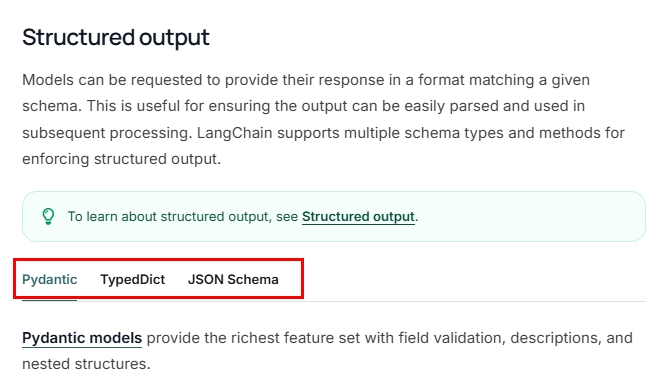
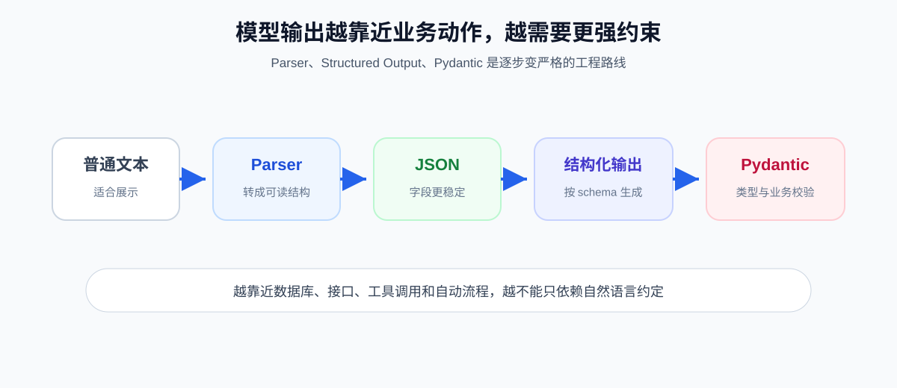

# 14 - Output Parsers

---

**Chapter Objectives:**

- Understand what an **Output Parser** is, why it is needed, and where it fits within **Model I/O**.
- Be able to use **StrOutputParser** and **JsonOutputParser** to handle string and JSON output.
- Understand LangChain's official **Structured Output** approach, and grasp the differences among the three schema methods: **TypedDict**, **Pydantic**, and **JSON Schema**.

**Study Advice:** What this chapter addresses is "how the program can reliably use what the model says." You can start by running `StrOutputParser`, then move on to `JsonOutputParser`, and then to Pydantic, observing as you go where only parsing occurs and where validation actually happens. Once you can clearly distinguish the boundaries among Parser, Structured Output, TypedDict, Pydantic, and JSON Schema, you will have grasped the key points.

**Official Documentation and Resources**: See [Tool Navigation and Reference Material Index - Prompts and Structured Output](%E5%B7%A5%E5%85%B7%E5%AF%BC%E8%88%AA%E4%B8%8E%E5%8F%82%E8%80%83%E8%B5%84%E6%96%99%E7%B4%A2%E5%BC%95.md#prompting-and-structured-output).

---

## 1. Introduction to Output Parsers

This chapter corresponds to the **output parsing (Parse)** part of [Model I/O](11-Model-I-O%E4%B8%8E%E6%A8%A1%E5%9E%8B%E6%8E%A5%E5%85%A5.md): converting the model's **text output** into **structured data** that is easy for programs to use (such as strings, JSON, and strongly typed objects). Combined with [Chapter 13: Prompts](13-%E6%8F%90%E7%A4%BA%E8%AF%8D%E4%B8%8E%E6%B6%88%E6%81%AF%E6%A8%A1%E6%9D%BF.md) (**Format (input formatting)**) and Chapter 11 on models (**Predict (model invocation)**), this forms the complete "input → model → output parsing" pipeline. [Chapter 15: LCEL](15-LCEL%E4%B8%8E%E9%93%BE%E5%BC%8F%E8%B0%83%E7%94%A8.md) will use the pipe operator to connect these three into a single chain.

### 1.1 Definition

An **Output Parser** is a conversion layer that sits between the **model's output** and the **data the program ultimately needs**.

Its core task is to transform the content returned by the model from "human-readable" text into "program-processable" structured results.

This chain can be broken down into:

- Prompt is responsible for organizing the input and telling the model "**how you should answer**";
- Model is responsible for generating the result, actually "**generating the answer**";
- Output Parser is responsible for converting the result into a string, JSON, or object, "**organizing that answer into a form that is easy for the program to use**".
- [Chapter 15: LCEL and Chain Invocation](15-LCEL%E4%B8%8E%E9%93%BE%E5%BC%8F%E8%B0%83%E7%94%A8.md) will actually connect this chain together.



In actual usage, depending on the parser type, output parsers typically handle the following kinds of tasks:

- **Format conversion**: convert the model's answer into `str`, `dict`, Pydantic objects, and so on.
- **Structural constraints**: guide the model to output according to the specified fields as much as possible.
- **Result validation**: check whether field types, ranges, and required fields meet expectations.
- **Engineering integration**: enable model output to be directly consumed by databases, interfaces, frontends, and workflows.

### 1.2 The Role of Output Parsers

When first learning about LLMs, it is easiest to think of the model's answer as "it gives me a piece of text and that is the end." But in real projects, the model's output usually needs to flow into other program modules, for example:

- Stored into a database;
- Returned to the frontend page for rendering;
- Passed to the next workflow node;
- Used as parameters for Agents, tools, and interface calls;
- Entered into risk control, review, statistics, and reporting logic.

At this point, "a piece of natural language" is usually not enough. What the program prefers to receive is:

- A string;
- A JSON dictionary;
- An object with fixed fields;
- A strongly typed data structure with validation rules.

If you rely only on `split()`, regular expressions, and string splitting to parse the model's output, the code often becomes fragile: if the model adds an extra explanation, omits a comma, or changes a field name, the program may break.

### 1.3 Common Output Parser Categories

| Parser                 | Final Result               | Applicable Scenarios                 | Description                                    |
| ---------------------- | -------------------------- | ------------------------------------ | ---------------------------------------------- |
| `StrOutputParser`      | String `str`   | Only need to display text, no need to split fields | Simplest; usually just extracts the body content of the model's output |
| `JsonOutputParser`      | Python `dict` / `list` | Want the model to return JSON for further program processing | Suitable for field extraction, API responses, and workflow parameter passing |
| `PydanticOutputParser`     | Pydantic object            | Need strong typing and runtime validation | Suitable for business scenarios with explicit requirements for field type, length, and range |

### 1.4 Common Structured Output Approaches

In addition to "output parsers," LangChain also provides a further capability called **Structured Output**.  
Its focus is not on "parsing the result after the fact," but rather on "specifying in advance what structure the model should output." A term that appears frequently here is **schema**.

A **schema** can be thought of as a "**data structure specification**" or "**output format specification**."
It describes: what fields a piece of data should contain, what type each field is, which fields are required, and sometimes additional constraints such as field length, value range, and enumerated values.

For example, if we require the model to output information about a person:

```json
{
  "name": "张三",
  "age": 20
}
```

Then what this schema actually expresses is:

- There must be a `name` field;
- There must be an `age` field;
- `name` should be a string;
- `age` should be an integer.

Therefore, **the essence of structured output is to first define a schema, and then have the model output results according to that schema.**

There are three common official structured output approaches:

| Approach      | Definition Method              | Final Result  | Supports Runtime Validation | Applicable Scenarios                           |
| ------------- | ------------------------------ | ------------- | --------------------------- | ---------------------------------------------- |
| `TypedDict`   | Python standard library `typing.TypedDict` | `dict`        | No                  | Only needs a fixed field structure, no strict validation required |
| `Pydantic`   | `BaseModel` + `Field(...)`    | Pydantic object | Yes                 | Needs validation for strong types, ranges, lengths, and required fields |
| `JSON Schema`   | Standard JSON Schema dictionary | Usually `dict` | Depends on implementation | Needs to share a structure protocol across languages and systems |

In LangChain, these structures are usually used in the following way:

```python
model.with_structured_output(...)
```

That is to say:

- `TypedDict` / `Pydantic` / `JSON Schema` are ways of "defining the output structure";
- `with_structured_output(...)` is the entry point for "having the model output according to this structure and automatically parse it."

### 1.5 The Relationship Between Output Parsers and Structured Output

These two concepts are easy to confuse, but they can be distinguished as follows:

- **Output Parser**: emphasizes "the model has already output something; how do I convert it into data the program can use";
- **Structured Output**: emphasizes "before the model outputs anything, I first define what it should look like."

You can also understand them as:

- Output parsers lean toward **post-processing**;
- Structured output leans toward **pre-constraint + automatic parsing**.

But they are not in an "either-or" relationship, nor are they in a "must be used together" relationship.

There are mainly three common situations:

#### Scenario 1: Only Use an Output Parser

Suitable for cases where the model outputs normally first, and then the program converts the result into a string, JSON, or object.

```python
from langchain_core.output_parsers import JsonOutputParser

parser = JsonOutputParser()

result = model.invoke("请用 JSON 返回：name、age")
data = parser.invoke(result)
print(data)
```

The characteristic of this approach is straightforward: the model generates the result first, and then the parser is responsible for parsing it, so it is especially suitable for traditional `prompt | model | parser` chain invocation.

#### Scenario 2: Only Use Structured Output

Suitable when the model itself supports `with_structured_output(...)`, and LangChain directly constrains the model's output structure and parses it automatically.

```python
from typing import TypedDict


class Person(TypedDict):
    name: str
    age: int


structured_model = model.with_structured_output(Person)
result = structured_model.invoke("请返回一个人物信息")
print(result)
```

This approach no longer requires manually writing a separate parser; instead, `with_structured_output(...)` handles both "constraining output + automatic parsing" together, which is more suitable for scenarios where modern models already support native structured output.

#### Scenario 3: Structured Output + Additional Validation / Processing

In more rigorous engineering scenarios, you can also use structured output and then add extra processing logic.

```python
structured_model = model.with_structured_output(Person)
result = structured_model.invoke("请返回一个人物信息")

# 这里可以继续做业务校验、入库前清洗、字段转换等处理
print(result)
```

This kind of scenario does not necessarily require connecting another Output Parser, but it often requires additional work such as: business rule validation; field cleaning; conversion before database insertion; secondary wrapping before API return.

Therefore, the key conclusion here is:

- **Output parsers** and **structured output** can be used independently;
- They can also be used in combination;
- Whether to use them simultaneously depends on the model's capabilities and business requirements.

Their goal is the same: **to make model output reliably enter the program system, rather than remaining only at the natural language level.**

### 1.6 Practical Use Cases

| Scenario                                        | Common problems without parsing | More suitable approach                                       |
| ----------------------------------------------- | ------------------------------- | ------------------------------------------------------------ |
| Chat Q&A, copy polishing, summary display        | Only need to display text, low structural requirements | `StrOutputParser`                                            |
| Extracting fields from text, such as "question/answer" or "time/person/event" | Text is unstable, subsequent logic is hard to write | `JsonOutputParser`                                           |
| Returning fixed fields to frontend cards, forms, and list pages | Missing fields or drifting field names affect rendering | `with_structured_output(TypedDict)`                          |
| Writing strict data to databases, approval workflows, and order systems | Need to validate type, range, and length | `PydanticOutputParser` or `with_structured_output(Pydantic)` |
| Integrating with external systems under a unified protocol | Need language-agnostic, explicit protocols | `JSON Schema`                                                |

---

## 2. Common Output Parser Methods

### 2.1 Action 1: Parse Output

In LangChain, the two most common ways to use a parser are:

- `parser.invoke(...)`: more in the LangChain / Runnable style, suitable for chain composition with `prompt | model | parser`. Most examples in this chapter use this style.
- `parser.parse(text)`: more in the sense of "I already have a piece of plain text, and now I just want to parse this text."

The difference between these two methods is simple:

- If you are still inside a LangChain invocation chain, `invoke(...)` is commonly used;
- If you already have a string like `result.content` in hand, `parse(text)` is commonly used.

> **Note**: Many introductory tutorials loosely say that "`parse(result)` is used to parse model results." Conceptually this is not wrong, but `parse(...)` leans more toward parsing **text strings**, while in chain development we often directly use `parser.invoke(result)`.

### 2.2 Action 2: Give the Model "Format Instructions"

A parser is not just "post-processing"; in many cases it also **constrains the model's output in advance**.

The most common method is:

```python
parser.get_format_instructions()
```

It returns a piece of format instruction text that tells the model: what structure to output; what fields there are; what type each field is; whether only JSON should be returned; whether no extra explanatory text should be added.

This instruction is usually inserted into the Prompt so that the model tries from the beginning to output in a parseable format, thereby reducing the parsing failure rate.

---

## 3. Common Parser Usage and Examples

### 3.1 StrOutputParser

`StrOutputParser` is the simplest output parser in LangChain. What it does is very direct: **it takes the content returned by the model and uses it as a string**. It **does not perform structured parsing**, nor does it care about fields, key names, or data types; it only cares about "getting the final text."

It is especially suitable for these tasks:

- Q&A bots that directly display text;
- article summaries, title generation, rewriting and polishing;
- translation, continuation, and marketing copy;
- scenarios where you only need to display the result on the frontend without splitting fields.

In one sentence: **If the downstream only needs a piece of text rather than structured fields, use it.**

[Case source code]`案例与源码-2-LangChain框架/05_parser/StrOutputParserDemo.py`

[StrOutputParserDemo.py](../../%E6%A1%88%E4%BE%8B%E4%B8%8E%E6%BA%90%E7%A0%81-2-LangChain%E6%A1%86%E6%9E%B6/05_parser/StrOutputParserDemo.py ":include :type=code")

You might ask: since `AIMessage.content` can also directly obtain text, why use `StrOutputParser`?

There are three main reasons:

- **Chain consistency**: it can naturally be written as `prompt | model | parser` later.
- **Interface consistency**: today it's a string, tomorrow you want to switch to JSON - just change the parser, no need to rewrite the whole structure.
- **Better readability**: the code semantics become "this is the output parsing stage", which is friendlier for beginners and team collaboration.

### 3.2 JsonOutputParser

JsonOutputParser (JSON parser) can convert parseable JSON content in model output into structured data that programs can use directly.

Note here: it is not "magic that can stably convert any natural language text into JSON." The prompt still needs to specify the output format in advance; if the model output completely deviates from JSON, parsing may still fail.

In project development, JSON is the most common structured data format. Because it: suits frontend-backend transmission; suits API returns; suits database middleware processing; suits further conversion into objects or form data.

So in many cases, we don't want the model to just answer with one sentence, but to directly return:

```json
{
  "q": "...",
  "a": "..."
}
```

Or:

```json
{
  "time": "...",
  "person": "...",
  "event": "..."
}
```

In this case, you can use `JsonOutputParser`.

#### 3.2.1 Usage 1: Write JSON requirements directly in the prompt by hand

This is the most direct approach: explicitly state in the Prompt "please return JSON, including these fields".

[Case source code]`案例与源码-2-LangChain框架/05_parser/JsonOutputParserDemo.py`

[JsonOutputParserDemo.py](../../%E6%A1%88%E4%BE%8B%E4%B8%8E%E6%BA%90%E7%A0%81-2-LangChain%E6%A1%86%E6%9E%B6/05_parser/JsonOutputParserDemo.py ":include :type=code")

This case helps you understand the most basic workflow:

1. The Prompt explicitly requires JSON output;
2. The model returns a piece of "JSON-like text";
3. `JsonOutputParser` parses it into a Python `dict`.

This approach is suitable for: very few fields; very simple structures; when you can explain the format in one sentence; mainly for quick demos and quickly getting the pipeline running.

#### 3.2.2 Usage 2: Use get_format_instructions() to automatically generate format instructions

When the structure starts to become complex, hand-writing "please return JSON with fields a, b, c..." is prone to omissions, messiness, and imprecision.

A more reliable approach at this point is: **let the parser generate the format instructions itself, then splice them into the Prompt**.

[Case source code]`案例与源码-2-LangChain框架/05_parser/JsonOutputParser_GetFormatInstructions.py`

[JsonOutputParser_GetFormatInstructions.py](../../%E6%A1%88%E4%BE%8B%E4%B8%8E%E6%BA%90%E7%A0%81-2-LangChain%E6%A1%86%E6%9E%B6/05_parser/JsonOutputParser_GetFormatInstructions.py ":include :type=code")

In this case, a `Person` Pydantic model is used to describe the JSON structure, and then:

```python
parser.get_format_instructions()
```

automatically generates a standardized format instruction for the model.

The key points to grasp are:

- `JsonOutputParser` still essentially parses the result into **JSON / dict**;
- The Pydantic model is introduced here mainly to make it easier to **describe the output structure**;
- If the final result you want is a **Pydantic instance** rather than `dict`, you should generally look at the next section's `PydanticOutputParser` or `with_structured_output(Pydantic模型)`.

---

## 4. Structured Output

### 4.1 Definition

**Structured Output** means not being satisfied with "the model outputs a piece of JSON text," but further requiring:

- The output must conform to a specific schema;
- LangChain directly parses it into a dictionary or object for you;
- Field validation can also be performed when necessary.

In other words, ordinary JSON parsing is more like:

> "Please try to follow this format."

While structured output is more like:

> "You must deliver the result according to this schema."



The official LangChain documentation now especially emphasizes: **many modern models already support native structured output**. This means that, on supported models, prefer using:

```python
model.with_structured_output(...)
```

which is often more stable and less hassle than the traditional "hand-written Prompt + Parser parsing" approach.

But output parsers are not obsolete; they remain valuable, especially when: using models that do not support native structured output; needing to further parse / clean the result; needing to add strict validation with Pydantic; wanting to manage output parsing as part of an LCEL chain in a unified way.

### 4.2 Common Approaches

In the official LangChain documentation, structured output commonly has three schema approaches:

| Approach        | Common return form | Built-in runtime validation? | Suitable scenarios                       |
| --------------- | ------------------ | ---------------------------- | ---------------------------------------- |
| **TypedDict**   | `dict`           | No                           | Clear structure, fixed fields, but low validation requirements |
| **Pydantic**    | Pydantic object    | Yes                          | Needs strong typing, range checking, length checking, field validation |
| **JSON Schema** | `dict`           | Depends on usage           | Needs alignment with external protocols, cross-language collaboration |

Another pattern often used together with these is **Annotated**, which is not a fourth schema type, but a way to add supplementary information to fields.

---

## 5. TypedDict and Annotated

### 5.1 TypedDict: Describing "what this dictionary looks like"

`TypedDict` comes from the Python standard library `typing`, and its purpose is: to describe what keys a dictionary should have and what type each key is. It is more like a **structure specification**.

For LangChain, this specification is useful because it can guide the model to output a fixed structure and then parse it into a Python dictionary.

But pay special attention: **TypedDict does not perform real runtime validation.** In other words, it leans more toward "describing structure" than "enforcing validation".

### 5.2 Annotated: Adding explanatory notes to fields

`Annotated` is also a capability from the Python standard library `typing`. Its purpose is not to "change the type," but to: attach a piece of metadata or description to the original type.

For example:

```python
Annotated[str, "动物名称"]
```

It is still essentially `str`, just with the description "this is an animal name" attached. LangChain can use these descriptions to generate clearer schema descriptions, making it easier for the model to understand what each field should contain.

### 5.3 Case: TypedDict-style structured output

[Case source code]`案例与源码-2-LangChain框架/05_parser/StructuredOutput_TypedDict.py`

[StructuredOutput_TypedDict.py](../../%E6%A1%88%E4%BE%8B%E4%B8%8E%E6%BA%90%E7%A0%81-2-LangChain%E6%A1%86%E6%9E%B6/05_parser/StructuredOutput_TypedDict.py ":include :type=code")

This case can serve as the "first lesson" of modern LangChain structured output:

1. Use `TypedDict` to define `Animal` and `AnimalList`;
2. Use `Annotated` to add descriptions to fields;
3. Use `llm.with_structured_output(AnimalList)` to directly tell the model the target output structure;
4. After calling `.invoke(...)`, directly get the parsed `dict`.

This is more like the recommended approach in real projects than "first requiring JSON, then manually parsing."

### 5.4 Case: Annotated is only a description, not validation

[Case source code]`案例与源码-2-LangChain框架/05_parser/AnnotatedTypedDict.py`

[AnnotatedTypedDict.py](../../%E6%A1%88%E4%BE%8B%E4%B8%8E%E6%BA%90%E7%A0%81-2-LangChain%E6%A1%86%E6%9E%B6/05_parser/AnnotatedTypedDict.py ":include :type=code")

This case addresses an easily confusing question:

```python
Age = Annotated[int, "年龄，范围0-150"]
```

This statement does not mean Python will automatically check that "age must be between 0 and 150." It only means: the type of this field is `int`; with an attached description "age, range 0-150". Without an additional validation framework, this description will not automatically become a validation rule.

So in the TypedDict scenario: `Annotated` is more like a **prompt enhancer**; it is not a **runtime validator**.

### 5.5 Use Cases

TypedDict suits these situations:

- Frontend pages need fixed fields, but field values don't need complex validation;
- Passing structured data between workflow nodes;
- Want clear structure but don't want to introduce heavy validation logic;
- The model itself has good native structured output support.

One-sentence summary: **TypedDict is for "I want a stable structure," but don't yet require "strict data validity validation."**

---

## 6. Pydantic: From Structure Description to Validation

### 6.1 Definition

If `TypedDict` mainly solves "what this dictionary should look like," then **Pydantic** solves: "this data must not only look right, but must actually be legitimate."

Pydantic is a very commonly used data validation library in the Python ecosystem. When creating objects, it can perform: type checking; range checking; length checking; custom validation. In real businesses, whenever structured data is involved, it is often used.

### 6.2 Case: Annotated + Pydantic triggers validation

[Case source code]`案例与源码-2-LangChain框架/05_parser/AnnotatedPydantic.py`

[AnnotatedPydantic.py](../../%E6%A1%88%E4%BE%8B%E4%B8%8E%E6%BA%90%E7%A0%81-2-LangChain%E6%A1%86%E6%9E%B6/05_parser/AnnotatedPydantic.py ":include :type=code")

This case forms a direct contrast with the previous `AnnotatedTypedDict.py`:

- In TypedDict, `Annotated[int, "年龄范围0-150"]` is only a description;
- In Pydantic, `Annotated[int, Field(ge=0, le=150)]` truly becomes runtime validation.

Just remember one thing: **Annotated itself does not validate; what actually performs validation is Pydantic's `Field(...)` rules.**

### 6.3 Case: Complete Workflow of PydanticOutputParser

[Case source code]`案例与源码-2-LangChain框架/05_parser/StructuredOutput_Pydantic.py`

[StructuredOutput_Pydantic.py](../../%E6%A1%88%E4%BE%8B%E4%B8%8E%E6%BA%90%E7%A0%81-2-LangChain%E6%A1%86%E6%9E%B6/05_parser/StructuredOutput_Pydantic.py ":include :type=code")

This case reflects the most complete and classic workflow of the Pydantic route:

1. Define a `Product` Pydantic model;
2. Use `Field(...)` to add descriptions to fields;
3. Use `field_validator(...)` to write more detailed validation logic;
4. Create a `PydanticOutputParser(pydantic_object=Product)`;
5. Use `get_format_instructions()` to generate format instructions;
6. Splice the instructions into the Prompt;
7. After the model outputs, parse it into a **Pydantic instance**.

This workflow is stronger than pure `JsonOutputParser` because it doesn't just "convert to a dictionary" but "converts to a validated object."

### 6.4 Use Cases

When you encounter the following requirements, you should usually prioritize Pydantic:

- Need to write results into a database and cannot tolerate field types getting messed up;
- Need to connect model output to business systems such as orders, approvals, risk control, and reports;
- Certain fields must satisfy constraints like ranges, enums, and lengths;
- Want invalid data to immediately raise an error rather than silently passing through.

One-sentence summary:

**Pydantic is for "I want not just structure, but verifiable, dependable, production-ready data."**

---

## 7. JSON Schema: Useful for Aligning with External Protocols

### 7.1 Definition

`JSON Schema` is a standard specifically used to describe JSON structures and constraint rules.

Its biggest feature is language independence; both frontend and backend can understand it, making it well-suited for cross-team, cross-system, and cross-language collaboration.

The official LangChain documentation also lists it as one of the three mainstream approaches for structured output.

### 7.2 Use Cases

If your scenario is:

- The backend and frontend have already agreed on a JSON protocol;
- Your Python service needs to integrate with Java, Go, Node, and other systems;
- You want to standardize and document the data structure;
- You don't want to tightly couple to Pydantic or Python's type system;

Then JSON Schema will be more universal than TypedDict.

### 7.3 Differences from TypedDict and Pydantic

You can simply remember it this way:

- **TypedDict**: Most like a "structure specification" internal to Python.
- **Pydantic**: Most like a "structure + validation model" internal to Python.
- **JSON Schema**: Most like a "protocol document" shared between systems.

---

## 8. Practical Development Choices

This section provides the implementation choices for this chapter.

### 8.1 Selection Path from Simple to Strict

You can make choices along the following path:

1. **Only need text display**
   Use `StrOutputParser`
2. **Need simple JSON fields**
   Use `JsonOutputParser`
3. **Need a fixed structure, and the model supports structured output**
   Prefer `with_structured_output(TypedDict)`
4. **Need strict validation**
   Use `Pydantic` + `PydanticOutputParser`, or `with_structured_output(Pydantic模型)`
5. **Need cross-language / external protocol alignment**
   Use `JSON Schema`

For engineering selection, remember this phrase: **Use Parser for plain text, prefer `with_structured_output` for fixed structures, use Pydantic for strong validation, and check `response_format` for the final Agent result.**

### 8.2 A Selection Table Closer to Real-World Project Implementation

| Requirement                                      | Recommended Solution                                                    |
| ----------------------------------------- | ----------------------------------------------------------- |
| Chatbot replies, article summaries, translation            | `StrOutputParser`                                           |
| Extract simple fields like "question-answer" or "time-person-event" | `JsonOutputParser`                                          |
| Return a fixed field dictionary to a frontend API            | `with_structured_output(TypedDict)`                         |
| Write highly reliable data to databases or business systems          | `with_structured_output(Pydantic)` / `PydanticOutputParser` |
| Share a unified data protocol with systems in other languages            | `JSON Schema`                                               |
| Output format is very special and built-in parsers can't cover it        | Custom `BaseOutputParser`                                   |

### 8.3 Official Recommendations

LangChain's current overall official direction is:

- **If the model natively supports structured output, prefer native capabilities**;
- **If the model does not support it, or you need additional parsing/validation, then use output parsers**.

### 8.4 Custom Parsers

In most scenarios, you don't need to write your own parser. The general priority is: first check `with_structured_output(...)`, then built-in Parsers, and only consider custom ones as a last resort.

But some outputs are indeed quite special. For example, the model returns a fixed-format list, log, or command block that is neither standard JSON nor suitable for Pydantic. In this case, you can inherit from `BaseOutputParser` and only implement the most critical `parse()` method.

```python
from langchain_core.output_parsers import BaseOutputParser


class LineListParser(BaseOutputParser[list[str]]):
    def parse(self, text: str) -> list[str]:
        return [
            line.strip("- ").strip()
            for line in text.splitlines()
            if line.strip()
        ]
```

It is suitable for "lightweight format cleaning". If the result will later go into a database, approval workflow, or automatically executed tool, it is still recommended to follow up with Pydantic or business validation rather than relying solely on string splitting.

---

## 9. Common Misconceptions and Troubleshooting Suggestions

### 9.1 Misconception 1: Being able to parse it as JSON means the data is fine

Not correct. JSON only means "the format looks right", not that "the business logic is correct".  
For example, if a user's age is output as `999`, it is still valid JSON, but clearly unreasonable.

### 9.2 Misconception 2: Annotated provides built-in validation

Not correct. `Annotated` only adds metadata.  
What actually makes "ranges, lengths, and constraints" take effect are Pydantic's `Field(...)`, validators, and other mechanisms.

### 9.3 Misconception 3: Output parsers can completely replace prompt design

Not correct. If the prompt does not clearly specify field meanings, output boundaries, and the instruction not to add extra explanations, the parser will likely still fail.

### 9.4 Misconception 4: Every project should directly use Pydantic

Not necessarily. If you are only doing text display, or just a simple JSON demo, jumping straight to Pydantic may be overkill.  
Engineering is not "the more complex the better", but rather "sufficient and stable".

### 9.5 Misconception 5: Learning Parser means it's a separate system from structured output

No, it's not. They essentially solve the same problem: **making model output stably consumable by programs**.  
The difference is only:

- Some approaches lean toward "post-processing parsing";
- Some approaches lean toward "native structural constraints + automatic parsing";
- Some approaches can further perform strict validation.

---

**Chapter Reflection Questions:**

1. Why does "the model output JSON" not equal "the program can safely use it"?

   **Reference thoughts:** Correct JSON syntax is only the first step; whether fields are complete, types are correct, and values conform to business rules still requires validation. Parsing solves "readability", while validation solves "trustworthiness".

2. When is `StrOutputParser` sufficient, and when should you use Pydantic?

   **Reference thoughts:** When only plain text display is needed, string parsing is sufficient; when results will enter a database, API, process branch, or automatic execution, you should consider strong validation like Pydantic. The closer you get to business actions, the less you can rely on natural language alone.

3. How should the relationship between Structured Output and Output Parser be understood?

   **Reference thoughts:** Structured Output leans more toward having the model generate according to a structure, while Parser leans more toward parsing and transforming after output. The two can be used together: constrain generation on the front end, and provide fallback parsing and validation on the back end.

4. What determines the choice among TypedDict, Pydantic, and JSON Schema?

   **Reference thoughts:** TypedDict is suitable for lightweight type descriptions, Pydantic is suitable for strong validation and error messages within Python, and JSON Schema is suitable for cross-language, API protocol, or external system alignment. It's not about being heavier being better; it depends on where the boundaries are.

**Chapter Summary:**

- The **output parser** is the **Parse** step in Model I/O, responsible for converting model output into data that programs can directly use.
- The focus of this chapter is not on memorizing APIs, but on building engineering awareness: **LLM output often needs to continue into program pipelines, so it must be structured**.
- **StrOutputParser** is suitable for plain text scenarios; **JsonOutputParser** is suitable for quickly obtaining `dict`; **PydanticOutputParser** is suitable for strongly typed, strongly validated scenarios.
- **Structured output** is the real focus of this chapter. The three common schema approaches officially used in LangChain are: **TypedDict, Pydantic, and JSON Schema**.
- **TypedDict** is suitable for describing structure; **Pydantic** is suitable for describing structure and performing runtime validation; **Annotated** is mainly used to supplement field descriptions and is not a validator itself.
- Modern LangChain recommends prioritizing `with_structured_output(...)` on supported models, while output parsers continue to play a role in compatibility, post-processing, and additional validation.
- In terms of mastery, after completing this chapter, you should at least be able to: distinguish the relationship between **output parsers** and **structured output**, and understand that both address the problem of "how model results can be reliably handed to programs"; know the applicable scenarios for the three approaches `StrOutputParser`, `JsonOutputParser`, and `PydanticOutputParser`; and understand the boundaries between `TypedDict`, `Annotated`, Pydantic, and `JSON Schema` in terms of "describing structure" and "runtime validation".

**Suggested next step:** Study [Chapter 15: LCEL and Chained Invocation](15-LCEL%E4%B8%8E%E9%93%BE%E5%BC%8F%E8%B0%83%E7%94%A8.md) to combine this chapter's parsers with the Prompts from [Chapter 13](13-%E6%8F%90%E7%A4%BA%E8%AF%8D%E4%B8%8E%E6%B6%88%E6%81%AF%E6%A8%A1%E6%9D%BF.md) and the Models from [Chapter 11](11-Model-I-O%E4%B8%8E%E6%A8%A1%E5%9E%8B%E6%8E%A5%E5%85%A5.md) into a real `prompt | model | parser` chain.
