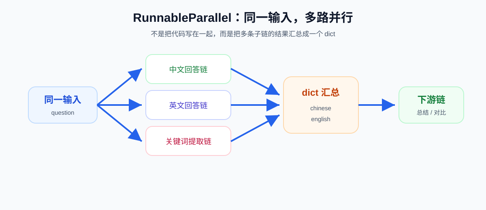

# 15 - LCEL and Chain Invocation

---

**Chapter learning objectives:**

- Understand the positioning of **Runnable** and why LangChain abstracts Prompt, Model, Parser, Tool, and Chain into unified "executable components."
- Understand what problem **LCEL** (LangChain Expression Language) actually solves, and master the chain composition idea behind the `|` pipe operator.
- Be able to read and run all examples in this chapter: **sequential chains, branching chains, multi-step serial chains, parallel chains, and function chains**, establishing the foundation for later learning about [memory and conversation history](16-%E8%AE%B0%E5%BF%86%E4%B8%8E%E5%AF%B9%E8%AF%9D%E5%8E%86%E5%8F%B2%EF%BC%88%E5%90%ABRedis%E5%9F%BA%E7%A1%80%EF%BC%89.md), [Tools invocation](17-Tools%E5%B7%A5%E5%85%B7%E8%B0%83%E7%94%A8.md), [RAG](19-RAG%E6%A3%80%E7%B4%A2%E5%A2%9E%E5%BC%BA%E7%94%9F%E6%88%90.md), and [Agent](21-Agent%E6%99%BA%E8%83%BD%E4%BD%93.md).

**Study suggestion:** First run `prompt | model | parser` yourself, then move on to branching, parallelism, and custom function nodes. When reading the code, keep an eye on two things: what each Runnable receives and returns, and whether the composed result can still be invoked with `invoke`, `stream`, or `batch`. This way, you won't just think of LCEL as pipe-operator syntax.

---

## 1. Runnable and the Unified Invocation Style

### 1.1 Prerequisite: Abstract Base Class (ABC)

If this is your first encounter with **abstract base classes**, don't overcomplicate it. For this chapter, you only need a practical enough understanding:

**An abstract base class first defines "what common capabilities this type of object should have," without immediately specifying "how each object should implement them internally."**

What is being described here is a kind of "unified rule" or "common protocol."

For example, a framework designer might first establish:

- As long as you belong to the "executable component" category
- You should support certain unified methods
- Such as single invocation, batch invocation, streaming invocation, and asynchronous invocation

This way, regardless of whether the object later turns out to be a Prompt, Model, Parser, or an entire Chain, users can understand and invoke it the same way. This is the most valuable aspect of an abstract base class: **first define the common rules, then let different objects implement their own specific behaviors.**

In LangChain, you can understand **Runnable** as exactly this kind of core abstract interface. The idea behind it is:

- A Prompt is an executable component
- A Model is an executable component
- A Parser is an executable component
- A Chain is also an executable component

Since they all belong to the broad category of "executable components," they should follow the same invocation protocol as much as possible. So in this section you don't need to memorize Python details such as `ABC` or `abstractmethod`. Just remember one sentence: **an abstract base class solves the problem of "first defining common rules," and Runnable is precisely the key abstraction LangChain uses to unify those rules.**


> **Illustration note**: The screenshot above is taken from the LangChain reference documentation. `Runnable` is declared as `class Runnable(ABC, Generic[Input, Output])`, describing a unit of work that "can be invoked, batched, streamed, transformed, and composed." `invoke`/`ainvoke`, `batch`/`abatch`, `stream`/`astream` appear in pairs, and `astream_log` can also stream out partial intermediate results. Each method accepts `config` (such as tags and metadata) for tracing and troubleshooting. Input/output/config structure information can be exposed to tooling and IDEs through `input_schema`, `output_schema`, and `config_schema`.

### 1.2 The Significance of a Unified Interface

Without a unified interface, prompts, models, parsers, tools, and retrievers each tend to have their own entry points (for example, a mixture of `format`, `generate`, `parse`, `run`, `stream`, and so on). The result is that **components are hard to compose, method names are hard to remember, every call site needs to be changed when swapping implementations**, and it is difficult to express the overall flow as a clear left-to-right data pipeline.

LangChain's solution is: **abstract these objects that "receive input and produce output" into a unified interface as much as possible.** That unified interface is **Runnable**.

### 1.3 Definition

**Runnable** is one of the most central abstractions in LangChain. In essence, it is an interface for an "executable data-processing node."

Here we need to distinguish a very easy point of confusion:

- **What Runnable is**: it indicates that "this type of object is an executable component," that is, a unified abstraction standard.
- **What the unified invocation style is**: it is the result brought by Runnable, namely that these components can all be invoked in the same style as much as possible, such as `invoke`, `batch`, and `stream`.

Therefore, the more precise conclusion is that **Runnable is not a translation of "unified invocation style," but rather the abstraction foundation behind that unified invocation style.**

As long as an object implements the Runnable interface, it can usually be invoked in a unified way, for example: `invoke`, `batch`, `stream`, `ainvoke`, `abatch`, `astream`.

In LangChain, many objects you have already learned about are essentially Runnables:

- [Prompt templates](13-%E6%8F%90%E7%A4%BA%E8%AF%8D%E4%B8%8E%E6%B6%88%E6%81%AF%E6%A8%A1%E6%9D%BF.md), [chat models](11-Model-I-O%E4%B8%8E%E6%A8%A1%E5%9E%8B%E6%8E%A5%E5%85%A5.md), [output parsers](14-%E8%BE%93%E5%87%BA%E8%A7%A3%E6%9E%90%E5%99%A8.md)
- Retrievers, tools, and even whole chains that you will learn about later
- Going further, a compiled LangGraph graph itself can also be invoked as a Runnable

In other words, the reason these components can later be smoothly chained together is not because "the pipe operator is magical," but because **these components themselves are all designed as composable Runnables.**

### 1.4 Unified Invocation Style

This section first addresses one question: why the later "chain composition" works and why it is useful.

First look at three typical objects you have already learned about:

**1. Prompt template**

- From a business perspective, the most common method of a Prompt template is `format(...)`
- But from the perspective of "a unified interface that facilitates later composition," it can also use `invoke(...)`

```python
# 业务层面常见写法
prompt_str = prompt.format(topic="LangChain")

# LCEL 统一接口写法
prompt_value = prompt.invoke({"topic": "LangChain"})
```

**2. Model**

- From a business perspective, the most common method of a model is `invoke(...)`
- It receives the output of the previous Prompt step and returns `AIMessage`

```python
ai_message = model.invoke(prompt_value)
```

**3. Parser**

- From a business perspective, parsers commonly have `parse(...)`
- But in LCEL, it can also uniformly receive the result of the previous step through `invoke(...)`

```python
result = parser.invoke(ai_message)
```

In this way, the three steps are unified into the same style:

```python
prompt_value = prompt.invoke({"question": "什么是 LangChain？"})
ai_message = model.invoke(prompt_value)
result = parser.invoke(ai_message)
```

The greatest value behind this is that **components are easier to swap**, **flows are easier to chain**, **the chain itself can continue to be used as a component**, and **the way intermediate results are passed is more uniform, without needing to write a lot of adapter code at every step**.

This is the fundamental reason why `prompt | model | parser` works later on.

### 1.5 Common Methods

Objects that implement the Runnable interface typically support the following core methods:

| Method               | Purpose                    | Suitable scenarios          |
| ------------------ | -------------------------- | -------------------------- |
| `invoke(input)`    | Synchronously process a single input | Most common, single invocation |
| `batch(inputs)`    | Synchronously batch-process multiple inputs | Batch tasks, offline tasks |
| `stream(input)`    | Synchronous streaming processing | Typewriter output, long-text generation |
| `ainvoke(input)`   | Asynchronously process a single input | Async services, high concurrency |
| `abatch(inputs)`   | Asynchronous batch processing | Async batch tasks |
| `astream(input)`   | Asynchronous streaming processing | Async chat UI, streaming returns |
| `astream_log(...)` | Stream output and optionally include intermediate steps | Debugging chains, observing multi-node execution |

They can be understood as follows:

- `invoke` is the most basic "execute once"
- The other methods are extensions along the dimensions of sync/async, single/batch, and one-shot/streaming

So when you see that "Prompt, Model, Parser, and Chain all support invoke," don't interpret it as "they are exactly the same," but rather as: **they are different, but they all follow the same invocation protocol.**

### 1.6 Value in Real Projects

This may not be immediately apparent in small examples, but it is very common in real projects. For example, a typical enterprise Q&A system might go through the following evolution:

1. At first it is just `prompt + model`
2. Later, to stabilize output, add `parser`
3. Then, to answer in both Chinese and English, add `branch`
4. Then, to return both a summary and original viewpoints at the same time, add `parallel`
5. Finally, to insert custom logs, instrumentation, and field mapping, add `lambda`

Without the unified abstraction provided by Runnable, each additional step would require changes in many places. With LCEL, these changes feel more like "adding nodes to a chain." This is also why LangChain's chain invocation makes people think of "building with blocks."

It is also because of this uniformity that retrievers, tools, memory modules, and even LangGraph nodes will all be easier to understand later on. Many of the more advanced capabilities are essentially built on top of this unified Runnable abstraction.

---

## 2. Introduction to LCEL

### 2.1 Definition

**LCEL** is the abbreviation for **LangChain Expression Language**, often rendered in Chinese as **LangChain 表达式语言**. Its purpose is straightforward: **to connect multiple Runnables in a declarative, composable way.**

The most classic LCEL style is:

```python
chain = prompt | model | parser
result = chain.invoke({"question": "什么是 LangChain？"})
```

So first understand LCEL as: **"a way of expressing the connection of multiple Runnables using `|（管道符）` or other composition methods."**

But LCEL is not only about "connecting objects." It also does two things for us:

- Automatically pass the output of the previous step to the next step
- Minimize handwritten adapter boilerplate between different nodes

### 2.2 LCEL Is More Than Syntactic Sugar

Many people see `prompt | model | parser` for the first time and think it is just "shorter to write." But the value of LCEL goes far beyond saving code.

Its real benefits come in three layers:

**1. Clearer expression**

Traditional style:

```python
prompt_value = prompt.invoke({"question": "什么是 LangChain？"})
ai_message = model.invoke(prompt_value)
result = parser.invoke(ai_message)
```

LCEL style:

```python
chain = prompt | model | parser
result = chain.invoke({"question": "什么是 LangChain？"})
```

The second style expresses "the flow itself" more clearly, rather than merely piling up code.

**2. Easier composition**

- The result produced by LCEL composition can itself continue to participate in further composition:

- A sequential chain can be placed inside a branching chain
- A sequential chain can be placed inside a parallel chain
- The output of a parallel chain can be passed on to the next step for further processing

Moreover, in many common scenarios, LCEL automatically handles repetitive work such as "how the result of the previous step should be passed to the next step." Only when the input/output structures of adjacent nodes do not match do we need to insert `lambda` or `RunnableLambda` ourselves to perform a mapping.

**3. Unified support for sync, async, batch, and streaming**

According to the official LangChain reference, combined structures such as `RunnableSequence` and `RunnableParallel` automatically inherit Runnable's synchronous, asynchronous, batch, and streaming capabilities. This means you are not just getting a "readable chain," but also a "uniformly executable chain."

### 2.3 Core Composition Ideas of LCEL

At the introductory stage, the most important thing in this chapter is not memorizing class names, but understanding the core composition ideas behind LCEL:

- **Sequential composition**: the output of the previous step becomes the input of the next step
- **Conditional routing**: choose different chains based on the input
- **Parallel composition**: the same input is fed to multiple chains simultaneously

Here is an additional compositional perspective:

- **RunnableSequence** and **RunnableParallel** are the two most core composition primitives
- Many other Runnable structures can essentially be seen as extensions or variants of these two basic composition capabilities

And `RunnableLambda` is equivalent to inserting a piece of your own Python logic into the composition process, allowing you to do:

- Debug intermediate results
- Map input structures
- Organize output results
- Make simple business decisions

In other words, the essence of LCEL is not "a few more classes," but rather: **LangChain starts to let you think about LLM applications in terms of "dataflow orchestration."**

### 2.4 The Relationship Between LCEL and Chain

This point is particularly easy to confuse, so it is emphasized separately:

- **What LCEL is**: it is a way of expressing how to build a workflow, with the focus on "how to write it."
- **What Chain is**: it is an executable workflow built through LCEL or other composition methods, with the focus on "what you end up with."

So the easiest way to remember it is: **LCEL is the method for building chains, and Chain is the workflow that is built.**

---

## 3. Chain Structure

### 3.1 Definition

In the LangChain context, a **Chain** can be simply understood as: **an executable workflow formed by combining multiple Runnables according to certain rules.**

This workflow can be very simple or very complex:

- When simple, it is just `prompt | model`
- When common, it is `prompt | model | parser`
- When complex, it may be a workflow composed of a mix of branches + parallelism + custom function nodes

The most critical point is: **a chain itself is also a Runnable.**

This means a chain does not become a "terminal object"; it can still continue to be composed. For example:

- A sequential chain can serve as a branch of `RunnableBranch`
- A sequential chain can be placed inside `RunnableParallel`
- Parallel results can continue to be passed to subsequent nodes for processing

### 3.2 Typical Structure

Starting from this section, we no longer focus on "how to write chains," but rather look at "what chains usually look like." This chapter is very closely related to the previous three chapters.

If you look at [Chapter 13](13-%E6%8F%90%E7%A4%BA%E8%AF%8D%E4%B8%8E%E6%B6%88%E6%81%AF%E6%A8%A1%E6%9D%BF.md), [Chapter 11](11-Model-I-O%E4%B8%8E%E6%A8%A1%E5%9E%8B%E6%8E%A5%E5%85%A5.md), and [Chapter 14](14-%E8%BE%93%E5%87%BA%E8%A7%A3%E6%9E%90%E5%99%A8.md) together, you will find that the most typical chain is:

1. **Prompt**: organize the input
2. **Model**: call the model to generate results
3. **Parser**: parse the results into a form that is easier for the business to use

That is:

```python
chain = prompt | model | parser
```

This chain is not an accidental way of writing it; it is the most classic and fundamental composition pattern in LangChain.

---

## 4. Basic Usage and Examples of Chained Calls

### 4.1 Selection and Comparison of Several Chain Types

| Type           | Typical Writing / Class Name                                  | Execution Method               | Input → Output     | Typical Scenario                     |
| -------------- | ------------------------------------------------ | ---------------------- | --------------- | ---------------------------- |
| **Sequential Chain**     | `prompt -> model -> parser` / `RunnableSequence` | Execute step by step         | Single input → Single output | Most basic Q&A, extraction, summarization     |
| **Branching Chain**     | `RunnableBranch(...)`                            | Follow only one sub-chain based on conditions | Single input → Single output | Intent routing, multilingual routing         |
| **Multi-Step Serial Chain** | Multiple sub-chains connected in series                                 | The result of the previous step goes to the next step     | Single input → Single output | Summarize then translate, organize then generate   |
| **Parallel Chain**     | `RunnableParallel({...})`                        | Multiple sub-chains execute simultaneously       | Single input → Multiple outputs | Generate Chinese and English simultaneously, run multiple models in parallel   |
| **Function Chain**     | `RunnableLambda(func)`                           | Insert Python functions into the chain | Depends on the function      | Field mapping, debugging, lightweight business logic |

If you just want to quickly build intuition, you can choose like this:

- **Only one linear workflow**: use a sequential chain first
- **Need to switch between different workflows based on conditions**: use a branching chain
- **Need to chain multiple model calls together**: use a multi-step serial chain
- **Need to run multiple chains on the same input simultaneously**: use a parallel chain
- **Need to insert custom Python logic**: use a function chain

---

### 4.2 RunnableSequence (Sequential Chain)

`RunnableSequence` is one of the most common and important chain types. The official LangChain reference explicitly states that it appears in almost all basic chained workflows.

Its core rule is very simple: **the output of the previous Runnable is directly used as the input of the next Runnable.**

Therefore:

```python
chain = prompt | model | parser
```

is essentially a `RunnableSequence`.

You can also write it explicitly like this:

```python
from langchain_core.runnables import RunnableSequence

chain = RunnableSequence(first=prompt, middle=[model], last=parser)
```

But in actual development, the more common and recommended approach is still the pipe operator style, because it is more readable.

The most typical scenario for this type of chain is to string together the core content of the previous chapters all at once:

- Prompt organizes the input
- Model calls the model
- Parser converts the output into a string or structured result

[Case source code] `案例与源码-2-LangChain框架/06-lcel/LCEL_RunnableSequenceDemo.py`

[LCEL_RunnableSequenceDemo.py](../../%E6%A1%88%E4%BE%8B%E4%B8%8E%E6%BA%90%E7%A0%81-2-LangChain%E6%A1%86%E6%9E%B6/06-lcel/LCEL_RunnableSequenceDemo.py ":include :type=code")

This case is worth paying special attention to, because it not only demonstrates "step-by-step execution," but also demonstrates "directly writing three steps as one chain and then invoking it once." This is exactly the core experience of LCEL.

### 4.3 RunnableBranch (Branching Chain)

If sequential chains solve the problem of "doing things in order," then `RunnableBranch` solves the problem of: **deciding which chain to follow based on the input content.**

It is very similar to `if / elif / else` in programming, except that it has now been placed into the Runnable system. A typical structure is:

```python
RunnableBranch(
    (条件1, 链1),
    (条件2, 链2),
    默认链,
)
```

During execution, conditions are checked in order:

- The chain corresponding to the first matching condition will be executed
- If none match, the default chain is used

This is very common in projects, for example:

- Choose different translation chains based on language
- Choose different customer service workflows based on user intent
- Choose different Prompts or models based on question type

The supporting case in this chapter is a very typical "language routing" example:

- If the input contains the keyword "Japanese," use the Japanese translation chain
- If the input contains the keyword "Korean," use the Korean translation chain
- Otherwise, default to the English translation chain

[Case source code] `案例与源码-2-LangChain框架/06-lcel/LCEL_RunnableBranchDemo.py`

[LCEL_RunnableBranchDemo.py](../../%E6%A1%88%E4%BE%8B%E4%B8%8E%E6%BA%90%E7%A0%81-2-LangChain%E6%A1%86%E6%9E%B6/06-lcel/LCEL_RunnableBranchDemo.py ":include :type=code")

This case is very close to real projects, because in many actual business scenarios, not all requests follow the same chain, but rather "judge first, then route."

### 4.4 Multi-Step Chain (Multi-Step Serial Chain)

The key point to learn in this section is: **how to connect multiple sub-chains end to end to form a multi-step serial workflow.**

For example, what this case does is:

1. First have the model introduce a topic in Chinese
2. Then convert the result of the first step into the input structure required by the second step
3. Finally pass it to another chain to translate into English

This is a very typical form of "multi-step processing":

- The first step is not the final result
- The second step depends on the result of the first step
- In between, a structural mapping may also be needed

This type of serial chain is especially common in projects, for example:

- Summarize first, then translate
- Extract key points first, then generate a report
- Retrieve first, then rewrite, then structure

[Case source code] `案例与源码-2-LangChain框架/06-lcel/LCEL_MultiStepChainDemo.py`

[LCEL_MultiStepChainDemo.py](../../%E6%A1%88%E4%BE%8B%E4%B8%8E%E6%BA%90%E7%A0%81-2-LangChain%E6%A1%86%E6%9E%B6/06-lcel/LCEL_MultiStepChainDemo.py ":include :type=code")

The point most worth noting in this case is not the file name, but the mapping action in the middle:

```python
(lambda content: {"input": content})
```

It illustrates a very common practical problem: **the input and output structures of two adjacent steps do not necessarily match naturally.** This is also why function nodes and RunnableLambda are very practical in LCEL.

### 4.5 RunnableParallel (Parallel Chain)

`RunnableParallel` solves another common problem: **I want to feed the same input to multiple chains simultaneously.**

Its core characteristic is: multiple sub-chains share the same input, execute simultaneously, and finally the results are aggregated by key into a `dict`.



It is also helpful to understand it from the execution mechanism:

- During synchronous execution, LangChain usually schedules these sub-Runnables concurrently
- During asynchronous execution, the idea is to await multiple asynchronous tasks together and then aggregate the results

You do not necessarily need to memorize the underlying details at first, but you should know: **a parallel chain is not "written together," but really "executes on multiple routes under the same input."**

For example:

```python
parallel_chain = RunnableParallel({
    "chinese": chain1,
    "english": chain2,
})
```

In addition to explicitly using `RunnableParallel(...)`, LCEL also has a very practical way of writing: **directly use a dictionary to express a parallel structure**. For example:

```python
parallel_then_summary = {
    "paragraph_1": chain1,
    "paragraph_2": chain2,
} | summary_chain
```

The meaning of this code is:

1. First run `chain1` and `chain2` in parallel
2. Aggregate the results into a dictionary
3. Then pass this dictionary to the subsequent `summary_chain`

This style of writing is very common in actual projects, because many business scenarios do not "end after parallel execution," but rather "generate multiple results in parallel, and then analyze or summarize them uniformly."

The returned result after invocation may look like this:

```python
{
    "chinese": "...",
    "english": "..."
}
```

According to the official LangChain reference, `RunnableParallel` is another core composition primitive alongside `RunnableSequence`.

This kind of chain is also very common in actual projects:

- Generate Chinese and English answers for the same question simultaneously
- Run the same question through multiple models for comparison
- Perform multiple dimensional analyses on the same input simultaneously

The following case is a very clear example:

- One sub-chain introduces `LangChain` in Chinese
- Another sub-chain introduces `LangChain` in English
- Then return both results at once

[Case source code] `案例与源码-2-LangChain框架/06-lcel/LCEL_RunnableParallelDemo.py`

[LCEL_RunnableParallelDemo.py](../../%E6%A1%88%E4%BE%8B%E4%B8%8E%E6%BA%90%E7%A0%81-2-LangChain%E6%A1%86%E6%9E%B6/06-lcel/LCEL_RunnableParallelDemo.py ":include :type=code")

This case also has a very valuable supplementary point: it calls `get_graph().print_ascii()`. This helps you transition from understanding "code chains" to understanding "graph structures," laying the groundwork for learning LangGraph later.

### 4.6 RunnableLambda (Function Chain)

The value of `RunnableLambda` lies in: **turning ordinary Python functions into Runnables.**

This sounds like a small feature, but it is very practical in actual development, because chained workflows often encounter these situations:

- The output structure of the previous step does not meet the input requirements of the next step
- You want to print intermediate results for debugging
- You want to rename a field
- You want to insert a little simple business logic

Without function nodes, you would have to break the chain apart and write a lot of intermediate processing code outside it; with `RunnableLambda`, these logics can be placed back inside the chain.

For example:

```python
from langchain_core.runnables import RunnableLambda

def debug_print(x):
    print(x)
    return {"input": x}

chain = chain1 | RunnableLambda(debug_print) | chain2
```

LangChain also supports a more convenient way of writing this: directly put the function between `|`, and the framework will automatically wrap it as a Runnable.

The supporting cases for this chapter also demonstrate both ways of writing it:

- `chain1 | debug_print | chain2`
- `chain1 | RunnableLambda(debug_print) | chain2`

[Case source code] `案例与源码-2-LangChain框架/06-lcel/LCEL_RunnableLambdaDemo.py`

[LCEL_RunnableLambdaDemo.py](../../%E6%A1%88%E4%BE%8B%E4%B8%8E%E6%BA%90%E7%A0%81-2-LangChain%E6%A1%86%E6%9E%B6/06-lcel/LCEL_RunnableLambdaDemo.py ":include :type=code")

From a project perspective, RunnableLambda is very much like the "glue layer in a chain":

- It is not responsible for model capabilities.
- It is responsible for gluing the preceding and following nodes together.

If the earlier "multi-step serial chain" made you feel "why intermediate mapping is needed", this section is answering "how intermediate mapping should be elegantly written into a chain".

### 4.7 Supplement: Other Common Runnable Structures

In addition to the several structures highlighted in this chapter, LangChain also has some Runnable components that are very common in real projects but do not need to be explored in depth at the beginner stage.

| Name                    | Function                                                    | When you will use it                               |
| ----------------------- | ----------------------------------------------------------- | -------------------------------------------------- |
| `RunnablePassthrough`   | Passes the input through unchanged after receiving it, and can also conveniently add fields to the output            | When you want to keep the original input, add keys to the result, or do lightweight context assembly |
| `RunnableWithFallbacks` | Configure fallback logic for a Runnable, falling back to a backup Runnable after failure | When a model call fails or the main chain fails, automatically switch to a backup plan       |
| `RunnableBinding`       | Pre-bind `config`, default parameters, and so on for a Runnable                 | Reusing the same chain in different environments, configurable temperature and model, etc.     |

You do not need to master them right away, but you can start by forming an impression: **the Runnable world is not limited to "sequential, branching, parallel, and lambda" - LangChain provides a whole family of executable nodes.**

### 4.8 Retry and Fallback

In real projects, a chain does not always run smoothly every time: model APIs may time out, structured output may occasionally fail validation, and external services may also fail briefly. One of the benefits of LCEL is that this kind of stability handling can be attached to a Runnable instead of being scattered throughout business code.

The two most common actions are:

| Writing                    | Function                                | Suitable scenario                       |
| ----------------------- | ----------------------------------- | ------------------------------ |
| `with_retry(...)`       | Automatically retry after the current Runnable fails        | Temporary network fluctuations, occasional format errors from the model |
| `with_fallbacks([...])` | Switch to a backup Runnable after the main Runnable fails | Main model unavailable, main chain strategy fails     |

Simplified example:

```python
safe_chain = chain.with_retry(stop_after_attempt=3)

fallback_chain = primary_chain.with_fallbacks([backup_chain])
```

This kind of writing does not change the main flow of the chain, but it can bring the project closer to a production environment. At the introductory stage, you do not need to memorize all the parameters; just remember first: **LCEL is not only responsible for "how to connect things", it can also help you put engineering capabilities such as retry, fallback, and configuration onto the chain.**

---

**Chapter Reflection Questions:**

1. What problem does LCEL help you solve, rather than just "writing a few fewer lines of code"?

   **Reference thoughts:** It makes input formatting, model invocation, parsing, branching, parallelism, and post-processing all become composable Runnables. The emphasis is on clear process structure, reusability, streamability, and batch processing, rather than the pipe operator looking concise.

2. When reading an LCEL chain, how would you judge whether each segment is reasonably designed?

   **Reference thoughts:** Look at whether the input and output of each Runnable are clear, whether it does only one kind of thing, and whether it is easy to test independently. Many chain problems are not caused by the model being wrong, but by the data structures of preceding and following nodes not matching.

3. When is `RunnableLambda` good glue, and when does it become a bad smell?

   **Reference thoughts:** It is suitable for small amounts of field conversion, cleaning, and routing judgment; if a large amount of business logic, external side effects, and complex exception handling are stuffed inside, it should be split into explicit functions, tools, or services rather than hidden in the chain.

4. For a task that involves "classify first, then route, partially parallel, and finally aggregate", how would you break down the chain?

   **Reference thoughts:** First use a sequential chain for classification, then use a branching chain to select the route, use a parallel chain for retrievals or analyses that can run in parallel, and finally use an aggregation node to unify the output. Draw the data flow first, then write the LCEL; this will be more stable than directly piecing the pipe together.

**Chapter Summary:**

- **Runnable** is the unified "executable component" abstraction in LangChain. The reason Prompt, Model, Parser, Tool, and Chain can all be invoked in a unified way is that they are constrained to the same interface style at the Runnable layer.
- **LCEL** is an expression language for combining multiple Runnables into a chain. Its core value is not only that `|` is concise to write, but that it makes the process declarative, composable, and extensible.
- **The core main line of chains** is a natural extension of the content in the previous chapters: organizing [prompt templates](13-%E6%8F%90%E7%A4%BA%E8%AF%8D%E4%B8%8E%E6%B6%88%E6%81%AF%E6%A8%A1%E6%9D%BF.md), [model invocation](11-Model-I-O%E4%B8%8E%E6%A8%A1%E5%9E%8B%E6%8E%A5%E5%85%A5.md), and [output parsers](14-%E8%BE%93%E5%87%BA%E8%A7%A3%E6%9E%90%E5%99%A8.md) into an executable process.
- Among the **common chain structures**, sequential chains are the foundation, branching chains solve routing problems, multi-step serial chains solve dependency problems between preceding and following steps, parallel chains solve the problem of processing multiple routes simultaneously, and RunnableLambda solves how to insert custom logic into a chain; retry and fallback solve chain stability issues.
- In terms of mastery, after learning this chapter, you should at least: understand why `Runnable` is the most important unified abstraction in LangChain, know that Prompt, Model, Parser, and Chain can all be invoked in a unified way; be able to proficiently read and write the most basic LCEL chain like `prompt | model | parser`; and be able to distinguish the usage scenarios of sequential chains, branching chains, multi-step serial chains, parallel chains, and function chains.

**Suggested next step:** First run all five cases in this chapter, focusing on observing "what the input and output of each step are and why they can connect to the next step"; then continue learning [Chapter 16: Memory and Conversation History](16-%E8%AE%B0%E5%BF%86%E4%B8%8E%E5%AF%B9%E8%AF%9D%E5%8E%86%E5%8F%B2%EF%BC%88%E5%90%ABRedis%E5%9F%BA%E7%A1%80%EF%BC%89.md) and [Chapter 17: Tools and Tool Calling](17-Tools%E5%B7%A5%E5%85%B7%E8%B0%83%E7%94%A8.md). You will then have a clearer understanding of how chain invocation can be further extended into LLM applications with state, tools, and decision-making capabilities.
