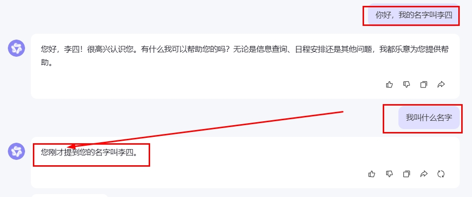
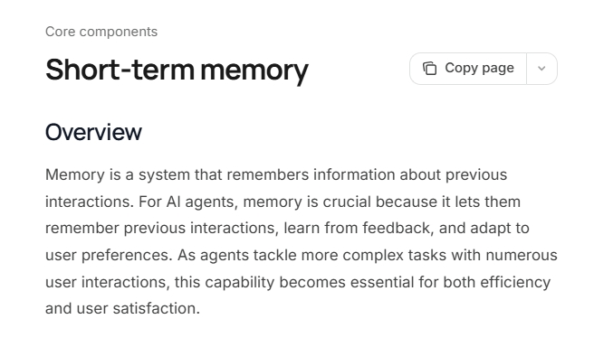
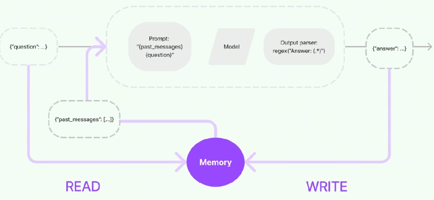
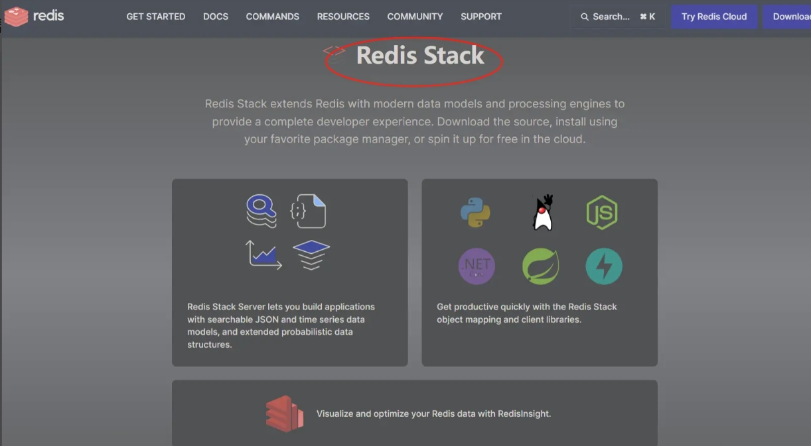
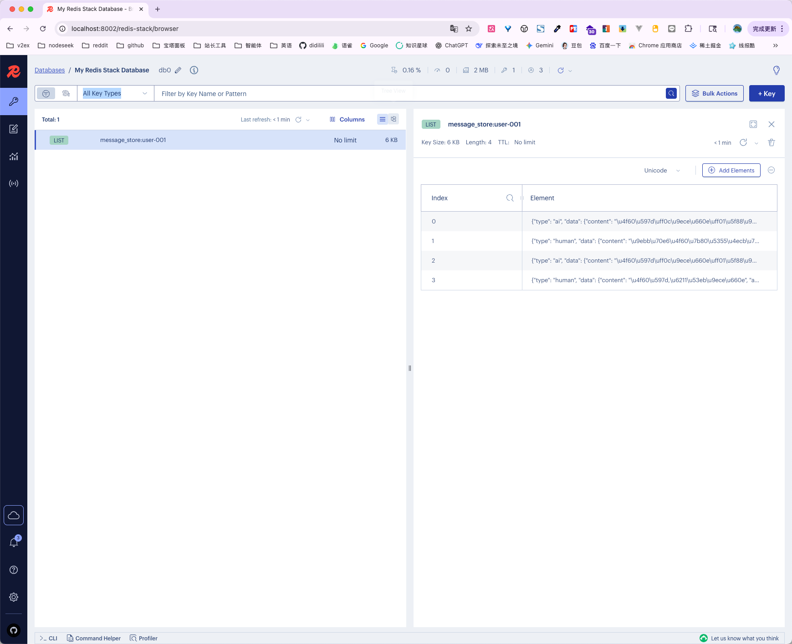

# 16 - Memory and Conversation History (Including Redis Basics)

---

**Objectives of this chapter:**

- Understand what **Memory** means in this chapter and why it is indispensable in multi-turn conversations.
- Grasp the core implementation flow of "**read history -> inject into prompt -> call model -> write back to history**", and understand the division of responsibilities between `RunnableWithMessageHistory` and `BaseChatMessageHistory`.
- Build a clear understanding of Redis's role in this chapter: it does not make the model "smarter"; it makes **conversation history persistent, cross-process, and shareable across instances**.

**Study suggestion:** It is best to study this chapter through two rounds of conversation: first observe why the model forgets things when there is no memory, then see how history messages are read, injected into the prompt, used to call the model, and written back to storage under the same `session_id`. Do not treat Redis as the main focus initially; it is simply a way to store the in-memory version of history more persistently. As long as you can clearly explain "read history -> inject into prompt -> call model -> write history", the subsequent implementation classes will not feel scattered.

**Official documentation and resources**: See [Tool Navigation and Reference Material Index - LangGraph](%E5%B7%A5%E5%85%B7%E5%AF%BC%E8%88%AA%E4%B8%8E%E5%8F%82%E8%80%83%E8%B5%84%E6%96%99%E7%B4%A2%E5%BC%95.md#LangGraph).

---

## 1. Introduction to Memory

### 1.1 Why Memory Is Needed

If you are only doing single-turn Q&A, each request is an independent call: the model looks only at the current input and ends after answering.  
But as soon as you start building chatbots, customer service assistants, learning assistants, or enterprise knowledge Q&A, multi-turn context immediately becomes a hard requirement.

The most typical symptom is:

1. In the first turn you say: "My name is Zhang San."
2. In the second turn you ask: "What is my name?"

If the system does not save and re-inject the previous turn's content, the model can only treat the second turn as a brand-new request, so it naturally answers: "I don't know." This is not because the model is "too dumb"; it is because the program simply never brought the previous turn's information to it.



So from an engineering perspective, memory is not an "optional high-level feature" but one of the most fundamental capabilities of a multi-turn dialogue system. It solves at least three types of problems:

- **Context continuity**: Let the model know what was said in the previous turn.
- **Conversation personalization**: Let the model remember information the user provided in the current session, such as name, preferences, and task background.
- **Multi-step task continuity**: Let the model use the result of a previous step as the input of the next step, instead of starting from scratch every turn.

To put it in the most direct terms: **without memory, a chat system is just "many consecutive single-turn requests"; with memory, it really begins to resemble a "conversation".**



### 1.2 Definition

In this chapter, **Memory** mainly refers to **Short-Term Memory** or **Chat History**.

Its essence is not that "the model actually remembers"; it is that **the program saves previous messages and passes all of this history back to the model before the next call.**

So it is better understood as an "external conversation state management mechanism" rather than learning at the model parameter level.

### 1.3 This Is Not Model Training

This point is easy to confuse, so it is emphasized separately.

The memory discussed in this chapter:

- Is **not** retraining the model
- Is **not** writing information into model parameters
- Is **not** making the model permanently learn certain knowledge

What it does is only:

1. Save history messages externally
2. Read them back before the next call
3. Send them to the model together with the current question

In other words, the model "remembers who you are" not because it learned you internally, but because the program brings the history message "your name is Zhang San" back to it every time.

This is also why:

- **In-memory version**: Once the program exits, the history is lost.
- **Redis version**: After the program restarts, the history can still be read back.

### 1.4 What the "Memory" in This Chapter Can Do

From a project perspective, the memory in this chapter mainly enables the following:

- **Make multi-turn Q&A continuous**: For example, first introduce yourself, then follow up with questions about name, preferences, and previously mentioned content.

- **Save the current session context**: For example, when the user is working on a resume, learning Python, or organizing a certain report, subsequent questions do not need to repeat the background every turn.

- **Provide context for chained flows**: History messages are ultimately usually injected into templates through the `MessagesPlaceholder` from [Chapter 13](13-%E6%8F%90%E7%A4%BA%E8%AF%8D%E4%B8%8E%E6%B6%88%E6%81%AF%E6%A8%A1%E6%9D%BF.md) and used together with the chains in [Chapter 15](15-LCEL%E4%B8%8E%E9%93%BE%E5%BC%8F%E8%B0%83%E7%94%A8.md).

- **Lay the foundation for subsequent Agent / Tool / LangGraph**: You will find later that tool calling, agents, and multi-step decision-making almost always depend on saving state for the current thread / current session.

### 1.5 What This Chapter Does Not Focus On

To avoid mixing this up with later chapters, the boundaries of this chapter should also be made clear here:

- **Not long-term knowledge memory**: For example, permanent user profiles or long-term preference management across many days is not the core of this chapter.

- **Not RAG retrieval memory**: Retrieving information from external documents and then answering belongs to the main line of [Chapter 19 RAG](19-RAG%E6%A3%80%E7%B4%A2%E5%A2%9E%E5%BC%BA%E7%94%9F%E6%88%90.md).

- **Not an Agent decision-making state machine**: More complex looping states and persistence will appear more naturally in the chapters on [Agent](21-Agent%E6%99%BA%E8%83%BD%E4%BD%93.md) and LangGraph.

So for now, you can focus this entire chapter down to one sentence: **This chapter mainly discusses how to save history messages within the current session and feed them back to the model.**

---

## 2. "I Don't Know" Demonstration: Behavior Without Memory

Before actually introducing memory, the best way to learn is not to memorize concepts first, but to see firsthand "what happens without memory." The example below intentionally keeps only the simplest chain: Prompt, Model, Parser.

Then make two consecutive calls:

1. The first time, tell the model: "My name is Zhang San. What is your name?"
2. The second time, ask: "Do you know who I am?"

Because the program does not save the first turn's content and does not re-inject history in the second turn, the model can only treat the second question as a brand-new request, and therefore gives an answer like "I don't know."

【Example source code】`案例与源码-2-LangChain框架/07-memory/Memory_IDontKnow.py`

[Memory_IDontKnow.py](../../%E6%A1%88%E4%BE%8B%E4%B8%8E%E6%BA%90%E7%A0%81-2-LangChain%E6%A1%86%E6%9E%B6/07-memory/Memory_IDontKnow.py ":include :type=code")

This example is meant to build a basic intuition: **the model is not naturally capable of remembering multi-turn conversations; whether it can see history is decided by the program.**

---

## 3. Implementation Principles

### 3.1 Core Main Flow

Before rushing to look at class names, the memory implementation process can be broken down into four steps:

1. **Read history**
2. **Assemble history into the current prompt**
3. **Call the model**
4. **Write this turn's input and output back into history**

This is the most core chain of this chapter.



### 3.2 Engineering Expression

If expressed in a way closer to code, a single call with memory usually happens like this:

**Step 1: Locate the corresponding history based on the session identifier.**  
For example, use `session_id="user-001"` to find the list of messages for this user's current session.

**Step 2: Insert the history messages into the Prompt.**  
This step is usually used together with the `MessagesPlaceholder("history")` from [Chapter 13](13-%E6%8F%90%E7%A4%BA%E8%AF%8D%E4%B8%8E%E6%B6%88%E6%81%AF%E6%A8%A1%E6%9D%BF.md).

**Step 3: Send "history + current question" together to the model.**  
In this way, the model no longer sees only the current sentence, but the complete context.

**Step 4: Write this turn's messages back into history storage.**  
That is, append both the user input of this turn and the model's reply of this turn, so that they can be read again in the next turn.

### 3.3 Relationship Between MessagesPlaceholder and Templates

In a conversation history scenario, you usually do not hard-code history messages one by one in the template, because the number of turns and the content change every round. A more reasonable approach is to leave a "history message slot" in the template and stuff the entire current session history into that slot at runtime — this is exactly the typical use of `MessagesPlaceholder` in [Chapter 13](13-%E6%8F%90%E7%A4%BA%E8%AF%8D%E4%B8%8E%E6%B6%88%E6%81%AF%E6%A8%A1%E6%9D%BF.md), which connects with the "reading and writing history" in this chapter.

### 3.4 The Meaning of session_id

Whenever memory is involved, one key question arises: **how do you know which history belongs to which user and which session?**

The most common approach is to use `session_id`, which is simply "the identifier of the current session".

For example:

- `user-001`
- `user-002`
- `chat-room-a`

Different `session_id` values usually correspond to different historical records.

In `RunnableWithMessageHistory`, `session_id` is usually passed in through runtime configuration, for example `config={"configurable": {"session_id": "user-001"}}`. Different `session_id` values will correspond to different history objects.

This is also why `session_id` is very important in the Redis version and multi-session version examples in this chapter. Without this layer of distinction, the system could mistakenly give user A's history to user B.

### 3.5 Relationship Between This Chapter and the Official LangGraph Main Line

Some version background is needed here.

In the current official LangChain / LangGraph main line, **short-term memory** is increasingly being discussed within the **LangGraph persistence / checkpointer / thread** system.  
That is, the official documentation now emphasizes more:

- Thread
- Persistence
- Checkpointer
- Graph execution state

However, this does not mean that `RunnableWithMessageHistory` is no longer valuable. For LCEL chains, it is more intuitive and makes it easier to see how history messages are injected into the current call.

Therefore, this chapter adopts the following learning sequence:

- First use `RunnableWithMessageHistory + BaseChatMessageHistory` to see chain-level conversation history clearly
- Then understand that state persistence for complex agents will continue to move toward LangGraph persistence

> **Version note:** This chapter continues to use `RunnableWithMessageHistory` in order to clearly explain how history messages are read, written, and injected in LCEL chains. For production-grade agents or complex multi-turn state management, it is recommended to also refer to LangGraph's checkpointer, thread, and persistence mechanisms when designing.

This way, when you later switch to more complex Agent / LangGraph scenarios, there will be no disconnect.

**Supplement:** History messages consume the model's context window; when there are too many turns, you need to perform truncation, summarization, or keep only the latest \(k\) turns. Otherwise, you may hit the token limit or incur additional costs. This chapter focuses on explaining the "injection of history"; specific compression strategies can be chosen later according to product requirements.

---

## 4. Memory-Related Implementation Classes

### 4.1 Which Approach Is Used in This Chapter

As already clarified above: this chapter first uses `RunnableWithMessageHistory + BaseChatMessageHistory` to explain chain-level conversation history; state persistence for complex agents will be understood later in the context of LangGraph's `thread / checkpointer / persistence`.

Next, let's look at several related classes: which ones are early-era approaches, and which ones are suitable as the focus of this chapter.

### 4.2 ConversationChain (Early Approach)

LangChain had a fairly representative class in its early days called `ConversationChain`.

It has built-in conversation templates and memory mechanisms, so it is very convenient for quick simple demonstrations. However, its flexibility is limited, and it does not fit well with the LCEL / Runnable system. When facing complex conversational flows, its extensibility is relatively poor.

Therefore, in today's learning path, it is no longer suitable as the main approach for this chapter.

### 4.3 RunnableWithMessageHistory (A More Appropriate Approach)

The role of `RunnableWithMessageHistory` is very direct: **it wraps an existing Runnable / Chain with a layer of history management capability.**

It does not replace your Prompt, Model, or Parser, but stands outside of them, uniformly responsible for reading, injecting, and writing back history.

This fits very well with the LCEL discussed in Chapter 15, because it does not introduce a different style, but continues to work on top of the Runnable system. Therefore, from a teaching perspective, it is particularly suitable for this chapter, because it can clearly explain that "memory is a session capability managed separately outside the chain."

### 4.4 BaseChatMessageHistory (History Storage Interface)

If `RunnableWithMessageHistory` solves "when to read and write history," then `BaseChatMessageHistory` solves:

**Where exactly history is stored and how it is stored.** It can be seen as "a unified abstract interface for chat message history."

No need to get bogged down in source code details initially; just grasp this division of labor:

- **RunnableWithMessageHistory**: controls when history is read and written
- **BaseChatMessageHistory and its implementation classes**: control where history is stored

This is why this chapter covers both of them together, rather than just one of them.

### 4.5 Common Implementation Classes

LangChain provides multiple chat history implementations (such as in-memory, file, Redis, Elasticsearch, DynamoDB, etc.), and the core differences mainly lie in **whether it is persisted and whether it is suitable for multi-instance sharing**.

The differences between common implementations can be seen mainly from the storage location:

| Component Name                     | Storage Method     | Suitable Scenarios                   |
| ---------------------------- | ------------ | ------------------------------ |
| `InMemoryChatMessageHistory` | In-process memory   | Local learning, single-process demos, temporary sessions |
| `FileChatMessageHistory`     | Local file     | Lightweight persistence, small scripts           |
| `RedisChatMessageHistory`    | Redis        | Persistence, cross-process, multi-instance sharing     |
| Other backend implementations                 | ES, databases, etc. | Integration with existing tech stack               |

For this chapter, the most important are the first two core conclusions:

- **Learn InMemory first**, because it is the most intuitive
- **Then learn Redis**, because it is closest to real-world projects

### 4.6 Correspondence with the Case Structure in This Chapter

The case files for this chapter are listed below in learning order:

| File                                     | Purpose                              |
| ---------------------------------------- | --------------------------------- |
| `Memory_IDontKnow.py`                    | First see the problem when there is no memory                |
| `Memory_RunnableWithMessageHistory.py`   | The most basic in-memory version with conversation history          |
| `Memory_RunnableWithMessageHistoryV2.py` | Multi-session version, corresponding to real multi-user scenarios |
| `Memory_InMemoryChatMessageHistory.py`   | Not using the wrapper, directly operating history manually  |
| `RedisEnvCheck.py`                       | Run environment validation before running the Redis version         |
| `Memory_RedisChatMessageHistory.py`      | Main Redis persistence case                |
| `Memory_RedisStackChatMessageHistory.py` | Redis Stack optional case              |

This arrangement is actually very reasonable:

- First let you see the problem
- Then provide the simplest solution
- Then expand to multi-session
- Finally cover persistence

---

## 5. Case Code

### 5.1 In-Memory Version (In-process, lost upon restart)

The in-memory version is best for getting started, because it exposes the "essence of memory" most clearly:

- History is simply a list of messages
- Each round reads from this list
- At the end of each round, new messages are written back

The drawbacks are also obvious:

- Only valid within the current Python process
- Once the program stops, history is gone
- Not suitable for multi-instance sharing

But precisely because it is simple enough, it is suitable for building the first layer of understanding.

#### 5.1.1 Most Basic Approach: RunnableWithMessageHistory

[Case Source Code] `案例与源码-2-LangChain框架/07-memory/Memory_RunnableWithMessageHistory.py`

[Memory_RunnableWithMessageHistory.py](../../%E6%A1%88%E4%BE%8B%E4%B8%8E%E6%BA%90%E7%A0%81-2-LangChain%E6%A1%86%E6%9E%B6/07-memory/Memory_RunnableWithMessageHistory.py ":include :type=code")

There are three points in this case that are most worth understanding:

- `MessagesPlaceholder("history")` is responsible for receiving history
- `RunnableWithMessageHistory` is responsible for wrapping the entire chain
- `session_id` is responsible for telling the system "which history should be read currently"

#### 5.1.2 Multi-Session Approach: Maintaining Multiple Histories by session_id

[Case Source Code] `案例与源码-2-LangChain框架/07-memory/Memory_RunnableWithMessageHistoryV2.py`

[Memory_RunnableWithMessageHistoryV2.py](../../%E6%A1%88%E4%BE%8B%E4%B8%8E%E6%BA%90%E7%A0%81-2-LangChain%E6%A1%86%E6%9E%B6/07-memory/Memory_RunnableWithMessageHistoryV2.py ":include :type=code")

This case is closer to real projects than the previous one, because in real systems, there is not just one user, and not just one history.

It uses a `store` dictionary keyed by `session_id` to store different `InMemoryChatMessageHistory`, essentially demonstrating:

**How the same chain logic switches to different histories based on different session IDs.** If you later build web chat, customer service systems, or multi-user conversations, this approach will be used repeatedly.

#### 5.1.3 Directly Operating InMemoryChatMessageHistory

[Case Source Code] `案例与源码-2-LangChain框架/07-memory/Memory_InMemoryChatMessageHistory.py`

[Memory_InMemoryChatMessageHistory.py](../../%E6%A1%88%E4%BE%8B%E4%B8%8E%E6%BA%90%E7%A0%81-2-LangChain%E6%A1%86%E6%9E%B6/07-memory/Memory_InMemoryChatMessageHistory.py ":include :type=code")

This case no longer relies on automatic management through `RunnableWithMessageHistory`, but instead manually:

- `add_user_message(...)`
- `add_message(...)`
- `history.messages`

Its value lies in letting you "see the underlying layer" more clearly: **so-called memory, in the final analysis, is just maintaining a message history list.**

From an engineering perspective:

- **Want to quickly build a multi-turn chain**: prefer using `RunnableWithMessageHistory`
- **Want full control over read/write timing**: can directly operate `InMemoryChatMessageHistory`

### 5.2 Persistence: Redis Storage

Once you understand the in-memory version, you will naturally encounter a question: **After the program restarts, all history is gone. What should you do?**

This is why Redis comes into play. Redis's role in this chapter is very clear:

- It is not a model
- It is not a Prompt
- It is not a "more advanced memory algorithm"
- It is just a storage backend more suitable for persistently saving conversation history

That is to say, switching from the in-memory version to the Redis version in this chapter does not change the "memory principle," but rather the "location where history is stored."

#### 5.2.1 Design Requirements and Reference Documentation

The goal of this section is very simple: **change conversation history from process memory to Redis persistent storage.** After doing so: history can be restored after a program restart, multiple instances can share the same history, and it is closer to real production systems.

At the same time, combined with the current dependencies of this project, you should also know:

- This repository's `requirements.txt` already includes `redis>=5.3,<6`
- It also includes `langchain-redis>=0.2`

So if you have already executed `pip install -r requirements.txt`, you usually do not need to install basic dependencies separately.

#### 5.2.2 Introduction to Redis and Redis Stack

First, the most important conclusion: **for the conversation history case in this chapter, plain Redis is sufficient.**

The reason is that when `RedisChatMessageHistory` stores conversation history, it only uses Redis's basic data structure capabilities and does not depend on the advanced modules only available in Redis Stack.

Therefore:

- **Plain Redis**: can fully run the main case in this chapter
- **Redis Stack**: can also run it, and makes it easier to visualize data with RedisInsight



If you are learning this for the first time, you can simply distinguish them as follows: `Redis` is the high-performance key-value store itself, while `Redis Stack` builds on Redis by adding more enhanced capabilities and bringing a friendlier toolchain.

The reason this chapter still keeps the Redis Stack section is, on the one hand, to let you observe data more intuitively with RedisInsight, and on the other hand, to lay some groundwork for later, more complex Redis usage such as vector storage and search.

| Feature Dimension | Plain Redis                 | Redis Stack Enhanced Features                                  |
| :------- | :------------------------- | :---------------------------------------------------- |
| Data Structures | Strings, lists, sets, hashes, etc. | Adds advanced types such as JSON, graphs, time series, probabilistic structures           |
| Query Capabilities | Key-value queries only               | Supports full-text search, vector search, graph queries, JSON queries             |
| Use Cases | Caching, message queues, counters, etc.   | Real-time recommendations, time-series analysis, knowledge graphs, document databases, AI vector retrieval |
| Developer Experience | Command-line operations, manual logic assembly required | Provides RedisInsight and object mapping libraries, higher development efficiency          |

#### 5.2.3 Starting with Docker and Connecting from the Host

If you do not have Redis installed separately on your local machine, using Docker is the easiest approach.

**Plain Redis:**

```bash
docker run -d --name docker-redis-1 -p 6379:6379 redis
```

This way, the local machine can connect to Redis through:

```bash
redis://localhost:6379
```

to connect to Redis.

**Redis Stack:**

```bash
docker run -d --name redis-stack -p 26379:6379 -p 8001:8001 redis/redis-stack
```

Here you need to distinguish between two ports:

- `26379`: used for local access to the Redis service (mapped to port `6379` inside the container)
- `8001`: the commonly mapped port for accessing RedisInsight through a browser

That is to say, in the Redis Stack case, if the default connection is `redis://localhost:26379`, that is completely normal, because it connects to the **host mapped port**, not the original `6379` inside the container. If your local image or compose maps Insight to **8002** or another port, simply follow the actual `docker ps` or documentation.

#### 5.2.4 Basic Redis Commands and Viewing Conversation History

You do not need to become a Redis expert in this section; you only need to be able to view the data written by the cases in this chapter.

The most commonly used commands are as follows:

| Command                 | Description                       | Example                             |
| :------------------- | :------------------------- | :------------------------------- |
| `PING`               | Check whether the service is alive           | `PING` → returns `PONG`             |
| `SET key value`      | Set a string key-value             | `SET mykey "hello"`              |
| `GET key`            | Get a string value               | `GET mykey`                      |
| `DEL key [key ...]`  | Delete one or more keys           | `DEL mykey`                      |
| `KEYS pattern`       | Find keys by pattern (use with caution in production) | `KEYS *`、`KEYS message_store:*` |
| `EXISTS key`         | Check whether a key exists             | `EXISTS mykey` → 1 or 0          |
| `TTL key`            | View the remaining TTL of a key (in seconds) | `TTL mykey`, -1 means never expires     |
| `EXPIRE key seconds` | Set the expiration time of a key           | `EXPIRE mykey 3600`              |
| `DBSIZE`             | Number of keys in the current database         | `DBSIZE`                         |
| `FLUSHDB`            | Clear the current database (use with caution)     | `FLUSHDB`                        |

In the Redis conversation history case in this chapter, the point most worth your attention is this: **LangChain writes different keys based on `session_id`.**

For example, after you have run a session with `session_id=user-001`, you may see something like:

```redis
KEYS *
TYPE message_store:user-001
LRANGE message_store:user-001 0 -1
```

Each element you see is essentially a serialized message record. Here you can establish a basic intuition:

**Conversation history is not mysterious; when stored in Redis, it is essentially just a set of message data managed by session.**

#### 5.2.5 Environment Validation

Before actually running Redis conversation history, it is recommended to check two things first:

1. Whether the `redis` package is installed correctly in Python
2. Whether the Redis service can actually be connected to

[Case Source Code] `案例与源码-2-LangChain框架/07-memory/RedisEnvCheck.py`

[RedisEnvCheck.py](../../%E6%A1%88%E4%BE%8B%E4%B8%8E%E6%BA%90%E7%A0%81-2-LangChain%E6%A1%86%E6%9E%B6/07-memory/RedisEnvCheck.py ":include :type=code")

This script is recommended as "the first step before running the Redis examples," since many issues are not actually LangChain problems but rather the Redis environment itself not being ready.

#### 5.2.6 Example: Redis Chat History

[Example source code]`案例与源码-2-LangChain框架/07-memory/Memory_RedisChatMessageHistory.py`

[Memory_RedisChatMessageHistory.py](../../%E6%A1%88%E4%BE%8B%E4%B8%8E%E6%BA%90%E7%A0%81-2-LangChain%E6%A1%86%E6%9E%B6/07-memory/Memory_RedisChatMessageHistory.py ":include :type=code")

This is the most important persistence example in this chapter. Compared with the in-memory version, the only core change is one thing:

- `get_session_history(...)` no longer returns `InMemoryChatMessageHistory`
- Instead, it returns `RedisChatMessageHistory`

In other words: **The chain's read/write logic remains unchanged; only the history storage backend has changed.**

This understanding is particularly important because it lets you truly grasp:

- `RunnableWithMessageHistory` is responsible for "when to read and write"
- `RedisChatMessageHistory` is responsible for "where the history is stored"

The two work together rather than replacing each other.

#### 5.2.7 Example: Using Redis Stack (Optional)

[Example source code]`案例与源码-2-LangChain框架/07-memory/Memory_RedisStackChatMessageHistory.py`

[Memory_RedisStackChatMessageHistory.py](../../%E6%A1%88%E4%BE%8B%E4%B8%8E%E6%BA%90%E7%A0%81-2-LangChain%E6%A1%86%E6%9E%B6/07-memory/Memory_RedisStackChatMessageHistory.py ":include :type=code")

The logic in this example is essentially the same as the main example in the previous section, except that it connects to the common Redis Stack port by default.

Its greatest teaching value is not that it introduces a completely new solution, but rather that it lets you confirm Redis Stack is also compatible with running the history storage covered in this chapter, and that you can use RedisInsight to directly view the session data.



Therefore, this section is better viewed as **a variant of the main example that makes data observation more convenient.**

---

**Chapter reflection questions:**

1. If a user says "the model remembers me," how would you explain what the "memory" in this chapter actually is?

   **Reference approach:** The memory here is not a model parameter update; rather, the system retrieves historical messages again and provides them to the model as context. The model appears to remember because the application brings the history along for it.

2. Why is it important to distinguish the boundary between `RunnableWithMessageHistory` and the specific storage classes?

   **Reference approach:** The former is responsible for integrating history into the invocation chain and deciding when to read and write, while the latter is responsible for where messages are actually stored. Once the boundary is clear, storage backends such as in-memory, Redis, and databases can be swapped without substantially changing the invocation chain logic.

3. In a multi-user scenario, what problems can arise if `session_id` is poorly designed?

   **Reference approach:** It may cause sessions or users to become mixed up, misuse history, or even leak privacy. `session_id` should be designed together with isolation policies for users, sessions, and business tenants, rather than being written as an arbitrary string.

4. Why can't the complete history be fed back to the model indefinitely?

   **Reference approach:** Context window size, cost, latency, and noise all increase. More history is not necessarily better; real systems need window truncation, summarization, important information extraction, and expiration cleanup.

**Chapter summary:**

- **What memory is**: This chapter discusses short-term memory / chat history, not training the model or updating model parameters, but saving historical messages and providing them back to the model before the next round of invocation.
- **Basic flow**: Read history → insert into prompt → call model → write history back. `MessagesPlaceholder` is responsible for reserving space for historical messages, `RunnableWithMessageHistory` is responsible for managing the timing of reads and writes, and `BaseChatMessageHistory` and its implementation classes are responsible for the specific storage.
- **How to choose storage**: `InMemoryChatMessageHistory` is suitable for single-process learning and demos, but the data is lost once the process stops; `RedisChatMessageHistory` is suitable for persistence, multi-instance sharing, and cross-process session recovery.
- **Version relationships**: This chapter uses `RunnableWithMessageHistory + BaseChatMessageHistory` to clarify chain-level memory; for long-running state in complex agents, later chapters will cover LangGraph threads, persistence, and checkpointers.

**Suggested next step:** First run all the examples without memory, with the in-memory version, with multiple sessions, and with the Redis version, focusing on observing "how history is continued under the same `session_id`"; then continue with [Chapter 17 Tools](17-Tools%E5%B7%A5%E5%85%B7%E8%B0%83%E7%94%A8.md). You will more easily understand why agent scenarios require not only tools but also session state and history management.
