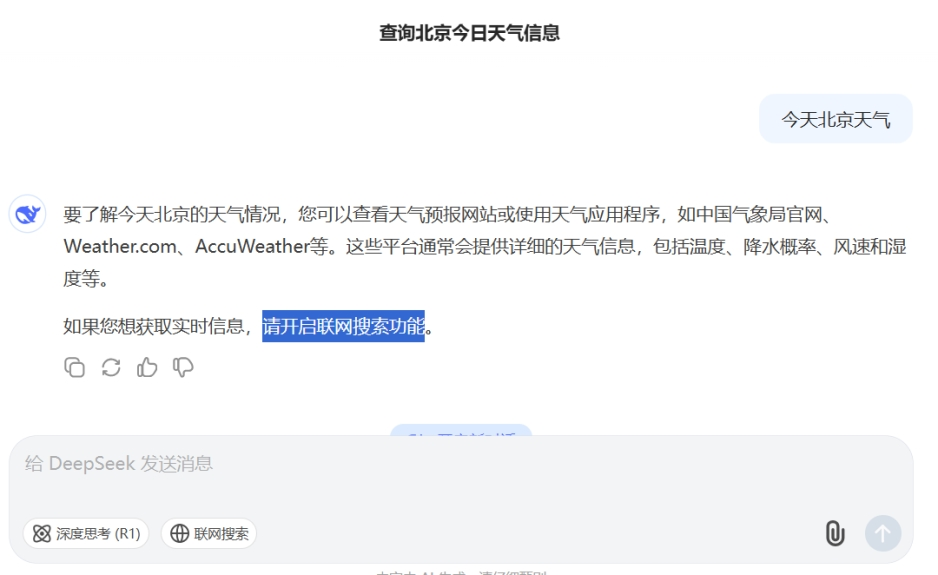
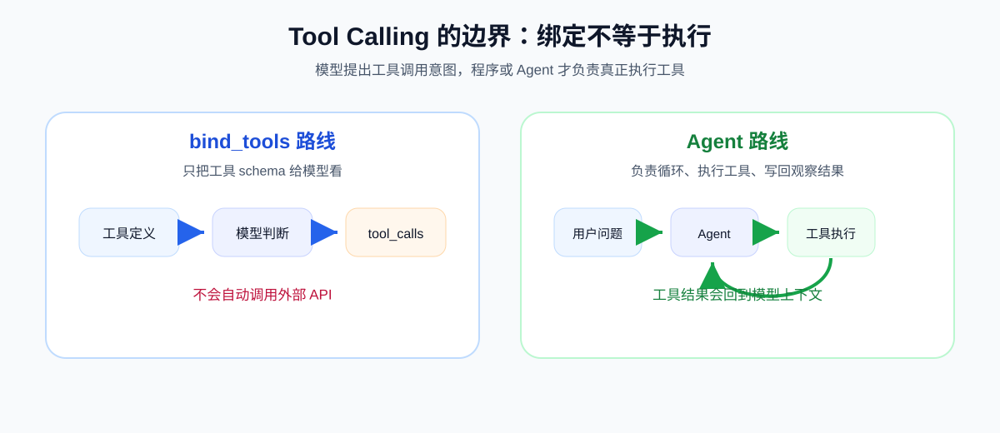
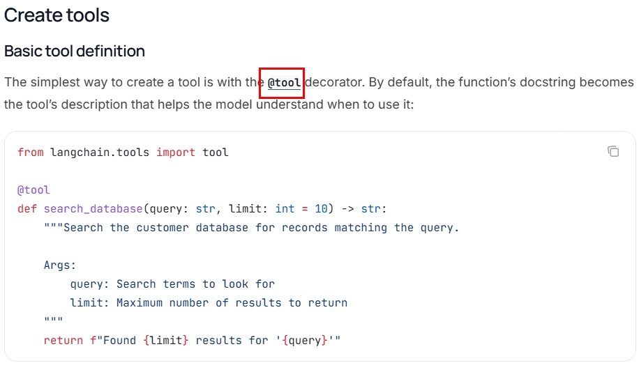
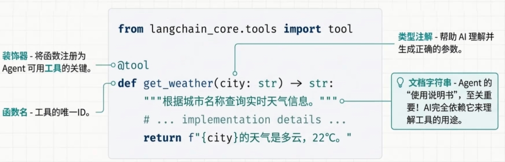
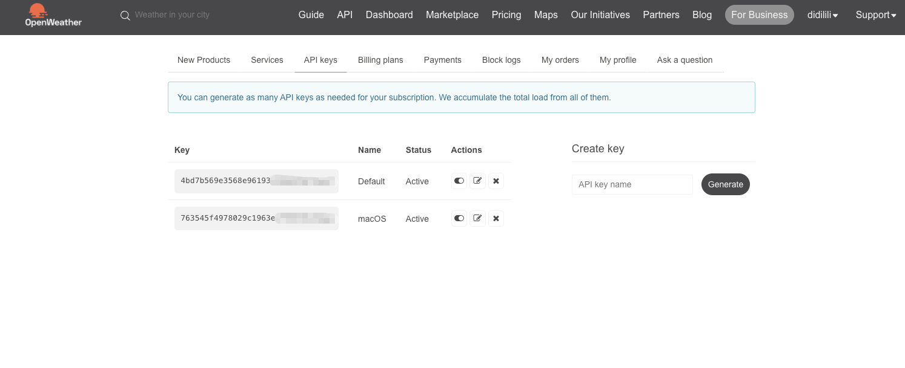

# 17 - Tools Calling

---

**Objectives of this chapter:**

- Understand what **Tool**, **Tool Calling**, and **Function Calling** each mean, and establish the core division of labor: "**the model is responsible for decision-making, the program is responsible for execution**".
- Learn to define LangChain tools using the **`@tool`** decorator, write parameter schemas with **Pydantic**, and understand key objects such as `name`, `description`, `args`, `tool_calls`, and `ToolMessage`.
- Run through and understand all cases in this chapter: **basic addition tool, Pydantic parameter schema, weather query tool, and the complete weather assistant chain**, laying the foundation for [Memory and Conversation History](16-%E8%AE%B0%E5%BF%86%E4%B8%8E%E5%AF%B9%E8%AF%9D%E5%8E%86%E5%8F%B2%EF%BC%88%E5%90%ABRedis%E5%9F%BA%E7%A1%80%EF%BC%89.md), [Agent](21-Agent%E6%99%BA%E8%83%BD%E4%BD%93.md), and [MCP Model Context Protocol](20-MCP%E6%A8%A1%E5%9E%8B%E4%B8%8A%E4%B8%8B%E6%96%87%E5%8D%8F%E8%AE%AE.md).

**Study suggestion:** When learning tool calling, first hold the boundary firmly: the model is responsible for deciding whether to call a tool and filling in the parameters, while the program is responsible for actually executing the tool and returning the result. You can read this chapter along the line of `@tool`, `bind_tools`, `tool_calls`, `ToolMessage`, and the business closed loop. Pydantic is not just decoration; it helps turn tool parameters into a more reliable contract.

**Official documentation and resources:** See [Tool Navigation and Reference Materials Index - Tool Calling, MCP, and Agents](%E5%B7%A5%E5%85%B7%E5%AF%BC%E8%88%AA%E4%B8%8E%E5%8F%82%E8%80%83%E8%B5%84%E6%96%99%E7%B4%A2%E5%BC%95.md#工具调用、MCP与智能体).

---

## 1. Introduction to Tools

### 1.1 Definition

**Tool**, is an **external capability** prepared for a large language model. It is essentially a callable function, but we wrap it into a form that the model can understand, so that the model knows:

- What this tool is called
- What this tool does
- What parameters this tool accepts

**Tool Calling** or **Function Calling** means: **During the process of responding, the model does not directly provide the final natural language answer, but first outputs a structured intent saying "I want to call a certain tool, with these parameters."**

Then you must especially remember one most important division of labor:

- **The model is responsible for deciding**: whether to call a tool, which tool to call, and what parameters to pass
- **The program is responsible for executing**: actually calling the function / API / database / business service, and sending the result back to the model

So from an engineering perspective, a Tool is not "the model suddenly learns to call external systems on its own," but rather **we expose external capabilities to the model in a controlled way**.

**One-sentence definition:** A Tool is the external capability itself, and Tool Calling is the process by which the model initiates the use of that capability.

> **Terminology convention:** To reduce the cost of switching in later chapters, this tutorial uniformly refers to this mechanism as **Tool Calling** hereafter; if **Function Calling** appears when citing OpenAI or other platform documentation, it is essentially the same problem under a different name.

### 1.2 The Role of Tools

Without tools, although a large language model can "talk," what it can actually do is still very limited. It excels at language understanding, information organization, summarization and rewriting, and explanation, but it cannot naturally perform real-world queries and operations for you.

The most typical limitations include:

- **It cannot reliably access real-time data**, such as the latest weather, real-time stock prices, or today's order status
- **It cannot directly operate external systems**, such as querying databases, sending HTTP requests, reading files, or calling internal enterprise interfaces
- **It cannot guarantee completely accurate computation and execution**, such as complex calculations, strict form submissions, payment orders, or status changes

This is also why in real projects, almost all LLM applications with "real business value" eventually move toward Tools:

- Intelligent customer service needs to check orders, logistics, and after-sales status
- Enterprise assistants need to query knowledge bases, databases, and ticketing systems
- Data analysis assistants need to run SQL, read reports, and call statistical interfaces
- Lifestyle assistants need to check weather, maps, flights, and schedules



> **Figure description:** In the interface, the user asks "Today's weather in Beijing". When external capabilities such as "web search" are not enabled, the model cannot provide real-time data and can only suggest visiting a weather website or **enabling web search**. This figure illustrates that **without tools/plugins connected, no matter how strong the model is, it still cannot obtain the real-time state of the world**, forming a contrast with the later use of a Tool to call a weather API.

At the introductory stage, you can first grasp a basic judgment: **Without Tools, a large language model is mainly "talking"; with Tools, it can actually begin to "do."**

### 1.3 The Relationship Among Tool, Tool Calling, and Agent

These three must be distinguished clearly first, because many people mix them up when learning about Agents later.

| Concept                             | What It Is                            | Core Responsibility                              |
| :---------------------------------- | :------------------------------------ | :----------------------------------------------- |
| **Tool**                            | A wrapped external capability         | Responsible for "doing things"                   |
| **Tool Calling / Function Calling** | The mechanism by which the model outputs structured call intent | Responsible for "initiating the call request"    |
| **Agent**                           | An intelligent entity that reasons, plans, and makes multi-step decisions | Responsible for "deciding when to call, how many times to call, and in what order to call" |

They can be understood as follows:

- **Tool** is like the "screwdriver, wrench, calculator, weather API" in a toolbox
- **Tool Calling** is like "I have now decided which tool to use, and I am stating the parameters"
- **Agent** is like "a worker or dispatcher with judgment", who decides on its own which tool to use first, which tool to use next, and whether to continue calling

Therefore, the focus of this chapter is to first thoroughly understand **"the tool itself"** and **"the single-turn/manual tool calling chain"**. When you reach [Chapter 21 Agent](21-Agent%E6%99%BA%E8%83%BD%E4%BD%93.md), it will be much easier to understand "letting the model call tools iteratively and in multiple steps on its own".

### 1.4 The Position of This Chapter in the Project

This chapter corresponds to the `案例与源码-2-LangChain框架/08-tools` directory in the repository, and the overall learning path is very clear:

| File                       | Purpose                                  | Suggested Learning Order |
| :------------------------- | :--------------------------------------- | :----------- |
| `Tool_AddNumberTool.py`    | The most basic usage of `@tool`                 | Read first         |
| `PydanticDemo.py`          | First understand Pydantic validation and conversion separately        | Read next         |
| `Tool_AddNumberToolPro.py` | Add `args_schema` to tools               | Read after that       |
| `QueryWeatherTool.py`      | Wrap a real API as a Tool               | Read further on     |
| `LLMQueryWeatherDemo.py`   | Connect "model + tool + parsing + output" into a closed loop | Read last       |

This chapter is not a scattered introduction to a few APIs, but revolves around one question:

**How do we gradually turn an ordinary Python function into a tool capability that can be correctly understood by the model, safely executed by the program, and truly serve business scenarios.**

---

## 2. How Tool Calling Works

### 2.1 The Core Thread

As long as you first grasp one thread, almost all APIs later in this chapter will become easy to understand:

1. The user asks a question
2. The program sends "user message + tool definitions" to the model together
3. The model determines whether it needs to call a tool
4. If so, the model returns `tool_calls`
5. The program actually executes the tool based on `tool_calls`
6. The program puts the tool result back into the message stream
7. The model generates the final natural language reply based on the tool result

This is the complete closed loop of tool calling.


> **Tip: Swimlane diagram vs. ordinary flowchart (interview question)**
>
> The figure above is a **swimlane diagram**, which divides by roles/systems to show "who does what at which stage".
>
> - **Ordinary flowchart**: only shows the sequence of steps and branches/decisions, without distinguishing "who" executes each step; suitable for processes within a single role or single system (such as algorithm steps or a single business line).
> - **Swimlane diagram**: divides lanes by role/department/system, with each step placed in the lane of the corresponding responsible party, making it easy to see at a glance "who does what"; suitable for multi-role collaboration and cross-department/cross-system processes.
> - **When to use a swimlane diagram**: use a swimlane diagram when a process involves multiple responsible entities (users, models, applications, third-party services, etc.) and needs to clarify responsibility boundaries and handoff points. For example, tool calling (user → model → your code → model), approval flows, and cross-system integration.

If you have read [Chapter 11](11-Model-I-O%E4%B8%8E%E6%A8%A1%E5%9E%8B%E6%8E%A5%E5%85%A5.md) and [Chapter 13](13-%E6%8F%90%E7%A4%BA%E8%AF%8D%E4%B8%8E%E6%B6%88%E6%81%AF%E6%A8%A1%E6%9D%BF.md), you will see a continuous message thread here:

- Chapter 11 discusses that the model returns `AIMessage`
- Chapter 13 discusses that the message stream contains `ToolMessage`
- Chapter 17 is where these two things are actually connected

In other words, **Tool Calling is not a separate mechanism apart from the message system; it essentially still takes place within the message stream.**



### 2.2 What the Model Actually Sees

You may ask: why does the model know that it "should call the weather tool rather than simply making up a weather answer"?

The reason is: when you use `bind_tools(...)` to bind tools to the model, the request includes not only the user's question but also **tool definition information**. According to the official LangChain and OpenAI documentation, this information includes at least:

- **Tool name**: for example, `get_weather`
- **Tool description**: that is, the docstring or a manually provided description
- **Parameter schema**: for example, parameter names, types, and field descriptions

What the model sees is not "a black-box function," but "a structured capability description with a name, purpose description, and parameter rules." This is also why the quality of the tool description directly affects the tool calling performance: **the model does not understand the tool by reading your function body; it mainly relies on `name`, `description`, and `args_schema` to infer "when it should be used and how parameters should be passed."**

### 2.3 What the Program Mainly Does

The model outputs the tool call intent, but **the model will not execute the tool for you**. The one that actually executes the tool is always your application code.

This step usually includes:

- Reading the `tool_calls` returned by the model
- Finding the corresponding tool
- Extracting the parameters
- Executing a Python function, HTTP request, database query, or other business logic
- Sending the result back to the model

This is especially important in real projects because it means:

- **Permission control is in your hands**
- **Whether a certain tool is actually allowed to be called is in your hands**
- **Whether parameters need secondary validation is in your hands**
- **Whether tool results need desensitization, rate limiting, or retries is also in your hands**

So tool calling is never "the model directly operates your system," but rather **the model makes a request, and the application code reviews and executes it.**

### 2.4 The Relationship Among tool_calls, AIMessage, and ToolMessage

These three objects are the most easily confused but also the most critical set of concepts.

| Object                 | Which turn it appears in       | Role                                 |
| :--------------------- | :----------------------------- | :----------------------------------- |
| `AIMessage.tool_calls` | When the model decides to call a tool | Represents "which tool the model wants to call and what the parameters are" |
| Tool execution result           | After the program executes the tool       | Represents "the result after actual execution"               |
| `ToolMessage`          | When sending the tool result back to the model | Represents "a return message after a certain tool has been executed"   |

First, establish a very practical understanding:

- **`AIMessage.tool_calls` is the model's request**
- **`ToolMessage` is the program's receipt**

This is very similar to the real-world process of "initiating a request → executing an operation → returning a result."

If there are multiple tool calls in a single reply, `ToolMessage` also needs to use `tool_call_id` to correspond back to a preceding `tool_call`, so that both the model and the runtime know "which tool request this tool result is answering."

In LangChain's more general official explanation, they often directly show:

1. The model returns `AIMessage(tool_calls=[...])`
2. The program executes the tool
3. The program constructs `ToolMessage`
4. Then these messages are sent back to the model together

However, to make the current case in this course more suitable for beginners, it retains a more intuitive teaching path: **using the [output parser](14-%E8%BE%93%E5%87%BA%E8%A7%A3%E6%9E%90%E5%99%A8.md) to extract the tool parameters, then manually executing the tool, and then passing the result to the next [LCEL](15-LCEL%E4%B8%8E%E9%93%BE%E5%BC%8F%E8%B0%83%E7%94%A8.md) chain to organize natural language.**

These two approaches are not contradictory; they simply represent different teaching levels: one is suitable for seeing the process clearly, while the other is closer to the general message flow.

### 2.5 When tools are not needed

Not every problem requires using a Tool.

If the user is simply asking:

- "What is LangChain?"
- "Please explain Python decorators"
- "Help me summarize this text"

For these types of questions, the model itself can already answer them, and at this point directly using `Prompt → Model → Parser` is often sufficient.

The value of Tools usually becomes clearly evident in the following types of scenarios: **when real-time data is needed**; **when access to external systems is needed**; **when highly deterministic execution is needed**; **when model output needs to be translated into real actions**.

This also aligns closely with real project experience: **Tools are not added to "look advanced," but to supplement the parts of capability that the model itself cannot do or cannot do reliably.**

---

## 3. Custom Tools: Start with the Simplest Tool

### 3.1 Using the @tool Decorator

In LangChain, the simplest way to define a tool is to use the **`@tool`** decorator.

If this is your first encounter with decorators, there is no need to overcomplicate your understanding. For this chapter, you can first grasp this: **the role of a decorator is to add an additional layer of "framework-recognizable capability" to a function without changing its core logic.**

In this context, what `@tool` does is:

- Wrap an ordinary Python function into a LangChain Tool
- Give it metadata such as `name`, `description`, `args`
- Enable it to be recognized and called by the model or Agent

LangChain's official documentation also explicitly emphasizes: **the simplest way to create a tool is to use the `@tool` decorator; by default, the function docstring becomes the tool description.**



So remember the most important sentence first: **the purpose of `@tool` is not to make the function "more complex," but to turn the function into "a tool the model can understand."**

### 3.2 Basic Example: Addition Tool

From a teaching perspective, do not rush into weather, databases, or search engines yet. The most suitable starting point is actually the simplest mathematical tool, because it exposes all the key points.

[Example source code] `案例与源码-2-LangChain框架/08-tools/Tool_AddNumberTool.py`

[Tool_AddNumberTool.py](../../%E6%A1%88%E4%BE%8B%E4%B8%8E%E6%BA%90%E7%A0%81-2-LangChain%E6%A1%86%E6%9E%B6/08-tools/Tool_AddNumberTool.py ":include :type=code")

What is most worth understanding in this example is not the "addition" itself, but these three things:

- An ordinary function becomes a Tool after going through `@tool`
- The Tool can be executed directly through `invoke(...)`
- The Tool automatically exposes its name, description, and parameter structure

In other words, from this step onward, you have already turned a "Python function" into a "model-usable capability."

### 3.3 Common Tool Attributes

In actual development, you will often see the following attributes:

| Attribute            | Purpose                     | How to understand it at the beginner stage                           |
| :-------------- | :----------------------- | :----------------------------------------- |
| `name`          | Tool name                   | When the model wants to call something, it first looks at this name               |
| `description`   | Tool description                 | The most important basis for the model to determine "when to use this tool" |
| `args`          | Parameter structure                 | The model knows "what parameters to pass and what types they are"   |
| `return_direct` | Whether to return the result directly to the user | More common mainly in Agent scenarios                    |

At the beginner stage, the most worthwhile things to prioritize are:

- **`description` determines whether the model can easily select this tool**
- **`args` determines whether the model can easily pass the correct parameters**

Therefore, from an engineering practice perspective, the biggest fear when defining a Tool is not that "the function implementation is difficult," but rather: names chosen too casually, descriptions written too vaguely, and parameter definitions that are unclear.



### 3.4 The Role of Tool Descriptions

Many people, when defining a tool, write only a very short docstring, such as "check weather" or "get information." While this may barely work, it is usually not good enough in real projects. A better tool description should try to make the model understand three things:

1. **What this tool does**
2. **When it should be called**
3. **How key parameters should be filled in**

For example, for the same weather tool:

- "Check weather"
- "Query the current weather for a specified city. Parameter loc takes the city's English name, such as Beijing, Shanghai"

Obviously, the latter makes it easier for the model to call it in the correct scenario and to pass the correct parameters.

This is also why, when defining Tools in a project, it is usually not recommended to keep the docstring too abbreviated. **A Tool description is not just something for people to glance at; it is itself an important input for the model's decision-making.**

### 3.5 The Tool Layer in Real Projects

In real projects, a Tool is generally not just a "toy function" but often a lightweight wrapper around the following capabilities:

- Calling third-party APIs
- Calling internal services
- Querying databases
- Running retrieval
- Executing a stable business action

Therefore, the engineering value of the Tool layer is very high. It is essentially inserting a controllable capability boundary between the "model" and the "business system."

From an architectural perspective, a relatively common way of organizing this is:

- **Tool layer**: tool definitions exposed to the model
- **Service layer**: the actual business implementation or API call wrapper
- **Model / Chain / Agent layer**: responsible for deciding when to call tools

The benefit of doing this is: **model capabilities are decoupled from business implementation**, making it easier later to replace the model, replace the API, or replace the calling strategy.

---

## 4. Parameter Schema: Why Pair It with Pydantic

### 4.1 Why Function Parameters Alone Are Not Enough

Relying solely on Python function signatures can certainly define tools, but once you enter real projects, you will quickly encounter two problems: parameter types and formats are not clear enough, and parameter validation is not strict enough.

For example, if you only write:

```python
def add_number(a: int, b: int) -> int:
    ...
```

This can certainly tell the model "there are two integer parameters," but in many cases that is still not enough. You may also want to express:

- What this parameter specifically means
- Whether it has a range of values
- Whether it can be empty
- How to report errors more clearly when parameters are passed incorrectly

This is why `args_schema` and Pydantic come into play.

### 4.2 Pydantic Definition

**Pydantic** is a very commonly used data validation library in Python. Its essence is to uniformly consolidate "parameter structure, parameter types, field descriptions, and validation rules" into a model class.

In the context of this chapter, Pydantic's most important values are twofold: **for the program**: performing runtime validation and conversion; **for the model**: describing the parameter schema more clearly.

Therefore, it is suitable for use in Tool parameter definitions. At the beginner stage, you can first grasp one point:

**Pydantic = type declaration + automatic validation + clearer parameter descriptions.**

### 4.3 Introductory Example

Before putting Pydantic into a Tool, it is easier to first understand it on its own.

[Example source code] `案例与源码-2-LangChain框架/08-tools/PydanticDemo.py`

[PydanticDemo.py](../../%E6%A1%88%E4%BE%8B%E4%B8%8E%E6%BA%90%E7%A0%81-2-LangChain%E6%A1%86%E6%9E%B6/08-tools/PydanticDemo.py ":include :type=code")

What is most noteworthy in this example is:

- Pydantic performs validation at instantiation time
- Valid input can be automatically converted
- Invalid input will produce clear errors
- Strict types (such as `StrictInt`) can avoid "ambiguous conversion"

This set of capabilities will be very useful when applied to Tool parameters, because the worst case in tool calls is "parameters that look right but are actually wrong."

### 4.4 Pydantic Version of the Addition Tool

Once you understand Pydantic, looking at the tool version becomes very straightforward.

[Example source code] `案例与源码-2-LangChain框架/08-tools/Tool_AddNumberToolPro.py`

[Tool_AddNumberToolPro.py](../../%E6%A1%88%E4%BE%8B%E4%B8%8E%E6%BA%90%E7%A0%81-2-LangChain%E6%A1%86%E6%9E%B6/08-tools/Tool_AddNumberToolPro.py ":include :type=code")

The key points that this example adds beyond the basic version are:

- Use `BaseModel` to define the parameter structure
- Use `Field(description=...)` to write descriptions for parameters
- Use `@tool(args_schema=...)` to bind the parameter model to the tool

After doing this, what the model sees is no longer just "there are two integer parameters," but rather:

- What the parameter names are
- What the parameter types are
- What the parameters are used for

This significantly improves the probability that the model will generate correct parameters.

### 4.5 The Practical Value of args_schema

For toy examples, writing function parameters directly is enough; but once you enter real projects, `args_schema` is often a habit well worth developing.

There are three main reasons:

- **More stable**: the parameter structure is clearer, making it less likely for the model to pass things randomly
- **Safer**: stricter validation can be performed at runtime
- **More maintainable**: the tool definition itself reads like a small interface document

This is actually the same engineering mindset as writing DTOs and request parameter objects in backend development.  
You are not writing a schema just to "look standardized," but so that:

- The model can more easily call things correctly
- The code is easier to debug
- The team can collaborate more easily

So this point means: **Pydantic moves a Tool from "just runnable" toward "more like a real interface definition."**

---

## 5. Weather Assistant in Practice: Running Tools as a Complete Business Loop

### 5.1 Requirements and Preparation

The earlier addition tool was meant to help you first understand the essence of Tools, but what truly approaches a business project is the weather assistant combination of "model + tool + external API."

The goal of this section is very clear: **to let the model not just "know that a weather tool exists," but to actually call the weather API when the user asks a question, and then organize the result into a natural language reply.**

This example is also very close to real projects, because real-world Tools are often not local pure functions but look more like this:

- Call a third-party interface
- Receive JSON data
- Do necessary processing
- Return to the message flow or chain to continue generating the final answer

Before running this section's example, you need to prepare:

- **OpenWeather API Key**: Apply for free on the [OpenWeather API keys page](https://home.openweathermap.org/api_keys), write the key into the **project root directory** `.env` (for example, `OPENWEATHER_API_KEY=你的密钥`), and ensure that the variable can be loaded when running the script. For an overview of the weather HTTP API, see the [OpenWeatherMap documentation](https://openweathermap.org/api).

> **Version note:** OpenWeather's free quota, available products, subscription tiers, and call limits may change according to official policy adjustments; this chapter only covers the API Key acquisition and local configuration process. For specific quotas and billing, refer to the current [OpenWeather Pricing](https://openweathermap.org/price) page and your account subscription page.



### 5.2 Defining the Weather Query Tool

First, let's look at the weather tool itself. It is responsible for wrapping the "real API capability" into a Tool that the model can use.

[Case source code] `案例与源码-2-LangChain框架/08-tools/QueryWeatherTool.py`

[QueryWeatherTool.py](../../%E6%A1%88%E4%BE%8B%E4%B8%8E%E6%BA%90%E7%A0%81-2-LangChain%E6%A1%86%E6%9E%B6/08-tools/QueryWeatherTool.py ":include :type=code")

This case is well suited to helping you establish two key understandings:

First, **the model will not send HTTP requests for you**. The actual request logic is still the `httpx.get(...)` that you write.  
Second, **the significance of a Tool is not to replace business implementation, but to wrap the business implementation into a "model-callable interface."**

So from this step onward, you are already doing something quite similar to real project development:

- Encapsulating business capabilities into a reusable function
- Exposing them to the model in the form of a Tool
- Letting the model only decide "when to call and how to call"

### 5.3 What Actually Happens After the Model Binds a Tool

After defining a Tool, you still need to hand it over to the model, which is usually done through `bind_tools(...)`.

The official LangChain documentation makes this point very clear: **only after binding tools to the model can the model have the opportunity to return `tool_calls` during subsequent calls.**

In other words, the meaning of `bind_tools([get_weather])` is not "execute the tool right now," but rather:

**Declare to the model that the capability `get_weather` is available, telling it: if you later determine it is necessary, you can call this tool.**


After the model receives the user's question, two situations may occur: **no tool needed**: directly return a natural language answer; **tool needed**: return `tool_calls`.

Once `tool_calls` is returned, it means the model is saying:

> I suggest calling this tool with the following parameters. Please have your application actually execute it.

### 5.4 Case Study: Complete Weather Assistant Pipeline

Next is the most important business closed-loop case in this chapter.

[Case source code] `案例与源码-2-LangChain框架/08-tools/LLMQueryWeatherDemo.py`

[LLMQueryWeatherDemo.py](../../%E6%A1%88%E4%BE%8B%E4%B8%8E%E6%BA%90%E7%A0%81-2-LangChain%E6%A1%86%E6%9E%B6/08-tools/LLMQueryWeatherDemo.py ":include :type=code")

Among them, step 4 "parsing tool call parameters" depends on `JsonOutputKeyToolsParser`, whose role is to parse the tool call fragments in the model output into executable Python structures. See [Chapter 14: Output Parsers](14-%E8%BE%93%E5%87%BA%E8%A7%A3%E6%9E%90%E5%99%A8.md) for details.

The teaching value of this case is very high because it connects all the core concepts in this chapter:

1. **Define a Tool**
2. **Bind the Tool to the model**
3. **Let the model return a tool call intent**
4. **Parse the tool call parameters**
5. **Actually execute the tool**
6. **Process the tool result into a natural language reply for the user**

From a pipeline perspective, it does two consecutive things:

- **First half**: user question → model judgment → parse tool parameters → call weather tool → obtain weather JSON
- **Second half**: hand the weather JSON back to the model → generate a more natural Chinese weather description

This is especially suitable for beginners because it separates "tool calling" and "final reply generation" into two clear stages rather than mixing them together all at once.

> **Note**: In `LLMQueryWeatherDemo.py`, the weather tool in the same directory is imported through `from QueryWeatherTool import get_weather`. Before running, make sure `OPENWEATHER_API_KEY` has been configured, and try to execute the script from the project root directory to avoid `.env` failing to read it.

> **API note:** To lower the entry barrier, the course example retains the Current Weather API calling method of `q=城市名`. If a production project requires more stable geographic resolution, it is recommended to first use the OpenWeather Geocoding API to convert city names, postal codes, or addresses into latitude and longitude, and then use `lat/lon` to call the weather API.

### 5.5 Relationship Between the Course Example Approach and the Official Mainline

This point is important and deserves separate clarification. In the current weather case of this course, the following are used:

- `bind_tools([get_weather])`
- `JsonOutputKeyToolsParser`
- Manually executing the tool
- Then going through an output chain to generate natural language

In contrast, in the official LangChain mainline and OpenAI's official Function Calling documentation, the more common approach is usually:

1. The model returns `AIMessage.tool_calls`
2. The program executes the tool
3. Wrap the result as `ToolMessage`
4. Send this set of messages back to the model

The essential nature of the two approaches is exactly the same:

- **The model first initiates a tool call intent**
- **The program executes the tool**
- **The result returns to the model context**

The course example retains the parser approach because it is more intuitive: you can very clearly see every intermediate step of "model produces parameters → tool is called → result is organized into natural language."

Therefore, it is recommended that you understand it this way:

- **Course example approach**: more suitable for beginners, making the pipeline clearer
- **Official recommended approach**: closer to general message flow and Agent extension

This is not about one replacing the other, but rather **two ways of presenting the same principle at different teaching levels.**

---

## 6. From Course Examples to Real Projects

### 6.1 How Tools Are Usually Positioned in Projects

If you are only writing scripts, Tools can be written directly together with business logic; but for formal projects, it is more recommended to treat Tools as the "interface layer exposed to the model."

A relatively common organizational approach that is also suitable for team collaboration is:

- tool.py / tools/: defines the tool entry points shown to the model
- service.py / services/: contains the real business logic
- client.py / adapters/: wraps third-party API or internal interface access
- prompt / chain / agent layer: decides when to call tools

The benefit of doing this is that later, whether you replace the model, the API platform, or the Agent framework, the entire tool layer will not become tangled together.

### 6.2 The Most Important Engineering Principles When Designing Tools

For real projects, whether a Tool is well defined often affects stability more than "how well-written the model prompt is."

The more important principles include:

- **Single responsibility**: a Tool should ideally do only one clear thing
- **Explicit inputs**: parameter meanings, types, and whether they are required should be clearly stated
- **Stable outputs**: the return structure should be as stable as possible; do not sometimes return a string and sometimes a complex nested object
- **Controllable exceptions**: errors should be catchable and handleable by the program; do not directly dump underlying exceptions to the user
- **Idempotency and side-effect isolation**: if you can perform a query, do not casually also perform a write; when state changes are involved, try to split them into explicit steps of "confirm first, then execute"
- **Timeouts, retries, and rate limiting**: external API Tools should set timeouts, retry limits, and frequency controls to prevent the Agent from repeatedly calling under abnormal conditions
- **Access control**: tools involving write operations, payments, deletions, outbound calls, and similar actions require additional safeguards
- **Observability**: it is best to record call logs, parameters, latency, and error information for troubleshooting

These points are in fact highly consistent with the principles of ordinary backend interface design.  
It is precisely for this reason that Tools are not mysterious in nature; they simply change how "backend capabilities" are exposed into a form suitable for LLM use.

### 6.3 Relationship Between This Chapter and Memory, Agents, and MCP

This chapter occupies a very critical position within the entire tutorial system.

- Relationship with [Chapter 16: Memory and Conversation History](16-%E8%AE%B0%E5%BF%86%E4%B8%8E%E5%AF%B9%E8%AF%9D%E5%8E%86%E5%8F%B2%EF%BC%88%E5%90%ABRedis%E5%9F%BA%E7%A1%80%EF%BC%89.md): tool call results often also need to enter the message flow and participate in subsequent reasoning together with conversation history
- Relationship with [Chapter 21: Agent Intelligent Agents](21-Agent%E6%99%BA%E8%83%BD%E4%BD%93.md): Agents further solve, on top of Tools, the problems of "when to call, how many times to call, and in what order to call"
- Relationship with [Chapter 20: MCP Model Context Protocol](20-MCP%E6%A8%A1%E5%9E%8B%E4%B8%8A%E4%B8%8B%E6%96%87%E5%8D%8F%E8%AE%AE.md): MCP solves the problem of "how to open external capabilities to the model using a standard protocol," and can be seen as a more general and more standardized way of accessing tools

To summarize their relationship in one sentence: **Tools provide capabilities, Memory provides context, Agents handle decision-making, and MCP handles standardized integration.**

Therefore, although this chapter only discusses Tools, it is actually the foundation for many advanced capabilities that follow.

---

**Chapter reflection questions:**

1. What is the criterion for deciding whether a function should be exposed as a Tool?

   **Reference thinking:** Consider whether it requires the model to determine the call timing and parameters based on natural language. If it is a fixed internal process, ordinary code is sufficient; if the model needs to choose and fill in parameters according to context, then it is worth exposing as a Tool.

2. What real problems can poorly written tool descriptions cause?

   **Reference thinking:** The model may not use the tool, may use the wrong tool, may fill in incorrect parameters, or may execute it when it should not. The model cannot see the inside of your function; it can only rely on the name, description, and parameter schema to judge the capability boundary.

3. What does "the model is responsible for decisions, and the program is responsible for execution" mean in terms of security?

   **Reference thinking:** The model can propose a call intent, but actually accessing the database, sending messages, placing orders, and deleting data must be executed by the program, with permission checks, validation, confirmation, auditing, and failure handling added. Side effects must not be left entirely to the model's discretion.

4. How should tools with side effects and read-only tools differ in design?

   **Reference thinking:** For read-only tools, the focus is on parameter and result quality; for tools with side effects, additional confirmation, permission control, idempotency, rollback, logging, and alerting are also required. The higher the risk, the more cautious the degree of automation should be.

**Chapter summary:**

- **What a Tool is**: A Tool is an external capability exposed to the model, essentially usually a wrapped function or interface; Tool Calling / Function Calling is the mechanism by which the model outputs a call intent.
- **Basic division of labor**: the model is responsible for "whether to call, which one to call, and what parameters to pass," while the program is responsible for "actually executing the tool and filling the result back in."
- **How to define a Tool**: the simplest way is to use the `@tool` decorator. The model mainly understands the tool through `name`, `description`, and `args_schema`, so the tool name, tool description, and parameter definitions are all critical.
- **Why use Pydantic**: Pydantic makes parameter definitions clearer, validation more stable, errors easier to locate, and also helps the model generate correct parameters. It is an important step in moving a Tool from "just working" to "production-ready."
- **Relationship with the official mainline**: for teaching intuitiveness, this course retains the expanded approach of `bind_tools + parser + 手动执行工具`; the official LangChain / OpenAI documentation more often explains it from the perspective of the message flow of `AIMessage.tool_calls → ToolMessage`. The two are essentially the same, only differing in teaching perspective.

**Suggested next step:** First run through all 5 cases in this chapter, focusing on the four key areas: "tool descriptions, parameter schema, model-returned tool_calls, and programmatic tool execution"; then continue with [Chapter 21: Agent](21-Agent%E6%99%BA%E8%83%BD%E4%BD%93.md), where you will more easily understand why the core of an Agent is not "a few more APIs," but the addition of autonomous decision-making and multi-step orchestration capabilities on top of Tools.
