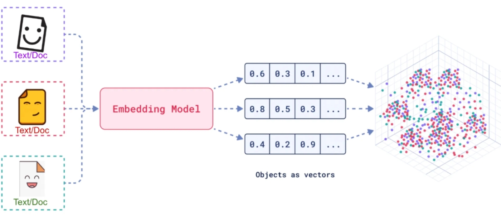
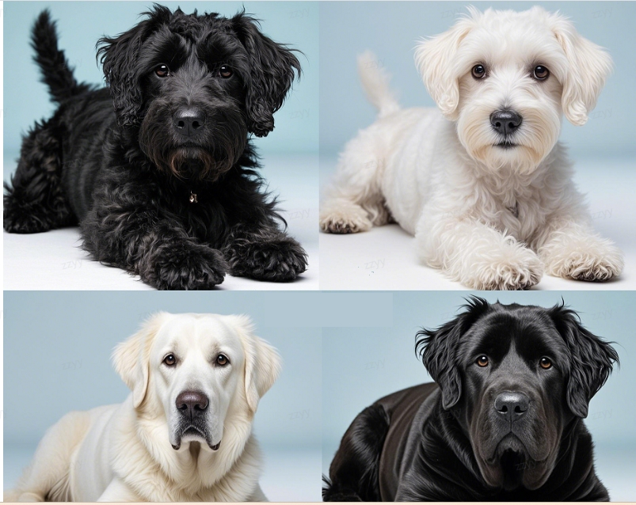
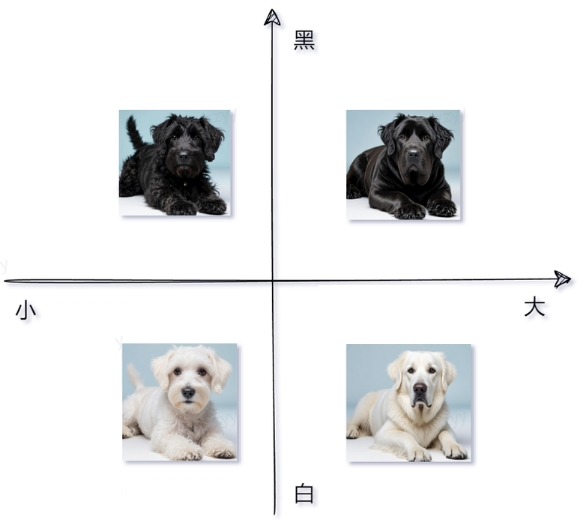
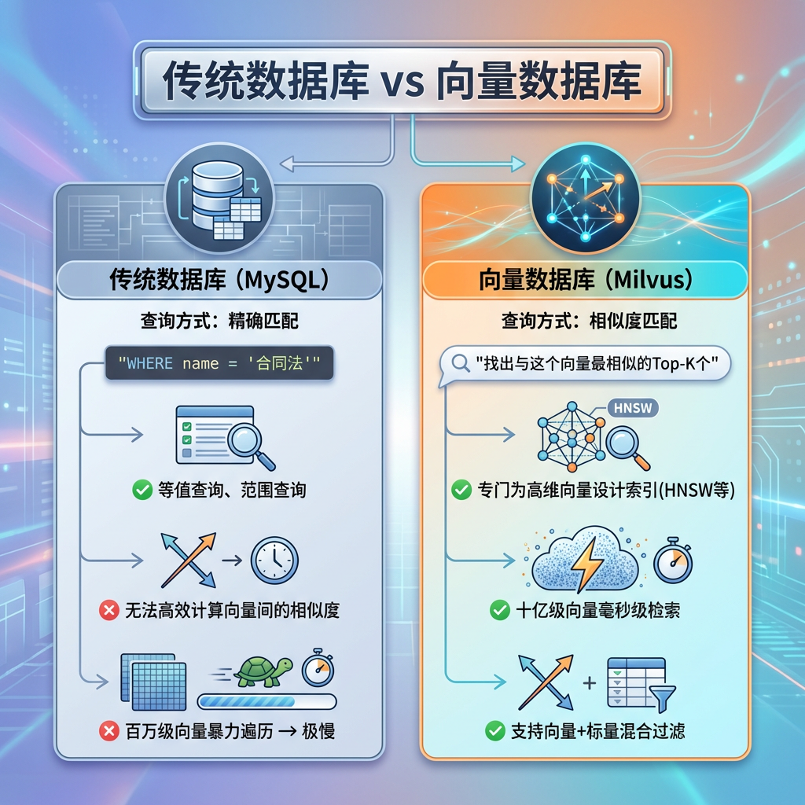
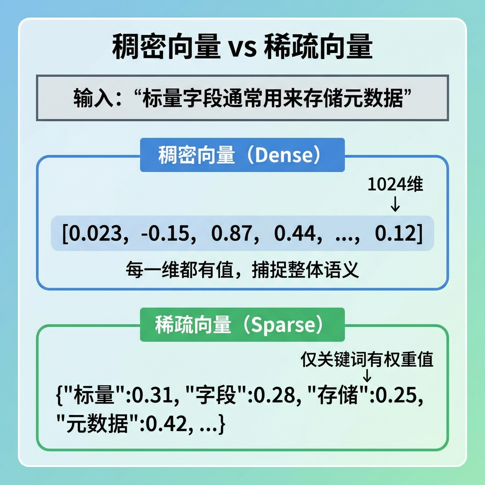
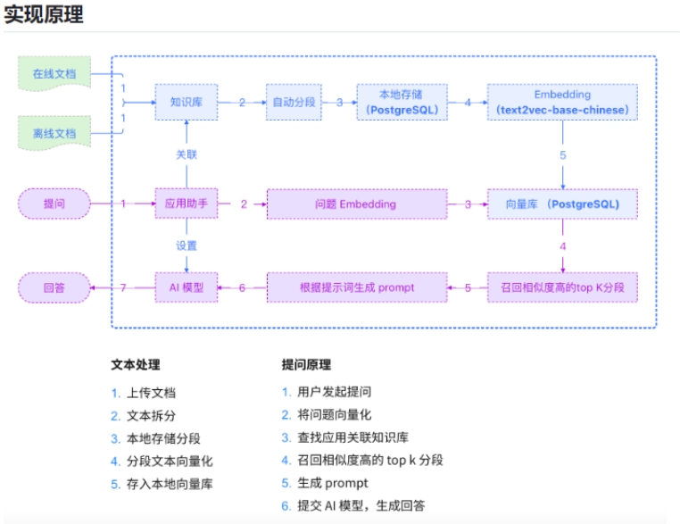
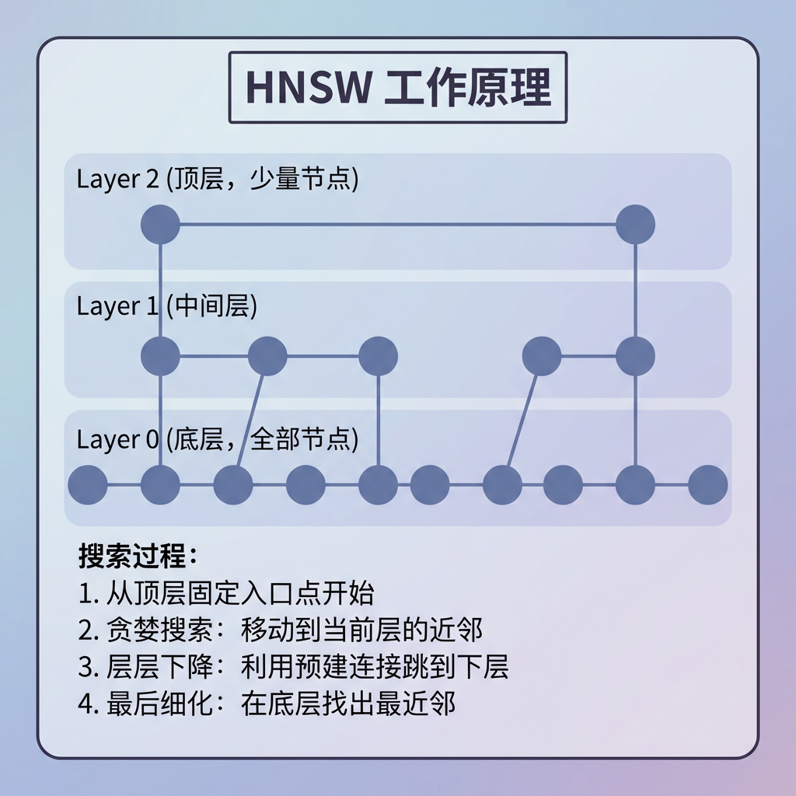
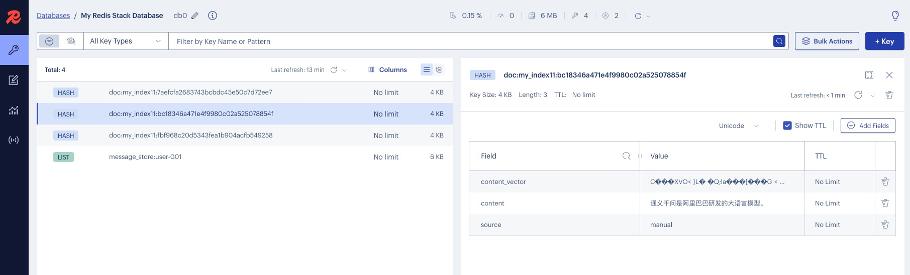

# 18 - Vector Databases and Embedding in Practice

---

**Chapter learning objectives:**

- Understand what **Vector**, **Embedding**, and **Vector Store / Vector Database** each mean, and how they relate to one another.
- Establish a clear main thread: **text is first embedded, then written to a vector store, and then searched by similarity**; after completing this chapter, you can naturally transition to [Chapter 19 RAG Retrieval-Augmented Generation](19-RAG%E6%A3%80%E7%B4%A2%E5%A2%9E%E5%BC%BA%E7%94%9F%E6%88%90.md).

**Study suggestions:** In this chapter, map out the pipeline first, then look at the code: text goes through an Embedding model to become vectors, vectors go into a database, and queries use similarity to retrieve them. You can memorize API names later, but make sure you understand "what is stored, what is retrieved, and why similarity can represent relevance." If you have extra capacity, manually calculate or print the similarity of two or three short pieces of text; that will be more solid than memorizing concepts in the abstract.

**Official documentation and resources**: See [Tool Navigation and Reference Index - RAG and Vector Retrieval](%E5%B7%A5%E5%85%B7%E5%AF%BC%E8%88%AA%E4%B8%8E%E5%8F%82%E8%80%83%E8%B5%84%E6%96%99%E7%B4%A2%E5%BC%95.md#RAG与向量检索).

---

## 1. Vectors and Embedding

### 1.1 Definition of a Vector

**Vector** is originally a mathematical concept, referring to: **using an ordered set of numbers to represent the position or features of an object in a space.**

For example:

- A two-dimensional vector can be written as `(x, y)`
- A three-dimensional vector can be written as `(x, y, z)`
- In AI scenarios, high-dimensional vectors of several hundred or even thousands of dimensions are common, such as `1024` dimensions or `1536` dimensions.

At the introductory stage, you don't need to get bogged down in the mathematical details of high-dimensional space. Just build this intuition first:

**A vector is simply a string of numbers, and that string of numbers can represent the "features" of a piece of text, an image, or another object.**

### 1.2 Definition of Embedding

The process of converting text, images, audio, and other raw content into vectors is usually called **vectorization**; in the field of large models and retrieval, a more common name is **Embedding**.

When people say Embedding, it sometimes refers to "the process of vectorization" and sometimes to "the vector representation obtained after vectorization." Just judge from the context; there is no need to treat them as two completely unrelated concepts.

The official LangChain documentation describes text Embedding very clearly: **Embedding models convert raw text such as sentences and paragraphs into fixed-length numeric vectors, and try to make semantically similar texts closer together in vector space.**

The following diagram can help you build an overall impression: on the left is the raw content, in the middle is the embedding model, and on the right are strings of vectors.



In more straightforward terms, Embedding solves this problem:

- Text itself cannot directly undergo "semantic mathematical comparison"
- Vectors can be used for distance and similarity calculations
- Therefore, once text is converted into vectors, it becomes possible to "find similar content by meaning"

This is also why Embedding is often used in semantic search, recommendation systems, text clustering, deduplication and similar content identification, and RAG retrieval-augmented generation.

### 1.3 Semantic Similarity and Vector Similarity

The core value of Embedding is not simply "encoding text into numbers"; rather, **it hopes to map "semantic relationships" into "spatial relationships."**

That is to say: texts with similar semantics will have closer vectors; texts with greater semantic differences will have farther vectors. For example: "I like eating apples" and "Apples are my favorite fruit to eat."

Although these two sentences are not literally identical, their semantics are similar, so their vectors will usually also be closer.
By contrast, "I like using an Apple phone" also contains the word "Apple," but its semantics have partly shifted toward "phone brand," so its relationship to the previous two sentences is not as close.

This is exactly where vector retrieval is stronger than keyword retrieval: **it looks for "similar meaning," not just "identical wording."**

### 1.4 Definition of Vector Dimension

The vectors output by Embedding are generally fixed-length lists of floating-point numbers. This length is called the **dimension**.

For example:

- A model outputs 1024-dimensional vectors
- This means each piece of text will ultimately become an array of length 1024

For now, just remember two conclusions:

1. **Different Embedding models may output different dimensions.**
2. **Even if the dimensions are the same, vector spaces from different models usually cannot be directly mixed.**

Therefore, in real projects you must ensure that **the Embedding model used when building the database is consistent with the Embedding model used at query time.**

Otherwise, either the dimensions will mismatch and cause an error directly, or even if calculation is possible, the similarity results will be meaningless.

### 1.5 Building Further Intuition

The following two diagrams help you understand, respectively, that "images can also be embedded" and that "vector space affects retrieval quality."



> **Diagram explanation:** Same breed but different coat color, same coat color but different body size - analogous to distinguishing samples "by feature dimensions" in vector retrieval; used to build the intuition that "**vector = feature coordinates**" (the main thread of this chapter still focuses on text Embedding).



> **Diagram explanation:** High-dimensional Embedding can be understood as "more feature axes"; dimensionality is related to model design, and **retrieval effectiveness depends on model and index quality**, not simply on the number of dimensions.

**The one sentence to remember from this section:** Embedding is not meant to "make text harder to understand," but to enable computers to compare semantics in mathematical space.

---

## 2. Vector Databases

Once text has been converted into vectors, the next question arises: **where are these vectors stored? And how do we efficiently query "who is most similar to me?"** This is exactly why vector databases exist.

### 2.1 Definition

The official LangChain summary is very direct: **A vector store stores embedded data and supports similarity search.** The official Redis documentation emphasizes another point: **vector retrieval is not just about storing vectors, but about building indexes around vectors and combining them with metadata for search and filtering.**

Therefore, you can initially understand a "vector database" as: **a storage system specifically designed for "similarity retrieval."**

### 2.2 Difference from Traditional Databases

The most fundamental difference is not "whether it can store data," but "how it queries data."

| Comparison dimension | Traditional relational database / ordinary KV store | Vector database |
| ------------ | ------------------------------- | ------------------------------------ |
| Core query method | Exact match, range query, conditional filtering | Similarity search, nearest neighbor retrieval |
| Typical question | "What is the record with id=1001?" | "What is the content most semantically similar to this text?" |
| Main basis | Field value equality, size, ordering | Vector distance / similarity |
| Common use cases | Orders, users, transactions, configuration | RAG, search, recommendation, deduplication, clustering |



This does not mean traditional databases are useless; rather, it means: **when your question shifts from "querying fields" to "querying meaning," you need to introduce a vector database.**

### 2.3 What Is Stored in a Vector Database

This is one of the most confusing points for first-time learners. A vector database usually contains more than just "a vector array"; it typically includes at least the following types of information:

- **Original content**: for example, the text body `page_content`
- **Vector values**: the high-dimensional array computed by the Embedding model
- **Metadata**: for example, `source`, `page`, `segment_id`, business tags, and so on
- **Index structure**: used to accelerate similarity retrieval

In other words, what a vector database really does is: **organize "content + vector + metadata" and support retrieving the most relevant content by similarity.**

This is crucial for RAG because during the retrieval phase, you not only need to get the "most similar vector," but also retrieve the corresponding text segment and metadata before passing them to the large model to generate an answer.

### 2.4 Definitions of Dense Vectors, Sparse Vectors, and Scalar Fields

At this point, many people assume that a vector database only stores "one text vector field." Of course you can do that in real projects, but a more complete understanding is: **a retrievable data object often contains dense vectors and scalar fields at the same time, and some systems additionally use sparse vectors.**

- **Dense Vector**: the most common type, namely the long list of floating-point numbers output by an Embedding model. It excels at expressing overall semantics, so texts with "similar meaning" are usually closer together.
- **Sparse Vector**: not every dimension has a value; only a few dimensions are non-zero. It is more like an expression of "keywords and weights," and is often associated with term matching, inverted indexes, and BM25-style approaches.
- **Scalar Fields**: ordinary fields such as `source`, `author`, `category`, `created_at`, `doc_id`. They do not participate in semantic vector calculation, but are commonly used for filtering, sorting, permission control, and result display.

You can first treat them as three complementary capabilities:

- Dense vectors are responsible for "finding similar content by semantics"
- Sparse vectors lean more toward "finding related content by keywords and term weights"
- Scalar fields are responsible for "filtering results by business conditions"



**Extension: BGE-M3 and Hybrid Retrieval**

Taking Embedding models such as BGE-M3 as an example, they can simultaneously support multiple representation formats, including dense vectors and sparse vectors. In a retrieval system, this enables combinations such as:

| Retrieval signal | Problems it is better at solving |
| -------- | ---------------------------------------------- |
| Dense vector | When users rephrase a question, still finding relevant content by semantics |
| Sparse vector | Product model numbers, error codes, proper nouns, exact keyword matching |
| Scalar field | Permission, category, time, source, business tag filtering |

Therefore, in production RAG systems, you often see a combination of "dense retrieval + sparse retrieval + metadata filter + rerank." This is not about making the system complicated, but because a single path can hardly balance semantics, keywords, and business constraints at the same time.

The main Redis case study in this chapter focuses primarily on **dense vectors generated from text Embedding + metadata fields**. That is already enough to build a clear introductory pipeline. But later, when you see terms like "hybrid retrieval," "dense + sparse recall," and "metadata filter," they will no longer feel unfamiliar.

### 2.5 Common Categories of Vector Databases

At the introductory stage, you don't need to learn all of them, but you should at least know what common options exist in the ecosystem:

| Name | Brief description |
| ------------------------------ | ---------------------------------------- |
| **FAISS**                      | Local-leaning, algorithm-library-leaning, suitable for quick vector retrieval experiments |
| **Chroma**                     | Lightweight and easy to start with, suitable for local prototype validation           |
| **Milvus**                     | Open-source professional vector database, suitable for large-scale production environments   |
| **Pgvector**                   | PostgreSQL extension, suitable for projects already using a PostgreSQL ecosystem  |
| **Redis / Redis Stack**        | Can be used both as a cache and for vector retrieval, suitable for engineering integration |
| **Elasticsearch / OpenSearch** | Mature search ecosystem that also supports vector search             |

### 2.6 The Relationship Between RAG and Vector Databases

Because most people first encounter vector databases precisely when working on RAG.

The underlying pipeline of RAG is usually:

1. Split documents into chunks
2. Use an Embedding model to convert chunks into vectors
3. Write "chunk + vector + metadata" into a vector database
4. When a user asks a question, convert the question into a vector as well
5. Query the most relevant chunks in the vector database
6. Pass the chunks and the question to a large language model to generate an answer

In other words, **a vector database is one of the underlying infrastructure components of RAG, but it is not the same as a complete RAG system.**



> **Diagram explanation:** The upper half is the **indexing/ingestion** pipeline, and the lower half is the **query** pipeline; the vector database sits at the key position "after chunk text is vectorized, before the retrieved top-K chunks are handed to the model". For the complete loader, splitter, and generation stages, see [Chapter 19 RAG](19-RAG%E6%A3%80%E7%B4%A2%E5%A2%9E%E5%BC%BA%E7%94%9F%E6%88%90.md).

### 2.7 How to Choose Between Redis and Milvus

This tutorial chooses Redis Stack because it is easy to combine with engineering scenarios such as caching, sessions, and queues, and the installation and demonstration costs are also low. At the introductory stage, using it to understand "writing vectors, creating indexes, and similarity retrieval" is very appropriate.

However, if your project moves to a larger scale, for example, with very large data volumes, complex indexing strategies, and higher requirements for hybrid retrieval and high-concurrency retrieval, then you can treat **Milvus** as a production-level expansion direction. First, remember this simple judgment:

| Scenario                                         | More suitable      |
| -------------------------------------------- | ----------- |
| Course learning, personal projects, integration with the Redis ecosystem        | Redis Stack |
| Large-scale vector retrieval, professional index management, production-level retrieval platforms | Milvus      |

---

## 3. Using Redis Stack as Vector Storage

This tutorial chooses **Redis / Redis Stack** for vector storage, not because it is the only option, but because it is suitable for teaching and getting started with engineering:

- The project has already introduced Redis in [Chapter 16](16-%E8%AE%B0%E5%BF%86%E4%B8%8E%E5%AF%B9%E8%AF%9D%E5%8E%86%E5%8F%B2%EF%BC%88%E5%90%ABRedis%E5%9F%BA%E7%A1%80%EF%BC%89.md)
- Redis Stack integrates search and vector retrieval capabilities on top of Redis
- For introductory learning, one environment can cover caching, messaging, history, and vector retrieval at the same time, making the engineering progression more coherent

### 3.1 The Relationship Among Redis, Redis Stack, and RediSearch

- **Redis**: the basic in-memory database / key-value store
- **Redis Stack**: packages search, JSON, time series, Bloom filter, and other extension capabilities on top of Redis
- **RediSearch**: the module in Redis Stack that is closely related to search, full-text retrieval, and vector retrieval

From the perspective of this chapter, it is enough to remember one sentence directly: **The reason we can use Redis for vector retrieval is that Redis Stack / RediSearch provides vector fields, indexes, and KNN search capabilities.**

The official Redis documentation also clearly states that Redis can:

- Create vector indexes
- Store vectors and metadata
- Perform KNN (nearest neighbor) vector search
- Combine metadata filtering for hybrid retrieval

### 3.2 Why This Tutorial Chooses Redis

From the perspective of real projects, Redis as vector storage has several very practical advantages:

- **Low onboarding cost**: many teams already have Redis
- **Easy engineering integration**: caching, sessions, history, and vector retrieval can all be placed in the same infrastructure
- **Suitable for small and medium-sized knowledge bases**: it is very convenient for course demonstrations, internal tools, and lightweight RAG

Of course, in engineering you should also understand its boundaries: if the vector scale is very large and retrieval requirements are very complex, teams may also choose more specialized solutions such as Milvus, Weaviate, or Pinecone; this is not a question of "which one is absolutely better", but rather "which solution is more suitable for your scenario".

If you have not yet installed Redis Stack, please first review the sections on Docker, Redis Stack, and RedisInsight in [Chapter 16](16-%E8%AE%B0%E5%BF%86%E4%B8%8E%E5%AF%B9%E8%AF%9D%E5%8E%86%E5%8F%B2%EF%BC%88%E5%90%ABRedis%E5%9F%BA%E7%A1%80%EF%BC%89.md); this chapter does not repeat the installation process and focuses only on the main line of "Embedding + vector retrieval".

> First clarify a point that is easy to misunderstand
>
> - When doing vector retrieval, what is actually written into Redis is not just a "bare vector"; it is usually: text content, the vector corresponding to the text, metadata, and structural information related to the index.
> - Therefore, the records you see in RedisInsight are often not a simple array of numbers, but structured data composed of multiple fields. This will become more intuitive when you look at the case in Section 6 of this chapter.

---

## 4. Embedding: Text Vectorization

This section is the core of this chapter. Because whether it is calculating similarity later or writing into Redis, everything essentially depends on the same step: **first convert text into vectors.**

### 4.1 Definition

**Embedding** is the process of representing a text string as a **vector (a list of floating-point numbers)**. By calculating the distance or similarity between vectors, the relevance between texts can be measured: **the smaller the distance (or the higher the similarity), the higher the relevance**; the larger the distance, the lower the relevance.

**In one sentence:** Embeddings are used to measure the relevance between texts.

**Common applications include:**

- **Search**: rank results by relevance to a query
- **Clustering**: group texts by similarity
- **Recommendation**: recommend content based on related texts
- **Anomaly detection**: find outliers with low relevance to the majority of content
- **Diversity measurement**: analyze similarity distributions
- **Classification**: classify texts by similarity to labels

The official LangChain documentation further emphasizes two APIs:

- `embed_query(text)`: convert a single query text into a vector
- `embed_documents(texts)`: convert multiple document texts into vectors in batch

This distinction happens to correspond to two stages in real projects:

- **Indexing stage**: vectorize document chunks in batch, usually using `embed_documents`
- **Query stage**: vectorize the user question, usually using `embed_query`

### 4.2 Important Practical Rules

Before running the cases, first understand these pieces of experience clearly:

1. The Embedding model outputs vectors, not natural language.
2. Different Embedding models may have different dimensions.
3. Indexing and querying must use the same Embedding model.
4. Embedding is suitable for semantic similarity calculation, but it is not responsible for "answering questions" by itself.
5. The main line of this chapter is text Embedding; multimodal Embedding is an advanced extension.

Rule 5 deserves a special explanation. The current official LangChain Embeddings overview page mainly focuses on **text Embedding**; the multimodal case retained in this chapter is demonstrated through the **DashScope native SDK** to show the expansion capability, with the goal of helping you build the awareness that "Embedding is not only for text", but the main learning line of this chapter remains **text vectorization**.

### 4.3 Case: DashScope Native Call, First See "What a Vector Looks Like"

This is the simplest Hello-level example. The goal is not to immediately do retrieval, but to first see:

- How text is passed to the Embedding model
- What the general structure of the returned result looks like
- What kind of floating-point sequence a vector usually is

[Case source code] `案例与源码-2-LangChain框架/09-embedding/Text2Embedding_DashScopeHello.py`

[Text2Embedding_DashScopeHello.py](../../%E6%A1%88%E4%BE%8B%E4%B8%8E%E6%BA%90%E7%A0%81-2-LangChain%E6%A1%86%E6%9E%B6/09-embedding/Text2Embedding_DashScopeHello.py ":include :type=code")

When studying this case, it is recommended that you pay special attention to:

- Which Embedding model is specified by `model`
- At which layer `embedding` is located in the returned object
- How long the final output vector is for this piece of text

### 4.4 Case: OpenAI-Compatible Approach, Understanding "Same Capability, Different Connection Methods"

Although many platforms are not OpenAI, they provide **OpenAI-compatible interfaces**. This means you can continue using the OpenAI SDK calling style, and only change: `base_url`, `api_key`, `model` to the corresponding platform's configuration.

The value of this case is very significant in real projects, because it makes you realize: **very often what you are really learning is not "a particular vendor's private SDK", but a universal integration pattern.**

[Case source code] `案例与源码-2-LangChain框架/09-embedding/Text2Embedding_OpenAiHello.py`

[Text2Embedding_OpenAiHello.py](../../%E6%A1%88%E4%BE%8B%E4%B8%8E%E6%BA%90%E7%A0%81-2-LangChain%E6%A1%86%E6%9E%B6/09-embedding/Text2Embedding_OpenAiHello.py ":include :type=code")

### 4.5 Case: Using LangChain's Unified Interface for Single and Batch Vectorization

When you start working on LangChain projects, it is more recommended to understand this layer of encapsulation. Because later, whether it is retrievers, vector databases, or RAG, many components collaborate around LangChain's Embeddings interface.

This case is extremely important because it directly demonstrates:

- `embed_query(text)`: vectorize a single query text
- `embed_documents(texts)`: vectorize multiple document texts in batch

These two methods are basically a microcosm of the "indexing stage" and "query stage" of later retrieval.

[Case source code] `案例与源码-2-LangChain框架/09-embedding/Text2Embedding_DashScope.py`

[Text2Embedding_DashScope.py](../../%E6%A1%88%E4%BE%8B%E4%B8%8E%E6%BA%90%E7%A0%81-2-LangChain%E6%A1%86%E6%9E%B6/09-embedding/Text2Embedding_DashScope.py ":include :type=code")

At runtime, you can pay special attention to: a single call returns one vector; a batch call returns a "list of vectors"; len(vector) corresponds to the dimension.

### 4.6 Case: Advanced Extension, Multimodal Embedding

This section is not a required main line for this chapter; its main purpose is to help you know that Embedding can process not only text, but can also be extended to multimodal inputs such as images and text. However, note that this case uses the **DashScope native multimodal Embedding interface**, not the LangChain unified text Embeddings interface itself.

For beginners, it is enough to know two things first:

1. **The idea of Embedding applies not only to text.**
2. **In this chapter, first master text Embedding thoroughly; multimodal can be expanded later as needed.**

[Case source code] `案例与源码-2-LangChain框架/09-embedding/Text2Embedding_DashScopePro.py`

[Text2Embedding_DashScopePro.py](../../%E6%A1%88%E4%BE%8B%E4%B8%8E%E6%BA%90%E7%A0%81-2-LangChain%E6%A1%86%E6%9E%B6/09-embedding/Text2Embedding_DashScopePro.py ":include :type=code")

---

## 5. Calculating Semantic Similarity Through Vectors

Once we are able to convert text into vectors, we can move on to the next step: **compare how semantically close two pieces of text are.**

### 5.1 Why Cosine Similarity Is Commonly Used

In vector similarity calculation, the common metrics include:

- **Cosine Similarity**
- **Euclidean Distance**
- **Dot Product**

Among them, the one most suitable for building intuition first is usually **cosine similarity**. Its focus is not on "how similar the lengths of two vectors are", but on "how close the directions of two vectors are". For semantic retrieval, this is usually very valuable, because we care more about "whether the meaning is close".

Cosine similarity formula:

```text
cos(theta) = (A · B) / (|A| |B|)
```

Its result is usually in the range `[-1, 1]`:

- The closer to `1`, the more similar they generally are
- The closer to `0`, the weaker the relevance
- The closer to `-1`, the more opposite the directions

OpenAI's official documentation also explicitly mentions that in many Embedding scenarios, **cosine similarity is a very common and very practical choice**.

### 5.2 How to Choose Among Common Distance Metrics in Retrieval

Earlier we built intuition using cosine similarity, but in real projects, you will often see these names in vector databases, indexes, or SDK parameters:

- **COSINE**: Focuses more on whether vector directions are close; it is the most common and easiest-to-understand metric in text semantic retrieval.
- **L2**: Euclidean distance, which focuses on the straight-line distance between two points in space. The smaller the distance, the closer they generally are.
- **IP (Inner Product)**: Inner product. Some models or systems use it directly for similarity calculation; when vectors are already normalized, it is often very close to cosine similarity.

Do not get hung up on "which one is always the best" here. First look at this rule:

**The characteristics of the Embedding model, the metric chosen when building the index, and the metric passed in at query time must all be consistent.**

Otherwise, there are two common problems: at best, results get worse, and clearly relevant content fails to rank highly; at worst, the index configuration and query configuration do not match, causing an outright error.

So when you see `COSINE`, `L2`, or `IP` written in some vector database example, do not treat it as an unimportant parameter; it essentially determines how the system understands "similarity."

### 5.3 Exact Retrieval, Approximate Retrieval, and Indexes

Another engineering concept worth establishing early is: **not all similarity retrieval dutifully compares the query vector with every vector in the database one by one.**

From a conceptual standpoint, it can roughly be divided into two categories:

- **Exact retrieval (Exact KNN / FLAT)**: The query vector is compared against all vectors in the database. The results are the most direct and easiest to understand.
- **Approximate retrieval (ANN, Approximate Nearest Neighbor)**: Search is accelerated through index structures, only approximately finding the batch of results "most likely to be close."

Why is approximate retrieval needed? Because once data reaches a certain scale, comparing one by one becomes slower and slower. Therefore, many vector databases build indexes, trading space for time. Across different systems, you will often encounter:

- **FLAT**: More of a brute-force search; accurate but slow
- **HNSW**: A very common ANN index in engineering, usually able to strike a good balance between recall and latency



At the introductory stage, you can first remember one sentence: **The role of an index is not to change the definition of "semantic similarity," but to make the task of "finding the most similar content" feasible even at large scale.**

This is also why earlier in this chapter we kept emphasizing that retrieval quality is not determined solely by the Embedding model; index quality, parameter configuration, and data chunking methods also jointly determine the final result.

### 5.4 Example: Convert Multiple Sentences into Vectors and Compare Them Pairwise

This example will:

1. Prepare multiple sentences of text
2. Call the Embedding API to obtain the vector for each sentence
3. Manually calculate cosine similarity using `numpy`
4. Print the pairwise comparison results

[Example source code] `案例与源码-2-LangChain框架/09-embedding/Text2Embedding_CosSimilarity.py`

[Text2Embedding_CosSimilarity.py](../../%E6%A1%88%E4%BE%8B%E4%B8%8E%E6%BA%90%E7%A0%81-2-LangChain%E6%A1%86%E6%9E%B6/09-embedding/Text2Embedding_CosSimilarity.py ":include :type=code")

When studying this example, it is recommended to focus on two things:

- The key is not "which model must be used," but **how to perform similarity calculation after obtaining the vectors**
- When the topics of two sentences are more similar, the cosine similarity is usually higher

This example uses a multimodal Embedding interface to process text input. What the course wants to demonstrate is the fact that "**once vectors are obtained, you can perform mathematical comparisons**." This does not mean similarity calculation must use a multimodal model; in real projects, you can absolutely use a conventional text Embedding model to perform the same calculation.

### 5.5 How Similarity Results Are Used in Projects

In real projects, the most common uses of such scores are:

- **Semantic retrieval ranking**: Putting the most relevant text at the front
- **Text deduplication**: Determining whether two pieces of content are highly duplicated
- **Recommendation**: Finding similar products, similar articles, similar questions
- **Cluster analysis**: Grouping semantically similar content together

So, do not understand "cosine similarity" only as a math problem. In engineering, it often directly determines: **whether the content ranked at the top of retrieval results is really what you want.**

---

## 6. Writing to and Retrieving from a Vector Database (RAG's Underlying Capability)

Earlier we accomplished two things: 1. Converting text into vectors; 2. Learning to calculate similarity between vectors.

This section pushes those two things one step further into a real engineering pipeline: **writing text and vectors into Redis, and then performing retrieval by similarity.**

First, let's be clear about a boundary: **this section is not yet a complete RAG.** What is demonstrated here is the underlying capability of RAG, namely: building an index and performing similarity retrieval. But it has not yet added: document loaders, text splitters, or passing retrieval results to a large language model to generate the final answer.

These will be expanded on in [Chapter 19: RAG Retrieval-Augmented Generation](19-RAG%E6%A3%80%E7%B4%A2%E5%A2%9E%E5%BC%BA%E7%94%9F%E6%88%90.md).

### 6.1 Example: Write a List of Documents into Redis, Then Retrieve Results Using a Retriever

This is the most suitable example in this chapter to serve as a "first look at vector database practice."

What it does can be summarized as:

1. First prepare several `Document` objects (`page_content` + `metadata`, which in a complete RAG are often produced by loaders and splitters; see [Chapter 19](19-RAG%E6%A3%80%E7%B4%A2%E5%A2%9E%E5%BC%BA%E7%94%9F%E6%88%90.md))
2. Use `DashScopeEmbeddings` to vectorize the `page_content`
3. Use `Redis.from_documents(...)` to write everything into Redis at once
4. Then create a retriever using `as_retriever()`
5. Perform similarity retrieval on the query text

The most valuable points for beginners to understand in this example are:

- What the vector database stores is not isolated numbers, but content combined with the `Document` structure
- What is retrieved is not "the vectors themselves," but the corresponding `Document`
- This is exactly the foundation that later allows RAG to feed retrieved results back into the prompt

[Example source code] `案例与源码-2-LangChain框架/09-embedding/EmbeddingStoreRedis.py`

[EmbeddingStoreRedis.py](../../%E6%A1%88%E4%BE%8B%E4%B8%8E%E6%BA%90%E7%A0%81-2-LangChain%E6%A1%86%E6%9E%B6/09-embedding/EmbeddingStoreRedis.py ":include :type=code")

After running it, you can see a structure similar to the following in RedisInsight:



When you see this figure, it is recommended to focus on understanding:

- Fields of the `content` type are the original text
- Fields of the `content_vector` type are the vectors after Embedding
- Fields such as `source` are metadata

In other words, what Redis stores here is a "searchable semantic index," not merely a set of floating-point numbers.

### 6.2 Example: Writing Text Using langchain_redis's RedisVectorStore

In addition to `langchain_community.vectorstores.Redis`, the project also retains another approach that is closer to the dedicated Redis integration package:

- `RedisConfig`
- `RedisVectorStore`
- `add_texts(...)`

This example helps you understand another common approach: **first create a vector store instance, then continuously append text to it.**

[Example source code] `案例与源码-2-LangChain框架/10-rag/RedisVectorStore.py`

[RedisVectorStore.py](../../%E6%A1%88%E4%BE%8B%E4%B8%8E%E6%BA%90%E7%A0%81-2-LangChain%E6%A1%86%E6%9E%B6/10-rag/RedisVectorStore.py ":include :type=code")

This example has several key learning points:

- `add_texts()` is suitable for writing lists of strings
- Each text item can carry its own `metadata`
- The returned `ids` can be used for subsequent deletion, updating, or tracking

This style of writing is very common in real projects, because in many cases data is not imported all at once, but rather:

- Batch import
- Incremental append
- Scheduled index rebuilding

### 6.3 Example: Connecting to an Existing Index and Performing Similarity Search

This example is a companion to the previous section. It assumes that you have already written data, and then you perform queries.

The core actions are:

- Connect to an existing `index_name`
- Vectorize the query text
- Find the most similar pieces of text in Redis
- Return `(Document, score)` results

[Example source code] `案例与源码-2-LangChain框架/10-rag/RedisVectorStore_SimilaritySearch.py`

[RedisVectorStore_SimilaritySearch.py](../../%E6%A1%88%E4%BE%8B%E4%B8%8E%E6%BA%90%E7%A0%81-2-LangChain%E6%A1%86%E6%9E%B6/10-rag/RedisVectorStore_SimilaritySearch.py ":include :type=code")

Here it is necessary to first clarify the meaning of `score`:

**The `score` returned by `similarity_search_with_score()` often represents "distance" in many implementations, and is not necessarily a score where "larger means more similar."**

Therefore:

- In some scenarios, a smaller `score` actually indicates greater similarity
- The code converts it into `1 - score` mainly for intuitive understanding during course demonstration
- In real projects, the definition should be based on the current vector database, distance metric, and return value semantics

If you need to set a recall threshold later, the first step is not to directly apply a certain score, but to first confirm whether this `score` represents distance or similarity.

### 6.4 Metadata Filtering, Hybrid Retrieval, and Reranking

After running their first vector retrieval example, many people mistakenly assume that "retrieval = convert the question into a vector, then directly search top-k." That main thread is certainly not wrong, but in real projects, three more types of capabilities are usually layered on top:

- **Metadata filtering**: First narrow the candidate range using conditions such as `source`, `category`, time range, and permission fields, then perform vector retrieval.
- **Hybrid retrieval**: Simultaneously combine semantic vector retrieval and keyword retrieval, or combine different types of recall paths.
- **Reranking**: First recall a batch of candidate results, then reorder them using a more refined model or strategy.

The problem each of the three solves is very clear:

- Filtering solves "only search within a certain business scope"
- Hybrid solves "wanting to capture semantics without losing keyword matches"
- Reranking solves "results have been retrieved, but the order is still not good enough"

Among these, "reranking" can be examined separately. It is not about searching the entire database again, but rather performing a secondary ranking optimization on **a small batch of candidate results that have already been recalled**. In many systems, vector retrieval handles the first-stage recall, and the reranker handles the second-stage ranking, which often balances both speed and effectiveness.

The Redis practice in this chapter mainly demonstrates **the first-stage capability of dense vector retrieval**. Later, in a more complete RAG system, if you find that "results can be retrieved, but the ranking is not stable enough" or "keyword information is lost," you can prioritize starting with these three types of enhancement methods.

### 6.5 How to Understand from_documents and add_texts

Both methods can "write content into a vector database," but their suitable scenarios are not exactly the same:

| Method                  | More suitable for what scenarios                                 | Intuitive understanding                     |
| --------------------- | ---------------------------------------------- | ---------------------------- |
| `from_documents(...)` | You already have a batch of `Document` objects and want to build the index in one go | More like "build the index in one step" |
| `add_texts(...)`      | You have a list of strings, or you want to keep appending data | More like "incrementally write to an existing vector store" |

At the beginner stage, you don't need to worry about which one is absolutely more advanced. Just remember:

- Both of them are essentially "text vectorization + writing to a vector store"
- The main differences are the input parameter structure and how the engineering is organized

### 6.6 Relationship Between This Chapter and Chapter 19

After completing this section, you have already mastered the critical foundational capabilities for RAG:

- Text vectorization
- Writing vectors to Redis
- Similarity search

Building on this, [Chapter 19](19-RAG%E6%A3%80%E7%B4%A2%E5%A2%9E%E5%BC%BA%E7%94%9F%E6%88%90.md) will cover the remaining three steps:

1. Use loaders to read PDF / Word / Markdown and other documents into `Document`
2. Use text splitters to chunk long documents into segments
3. Pass the retrieved results and the user's question together to a large language model to generate an answer

### 6.7 Production-Level Extension Directions

After learning Redis vector search, you can divide further improvement into three tracks:

- **Data track**: incremental writes, deletion and updates, index rebuilding, version management.
- **Retrieval track**: metadata filters, hybrid retrieval, reranking, threshold strategies.
- **Platform track**: transition from lightweight Redis / Chroma to more specialized retrieval platforms such as Milvus and OpenSearch.

These three tracks do not need to be fully expanded in this chapter, but they will help you understand that a vector database is not simply "storing vectors"; it is the foundation for the effectiveness and performance of a RAG system.

Therefore, the relationship between this chapter and Chapter 19 can be summarized as follows:

- **Chapter 18**: first become proficient in "vectorization + storage + retrieval"
- **Chapter 19**: then connect them with document processing, prompts, and LLMs to form a complete RAG pipeline

---

**Chapter Review Questions:**

1. Why are embeddings suitable for semantic retrieval, while ordinary keyword matching is insufficient?

   **Reference approach:** Embeddings map text into a semantic space and can capture synonymous expressions and similar meanings; keyword matching relies more on literal overlap. For example, "refund rules" and "how do I get my money back" differ literally but are semantically close.

2. When writing vectors to a database, besides the vector itself, what other information should be stored?

   **Reference approach:** At minimum, you should store the original text segment, source, document ID, paragraph position, business tags, update time, and other metadata. Otherwise, after retrieval you will only have a string of numbers with no way to display, trace, or filter the content.

3. Does high similarity always mean the answer is usable? Why?

   **Reference approach:** Not necessarily. Vector similarity only indicates semantic closeness; the result may still be irrelevant to the question, lack key conditions, or be outdated. Real-world RAG also needs thresholds, filtering, reranking, and answer-generation constraints.

4. If query results are always irrelevant, which parts would you check first?

   **Reference approach:** Check whether the documents were actually written, whether the embedding model is consistent, whether the vector dimensions match, whether the query text is reasonable, whether metadata filtering is too strict, and whether similarity calculation and Top K are configured appropriately.

**Chapter Summary:**

- **Vectors and Embeddings**: Embedding models convert text into fixed-length vectors, allowing "semantically similar" to be transformed into "vectors that are close together".
- **Vector Databases**: They do not solve ordinary field queries, but rather the problem of "finding the closest content by meaning"; this is also the foundation that makes RAG possible.
- **Redis Stack**: This tutorial uses Redis for vector storage so that you can quickly understand vector indexing and retrieval on top of your existing project infrastructure.
- **Case Study Main Line**: This chapter has fully walked through the pipeline of "text vectorization → similarity calculation → writing to Redis → similarity search"; besides the model itself, what really affects the results includes chunking methods, metadata design, thresholds, and whether hybrid retrieval is needed.
- After completing this chapter, you should at least be able to clearly explain what **vectors, embeddings, and vector databases** are, as well as the relationship and sequence among them; understand why "semantically similar" can be mapped to "vector proximity", and why building the index and querying should use the same embedding model as much as possible; connect the main pipeline of "vectorization → similarity calculation → writing to a vector store → similarity search" with subsequent RAG work, and realize that retrieval quality is not determined solely by the vector store itself.

**Suggested Next Steps:**

1. First run the cases under the `09-embedding` directory in order, especially `Text2Embedding_DashScope.py`, `Text2Embedding_CosSimilarity.py`, and `EmbeddingStoreRedis.py`.
2. Then run `RedisVectorStore.py` and `RedisVectorStore_SimilaritySearch.py` under the `10-rag` directory to compare the two ways of writing to a Redis vector store.
3. After completing this chapter, continue reading [Chapter 19: RAG Retrieval-Augmented Generation](19-RAG%E6%A3%80%E7%B4%A2%E5%A2%9E%E5%BC%BA%E7%94%9F%E6%88%90.md) to connect the vector capabilities from this chapter to a complete RAG pipeline.
