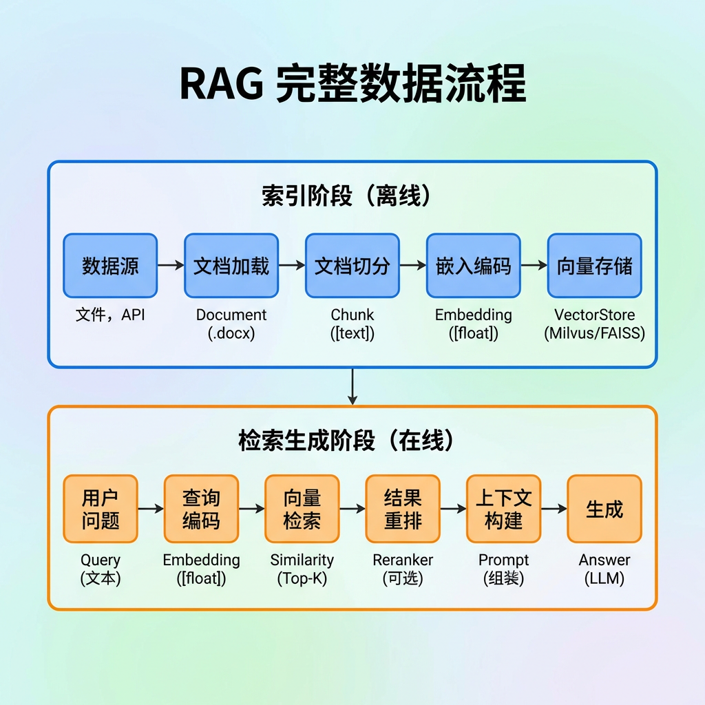
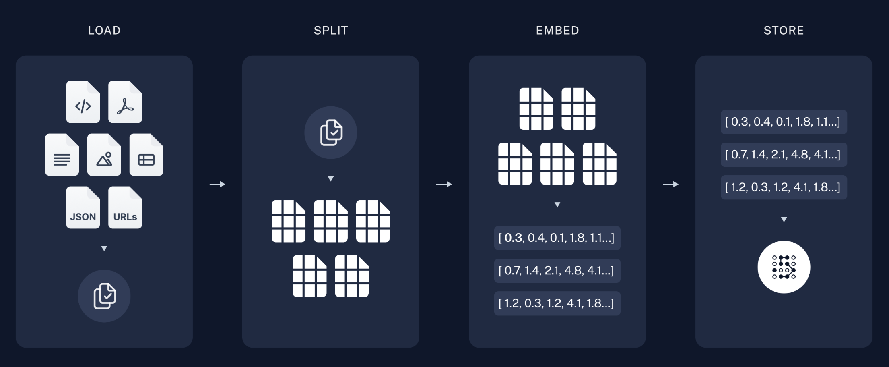
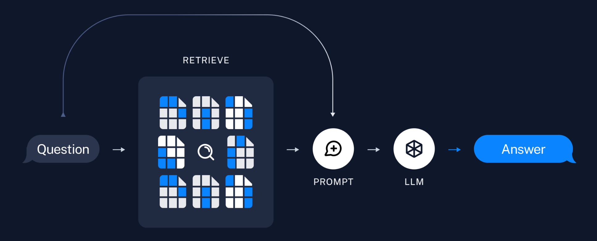
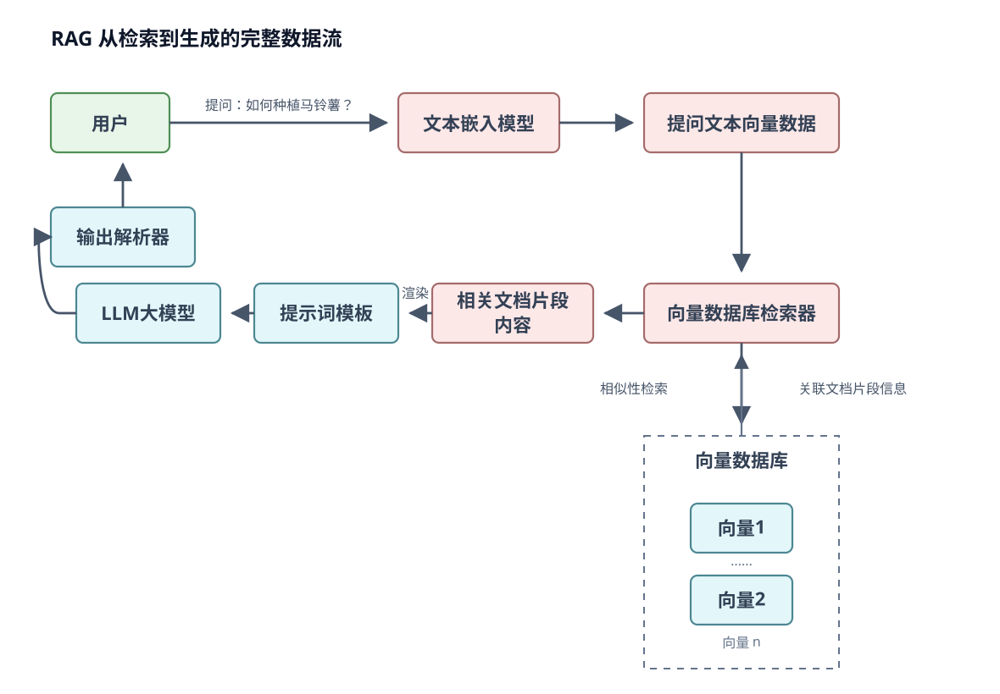
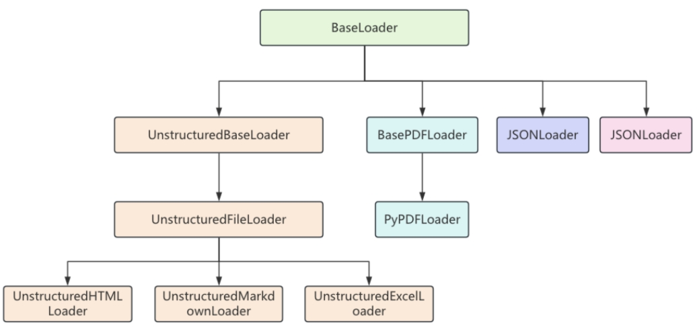
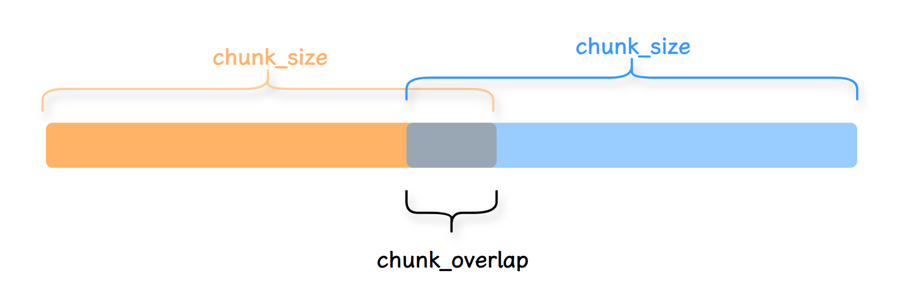
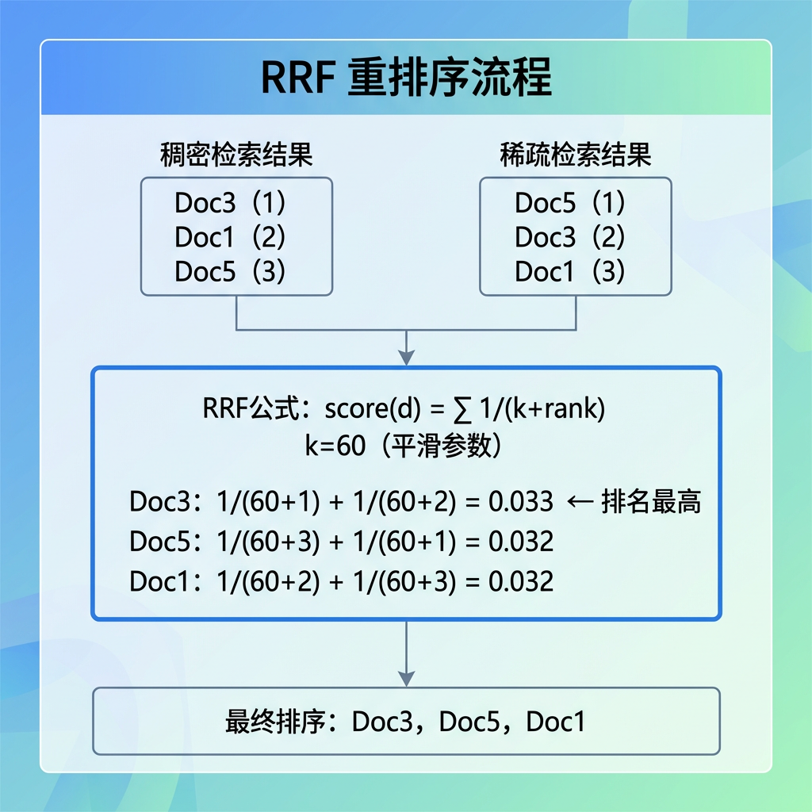
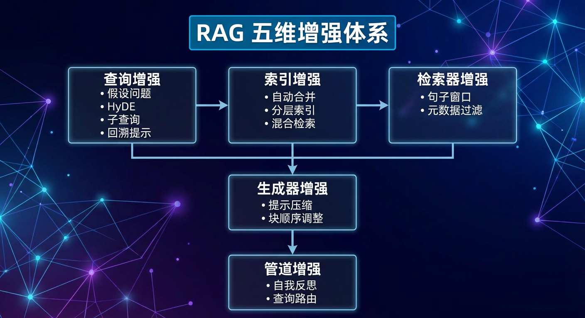

# 19 - RAG Retrieval-Augmented Generation

---

**Chapter learning objectives:**

- Advance the RAG and knowledge base intuition established in [Chapter 2: RAG - Building Enterprise Private/Personal Knowledge Bases](2-RAG-%E6%90%AD%E5%BB%BA%E4%BC%81%E4%B8%9A%E7%A7%81%E6%9C%89&%E4%B8%AA%E4%BA%BA%E7%9F%A5%E8%AF%86%E5%BA%93.md) to the LangChain code implementation level.
- Master the most common categories of components for building RAG in LangChain: **document loaders, text splitters, embedding models, vector databases, retrievers, prompt templates, and chat models**.
- Run through and understand all cases in this chapter: **multiple document loading methods, text splitting, Redis vector retrieval, a complete RAG intelligent operations assistant**, truly connecting the content from [Chapter 18: Vector Databases and Embedding in Practice](18-%E5%90%91%E9%87%8F%E6%95%B0%E6%8D%AE%E5%BA%93%E4%B8%8EEmbedding%E5%AE%9E%E6%88%98.md) into a deployable question-answering system.

**Study suggestion:** RAG is best understood in two phases: offline, documents are processed into retrievable knowledge; online, relevant material is recalled and assembled into context based on the user's question. When reading this chapter, use two colors to mark which code belongs to "building the index" and which belongs to "question answering." Once you understand where document loading, splitting, embeddings, vector stores, and prompts fit, you can read any framework.

**Official documentation and resources:** See [Tool Navigation and Reference Index - RAG and Vector Retrieval](%E5%B7%A5%E5%85%B7%E5%AF%BC%E8%88%AA%E4%B8%8E%E5%8F%82%E8%80%83%E8%B5%84%E6%96%99%E7%B4%A2%E5%BC%95.md#RAG与向量检索).

---

## 1. Introduction to RAG

### 1.1 Definition

> If you have already read [Chapter 2](2-RAG-%E6%90%AD%E5%BB%BA%E4%BC%81%E4%B8%9A%E7%A7%81%E6%9C%89&%E4%B8%AA%E4%BA%BA%E7%9F%A5%E8%AF%86%E5%BA%93.md), there is no need to start again from "how to use a knowledge base product" here; instead, we can directly place RAG back into a code context to understand it.

**RAG (Retrieval-Augmented Generation)** is essentially an application architecture based on "**retrieve first, then generate**." After the user asks a question, the system does not immediately rely solely on the large language model's own memory to answer; instead, it first retrieves relevant material from an external knowledge base, then passes that material together with the question to the LLM to generate an answer.

At the engineering implementation level, this chapter is more concerned with the following questions:

- How is external knowledge represented as objects in code
- Why documents must first be loaded, then chunked, then vectorized
- What steps the vector store and the retriever are each responsible for
- How retrieval results ultimately enter the Prompt or message context

So this chapter can be viewed as: **translating the knowledge base Q&A experience from Chapter 2 into data structures and component pipelines in LangChain.**

### 1.2 The Role of RAG

This was already covered from a product perspective in [Chapter 2](2-RAG-%E6%90%AD%E5%BB%BA%E4%BC%81%E4%B8%9A%E7%A7%81%E6%9C%89&%E4%B8%AA%E4%BA%BA%E7%9F%A5%E8%AF%86%E5%BA%93.md):

RAG primarily addresses problems such as **frozen knowledge, missing private knowledge, unavailable up-to-date information, and answers lacking evidence**.

This chapter will not repeat that discussion; instead, it shifts focus to a question more suited to developers: **since we already know to use RAG, which specific parts of the code actually determine answer quality?**

From an engineering perspective, what most noticeably affects results is usually not simply "whether a vector store is connected," but rather:

- Whether documents are loaded correctly
- Whether text is split into reasonable chunks
- Whether embeddings are stable
- Whether retrieval actually recalls the truly relevant segments
- Whether the Prompt uses the context correctly

The relationship with other approaches can still be quickly reviewed with the table below:

| Approach | Essence | Advantages | Limitations |
| -------------- | ---------------------- | ------------------------ | ----------------------------------- |
| **Ask the model directly** | No external knowledge, generate directly | Fastest to get started | Easily unaware of private/latest knowledge, more hallucinations |
| **RAG** | Retrieve material first, then generate | Updates quickly, small changes, traceable | Depends on document quality, chunking strategy, retrieval quality |
| **Fine-tuning** | Adjust model parameters | Can change answer style and task habits | High cost, slow updates, not suitable for frequently changing knowledge |
| **RAG + fine-tuning** | External knowledge + parameter adaptation | Balances knowledge and expression | Higher cost and system complexity |

At the same time, it is important to know that **RAG is not a cost-free silver bullet**. In real projects, it typically brings several practical trade-offs:

- **Higher response latency**: each Q&A requires an additional retrieval step, sometimes including filtering, reranking, and other steps.
- **Higher token consumption**: retrieval results enter the Prompt; the more content recalled, the longer the context sent to the model.
- **Quality depends on the entire pipeline**: document quality, chunking strategy, embedding quality, retrieval effectiveness, and how Prompt constraints are applied all affect the final answer.

### 1.3 The Standard RAG Workflow

> In [Chapter 2](2-RAG-%E6%90%AD%E5%BB%BA%E4%BC%81%E4%B8%9A%E7%A7%81%E6%9C%89&%E4%B8%AA%E4%BA%BA%E7%9F%A5%E8%AF%86%E5%BA%93.md), we already viewed the two-phase workflow from a product and platform perspective; here we switch to a LangChain code perspective and restate it.

The LangChain official documentation also typically divides RAG into two major phases: **Indexing** and **Retrieval and Generation**.

This is not for redundancy, but to translate "buttons and configuration options on the platform" into "components and data flow in code."



#### 1.3.1 Indexing Phase: Prepare the Knowledge Base First

The indexing phase deals with **raw documents**, such as Word, PDF, Markdown, TXT, CSV, JSON, and other files. Its goal is not to answer questions, but to process these documents into a form that is "**easy to retrieve later**."

> The "upload files, segment, build knowledge base" process you saw in Chapter 2 is essentially this phase in code.

This phase typically includes:

1. **Load**: read raw files into LangChain's `Document` objects.
2. **Split**: divide long documents into smaller chunks to facilitate subsequent vectorization and retrieval.
3. **Embed**: convert each document chunk into a vector.
4. **Store**: write "chunk content + vector + metadata" into the vector database.



There are two points that are easy to overlook:

- **Indexing is usually done offline.**  
  For example, rebuild the knowledge base on a scheduled basis each day, or write incrementally after documents are updated; it does not necessarily happen at the same time as user Q&A.

- **Indexing is not just "storing text."**  
  What it really stores is "**text chunk + vector representation + metadata**," so that later it is possible to perform similarity retrieval, source display, and conditional filtering.

> **What is metadata?**  
> `metadata` is additional information bound to a document chunk, such as file path `source`, page number `page`, title, author, date, category, and so on.  
> In RAG, what actually participates in vectorization is the body text `page_content`; `metadata` is used more for **source display, filtering conditions, and result explanation**.

#### 1.3.2 Retrieval and Generation Phase: Dynamically Query Material for Each Question

When the user actually asks a question, the system enters the second phase. This corresponds to the "ask questions based on the knowledge base / generate answers" capability from Chapter 2, except here we need to see clearly what steps it is actually divided into in code:

1. The user inputs a question.
2. The question is also vectorized.
3. Find the most similar document chunks in the vector store.
4. Put these chunks into the Prompt as `context`.
5. Then send `context + question` to the LLM together to generate an answer.



The core of this phase is not "building the index again," but "**using the already-built index to look up material**." In other words:

- **Indexing phase**: prepare the knowledge base in advance.
- **Retrieval phase**: look up material on the fly each time a question is asked.

#### 1.3.3 Pipeline RAG vs. Agentic RAG

In this chapter of the tutorial, the focus is on the most classic and easiest-to-start **pipeline RAG**. It follows the same line of thought as the **2-Step RAG** in the LangChain official documentation: **retrieve first, then generate**, with the flow fixed by code rather than decided by the model on the fly.

Its characteristics are clear: every time the user asks a question, the system first performs a retrieval; whether to retrieve is not decided temporarily by the model, but hard-coded into your code flow in advance; the overall structure is usually also a fixed pipeline of "retriever + prompt template + chat model."

This type of approach is suitable for: enterprise knowledge base Q&A, document Q&A, and retrieval augmentation for specifications/manuals/FAQs.

If you want to let "the model itself decide whether to retrieve, when to retrieve, and how many times to retrieve," that is closer to **Agentic RAG** (corresponding to **Agentic RAG** in the official documentation). More complete agent orchestration will be covered in later chapters such as [Chapter 21: Agent](21-Agent%E6%99%BA%E8%83%BD%E4%BD%93.md); first, it is more important to build a solid foundation in this chapter's **two-phase, single-retrieval, single-generation** mainline.

#### 1.3.4 An Enhanced Workflow Closer to Production

If you are just getting started, grasping the earlier "two-phase" flow is enough; but from a real project perspective, many RAG systems add a few more steps between "retrieval and generation" to make results more stable. In Chapter 2, you already saw Top K, Rerank, and hybrid retrieval parameters in Dify; here we can map them to the code pipeline:

1. **First recall candidate chunks**: the retriever does not necessarily only use vector retrieval; it may also be keyword or hybrid retrieval.
2. **Then filter or rerank**: filter by `metadata` scope, or use a reranker to rescore candidate chunks.
3. **Finally feed into the Prompt**: send fewer but more relevant chunks to the model, rather than stuffing a large amount of noisy context in.
4. **Preserve sources after generation**: real projects often return file names, page numbers, and chunk sources for verification.
5. **Continuously evaluate and observe**: evaluate recall hit rate and answer quality offline, and monitor which part of the retrieval or generation pipeline is failing online.

Therefore, **RAG is not as simple as "vector store + LLM."** A more complete understanding should be: **data processing, retrieval strategy, context organization, answer generation, source tracking, and quality evaluation** together form an engineering pipeline.

---

## 2. Core Knowledge of RAG Text Processing

### 2.1 LangChain Components and Standard Workflow

RAG is not a feature that can be completed by any single class; it is more like a pipeline assembled from multiple components. The value of LangChain lies precisely in the fact that it unifies these components into relatively consistent interfaces, making it convenient for us to build them up step by step.

The most common component responsibilities in this chapter are as follows:

| Component | Role | Common classes / description |
| -------------- | ------------------------------------------------- | ---------------------------------------------------------------- |
| **Document** | A unified document object in LangChain | Composed of `page_content` + `metadata` |
| **Document loader** | Reads documents from TXT, PDF, Word, Markdown, JSON, CSV, etc. | `TextLoader`, `PyPDFLoader`, `UnstructuredWordDocumentLoader`, etc. |
| **Text Splitter** | Cuts long documents into smaller chunks                              | `RecursiveCharacterTextSplitter` is the most common                          |
| **Embedding Model**   | Converts text chunks into vectors                                | This project commonly uses `DashScopeEmbeddings`                                 |
| **Vector Database** | Stores vectors and supports similarity search                            | Redis / RedisStack, Chroma, FAISS, etc.                             |
| **Retriever**     | Recalls relevant chunks from the vector store when a user asks a question                    | Usually obtained via `vector_store.as_retriever()`                        |
| **Prompt Template** | Organizes retrieval results and the user's question into a Prompt                 | `PromptTemplate`, `ChatPromptTemplate`                           |
| **Chat Model**   | Generates the final answer based on context                            | `ChatOpenAI`, `init_chat_model()`, etc.                             |

In interview terms, the whole process can be summarized like this:

1. Use a **document loader** to convert raw files into `Document`.
2. Use a **text splitter** to cut long documents into multiple chunks.
3. Use an **embedding model** to convert chunks into vectors and write them into the **vector database**.
4. When a user asks a question, perform vector retrieval on the question and obtain relevant chunks.
5. Put the chunks into the Prompt as context together with the user's question.
6. Call the large language model and get the final answer.



#### 2.1.1 from_documents and add_texts: two common ways to insert data

In this repository, you will see both ways of writing code: `from_documents(...)` and `add_texts(...)`

They can both write content into the vector store, but the suitable input forms and engineering semantics are different.

| Method                 | Better suited for what scenario                      | What data you typically have       | Common understanding                   |
| -------------------- | ----------------------------------- | -------------------------- | -------------------------- |
| **`from_documents`** | A one-step insertion after "loading + splitting" has already been done | A list of `Document`            | More like "building the index from document chunks in batch"   |
| **`add_texts`**      | When you already have a vector store instance and need to continuously append content  | A list of strings + optional metadata | More like "appending text to an existing index" |

They can be seen as two data entry points. They do not conflict; it only depends on **whether you currently have a list of `Document` or a list of plain text**:

- **Document-flow driven**: `Loader -> Splitter -> List[Document] -> from_documents(...)` (typical RAG index building)
- **Plain-text-flow driven**: `texts + metadata -> add_texts(...)` (API data insertion, incremental appending, experiments independent of Loaders)

#### 2.1.2 Understanding this through the cases in this chapter

This repository happens to contain two very typical cases that clearly illustrate the difference between these two methods.

**Type 1: `from_documents`, corresponding to the complete RAG pipeline**

In the comprehensive case EmbeddingRagLLM.py, the process is:

1. Use `Docx2txtLoader` to load `alibaba-java.docx`
2. Use `CharacterTextSplitter` to split the document
3. Obtain a batch of split `Document`
4. Call `Redis.from_documents(...)` to write directly into the vector store

This way of writing is very close to the "real RAG business process" because:

- Your knowledge is originally in documents
- Documents first go through loading and splitting
- The `Document` structure is preserved during insertion
- It can naturally connect to `as_retriever()` later

In other words, `from_documents(...)` is more like "**building the index in batch from already prepared knowledge chunks**".

**Type 2: `add_texts`, corresponding to a standalone demonstration of vector store read/write**

In `RedisVectorStore.py`, the case does not first go through Loader and Splitter. Instead, it directly provides a set of strings `texts` and corresponding `metadata`, and then completes the write in two steps:

1. First create `RedisVectorStore`;
2. Then call `add_texts(texts, metadata)` to write.

This way of writing is more like a demonstration of:

- How the vector store itself is used
- How plain text is inserted in batch
- How to continue appending content to an existing index

Therefore, it is more suitable for understanding "**how the vector storage layer works**", and is also more suitable for small-scale experiments, incremental writes, and independent insertion logic that does not depend on document loaders.

#### 2.1.3 One step further: the retrieval case and how they relate

Although `RedisVectorStore_SimilaritySearch.py` is placed together with the two files above, it actually belongs to the **retrieval stage of RAG**, not the indexing stage.

Its relationship with the two write methods above is:

1. First write data into the vector store through `from_documents(...)` or `add_texts(...)`
2. Then query the store through `similarity_search_with_score(...)`

So these three cases can be understood together as:

- `RedisVectorStore.py`: how to write text into the store
- `RedisVectorStore_SimilaritySearch.py`: how to retrieve relevant content
- `EmbeddingRagLLM.py`: how to feed the "retrieved content" to the large language model to produce an answer

Seen this way, the three are not scattered small examples, but three segments of the complete RAG pipeline.

#### 2.1.4 How to choose when getting started

If you are just starting to learn, it is recommended to understand them in the following order:

1. **First, make sure you fully understand `add_texts(...)`**  
   Because it is more direct and makes it easier to understand "text -> vector -> vector store".

2. **Then look at `from_documents(...)`**  
   Because it is closer to real RAG projects and can connect "document loading, text splitting, and vectorization for insertion".

3. **Finally, put them back into the complete case for understanding**  
   You will find that the key point of RAG has never been just "storing content in", but "after storing it, how to retrieve it when a question is asked and combine it with the Prompt and LLM".

[Case source code] `案例与源码-2-LangChain框架/10-rag/RedisVectorStore.py` (write text and store it in Redis)

[RedisVectorStore.py](../../%E6%A1%88%E4%BE%8B%E4%B8%8E%E6%BA%90%E7%A0%81-2-LangChain%E6%A1%86%E6%9E%B6/10-rag/RedisVectorStore.py ":include :type=code")

[Case source code] `案例与源码-2-LangChain框架/10-rag/RedisVectorStore_SimilaritySearch.py` (similarity search)

[RedisVectorStore_SimilaritySearch.py](../../%E6%A1%88%E4%BE%8B%E4%B8%8E%E6%BA%90%E7%A0%81-2-LangChain%E6%A1%86%E6%9E%B6/10-rag/RedisVectorStore_SimilaritySearch.py ":include :type=code")

### 2.2 Document Loaders

The first step of RAG is often not "connecting the model", but "**reading your knowledge in**". The responsibility of document loaders is to convert data from different sources into LangChain's `Document` format.

LangChain's official positioning of document loaders is very clear: they provide a unified reading interface for different data sources, and everything is ultimately converted into `Document`. Therefore, whether you are dealing with local files, enterprise document platforms, web pages, databases, or third-party systems, you can then proceed through splitting, vectorization, and retrieval in a unified way.

For now, just remember two unified interfaces:

- `load()`: load all documents at once
- `lazy_load()`: load in a streaming manner on demand, suitable for large files or large batches of data

#### 2.2.1 The significance of unifying everything into Document

`Document` is the basic data structure of LangChain in RAG. It typically has two core fields:

- `page_content`: the main content
- `metadata`: additional information such as source, page number, file name, and category

In some implementations or versions, you will also see an optional `id` field used to identify a document or document chunk. The benefit of this design is that downstream splitters, vector stores, and retrievers do not need to care whether "this content originally came from PDF or CSV". They only need to operate on the unified `Document`.

This is why you will often see the following pipeline:

**Raw file -> Loader -> List[Document] -> TextSplitter -> VectorStore**



#### 2.2.2 How to choose a loader

When choosing a loader, do not start by memorizing dozens of class names. First grasp two principles:

1. **Choose by file type first**
   - For TXT, use `TextLoader`
   - For PDF, use `PyPDFLoader`
   - For Word, use `UnstructuredWordDocumentLoader` or `Docx2txtLoader`
   - For Markdown, use `UnstructuredMarkdownLoader`
   - For JSON, use `JSONLoader`
   - For CSV, use `CSVLoader`

2. **Then choose by parsing precision and cost**
   - If you want to quickly run through a case, prefer loaders with few dependencies and direct interfaces
   - If you want to preserve richer layout structure, heading hierarchy, and table information, then consider stronger parsers

For example, the comprehensive case in this chapter, `EmbeddingRagLLM.py`, uses `Docx2txtLoader` because it is direct enough and suitable for quickly reading `alibaba-java.docx` and running an end-to-end RAG pipeline;

while the standalone Word loading case `RagLoadDocDemo.py` uses `UnstructuredWordDocumentLoader`, which is better for illustrating that "different file formats can uniformly enter the RAG process".

If you later encounter more complex PDFs, scanned documents, or tabular documents in real projects, you will usually introduce stronger solutions such as OCR, layout analysis tools, and dedicated PDF parsing services. This part is beyond the scope of the cases in this chapter, but you need to first establish this judgment: **whether RAG performs well is often not because the model goes wrong first, but because document parsing quality already determined half of the outcome.**

#### 2.2.3 Document loader cases

The following cases are all in the `10-rag/docloads/` directory. It is recommended that you run through them one by one by file format. The focus of learning is not to memorize class names by rote, but to observe: **no matter what file is loaded, the output enters the same `Document` structure.**

- **TXT (plain text)**

[Case source code] `案例与源码-2-LangChain框架/10-rag/docloads/RagLoadTxtDemo.py`

[RagLoadTxtDemo.py](../../%E6%A1%88%E4%BE%8B%E4%B8%8E%E6%BA%90%E7%A0%81-2-LangChain%E6%A1%86%E6%9E%B6/10-rag/docloads/RagLoadTxtDemo.py ":include :type=code")

- **PDF**

[Case source code] `案例与源码-2-LangChain框架/10-rag/docloads/RagLoadPdfDemo.py`

[RagLoadPdfDemo.py](../../%E6%A1%88%E4%BE%8B%E4%B8%8E%E6%BA%90%E7%A0%81-2-LangChain%E6%A1%86%E6%9E%B6/10-rag/docloads/RagLoadPdfDemo.py ":include :type=code")

- **Word (.docx)**

[Case source code] `案例与源码-2-LangChain框架/10-rag/docloads/RagLoadDocDemo.py`

[RagLoadDocDemo.py](../../%E6%A1%88%E4%BE%8B%E4%B8%8E%E6%BA%90%E7%A0%81-2-LangChain%E6%A1%86%E6%9E%B6/10-rag/docloads/RagLoadDocDemo.py ":include :type=code")

- **Markdown**

[Case source code] `案例与源码-2-LangChain框架/10-rag/docloads/RagLoadMarkdownDemo.py`

[RagLoadMarkdownDemo.py](../../%E6%A1%88%E4%BE%8B%E4%B8%8E%E6%BA%90%E7%A0%81-2-LangChain%E6%A1%86%E6%9E%B6/10-rag/docloads/RagLoadMarkdownDemo.py ":include :type=code")

- **JSON**

[Case source code] `案例与源码-2-LangChain框架/10-rag/docloads/RagLoadJsonDemo.py`

[RagLoadJsonDemo.py](../../%E6%A1%88%E4%BE%8B%E4%B8%8E%E6%BA%90%E7%A0%81-2-LangChain%E6%A1%86%E6%9E%B6/10-rag/docloads/RagLoadJsonDemo.py ":include :type=code")

- **CSV**

[Case source code] `案例与源码-2-LangChain框架/10-rag/docloads/RagLoadCSVDemo.py`

[RagLoadCSVDemo.py](../../%E6%A1%88%E4%BE%8B%E4%B8%8E%E6%BA%90%E7%A0%81-2-LangChain%E6%A1%86%E6%9E%B6/10-rag/docloads/RagLoadCSVDemo.py ":include :type=code")

### 2.3 Text Splitters

After documents are loaded, they usually cannot be directly used to build RAG. The reason is simple: **raw documents are often too long**.

This leads to two practical problems:

- **Poor retrieval performance**: if the entire document is too large, the vector representation becomes too coarse, making it difficult to precisely locate the truly relevant small segment.
- **High generation cost**: even if the entire document is retrieved, it may not fit into the model's context window, or a large amount of irrelevant content may be sent to the model together.

Therefore, RAG almost always includes the "**chunking**" step.

LangChain officially also clearly recommends that for general-purpose text, `RecursiveCharacterTextSplitter` is often the most recommended entry-level splitter. It tries to prioritize preserving larger semantic units, such as paragraphs and sentences; if a block is still too long, it continues splitting into smaller levels.

#### 2.3.1 Why Chunking Is Needed

The essence of chunking is to split a large document into multiple smaller segments that are easier to include in retrieval. After doing this, the system can more easily recall only the truly relevant fragments and can more easily control the context length sent to the model each time. With less irrelevant content, interference decreases, and subsequent source attribution and precise citation also become more convenient.

In real projects, the chunking strategy directly affects the final quality of RAG. Often the problem is not the model itself, but rather:

- Chunks are too large, so relevant information is drowned out
- Chunks are too small, so semantics are fragmented
- There is no overlap, causing a sentence to be cut off in the middle

Therefore, **the splitting strategy itself is an important part of RAG quality.**

There is also a very important practical point: even if some large language models already support long contexts, that does not mean "stuffing the entire document directly into the model" is a good approach. The longer the context, the easier it is for irrelevant information to be mixed in, and the easier it is for the truly critical content to be diluted. In RAG, "chunking + retrieval" is essentially helping the model perform a round of information filtering first.

#### 2.3.2 Common Splitters and Applicable Scenarios

| Splitter                             | Purpose                                                                 |
| ---------------------------------- | -------------------------------------------------------------------- |
| **RecursiveCharacterTextSplitter** | General-purpose first choice, prioritizes preserving larger semantic units and recursively splits finer when necessary                   |
| **CharacterTextSplitter**          | Splits by specified separators, simple and direct                                             |
| **MarkdownHeaderTextSplitter**     | Splits by Markdown heading levels                                             |
| **HTMLHeaderTextSplitter**         | Splits by HTML heading structure                                             |
| **TokenTextSplitter**              | Controls chunk size by token count, closer to model context limits                          |
| **Semantic Chunking**  | Splits according to semantic changes, trying to keep related content in the same chunk, but with higher cost and more complex implementation |
| **Code splitters**                   | Split code text by functions, classes, and logical blocks                                       |

The main thread of this chapter's case still focuses on **`RecursiveCharacterTextSplitter`**, because it is best suited to helping you build intuition about "chunking."

Here is a practical judgment from real projects: the splitting strategy is not "the more advanced, the better," but rather depends on whether it is worth it. Approaches like semantic chunking theoretically have a better chance of preserving complete semantics, but they often require additional vector computation or more complex implementation. For beginners and most entry-level projects, learning to use `RecursiveCharacterTextSplitter` well is usually more important than pursuing complex splitting from the start.

#### 2.3.3 Understanding Key Parameters

The most commonly used parameters of `RecursiveCharacterTextSplitter` are the following:

| Parameter              | Meaning           | Practical understanding                                      |
| ----------------- | -------------- | --------------------------------------------- |
| `chunk_size`      | Maximum length of a single chunk   | Chunks that are too large are not conducive to retrieval, while chunks that are too small are prone to semantic fragmentation      |
| `chunk_overlap`   | Overlap length between adjacent chunks | Prevents sentences and semantics from being truncated; commonly set to 10%-20% of the chunk size |
| `length_function` | Length calculation method   | By default commonly uses `len`, that is, by character count; can also be by token count   |
| `separators`      | Preferred splitting separators | Determines whether to split first by paragraphs, line breaks, periods, or finer granularity      |

For beginners, it is enough to remember the following rule of thumb first:

- **General document Q&A**: prioritize using `RecursiveCharacterTextSplitter`
- **First tune `chunk_size` and `chunk_overlap`**
- **After getting the pipeline running, gradually optimize the splitting rules**

In real projects, there is no "eternally optimal" chunk size. It is related to document type, language, Q&A granularity, and model context length. When learning, first get the main pipeline running, then tune parameters based on results; that is a more realistic route.



#### 2.3.4 Text Splitter Examples

- **Splitting plain text**

[Case source code]`案例与源码-2-LangChain框架/10-rag/textsplit/RecursiveTextSplitter.py`

[RecursiveTextSplitter.py](../../%E6%A1%88%E4%BE%8B%E4%B8%8E%E6%BA%90%E7%A0%81-2-LangChain%E6%A1%86%E6%9E%B6/10-rag/textsplit/RecursiveTextSplitter.py ":include :type=code")

- **Splitting plain text (V2: verifying overlap and completeness)**

[Case source code]`案例与源码-2-LangChain框架/10-rag/textsplit/RecursiveTextSplitterV2.py`

[RecursiveTextSplitterV2.py](../../%E6%A1%88%E4%BE%8B%E4%B8%8E%E6%BA%90%E7%A0%81-2-LangChain%E6%A1%86%E6%9E%B6/10-rag/textsplit/RecursiveTextSplitterV2.py ":include :type=code")

- **Splitting Document objects (load first, then split)**

[Case source code]`案例与源码-2-LangChain框架/10-rag/textsplit/RecursiveDocumentSplitter.py`

[RecursiveDocumentSplitter.py](../../%E6%A1%88%E4%BE%8B%E4%B8%8E%E6%BA%90%E7%A0%81-2-LangChain%E6%A1%86%E6%9E%B6/10-rag/textsplit/RecursiveDocumentSplitter.py ":include :type=code")

These three cases correspond to three entry points:

- `split_text()`: string -> list of strings
- `create_documents()`: list of strings -> list of `Document`
- `split_documents()`: list of `Document` -> smaller list of `Document`

In real RAG projects, the most common one is usually the last one, that is:

**loader.load() -> split_documents() -> embeddings -> vector store**

### 2.4 Overview of Advanced Directions

After getting the entry-level pipeline running, optimization in real projects usually proceeds along the following lines:

- **Hybrid retrieval**: combines keyword retrieval (such as BM25) with vector retrieval to alleviate problems where vector search alone is not accurate enough for items such as proper nouns, serial numbers, and error codes.
- **Reranking**: first recall more candidate fragments through vector search, then use models such as cross-encoders to re-score the "question-fragment" pairs and improve the quality of what is finally sent to the prompt.
- **Query rewriting**: multi-query expansion, HyDE, etc., using an extra step to improve the match between the question and the documents (often combined with Agents or fixed preprocessing scripts).
- **Evaluation and observability**: prepare a set of "question-expected cited fragments or standard answers" for regression; online, tools such as [LangSmith](https://docs.langchain.com/langsmith/observability-llm-tutorial) can be used to trace the entire retrieval and generation pipeline and determine whether the problem lies in retrieval or in the prompt/model.





Looking further, production-level RAG optimization can usually be approached from five directions:

| Direction   | Common practices                            | Main problem solved                     |
| ------ | ----------------------------------- | -------------------------------- |
| Query side | Query rewriting, multi-query, HyDE              | User phrasing does not match document wording         |
| Index side | Reasonable chunking, overlap, metadata, parsing quality | Indexed content is too fragmented, too noisy, or lacks filtering fields |
| Retrieval side | Vector retrieval, BM25, hybrid retrieval, RRF       | Recall from a single path is unstable               |
| Ranking side | Rerank, threshold filtering, Top K adjustment        | Many candidate fragments but uneven quality         |
| Generation side | Source citation, context compression, answer constraints      | Answers are unreliable or context is too long           |

When learning, first get the Redis vector retrieval pipeline working; when the project scale grows, then consider capabilities such as HNSW, BM25, Analyzer, scalar filtering, and hybrid retrieval in professional vector databases like Milvus.

These topics can form a continuous in-depth route together with [Chapter 21 Agent Intelligent Agents](21-Agent%E6%99%BA%E8%83%BD%E4%BD%93.md) and subsequent LangGraph-related chapters.

---

## 3. Comprehensive RAG Case: Intelligent Operations Assistant

### 3.1 Requirements Description

The goal of this chapter's comprehensive case is not to build an abstract "encyclopedia Q&A," but to build a scenario closer to real business: an **intelligent operations assistant**.

Suppose we have an error code documentation file, such as `alibaba-java.docx`, which records various error codes and their meanings. Now we want that after a user enters an error code, the system can:

- Understand the user's question
- Find the corresponding error code description in the knowledge base
- Generate a readable answer based on the retrieved content

This kind of requirement is very common in real projects because:

- Error codes inside enterprises are usually **private knowledge**
- Documents are continuously updated
- A general-purpose large language model cannot be expected to naturally know the meanings of all internal codes

Therefore, it is suitable to implement with RAG.

The technical main line of this case is:

- **Document source**: `alibaba-java.docx`
- **Embedding model**: Alibaba Bailian vector model
- **Vector database**: Redis / RedisStack
- **Large language model**: Qwen / DeepSeek and other chat models
- **Framework**: LangChain

### 3.2 Before: Limitations Without RAG

If RAG is not used and the model is simply asked directly:

> `00000 和 A0001 分别是什么意思？`

The model may exhibit several situations:

- It has no idea which system these codes belong to
- It guesses randomly based on general semantics
- It gives plausible-sounding but unverifiable answers

This is not because the model is "stupid," but because this kind of knowledge is usually not in the stable public corpus available during its training. Precisely for this reason, enterprise projects rarely hand "private knowledge Q&A" entirely to a bare model.

Therefore, the real question is not "whether the model can answer," but rather: **whether it has actually seen your own business documents when answering.**

### 3.3 After: Complete RAG Workflow

[Case source code]`案例与源码-2-LangChain框架/10-rag/EmbeddingRagLLM.py`

[EmbeddingRagLLM.py](../../%E6%A1%88%E4%BE%8B%E4%B8%8E%E6%BA%90%E7%A0%81-2-LangChain%E6%A1%86%E6%9E%B6/10-rag/EmbeddingRagLLM.py ":include :type=code")

This comprehensive case basically ties together everything covered earlier in this chapter. Its actual workflow is:

1. Use **`Docx2txtLoader`** to load `alibaba-java.docx`
2. Use **`CharacterTextSplitter`** to split the document into chunks
3. Use **`DashScopeEmbeddings`** to vectorize the fragments
4. Use the **Redis vector database** to store these fragments
5. Use **`as_retriever()`** to generate a retriever
6. Use **`PromptTemplate`** to organize `context + question`
7. Use a **chat model** to generate the final answer based on the retrieved results

The most noteworthy line among them is:

```python
rag_chain = {"context": retriever, "question": RunnablePassthrough()} | prompt | llm
```

The line above uses the **LCEL pipeline** writing style from [Chapter 15 LCEL and Chained Invocation](15-LCEL%E4%B8%8E%E9%93%BE%E5%BC%8F%E8%B0%83%E7%94%A8.md): it connects the dictionary, `RunnablePassthrough`, Prompt, and LLM into an executable chain using `|`. It is almost a miniature representation of "pipeline-style RAG":

- `retriever` queries the knowledge base according to the user's question and produces `context`
- `RunnablePassthrough()` continues passing the original question backward
- `prompt` assembles `context + question` into a prompt
- `llm` reads the prompt and generates the answer

#### 3.3.1 Why It Is Close to Real Projects

Although this case is small in scale, it already has several key characteristics of a real RAG project:

- **Knowledge comes from business documents, not hard-coded into the prompt**
- **Knowledge is first stored, then dynamically retrieved at Q&A time**
- **Answers depend on context and no longer rely entirely on model memory**
- **For the same question, you can compare the difference between "with a knowledge base" and "without a knowledge base"**

This is exactly the first-stage form of many enterprise projects: first build a "usable, verifiable, and scalable" RAG prototype, and then optimize it step by step:

- Chunking strategy
- Number of retrieved results `k`
- Prompt constraint approach
- Source display
- Retrieval reranking
- Multi-turn dialogue combined with memory

#### 3.3.2 What Else Is Worth Noting in This Case

1. **The comprehensive case uses `CharacterTextSplitter`**  
   This helps you quickly get the process running; however, in general text scenarios, the most common first choice in actual projects is still `RecursiveCharacterTextSplitter`.

2. **The Prompt explicitly states: "If there is no relevant information in the text, please say so directly"**  
   This is a common constraint pattern in RAG. Because retrieval is not 100% accurate, the Prompt should guide the model to "answer based on the context" rather than making things up beyond the context.

3. **The script provides a comparison demonstration of "with RAG / without RAG"**  
   This is suitable for teaching and also for validating value in the early stages of a project. Only by making comparisons can you more easily determine whether the problem lies in the model itself or in the retrieval pipeline.

4. **Redis is only the vector storage backend in this case**  
   The essence of RAG is not tied to Redis, but rather to the "retrieval-augmented generation" pipeline itself. If you later switch to Chroma, FAISS, Milvus, or PgVector, the overall approach will not change.

---

**Chapter Review Questions:**

1. In a complete RAG system, which steps belong to offline index construction, and which belong to online question answering?

   **Reference answer:** Offline index construction includes document loading, cleaning, chunking, embedding, and writing to the vector database; online question answering includes query vectorization, retrieval, reranking, context assembly, model generation, and answer return. Distinguishing the two stages clearly makes troubleshooting much simpler.

2. Why is text chunking neither better when it is as fine-grained as possible, nor better when it is as large as possible?

   **Reference answer:** If chunks are too fine, context is lost; if chunks are too large, noise is introduced and tokens are wasted. Good chunking should balance semantic completeness, retrieval precision, and context cost, and when necessary should preserve headings, hierarchy, and source information.

3. If a RAG answer contains hallucinations, how do you determine whether the problem is in retrieval or in generation?

   **Reference answer:** First check whether the retrieved chunks contain the evidence for the answer. If they do not, investigate the documents, chunking, embedding, and retrieval parameters; if they do but the model still answers incorrectly, investigate the Prompt, citation constraints, context ordering, and output requirements.

4. Why does RAG need to retain sources and metadata?

   **Reference answer:** Sources make answers traceable, and metadata supports filtering, sorting, permission control, and troubleshooting. In enterprise scenarios, getting the answer right is not enough; you also need to know where the evidence comes from and whether you have permission to use it.

**Chapter Summary:**

- **The essence of RAG**: It is not about training a model, but rather first retrieving external knowledge, and then having the model generate an answer based on that knowledge.
- **The two stages of RAG**: The indexing stage is responsible for "preparing the knowledge base," and the retrieval stage is responsible for "dynamically looking up materials for each query" (consistent with the **2-Step RAG** in the official documentation).
- **New focus in this chapter**: Compared with [Chapter 18](18-%E5%90%91%E9%87%8F%E6%95%B0%E6%8D%AE%E5%BA%93%E4%B8%8EEmbedding%E5%AE%9E%E6%88%98.md), this chapter adds "where documents come from, how to chunk them, and how to feed retrieval results into the model."
- **Main case thread in this chapter**: From multi-format document loading, to text chunking, to Redis retrieval and an intelligent operations assistant, it forms a complete entry-level RAG system; however, in actual production, the results still depend on whether document quality, chunking strategy, retrieval, reranking, Prompt constraints, and the evaluation loop are all done solidly.
- After completing this chapter, you should be able to: describe the standard RAG pipeline using the two-stage framework of "**indexing stage**" and "**retrieval and generation stage**"; know which step document loaders, text splitters, embedding, vector databases, retrievers, Prompts, and chat models are each responsible for in RAG; distinguish the difference between **pipeline-style RAG** and **agent-style RAG**, and understand that RAG quality is jointly determined by "documents, retrieval, generation, and evaluation."

**Suggested next step:** First get at least one working example of the document loading, text chunking, and comprehensive case in this chapter, then go back to [Chapter 18: Vector Databases and Embedding in Practice](18-%E5%90%91%E9%87%8F%E6%95%B0%E6%8D%AE%E5%BA%93%E4%B8%8EEmbedding%E5%AE%9E%E6%88%98.md) and reconnect the underlying pipeline of "vectorization → storage → retrieval"; if you are ready to continue learning "when to fix the retrieval pipeline in advance, and when to let the system decide whether to retrieve on its own," move on to [Chapter 21: Agents](21-Agent%E6%99%BA%E8%83%BD%E4%BD%93.md).
