# 2 - RAG - Building Enterprise Private & Personal Knowledge Bases

This chapter is the first in the book that puts **RAG and knowledge bases** into practice on products and platforms. The earlier [1-3 RAG, Fine-tuning, Continued Pre-training, and Agent Selection](1-3-RAG%E3%80%81%E5%BE%AE%E8%B0%83%E3%80%81%E7%BB%AD%E8%AE%AD%E4%B8%8E%E6%99%BA%E8%83%BD%E4%BD%93%E9%80%89%E5%9E%8B.md) is more about "why choose RAG and when to choose RAG"; this chapter is more about "if you have already decided to use RAG, how to build a knowledge base"; the later [19-RAG Retrieval-Augmented Generation](19-RAG%E6%A3%80%E7%B4%A2%E5%A2%9E%E5%BC%BA%E7%94%9F%E6%88%90.md) will continue from the LangChain code side, connecting document loading, chunking, Embedding, vector stores, retrieval, and generation into a complete engineering pipeline.

---

**Learning Objectives for This Chapter:**

- Understand what RAG is, why it is needed, and its relationship with knowledge bases, vector stores, Embedding, and prompt augmentation.
- Establish a complete understanding of the two-stage RAG process: **knowledge base construction (offline)** and **retrieval generation (online)**.
- Know what a "personal/enterprise knowledge base" is and who is better suited to start with a knowledge base rather than jumping directly into fine-tuning.
- Be able to use **Cherry Studio**, **ima**, and **Dify** to build knowledge bases, while retaining intuitive product experience and operational paths.

**Learning Tips:** This chapter is best read while looking at the platforms and drawing the RAG pipeline: where documents come from, how they are split and indexed, how they are recalled when a user asks a question, and how the recalled content is handed to the model. You do not need to remember every button at once, but after each step you should ask yourself: is this step "preparing knowledge" or "querying knowledge"? If you can clearly distinguish these two stages, you will not easily get lost when switching between Cherry Studio, ima, or Dify later.

**Official Documentation and Resources**: See [Tool Navigation and Reference Index - RAG and Vector Retrieval](%E5%B7%A5%E5%85%B7%E5%AF%BC%E8%88%AA%E4%B8%8E%E5%8F%82%E8%80%83%E8%B5%84%E6%96%99%E7%B4%A2%E5%BC%95.md#RAG与向量检索).

---

## 1. Understanding RAG

### 1.1 What Is RAG

RAG (Retrieval-Augmented Generation) is an application architecture that combines **information retrieval** with **large language model generation**.

Its core idea is not complicated:

1. The user first asks a question.
2. The system first searches for relevant materials from external knowledge sources.
3. It sends "question + materials" together to the large language model.
4. The large language model generates an answer based on these materials.

The key point of RAG is not "retraining the model" but rather **supplementing the model with the context it currently needs at runtime**. At the introductory stage, just remember:

> **RAG = Look up materials first, then answer the question.**

To put it in more engineering terms:

- **Retrieval**: First find the material snippets most relevant to the question.
- **Augmented**: Insert the retrieved materials into the current Prompt or message context.
- **Generation**: Let the large language model generate the final answer based on these materials.

Therefore, RAG is often described as "letting the model take an open-book exam" rather than "learning new knowledge all over again." It does not change model parameters or alter the model's "brain"; what it does is attach a retrievable external material layer to the model.

### 1.2 Why RAG Is Needed

When first encountering knowledge bases, many people think of RAG as just a more advanced chatting technique. That understanding is inaccurate. The fundamental reason RAG exists is that large language models, when used alone, naturally have several types of limitations, and these limitations are very common in real projects.

There are three common categories of problems:

- **Frozen knowledge**: Once model training is complete, its knowledge does not automatically update with the real world.
- **Missing private knowledge**: Enterprise policies, internal documents, project materials, and course handouts are content the model has usually never seen during training.
- **Hallucination and lack of traceability**: When the model is unsure, it tends to "guess a plausible answer," and it is difficult for it to tell you where the basis for that answer comes from.

This can be understood from two perspectives.

**First, the time dimension.**
As model scale increases, training cost and cycle time also grow, so large language models cannot realistically be retrained every day. Therefore, "the latest information, just-changed information, and real-time updated information" are naturally not its strong suit.

**Second, the data source dimension.**
Large language models mainly learn from public corpora, while enterprise internal materials, personal notes, project specifications, customer documents, and course summaries are often completely outside the training scope. If you ask the model directly, it either does not know or answers partly by guessing.

**Example 1:**

As LLM scale grows, training cost and cycle time increase accordingly. Therefore, data containing the latest information is difficult to incorporate into the model training process, making it impossible to reflect the latest information or dynamic changes in a timely manner. This causes LLMs to struggle with time-sensitive questions such as "Please recommend currently popular films."

**Example 2:**

The training of large language models (LLMs) relies on`海量公开的静态数据`, while certain`特定领域` (such as enterprise internal materials, proprietary technical documents, etc.) are usually not available as public training data. As a result, when models face queries in these domains, they may generate inaccurate or even fabricated responses due to insufficient information.

This is where the value of RAG lies: it does not require the model to "know everything on its own"; instead, it enables the system to search for evidence in your materials before answering.

**Solution:**

To address this problem, RAG technology introduces external knowledge sources such as`向量数据库（Vector Database）` to provide the knowledge the model lacks in a structured, retrievable manner. A complete RAG system involves far more than just a vector database; behind it lies an entire pipeline including document loading, cleaning, chunking, Embedding, retrieval, Prompt assembly, and final generation.

**Example 1:**

When an LLM faces an unfamiliar domain on an exam, its ability to answer is limited, and it is about to start improvising. But at that moment, RAG provides some hints and directions, allowing the LLM to understand and begin answering in the direction of those hints. As a result, the exam accuracy rate improves from 60% to 90%!

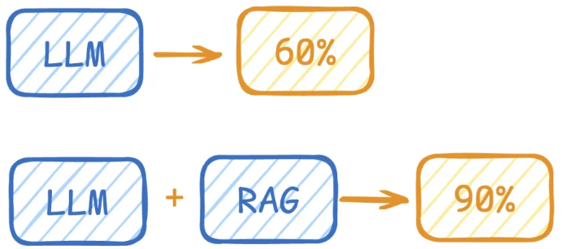

**Example 2:**

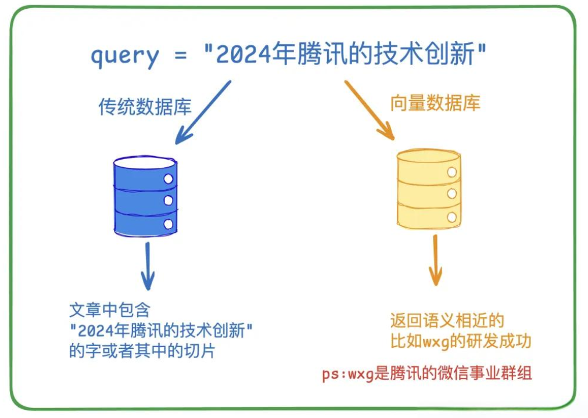

In a real project, it roughly works like this:

- The company has policies, product descriptions, FAQs, and API documentation;
- The model itself does not know these materials;
- But when a user asks a question, the system first searches for the most relevant parts in these materials;
- Then it has the model answer based on those materials.

This way, the answer is more like "answering with evidence" rather than "improvising based on the model's impressions."

### 1.3 Execution Process

The most important thing in understanding RAG is to view it as **two stages**, not just a single phrase like "retrieve first, then generate."

The first stage is **knowledge base construction**, which deals with raw materials; the second stage is **retrieval and answer generation**, which deals with user questions.

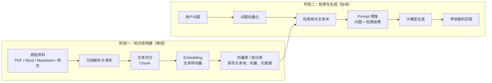


**Process Description:**

The entire diagram is divided into **two stages**: the upper part is **knowledge base construction**, and the lower part is **query and answer generation**. What it does is: first turn local documents into a retrievable knowledge base, then dynamically look up materials when users ask questions, and augment those materials into the model input.

| Step                       | English Name        | Chinese Name   | What It Does                                                                 |
| -------------------------- | ------------------- | -------------- | ---------------------------------------------------------------------------- |
| **Stage 1: Knowledge Base Construction** |
| 1                          | Local Documents     | Local Documents | Process starting point: your PDF, Word, Markdown, TXT, and other raw files are the data source for the private knowledge base. |
| 2                          | Unstructured Loader | Unstructured Loader | Reads and parses local documents in various formats, extracts plain text from them, and unifies them into a format that can be processed later. |
| 3                          | Text                | Text         | The plain text content produced by the loader.                               |
| 4                          | Text Splitter       | Text Splitter | Splits long text into small chunks according to rules, making it easier to embed and fit into the LLM context. |
| 5                          | Text Chunks         | Text Chunks   | The segments of text obtained after splitting; these are the basic units for subsequent embedding and retrieval. |
| 6                          | Embedding           | Embedding     | Uses an embedding model to convert each text chunk into a vector. Chunks with similar semantics have closer vector distances. |
| 7                          | VectorStore         | Vector Store  | Stores the vectors, original text, and metadata of text chunks in a vector database, supporting later similarity-based retrieval. |
| **Stage 2: Query and Answer Generation** |
| 8                          | Query               | Query         | The question or request posed by the user in natural language.               |
| 9                          | Embedding           | Embedding     | Uses the **same** embedding model to convert the user query into a vector as well, ensuring it is in the same vector space as the knowledge base. |
| 10                         | Query Vector        | Query Vector  | The vector representation of the user query. It is used to find the most relevant document chunks in the vector store. |
| 11                         | Vector Similarity   | Vector Similarity | Performs similarity search in the vector store to find the text chunks closest to the question. |
| 12                         | Related Text Chunks | Related Text Chunks | The text snippets obtained from retrieval; they are the most critical basis for answering the question. |
| 13                         | Prompt Template     | Prompt Template | Assembles "user question + retrieval results" into a structured input. This corresponds to the "Augmented" part of RAG. |
| 14                         | Prompt              | Prompt       | The final content sent to the large language model.                          |
| 15                         | LLM                 | Large Language Model | Generates an answer based on the retrieval results and the user question. This corresponds to the "Generation" part of RAG. |
| 16                         | Answer              | Answer       | The final response given by the model based on the retrieved materials.       |

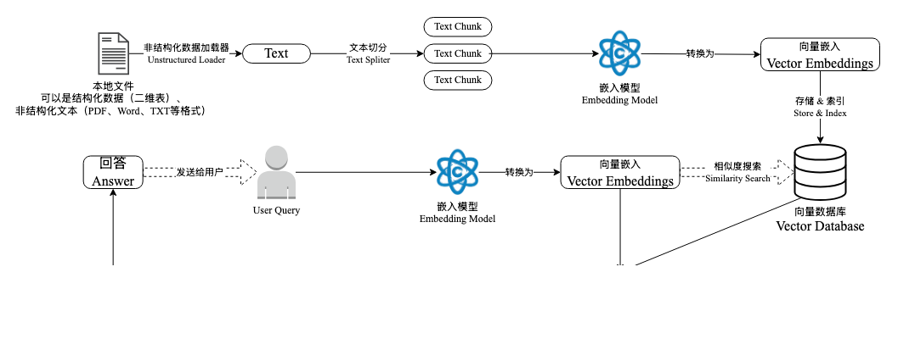

> Retrieval-Augmented-Generation process: **Retrieval** corresponds to steps 9-11 (query embedding → query vector → vector similarity search); **Augmented** corresponds to step 13 (injecting retrieval results into the prompt / message context); **Generation** corresponds to step 15 (LLM outputs the answer).

> **You may ask:** Why must the **same** embedding model be used for both "knowledge base construction" and "when users ask questions"? Because the embedding model essentially defines a "semantic coordinate system." Using model A for building the base and model B for querying is like using two completely different rulers to measure distance—the calculated similarity will become chaotic, and retrieval performance will noticeably degrade.

When understanding this diagram, it is also recommended to first remember the four most easily confused terms:

- **Knowledge base**: The overall container that holds external knowledge, which may include documents, chunks, vectors, metadata, retrieval configuration, and so on.
- **Vector store**: The storage component inside the knowledge base used for similarity retrieval; it is not equivalent to the entire knowledge base.
- **Embedding**: The model or process that converts text into vectors.
- **Prompt augmentation**: The step that hands the retrieval results to the model.

If you continue to [19-RAG Retrieval-Augmented Generation](19-RAG%E6%A3%80%E7%B4%A2%E5%A2%9E%E5%BC%BA%E7%94%9F%E6%88%90.md), you will find that these four terms map to more specific code objects, for example:

- Document -> `Document`
- Text splitting -> `TextSplitter`
- Vectorization -> `Embeddings`
- Retrieval -> `Retriever`
- Augmented input -> `PromptTemplate / ChatPromptTemplate`

**Highlighting the difficult steps (blue parts):**

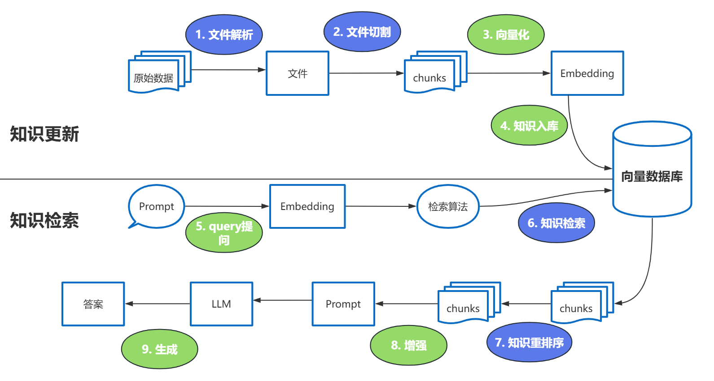

This diagram reminds us that the most difficult parts of RAG are usually not "uploading files" itself, but whether these stages are handled properly:

- Whether the documents are parsed correctly
- Whether the text is split into chunks that are too small or too large
- Whether the Embedding model is suitable
- Whether the retrieved content is truly relevant
- Whether the context assembled for the model contains too much noise

RAG is not "if there is a knowledge base, the answers will definitely be good;" rather, "the higher the quality of the knowledge base pipeline, the more stable the answers."

### 1.4 RAG Engineering Quality Framework

After understanding the process, let's look at a question that is closer to real projects: **Why do some knowledge bases produce very stable answers while others often hallucinate, even though they are all called knowledge bases?**

You can use this formula for troubleshooting: **RAG effectiveness = document quality x parsing quality x chunking quality x retrieval quality x reranking quality x prompt organization quality x generation model quality x evaluation loop**

The multiplication sign here means that as long as any one stage is particularly poor, the overall result will be noticeably dragged down.

When the knowledge base answers inaccurately, don't immediately blame the model. First look at the symptoms, then trace back:

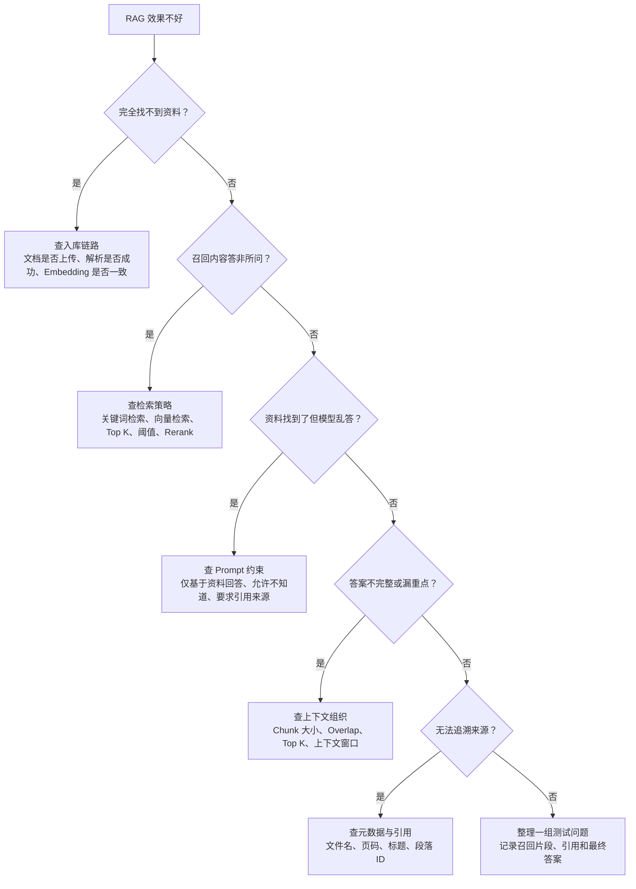

---

## 2. Overview of Knowledge Bases

This section understands knowledge bases from the perspective of a "product user." A knowledge base can be understood as: **an external knowledge layer that makes your materials searchable, citable, and callable by large language models.**

It is not just a "folder," nor just a "vector database":

- From the user's perspective, a knowledge base is like "organizing a lot of materials into a warehouse that can answer questions."
- From an engineering perspective, a knowledge base usually involves multiple stages behind the scenes, such as documents, chunking, Embedding, vector retrieval, metadata, and retrieval strategies.

### 2.1 What is a Knowledge Base

First, a brief definition:

> **Knowledge base = allows the model to access your own materials and call on those materials as needed when answering questions.**

It is especially suitable for the following groups of people:

**Small business owners or entrepreneurs:**
They often need to look up and share policy documents, product descriptions, customer feedback, and market analysis. After organizing these materials into a knowledge base, the efficiency of Q&A and reuse will improve significantly.

**Office workers or freelancers:**
Whether it is writing, design, development, or video production, you will accumulate a large amount of material, requirements, specifications, and project documents. The value of a knowledge base is not "storing it," but "being able to quickly find it and continue using it next time."

**Educators or students:**
Teachers can organize course materials, lecture notes, cases, and Q&A documents; students can turn class notes, paper materials, exam highlights, and knowledge point summaries into their own review-oriented knowledge base.

**Ordinary people in daily life:**
Travel plans, reading notes, interest materials, learning records, and job search materials can all be turned into a personal knowledge base. A knowledge base is not an enterprise-only tool; it is equally suitable for personal growth and everyday information management.

From the perspective of "why it is worth doing," a knowledge base has at least three layers of value:

- **Manage materials**: Materials are no longer scattered across chat records, cloud drives, and folders.
- **Quick retrieval**: No need to manually flip through PDFs or web pages every time.
- **Enhanced generation**: Retrieval results can also be handed to the model for summarization, rewriting, Q&A, and secondary creation.

### 2.2 Comparison of Knowledge Base Building Platforms

In this repository, RAG will be covered from two directions: **platform-based building** and **code implementation**. From a platform perspective, you can first divide common tools into three categories by capability positioning. The tools listed here are common representatives for learning and selection, not a fixed ranking; specific features, pricing, and deployment methods will change with versions, and the official documentation of each platform should prevail.

1. **Personal lightweight type**: quick to get started, strong graphical interface, suitable for individuals or small teams to build a Demo first.
2. **Platform collaboration type**: can not only build a knowledge base, but also connect workflows, application publishing, and team collaboration.
3. **Complex document parsing type**: the focus is on document understanding quality, especially suitable for long PDFs, complex tables, and scanned documents.

**2.2.1 Core Positioning and Technical Features**

**AnythingLLM, Cherry Studio**: `桌面/图形化 AI 助手 + 知识库（RAG）`, support connecting cloud models and local models, suitable for `个人/小团队` quick validation. In areas such as "multi-tenant governance, complex system integration, and production observability," they are usually not as good as platform-type products.

**Dify, FastGPT**: `LLM 应用与工作流编排平台`, support creating knowledge bases and connecting them to conversational applications, workflows, and Agents, making them more suitable for scenarios that move "from Demo to team collaboration and application delivery."

**RAGFlow**: emphasizes `复杂文档解析`, `高精度混合检索`, `重排`, `可视化干预`, and is suitable for scenarios that place great importance on "document parsing quality" and "retrieval quality." The focus of such tools is not "whether they can upload files," but whether they can parse complex documents into knowledge fragments that are more suitable for retrieval and citation.

**2.2.2 Typical Scenarios and Selection Suggestions**

**1. Personal knowledge management (lightweight)**

- Requirements: quick validation, low budget, individual/small team use, with the main goal of "getting it running first."
- Recommended tools: Cherry Studio / AnythingLLM / ima
- Reasons:
  - Simple deployment and operation, quick to get started
  - Suitable for connecting to online model APIs as well as local models
  - More suitable as a "personal knowledge assistant" rather than a complex business platform

**2. Application delivery and team collaboration (platform-type scenario)**

- Requirements: package knowledge base capabilities into reusable AI applications, support multi-person collaboration, workflow orchestration, permission and version management.
- Recommended tools: Dify / FastGPT
- Reasons:
  - The knowledge base is only one part of the entire platform, and it can later be connected to workflows, tool calls, and Agents
  - More suitable for integration with business systems
  - Closer to "internal product delivery" than standalone personal use

**3. Enterprise-grade document parsing (high-precision requirements)**

- Requirements: handle complex layouts, long PDFs, scanned documents, mixed text and graphics, tables, etc., emphasizing parsing quality and traceable citations.
- Recommended tool: RAGFlow
- Reasons:
  - Places more emphasis on document understanding and retrieval accuracy
  - Supports hybrid retrieval, reranking, and a stronger document processing pipeline
  - Suitable for scenarios where "RAG effectiveness" is treated as a core competitive advantage

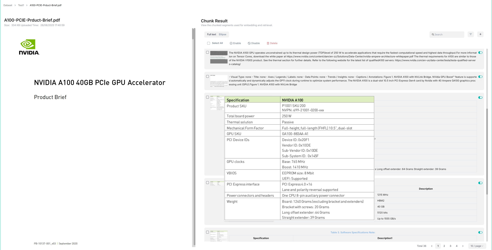

---

## 3. Building a Personal Knowledge Base with Cherry Studio

> Later we will focus on Coze and Dify to explain workflows and agents, so for the knowledge base here, we will first choose **Cherry Studio**, which is more suitable for individuals to get started quickly, and **ima**, produced by Tencent.

### 3.1 Cherry Studio Features

Cherry Studio is better understood as a "**personal-oriented, desktop-based, model aggregation AI workstation**." Its advantage is not enterprise platform capability, but rather: quick to get started; strong graphical interface; suitable for individuals to quickly build a knowledge base and compare multiple models.

**Beginner-friendly**: Cherry Studio is committed to lowering the technical barrier, allowing zero-basic users to get started quickly, enabling users to focus more on work, study, or creation itself.

**One question, multiple answers**: Supports generating replies from multiple models for the same question at the same time, making it convenient to compare the performance of different models.

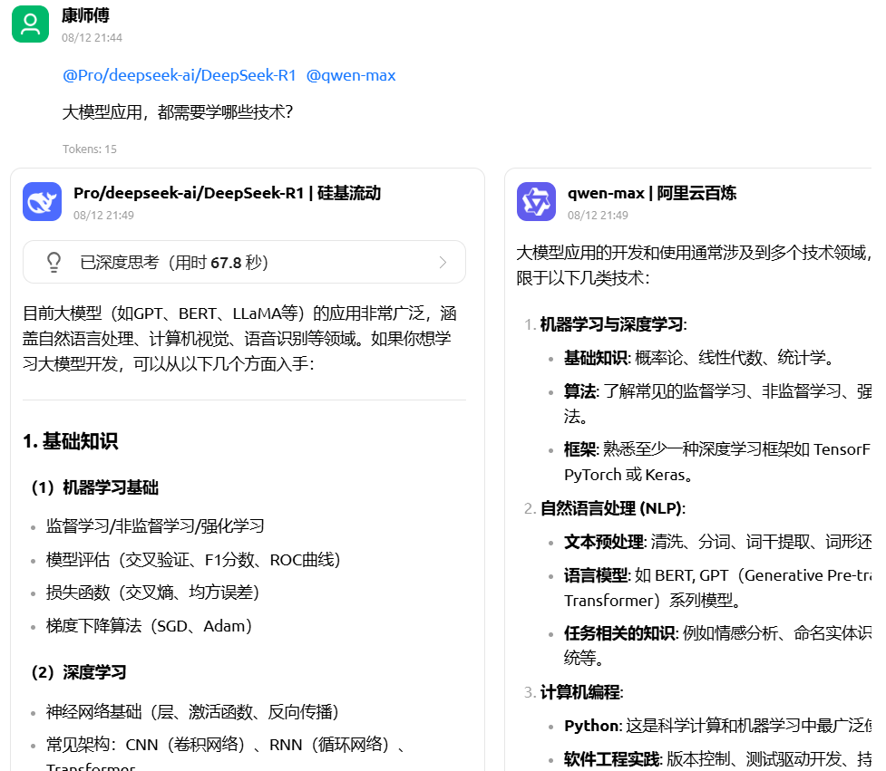

**Assistant marketplace**: Built in with over a thousand industry-specific assistants, covering scenarios such as translation, programming, and writing, while also supporting custom assistants.

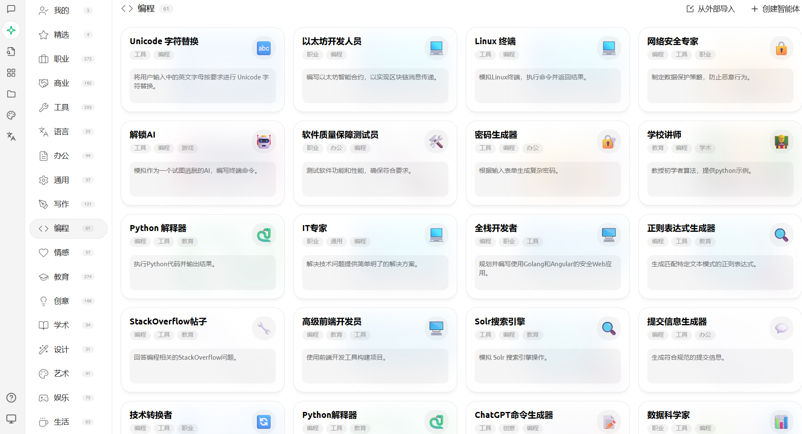

**Provider model aggregation**: Supports integration with third-party providers following standards such as OpenAI, Gemini, Anthropic, and Azure, with strong compatibility.

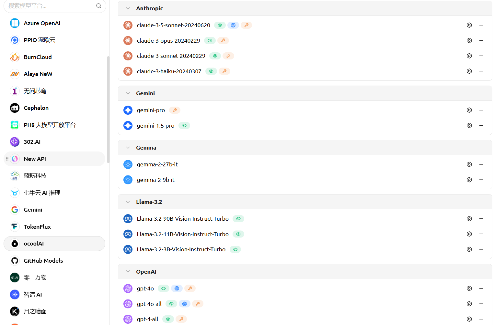

**Data security**: Supports fully local usage scenarios, and when combined with local large language models, it is more suitable for users who are more sensitive to data security.

### 3.2 Using LLMs

In Cherry Studio, knowledge base Q&A is not just a matter of "uploading files." At minimum, you need to first understand two roles clearly: the **chat model** and the **Embedding model**:

- **Chat model (LLM)**: responsible for generating the final answer.
- **Embedding model**: responsible for converting documents and questions into vectors for retrieval.

So model access must be completed first.

**Step 1: Download and install the client tool**

Download address: https://www.cherry-ai.com/download

**Step 2: Register an account on SiliconFlow**

The large language model service here is illustrated using the SiliconFlow platform as an example.

Website: https://siliconflow.cn/zh-cn/models

**Step 3: Create an API key**

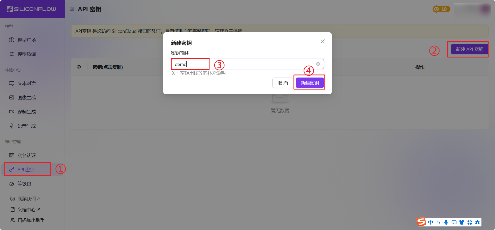

**Step 4: Copy the API key**

**Step 5: Configure the API key**

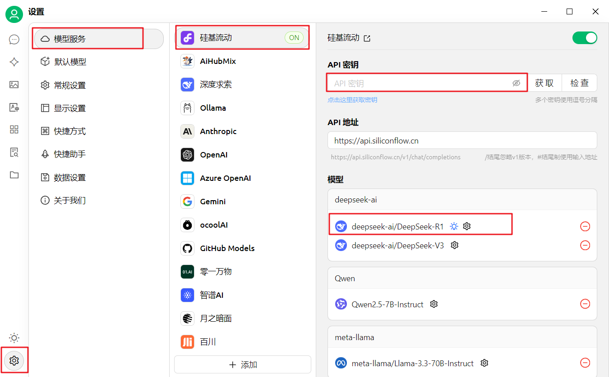

**Step 6: Select a large language model**

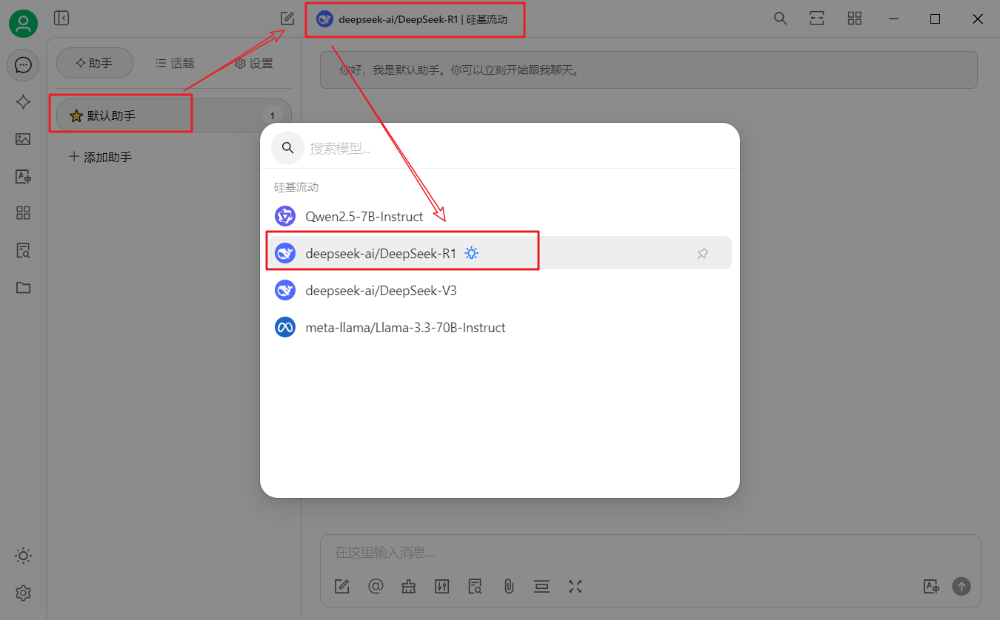

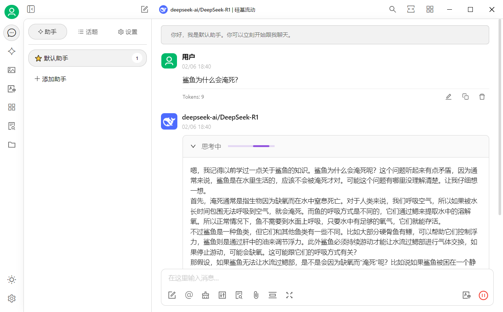

What is completed here is the "generation model" access, which is the part responsible for answering questions later.

### 3.3 Using the Knowledge Base

This part is the key to moving from "ordinary chat" to "knowledge base Q&A." It is recommended that while working through it, you keep in mind: **uploading documents is not the end goal; whether retrieval is correct and whether generation can be based on the knowledge base are the key to effectiveness.**

**Step 1: Add an embedding model**

Confirm the name according to the following figure:

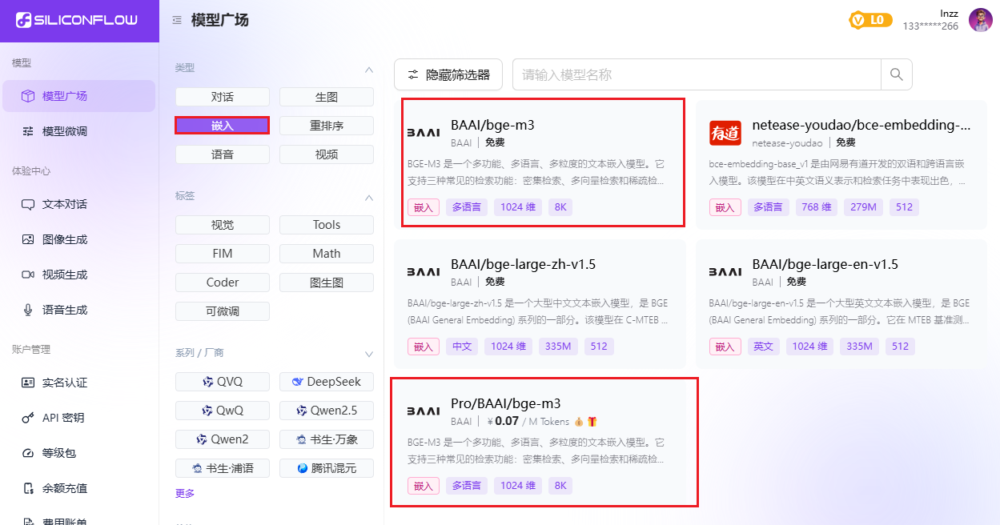

Return to Cherry Studio to add it:

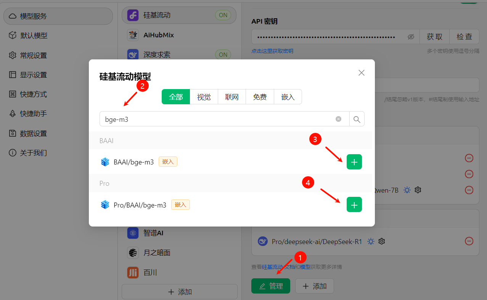

This step corresponds to the "Embedding" stage in RAG. Subsequent document uploads for building the knowledge base and user question retrieval will all depend on this model.

**Step 2: Create a knowledge base**

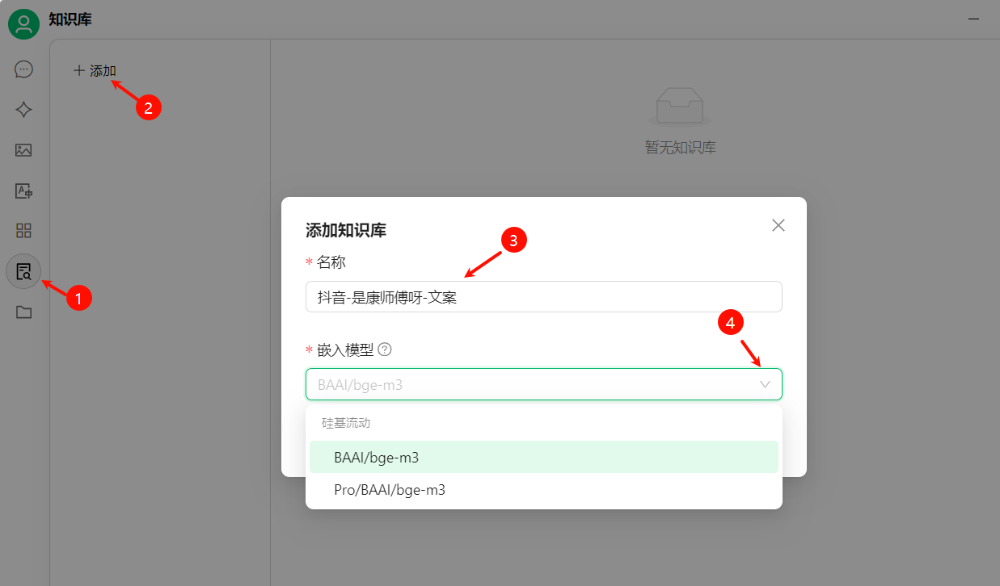

Provide knowledge base content:

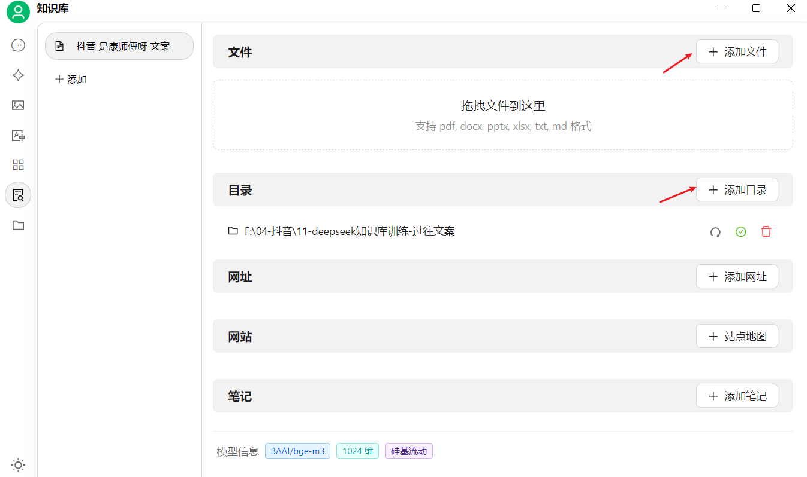

This supports adding files in different formats, folders, web page addresses, large blocks of text, and other methods to the knowledge base.

> Note: If uploaded files contain a large amount of handwritten content, complex tables, scanned documents, formulas, or complex layouts, parsing performance will usually decrease significantly. Many people think that "poor RAG results" are a model problem, when in fact the problem often already occurred during the document parsing stage.

**Step 3: Support direct retrieval**

Retrieval:

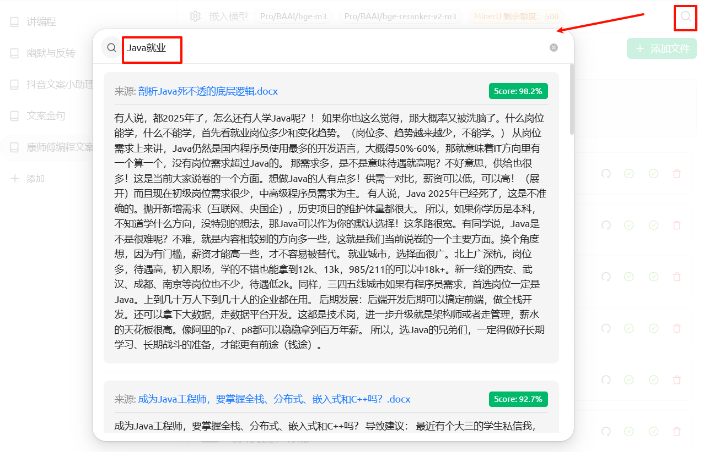

What is shown here is the ability to "search the knowledge base first." At this point, the system has not yet had the LLM generate a long passage; instead, it performs recall in the database based on the RAG approach. Relevant fragments and matching scores can both be seen, which is very suitable for troubleshooting effectiveness.

**Step 4: Generate based on the knowledge base**

After selecting it, ask a question:

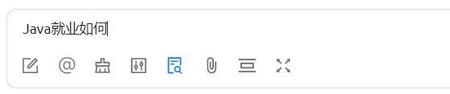

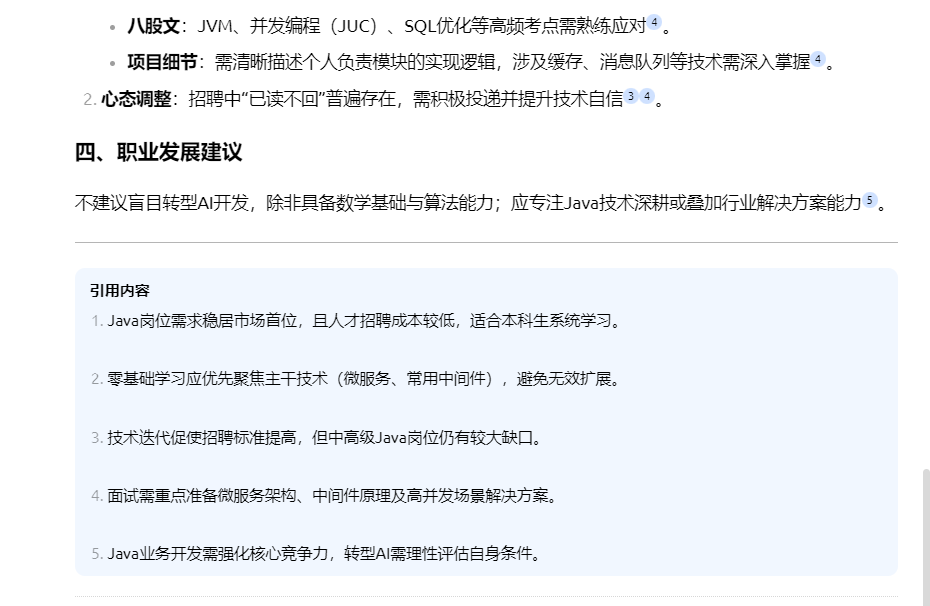

This step corresponds to the "complete RAG": first retrieval, then context enhancement, and finally answer generation by the model.

**Supplement: Enhancing document parsing capability**

If the uploaded files contain handwritten content, complex tables, scanned documents, or complex formulas, parsing quality will be poorer. In this case, you can first use a dedicated document parsing tool for preprocessing, and then upload the processed content to the knowledge base.

Tool used: Doc2X

Website: https://doc2x.noedgeai.com/

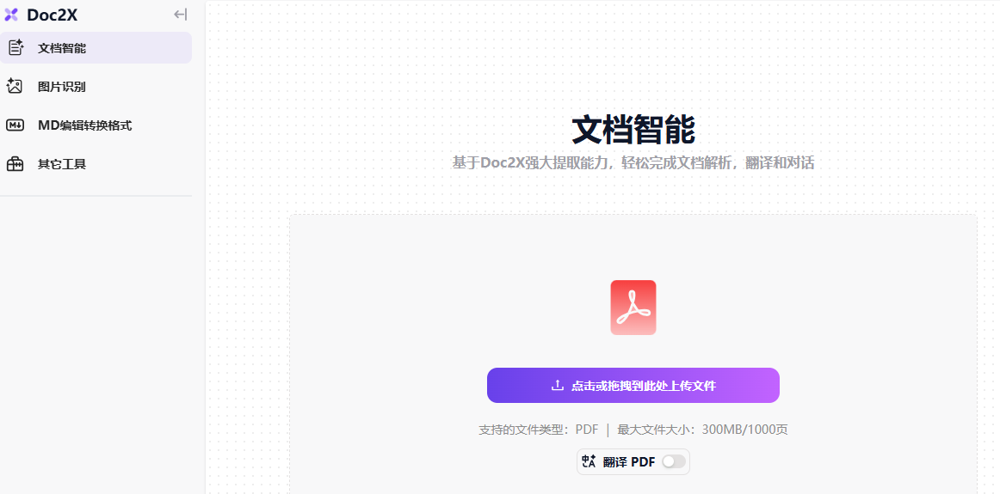

Here you should build a very practical engineering mindset:

- **RAG results are not determined by the large language model alone**; they are also affected by document quality, parsing quality, chunking quality, retrieval quality, reranking quality, and prompt organization quality.
- Not every problem should be blamed on the model; many problems occur in the upstream data pipeline.

### 3.4 Pipeline Analysis

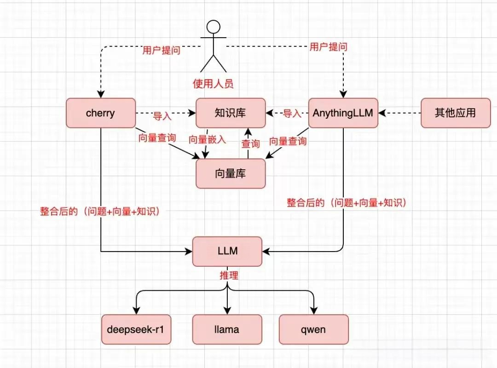

The entire Cherry Studio pipeline can be broken down into:

1. Connect a chat model
2. Connect an Embedding model
3. Upload documents and build a knowledge base
4. Retrieve relevant content first
5. Then generate answers based on the knowledge base

This pipeline corresponds one-to-one with the standard RAG process introduced in Section 1 earlier. It is precisely for this reason that when you later switch to Dify, LangChain, or RAGFlow, although the interfaces differ, the underlying approach remains unchanged.

---

## 4. Building a Personal Knowledge Base with ima

### 4.1 ima Features

If Cherry Studio is more like a "desktop model workbench," then **ima** is more like a "more consumer-oriented, lighter-weight knowledge assistant with a lower barrier to entry." It is especially suitable for beginners to quickly experience the process of "connecting materials into a model."

- **Simple operation, zero learning curve**: The interface and workflow are very intuitive and more geared toward ordinary users.
- **Multi-device synchronization**: Supports access and synchronization across client, mini program, web, and other platforms.
- **Shared knowledge bases**: Supports sharing knowledge bases with others, facilitating collaboration and transfer.
- **Models and entry points**: Usually integrates platform-provided or partner LLM capabilities, and supports asking questions through clients, WeChat, and other entry points, with the model generating answers based on the knowledge base. Specific model names and entry point forms may change with product versions.

At the beginner stage, ima's main value is: **it makes it easy to first build an intuition for "knowledge base Q&A"**. Its customizability is not as high as Dify, but the barrier to entry is lower.

### 4.2 Building a Knowledge Base

**Step 1: Download and Install**

Website: https://ima.qq.com/

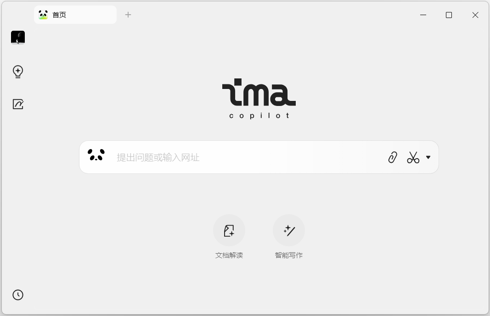

**Step 2: Create a New Knowledge Base**

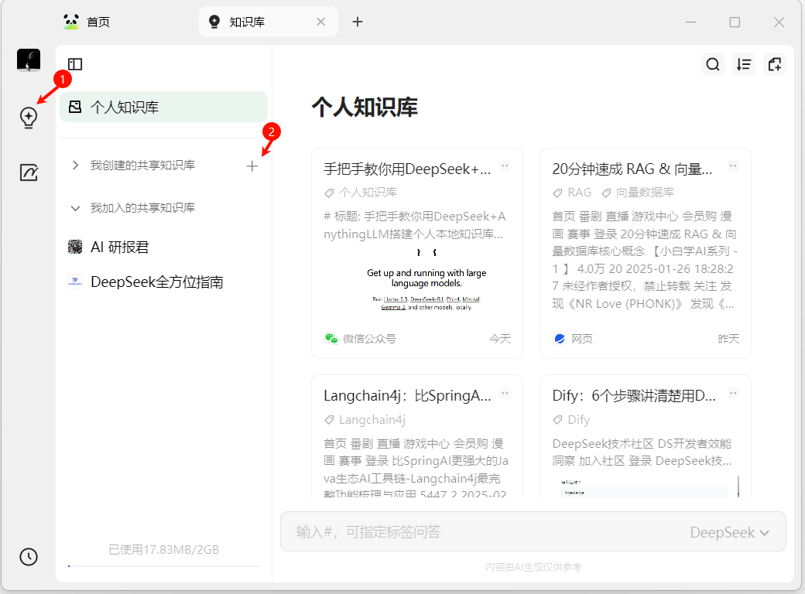

**Step 3: Import Local Files**

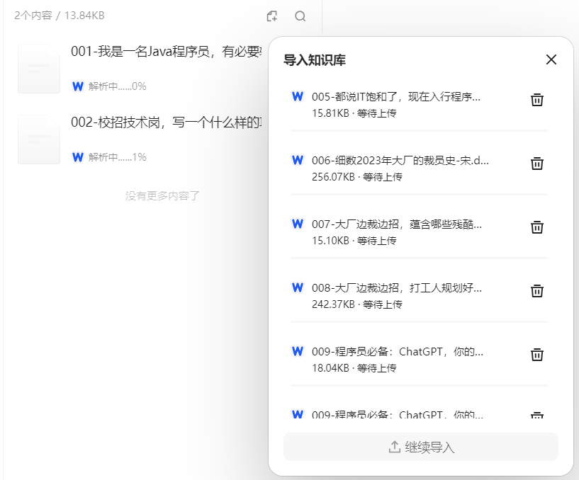

**Step 4: Generate Based on the Knowledge Base**

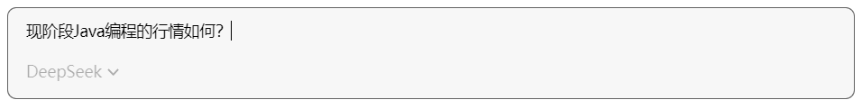

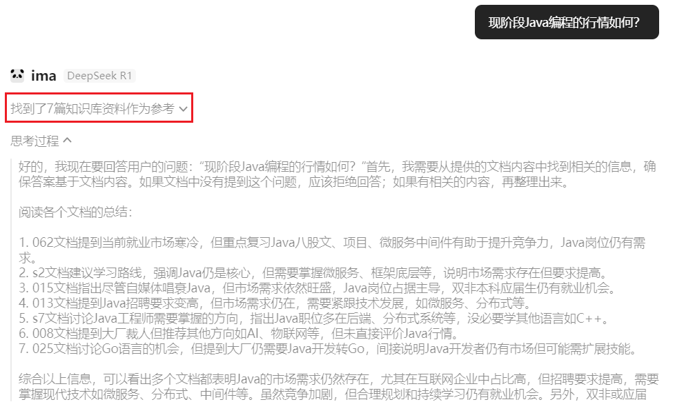

The most worthwhile thing to appreciate in this section is: even though the platform interface differs from Cherry Studio, what happens underneath is still the same set of logic:

- Import files
- Convert them into retrievable content
- User asks a question
- Retrieve knowledge
- Answer based on the knowledge

### 4.3 Combining Internet Web Pages into a Knowledge Base

A knowledge base does not have to come only from local files; it can also come from web page content. This capability is very commonly used when building a personal learning-oriented knowledge base.

Step 1: Search for articles on related topics in WeChat Official Accounts and add them to ima.

Step 2: Create a new personal knowledge base in ima and add the relevant articles to this knowledge base.

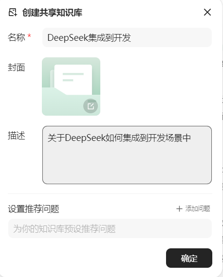

Step 3: After the articles are imported, you can generate a knowledge base and perform retrieval and Q&A based on the large language model.

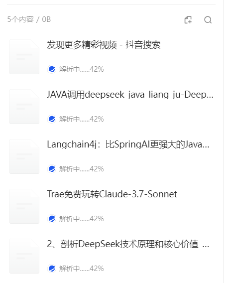

This case is very representative because it illustrates an important insight:

> **A knowledge base is not equal to "uploading PDFs."** As long as materials can be organized into usable text, they have the opportunity to become part of a knowledge base.

### 4.4 Adding Third-Party Knowledge Bases

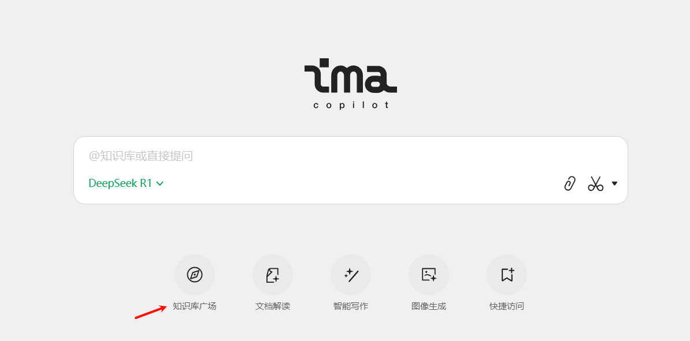

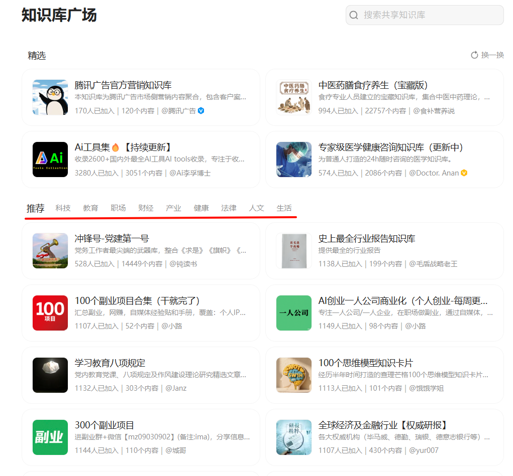

This point corresponds to the capability of "knowledge base collaboration and reuse." For enterprises or teams, the value of a knowledge base is not just that you can query it yourself, but that it can become a shared knowledge entry point for multiple people.

---

## 5. Building a Knowledge Base with Dify

### 5.1 Introduction to Dify

Dify is an open-source large language model (LLM) application development platform. Compared with Cherry Studio and ima, it leans more toward a comprehensive form of "**application platform + workflow platform + knowledge base platform**."

This means that a knowledge base in Dify is not just a tool for "answering your own questions"; it can also be further connected to:

- Chat applications
- Workflows
- Agents
- API external services

Combined with the official documentation, a Dify knowledge base can be understood as:

- A knowledge base is a collection of your own data
- Each knowledge base can contain multiple documents
- Each document is ultimately split into multiple chunks
- At runtime, the application retrieves relevant content from these chunks and then passes it to the model to generate answers

Therefore, if Cherry Studio / ima are more like "getting started for personal use," Dify is more like "the knowledge base needs to enter a product and workflow system."

### 5.2 Source Data Formats

With Dify, you can conveniently and quickly build a private knowledge base and further place the knowledge base into workflows and applications for collaborative use. Dify provides a relatively complete visual interface for managing documents, chunks, retrieval strategies, and application integration.

Currently, Dify supports multiple source data formats, including:

- **Long-form text content**: TXT, Markdown, DOCX, HTML, JSON, PDF
- **Structured data**: CSV, Excel

From the wording of Dify's official knowledge base documentation, the most critical object relationships in a knowledge base are:

- **Knowledge Base**: the overall container
- **Document**: an imported file or data source
- **Chunk**: a retrievable segment after document splitting

**Note:** To achieve good results with a private knowledge base, it is usually necessary to use both an **Embedding model** and a **Rerank model**. Embedding determines "how to find relevant text," and Rerank determines "how to reorder candidate results." In scenarios with higher requirements, Rerank is often worth enabling.

### 5.3 Building a Private Knowledge Base

The focus of this section is not just "clicking through the steps in order," but more importantly understanding: **why these parameters directly affect the final knowledge base Q&A quality.**

**Step 1: First create a new knowledge base**

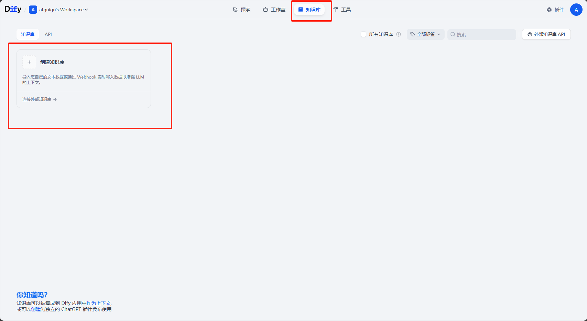

**Step 2: Upload knowledge base files**

The file prepared here is a TXT-format text of the Criminal Law, with each article divided by natural paragraphs.

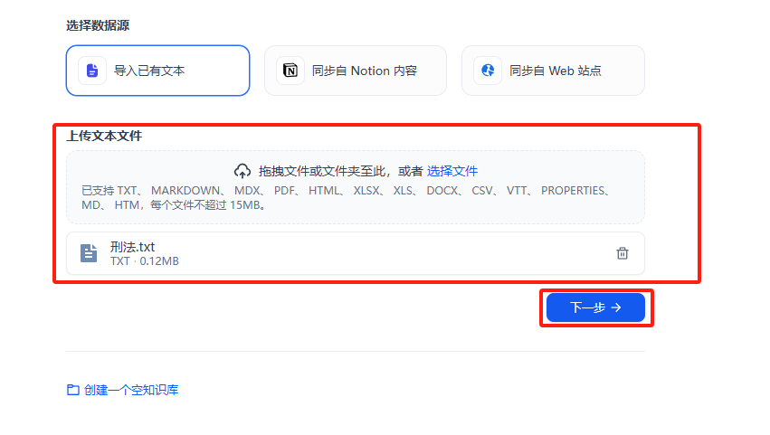

This case is suitable as an introductory demonstration because legal provisions are naturally clearly segmented, have clear knowledge boundaries, and make it easier to observe whether retrieval is accurate.

**Step 3: Chunking settings**

Large language models have a limited context window, so it is usually necessary to first segment long text and then recall the few paragraphs most relevant to the question. Chunks that are too coarse introduce noise, while chunks that are too fine fragment semantics, so "how to chunk" is one of the most critical tuning points in RAG.

If the chunk separator is `\n`, then each newline becomes one chunk; if it is `\n\n`, then each paragraph becomes one chunk. Click "Preview Chunks" to view how chunks are currently divided.

The chunk overlap length is generally `10%-20%` of the maximum chunk length.

If there are URLs, email addresses, and the like in the knowledge base documents, they can also be filtered out during preprocessing.

**Explanation of chunking settings (what these items do and how they affect the knowledge base)**

| Configuration Item | What It Does | Impact on the Knowledge Base |
| ---------------- | -------------------------------------------------------------------- | ------------------------------------------------------------------------------------------------------------------------------------------------------------ |
| **Chunk Separator** | Decides "by what boundary" to split long text into small chunks. `\n` = split by newline, `\n\n` = split by blank line. | If chosen well, the resulting chunks have more complete semantics; if chosen poorly, a whole paragraph may be fragmented, and later retrieval may only match half a sentence. |
| **Maximum Chunk Length** | The character/token limit for a single chunk; if exceeded, another cut is made. | If set too large, a single chunk contains too much irrelevant content, easily bringing noise into the prompt; if set too small, semantics are broken apart and recall may miss key information. Generally, you can start from 200–800 characters (or about 100–500 tokens) and then adjust according to the document type. |
| **Chunk Overlap Length** | A segment of text repeated between adjacent chunks to avoid semantic breaks at boundaries. | With some overlap, sentences at boundaries are less likely to be truncated; too much overlap causes content duplication, storage waste, and retrieval noise. |

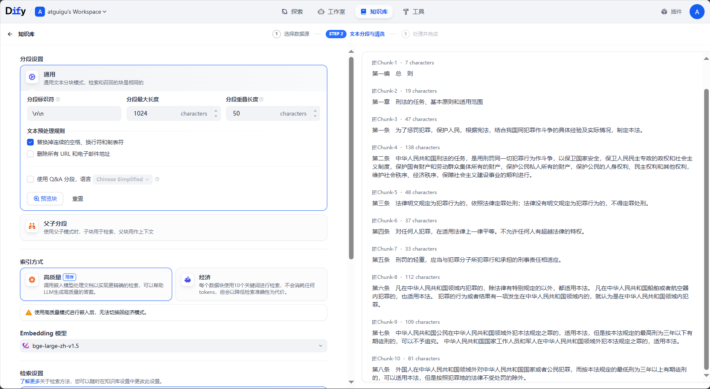

**Step 4: Select an indexing method**

High quality is automatically selected here. High quality has higher accuracy, but token consumption also increases; if you are using a locally deployed model, cost sensitivity will be lower.

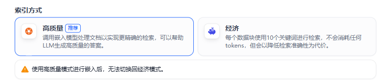

There is also the **Q&A method**: if the document itself is in question-and-answer pair format, this method is usually more suitable.

**Step 5: Retrieval settings**

Here you can select the **Embedding model** and **Rerank model**, and also set Top K, that is, the top n most similar items to select. You can also set a Score threshold, which is the lower similarity limit for filtering text.

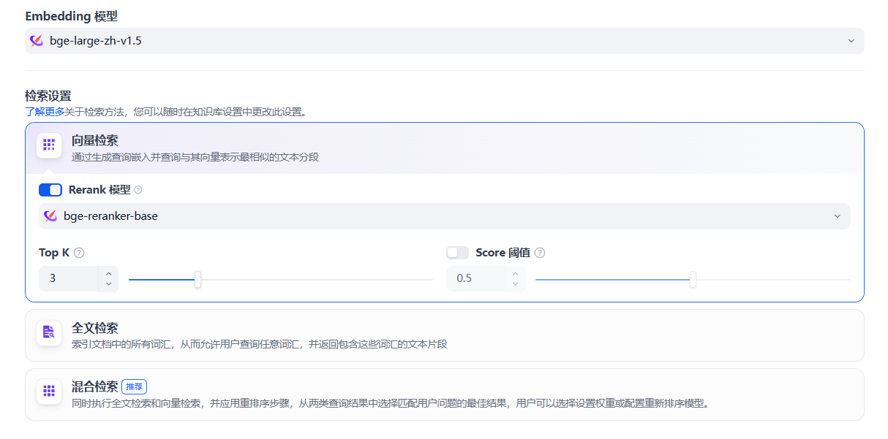

Hybrid retrieval: includes both vector retrieval (optionally using a Rerank model for fine-ranking) and full-text retrieval.

**Explanation of retrieval settings (what these items do and how they affect the knowledge base)**

| Configuration Item | What It Does | Impact on the Knowledge Base |
| ------------------ | ------------------------------------------------------------------------------- | -------------------------------------------------------------------------------------------------------------------------------------------- |
| **Embedding Model** | Converts both "document chunks" and "user questions" into vectors for calculating semantic similarity. | The **same** Embedding model must be used for both indexing and retrieval; otherwise, the vectors will not be in the same space and retrieval quality will noticeably degrade. |
| **Vector Retrieval** | Uses the question vector to find the "most similar" document chunks in the vector store. | This is the core retrieval step in RAG; without it, content cannot be recalled from the knowledge base by semantics. |
| **Rerank Model** | After vector retrieval returns a batch of candidate chunks, uses a specialized model to assign more refined relevance scores to "question + each candidate." | Without Rerank, relying only on vector similarity sometimes mixes in fragments that "look related but do not answer the question"; enabling it usually significantly improves the quality of context ultimately sent to the model, but also increases latency and cost. |
| **Top K**          | The maximum number of document chunks to retrieve and pass to subsequent steps.                                            | If K is too small, key information may be missed; if K is too large, irrelevant content can easily be stuffed into the context, increasing noise and token overhead. Generally, start with 5 and fine-tune based on the results.                          |
| **Score Threshold**     | The minimum similarity score; only chunks that reach this threshold are kept.                                        | A high threshold yields cleaner results but may miss some recall; a low threshold captures more information but adds more noise. When troubleshooting, raise or lower the threshold depending on whether you are seeing "content not found" or "recall is too noisy."                       |
| **Hybrid Search**       | Performs vector search and full-text search at the same time, then merges, deduplicates, and ranks the results.                                  | When documents contain both natural language passages and item numbers, proper nouns, or legal article numbers, hybrid search is usually more stable than pure vector search.                                                 |

Once configured, save and process it.

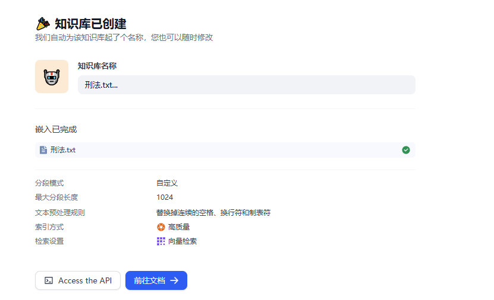

The most valuable engineering takeaway from this section is:

> **The effectiveness of RAG is not determined at the moment you "finish uploading files," but is jointly determined by document quality, chunking strategy, embedding quality, retrieval strategy, and reranking strategy.**

If you want to continue mapping the configuration items in these platforms to their code implementations, you can read this section together with the "Document Loaders, Text Splitters, and Retrievers" sections in [19-RAG Retrieval-Augmented Generation](19-RAG%E6%A3%80%E7%B4%A2%E5%A2%9E%E5%BC%BA%E7%94%9F%E6%88%90.md); this will help you understand more quickly.

### 5.4 Testing

Next, test it. Create a chat assistant and set the prompt to:

```text
你是一个法律小助手，请只根据知识库中的信息，简要回答用户提问的案件触犯了哪些法律
```

For the knowledge base, select the `刑法.txt` you just added, and then you can start asking questions.

You can observe that the chat assistant automatically cites content from the knowledge base when answering.

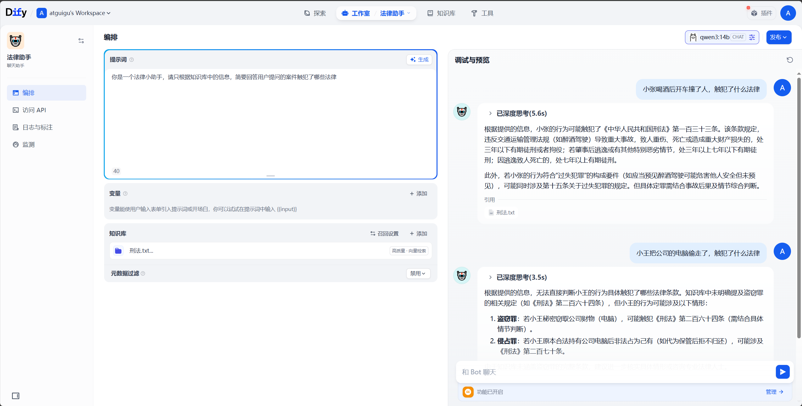

Looking at this case together with the earlier Cherry Studio and ima cases makes it easier to form a complete understanding:

- Cherry Studio: better suited for individuals who want to quickly set up a knowledge base and try it out
- ima: better suited for ordinary users to experience knowledge base Q&A with a low barrier to entry
- Dify: better suited for putting a knowledge base into applications, workflows, and team collaboration environments

---

**Chapter Reflection Questions:**

1. If a knowledge base Q&A system performs poorly, would you first check the documents, chunking, embedding, retrieval parameters, or prompts? Why?

   **Suggested approach:** First look at how the problem manifests. If content cannot be found at all, prioritize checking whether documents were indexed, whether chunking is reasonable, and whether embeddings are consistent. If a lot of irrelevant content is recalled, then adjust Top K, thresholds, and Rerank. If recall is correct but the answers are messy, then look at prompts and citation constraints.

2. Why does "uploading files" not equal "the knowledge base is ready to use"?

   **Suggested approach:** Files still need to be parsed, cleaned, chunked, vectorized, written to the index, and retrieved correctly at query time. If any step in this chain goes wrong, users simply see "inaccurate answers." Knowledge base quality is not determined by the act of uploading, but by the entire processing pipeline.

3. What are platforms like Cherry Studio, ima, and Dify respectively suitable for validating?

   **Suggested approach:** Cherry Studio is suitable for individuals to quickly try out results, ima is suitable for experiencing knowledge base Q&A with a low barrier to entry, and Dify is more suitable for integrating a knowledge base into applications, workflows, and team collaboration. When choosing a platform, consider whether the goal is personal validation, general use, or engineering delivery.

4. When explaining Top K, threshold, and Rerank to a newcomer, what troubleshooting example would you use?

   **Suggested approach:** You can use the analogy of "looking up materials": Top K decides how many passages to take, the threshold decides whether to discard overly irrelevant materials, and Rerank decides how to reorder the candidate materials. If answers miss information, K may be too small or the threshold too high; if answers go off track, K may be too large or reranking may be missing.

**Chapter Summary:**

- **What RAG is**: Retrieval (find relevant passages from your documents) → Augmentation (insert those passages into the current input) → Generation (the large language model answers based on this content); it does not modify model parameters, but supplements context at runtime.
- **Why RAG is needed**: It mainly addresses problems such as frozen knowledge, missing private knowledge, unavailable latest information, and hallucination. Many business problems are essentially not "the model does not know how," but "the model has not seen the materials."
- **What a knowledge base is**: A knowledge base is the overall container that holds external knowledge, and it is not equivalent to a vector store. Behind a knowledge base there are usually components such as documents, chunking, embeddings, retrieval, metadata, and retrieval strategies.
- **How to understand the three types of platforms**: Cherry Studio and ima are suitable for individuals to get started quickly; Dify is more suitable for application delivery and workflow integration; RAGFlow is more suitable for complex document parsing and high-precision retrieval scenarios.
- **Factors that truly affect effectiveness**: Document quality, parsing quality, chunking strategy, embedding model, reranking, Top K, and threshold all directly affect "whether retrieval is accurate and whether answers are stable."

**Suggested Next Steps:**

- If you want to continue toward platform-based applications and workflows, it is recommended to read [3-Agent Development Based on Coze & Dify Platforms](3-%E5%9F%BA%E4%BA%8ECoze&Dify%E5%B9%B3%E5%8F%B0%E7%9A%84%E6%99%BA%E8%83%BD%E4%BD%93%E5%BC%80%E5%8F%91.md) and [4-Calling Dify Platform Workflows with Python](4-Python%E8%B0%83%E7%94%A8Dify%E5%B9%B3%E5%8F%B0%E5%B7%A5%E4%BD%9C%E6%B5%81.md).
- If you want to truly run RAG from a code perspective, it is recommended to first read [18-Vector Databases and Embedding in Practice](18-%E5%90%91%E9%87%8F%E6%95%B0%E6%8D%AE%E5%BA%93%E4%B8%8EEmbedding%E5%AE%9E%E6%88%98.md), and then continue with [19-RAG Retrieval-Augmented Generation](19-RAG%E6%A3%80%E7%B4%A2%E5%A2%9E%E5%BC%BA%E7%94%9F%E6%88%90.md).
