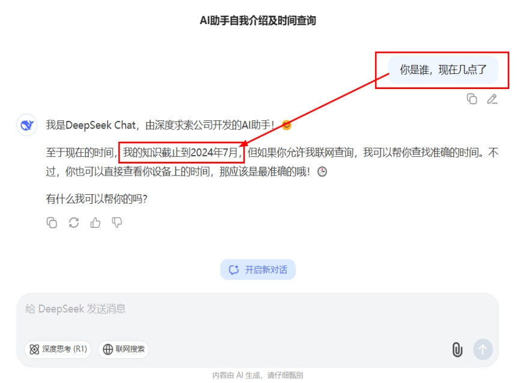
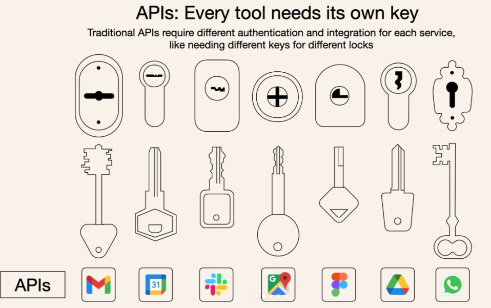
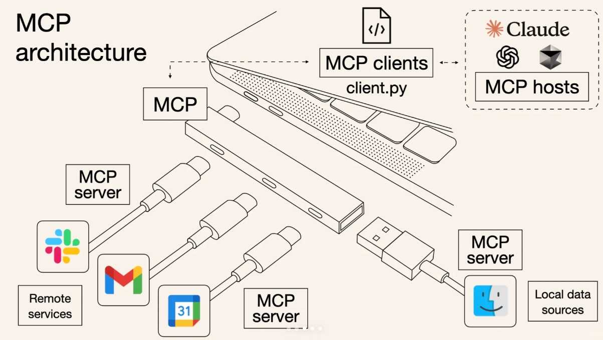
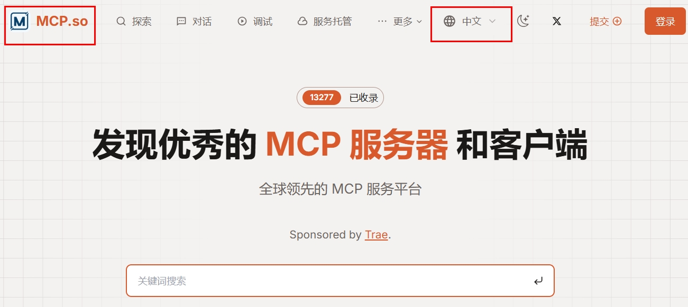
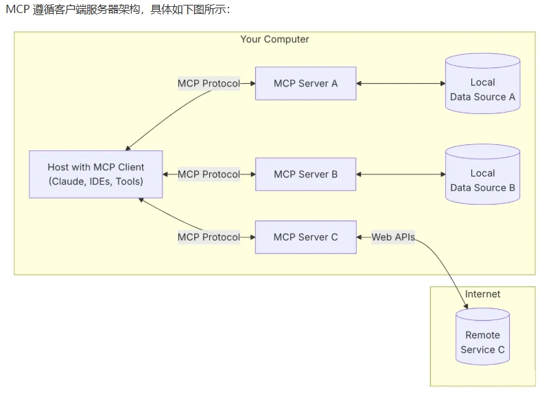
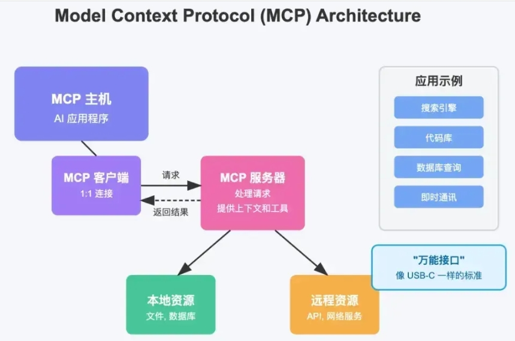
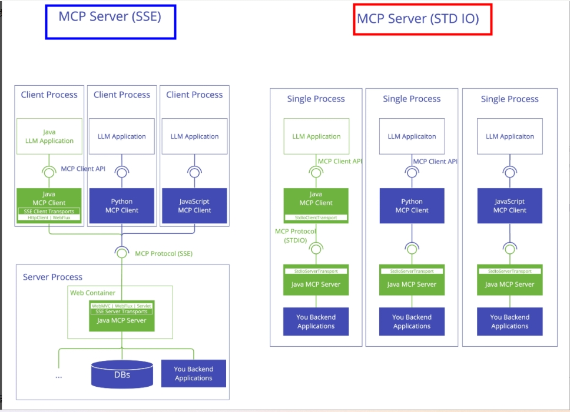

# 20 - MCP Model Context Protocol

---

**Learning objectives for this chapter:**

- Understand what **MCP (Model Context Protocol)** is, what pain points it solves, and how its positioning differs from [Tool](17-Tools%E5%B7%A5%E5%85%B7%E8%B0%83%E7%94%A8.md), [RAG](19-RAG%E6%A3%80%E7%B4%A2%E5%A2%9E%E5%BC%BA%E7%94%9F%E6%88%90.md), and [Agent](21-Agent%E6%99%BA%E8%83%BD%E4%BD%93.md).
- Master the MCP **host / client / server** architecture, core capabilities, common transport methods, and the roles of `mcp.json`, FastMCP, and the LangChain MCP adapter in projects.
- Run through and understand all cases in this chapter: **minimal teaching server, FastMCP server, weather MCP service, in-process client, and MCP client based on `mcp.json` + LangChain Agent**, laying the foundation for later study of [Chapter 21: Agents](21-Agent%E6%99%BA%E8%83%BD%E4%BD%93.md).

**Study suggestion:** Don't treat MCP as a pile of protocol names to memorize at first. Its core is to make connecting external capabilities into model applications more standardized. On the first pass, focus on just three sets of relationships: Tools / Resources / Prompts are the exposed capabilities, Host / Client / Server are the communication roles, and stdio / Streamable HTTP are the transport methods. After completing [Chapter 21: Agents](21-Agent%E6%99%BA%E8%83%BD%E4%BD%93.md), come back to `Agent + MCP` and it will be easier to understand why it matters.

**Official documentation and resources**: See [Tool navigation and reference index - Tool calling, MCP, and agents](%E5%B7%A5%E5%85%B7%E5%AF%BC%E8%88%AA%E4%B8%8E%E5%8F%82%E8%80%83%E8%B5%84%E6%96%99%E7%B4%A2%E5%BC%95.md#工具调用、MCP与智能体).

---

## 1. Why we need MCP

### 1.1 Integration pain points in real projects

Many students first encountering MCP understand it as "letting LLMs go online" or "letting LLMs call tools." That is only partially correct.  
The more central question is not "can the model use tools," but "how can different AI applications connect external tools and context in a unified way."

Without MCP, the main pain points in real projects fall into three categories:

- **Every AI application has to re-integrate external systems**  
  For example, to connect the same GitHub, Slack, database, or file system, Cursor needs one set of code, Claude Desktop needs another, and a self-built Agent platform needs yet another.

- **Every framework and host has its own integration approach**  
  Even if they all support Tool / Function Calling, real-world implementation still involves: how services are discovered, how parameter schemas are described, how authentication is passed, how processes are started, and how results are returned.

- **Tools are hard to reuse as "ecosystem capabilities"**  
  Without a unified protocol, even a well-written tool often serves only a specific application, making migration and reuse very costly.



So the background behind MCP's emergence is not that "nobody could write tools before," but rather:

**Everyone is writing tools, but there is a lack of a unified connection standard that can be reused across applications, frameworks, and hosts.**

### 1.2 The core problem MCP addresses

The problem MCP solves can be summarized in one sentence: **it enables capabilities such as "external tools, resources, and prompt templates" to be discovered and used by different AI applications through a unified protocol.**

Consider an example closer to real projects. Suppose you have an AI programming assistant in an IDE, and you want it to:

- Read a local code repository
- Check GitHub Issues
- Access an internal documentation system
- Query cloud service configurations
- Call a database to help troubleshoot problems

Without MCP, you would often need to implement many connectors specifically for this AI assistant. If these capabilities are already exposed according to the MCP standard, then the assistant only needs to support MCP to access all of these services uniformly.

At this point, the value of MCP becomes clear: **expose once, reuse everywhere**; **unified schema reduces adaptation costs**; **it makes it easier to form a tool ecosystem**.

### 1.3 Intuitive analogy: a unified socket for the AI world

Many students remember Iron Man's assistant "JARVIS": it is not just a chatbot, but can connect various external capabilities such as the suit, laboratory, cameras, databases, and control systems.

Real-world AI applications are the same. A truly useful AI assistant often needs to do more than just "talk"; it also needs to check local files, query databases, search GitHub Issues, call weather APIs, send messages to Slack / WeChat / email, and invoke internal business systems.


If every system requires a separate set of connection logic, the cost would be extremely high. MCP's approach is to give AI applications something more like a "**unified socket**."

It is more intuitive to understand it as a unified socket layer: it is like the **USB-C of the AI world**, and also like a **protocol layer similar to OpenFeign / gRPC for LLMs**, essentially serving as a **general adaptation layer between AI applications and external capabilities**.

This intuition connects more smoothly with the previous section: **what MCP unifies is not the model itself, but the way AI applications discover, understand, call, and reuse external capabilities.**

---

## 2. Introduction to MCP

### 2.1 Definition

MCP (Model Context Protocol) is an **open standard protocol** that specifies how **AI applications / Agents / IDEs / chat clients** interact with **external tools, resources, and context providers**.

The official core description can be summarized as:

- MCP standardizes how applications provide context to LLMs
- It allows AI applications to connect different data sources and tools in a unified way

At the entry stage, grasp this point first:

**The keywords for MCP are "standard protocol, unified access, cross-host reuse."**

### 2.2 How Does It Differ from Tool, RAG, and Agent

| Concept | Problem It Solves | Typical Focus |
| --------------------------- | ------------------------------ | ---------------------------------------- |
| **Tool / Function Calling** | How a model calls a specific tool | Tool schema, parameters, call results |
| **RAG** | How a model obtains external knowledge context | Document loading, chunking, retrieval, context assembly |
| **MCP** | How external capabilities are exposed and accessed in a standardized way | Host / Client / Server, protocol, transport, discovery |
| **Agent** | Who plans, decides, and invokes these capabilities | Reasoning, orchestration, memory, execution loops |

Quick reference:

> **Terminology note:** This chapter writes it as **Tool / Function Calling** to accommodate different documentation contexts; as in [Chapter 17](17-Tools%E5%B7%A5%E5%85%B7%E8%B0%83%E7%94%A8.md), you can treat them as the same layer of "how a model expresses tool-calling intent."

- **Tool** addresses "whether it can be called"
- **RAG** addresses "whether knowledge can be obtained"
- **MCP** addresses "how to unify access"
- **Agent** addresses "who decides when to call"

---

## 3. What MCP Can Do

### 3.1 Unified Access and Abstraction

The most direct value of MCP is exposing originally scattered external capabilities to AI applications in a unified way.



> **Note:** "Division" - each application and data source integrates separately, leading to repeated development and poor reusability.



> **Note:** "Unification" - through unified protocols such as MCP, develop once and reuse across multiple ends.

Therefore, MCP is not replacing Tool; rather, it abstracts one more "protocol layer" above Tool.

### 3.2 What an MCP Server Can Typically Expose

According to the official documentation, the three most core capabilities of an MCP server are:

| Type | Purpose | Control Method | Corresponding Examples |
| ------------- | --------------------------------------------------- | --------------------------- | ---------------------------------------------- |
| **Tools** | Executable actions, such as checking weather, querying databases, sending requests | **Model-triggerable** | `McpServer.py`, `McpServerWeatherByFastMCP.py` |
| **Resources** | Readable content, such as files, configurations, database schemas, API responses | **Application / host decides how to use** | `McpServerByFastMCP.py`'s `@mcp.resource()` |
| **Prompts** | Reusable prompt templates / workflow templates | **User-explicit selection is more common** | `McpServerByFastMCP.py`'s `@mcp.prompt()` |

The official documentation clearly distinguishes how these three are controlled:

- **Tools are model-controlled**
- **Resources are application-driven**
- **Prompts are more user-controlled**

In other words:

- Tool is better suited for letting the model automatically decide when to call
- Resource is better suited for the host to decide how to incorporate into context
- Prompt is better suited for users to explicitly trigger a templated workflow

This is also why MCP cannot simply be understood as "just a tool protocol." **Tools are part of MCP, but not all of it.**

### 3.3 Other Capabilities That Are Easy to Overlook

In addition to Tools / Resources / Prompts, the official protocol also includes some more advanced client / session capabilities, such as:

- **Sampling**: The server requests a generation from the **host-side LLM** through the client (bringing "which side has the compute" into protocol collaboration)
- **Elicitation**: The server requests additional information from the user through the client
- **Logging**: The server sends structured logs to the client
- **Progress / Notifications**: Progress and notifications during long-running tasks

These are not covered as the main focus in the current repository examples, but they are important for understanding MCP because they show that:

**MCP is not just "listing tools and then calling tools"; it also defines a more complete human-machine collaboration and context-exchange mechanism.**

However, for this chapter, the key points to master first are:

- How Tools are exposed
- How servers and clients connect
- How LangChain / Agents obtain MCP tools

That is already sufficient.

### 3.4 Common Uses in Real Projects

In real projects, the most common directions for MCP implementation are usually threefold:

1. **Adding capabilities to existing AI applications**  
   For example, letting clients such as Cursor, Claude Desktop, VS Code, and ChatGPT access the filesystem, code repositories, browsers, and internal systems.

2. **Building a unified tool access layer for self-developed Agent platforms**  
   This way, the Agent platform does not need to write a different protocol for each of GitHub, databases, knowledge bases, Slack, and cloud platforms.

3. **Turning enterprise internal capabilities into reusable AI interface layers**  
   For example, wrapping capabilities such as "query work orders," "query orders," "query configurations," and "send notifications" into MCP services for multiple AI applications to share.

**Security and trust boundaries (essential for real-world deployment):** MCP Servers can often access local files, internal APIs, or credentials with relatively high privileges; in production environments, you should enforce **trusted sources** (install only audited services), **least privilege**, and **network isolation**, and record call audits. This is just as important as "what can be connected."

---

## 4. How to Use MCP

### 4.1 Using Existing MCP Services Directly

If your goal is not "learning how to implement the protocol" but rather "getting capabilities connected first," the most direct approach is usually:

- Find an existing MCP Server
- Configure the connection method in the host application
- Let the client automatically discover its Tools / Resources / Prompts

The official ecosystem already provides Registry-oriented capabilities, and discovery of public MCP servers is becoming increasingly standardized. This means:

**For many capabilities, you don't need to write your own server from the start — learning how to connect, configure, and debug is also essential.**



### 4.2 Building a Local MCP Server Yourself

If you need to connect to: a local file system, an internal database, a private enterprise API, or your own business system.

Then you usually need to write your own MCP Server. This is also the focus of the examples in this chapter: through a local weather service, FastMCP examples, and the `mcp.json` client configuration, we will understand how an MCP service is exposed, discovered, and then used by an Agent.

#### 4.2.1 What is FastMCP

This is a good place to clarify the term **FastMCP**, because it will appear frequently in the file names of the examples that follow.

**FastMCP is a high-level wrapper in the official MCP Python ecosystem for quickly writing MCP Servers.** It hides a lot of low-level boilerplate for you, allowing you to expose MCP capabilities in a way that feels closer to "just writing Python functions."

First, think of its relationship to MCP in terms of the following correspondence:

- **MCP** is the protocol standard, solving the problem of "how AI applications uniformly integrate external capabilities"
- **FastMCP** is a server-side development tool in Python, solving the problem of "how I can more conveniently expose capabilities according to the MCP standard"

In other words: **MCP is the rules**, and **FastMCP is a tool for implementing those rules**. It's like this: HTTP is a protocol, and FastAPI / Flask are frameworks that help you implement HTTP services.

The same applies in this chapter: MCP determines how the Host, Client, and Server collaborate, while FastMCP helps you write an MCP Server more easily.

#### 4.2.2 Why This Chapter Covers FastMCP

In real-world projects, if you plan to write your own MCP server, there are usually two common approaches:

1. **Implement it directly using the SDK / protocol details yourself**
2. **Use a higher-level wrapper like FastMCP to implement it**

The second approach is usually more friendly because it lets you focus on "what capabilities I want to expose" instead of getting bogged down in a lot of low-level details early on.

This is also why the examples in this chapter are divided into two categories:

- `McpServer.py`
  This is a minimal teaching implementation that helps you understand the smallest concept of "registering tools on the server."

- `McpServerByFastMCP.py`, `McpServerWeatherByFastMCP.py`
  These are written in a style closer to real Python MCP development experience, helping you understand how Tool / Resource / Prompt are exposed according to the official SDK style.

Therefore, in this chapter, **FastMCP is not the main character; the MCP protocol itself is. But FastMCP is very suitable as an introductory implementation tool on the Python side.**

### 4.3 Using MCP in LangChain / Agent

This point is also very close to the current project's main thread.

LangChain officially provides adapter support for MCP. The common approach is:

1. Use `MultiServerMCPClient` to connect to one or more MCP servers
2. Retrieve MCP tools via `get_tools()`
3. Pass these tools to `create_tool_calling_agent` or `create_agent`
4. Let the Agent actually call them in conversation (see [Chapter 21: AI Agents](21-Agent%E6%99%BA%E8%83%BD%E4%BD%93.md) for details on Agent creation and execution)

This also illustrates the relationship between MCP and LangChain:

- **MCP** is responsible for "standardized integration"
- **LangChain / Agent** is responsible for "actually putting the integrated capabilities to use"

---

## 5. MCP Architecture Knowledge

### 5.1 Host, Client, and Server Definitions

MCP uses a typical **Host - Client - Server** architecture.



| Role | Meaning |
| ---------------------------- | ---------------------------------------------------------------- |
| **MCP Host** | The application the user actually interacts with, such as an IDE, desktop client, chat application, or a self-built AI platform |
| **MCP Client** | A component inside the Host responsible for establishing a protocol connection with a particular MCP Server |
| **MCP Server** | A service that exposes capabilities such as Tools / Resources / Prompts |
| **Local / Remote Resources** | Files, databases, APIs, internal systems, etc. that the server can access |

One point to be clear about in the official documentation:

- **Host is the application you are using**
- **Client is the protocol connection component inside the Host**

This is also why "one Host can connect to multiple Servers," but "a specific Client usually corresponds to one direct connection to a particular Server."



### 5.2 How MCP Works at the Protocol Level

MCP is not just "sending HTTP requests"; it has its own set of conventions at the protocol layer.
When studying this chapter, it is enough to first understand the following main line:

1. **Host / Client initiates the connection**
2. **Client and Server perform initialization**
3. **Both sides declare their supported capabilities**
4. **The client discovers the tools / resources / prompts provided by the server**
5. **Call or read as needed**
6. **Results are returned to the Host and then used by the model / UI**

MCP's underlying message format is based on **JSON-RPC 2.0** (request / response / notification). This is also why you will see these in many references:

- request / response / notification
- capabilities negotiation
- initialize

MCP is more like: **"a protocol layer + capability discovery layer + invocation layer between AI applications and external capabilities"** rather than just a single SDK.

#### 5.2.1 Understanding a Complete MCP Call Through 5 Actions

If we put MCP back into a real question-and-answer round, it can be broken down into the following 5 actions:

1. **Handshake & Discovery**
  After the Host starts, it connects to the MCP Server according to the configuration and completes initialization. At this point, the client knows: what Tools, Resources, and Prompts this server provides, and what capabilities it supports.

2. **Context Injection**
  After the user asks a question, the Host provides "user question + discovered tool descriptions / resource information / prompt information" to the model or application logic.

3. **Reasoning / Decision**
  The model decides whether a Tool needs to be called, or the application decides whether to read a Resource or use a Prompt.

4. **Routing & Execution**
  The Host / Client sends the request to the MCP Server according to the protocol. The Server executes the real logic in its own process or remote service, such as checking the weather, reading a file, or querying a database.

5. **Result Feedback**
  The Server returns the result to the Client, the Client then passes the result back to the Host, and the Host continues to let the model generate the final answer, or directly displays it to the user.

You can compare this process with the Tool calling in Chapter 17:

- **Tool calling** is more like "the model knows how to call a function"
- **MCP** is more like "where this function comes from, how it is discovered, how it is connected, and how it is called according to the protocol"

This is also why in Agent scenarios, MCP often appears one layer before Tool.

### 5.3 Two Common Transport Types: STDIO and the HTTP Family

This section first clarifies the old and new naming.

According to the **official MCP transport specification** (refer to pages such as [Transports](https://modelcontextprotocol.io/specification/2025-11-25/basic/transports) for the current version, as it will iterate), the current mainstream standard transports are:

1. **stdio**
2. **Streamable HTTP**

The official documentation also explicitly states:

- **Streamable HTTP** replaces the **HTTP+SSE transport from the 2024-11-05 version**
- In the new HTTP transport, the server **can still use SSE as a streaming return mechanism**

In other words, the more accurate understanding today should be:

- **STDIO**: local child process communication
- **Streamable HTTP**: an independent service process communicating over HTTP, with SSE streaming as needed

And what you see in many older references, older examples, and adapter configurations as `sse` usually belongs to:

- The old HTTP+SSE transport naming
- Or a compatibility notation
- Or specific library-level retention of historical interfaces



Combined with the existing examples in the repository, you can look at it this way:

| Transport | Better suited for | Corresponding examples |
| --------------------------- | ---------------------------------- | ------------------------------------------ |
| **STDIO** | Local, lightweight, client launches the server process | `McpServerByFastMCP.py` |
| **SSE / HTTP compatible teaching notation** | Understanding historical references and remote service forms | `McpServerWeatherByFastMCP.py`, `mcp.json` |
| **Current specification focus** | Prioritize understanding as `Streamable HTTP` | New projects should follow the official specification |

Keep two points in mind when reading the repository examples:

- **The examples in this chapter retain the `sse` notation for compatibility with the existing repository code**
- **The current specification focus should be understood as `stdio + Streamable HTTP`**

#### 5.3.1 Beyond Transport: Pay Attention to Security Boundaries

When MCP is actually deployed, the transport method is only the first layer; security boundaries are equally important. Based on official security practices, remember the following points first:

- **Write operations require human confirmation**: Tools such as deletion, outbound calls, payments, and batch modifications should not be silently executed by the model by default.
- **HTTP services need authentication and origin validation**: At minimum, consider tokens, session identity, and Origin / source validation, rather than treating "as long as it can connect, integration is successful."
- **Local services should limit their exposure scope as much as possible**: If it can listen only on localhost, do not open it to the public network by default. Avoid turning a debugging MCP Server directly into an external network entry point.
- **Logs and business data should be handled at different levels**: Progress, error, and debug logs are useful, but do not expose sensitive configuration or private data to the model or untrusted clients as-is.

### 5.4 Basic FastMCP Syntax and Common APIs

The MCP server examples in the repository mainly follow the FastMCP / official Python SDK route. Before looking at the examples, first remember the responsibilities of these APIs:

> The examples in this repository use the official MCP Python SDK 1.x. In this version, the network binding parameters are written in the `FastMCP(...)` constructor. MCP Python SDK 2.x has renamed `FastMCP` to `MCPServer`. Do not mix the import methods and startup parameters of the two versions.

#### 5.4.1 Creating a Service Instance

```python
from mcp.server.fastmcp import FastMCP

mcp = FastMCP("Demo")
```

This step is creating an MCP Server instance.

#### 5.4.2 Registering a Tool

```python
@mcp.tool()
def add(a: int, b: int) -> int:
    return a + b
```

This means exposing an ordinary Python function as an MCP Tool.

#### 5.4.3 Registering a Resource

```python
@mcp.resource("greeting://default")
def get_greeting() -> str:
    return "Hello from static resource!"
```

This means the server exposes a readable resource that the client can read by URI.

#### 5.4.4 Registering a Prompt

```python
@mcp.prompt()
def greet_user(name: str, style: str = "friendly") -> str:
    return f"为{name}生成问候语"
```

This means the server exposes a reusable prompt template.

#### 5.4.5 Starting the Service

```python
mcp.run(transport="stdio")
```

Or:

```python
mcp.run(transport="streamable-http")
```

In the current repository examples, the following is also retained:

```python
mcp = FastMCP("Demo", host="127.0.0.1", port=8000)
mcp.run(transport="sse")
```

This style of writing is used to preserve the existing examples in the repository. The parameter positions here correspond to MCP Python SDK 1.x; please also understand SSE within the context of "legacy compatibility / teaching preservation."

#### 5.4.6 Viewing the Client from the Underlying SDK Perspective

`McpClientAgent.py` uses the higher-level `MultiServerMCPClient`, which encapsulates many underlying details.  
However, from a learning perspective, understanding roughly what the underlying client does will help you better understand MCP.

From the official SDK's line of thinking, the typical actions of an MCP client are usually:

1. Establish a transport connection
2. Create `ClientSession`
3. Call `initialize()`
4. `list_tools()` / `list_resources()` / `list_prompts()`
5. `call_tool()` / `read_resource()` / `get_prompt()`

For **STDIO**, the sequence is roughly like this:

```python
import asyncio
from mcp import ClientSession, StdioServerParameters
from mcp.client.stdio import stdio_client

async def main():
    server_params = StdioServerParameters(
        command="python",
        args=["mcp_server_stdio.py"],
    )
    async with stdio_client(server_params) as (read, write):
        async with ClientSession(read, write) as session:
            await session.initialize()
            tools = await session.list_tools()
            result = await session.call_tool("add", {"a": 1, "b": 2})
            print(tools)
            print(result)

asyncio.run(main())
```

For **Streamable HTTP**, the core difference is mainly that the "connection method" becomes a remote URL:

```python
import asyncio
from mcp import ClientSession
from mcp.client.streamable_http import streamable_http_client

async def main():
    async with streamable_http_client("http://127.0.0.1:8000/mcp") as (read, write, _):
        async with ClientSession(read, write) as session:
            await session.initialize()
            tools = await session.list_tools()
            print(tools)

asyncio.run(main())
```

You don't need to memorize these low-level APIs right away, but understanding this layer of operations is very valuable because it helps you understand: why you need to call `initialize()` first; why the client can "list" tools, resources, and prompts; and why `MultiServerMCPClient` is essentially encapsulating these underlying processes for you.

### 5.5 Understanding the Complete Call Flow

It's easier to understand if you think of the protocol layer as a complete chain:

1. The user initiates a request in the Host
2. Some MCP Client inside the Host establishes a session with the corresponding Server
3. The Client discovers the capabilities exposed by the Server
4. The model or application decides whether to call a Tool / read a Resource / retrieve a Prompt
5. The Server executes or returns the result
6. The Host presents the result to the user, or continues passing it to the model for reasoning

If this flow is then mapped into a LangChain Agent, it becomes:

1. `MultiServerMCPClient` connects to the MCP service
2. `get_tools()` retrieves tools
3. The Agent gets the tool list
4. The user asks a question
5. The Agent selects a tool
6. The tool returns a result
7. The model continues generating the final answer based on the result

---

## 6. Hands-on Case Study: Local MCP Weather Service and Client

### 6.1 Position of This Chapter's Case Study in the Project

The core files are as follows:

| File                           | Purpose                   | How You Should Understand It                                        |
| ------------------------------ | ---------------------- | ------------------------------------------------------- |
| `McpServer.py`                 | Minimal teaching server       | **Concept demonstration version**, helping you understand "how tools are registered and exposed"            |
| `McpServerByFastMCP.py`        | FastMCP standard usage example   | Demonstrates `tool / resource / prompt + stdio`                 |
| `McpServerWeatherByFastMCP.py` | Weather server             | Demonstrates the weather Tool and HTTP/SSE compatible usage                      |
| `McpClient.py`                 | Simplified client           | **Same-process teaching version**, not a protocol network client in the strict sense        |
| `mcp.json`                     | Client connection configuration         | Declares which MCP services to connect to and how to connect                       |
| `McpClientAgent.py`            | LangChain + MCP client | Closer to a real project; reads `mcp.json` and then hands the MCP tools to the Agent |

### 6.2 Distinguishing the Server Case Studies

#### 6.2.1 Minimal Teaching Version: McpServer.py

[Example source code] `案例与源码-2-LangChain框架/11-mcp/McpServer.py`

[McpServer.py](../../%E6%A1%88%E4%BE%8B%E4%B8%8E%E6%BA%90%E7%A0%81-2-LangChain%E6%A1%86%E6%9E%B6/11-mcp/McpServer.py ":include :type=code")

The most important value of this file is not that it is a "strict and complete protocol implementation," but rather that it **helps you first understand what an MCP server is actually doing**.

Its core functionality consists of only two things:

1. Maintain a `_tools` container
2. Use `@mcp.tool()` to register `get_weather` into it

Therefore, it is more like a "**demonstration of the MCP concept**."

You should understand it as:

- Helping you first understand what it means for "a server to expose tools"
- Helping you understand why the client can discover tools
- Helping you understand the relationship between MCP and an ordinary `@tool`

But it should also be made clear: **it is not a complete, standard MCP server implementation that can independently serve external requests in the strict sense.**

#### 6.2.2 Standard Usage Introductory Version: McpServerByFastMCP.py

[Example source code] `案例与源码-2-LangChain框架/11-mcp/McpServerByFastMCP.py`

[McpServerByFastMCP.py](../../%E6%A1%88%E4%BE%8B%E4%B8%8E%E6%BA%90%E7%A0%81-2-LangChain%E6%A1%86%E6%9E%B6/11-mcp/McpServerByFastMCP.py ":include :type=code")

This file is closer to the "normal usage of the official Python SDK / FastMCP," and it also demonstrates:

- `@mcp.tool()`
- `@mcp.resource()`
- `@mcp.prompt()`
- `mcp.run(transport="stdio")`

It is well suited for answering a key question: **an MCP server not only exposes tools, but it can also expose resources and prompt templates.**

This is also the most suitable case in this chapter for building an intuition for the "Tools / Resources / Prompts trichotomy."

#### 6.2.3 Weather Server: McpServerWeatherByFastMCP.py

[Example source code] `案例与源码-2-LangChain框架/11-mcp/McpServerWeatherByFastMCP.py`

[McpServerWeatherByFastMCP.py](../../%E6%A1%88%E4%BE%8B%E4%B8%8E%E6%BA%90%E7%A0%81-2-LangChain%E6%A1%86%E6%9E%B6/11-mcp/McpServerWeatherByFastMCP.py ":include :type=code")

This file mainly demonstrates two things:

1. How to encapsulate a weather query as an MCP Tool
2. How to run the server as a "standalone service"

This file still uses the `transport="sse"` style from the repository. When reading it, treat it as a teaching example of the "standalone service form"; for new projects, still prioritize the `stdio / Streamable HTTP` described in Section 5.3 for the transport method.

### 6.3 Introduction to mcp.json

[Configuration file] `案例与源码-2-LangChain框架/11-mcp/mcp.json`

[mcp.json](../../%E6%A1%88%E4%BE%8B%E4%B8%8E%E6%BA%90%E7%A0%81-2-LangChain%E6%A1%86%E6%9E%B6/11-mcp/mcp.json ":include :type=code")

In this section, I especially want to help you correct a common misconception:

**`mcp.json` is not the MCP protocol itself, nor is it the "only contract."**

Its more accurate positioning is: **a client connection configuration file commonly used by certain MCP Hosts / Clients / adapters.**

In other words, what it solves is:

- Which servers to connect to
- What transport each server uses
- What the URL / command / args are

Rather than:

- How the MCP protocol itself is defined
- How to write the complete definition of a Tool schema

The `mcp.json` here primarily reads three types of information:

- `weather`
  - Uses `sse`
  - Points to the local weather service
- `fetch`
  - Uses `stdio`
  - Starts a local MCP Server through a command

This also well reflects a practical characteristic of MCP: **the same client can simultaneously connect to multiple MCP Servers, and each server can use a different transport method.**

### 6.4 How to Distinguish and Understand the Client Case Studies

#### 6.4.1 Same-Process Teaching Client: McpClient.py

[Example source code] `案例与源码-2-LangChain框架/11-mcp/McpClient.py`

[McpClient.py](../../%E6%A1%88%E4%BE%8B%E4%B8%8E%E6%BA%90%E7%A0%81-2-LangChain%E6%A1%86%E6%9E%B6/11-mcp/McpClient.py ":include :type=code")

This file is easy to misunderstand, so it needs to be clearly explained here: its focus is to demonstrate:

- How the server exposes tools
- How the client discovers tools
- How tools are called

But its implementation approach is:

- `from McpServer import mcp`
- Directly reads `mcp._tools`
- Calls functions directly within the same process

So it is more like: **an MCP concept demonstration client**, rather than: **a real client that connects to an independent server through network or subprocess transport according to the protocol**. Precisely because of this, it is very suitable for getting started, but it should not be mistaken for a "formal MCP network call example."

#### 6.4.2 A Client Closer to Real Projects: McpClientAgent.py

[Example source code] `案例与源码-2-LangChain框架/11-mcp/McpClientAgent.py`

[McpClientAgent.py](../../%E6%A1%88%E4%BE%8B%E4%B8%8E%E6%BA%90%E7%A0%81-2-LangChain%E6%A1%86%E6%9E%B6/11-mcp/McpClientAgent.py ":include :type=code")

This example is closer to a real project because it implements the following complete chain:

1. Reads `mcp.json`
2. Uses `MultiServerMCPClient` to connect to the service
3. Retrieves MCP tools through `get_tools()`
4. Hands the tools to the LangChain Agent
5. Lets the Agent actually use these tools in conversation

There are two things in this file that are most worth learning:

**First, it shows how MCP and the Agent are connected.**  
MCP is not responsible for planning for you, nor is it responsible for reasoning for you; it is responsible for bringing the tools in. What truly decides "when to call the weather tool" is the Agent.

**Second, it shows that LangChain's support for MCP no longer stops at tool discovery.**  
According to the official LangChain documentation, in addition to `get_tools()`, it is now also possible to:

- `get_resources()`
- `get_prompt()`
- Use stateful sessions
- Handle logging / elicitation / structured content

However, the main thread of this chapter still focuses on **integrating MCP tools into an Agent**, which is also the most suitable first step for getting started.

Here is one more session-related detail:

Many adapters encapsulate "retrieving tools and calling tools" as an on-demand connection path. For most ordinary tools, this is sufficient; if the Server depends on long-term session state, then you need to use approaches such as `async with client.session(...)` according to the documentation to maintain the session, and then read resources, prompts, or call tools within that session.

### 6.5 Testing Suggestions and Learning Order

It is recommended to run the examples in this chapter in the following order:

1. **First look at `McpServer.py` + `McpClient.py`**  
   First build the intuition that "the server exposes tools, and the client discovers and calls them."

2. **Then look at `McpServerByFastMCP.py`**  
   Build an overall understanding of the three types of capabilities in `tool / resource / prompt`.

3. **Then look at `McpServerWeatherByFastMCP.py` + `mcp.json`**  
   Understand standalone services and client configuration.

4. **Finally run `McpClientAgent.py`**  
   See how the LangChain Agent actually puts MCP tools to use.

If you want to get even closer to the official ecosystem's debugging approach, you can also learn about **MCP Inspector**:

- Official tool documentation: https://modelcontextprotocol.io/docs/tools/inspector

It is suitable for doing these things:

- View what Tools / Resources / Prompts the server has
- Manually test tool parameters
- View server logs and notifications

This is very helpful for troubleshooting "whether the server did not expose it, or whether the client did not connect."

---

**Chapter Reflection Questions:**

1. How is the problem MCP solves different from "writing a local utility function"?

   **Reference thought:** A local utility function only serves the current code; MCP allows tools, resources, and prompts to be exposed through a unified protocol for reuse by different AI applications. Its focus is standardized integration and cross-application reuse, rather than simply writing another function.

2. If the three roles of Host, Client, and Server are confused, what misunderstandings can result?

   **Reference thought:** It would become unclear who runs the application, who is responsible for protocol communication, and who exposes capabilities. The Host is the application host, the Client is responsible for connecting to the MCP Server, and the Server provides Tools / Resources / Prompts. Only when the roles are clear can configuration and troubleshooting have direction.

3. How should the three types of capabilities—Tool, Resource, and Prompt—be divided?

   **Reference thought:** Tool is suitable for executable actions, Resource is suitable for contextual material to be read, and Prompt is suitable for reusable prompt templates. Do not turn everything into a Tool, otherwise permissions and semantics will become messy.

4. When should stdio be used, and when should more attention be paid to Streamable HTTP?

   **Reference thought:** stdio is common for local processes, desktop tools, and development debugging; service-oriented, cross-process, and remote access scenarios require the HTTP form more. The transport method serves the deployment scenario, not simply memorizing protocol names.

**Chapter Summary:**

- **The Essence of MCP**: It is not a model, nor a tool itself, but a standardized connection protocol between AI applications and external capabilities.
- **The Core Value of MCP**: Unified discovery, unified description, and unified access, making tools, resources, and prompt templates easier to reuse across applications.
- **Differences from Other Concepts**: Tool addresses "invoking capabilities," RAG addresses "retrieving knowledge," Agent addresses "planning and decision-making," and MCP addresses "standardized access."
- **Current Specification Focus**: Standard transport is primarily understood as `stdio` and `Streamable HTTP`; the `sse` notation in the repository is retained for case compatibility and instructional understanding purposes.
- **Main Thread of This Chapter's Cases**: From a minimalist teaching server, to a FastMCP server, and then to an MCP client with `mcp.json` + LangChain Agent, this already forms a complete introductory path.
- **Security Boundaries Must Not Be Omitted**: MCP makes access more unified, but that does not mean access is inherently secure. In real projects, you still need to consider whether the server source is trustworthy, authentication and authorization, least privilege, isolation of sensitive capabilities, and avoid directly exposing internal resources that should not be exposed to the model side.
- After completing this chapter, you should at least be able to distinguish four things: MCP is the protocol layer; Host / Client / Server are communication roles; Tools / Resources / Prompts are the capabilities exposed by the server; unified access does not automatically solve security issues.

**Suggested Next Step:** It is recommended to first run the local server and client in this chapter yourself, and then review [Chapter 17: Tools Function Calling](17-Tools%E5%B7%A5%E5%85%B7%E8%B0%83%E7%94%A8.md) and [Chapter 21: Agent Intelligent Agents](21-Agent%E6%99%BA%E8%83%BD%E4%BD%93.md). You will more easily see how "local Tools, MCP Tools, and the Agent decision layer" divide responsibilities in engineering.
