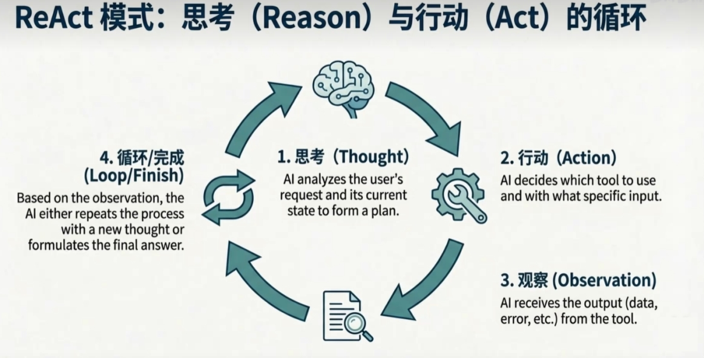
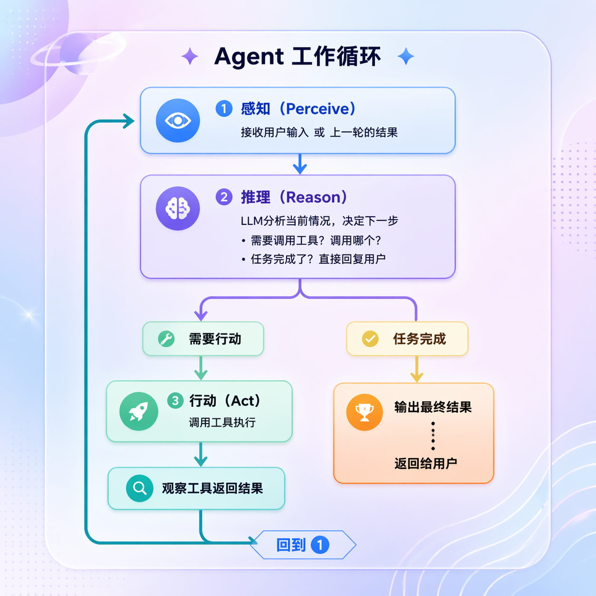
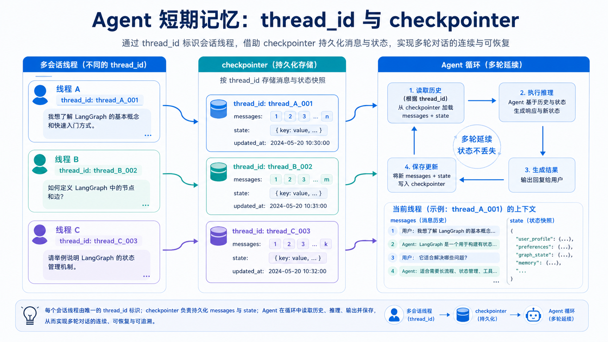
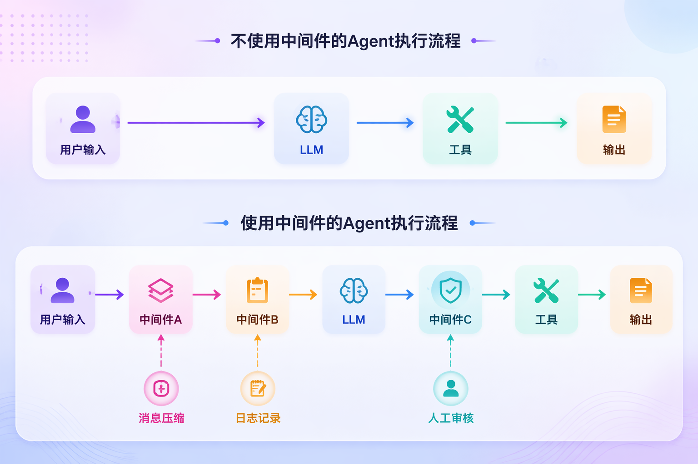

# 21 - Agent

---

**Learning objectives for this chapter:**

- Understand what an **Agent** really is, what problems it is suitable for, and its relationship with [Tool](17-Tools%E5%B7%A5%E5%85%B7%E8%B0%83%E7%94%A8.md), Function Calling, [RAG](19-RAG%E6%A3%80%E7%B4%A2%E5%A2%9E%E5%BC%BA%E7%94%9F%E6%88%90.md), and [MCP](20-MCP%E6%A8%A1%E5%9E%8B%E4%B8%8A%E4%B8%8B%E6%96%87%E5%8D%8F%E8%AE%AE.md).
- Master the core working pattern of an Agent: **continuously reason around a goal, decide whether to call a tool, receive the result, continue making decisions, until an end condition is met**.
- Understand the two main learning paths for Agents in LangChain: **V0.3 / classic Agent + AgentExecutor**, and **V1.x `create_agent` + LangGraph runtime**.
- Run and understand all examples in this chapter: `AgentSmartSelectV0.3.py`, `AgentSmartSelectV1.0.py`, `AgentReact.py`, `Agent2Agent.py`, `McpClientAgent.py`.

**Study advice:** For the Agent chapter, first grasp one sentence: an Agent is the decision layer, not the tool itself. When reading, first look at how it decides the next step, then look at what capabilities Tool, RAG, MCP, and Function Calling each add to it. In the code section, focus on comparing the old AgentExecutor with the new `create_agent` approach; after reading, you should be able to judge whether a requirement should use a regular chain, tool calling, or an Agent.

**Official documentation and resources:** See [Tool Navigation and Reference Index - Tool Calling, MCP, and Agents](%E5%B7%A5%E5%85%B7%E5%AF%BC%E8%88%AA%E4%B8%8E%E5%8F%82%E8%80%83%E8%B5%84%E6%96%99%E7%B4%A2%E5%BC%95.md#工具调用、MCP与智能体).

---

## 1. Introduction to Agents

### 1.1 Definition

First, the most important sentence for beginners: **An Agent is not a single model, nor a single tool, but a mode of operation that "continuously makes decisions around a goal and invokes capabilities."**

If we look only at the minimal essence, an Agent can be viewed as: **Agent = Model + Toolset + Execution Loop + Current State**.

The four parts respectively represent:

- **Model**: Responsible for understanding the user's goal, analyzing the current situation, and deciding the next step.
- **Tools**: Responsible for executing actions, such as checking the weather, checking inventory, calling APIs, searching documents, and accessing databases.
- **Execution Loop**: Responsible for making the model not just answer once, but "think one step, act one step, observe the result, then decide the next step."
- **State**: Responsible for saving the current conversation, tool results, intermediate results, and sometimes short-term memory.

This is also the first common misconception to correct in this chapter: **not all Agents must simultaneously have "long-term memory, complex planning, and multi-agent collaboration."**

For many introductory scenarios, the simplest Agent only needs to: 1. Understand the user's goal; 2. Know when to call a tool; 3. Be able to continue judging based on the tool result; 4. Finally give an answer. That is already an Agent.

The formula above is a "minimal understanding version" to help you grasp the key points first. If we expand an Agent further, in a more complete architectural diagram it may also include capabilities such as memory, planning, and reflection. Therefore, the following diagram is better understood as an "expanded capability puzzle" rather than a one-to-one correspondence with the four items defined above.


### 1.2 The Most Common Working Pattern of Agents: ReAct

**ReAct = Reason + Act.** In Chinese, it can be understood as: **reason first, then act.**

This is the most classic execution loop of an Agent:

1. **Thought / Reason**: Think one step ahead about what to do now.
2. **Action**: If external capabilities are needed, call a certain tool.
3. **Observation**: Obtain the tool's returned result.
4. **Continue the loop or end**: If not yet complete, continue to the next round; if the information is sufficient, give the final answer.

So the essence of ReAct is: **reason first, then act; based on the result of the action, continue reasoning.**

This is very different from an ordinary "answer only once" LLM call. A normal conversation is usually: the user asks a question, and the model answers directly. An Agent is more like: the user asks a question, the model determines whether to query a tool, calls the tool, observes the result, then determines whether to continue, and finally answers.

The following diagram corresponds exactly to this loop:



One more important practical understanding should be added here: **modern Tool Calling Agents do not necessarily display the "Thought" completely to you.**

Often what you actually see in code is:

- `AIMessage` contains `tool_calls`
- After the tool executes, you get `ToolMessage`
- Finally, an ordinary `AIMessage` appears

So in today's LangChain / Tool Calling context, ReAct should be understood more as a **working mechanism** rather than just a fixed prompt template format.

**Agents do not only work in the ReAct way.**

ReAct is only the most classic and most beginner-friendly way of understanding, because it makes it easiest to see "why an Agent is not just a one-time answer." However, in real projects, common Agent forms also include:

- **Plan-and-Execute**: First make an overall plan, then execute step by step according to the plan.
- **Router / Supervisor**: First determine which tool, sub-agent, or process the task should be handed to.
- **Workflow + Agent hybrid**: Use a workflow for fixed parts, and let the Agent make decisions when reaching uncertain nodes.
- **Multi-Agent / A2A**: Multiple Agents divide work and collaborate, coordinated by a main Agent or coordinator.
- **Human-in-the-loop**: Key steps require human confirmation; the Agent is not a fully automatic closed loop.

So a more accurate conclusion is:

- **ReAct is the most classic working mechanism of Agents**
- **It is not the only form of Agent**
- **This chapter starts with ReAct because it is the easiest way to explain the core value of Agents**

### 1.3 The Relationship Between Tool and Agent

This section is the most confusing part of the entire chapter.

**Tool** is the encapsulation of capability.

For example: `get_weather()`, `search_products()`, `check_inventory()`, `book_flight()`. They are all just functions or interfaces that "can do one thing."

**Agent** is the decision-maker.

It is responsible for judging: whether to call a tool now, which tool to call, which one to call first, which one later, whether one tool is enough, whether to retry or change the route if a tool fails, and when to stop and give the final answer.

So the relationship between the two can be summarized as: **Tool = capability; Agent = decision-making + using these capabilities.**

| Object    | Essential positioning | One-sentence understanding                              |
| --------- | --------------------- | ------------------------------------------------------- |
| **Tool**  | Capability layer      | What I can do                                            |
| **Agent** | Decision layer        | When and in what order I use these capabilities         |

Precisely because of this, **having a Tool does not mean having an Agent**. For example, for a one-step question like "check the weather in Beijing," directly calling a weather tool is enough, and an Agent is completely unnecessary.

But if the question becomes: "Help me find the most popular wireless earbuds, then check inventory, and then tell me which one can be bought"; "First book a flight, then book a hotel, then schedule a ride"; "First query the knowledge base, then see whether to call an external API, then organize everything into a report."

In these cases, no single Tool can solve the problem; someone is needed to handle multi-step decision-making, and that is when an Agent becomes valuable.

### 1.4 Agent Use Cases

This point is clearest when understood in combination with the official distinction between **workflow vs agent**. Here, **workflow** can generally be understood in Chinese as **工作流 / 固定流程**. It refers to a processing route whose **steps are basically predetermined in advance and whose execution order is relatively stable**, such as first doing A, then B, then C, with little need for the model to decide on the spot "how to proceed next."

It will be clearer to first roughly distinguish it from an Agent: the process of a **workflow** is basically hardcoded, and the focus is on "executing according to predetermined steps"; the process of an **agent** is not completely fixed, and the focus is on "dynamically making decisions based on context." **If the process path is fixed, prioritize a workflow / chain, not an Agent.**

For example:

- Fixed: first text chunking, then vectorization, then writing to the vector database
- Fixed: first classification, then summarization, then storing in the database
- Fixed execution in the order of A → B → C

These scenarios are more like **workflow** problems in [Chapter 15: LCEL and Chain Invocation](15-LCEL%E4%B8%8E%E9%93%BE%E5%BC%8F%E8%B0%83%E7%94%A8.md) or in subsequent LangGraph content.

**If how to proceed next is not fixed and the model needs to dynamically decide based on intermediate results, then it is more suitable for an Agent.**

For example:

- The user's question is uncertain, and the model needs to decide whether to query the database first or call an API first
- There are many tools, and the model must choose which one by itself
- A tool may need to be called once, or it may need to be called many times
- After a tool returns a result, reasoning must continue

Therefore, a judgment criterion closer to real projects can be written as:

| Scenario                                                                 | More suitable for |
| ------------------------------------------------------------------------ | ----------------- |
| Fixed path, clear steps, order can be predetermined                      | Chain / workflow  |
| Unfixed path, tool selection depends on context, intermediate results affect subsequent decisions | Agent             |

This is also why many enterprise projects today are actually: **Workflow takes charge of the fixed skeleton, and Agent takes charge of decision-making at uncertain nodes.**

Looking at real projects from 2025-2026, typical Agent scenarios are also expanding from "being able to call a few tools" to more complete task closures. For example:

- **Browser automation / Computer Use Agent**: Understand the page according to the goal, click buttons, fill in forms, scroll the page, and verify results through screenshots or page state.
- **Long-task research agent**: Break down subtasks around complex problems, conduct multiple rounds of search, cross-verify materials, and finally generate a structured report with sources.
- **Codebase maintenance agent**: Read the codebase, locate relevant files, formulate a modification plan, edit code, run tests, and continue fixing based on failure results.
- **File / data analysis agent**: Read spreadsheets, PDFs, logs, or business data, call code execution, SQL, statistics, or visualization tools, and output analysis conclusions and charts.

These examples still conform to the above judgment criteria: if the process is completely fixed, a chain or workflow is more stable; if each step must be judged based on intermediate results, it is more appropriate to delegate to an Agent.

---

## 2. Evolution: From Multi-Step Assembly to One-Step Creation

### 2.1 V0.3 / Classic Path: Explicitly Assembling the Agent

In earlier LangChain Agent implementations, you usually had to explicitly prepare these parts: 1. model; 2. tool list; 3. prompt template; 4. `create_tool_calling_agent(...)`; 5. `AgentExecutor(...)`.

That is to say, the Agent itself is only responsible for "coming up with ideas and deciding what to call," while the component that actually drives the loop, executes tools, and writes results back into the context is usually **AgentExecutor**.

The advantage of this approach is: the structure is clear, it is very suitable for teaching, and it is easy to see how the Agent and the Executor cooperate.

Its limitation is: the code is longer, it is easy to be overwhelmed by concepts such as Prompt, scratchpad, and executor at the same time, and more components need to be manually assembled in engineering.

The `AgentSmartSelectV0.3.py` in the repository is a typical example of this path.

### 2.2 V1.x Path: Create an Agent in One Step with create_agent

In LangChain 1.x, the officially recommended entry point is:

```python
from langchain.agents import create_agent
```

Then directly pass in the model, tools, system prompt, and so on to get a runnable Agent.

The core change in this approach is not that "the Agent no longer loops," but rather: **many parts that previously had to be assembled explicitly by yourself have now been encapsulated into a more unified runtime.**

According to the current official documentation, behind the scenes `create_agent` uses a **graph-based runtime built on LangGraph**. Here, the **graph-based runtime** can be understood as: **the Agent's execution process is no longer just a "single function call," but is driven by a runtime framework based on state transitions.**

You can think of it this way:

- What messages and intermediate results currently exist is the **state**
- Whether the next step is to continue letting the model reason, call a tool, or finish the output is the **state transition**
- The whole process looks like an execution graph of "nodes + edges," so it is called **graph-based**

Here, there's no need to dive into LangGraph details yet. Just grasp one sentence:

**Although `create_agent` looks like a one-step creation, underneath it still has a runtime responsible for "looping, state, and tool calling" supporting it.**

This means: the Agent is still looping, still calling tools, and still maintaining message state. It is just that these actions no longer require you to manually piece together a `Agent + AgentExecutor + scratchpad` to make it run.

### 2.3 The Purpose of These Two Approaches

For this tutorial series, both approaches are worth keeping because they each carry different teaching value:

- **V0.3 / classic approach**  
  Helps you understand how the internals of an Agent actually work: how the Prompt, tools, Executor, and loop cooperate.

- **V1.x / `create_agent` approach**  
  Helps you master the currently official and more recommended way of writing code, which is closer to real project development.

So this chapter is not teaching you to memorize two APIs, but rather: **how to read the classic approach**, **how to use the current approach**, and **that the essence of an Agent behind both is actually the same thing**.

The following diagram can help establish the feeling of "from component inputs to Agent creation":

![Three-step Agent assembly illustration: ① define tools (such as `tools = [get_weather]`) ② build the system prompt ③ call `create_agent(model, tools, system_prompt)` to consolidate Tools / Prompt / Model into a runnable Agent](../../images/21/21-2-1-1.jpeg)

### 2.4 Quick Comparison of V0.3 and V1.x

| Dimension     | V0.3 / classic                                | V1.x / `create_agent`  |
| -------- | --------------------------------------------- | ---------------------- |
| Core entry point | `create_tool_calling_agent` + `AgentExecutor` | `create_agent`         |
| Code organization | Manually piecing together more components                                | Unified entry point is more concise         |
| Learning value | Easier to see the internal structure                            | Closer to the current official mainstream     |
| Execution mode | Agent decides, Executor drives the loop                 | graph runtime drives the loop |
| Better for   | Understanding principles, maintaining old cases                          | New projects, rapid setup       |

There is also a practical supplement:

**The current official 1.x documentation emphasizes using the `messages` state as the unified input for the Agent.** However, in this tutorial repository, for the sake of teaching continuity, some `{"input": "..."}` style examples are still preserved. When reading the code, first grasp the meaning of the entry point: **they are all giving the Agent a "new user request"**, but different versions and adaptation layers have slightly different calling conventions.

---

## 3. How Agents Work (V0.3)

This section focuses on the classic approach in this tutorial, because it is the most suitable for taking apart and understanding the internal working mechanism of an Agent.

### 3.1 Reasons to Keep V0.3

Although new projects today more commonly use `create_agent` directly, the classic approach still has learning value. It lets you see clearly: what the Agent itself is responsible for, what the AgentExecutor is responsible for, why the Prompt must contain `agent_scratchpad`, and how tool results are "fed back" to the model for continued reasoning.

### 3.2 Division of Responsibilities Between Agent and AgentExecutor

Under the V0.3 / classic approach, responsibilities can be directly split as follows:

- **Agent**: responsible for analyzing input and deciding the next action
- **AgentExecutor**: responsible for executing actions, obtaining results, and continuing to drive the loop

In other words: **the Agent is more like the brain, while the AgentExecutor is more like the executor and loop scheduler.** This is also why having an Agent alone is usually not enough; it still needs to be handed over to the Executor to run.

The following diagram is perfect for understanding this point:


### 3.3 The Importance of agent_scratchpad

In the classic approach, you often see a placeholder like this in the Prompt:

```python
("placeholder", "{agent_scratchpad}")
```

Among these, `ChatPromptTemplate`, placeholders, and message structure are consistent with [Chapter 13: Prompts and Message Templates](13-%E6%8F%90%E7%A4%BA%E8%AF%8D%E4%B8%8E%E6%B6%88%E6%81%AF%E6%A8%A1%E6%9D%BF.md); the additional `{agent_scratchpad}` here is specifically used for multi-turn tool loops.

This is not decorative; its role is crucial. It is essentially the Agent's "scratch area / intermediate step area," used to hold: what tool the model decided to call in the previous round, what the tool returned, and what the model should base its next round of reasoning on using this information.

Without this area, it would be very difficult for the model to "remember what it just did" across a multi-step loop.

Therefore, in the classic approach, `agent_scratchpad` is not a peripheral knowledge point, but rather **a critical piece that makes the ReAct loop work.**

### 3.4 Understanding Through a Case Study

[Case source code] `案例与源码-2-LangChain框架/12-agent/AgentSmartSelectV0.3.py`

[AgentSmartSelectV0.3.py](../../%E6%A1%88%E4%BE%8B%E4%B8%8E%E6%BA%90%E7%A0%81-2-LangChain%E6%A1%86%E6%9E%B6/12-agent/AgentSmartSelectV0.3.py ":include :type=code")

This case is suitable for understanding the complete chain of a classic Agent, because it lays out all of these parts:

1. Define the `get_weather` tool
2. Define `ChatPromptTemplate`
3. Keep `agent_scratchpad` in the Prompt
4. Use `create_tool_calling_agent` to obtain the Agent
5. Use `AgentExecutor` to drive execution

When the user asks: What is the weather like in Beijing and Shanghai today, and which city is hotter?

The Agent in this case does not "answer everything at once," but instead behaves more like this:

1. First determines that the weather needs to be checked
2. Calls `get_weather(Beijing)` once
3. Calls `get_weather(Shanghai)` again
4. Compares the results from the two tool calls
5. Finally outputs a summary

So what it truly demonstrates is not "weather querying," but rather: **how a classic Agent performs multi-step tool calls and consolidates multiple results into a final answer.**

---

## 4. How Agents Work (V1.0)

This section corresponds to the current official mainstream approach, which is the more modern Agent entry point in your project.

### 4.1 The Purpose of create_agent

The greatest value of `create_agent` is not "writing a few fewer lines of code," but rather: **consolidating common Agent configurations into a single unified entry point.**

You typically hand it these things: the model, tools, system prompt, and sometimes structured output, state, middleware, and so on. This allows you to focus more on business goals instead of getting bogged down in a large number of low-level assembly details from the start.



### 4.2 Core Inputs of V1.x

At the introductory stage, first look at the 6 common parameters of `create_agent`:

| Parameter              | How common   | Purpose                                         |
| ----------------- | ---------- | -------------------------------------------- |
| `model`           | Required       | Who performs the reasoning and decision-making                           |
| `tools`           | Very common     | What callable capabilities are given to the Agent                      |
| `system_prompt`   | Very common     | Constrains the Agent's role, style, and working rules            |
| `response_format` | Very common     | Makes the final result more suitable for structured output                   |
| `checkpointer`    | Engineering capability | Saves runtime state and can support short-term memory                 |
| `middleware`      | Engineering capability | Inserts custom control logic at stages such as model calls and tool calls |

In project development, these can be mapped as follows:

- `model`: how to choose model capabilities
- `tools`: what external capabilities the Agent can use
- `system_prompt`: how to constrain behavioral rules
- `response_format`: whether the output should be convenient for direct program consumption
- `checkpointer`: how to preserve state and short-term memory across multiple rounds of calls
- `middleware`: whether to add guarding, interception, and dynamic control

Among these, the first four are the most suitable for getting started; the latter two lean more toward engineering capabilities.

### 4.3 Understanding Structured Output in Agents

The V1.0 case in this tutorial preserves a very valuable knowledge point: **an Agent does not necessarily have to return only natural language; it can also return structured results.** In real projects, we often do not just want to "have the model say a paragraph," but rather hope that it ultimately provides: JSON, TypedDict, Pydantic objects, or field structures that are convenient for programs to consume directly.

The official documentation also treats `response_format` as one of the key capabilities of `create_agent`. So you can understand this capability as: **an Agent not only knows how to call tools, but it can also organize the final answer into a format that is easier for programs to receive.**

In the context of the current 1.x documentation, `response_format` is commonly understood in three ways:

- Pass a schema type directly: for example, `TypedDict` or a Pydantic model, and the framework will automatically choose a more appropriate structured output strategy based on the model's capabilities.
- Explicit `ProviderStrategy(schema)`: when the underlying model natively supports structured output, this is closer to the provider's native capabilities.
- Explicit `ToolStrategy(schema)`: treating structured output as a tool-call-style constraint, which usually has better compatibility.

At the introductory stage, you can first grasp one basic judgment: **`response_format` is not post-processing that "converts a string to JSON," but rather clarifying in advance "what the result should look like" at the Agent's final output stage.**

### 4.4 checkpointer, thread_id, and Short-term Memory

If you pass `checkpointer` to `create_agent`, the underlying runtime can save the Agent's state. At that point, the Agent is no longer just "answering whatever is asked in the current round," but can preserve context across multiple rounds of calls.

Here, you can first map the three terms as follows:

- **checkpointer**: the state saver, responsible for recording the state during execution
- **thread_id**: the identifier of a session or a conversation thread
- **short-term memory**: under the same `thread_id`, messages and state across multiple rounds can be carried forward and reused

So it can be summarized in one sentence: **checkpointer determines "whether the state can be saved," and thread_id determines "which session these states belong to."**



In actual calls, `thread_id` is usually passed through the runtime configuration, for example:

```python
config = {"configurable": {"thread_id": "user-001"}}
```

> **Version Note:** In the LangChain 1.x context, `thread_id` primarily serves checkpointing and multi-turn state isolation; if you need to pass static runtime information such as user profiles, tenant information, or permission contexts, you also need to pay attention to context mechanisms like `context` in `create_agent`. Do not cram all business information into `thread_id`.

This point is connected to [Chapter 16: Memory and Conversation History (Including Redis Basics)](16-%E8%AE%B0%E5%BF%86%E4%B8%8E%E5%AF%B9%E8%AF%9D%E5%8E%86%E5%8F%B2%EF%BC%88%E5%90%ABRedis%E5%9F%BA%E7%A1%80%EF%BC%89.md). Chapter 16 leans more toward "what memory is and how to store historical messages," while this chapter leans more toward "how state and short-term memory are integrated into the Agent runtime along the `create_agent` 1.x main line."

### 4.5 How to Observe the Running Process: stream and LangSmith

In real projects, knowing only `invoke()` is not enough, because Agents often do not complete in a single step.

#### 4.5.1 The Role of stream()

If an Agent has to go through: model judgment, tool call, tool return, second judgment, and final output, then calling `invoke()` directly often means you have to wait until the very end to see the result. The value of `stream()` lies precisely in this: **it exposes intermediate progress in real time.**

This is very useful for real projects because it can help you:

- See whether the Agent is stuck at the model or at a tool
- See whether multiple rounds of tool calls occurred
- Provide a better interactive experience for the frontend
- Debug "why the Agent did not behave as expected this time"

So the distinction here is straightforward: `invoke()` is more like waiting for the final result, while `stream()` is more like watching the Agent's execution process.

#### 4.5.2 The Relationship Between LangSmith and Agents

Agent problems are often not just a matter of "whether an error was reported," but rather:

- Why did it call this tool instead of that one
- Why did it make an extra round of calls
- Why was the structured output not generated as expected
- Why did this step take particularly long

For these kinds of problems, looking only at the final answer is usually not enough. This is also why the official documentation often discusses **LangSmith** together with Agents. You can first think of LangSmith as: **an observability platform for tracing, debugging, testing, and evaluating Agent execution processes.**

There is no need to dive into platform details right away. For now, just know that `stream()` lets you see the process at the code level, while **LangSmith** lets you see the process at the visual level, and both can help with Agent development.

### 4.6 Understanding Through a Case Study

[Case Source Code] `案例与源码-2-LangChain框架/12-agent/AgentSmartSelectV1.0.py`

[AgentSmartSelectV1.0.py](../../%E6%A1%88%E4%BE%8B%E4%B8%8E%E6%BA%90%E7%A0%81-2-LangChain%E6%A1%86%E6%9E%B6/12-agent/AgentSmartSelectV1.0.py ":include :type=code")

This case does the same kind of business as V0.3: both revolve around calling weather tools to determine "which city is hotter, Beijing or Shanghai."

But its teaching focus has changed. It no longer emphasizes the manual assembly of Prompt + Executor, but rather emphasizes:

- The unified creation approach of `create_agent(...)`
- The structured output brought by `response_format`
- The more concise usage of V1.x Agents

So when reading this case, it is recommended to focus on two things:

1. **Why is the code noticeably shorter**
2. **Why can you directly obtain `structured_response` at the end**

These two points represent exactly the two practical values of the V1.x approach: it is more suitable for quickly building new projects, and it is more suitable for connecting Agent output into backend business logic.

In addition, although the focus of `AgentSmartSelectV1.0.py` in this tutorial is on `invoke()` and structured output, in a real project you would typically continue to care about:

- Whether to use `stream()` to display intermediate progress
- Whether to use `checkpointer` to retain short-term memory
- Whether to use `middleware` for dynamic control and guarding

This is also why `create_agent` may look like just a function, yet behind it can extend all the way to more complete Agent engineering capabilities.

### 4.7 Comparison of V0.3 and V1.x Case Studies

The overall differences have already been summarized from the API and runtime perspectives in **Section 2.4 (Quick Comparison of V0.3 and V1.x)** above; the following table only compares the two files in this repository under the **same business scenario (comparing temperatures in two cities)**, making it easier for you to read the code side by side.

| Dimension | `AgentSmartSelectV0.3.py` | `AgentSmartSelectV1.0.py` |
| -------- | --------------------------------------- | ------------------------------------ |
| Teaching Focus | Understand how Agent + Executor work together | Understand the unified entry point of `create_agent` |
| Code Style | Explicit assembly | One-step creation |
| Intermediate Mechanism | `agent_scratchpad` and Executor loop are more visible | Runtime is encapsulated at a higher level |
| Output Focus | Final natural language answer | `structured_response` is more suitable for programmatic processing |

One-sentence summary: **V0.3 is more suitable for understanding "how an Agent gets moving," while V1.x is more suitable for understanding "how it is usually written in projects today."**

### 4.8 Middleware and Human Review

If `tools` is about adding capabilities to an Agent, then `middleware` is more like adding operational boundaries to it. It can insert control logic at stages such as model calls, tool calls, and state updates.



Common use cases include:

- **Dynamic Prompts**: Adjust the system prompt based on user, tenant, permission, or scenario.
- **Tool Call Guarding**: Check parameters, permissions, or business rules before high-risk tool calls.
- **Human Review**: Actions such as deletion, payment, sending messages, or batch modifications should not be executed silently by the Agent.
- **Logging and Monitoring**: Record key decisions, tool parameters, exceptions, and latency.

Therefore, the focus of a production-grade Agent is not "the more tools, the better," but rather: the stronger the capability, the clearer the boundaries must be. Later LangGraph chapters will continue to expand on interrupts, human confirmation, and complex state control.

---

## 5. Hands-On Practice and Case Studies

Sections 3 and 4 above have already clearly explained the two main Agent lines. This section puts all case studies back into their clear positions.

### 5.1 First Create an Overview Table for All Case Studies

| Case | Main Learning Points | Where Tools Come From | Best Understood in What Context |
| ------------------------- | ---------------------------------- | ------------ | ------------------------ |
| `AgentSmartSelectV0.3.py` | classic Agent + AgentExecutor | Local `@tool` | Understand the internal working mechanism of an Agent |
| `AgentSmartSelectV1.0.py` | `create_agent` + structured output | Local `@tool` | Understand the current 1.x main line |
| `AgentReact.py` | ReAct loop, multi-step tool calls, message traces | Local `@tool` | Understand an Agent's dynamic decision-making |
| `Agent2Agent.py` | Multi-agent collaboration / A2A | Local `@tool` | Understand multi-role division of labor |
| `McpClientAgent.py` | Agent + MCP tool integration | MCP services | Understand external tool integration |

In other words, this chapter is not using five case studies to repeat the same thing, but rather to piece together the complete capabilities of an Agent from five different angles.

### 5.2 ReAct Hands-On

[Case Source Code] `案例与源码-2-LangChain框架/12-agent/AgentReact.py`

[AgentReact.py](../../%E6%A1%88%E4%BE%8B%E4%B8%8E%E6%BA%90%E7%A0%81-2-LangChain%E6%A1%86%E6%9E%B6/12-agent/AgentReact.py ":include :type=code")

This case can be used to build the intuition that "**an Agent will make continuous multi-step decisions on its own.**"

It defines two tools:

- `search_products`
- `check_inventory`

The user's question is not a simple "check whether a certain ID has inventory," but rather: find the most popular wireless earbuds currently and check whether they are in stock.

This question naturally requires two steps:

1. First search for products and find which one is the most popular
2. Then, based on the search results, decide which product's inventory to check

The most critical point here is not the tools themselves, but rather: **the second step depends on the result of the first step.**  
If the process were completely fixed, an ordinary workflow could also accomplish this; this case uses an Agent to observe how the model determines, based on the content returned in the first step, which product to look up and which tool to call in the second step.

This case also has another learning point well worth keeping: it will display `result["messages"]`, allowing you to see: `AIMessage`, `tool_calls`, `ToolMessage`, and the final `AIMessage`.

So this case is not only suitable for learning ReAct, but also for learning: **what a modern Agent actually looks like at the message level.**

---

### 5.3 A2A Hands-On

[Case Source Code] `案例与源码-2-LangChain框架/12-agent/Agent2Agent.py`

[Agent2Agent.py](../../%E6%A1%88%E4%BE%8B%E4%B8%8E%E6%BA%90%E7%A0%81-2-LangChain%E6%A1%86%E6%9E%B6/12-agent/Agent2Agent.py ":include :type=code")

This case corresponds to multi-agent collaboration in the broad sense, that is, **A2A (Agent-to-Agent)**. Here, A2A refers to the idea of "division of labor and collaboration among Agents," and does not refer to any specific external communication protocol.

Its teaching value is very high because it replaces the idea of "one Agent solving all problems" with another way of thinking: the Ctrip Agent is only responsible for flights; the Meituan Agent is only responsible for hotels; the Didi Agent is only responsible for ride-hailing; and at the top there is an overall coordination logic responsible for scheduling.

This is very close to real projects. In many enterprise systems, what often exists is not "one large and all-encompassing Agent," but rather:

- One main entry point
- Multiple domain-specific sub-Agents
- Each with its own boundaries
- Finally aggregating the results

When comparing with LangChain's official multi-agent materials, note that: **the common official practice is to wrap subagents as tools and then hand them to the main Agent to call.**

However, this case in the tutorial uses:

- Sub-Agent chains
- `RunnableLambda` coordination
- Explicit sequential scheduling

This is not a mistake, but rather another way of expression that is more suitable for teaching. Its advantage is that you can more clearly see: how sub-Agents maintain single responsibilities; how the overall coordination connects the business sequence; and that A2A does not necessarily have to start from the single pattern of "the main Agent calling sub-Agent tools."

So this case is more suitable for helping you first grasp one key point: **the key to multi-agent collaboration is not what the API looks like, but "division of labor + coordination."**

---

### 5.4 Agent + MCP Hands-On

[Case Source Code] `案例与源码-2-LangChain框架/11-mcp/McpClientAgent.py`

[McpClientAgent.py](../../%E6%A1%88%E4%BE%8B%E4%B8%8E%E6%BA%90%E7%A0%81-2-LangChain%E6%A1%86%E6%9E%B6/11-mcp/McpClientAgent.py ":include :type=code")

This section connects Chapter 20 on MCP with the Agent chapter. The tools in the previous cases were basically `@tool` written directly in the current process. This case demonstrates something closer to real projects: **tools do not necessarily have to be defined in local code; they can also come from external MCP services.**

Its general flow is:

1. Read `mcp.json`
2. Use `MultiServerMCPClient` to connect to the MCP service
3. Obtain the list of tools exposed by MCP
4. Hand these tools to the LangChain Agent
5. Let the Agent continue to use them in conversations just like local Tools

So what this case really teaches is not "how to chat," but rather: **the source of an Agent's tools can be standardized and externalized.**

This is very meaningful in real projects, because many enterprise systems follow this route:

- Capabilities are encapsulated as MCP services by the backend team
- The Agent side is only responsible for integration and usage
- In this way, one toolset can be reused by multiple AI applications

Precisely for this reason, this chapter is strongly related to [Chapter 20: MCP Model Context Protocol](20-MCP%E6%A8%A1%E5%9E%8B%E4%B8%8A%E4%B8%8B%E6%96%87%E5%8D%8F%E8%AE%AE.md): Chapter 20 solves "how tools are exposed in a standardized way," while Chapter 21 solves "how Agents actually put these capabilities to use."

---

## 6. Summary: Differences and Relationships Among Agent, Tool, Function Calling, RAG, and MCP

This is the final section that must wrap up this chapter, because these concepts are the most easily confused.

> **Terminology convention:** To stay consistent with the earlier text, this chapter uses **Function Calling** here because it is still common in much official documentation; if you are more accustomed to the terminology in [Chapter 17](17-Tools%E5%B7%A5%E5%85%B7%E8%B0%83%E7%94%A8.md), you can also directly understand it as **the Tool Calling invocation mechanism**.

### 6.1 Start with One Summary Table

| Concept              | What problem it solves                            | One-sentence understanding |
| -------------------- | ------------------------------------------------ | -------------------------- |
| **Tool**             | What callable capabilities the system has        | Capability layer           |
| **Function Calling** | How the model expresses "calling a tool"         | Invocation mechanism       |
| **RAG**              | How to obtain context when the model lacks knowledge | Context enhancement     |
| **MCP**              | How to standardize tool / resource / prompt access | Connection protocol      |
| **Agent**            | When to use which capability and in what order    | Decision and orchestration layer |

### 6.2 How They Work Together in Real Projects

A complete pipeline closer to a real project usually looks like this:

1. The user proposes a goal
2. The **Agent** first decides what to do
3. If knowledge is missing, it first uses **RAG**
4. If action capability is missing, it calls **Tool** through **Function Calling**
5. These Tools may be written locally or may come from **MCP**
6. The Agent then continues making decisions based on the returned results until the task is ultimately completed (iteration limits and timeouts must be configured to avoid infinite loops)

Therefore, the relationship can be abbreviated as:

- **Agent = decision layer**
- **Tool = capability layer**
- **Function Calling = invocation mechanism**
- **RAG = context enhancement**
- **MCP = external capability access protocol**

---

**Chapter reflection questions:**

1. What signals would you look for to determine whether a task requires an Agent?

   **Suggested approach:** Look at whether the task has non-fixed steps, requires multiple decisions, requires tool selection, or requires adjusting the route based on intermediate results. If it is simply fixed input to fixed output, a chain or workflow is usually simpler.

2. When Agent, Tool, RAG, and MCP are used together, what is the position of each?

   **Suggested approach:** The Agent is responsible for decision-making and advancing the task, Tools provide executable capabilities, RAG provides external knowledge context, and MCP provides a standardized access method. They do not replace each other; instead, they collaborate at different layers.

3. Why do Agent systems need to set iteration limits, timeouts, and failure handling?

   **Suggested approach:** An Agent continues making decisions based on intermediate results. Without boundaries, it may loop calls, lose control of costs, or execute dangerous actions. Engineering-wise, stopping conditions, error fallbacks, and log tracing are needed.

4. How would you view the older AgentExecutor and the newer `create_agent` approach?

   **Suggested approach:** The older approach helps with reading historical code, while the newer approach is closer to the current LangChain / LangGraph mainline. When learning, there is no need to obsess over "which one completely replaces the other"; instead, consider the project version, dependencies, and maintenance cost.

**Chapter summary:**

- **The Agent's role is the decision layer**: It is not just a few more APIs or a few more Tools, but rather enabling the system to decide what to do next around a goal. Tools are the capability layer, and the Agent is responsible for coordinating these capabilities.
- **To understand Agents, you can view them within the ReAct loop**: observe the problem, decide on an action, call a tool, retrieve the observation, and continue deciding. Viewed this way, the scratchpad / AgentExecutor in the classic approach and `create_agent` in the 1.x approach no longer remain mere API memorization.
- **The LangChain 1.x mainline requires grasping three engineering points**: `response_format` is responsible for structuring the final output, `checkpointer` is responsible for thread state persistence, and `thread_id` is responsible for multi-turn conversations and session isolation. Together they determine whether an Agent can move from "runs in a demo" to "usable in a system."
- **It is also important to be clear about when not to use an Agent**: if the steps are fixed, the path is stable, and controllability requirements are high, prioritize LCEL or Workflow; only when a task truly requires dynamically selecting tools, decomposing steps on the fly, and adjusting during execution is an Agent worth the complexity it brings.
- **A production-ready Agent focuses on boundaries, not just capabilities**: tool whitelists, parameter validation, human review or secondary confirmation, timeout retries, and logging and state persistence are often more important than "connecting a few more Tools."

**Suggested next step:** First run `AgentSmartSelectV0.3.py`, `AgentSmartSelectV1.0.py`, `AgentReact.py`, and `Agent2Agent.py` locally in order, and read the documentation to understand how [Tool](17-Tools%E5%B7%A5%E5%85%B7%E8%B0%83%E7%94%A8.md), Agent, and AgentExecutor work together. If you want to connect external capabilities to an Agent, review `McpClientAgent.py` in [Chapter 20, MCP Model Context Protocol](20-MCP%E6%A8%A1%E5%9E%8B%E4%B8%8A%E4%B8%8B%E6%96%87%E5%8D%8F%E8%AE%AE.md). For the trade-offs between fixed chain-based workflows and Agents, refer to [Chapter 15, LCEL and Chained Invocation](15-LCEL%E4%B8%8E%E9%93%BE%E5%BC%8F%E8%B0%83%E7%94%A8.md) and Section **1.4 Agent Usage Scenarios** in this document.
