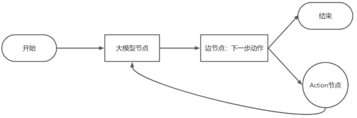
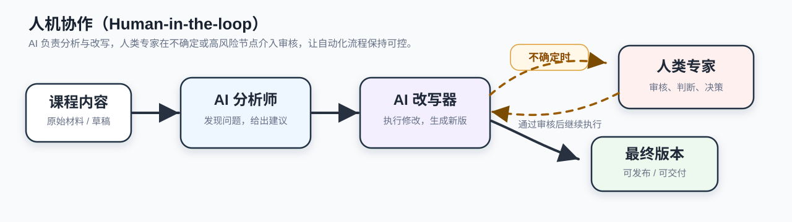
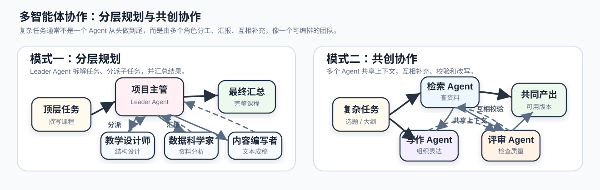
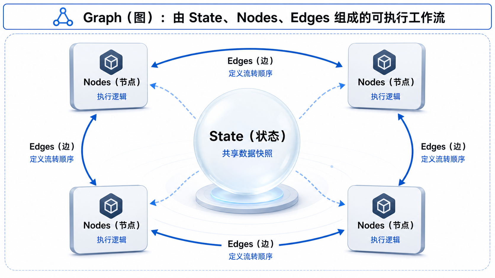
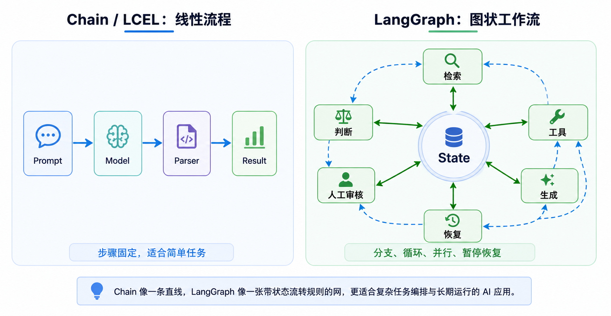
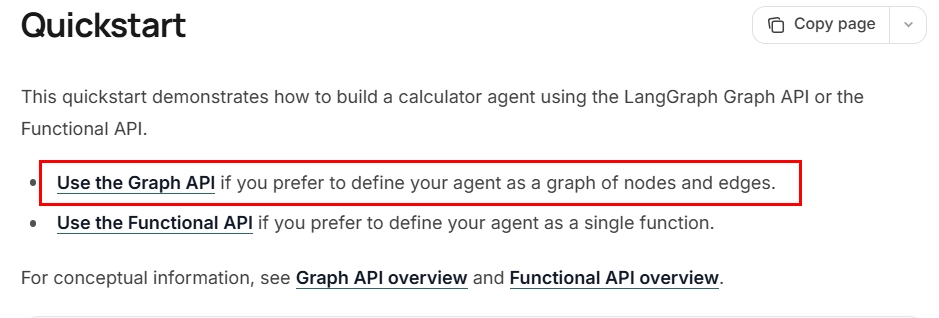
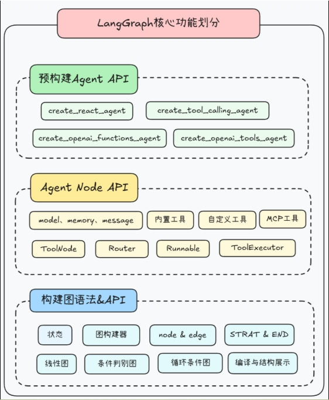
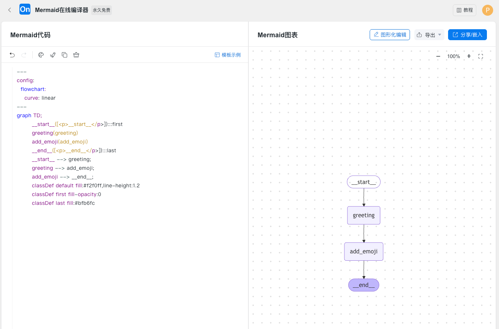

# 22 - LangGraph Overview and Quick Start

---

**Chapter learning objectives:**

- Understand **what LangGraph is** and why it is well-suited for orchestrating complex LLM workflows that are "stateful, branchable, loopable, pausable, and capable of human intervention."
- Clarify the relationships among **LangGraph, LangChain, Chain, Agent, and Workflow**, and know when to use LangChain directly versus when to use LangGraph.
- Master the four most important introductory concepts of LangGraph: **State, Nodes, Edges, and Graph**, and be able to work through the three introductory examples in this chapter by following the sequence "define state → write nodes → connect edges → compile → execute → visualize."

**Study suggestions:** In this chapter, first get your first LangGraph graph running; do not rush to memorize all the APIs. Start by grasping four words: State stores data, Nodes handle tasks, Edges decide the flow, and Graph orchestrates them together. State merging is covered in [Chapter 23](23-LangGraphAPI%EF%BC%9A%E5%9B%BE%E4%B8%8E%E7%8A%B6%E6%80%81.md), nodes and control flow in [Chapter 24](24-LangGraphAPI%EF%BC%9A%E8%8A%82%E7%82%B9%E3%80%81%E8%BE%B9%E4%B8%8E%E8%BF%9B%E9%98%B6.md), and advanced capabilities can be found in [Chapter 25](25-LangGraph%E9%AB%98%E7%BA%A7%E7%89%B9%E6%80%A7.md) and [Chapter 26](26-LangGraph%E5%A4%9A%E6%99%BA%E8%83%BD%E4%BD%93%E4%B8%8EA2A.md).

**Official documentation and resources**: see [Tool Navigation and Reference Index - LangGraph](%E5%B7%A5%E5%85%B7%E5%AF%BC%E8%88%AA%E4%B8%8E%E5%8F%82%E8%80%83%E8%B5%84%E6%96%99%E7%B4%A2%E5%BC%95.md#LangGraph).

---

## 1. Introduction to LangGraph

### 1.1 Definition

**LangGraph** is a **low-level graph orchestration framework and runtime** designed for scenarios involving **long-running processes, strong state requirements, branching, looping, and human intervention**.

You can remember it in one sentence: **LangGraph = using "graph + state" to organize and run LLM workflows / Agent processes.**

Let's break down the two key terms:

- **Graph**: This is not just about drawing a flowchart for people to look at; it means explicitly modeling "what each step does" and "where to go next" as an executable directed graph. Nodes perform actions, and edges determine the flow direction, so it naturally supports sequential execution, conditional branching, loop back, and parallel dispatch.
- **State**: This is not about scattering variables across a pile of functions; it means maintaining a "current workflow snapshot" that runs throughout the entire graph, such as historical messages, retrieval results, draft content, tool return values, current scores, and whether human review is needed. Nodes read this state, perform their work, and then return updates to be written back to the state.

Therefore, **LangGraph is not a new large model, nor is it a more mysterious Agent black box.** It solves the problem of process orchestration: when an AI application is no longer a straight line but requires judgment, retries, state preservation, and human review, how do you write the process in a way that is **controllable, maintainable, recoverable, and observable**.

From the perspective of **engineering implementation capabilities**, LangGraph is worth learning not only because it can "draw the process as a graph," but also because it incorporates the following common production issues into the core framework:

| Capability | What problem it solves | Introductory understanding |
| ---------------------- | -------------------------------------------------------- | --------------------------------------------------- |
| **Durable execution** | After a long-running task fails midway, you want to resume from a checkpoint instead of starting over | Makes the workflow "run longer and resume after interruption" |
| **Human-in-the-loop (HITL)** | Certain key nodes need human review, state modification, and confirmation before continuing | Allows a person to "take over and then return it" in the middle of the process |
| **Memory management** | Conversation history, intermediate conclusions, and cross-turn context need to be saved and reused | Makes State not just a temporary variable but a continuously maintained context carrier |
| **Streaming** | You want to see intermediate processes, token output, or custom progress events while executing | Users and developers do not have to "wait until the last moment" |
| **Production-grade deployment and observability** | You want to turn the graph into an operable, traceable, and debuggable online application | Not just a local demo, but closer to an online workflow runtime |

This chapter first builds an introductory understanding of "**graph + state + minimal execution approach**." The capabilities listed above such as persistence, streaming, and human intervention will be expanded upon in [Chapter 25](25-LangGraph%E9%AB%98%E7%BA%A7%E7%89%B9%E6%80%A7.md).

### 1.2 Why LangGraph is Needed

You can understand this from a real project scenario. Suppose you ask AI to write a "**Xiaomi SU7 Market Analysis Report**." The real process is often not "generate once and done" but more like the following:

1. First search the web for information
2. Write the first draft based on the information
3. Review the draft and find that "the data does not sufficiently support the conclusion"
4. Go back to the "search for information" step and gather more data
5. Rewrite or revise the draft
6. Then find that "the structure is a bit messy"
7. This time do not continue searching, but directly adjust the existing content structure
8. If the result is still not satisfactory, hand the draft to a human for review
9. Finally output the final draft

Note that this process already involves three types of "non-linear flow":

- **Conditional branching**: Should the next step be to continue searching, rewrite the draft, adjust the structure, or submit directly?
- **Loop back**: If the result is not good enough, should we go back to a previous step and run another round?
- **State-driven decisions**: The next step is not decided on a whim, but depends on the current draft, retrieval results, review conclusions, and other state.

This is no longer a process that a simple `prompt | model | parser` linear chain can naturally express.



If you only use **Chain / LCEL**, it is well suited for fixed-order linear pipelines, such as "summarize → translate → parse output." But once the process frequently involves "jumping to different branches based on current state," "going back to retry after failure," or "pausing midway to wait for human confirmation," you will easily end up writing a lot of `if / while` glue code, with business logic scattered across various functions, making it hard to maintain.

If you only use **Agent**, the model can indeed decide on its own which tool to call next, whether to continue thinking, and whether to search again, but this freedom also introduces another problem: **the execution path is not stable enough, and it is not easy for developers to precisely constrain what each step must do, nor is it easy to insert human review or state recovery at key nodes.**

This is exactly why LangGraph is worth learning: **it retains the expressive ability of "branching, looping, and dynamic decision-making" while making it easier to constrain the process, manage state, debug and trace, and support human-machine collaboration than a pure black-box Agent.**

The following two diagrams supplement the explanation from the perspectives of **human-in-the-loop collaboration** and **multi-agent collaboration**, respectively, showing why real AI systems often need the "controllable process orchestration" capability that LangGraph provides.





### 1.3 Related Concepts

LangGraph often appears together with LangChain, Chain, Agent, and Workflow.

| Concept | Introductory understanding | What problems it is better suited to solve |
| ---------------- | -------------------------------------------------------------------------------- | ------------------------------------------------------------ |
| **LangChain** | A component library for LLM application development, providing model integration, Prompt, Parser, Tools, Retriever, Agent, and other capabilities | Model integration, linear chains, RAG pipelines, quickly building Agents |
| **Chain / LCEL** | A chained composition style and chained process that connects multiple Runnables according to a fixed data flow | Linear, declarative processes like `Prompt → Model → Parser` |
| **Agent** | An application form in which the model dynamically decides the next action based on context | Task paths are not fully fixed, and the model needs to decide on its own whether to call tools or continue reasoning |
| **Workflow** | A workflow / fixed process where the overall steps are designed in advance by the developer, with conditional judgments only at some nodes | Clear process boundaries, requirements for stability and control, and a desire for easier reproduction and auditing |
| **LangGraph** | Uses "state + nodes + edges" to orchestrate a Workflow or Agent into an executable graph | Branching, looping, parallelism, persistence, human intervention, multi-agent scheduling |

There are three boundary points to remember:

- **LangGraph can be used together with LangChain, but it does not "require LangChain to be usable."** The official documentation explicitly states that LangGraph can be used independently; it is just that in actual projects, nodes in the graph often call LangChain models, tools, and prompts, so the two are frequently used together.
- **LangGraph is not a replacement for Chain, but rather an orchestration approach better suited to "non-linear control flow + state management."** If your task is inherently a fixed straight line, using LCEL is actually simpler; if the process begins to involve loops, branches, pauses, and recovery, it is more appropriate to switch to LangGraph.
- **LangChain v1's `create_agent` is built on top of the LangGraph runtime.** So LangGraph can be viewed as a "lower-level, more controllable orchestration layer for Agent / Workflow." If you just want to quickly build a standard tool-calling Agent, use `create_agent` first; if you want to break down each step, explicitly control state and edges, write LangGraph yourself.

### 1.4 Four Core Concepts

The most important part of getting started with LangGraph is not memorizing many APIs first, but thinking clearly about the boundaries of these four terms.

| Concept | Chinese explanation | Introductory understanding | What it usually corresponds to in code |
| --------- | -------- | -------------------------------- | ------------------------------------------------------ |
| **State** | State | What data the graph currently holds | `TypedDict` / `dict` / Pydantic schema |
| **Nodes** | Node | The functions that actually do the work at each step | Ordinary Python functions, async functions, or functions that internally call LLMs/tools |
| **Edges** | Edge | Where to go next after the current node finishes | `add_edge`, conditional edges, `START`, `END` |
| **Graph** | Graph | The complete workflow composed of state, nodes, and edges | `StateGraph(...)` builder; after `compile()`, you get an executable app |



Among these four concepts, the following points are most easily misunderstood:

- **A node does not necessarily have to be an LLM call.** A node is essentially a function; it can call an LLM, or it can simply perform arithmetic, query a database, call an API, or do format conversion.
- **An edge is not necessarily just a fixed sequence.** `A → B` is the simplest ordinary edge; Chapter 24 will cover more flexible control methods such as conditional edges, dynamic dispatch, and `Command`.
- **State updates are usually "nodes returning partial field updates," not manually assembling the full state each time.** For example, if a node only returns `{"greeting": "你好,z3"}`, the framework will merge it back into the global State according to the rules.
- **If a field should be "appended" rather than "overwritten," you need to consider using a Reducer.** This chapter will first build intuition through `add_messages`, and the complete Schema / Reducer mechanism will be systematically covered in [Chapter 23](23-LangGraphAPI%EF%BC%9A%E5%9B%BE%E4%B8%8E%E7%8A%B6%E6%80%81.md).

### 1.5 Use Cases

LangGraph is powerful, but not every task should start with it. In real projects, **if a problem can be stably solved with a simpler approach, don't force graph orchestration just to make it "look advanced."**

| Scenarios better suited for LangGraph                         | Scenarios better suited for LangChain / plain code / Coze / Dify first        |
| ------------------------------------------------- | ----------------------------------------------------------- |
| The workflow has obvious **conditional branches, loops, fallbacks, and parallelism**     | It's just a single model call, or a fixed `Prompt → Model → Parser` linear chain |
| Requires **long-running execution, checkpoint resumption, and recovery from the middle after failure**     | Just building a lightweight validation demo without needing state persistence                 |
| Requires **human-in-the-loop review**, where key nodes must pause and wait for manual confirmation | No human intervention needed, just automatically generating a piece of text                        |
| Requires **multi-agent collaboration** or orchestration of multiple sub-processes            | A single Agent or single workflow is already sufficient                                 |
| Requires stronger **observability, debuggability, and traceability**             | The project is still in the early rapid trial-and-error phase, and low-code platforms are faster                    |

You can think of the following diagram as the overall impression of this chapter: **A Chain is more like a straight line, while LangGraph is more like a network with state transition rules.**



---

## 2. HelloWorld Quick Start

### 2.1 Which API to Choose First

LangGraph officially now has two main ways of writing: **Graph API** and **Functional API**.

- **Graph API**: Explicitly writes the workflow as **State + Nodes + Edges + Graph**. The advantage is that the structure is clear, easy to diagram, and good for teaching. It also makes it easier to understand how state flows between nodes.
- **Functional API**: Organizes workflows using functional styles like `@entrypoint` / `@task`, which is closer to "orchestrating tasks within a single function." The advantage is that the cost of adapting existing Python code may be lower, but at the introductory stage, the workflow structure is not as intuitive as an explicit graph.

**Chapters 22–26 of this tutorial primarily adopt the Graph API.** First establish the explicit structure of "state, nodes, edges, and graph," and later it will be smoother to learn conditional edges, subgraphs, persistence, and multi-agent collaboration. The Functional API is not unimportant; it's just better suited as a supplementary way of writing once you understand the core ideas of LangGraph.



### 2.2 Technical Architecture

The following diagram can help you build a broader architectural sense. You can roughly think of LangGraph as having three layers:

- **Prebuilt Agent API**: More oriented toward "ready to use right away," suitable for quickly building standard Agents.
- **Agent Node API**: More oriented toward "building some intermediate-layer encapsulation around Agent nodes."
- **Graph-building syntax and API**: Lower-level, and more suitable for systematically learning core mechanisms such as State, Node, Edge, and Graph.



**In this chapter and subsequent Chapters 23–25, the main focus is on the bottom layer, "graph-building syntax and API."** Because only by first understanding this layer will you later know why LangGraph can do conditional jumps, state persistence, multi-branch parallelism, and human-in-the-loop interruption.

### 2.3 Minimal Graph Construction Process

Leaving aside complex capabilities for now, the minimal construction process of the LangGraph Graph API can be summarized in these 5 steps:

1. **Define State**: Specify which fields will flow through this graph.
2. **Define Nodes**: Write each step's logic as a function that receives the current `state` and returns the fields to update.
3. **Define Edges**: Use `add_edge` to connect nodes, and use `START` / `END` to specify the entry and exit points.
4. **Compile the Graph**: Call `compile()` to compile the graph builder into a truly runnable application object.
5. **Execute the Graph**: Call `invoke(initial_state)` with the initial state to get the final state result.

First use the following skeleton code to build intuition. The three cases that follow all gradually add content on top of these 5 steps:

```python
from typing import TypedDict
from langgraph.graph import StateGraph, START, END

class MyState(TypedDict):
    value: str

def node_a(state: MyState):
    return {"value": state["value"] + " A"}

def node_b(state: MyState):
    return {"value": state["value"] + " B"}

builder = StateGraph(MyState)
builder.add_node("node_a", node_a)
builder.add_node("node_b", node_b)
builder.add_edge(START, "node_a")
builder.add_edge("node_a", "node_b")
builder.add_edge("node_b", END)

app = builder.compile()
result = app.invoke({"value": "start"})
print(result)
```

Here's a small detail worth knowing in advance: the app obtained after `compile()` is the truly runnable graph application object. A graph must be compiled before it can be used; in addition to generating an executable object, the compilation step also performs some basic structural checks and reserves access points for later runtime capabilities such as persistence and interruption recovery. At the introductory stage, it's enough to understand it as "**first build the graph, then compile it, and only then run it.**"

In other words, LangGraph does not execute nodes line by line in the textual order of your code. You first write the business logic graph, then `compile()` hands it over to the runtime scheduler; the runtime decides which nodes to execute at each step based on nodes, edges, state channels, and configuration. We will continue to unpack this in Chapter 23 when discussing State and Reducer.

### 2.4 Graph Structure Visualization

A practical benefit of writing LangGraph is that it is much easier to visualize than "scattering the workflow across a pile of `if / while`." After compilation, you can view the graph structure through `app.get_graph()`. There are three common ways:

- **ASCII text diagram**: Suitable for quickly viewing the structure directly in the terminal.
- **Mermaid code**: Suitable for copying into [Mermaid Live Editor](https://mermaid.live/) or [ProcessOn Mermaid Editor](https://www.processon.com/mermaid) for viewing and further editing.
- **PNG image**: Suitable for exporting as documentation illustrations, but `draw_mermaid_png()` may depend on online rendering services or a local browser rendering environment and can occasionally be unstable.

Example code follows; the complete runnable version is in the later `LangGraphHello.py` (which already includes `import uuid`):

```python
import uuid

print(app.get_graph().print_ascii())
print("=" * 50)

print(app.get_graph().draw_mermaid())
print("=" * 50)

png_bytes = app.get_graph().draw_mermaid_png(max_retries=2, retry_delay=2.0)
output_path = "langgraph_" + str(uuid.uuid4())[:8] + ".png"
with open(output_path, "wb") as f:
    f.write(png_bytes)
print(f"图片已生成：{output_path}")
```

> **Note**: If PNG generation fails, prioritize keeping `draw_mermaid()` and copy the Mermaid code into an online editor to view the diagram. This issue is often not "the graph is written incorrectly," but rather instability in the rendering pipeline or network access.

### 2.5 Case 1: Minimal HelloWorld

The first case does not connect to an LLM and only does something very simple: **input a name, first generate a greeting, then append an emoji at the end.** Its focus is not the business logic, but helping you connect the four concepts of State, Node, Edge, and Graph for the first time.

**What to focus on in this case:**

- How `HelloState(TypedDict)` declares state fields.
- Why the two node functions `greet()` and `add_emoji()` "receive the current state and return a partial update dict."
- How the execution path `START → greeting → add_emoji → END` is connected through `add_edge`.
- Why after `compile()` you can call `app.invoke({"name": "z3"})`.
- Why `print_ascii()` and `draw_mermaid()` in the output contain `__start__` and `__end__`, which are LangGraph built-in virtual node names.

[Case source code] `案例与源码-3-LangGraph框架/01-helloworld/LangGraphHello.py`

[LangGraphHello.py](../../%E6%A1%88%E4%BE%8B%E4%B8%8E%E6%BA%90%E7%A0%81-3-LangGraph%E6%A1%86%E6%9E%B6/01-helloworld/LangGraphHello.py ":include :type=code")

**Explanation of the diagram below**: This is the effect after pasting the `draw_mermaid()` output into the Mermaid online editor. The left side is the Mermaid source code, and the right side is the rendered flowchart. You don't need to memorize all of Mermaid's syntax at the beginning; just being able to read the execution path `__start__ → greeting → add_emoji → __end__` is enough.



### 2.6 Case 2: Add Some Business Logic, but Still No LLM Yet

The second case replaces the "greeting" with a data flow more like business processing: **given the initial value `x`, first execute an addition node, then a subtraction node, and finally output the result.** It is still a very simple linear graph, but compared to Case 1, it is better suited for helping you understand "how state is passed and modified step by step between multiple nodes."

**What to focus on in this case:**

- Why here you can directly use `dict` as the State type instead of first defining `TypedDict`.
- Why both `addition(state)` and `subtraction(state)` only return `{"x": 新值}` instead of manually maintaining a global variable.
- Under the default state merging rule, the same-name field `x` will be **overwritten and updated** by the new value, which contrasts with the later "append update" of the `messages` field.
- `graph.nodes` and `graph.edges` can help you check "whether nodes are registered successfully and whether edges are connected correctly" before compilation.

[Case source code] `案例与源码-3-LangGraph框架/01-helloworld/LangGraphBiz.py`

[LangGraphBiz.py](../../%E6%A1%88%E4%BE%8B%E4%B8%8E%E6%BA%90%E7%A0%81-3-LangGraph%E6%A1%86%E6%9E%B6/01-helloworld/LangGraphBiz.py ":include :type=code")

### 2.7 Case 3: Connecting to an LLM

The third case begins to truly connect LangGraph with the LangChain model invocation learned earlier: **the user inputs a message → enters the model node → calls the chat model → writes the AI reply back into the messages field in the state.**

What is most worth focusing on in this case is:

```python
messages: Annotated[List, add_messages]
```

Its meaning is that the `messages` field is not simply overwritten but merged according to the "append message" rule. In a node, you only need to return "the one new AI reply from this round," and LangGraph will automatically append it to the end of the existing message list. For multi-turn conversations, Agent execution traces, and human corrections, this state update method is critical.

**What to focus on in this case:**

- Why `add_messages` is suitable for a conversation message list.
- The `init_chat_model(...)` section actually reuses the "three essentials of invocation" thinking from [Chapter 10](10-LangChain%E5%BF%AB%E9%80%9F%E4%B8%8A%E6%89%8B%E4%B8%8EHelloWorld.md): **model name, API Key, Base URL**.
- Why `model_node(state)` directly passes `state["messages"]` to the model and then returns `{"messages": [reply]}`.
- Why the final result reads the model's latest reply from `result["messages"][-1].content`.
- Although this graph has only one `model` node, it is already the minimal prototype for the later "multi-node conversation graph, tool-calling graph, and Agent graph."

[Case source code] `案例与源码-3-LangGraph框架/01-helloworld/LangGraphLLM.py`

[LangGraphLLM.py](../../%E6%A1%88%E4%BE%8B%E4%B8%8E%E6%BA%90%E7%A0%81-3-LangGraph%E6%A1%86%E6%9E%B6/01-helloworld/LangGraphLLM.py ":include :type=code")

### 2.8 Parallel Retrieval and Aggregated Answering

The previous three cases, for the sake of getting started, were all written as "a single route moving forward in sequence." In real projects, the more common value of LangGraph is expressing workflows such as **executing multiple branches in parallel and then aggregating them into a subsequent node**.

For example, an enterprise Q&A assistant, after receiving a user question, can simultaneously take two branches:

- One branch performs **knowledge base retrieval (RAG Search)** to obtain internal company materials;
- One branch performs **Web Search** to supplement real-time information;
- After both routes return results, they are handed over to the **final answer node** for fusion and summarization.

This structure becomes more intuitive when drawn as a graph:


```python
from typing import TypedDict

from langgraph.constants import START, END
from langgraph.graph import StateGraph


class QAState(TypedDict):
    query: str
    rag_result: str
    web_search_result: str
    final_answer: str


def rag_search_node(state: QAState):
    return {"rag_result": f"关于 {state['query']} 的知识库检索结果"}


def web_search_node(state: QAState):
    return {"web_search_result": f"关于 {state['query']} 的联网搜索结果"}


def final_answer_node(state: QAState):
    return {
        "final_answer": (
            f"基于知识库结果：{state['rag_result']}；"
            f"结合联网结果：{state['web_search_result']}；"
            "生成最终回答"
        )
    }


builder = StateGraph(state_schema=QAState)
builder.add_node("rag_search_node", rag_search_node)
builder.add_node("web_search_node", web_search_node)
builder.add_node("final_answer_node", final_answer_node)

builder.add_edge(START, "rag_search_node")
builder.add_edge(START, "web_search_node")
builder.add_edge("rag_search_node", "final_answer_node")
builder.add_edge("web_search_node", "final_answer_node")
builder.add_edge("final_answer_node", END)

graph = builder.compile()
result = graph.invoke({"query": "如何使用 LangGraph"})
print(result["final_answer"])
print(graph.get_graph().print_ascii())
```

This example does not require you to immediately implement a complete RAG system. Its purpose is to establish a kind of **project-level graph thinking**: LangGraph is not just about connecting several nodes in sequence; it is better suited to organizing multiple information sources, multiple processing branches, and a single final aggregation node into an executable workflow graph.

Here, branching from `START` to two nodes already involves parallel branches; when two upstream nodes converge on the same downstream node, state merging also becomes relevant. The next chapter on State / Reducer will specifically explain why these results can be safely written back into the same state.

---

**Chapter reflection questions:**

1. What kinds of processes are worth expressing with LangGraph rather than ordinary sequential function calls?

   **Reference thoughts:** When a process involves shared state, branching, loops, parallelism, pause/resume, or human intervention, LangGraph's graph structure becomes more valuable. Tasks that can be clearly expressed with ordinary linear scripts do not need to be forced into a graph.

2. If State, Node, and Edge are compared to a business process, what would each correspond to?

   **Reference thoughts:** State is the shared ticket or context in the process, Node is a processing step, and Edge is a routing rule. This analogy helps to understand that a graph is not merely something drawn for people to look at, but an executable process model.

3. What is the significance of `compile()`? Why is it not an optional step?

   **Reference thoughts:** It compiles the defined graph into a runnable object and performs necessary preparation and validation. Without compile, what came before merely describes the structure; you have not yet obtained an application that can be executed.

4. Choose a business process you are familiar with and break it down into at least 3 nodes and 1 conditional edge.

   **Reference thoughts:** For example, ticket processing: a classification node, a knowledge base retrieval node, a manual escalation node, and a reply generation node; the conditional edge decides whether to proceed with automatic replies or manual handling based on classification or confidence. The key is to clearly explain "how the flow goes."

**Chapter summary:**

- **LangGraph is a low-level graph orchestration framework and runtime**. Its core value lies in making stateful, branchable, loopable, and human-intervenable LLM processes more controllable to write.
- **LangChain and LangGraph work together**: LangChain excels at providing components and high-level wrappers such as models, Prompts, Tools, RAG, and Agents; LangGraph excels at process orchestration, state management, persistence, observability, and human-machine collaboration.
- **When getting started with the Graph API, first remember four words**: State, Nodes, Edges, Graph; then remember the five-step method: define state, write nodes, connect edges, compile, execute.
- **The three cases in this chapter build on each other**: `LangGraphHello.py` first helps you understand a minimal graph, `LangGraphBiz.py` helps you understand business state flow, and `LangGraphLLM.py` connects a chat model and `add_messages` into the graph.
- After completing this chapter, you should at least be able to do three things: summarize the core idea of LangGraph with "**graph + state**" rather than understanding it as "drawing out the process"; clearly explain the difference between the **Graph API** and the **Functional API**, and understand why this tutorial follows the Graph API as the main thread first; and remember the five minimal steps for putting LangGraph into practice: **define state → write nodes → connect edges → compile → execute**.

**Suggested next step:** First run these three scripts locally: `案例与源码-3-LangGraph框架/01-helloworld`. Then make two small modifications: add a multiplication node to `LangGraphBiz.py`; pass an additional round of historical messages to `LangGraphLLM.py` and observe how the `messages` list grows. After doing that, proceed to [Chapter 23 - LangGraph API: Graph and State](23-LangGraphAPI%EF%BC%9A%E5%9B%BE%E4%B8%8E%E7%8A%B6%E6%80%81.md) to systematically learn State Schema and Reducer.
