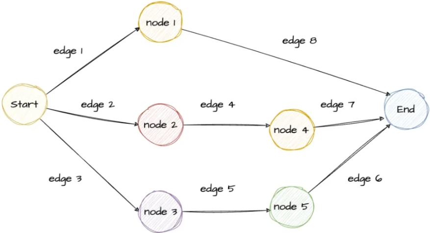
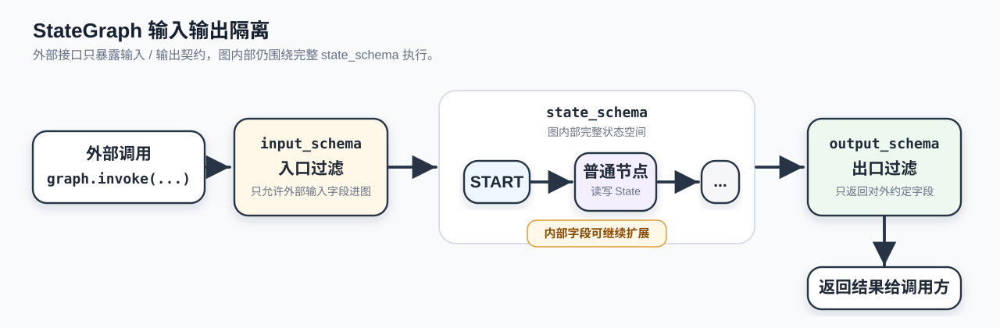
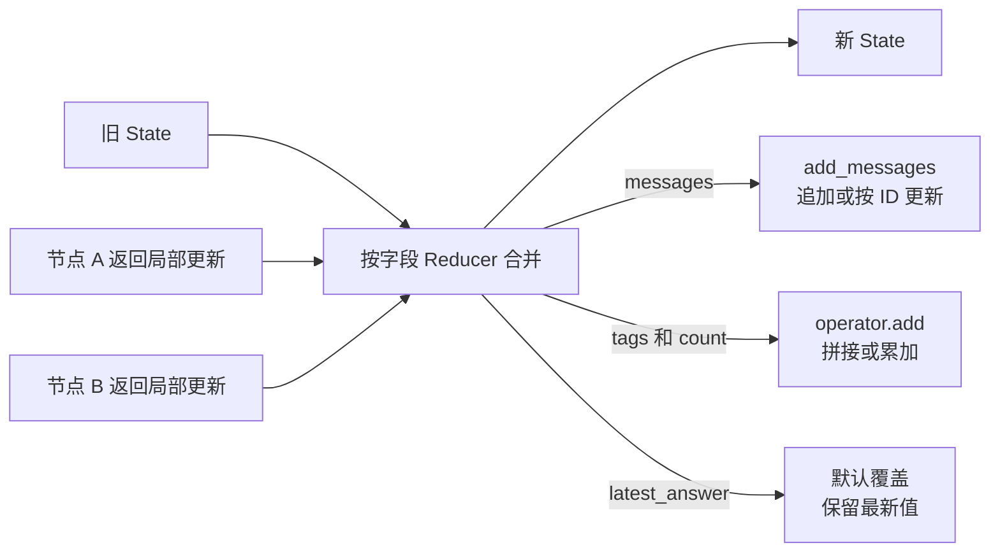
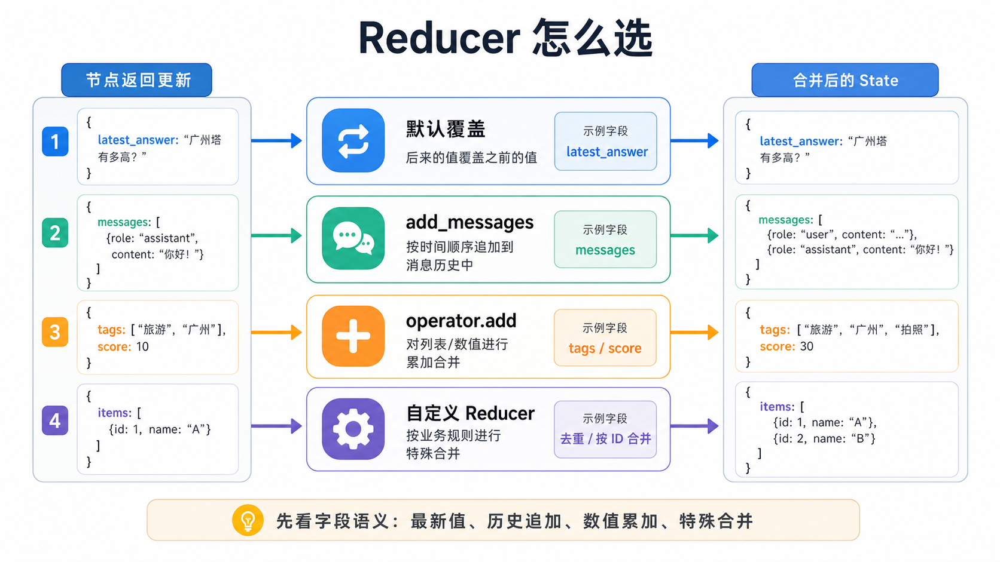
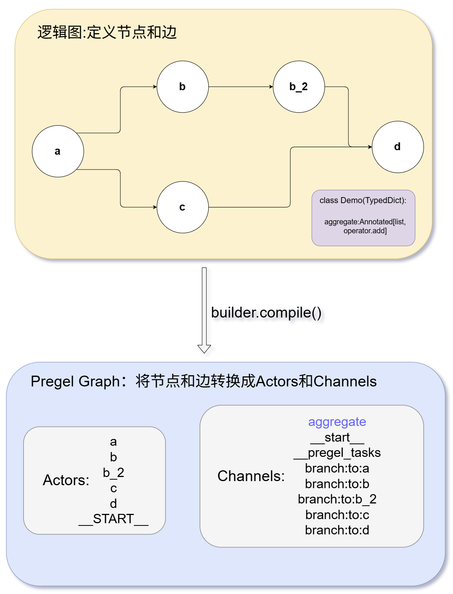
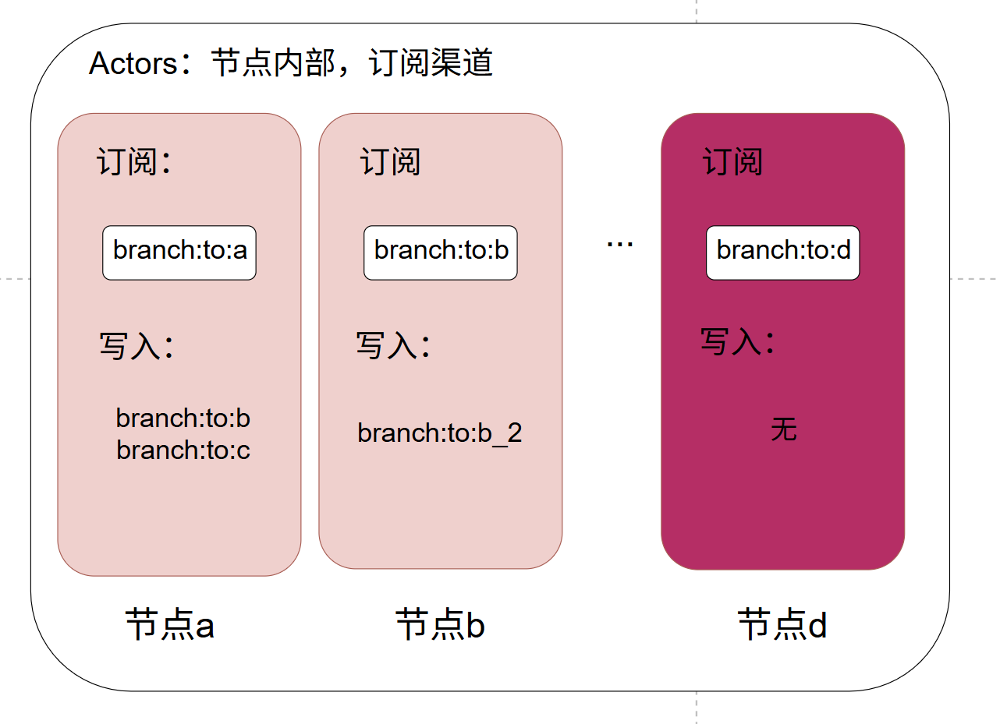
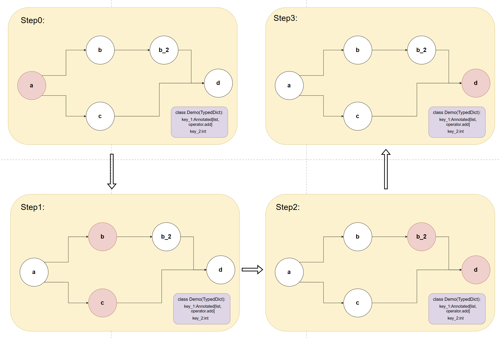

# 23 - LangGraph API: Graphs and State

---

**Chapter learning objectives:**

- Understand what a **Graph** in the Graph API actually is, and know what `StateGraph`, `START`, `END`, `compile()`, and `invoke()` are each responsible for.
- Understand the division of labor between **State** and **Reducer**, and why LangGraph does not rely on "manually passing a pile of parameters between functions," but instead drives workflows through "shared state + rule-based merge updates."
- Master **TypedDict / Pydantic / dataclass** State Schema definitions, the boundaries between **state_schema / input_schema / output_schema**, and common state merge approaches such as **default overwrite, `add_messages`, `operator.add`, `operator.mul`, and custom Reducer**.
- Be able to run and understand all the examples in this chapter, laying the foundation for the upcoming [Chapter 24: LangGraph API: Nodes, Edges, and Advanced Topics](24-LangGraphAPI%EF%BC%9A%E8%8A%82%E7%82%B9%E3%80%81%E8%BE%B9%E4%B8%8E%E8%BF%9B%E9%98%B6.md).

**Study advice:** The focus of this chapter is not "how to draw a graph," but how state is safely modified. When looking at each example, ask three questions: what did the node read from State, what partial updates did it return, and how did the Reducer finally merge them. Once this line is clear, `add_messages`, `operator.add`, and custom Reducer will no longer feel like a pile of isolated patterns.

**Official documentation and resources:** See [Tool Navigation and Reference Index - LangGraph](%E5%B7%A5%E5%85%B7%E5%AF%BC%E8%88%AA%E4%B8%8E%E5%8F%82%E8%80%83%E8%B5%84%E6%96%99%E7%B4%A2%E5%BC%95.md#LangGraph).

---

## 1. Graph API: The Graph

### 1.1 Definition

In LangGraph's **Graph API**, a **Graph** can be understood as: **an executable workflow structure diagram composed of nodes and directed edges**. Nodes are responsible for "what this stop does," edges are responsible for "where to go next after this stop finishes," and `START` and `END` represent the entry and exit points of the graph respectively.

The "graph" here is not just a flowchart drawn for people to look at; it is **a program structure that is actually compiled, run, and scheduled**. Once you define the state, nodes, and edges, and then call `compile()`, LangGraph compiles this graph builder into a truly runnable application object; after that, you can execute this graph using `invoke(...)`, `stream(...)`, and other methods.



This graph can be understood as follows:

- **Start** is the entry point, and **End** is the exit point.
- `node 1 ~ node 5` are different business steps, and the arrows indicate the execution direction.
- Multiple arrows emitting from Start mean the process can branch or run in parallel.
- Multiple paths eventually converging at End mean that different routes can converge into a unified exit.

When you later write `add_edge(START, "node_a")` and `add_edge("node_a", "node_b")`, you are essentially putting this "directed workflow structure" into code.

### 1.2 Why cover Graph separately

[Chapter 22](22-LangGraph%E6%A6%82%E8%BF%B0%E4%B8%8E%E5%BF%AB%E9%80%9F%E5%85%A5%E9%97%A8.md) already introduced the four core elements of LangGraph. We continue here with Graph to clearly explain "graph builders, state interfaces, and state merge rules." The previous chapter solved "getting it to run"; this chapter solves "why this design is more robust."

In real projects, the most common pitfalls at the Graph layer are often not "how to write node functions," but rather the following questions:

- How exactly are the graph's entry and exit points defined? Which nodes are merely internal steps, and which fields should be exposed to external callers?
- Which state is actually shared between nodes? After a node returns only a small update, does the framework overwrite the old value, append to a list, or perform custom merging?
- As the workflow becomes more complex, how do you keep the "control structure itself" clear, rather than scattering jump logic across a bunch of Python functions and `if/while`?

The main thread of this chapter can be summarized in one sentence: **Graph handles control structure, State handles data flow, and Schema and Reducer handle getting the State design right.**

### 1.3 The 5 steps to build a Graph

If we set aside advanced capabilities like conditional edges, `Send`, `Command`, and `Runtime` for now (these will be covered systematically in [Chapter 24](24-LangGraphAPI%EF%BC%9A%E8%8A%82%E7%82%B9%E3%80%81%E8%BE%B9%E4%B8%8E%E8%BF%9B%E9%98%B6.md)), the core process for building a basic `StateGraph` still comes down to these 5 steps:

1. **Define the State Schema**: First specify which state fields this graph will maintain internally.
2. **Create the `StateGraph` builder**: `builder = StateGraph(MyState)`.
3. **Register nodes and connect edges**: `add_node(...)`, `add_edge(...)`, and use `START` / `END` to explicitly define the entry and exit points.
4. **Compile the graph**: `graph = builder.compile()`, turning the builder into a runnable object.
5. **Execute the graph**: `graph.invoke(initial_state)`, passing in the initial state and receiving the final state.

One important note here: **node functions typically do not need to return the full State; they only need to return the fields that this node updates.** These partial updates are merged back into the global state according to Reducer rules. In other words: **Graph manages execution order, State manages shared data, and Schema and Reducer manage state structure and merge rules.**

After `compile()`, the graph is no longer just "a declaration of nodes and edges." At runtime, it progresses through rounds of steps: which nodes should execute in this round, and which updates can only take effect in the next round, are all scheduled by the runtime based on edges and state channels.

Therefore, when multiple edges diverge from the same node, the subsequent nodes are not necessarily simply queued one after another; when multiple nodes write back to the same State, they are not directly modifying global variables, but rather handing their respective updates to the Reducer for merging. This point runs through the rest of this chapter on State and Reducer.

### 1.4 Example: Building a complete fixed-path graph

This example uses three nodes `input → process → output` connected in a fixed path. The key point is not the business logic itself, but to make you clearly see: **how the same `process_data` is passed step by step along the nodes, and how it is updated by subsequent nodes.**

**What to focus on in this example:**

- How `StateGraph(GraphState)` binds "the internal state structure of this graph" to the graph builder.
- How patterns like `add_node("input", input_node)` and `add_edge(START, "input")` register functions as nodes and then connect the nodes together.
- Why `input_node`, `process_node`, and `output_node` are all "functions that receive the current state and return a partial update dict."
- Why the final `process_data` only retains `{"process": "process_value9527"}`, rather than automatically merging the initial input and everything written by earlier nodes. The answer lies in the later section on **default Reducer = overwrite update**.

[Example source code] `案例与源码-3-LangGraph框架/02-graph/BuildWholeGraphSummary.py`

[BuildWholeGraphSummary.py](../../%E6%A1%88%E4%BE%8B%E4%B8%8E%E6%BA%90%E7%A0%81-3-LangGraph%E6%A1%86%E6%9E%B6/02-graph/BuildWholeGraphSummary.py ":include :type=code")

### 1.5 Several questions when designing a Graph

The graphs in this chapter's examples are all very small. Once a real project becomes complex, you cannot just "add things as you think of them." Before writing a graph, think through a few questions:

- **Which steps should be split into independent nodes?** If a piece of logic needs to be debugged, reused, or timed separately, it is usually suitable to split into a node; if it is just a very small local computation, it does not necessarily have to be forcibly split.
- **Which flows should be fixed edges, and which should be handled by conditional edges?** For example, "retrieve first, then summarize" can usually be a fixed edge, while "re-query if the retrieval results are insufficient, otherwise proceed to answer generation" is better suited to a conditional edge.
- **Which data should go into State, and which are just temporary variables inside a node?** Data that needs to be passed across nodes, needs to be persisted and restored, or needs to be used by subsequent nodes should go into State; temporary calculation results that are only used within the current function do not all need to be stuffed into State.
- **Should the input/output interfaces exposed to the outside be separated from the complete internal state?** If this graph will be called by other services in the future, you usually do not want external callers to see all internal fields directly, which is where `input_schema` and `output_schema` come into consideration.

These questions naturally lead to Part 2: **how exactly State is defined, and how updates are merged.**

---

## 2. Graph API: State

### 2.1 Definition

In LangGraph, **State** is a **shared data snapshot** that runs through the entire graph execution process. Each node receives the current State, executes its own logic, and then returns a "state update"; LangGraph then merges this update back into the global State according to the **Reducer** corresponding to each field.

At the entry level, keep this sentence in mind:

**State = Schema + Reducer**

- **Schema** is responsible for defining "which fields exist in the state and what type each field is"; in the context of this chapter, it mainly refers to the **State Schema**.
- **Reducer** is responsible for defining "how a new value returned by a node for this field should be merged with the old state."

Without unified State, it is easy to fall back into the pattern of "manually grabbing a pile of return values from function A and then assembling them yourself for function B," which becomes chaotic as the workflow becomes complex. LangGraph places State at the center, effectively establishing a **Single Source of Truth** for you: all nodes read from and write to the same state, rather than each maintaining its own private data that easily conflicts.

The rest of this part can be learned in two layers:

- First look at **State Schema**: which fields exist in the state and what their types are;
- Then look at **Reducer**: after nodes return field updates, how those updates are finally merged back into State.

### 2.2 Example: Minimal State

This example deliberately avoids writing any business nodes and only connects a single `START → END` edge, to verify one thing: what is passed into `invoke(initial_state)` is the initial value of the State, and if no node updates it in between, it will ultimately be returned unchanged.

This example is well suited for establishing two basic intuitions first:

- `TypedDict` is not business logic; it is a declaration of "what this graph's state looks like."
- The core input of `invoke()` is an entire state dictionary, not a pile of positional arguments for each field.

[Example source code] `案例与源码-3-LangGraph框架/03-state/DefState.py`

[DefState.py](../../%E6%A1%88%E4%BE%8B%E4%B8%8E%E6%BA%90%E7%A0%81-3-LangGraph%E6%A1%86%E6%9E%B6/03-state/DefState.py ":include :type=code")

### 2.3 How to choose a State Schema

According to the official LangGraph Graph API documentation, common State Schema options include **TypedDict**, **Pydantic BaseModel**, and **dataclass**. The main examples in this repository primarily use `TypedDict` because it is lightweight, direct, and closest to the idea that "state is a dict snapshot."

| State Schema style      | Entry-level understanding                         | Advantages                                             | More suitable scenarios                                     |
| ---------------------- | -------------------------------- | ------------------------------------------------ | ------------------------------------------------ |
| **TypedDict**          | A dict structure with type annotations             | Lightweight, simple to write, low performance overhead, well suited for teaching and workflow state | Most starting scenarios for LangGraph state modeling                |
| **Pydantic BaseModel** | A data model with runtime validation and field constraints | Stronger data validation, defaults, nested models, field documentation   | Stricter external interfaces, more complex data structures, wanting failures to surface early |
| **dataclass**          | Python data class                    | Suitable for scenarios where defaults are needed and fields feel more like object properties     | Needs defaults but does not want to introduce Pydantic validation overhead         |

**How to choose in a way that aligns with real projects?**

- If you are still designing the main workflow, prefer **TypedDict** because it is the lightest option and quick to change.
- If this graph is already going to be exposed as a stable service and the input and output fields require strict validation, consider making the boundary layer use **Pydantic**.
- If you only want to add default values to State fields, **dataclass** is also worth considering.
- Do not turn all internal state into complex nested models right from the start just to make it "look more engineered." What LangGraph state fears most is not that it is "not advanced enough," but rather "too many fields, unclear boundaries, and no way to tell who is changing what."

### 2.4 Three Schemas

Many people feel a little confused the first time they see `StateGraph(OverallState, input_schema=InputState, output_schema=OutputState)`: since we already have `OverallState`, why do we also need to write `input_schema` and `output_schema` separately?

The reason is: **the complete state actually maintained inside the graph is not necessarily the same thing as the input and output interfaces exposed to the outside.**

| Name              | Purpose                                          | Intuitive way to understand it                                         |
| ----------------- | --------------------------------------------- | ---------------------------------------------------- |
| **state_schema**  | Defines the complete internal state space of the graph; nodes usually read from and write to it    | "What data exists on the graph's complete internal workbench"                       |
| **input_schema**  | Limits which fields callers are allowed to pass when calling `invoke(...)` | "What materials external users may bring when entering the door"                       |
| **output_schema** | Limits which fields are ultimately returned to the outside after the graph finishes executing          | "Which results are finally handed to the caller, without exposing all the internal drafts" |



These three layers can be understood along the execution chain:

- When an external caller invokes `graph.invoke(input_data)`, it first passes through the `input_schema` constraint, so the caller cannot arbitrarily stuff internal fields into it.
- Inside the graph, from `START` to ordinary nodes and then to `END`, nodes actually work around the complete `state_schema`.
- After the graph finishes executing, it passes through `output_schema` filtering, and only the fields allowed by the external contract are handed to the caller.

`input_schema` and `output_schema` are not meant to make you "write a few more copies of the types," but to separate the **service boundary** from the **internal workbench**. This way, even if the graph later adds fields such as `retrieved_docs`, `route_reason`, and `retry_count` internally, they will not necessarily affect the external API.

The terminology relationship can be remembered as a single line:

- **Schema** is the general term, meaning "the way a data structure is defined"
- **State Schema** is the most central Schema in this chapter, specifically describing the graph's internal state
- `state_schema`, `input_schema`, and `output_schema` are the specific parameter names at the code level

If `input_schema` and `output_schema` are not explicitly specified, they are usually the same as `state_schema` by default; but once this graph is going to become an external service interface, **separating "internal state" from "external contract" is more stable than exposing the entire State directly.**

`state_schema` defines the graph's complete state space, but that does not mean every node must read and write all fields. In real projects, the retrieval node may only care about `query`, the summarization node mainly reads `rag_result` / `web_search_result`, and the review node only handles `draft` and `review_result`. At runtime, the current complete state is handed to the node, but the node implementation should only depend on the fields it actually needs; if necessary, you can also use a smaller `TypedDict` for type annotation to make the dependencies clearer.

### 2.5 Case Study: Input/Output Isolation

This case corresponds to the input/output isolation in 2.4: **the caller only needs to pass `question` and ultimately only receives `answer`; whether the graph still retains other fields internally is an internal implementation detail and does not necessarily need to be exposed.**

**What to focus on in this case:**

- How the three schemas `InputState`, `OutputState`, and `OverallState` are layered.
- What exactly this line of code `StateGraph(OverallState, input_schema=InputState, output_schema=OutputState)` is declaring.
- Why `answer_node(state)` only depends on `question`, but when returning it can also return `{"answer": ..., "question": ...}`; the final external result still contains only `{"answer": ...}`, because it is filtered by `output_schema` before leaving the graph.
- This approach is very suitable for the "**lots of internal state, but the service API only wants to expose a few fields**" scenario in real projects.

[Case source code] `案例与源码-3-LangGraph框架/03-state/schema/StateSchema.py`

[StateSchema.py](../../%E6%A1%88%E4%BE%8B%E4%B8%8E%E6%BA%90%E7%A0%81-3-LangGraph%E6%A1%86%E6%9E%B6/03-state/schema/StateSchema.py ":include :type=code")

After learning `State Schema` and `input_schema / output_schema`, the "what the State fields look like" half becomes much clearer. The other half to fill in next is: **how fields are actually merged when they are updated.** That is exactly what the Reducer is responsible for.

---

## 3. Reducer (State Merging)

The Reducer still belongs to State design, but it is so critical that it deserves separate discussion. The relationship before and after can be viewed like this:

- `Graph` is responsible for describing the process structure
- `State` is responsible for describing shared data
- `Schema` is responsible for describing which fields exist in the State
- `Reducer` is responsible for describing how those fields are merged when updated

It can also be remembered in a smoother sentence: **Schema determines what the fields look like, and Reducer determines how the fields are merged when updated.**

### 3.1 Definition

As mentioned earlier, nodes generally only return "partial state updates," so how exactly are those updates merged with the old state? The answer is the **Reducer**.

For a given State field, the Reducer can be viewed as a function of "**old value + new update -> merged new value**." Different fields can have different Reducers; if a field does not have an explicitly specified Reducer, LangGraph treats it as **overwrite updating** by default, meaning the new value returned by the node directly replaces the field's original old value.

In `TypedDict`, the common way to specify a Reducer is `Annotated[字段类型, reducer函数]`, for example:

```python
import operator
from typing import Annotated
from typing_extensions import TypedDict
from langgraph.graph.message import add_messages


class MyState(TypedDict):
    messages: Annotated[list, add_messages]
    tags: Annotated[list[str], operator.add]
    count: Annotated[int, operator.add]
    latest_answer: str
```



Looking at it field by field:

- `messages` uses `add_messages` for merging, which suits scenarios like chat history where "new messages are appended to a list."
- `tags` and `count` use `operator.add`, representing list concatenation and numeric accumulation respectively.
- `latest_answer` does not have a Reducer written, so it defaults to overwriting; the newly written answer replaces the old answer.

### 3.2 Case One: Default Overwrite Update

If a field does not have `Annotated[..., reducer]` written, the default behavior is **overwrite update**. This behavior itself is fine and suits scenarios where "this field only ever cares about the latest value," such as `current_step`, `latest_answer`, and `final_summary`.

In this case, `node1` first changes `foo` to `22`, and then `node2` changes `bar` to a new list. Because neither `foo` nor `bar` declares a special Reducer, both are updated according to the default overwrite rule.

[Case source code] `案例与源码-3-LangGraph框架/03-state/reducers/StateReducer_Default.py`

[StateReducer_Default.py](../../%E6%A1%88%E4%BE%8B%E4%B8%8E%E6%BA%90%E7%A0%81-3-LangGraph%E6%A1%86%E6%9E%B6/03-state/reducers/StateReducer_Default.py ":include :type=code")

### 3.3 Case Two: add_messages Appending Message Lists

If you store conversation history in the `messages` field, you usually do not want each node's returned new message to overwrite the entire history; instead, you want to **append the new messages to the end of the old messages**. In this case, `add_messages` is appropriate.

Compared with the ordinary `operator.add`, `add_messages` is better suited to chat message scenarios because it not only appends new messages, but can also update existing messages based on **message id**, and it deserializes the message data in the input into LangChain's `Message` objects. The official `add_messages` documentation also clearly states that it merges two groups of messages: if the message IDs are the same, it updates the old messages; if it is a new message, it appends it to the end of the list.

[Case source code] `案例与源码-3-LangGraph框架/03-state/reducers/StateReducer_AddMessages.py`

[StateReducer_AddMessages.py](../../%E6%A1%88%E4%BE%8B%E4%B8%8E%E6%BA%90%E7%A0%81-3-LangGraph%E6%A1%86%E6%9E%B6/03-state/reducers/StateReducer_AddMessages.py ":include :type=code")

One more detail in this case is worth noting: when calling `graph.invoke(...)`, `messages` can accept either objects like `HumanMessage(...)` or dictionary formats like `{"role": "...", "content": "..."}`; if `add_messages` is used on the State, the runtime will try to convert them into LangChain Message objects. Therefore, when reading the text content in a node, you should usually use `state["messages"][-1].content` instead of treating the last message as an ordinary string.

### 3.4 Case Three: operator.add Used on Lists, Strings, and Numbers

`operator.add` is a very common built-in merging strategy, but its semantics differ across data types:

- For **lists**, it is list concatenation, similar in effect to `current + update`.
- For **strings**, it is string concatenation.
- For **numbers**, it is numeric addition.

This means `operator.add` is well suited to the following business scenarios:

- Multiple nodes each produce a batch of tags, document fragments, or candidate results, which are finally merged into one list.
- Multiple nodes generate copy fragments in sequence, which are finally assembled into complete text.
- Multiple nodes separately contribute scores, counts, or cost increments, which are finally accumulated into a total value.

**List appending case:**

[Case source code] `案例与源码-3-LangGraph框架/03-state/reducers/StateReducer_OperatorAdd.py`

[StateReducer_OperatorAdd.py](../../%E6%A1%88%E4%BE%8B%E4%B8%8E%E6%BA%90%E7%A0%81-3-LangGraph%E6%A1%86%E6%9E%B6/03-state/reducers/StateReducer_OperatorAdd.py ":include :type=code")

**String concatenation case:**

[Case source code] `案例与源码-3-LangGraph框架/03-state/reducers/StateReducer_OperatorAdd2.py`

[StateReducer_OperatorAdd2.py](../../%E6%A1%88%E4%BE%8B%E4%B8%8E%E6%BA%90%E7%A0%81-3-LangGraph%E6%A1%86%E6%9E%B6/03-state/reducers/StateReducer_OperatorAdd2.py ":include :type=code")

**Numeric accumulation case:**

[Case source code] `案例与源码-3-LangGraph框架/03-state/reducers/StateReducer_OperatorAdd3.py`

[StateReducer_OperatorAdd3.py](../../%E6%A1%88%E4%BE%8B%E4%B8%8E%E6%BA%90%E7%A0%81-3-LangGraph%E6%A1%86%E6%9E%B6/03-state/reducers/StateReducer_OperatorAdd3.py ":include :type=code")

### 3.5 Case Four: operator.mul Boundary

In this case, do not only look at "whether the code runs"; focus on understanding **why the result becomes 0.0**. For fields with a Reducer, LangGraph goes through the reduction process of "old value + new value" when merging updates; when the field type is `float` and `operator.mul` is used for multiplicative reduction, if the initial old value is `0.0`, the first merge becomes `0.0 * update = 0.0`, and no matter what is multiplied afterward, it remains 0.0.

So what this case really wants to show is not that "`operator.mul` can never be used," but rather: **for reduction logic that is sensitive to identity elements, such as multiplication, you cannot only look at the reducer function itself; you must also handle the initial value and the first merge boundary properly.** In real projects, if such boundaries are difficult to express directly with built-in functions, you should write a custom Reducer.

[Case source code] `案例与源码-3-LangGraph框架/03-state/reducers/StateReducer_OperatorMul.py`

[StateReducer_OperatorMul.py](../../%E6%A1%88%E4%BE%8B%E4%B8%8E%E6%BA%90%E7%A0%81-3-LangGraph%E6%A1%86%E6%9E%B6/03-state/reducers/StateReducer_OperatorMul.py ":include :type=code")

### 3.6 Case Five: Custom Reducer

When the ready-made strategies such as default overwriting, `add_messages`, and `operator.add` are not enough, you can write a custom Reducer. The core of a custom Reducer is not "how complex the implementation is," but remembering this signature:

```python
def my_reducer(current_value, update_value):
    return merged_value
```

换句话说，**Reducer 拿到的是当前旧值和本次节点更新值，返回的是合并后的新值。**

这个案例用 `MyOperatorMul(current, update)` 专门处理乘法第一次规约时 `current == 0.0` 的问题：如果判断这是第一次合并，就把它当作从乘法单位元 `1.0` 开始；否则正常做 `current * update`。

【案例源码】`案例与源码-3-LangGraph框架/03-state/reducers/StateReducer_Custom.py`

[StateReducer_Custom.py](../../%E6%A1%88%E4%BE%8B%E4%B8%8E%E6%BA%90%E7%A0%81-3-LangGraph%E6%A1%86%E6%9E%B6/03-state/reducers/StateReducer_Custom.py ":include :type=code")

### 3.7 案例六：字段级合并策略

真实业务里的状态通常不会只有一个字段。更常见的情况是：**聊天消息要追加，标签列表要拼接，评分要累加，最新结论要覆盖。** 这就意味着同一个 State 里，不同字段本来就应该有不同 Reducer。

这个案例把三种策略放在了一起：

- `messages: Annotated[List, add_messages]`：对话消息追加合并。
- `tags: Annotated[List[str], operator.add]`：标签列表拼接。
- `score: Annotated[float, operator.add]`：数值分数累加。

同时它还演示了一种常见结构：**从 `START` 同时连到多个节点，让多个分支分别产出不同状态更新，最后由各字段自己的 Reducer 负责合并。** 这是后面学习并行分支和复杂 Agent 图的基础。

【案例源码】`案例与源码-3-LangGraph框架/03-state/reducers/StateReducersMyChatBot.py`

[StateReducersMyChatBot.py](../../%E6%A1%88%E4%BE%8B%E4%B8%8E%E6%BA%90%E7%A0%81-3-LangGraph%E6%A1%86%E6%9E%B6/03-state/reducers/StateReducersMyChatBot.py ":include :type=code")

### 3.8 Reducer 选型

学完这些案例后，不要只背 Reducer 名字。真实项目里更重要的是：先看字段语义，再选合并方式。



| 业务字段类型                                         | 更适合的 Reducer                      | 典型例子                                             |
| ---------------------------------------------------- | ------------------------------------- | ---------------------------------------------------- |
| 只关心最新结果                                       | 默认覆盖                              | `latest_answer`、`current_route`、`final_summary`    |
| 聊天消息历史                                         | `add_messages`                        | `messages`、Agent 轨迹、人工修正后的消息状态         |
| 候选列表 / 标签列表 / 文档片段列表                   | `operator.add` 或自定义去重版 Reducer | `retrieved_docs`、`tags`、`candidate_items`          |
| 计数 / 分数 / token 成本累计                         | `operator.add`                        | `retry_count`、`total_score`、`token_cost`           |
| 乘积、最大值、去重合并、按时间戳保留最新值等特殊逻辑 | 自定义 Reducer                        | 风险分数聚合、按 ID 合并对象列表、保留优先级最高结果 |

实践时重点看这几条：

- **不要把所有字段都默认覆盖，也不要把所有列表都直接套 `operator.add`。** 先问清楚这个字段的业务语义：是“最新值”，还是“历史累积”，还是“需要按 ID 合并”。
- **消息历史优先考虑 `add_messages`，而不是普通列表相加。** 因为聊天消息往往涉及消息对象格式转换、按 ID 更新旧消息、人机介入修正等问题。
- **自定义 Reducer 里要处理好首次合并、空值、重复值、顺序稳定性这些边界。** 很多状态 bug 不是节点逻辑错了，而是 Reducer 合并规则没设计清楚。
- **并行分支写同一个字符串字段时，要谨慎使用 `operator.add`。** 字符串拼接依赖写入顺序，多个并行节点同时写入时可读性和稳定性都不如“先收集列表，再由汇总节点统一排序和拼接”。对候选文档、标签、片段这类结果，优先用列表字段承接。
- **State 字段不要无限膨胀。** 如果一个字段只是临时中间变量，而且后续节点根本不再用，不一定非要长期留在全局 State 里；否则图运行久了，状态会越来越难读。

State 也不只是“一次 `invoke()` 里的临时变量”。后面学习 `checkpointer`、`thread_id`、状态历史、故障恢复时，你会看到 State 还承担着“可持久化工作流上下文”的角色：

- 同一个 `thread_id` 下，多次调用可以继续沿用同一份状态上下文；
- 图执行中途报错时，只要状态已经被持久化，就有机会从上一次检查点恢复；
- `get_state()` / `get_state_history()` 这类能力，也都是围绕 State 快照展开的。

这一层在本章先建立概念即可。现在只要把 State 看成两件事的交汇点：它既是图运行时的共享数据结构，也是后续持久化、短期记忆和故障恢复的基础。

---

## 4、图在运行时如何推进

前面已经把 Graph、State、Reducer 讲完了。现在回到一个更工程化的问题：你写下来的逻辑图，运行时到底怎么跑？

LangGraph 底层采用的是 Pregel 风格的图计算思路。这里只要建立三个直觉：多个节点可以在同一轮被调度；节点返回的是更新，不是直接修改全局变量；有了检查点之后，状态历史可以被恢复和回放。

### 4.1 为什么要理解运行时

如果只看 `add_node()` 和 `add_edge()`，很容易以为 LangGraph 只是按箭头顺序挨个调函数。实际执行更接近下面这套模型：

- 每个节点会被转换成运行时里的 **Actor**。
- State 字段和边的触发关系会被组织成不同 **Channel**。
- 图按一个个 **Superstep** 往前推进。
- 每个 Superstep 里，运行时先决定哪些 Actor 该执行，再并行执行这些 Actor，最后统一合并它们写出的更新。

这解释了一个关键问题：**LangGraph 的状态更新不是节点函数原地改全局变量，而是节点返回更新，运行时按通道和 Reducer 统一合并。** 所以并行分支、动态分发和多智能体场景里，Reducer 设计很重要。

### 4.2 从逻辑图到 Pregel 运行时

你在代码里定义节点和边，调用 `builder.compile()` 后，运行时会把它转换成 Pregel 图。节点变成 Actors，状态字段、入口、分支触发关系等变成 Channels。



可以把它理解成：

- **逻辑图** 是你写给开发者看的：`a -> b -> b_2 -> d`、`a -> c -> d`。
- **Pregel 图** 是运行时真正调度用的：哪些 Actor 订阅哪些 Channel，执行后又写入哪些 Channel。

换句话说，`compile()` 不是形式主义。它会把你声明式写出的图结构，变成一套可执行、可检查、可流式观察、可持久化的运行时结构。

### 4.3 Actor 和 Channel 怎么配合

在 Pregel 视角下，一个节点不是孤立函数，而是一个订阅某些 Channel、执行后写入某些 Channel 的 Actor。



这张图可以这样读：

- 节点 `a` 订阅 `branch:to:a`，被触发后写入 `branch:to:b` 和 `branch:to:c`。
- 节点 `b` 订阅 `branch:to:b`，执行后写入 `branch:to:b_2`。
- 节点 `d` 订阅 `branch:to:d`，执行后不再写入新的分支通道，流程就自然走向结束。

所以边的本质可以进一步理解成：**它不是简单画一条线，而是在告诉运行时“哪个节点执行完后，要向哪个节点对应的触发通道写入信号”。**

### 4.4 Superstep：图是按步骤推进的

Pregel 模型里还有一个很关键的词：**Superstep**。你可以先把它理解成“一轮图调度”。每一轮通常可以拆成三步：

1. **Plan**：根据上一轮 Channel 的更新，决定这一轮哪些 Actor 要执行。
2. **Execute**：并行执行这些 Actor。只要在同一轮被选中，它们就不是简单串行排队。
3. **Update**：把这些 Actor 写出的更新统一合并回 Channels 和 State。



用上图里的结构来理解：

- `Step0`：节点 `a` 被触发，写入去往 `b` 和 `c` 的通道。
- `Step1`：节点 `b` 和 `c` 都被触发，可以在同一个 superstep 里执行。
- `Step2`：`b_2` 和 `d` 被触发，其中 `c` 的结果已经可以进入 `d`。
- `Step3`：`d` 再次接收到来自 `b_2` 分支的更新，执行后没有新的下游任务，图结束。

这也解释了为什么你在设计并行分支时要特别关心 Reducer：**多个 Actor 在同一步或相邻步骤里写同一个字段时，最终状态能不能稳定、正确地合并，取决于这个字段的 Reducer。**

### 4.5 StateSnapshot

配置 Checkpointer 后，LangGraph 不只是保存最后结果，还会保存执行过程中的状态快照。官方 API 里常见的两个方法是：

- `graph.get_state(config)`：获取某个 `thread_id` 下最近一次状态快照。
- `graph.get_state_history(config)`：获取某个 `thread_id` 下的历史状态快照序列。

这些快照通常可以理解成 **StateSnapshot**，里面最值得关注的不是只有 `values`，还包括：

| 字段            | 入门理解                                                        |
| --------------- | --------------------------------------------------------------- |
| `values`        | 当前状态值，也就是这一刻 State 里保存了什么                     |
| `next`          | 下一步准备执行哪些节点                                          |
| `config`        | 这份快照对应的运行配置，通常包含 `thread_id` 和 checkpoint 信息 |
| `metadata`      | 与快照相关的来源、步骤等元数据                                  |
| `parent_config` | 父快照配置，用来串起历史链路                                    |
| `interrupts`    | 当前未解决的中断信息，常见于人机协作场景                        |

`next` 这个字段尤其关键：它告诉你“如果从这份快照继续跑，下一步会去哪里”。这就是状态历史对断点恢复、时间回溯和人工介入有价值的原因。它不是普通日志，而是一份可以被运行时继续使用的执行现场。

---

**章节思考题：**

1. Why isn't State just a dictionary for casually stored variables?

   **Reference approach:** State is the data contract for the entire graph, determining what nodes can read and write, how parallel results are merged, and how the graph can later be recovered and debugged. Arbitrarily adding fields makes the graph increasingly difficult to maintain.

2. When designing State fields, how do you distinguish between inputs, process state, and outputs?

   **Reference approach:** Input fields receive external requests, process fields store intermediate classifications, retrieval results, and tool returns, while output fields expose final results to the outside world. Mixing the three together couples the interface and internal implementation tightly.

3. What subtle bugs can arise from choosing the wrong Reducer?

   **Reference approach:** When something that should be appended gets overwritten, history is lost; when something that should be overwritten gets appended, state balloons; if parallel results are not merged according to business semantics, the final state may become order-unstable, duplicated, or conflicting. A Reducer is a business rule, not just syntax.

4. When should a field remain in internal State rather than be placed in input_schema or output_schema?

   **Reference approach:** Fields that only serve internal node flow, debugging, or intermediate computation stay in internal State; only what external callers must provide goes into input, and only what external parties actually need to consume goes into output. The more restrained the interface, the easier the graph is to evolve.

5. Why does understanding Superstep help with designing Reducers?

   **Reference approach:** Because multiple nodes may write to the same field in the same round or adjacent rounds, the final state is not manually assembled by any single node but is uniformly merged by the runtime. If the Reducer is designed incorrectly, more parallel branches make the state more prone to overwriting, duplication, or order instability.

**Chapter Summary:**

- **Graph** is an executable directed workflow structure. `StateGraph` is responsible for building the graph, `START` / `END` define the entry and exit points, `compile()` turns the builder into a runnable graph, and `invoke()` is responsible for execution.
- **State is the central data structure of LangGraph**, not merely a replacement for ordinary "function parameter passing," but rather the shared state snapshot and single source of truth for the entire graph.
- **State = Schema + Reducer**: Schema defines the field structure, and Reducer defines how field updates are merged with the old state; only by considering the two together can you have a complete State design.
- **`state_schema`, `input_schema`, and `output_schema` must be clearly distinguished**: the complete internal state is one thing, while the external input/output contract is another.
- **Reducer selection must align with business semantics**: default overwrite suits the latest value, `add_messages` suits message history, `operator.add` suits concatenation/accumulation, and custom Reducers suit more complex merge rules.
- After completing this chapter, you should at least be able to explain the four-layer relationship among **Graph, State, Schema, and Reducer**, knowing that they are not the same level of abstraction; know what boundaries `state_schema`, `input_schema`, and `output_schema` are respectively responsible for; and choose default overwrite, `add_messages`, `operator.add`, or a custom Reducer based on field semantics.

**Suggested next step:** First run through all the Reducer cases in the `BuildWholeGraphSummary.py`, `DefState.py`, `StateSchema.py`, and `03-state/reducers` directories in order, then do two small exercises yourself: change the `process_data` in `BuildWholeGraphSummary.py` to use `operator.add` to append history; add a `latest_summary` field to `StateReducersMyChatBot.py` and use default overwrite to save the latest summary. After finishing, proceed to [Chapter 24 - LangGraph API: Nodes, Edges, and Advanced Topics](24-LangGraphAPI%EF%BC%9A%E8%8A%82%E7%82%B9%E3%80%81%E8%BE%B9%E4%B8%8E%E8%BF%9B%E9%98%B6.md) to continue learning about nodes, regular edges, conditional edges, and `Command` / `Send` / `Runtime`.
