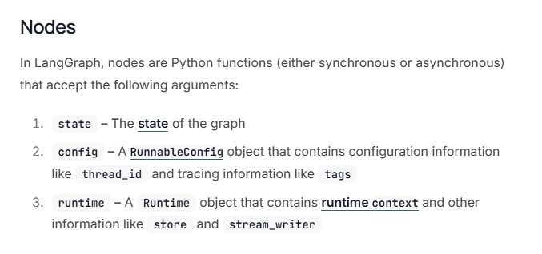
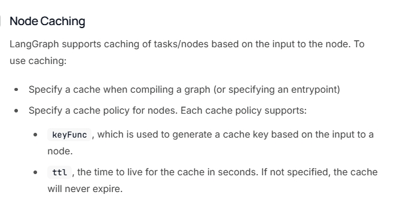
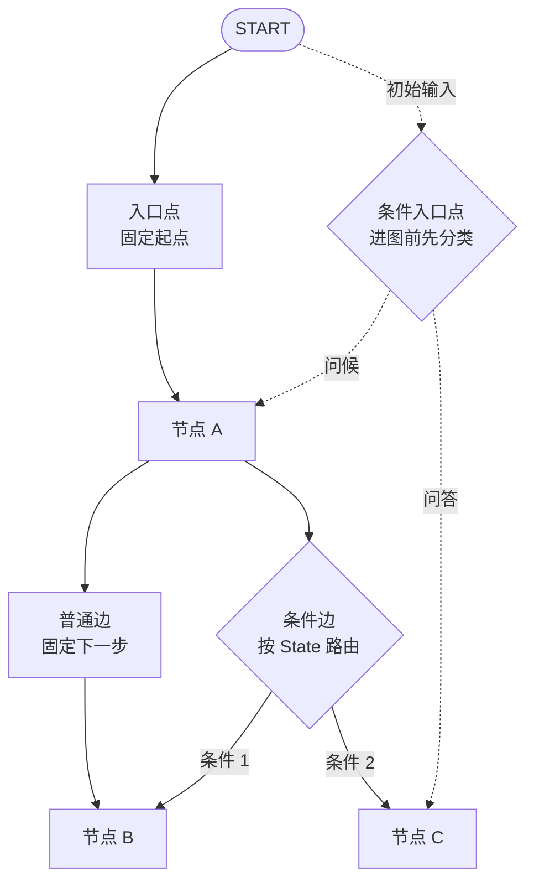
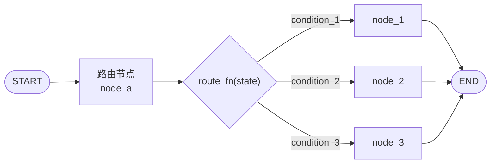
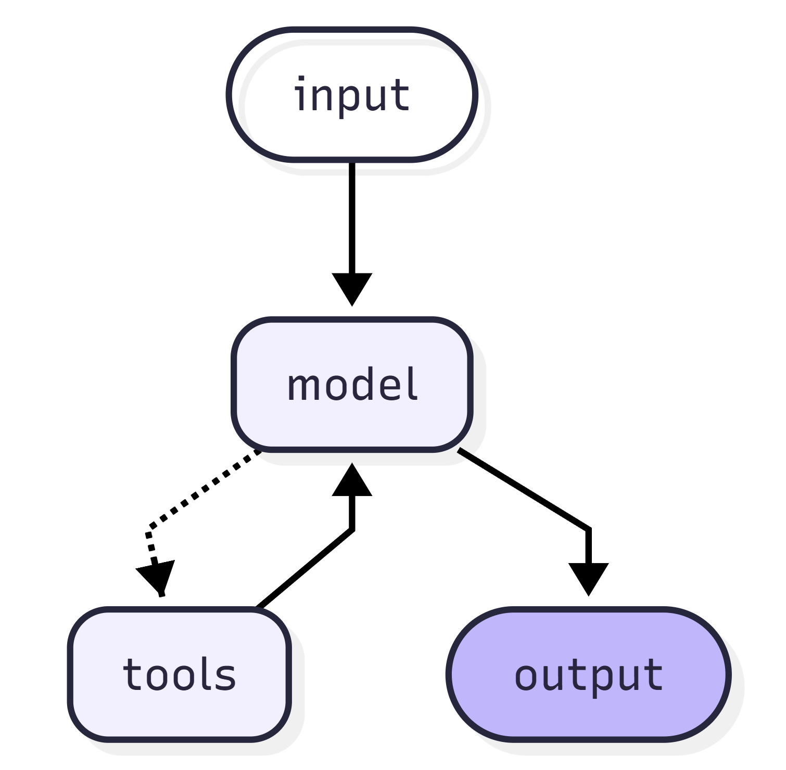
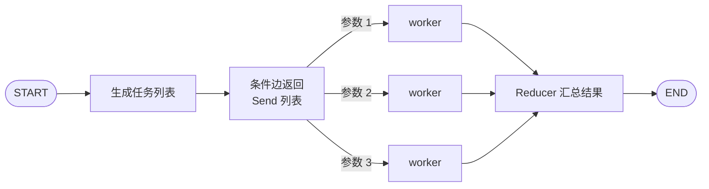
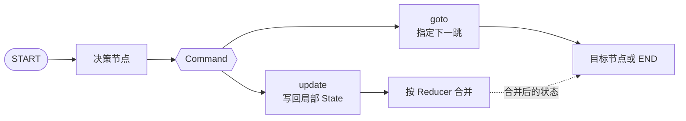
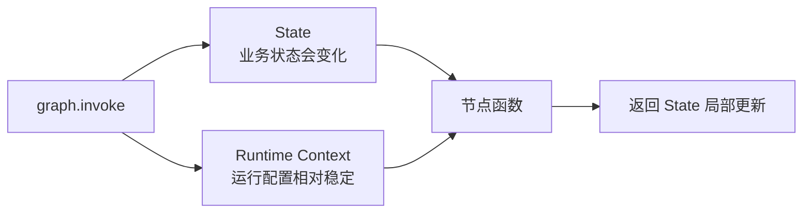
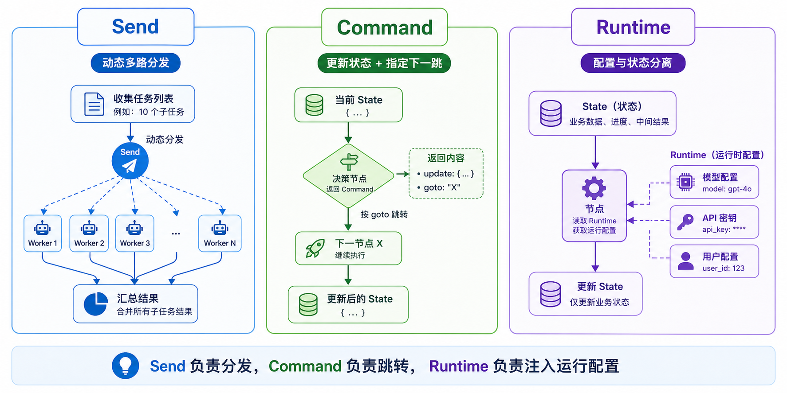

# 24 - LangGraph API: Nodes, Edges, and Advanced Features

---

**Chapter Learning Objectives:**

- Understand the definition, responsibilities, and common patterns of **Nodes**, and know why a node is the smallest execution unit in LangGraph.
- Master the core types of **Edges**: normal edges, conditional edges, entry points, and conditional entry points, and build an intuition for "why the graph can route according to rules."
- Understand what problems the three advanced control capabilities **Send, Command, and Runtime context** each solve, and know how they connect to the previously learned `Graph`, `State`, and `Reducer`.
- Be able to run and understand all examples in this chapter, laying the foundation for more complex LangGraph workflows, multi-agent systems, and advanced features ahead.

**Study Advice:** This chapter can be read as the "control flow" of LangGraph: Nodes do the work, Edges decide where to go, and Send / Command / Runtime handle scenarios where normal edges are insufficient. First get comfortable with normal edges and conditional edges, then look at dynamic dispatch, update-and-jump, and runtime context. After reading, if you can articulate "why this step does not have a fixed next hop," you have grasped the purpose of the advanced APIs.

**Official Documentation and Resources**: See [Tool Navigation and Reference Index - LangGraph](%E5%B7%A5%E5%85%B7%E5%AF%BC%E8%88%AA%E4%B8%8E%E5%8F%82%E8%80%83%E8%B5%84%E6%96%99%E7%B4%A2%E5%BC%95.md#LangGraph).

---

## 1. Graph API: Nodes

### 1.1 Definition

In LangGraph, a **Node** can be understood as: **an executable step in the graph**. It is typically just a Python function, which can be synchronous or asynchronous. When the graph runs, the framework schedules these nodes for execution sequentially or in parallel according to the edge connections.

If [Chapter 23](23-LangGraphAPI%EF%BC%9A%E5%9B%BE%E4%B8%8E%E7%8A%B6%E6%80%81.md) focused on "what shared state exists in the graph," then the Nodes introduced in this chapter focus on: **what processing should be done after the state arrives at a given station.**

A Node is not a decorative point on the graph, but a combination of three things:

- A clear piece of processing logic
- A read of the current State
- A partial update to the State

LangGraph's official definition of `StateGraph` contains a very core sentence: the node's signature can be written as `State -> Partial<State>`. This means: a node usually reads the current state and then returns only the fields it wants to update, rather than rewriting the entire state from scratch every time.

### 1.2 The Role of Nodes

Nodes are where the graph actually "gets work done." The Graph, State, and Reducer learned earlier are more about structure and mechanism, while nodes are responsible for carrying specific business logic. In real projects, the following tasks are usually written inside nodes:

- Calling a large language model
- Calling tools or external APIs
- Performing retrieval, reranking, and formatting
- Doing intermediate calculations before routing decisions
- Recording the result, status marker, or error information of a step

These three layers of relationships can be viewed as follows:

- **Graph** is responsible for the overall process structure
- **State** is responsible for shared data
- **Node** is responsible for what each step specifically does

### 1.3 What Node Functions Generally Look Like

According to the official Graph API documentation, LangGraph nodes commonly accept three types of parameters:

- `state`: the shared state that the graph sees at the current step
- `config`: the configuration and metadata of this run, usually of type `RunnableConfig`
- `runtime`: the runtime object, which can access `context`, `store`, `stream_writer`, etc.

The most common node form to start with is this one:

```python
def node(state: MyState) -> dict:
    return {"some_key": "new_value"}
```

This is also the form beginners should master first: **read state, return a partial update dict.**

As you begin building more complex workflows later, gradually add:

- `config`: suitable for `thread_id`, `tags`, `metadata`
- `runtime`: suitable for dependencies that do not belong in State, such as model names, database connections, API keys, and environment configuration



The hierarchy of these three terms in the diagram is recommended to be memorized as:

- `state` is "business data"
- `config` is "configuration and tracing information for this run"
- `runtime` is "runtime environment capabilities accessible during node execution"

The two parameters `config` and `runtime` are usually automatically injected by the LangGraph runtime via keyword arguments. In most scenarios, you do not need to manually assemble them; whether a node function declares these parameters expresses "what runtime information this node needs."

There is also a basic rule for node output: **return incremental updates; do not return the entire received State unchanged or modified in full.**

The reasons are:

- LangGraph treats the node's return value as "this node's partial update to the state"
- It then merges these updates back into the global State according to the Reducer rules corresponding to each field

Therefore, the more recommended pattern is:

```python
def node(state: MyState) -> dict:
    return {"result": "new_value"}
```

It is not recommended to directly modify the entire `state` and then return it in full. That can easily lead to two problems:

- Fields without a special Reducer configured may be overwritten altogether even though they should not have been modified by the current node
- For fields with a Reducer configured, if the node also returns "state that does not belong to its responsibility," the subsequent merge result becomes harder to predict

A node should only return the fields it is responsible for updating.

From a coding habit perspective, the following pattern should be avoided as much as possible:

```python
def query_web(state: MyState) -> dict:
    state["web_result"] = "网络搜索结果"
    return state
```

It looks convenient, but the problem is that it is difficult for the caller to determine which fields this node is actually responsible for modifying; if the State contains fields with Reducers such as `messages` or `retrieved_docs`, returning the whole thing can also lead to duplicate merging or accidental overwrites.

The more recommended pattern is:

```python
def query_web(state: MyState) -> dict:
    return {"web_result": "网络搜索结果"}
```

**A node function can internally read the complete State, but when leaving the node it should only hand in its own incremental updates.** This rule is of a piece with the Reducer from the previous chapter: nodes produce updates, and Reducers merge updates.

### 1.4 START, END, and Entry/Exit Points

When learning about nodes, you will often see `START` and `END` together. They are not business nodes you write yourself, but two built-in **special virtual nodes** in LangGraph:

- `START` represents the entry point of the graph
- `END` represents the end of the graph

The most common pattern is:

```python
graph.add_edge(START, "node_a")
graph.add_edge("node_a", END)
```

This means: the graph starts execution from `node_a`, and after `node_a` finishes, the process ends.

If the graph's entry and exit points are very clear, you can also use:

- `set_entry_point(node_id)`
- `set_finish_point(node_id)`

These are more concise syntactic sugar; underneath, they are still building edges like `START -> node` and `node -> END` for you.

### 1.5 Node Design Recommendations

In the beginner stage, it is easiest to write nodes by "stuffing everything inside." However, from a real project perspective, nodes are better suited to following these principles:

- **Single responsibility**: a node should try to do only one thing
- **Clear inputs and outputs**: by looking at the function signature and return value, you should know what it depends on and what it updates
- **Minimize dependence on external mutable state**: prefer passing values through State or Runtime rather than secretly reading global variables
- **Easy to retry and cache**: if a node has too many side effects, it will be difficult to control when configuring caching or retries later

You can first understand a node as "a small service in the graph," rather than "a big chunk of code in the graph."

### 1.6 Example: Node Definition Patterns and add_node

This example is the most basic Node example in Chapter 24, and the one most worth running first. It mainly demonstrates three things:

- A node is just a Python function
- In addition to the most basic `state` parameter, a node can also bind extra parameters via `partial`
- When calling `add_node(...)`, besides passing the node function, you can also attach `retry_policy`

[Example source code] `案例与源码-3-LangGraph框架/04-node/DefNode.py`

[DefNode.py](../../%E6%A1%88%E4%BE%8B%E4%B8%8E%E6%BA%90%E7%A0%81-3-LangGraph%E6%A1%86%E6%9E%B6/04-node/DefNode.py ":include :type=code")

This example is used to establish a basic intuition: **The key point of a Node is not "how fancy the function is written," but "how it is registered, scheduled, and configured by the graph."**

### 1.7 Node Caching

The problem that node caching solves is very practical: **a certain node is expensive and slow, but the same input often repeats. Can we avoid rerunning it every time?**

For LangGraph to actually hit the cache, three layers usually need to be considered:

- **The node declares a caching policy**: for example, `CachePolicy(key_func=..., ttl=...)`.
- **The graph selects a cache backend at compile time**: for example, `compile(cache=InMemoryCache())`.
- **Runtime determines whether there is a cache hit**: generate a cache key according to `key_func`, and then determine whether it has expired according to `ttl`.

Among them, `key_func` determines "what kind of input counts as the same result," and `ttl` determines "how long this result can be reused." The cache backend can be in-memory, Redis, SQLite, etc. The specific choice depends on whether the project requires cross-process, cross-machine, or persistent storage.

At the beginner stage, just remember: **nodes declare support for caching, and the graph chooses the specific cache backend at compile time.**



In real projects, caching is well suited to these kinds of nodes:

- Pure computation nodes
- Parsing, formatting, and cleaning nodes
- External call nodes with high cost but highly repetitive input

Nodes that are usually not suitable for direct, blunt caching include:

- Nodes that strongly depend on real-time data
- Nodes with strong side effects
- Nodes whose input looks the same but actually has different contexts

### 1.8 Example: Node Caching

The learning focus of this example is not to memorize the number `ttl=8`, but to see two things clearly:

- `cache_policy=CachePolicy(...)` is configured on the node
- `compile(cache=InMemoryCache())` provides the cache backend at graph compile time

In other words, **the node declares "I support caching," and the graph decides at compile time "which cache to actually use."**

[Example source code] `案例与源码-3-LangGraph框架/04-node/Node_Cache.py`

[Node_Cache.py](../../%E6%A1%88%E4%BE%8B%E4%B8%8E%E6%BA%90%E7%A0%81-3-LangGraph%E6%A1%86%E6%9E%B6/04-node/Node_Cache.py ":include :type=code")

### 1.9 Error Handling and Retry Mechanism

The retry mechanism solves another real-world problem: **if a node fails, should the entire graph immediately report an error, or should it retry first?**

LangGraph uses `RetryPolicy` to describe this. In the official reference documentation, `RetryPolicy` mainly includes these common parameters:

- `max_attempts`: the maximum number of execution attempts, including the first formal execution.
- `initial_interval`: how long to wait before the first retry, usually in seconds.
- `backoff_factor`: by what multiple the wait time grows after each retry, used for backoff.
- `max_interval`: the upper limit of a single retry wait time, to prevent the backoff time from growing indefinitely.
- `jitter`: whether to add a little random jitter to the wait time, reducing the risk of "simultaneous retries overwhelming the service again."
- `retry_on`: specifies which exceptions are worth retrying; exceptions that do not match will be thrown directly instead of being retried further.

The most important thing is not to memorize all the parameters, but to first distinguish two layers of semantics:

- **Time strategy**: how often to retry, whether to back off, and whether to add jitter
- **Exception strategy**: which exceptions should be retried and which should not

In real projects, it is recommended to first distinguish between exception types:

- **Network jitter and temporary timeouts** are usually suitable for retries
- **Parameter errors, type errors, and business logic errors** are usually not suitable for blind retries

So the value of `retry_on` is: **making retries feel more like an engineering strategy, rather than "just rerun everything indiscriminately after a failure."**

### 1.10 Case Study: Node Retry

This case is worth observing three situations in particular:

- What the default retry strategy looks like
- When customizing `retry_on`, how to retry only on specific exceptions
- Which exceptions fail immediately and never enter the retry flow

[Source code] `案例与源码-3-LangGraph框架/04-node/Node_ExpErrRetry.py`

[Node_ExpErrRetry.py](../../%E6%A1%88%E4%BE%8B%E4%B8%8E%E6%BA%90%E7%A0%81-3-LangGraph%E6%A1%86%E6%9E%B6/04-node/Node_ExpErrRetry.py ":include :type=code")

After finishing this Node section, you should at least come away with this understanding: **a node is not just "a function"; it is also a configurable execution unit within the graph that can have caching, retry policies, and explicitly defined entry and exit points.**

---

## 2. Graph API: Edge

### 2.1 Definition

If Node determines "what happens at this stop," then **Edge** determines **where to go next after this stop is completed.** An edge is not a decorative connection; it is the **flow control rule** of the graph.

The two most basic types of edges in LangGraph are:

- **Normal Edge**: always goes from A to B
- **Conditional Edge**: decides where to go next based on the current state

Around these two types of edges, there are also:

- **Entry Point**
- **Conditional Entry Point**

Together they all answer the same question: **how exactly this graph flows.**



**Caption:** Normal edges have a fixed direction; conditional edges use a function to choose the next hop; entry points determine which node is first entered; conditional entry points perform routing before the first hop (suitable for "classify first as soon as the graph starts").

### 2.2 The Role of Edges

Many people initially focus all their attention on the node functions themselves, thinking "as long as each node is written well, that is enough." But from a workflow perspective, what really determines the shape of the graph is often the edges.

The following differences are mainly determined by edges:

- Whether execution is in a fixed order or dynamically routed
- Whether there is a single entry point or branching right at the entry
- Whether it is a single path to the end or multiple branches converging in the middle
- Whether it is a simple sequential chain or closer to a small decision-making system

So it can be said that: **Node gives the graph processing capability**, while **Edge gives the graph process structure**.

### 2.3 Normal Edges

A normal edge is the easiest to understand: **after the current node finishes executing, it unconditionally moves to the next node.**

The most typical way to write it is:

```python
builder.add_edge("node_a", "node_b")
```

The meaning of this line of code is simple: after `node_a` finishes, go to `node_b`, with no judgment and no branching.


**Caption:** The left side shows the example code from the course materials, and the right side shows the linear topology; at compile time, an error is raised if an edge points to an unregistered node.

The focus of learning normal edges is not just knowing how to write `add_edge`, but building an intuition: the most basic form of a graph is a fixed path. Many complex graphs are first built from normal edges, and then conditional edges, Send, and Command are gradually added.

### 2.4 Case Study: Normal Edge

This case demonstrates the most basic linear graph: `START -> node_a -> node_b -> node_c -> END`

The focus is not the business logic, but understanding that: **when edges are fixed, the graph is like a declarative workflow chain.**

[Source code] `案例与源码-3-LangGraph框架/05-edge/Edge_Normal.py`

[Edge_Normal.py](../../%E6%A1%88%E4%BE%8B%E4%B8%8E%E6%BA%90%E7%A0%81-3-LangGraph%E6%A1%86%E6%9E%B6/05-edge/Edge_Normal.py ":include :type=code")

### 2.5 Conditional Edges

When the flow is not "always from A to B" but "after finishing A, decide where to go next based on the current state," a conditional edge is needed.

A common pattern in LangGraph is:

```python
graph.add_conditional_edges("node_a", route_fn, mapping)
```

This can be understood in three parts:

- `"node_a"`: which node to depart from for routing
- `route_fn`: returns the routing result based on the current state
- `mapping`: maps the routing result to a specific target node

More important than the API form is grasping this sentence:

**A conditional edge means deciding where to go next based on the current state after a node has finished executing.**



### 2.6 Case Study: Conditional Edge

These two cases together illustrate one thing: **conditional edges perform routing at the graph layer, rather than stuffing all the judgment logic back inside the node functions.**

You can focus on observing:

- One case uses boolean values or simple conditions for branching
- Another case uses string keys + mapping for multi-branch routing

[Source code] `案例与源码-3-LangGraph框架/05-edge/Edge_Conditional.py`, `Edge_ConditionalV2.py`

[Edge_Conditional.py](../../%E6%A1%88%E4%BE%8B%E4%B8%8E%E6%BA%90%E7%A0%81-3-LangGraph%E6%A1%86%E6%9E%B6/05-edge/Edge_Conditional.py ":include :type=code")

[Edge_ConditionalV2.py](../../%E6%A1%88%E4%BE%8B%E4%B8%8E%E6%BA%90%E7%A0%81-3-LangGraph%E6%A1%86%E6%9E%B6/05-edge/Edge_ConditionalV2.py ":include :type=code")

### 2.7 Entry Points and Conditional Entry Points

The conditional edges discussed earlier branch after a node has finished executing. The capabilities related to entry points solve a different problem: **where the graph starts from.**

The two most common situations are:

- **Entry Point**: the graph always starts from the same node
- **Conditional Entry Point**: when the graph starts, it first evaluates the input and then decides which node to begin from

They can be distinguished like this:

- **Normal entry point**: fixed starting point
- **Conditional entry point**: dynamic starting point

This is especially useful in real projects, because many systems need to perform initial routing as soon as a request arrives. For example:

- Greetings go to greeting handling
- Farewells go to ending handling
- General questions go to the Q&A flow

### 2.8 Case Study: Entry Points and Conditional Entry Points

These two cases correspond respectively to:

- Using `set_entry_point` / `set_finish_point` to specify fixed entry and exit points
- Attaching a conditional edge directly from `START` to decide which processing chain to enter based on the initial input

[Source code] `案例与源码-3-LangGraph框架/05-edge/Edge_EntryPoint.py`, `Edge_ConditionalEntryPoint.py`

[Edge_EntryPoint.py](../../%E6%A1%88%E4%BE%8B%E4%B8%8E%E6%BA%90%E7%A0%81-3-LangGraph%E6%A1%86%E6%9E%B6/05-edge/Edge_EntryPoint.py ":include :type=code")

[Edge_ConditionalEntryPoint.py](../../%E6%A1%88%E4%BE%8B%E4%B8%8E%E6%BA%90%E7%A0%81-3-LangGraph%E6%A1%86%E6%9E%B6/05-edge/Edge_ConditionalEntryPoint.py ":include :type=code")

### 2.9 Conditional Edges Can Also Form Loop Structures

Conditional edges can be used not only for branching, but also for looping.

For example:

- A node first makes a judgment
- If the condition is met, move on to the next processing node
- After processing is complete, return to the previous judgment node
- Until a certain termination condition is met, then proceed to `END`

This kind of structure is very common in LangGraph, especially for:

- Agent ReAct loops
- "If retrieval is insufficient, keep supplementing retrieval" loops
- "Continue / stop" judgments in multi-step planning and execution

ReAct is the most typical example: input enters the model node, the model may output directly or first call a tool; the tool result then returns to the model node, and the model continues to judge whether it can already answer.



This kind of loop is well suited to LangGraph because it has several inherent challenges:

- The next step is not fixed; the model may choose a tool or answer directly.
- Tool results need to be written back to State so that the next round of model judgment can read them.
- The loop must have an exit condition; otherwise it will keep going "model thinks, tool checks, thinks again."
- In production, you also need to observe how many rounds have run, where it is stuck, and whether human intervention is needed.

But loop structures carry a hidden risk: **if the termination condition is not designed correctly, the graph may loop forever.**

LangGraph provides protection mechanisms such as `recursion_limit` for this purpose. Its role is to **set an upper limit on graph execution to prevent the workflow from scheduling endlessly.**

The point here is not to memorize default values, but to treat loops as a flow structure that requires designed boundaries:

- Conditional edges can form loops
- Loop structures must have carefully designed termination conditions, such as "no more tool calls," "score meets the threshold," or "retry count reaches the limit"
- In real projects, it is best to use step protection like `recursion_limit` to prevent the graph from running out of control
- Once the recursion limit is triggered, treat it as a process design signal rather than simply increasing the number and moving on

### 2.10 Choosing the Right Edge

After finishing this section, the key is not to memorize "how many kinds of edges there are," but to know when to choose which one:

| Scenario                           | Better approach | How to understand it |
| ------------------------------ | ------------ | ---------------- |
| Steps are fixed and ordered clearly | Normal edge | A declarative pipeline |
| Branching by state is needed after a step | Conditional edge | Post-node routing |
| The graph always starts from the same place | Entry point | Fixed starting point |
| The graph must classify first before entering different flows | Conditional entry point | Dynamic starting point |

A common misconception is to write a large number of `if/else` statements inside nodes as soon as any judgment is needed. A more robust approach is: **nodes handle processing, edges handle flow.** This makes the graph structure clearer and easier to visualize and debug.

---

## 3. Send, Command, and Runtime Context

### 3.1 Three Types of Problems

After learning Node and Edge, you can already build many normal graphs. But in real projects, you will soon encounter three types of more complex problems:

- The next step is not a single fixed node, but a batch of dynamically generated subtasks.
- A node needs to update state as well as determine the next hop.
- Some configuration does not belong to State, but the node must be able to access it at runtime.

Send, Command, and Runtime answer these three types of problems respectively.

Starting from this section, we are looking at more flexible control primitives beyond ordinary nodes, ordinary edges, and conditional edges.

### 3.2 Send: Dynamic Dispatch

The main problem `Send` solves is: **an upstream node produces a batch of tasks, the number of tasks is only known at runtime, and you want to dispatch these tasks to the same downstream node to be processed separately.**

This is a typical Map-Reduce mindset:

- **Map**: first split a large task into many smaller tasks
- **Reduce**: after each smaller task completes, aggregate the results

In LangGraph, a conditional edge function can return `Sequence[Send]`. Each `Send` contains two parts:

- The target node name
- The piece of state to pass to that node

`Send` allows the graph to dynamically decide at runtime how many branches to open, and each branch can receive a different version of the state. When parallel branches write back to the same state field, you usually need to configure a suitable [Reducer](23-LangGraphAPI%EF%BC%9A%E5%9B%BE%E4%B8%8E%E7%8A%B6%E6%80%81.md) on the State (for example, list append); otherwise the results are difficult to aggregate.



The difference from ordinary conditional edges should be clearly understood:

- **Ordinary conditional edge**: usually decides "which single node to go to next"
- **Send**: decides "how many tasks to open next, and what state each task carries to which node"

### 3.3 Case Study: Send

This case can be used to understand LangGraph's parallel mindset:

- The upstream node first generates a batch of topics
- The conditional edge function maps these topics into a set of `Send`
- The downstream node generates a joke for each topic separately
- Finally, use a Reducer to merge the multi-route results back into State

[Case source code] `案例与源码-3-LangGraph框架/06-specialApi/SendDemo.py`

[SendDemo.py](../../%E6%A1%88%E4%BE%8B%E4%B8%8E%E6%BA%90%E7%A0%81-3-LangGraph%E6%A1%86%E6%9E%B6/06-specialApi/SendDemo.py ":include :type=code")

From a project perspective, Send is well suited to these scenarios:

- Parallel processing after document chunking
- Parallel retrieval for multiple queries
- Parallel scoring of a batch of candidate tasks
- Batch processing of multiple topics, multiple records, or multiple text passages

### 3.4 Command: Update and jump

If conditional edges are only responsible for "where to go", then `Command` solves another very common requirement: **after a node finishes making a decision, it wants both to update the state and to directly decide where to go next.**

`Command` allows you to put the state update and the control flow into the same return value.

The two most common parameters are:

- `update`: the partial update that the current node wants to write back to State, which is still merged according to the field's corresponding Reducer rules.
- `goto`: after the current node finishes executing, the node that the graph should jump to next; it can also jump directly to `END` to end the flow.

A node can:

- Return a new state update
- And at the same time directly tell the graph "which node to go to next"

The boundary with conditional edges needs to be clear:

- **Conditional edge**: more suitable when "the node is finished, and then the destination is determined separately based on the state".
- **Command**: more suitable when "this node itself is the decision point, and when leaving it should make both the state and the destination clear at once".



### 3.5 Case study: Command

This case is especially well suited to being understood in the context of a "decision node". You can focus on:

- Why `decision_agent` does not return an ordinary dictionary, but rather `Command(...)`
- Why it can write to `messages`, `current_agent`, and `task_completed`
- And at the same time use `goto` to hand the flow to the next node, or go directly to `END`

[Case source code] `案例与源码-3-LangGraph框架/06-specialApi/CommandDemo.py`

[CommandDemo.py](../../%E6%A1%88%E4%BE%8B%E4%B8%8E%E6%BA%90%E7%A0%81-3-LangGraph%E6%A1%86%E6%9E%B6/06-specialApi/CommandDemo.py ":include :type=code")

In real projects, Command is well suited to:

- Decision nodes
- Agent handoff nodes
- "Continue / Pause / Transfer to human" nodes in human-in-the-loop workflows
- Nodes that need to write logs while forwarding the flow

Here is a foreshadowing for later: Chapter 25 will discuss `interrupt`. The graph pauses when it reaches a certain node, handing the data to be reviewed to a user outside the graph; after the user finishes processing, `Command(resume=...)` is then used to send the result back into the graph to continue execution. `Command` not only expresses "where to go next", it also appears in human-in-the-loop workflows for "resume after pause".

### 3.6 Runtime: Separate configuration from state

We have been emphasizing State throughout the previous sections, but in real projects not all data should be placed into State. Consider the following: model name, API key, database connection, user environment configuration, and external dependency objects for the current run.

These generally do not belong to "the business state that the graph flows between nodes", but are more like **static context for this run**. In this case, it is more appropriate to place them in Runtime context rather than forcing them into State.

Both the official Graph API and the `Use the graph API` guide emphasize this: **runtime configuration can be declared via `context_schema` and passed in via `context=...` when invoking the graph.**

So the difference between the two can be remembered as:

- **State**: shared business data that keeps changing as the graph runs
- **Runtime Context**: static dependencies or configuration that nodes can read during this run, but that should not be mixed into business state



### 3.7 Basic usage of Runtime

Runtime context usually involves three steps:

1. Define `context_schema`
2. Attach it to `StateGraph(..., context_schema=...)` when creating the graph
3. Pass it in via `invoke(..., context=...)` when executing the graph, and read it in nodes with `runtime.context`

Here, `context_schema` is a **structural declaration of runtime configuration**.

The value of Runtime is that it separates "configuration" from "state". Once separated, State becomes cleaner, node testing becomes easier, and the cost of switching between different environments, models, and dependencies becomes lower.

### 3.8 Case study: Runtime Context

This case focuses on three things:

- How `ContextSchema` is defined
- How `StateGraph(..., context_schema=ContextSchema)` attaches the runtime context to the graph
- How nodes read the configuration through `runtime.context.xxx`

[Case source code] `案例与源码-3-LangGraph框架/06-specialApi/RuntimeContextDemo.py`

[RuntimeContextDemo.py](../../%E6%A1%88%E4%BE%8B%E4%B8%8E%E6%BA%90%E7%A0%81-3-LangGraph%E6%A1%86%E6%9E%B6/06-specialApi/RuntimeContextDemo.py ":include :type=code")

### 3.9 What can be observed externally while the graph executes

Earlier, when discussing Runtime, we mentioned `stream_writer`. Following this thread outward: the final result of the graph does not necessarily have to wait until `invoke()` has fully finished before it can be obtained.

Because the LangGraph graph itself implements the Runnable interface, it also supports: `stream()`, `astream()`.

This means you can gradually obtain intermediate information while the graph is executing. Common patterns include the following:

- `values`: output the current complete state at each step
- `updates`: output only the incremental update at each step
- `custom`: output custom data that nodes proactively write via `runtime.stream_writer(...)`
- `messages`: in nodes that call an LLM, stream message fragments or tokens
- `debug`: output more complete debugging information

Real projects frequently encounter these requirements:

- The frontend wants to show the current step as execution proceeds
- Token-level streaming output is desired while the LLM generates
- During a long-running flow, you want to know which node it is currently stuck on
- When debugging a complex graph, you want to observe exactly what each step updated

Therefore, `invoke()` is more like "wait for the whole graph to finish and then get the result", while `stream()` is more like "watch what is happening inside the graph as it runs".

### 3.10 How to distinguish Send, Command, and Runtime

Send, Command, and Runtime are easy to confuse. You can use the following table to remember them:

| Capability  | Problem it solves                                   | How to understand it                            |
| ----------- | --------------------------------------------------- | ----------------------------------------------- |
| **Send**    | Dynamically spawn multiple routes of subtasks       | Runtime parallel dispatch                       |
| **Command** | Update state and specify the next hop when a node exits | The decision node's "one-time handoff"       |
| **Runtime** | Inject configuration and dependencies that do not belong to State | Separate configuration from state    |



- **Send**: split one thing into many smaller things and do them in parallel
- **Command**: this node decides right now who takes over next
- **Runtime**: do not stuff the environment configuration needed for this run into State

---

**Chapter reflection questions:**

1. In a real workflow, how do you determine whether a piece of logic belongs in a Node or an Edge?

   **Reference thinking:** business processing, calling models, retrieval, and data transformation should go in Nodes; deciding where to go next should go in Edges or control objects. If processing and flow are mixed together, the graph will quickly lose readability.

2. Both conditional edges and `Command` can affect the next hop. What is the difference between them?

   **Reference thinking:** conditional edges place routing logic outside the graph structure, which is more suitable for clear branching; `Command` allows a node to specify the next hop while returning a state update, which is more suitable for scenarios where the node's processing result itself determines the control flow. When choosing, consider whether the routing logic belongs to the graph or to the node's result.

3. What problem is `Send` suitable for solving? When should it not be used?

   **Reference thinking:** it is suitable for dynamically splitting multiple routes of subtasks at runtime, such as processing multiple documents or multiple queries in parallel. If the number of tasks is fixed and the order is clear, using ordinary edges or a parallel structure may be clearer.

4. Why should Runtime Context not be stuffed into State?

   **Reference thinking:** Runtime holds configuration, dependencies, and the execution environment, such as clients, user context, and model parameters; State holds business flow data. Mixing them together makes the state unserializable and hard to recover, and also couples business data with the runtime environment.

5. Why does a cyclic graph need exit conditions and step-count protection?

   **Reference thinking:** Agent / ReAct / self-correction flows may naturally execute repeatedly. Without a clear exit condition, the graph will keep scheduling forever. `recursion_limit` is the last line of defense, but truly reliable design also needs to record retry count, scoring results, or tool-call state in State so that conditional edges can reliably lead to `END`.

**Chapter summary:**

- **Node** is the smallest execution unit of LangGraph and can be understood as a Python function scheduled by the graph. In addition to the most common `state -> dict` form, it can also be used with caching, retry policies, `config`, and `runtime`.
- **Edge** determines how the flow moves. Ordinary edges are suitable for fixed paths, conditional edges are suitable for state-driven branching, and entry points and conditional entry points determine where the graph starts.
- **Send, Command, and Runtime** are three commonly used advanced capabilities: Send is suitable for dynamic parallel dispatch, Command is suitable for decision nodes, and Runtime is suitable for separating configuration from state.
- The focus of this chapter is to build a complete understanding: **nodes handle processing, edges handle flow, State handles shared data, and advanced control primitives make the graph more flexible at runtime.** After completing this chapter, you should be able to distinguish the responsibilities of **Node** and **Edge**, know which scenarios ordinary edges, conditional edges, entry points, and conditional entry points are respectively suitable for, and understand what problems the three advanced capabilities `Send`, `Command`, and `Runtime` each solve.

**Suggested next step:**

It is recommended to first run through all the cases in the `04-node`, `05-edge`, and `06-specialApi` directories in order, and then move on to the subsequent advanced LangGraph chapters. If you can write out by hand a small workflow that does "classification → routing → parallel processing → aggregated answer", then you have truly mastered this chapter.
