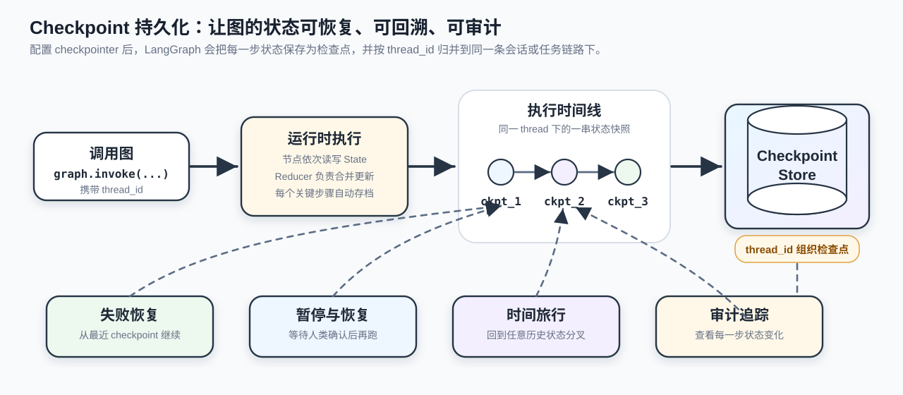
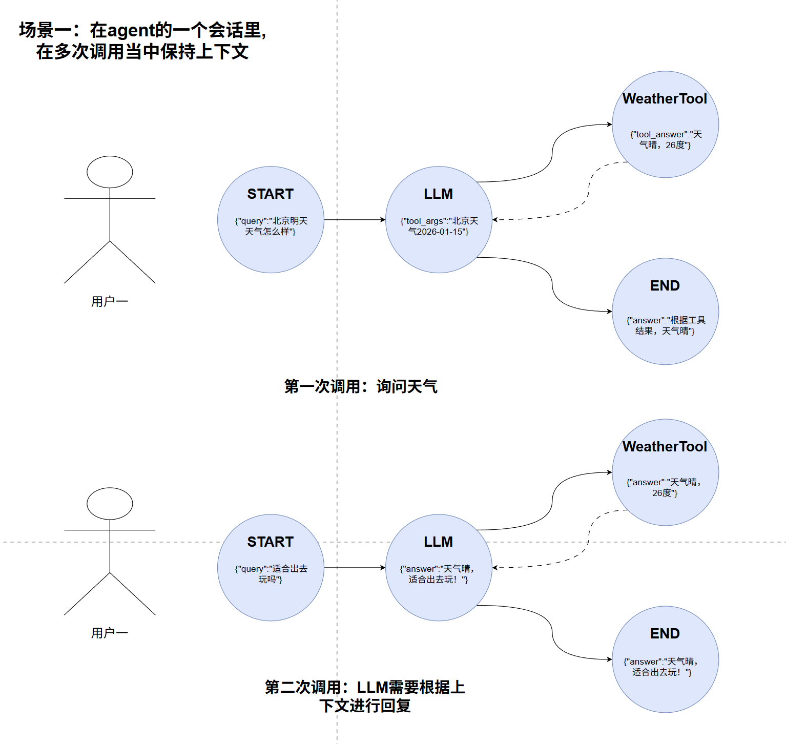
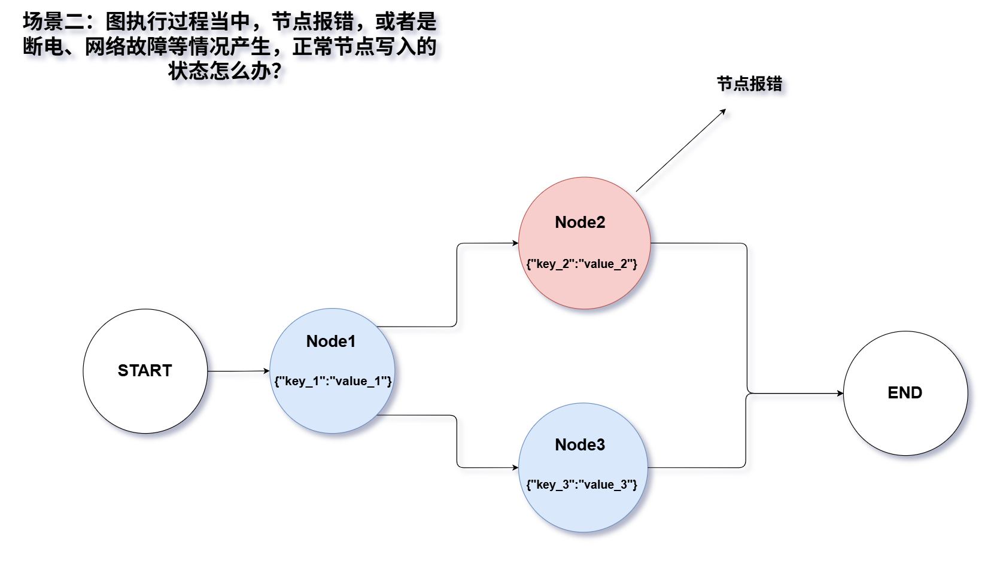
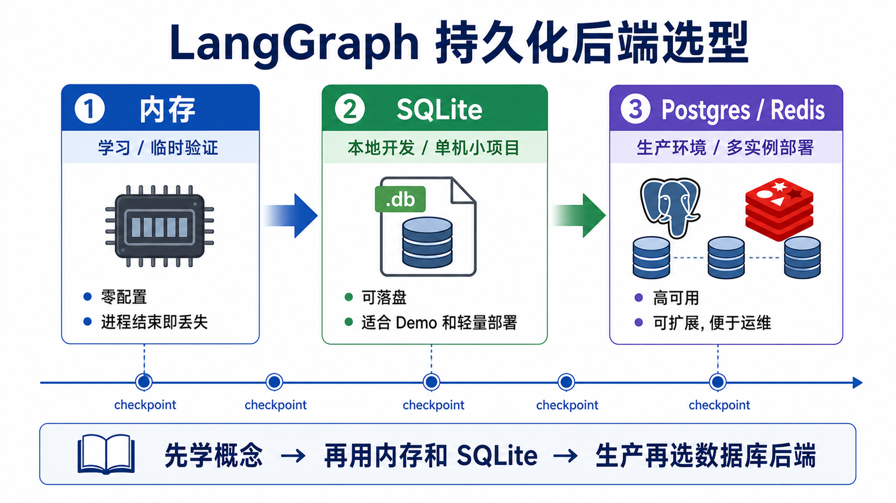
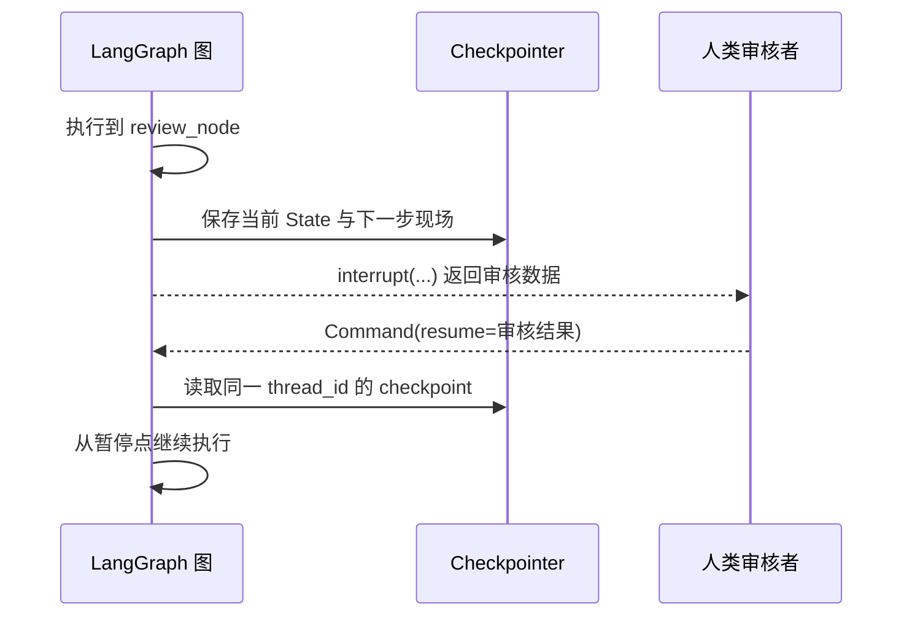
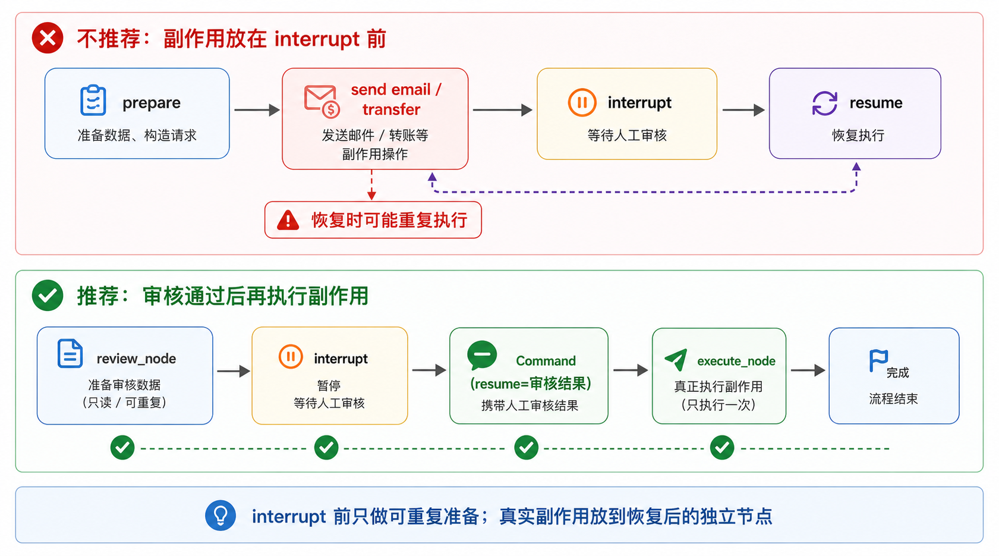
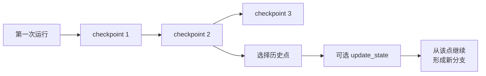
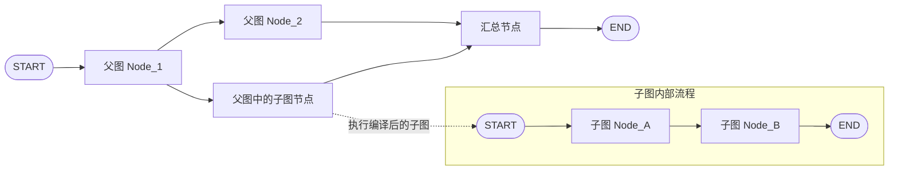

# 25 - LangGraph Advanced Features

---

**Chapter Learning Objectives:**

- Understand the five categories of advanced capabilities in LangGraph: **Streaming**, **Persistence**, **Human-in-the-Loop and Interrupt Recovery (Interrupt / HITL)**, **Time-Travel**, and **Subgraphs**.
- Build a more engineering-oriented understanding: these capabilities are not scattered APIs, but the infrastructure LangGraph provides for real production scenarios, enabling "observability, recoverability, reusability, and scalability".
- Be able to run and understand all cases in this chapter, and know what problems these advanced features solve and what scenarios they are suitable for.

**Learning Suggestion:** Read this chapter according to the priority of real projects: streaming solves "can't see progress", persistence solves "state can't be connected, failures require full reruns", Interrupt solves "key actions need human review", time-travel leans toward debugging and review, and subgraphs lean toward reuse and decomposition. When learning each feature, first ask what pain point it solves, then look at the API.

**Official Documentation and Resources**: See [Tool Navigation and Reference Index - LangGraph](%E5%B7%A5%E5%85%B7%E5%AF%BC%E8%88%AA%E4%B8%8E%E5%8F%82%E8%80%83%E8%B5%84%E6%96%99%E7%B4%A2%E5%BC%95.md#LangGraph).

---

## 1. Streaming

### 1.1 Definition

In many people's minds, "streaming output" often only means "the large language model outputs token by token like a typewriter". But in LangGraph, the scope of streaming is much broader. It can not only output the model generation process, but also expose **state changes during graph execution, node progress, subgraph processes, and custom messages** as execution proceeds.

This is also the biggest difference between LangGraph streaming and ordinary model streaming output:

- **Ordinary LLM streaming**: focuses more on "how the model text is gradually produced"
- **LangGraph streaming**: focuses more on "where the entire graph is currently executing and what state changes have occurred"

So you can first understand LangGraph Streaming as: **breaking down the graph execution process to show you, rather than waiting for the entire graph to finish before giving the final result.**

### 1.2 The Value of Streaming

Streaming is not just a "nice-to-have" experience optimization, but a fundamental capability for many AI applications. Common requirements in real projects include:

- The frontend wants to display current progress while executing, rather than waiting on a blank screen for a long time
- When calling a large language model, you want real-time display at the token level
- When the workflow is long, you want to know which node is currently being executed
- When debugging complex graphs, you want to see exactly what state was updated at each step
- Subgraphs or tools have important intermediate results that you want to see before the final result comes out

It has two layers of value: the **user experience layer**, allowing users to perceive earlier that a task is executing; and the **engineering debugging layer**, making it easier for developers to observe what is happening inside the graph.

### 1.3 stream() vs invoke()

First, distinguish these two entry points:

- `invoke()`: waits for the entire graph to finish, then returns the final result
- `stream()` / `astream()`: the graph sends out intermediate results in batches while running

- If you only care about the final result, use `invoke()`
- If you want to observe while executing, use `stream()` or `astream()`

The LangGraph graph itself implements the **Runnable** interface, so it naturally has these streaming capabilities. This also allows it to connect with the [LangChain `Runnable` / LCEL](15-LCEL%E4%B8%8E%E9%93%BE%E5%BC%8F%E8%B0%83%E7%94%A8.md) ecosystem.

There is also a key parameter to add here: `stream_mode`. `stream()` does not have only one fixed output format; `stream_mode` determines "what exactly the graph streams out during execution", such as full state, incremental updates, model message fragments, or custom progress information.

### 1.4 What stream_mode Options Are There

LangGraph uses `stream_mode` to specify "what exactly you want to stream".

The most common modes that are worth mastering first are these:

| Mode       | Meaning                                  |
| ---------- | ------------------------------------- |
| `values`   | Outputs a snapshot of the current full state after each step      |
| `updates`  | Outputs only the incremental updates from this step after each step      |
| `messages` | Outputs message fragments / tokens during the LLM generation process |
| `custom`   | Outputs custom messages actively written inside nodes      |
| `debug`    | Outputs more complete, lower-level debugging information          |

If you want to receive multiple streams at the same time, you can directly pass a list, for example:

```python
stream_mode=["updates", "custom"]
```

In this case, the returned streamed results typically carry an indication of "which mode the data belongs to".

### 1.5 How to Distinguish values and updates

This is the easiest pair of concepts to confuse in this chapter.

- `values`: at each step, gives you "what the current full State looks like"
- `updates`: at each step, gives you only "which fields were actually changed in this small step"

From a debugging experience perspective:

- `values` is more like "a full snapshot of each step"
- `updates` is more like "an incremental log of each step"

### 1.6 Case: Streaming Graph State (values / updates)

This case uses the most straightforward approach to show you the difference between `values` and `updates`. Its focus is not business logic, but helping you build an intuition for observing state changes through streaming.

[Case Source Code] `案例与源码-3-LangGraph框架/07-senior/streaming/StreamGraphState.py`

[StreamGraphState.py](../../%E6%A1%88%E4%BE%8B%E4%B8%8E%E6%BA%90%E7%A0%81-3-LangGraph%E6%A1%86%E6%9E%B6/07-senior/streaming/StreamGraphState.py ":include :type=code")

### 1.7 Case: Multiple Streaming Modes and debug

When you set `stream_mode` to a list, you can receive multiple types of streams in a single run. The most notable observations in this case are:

- What the output looks like when multiple modes are enabled together
- Why the `debug` mode is more suitable for debugging rather than being directly used for business UI

[Case Source Code] `案例与源码-3-LangGraph框架/07-senior/streaming/StreamMultipleModes.py`

[StreamMultipleModes.py](../../%E6%A1%88%E4%BE%8B%E4%B8%8E%E6%BA%90%E7%A0%81-3-LangGraph%E6%A1%86%E6%9E%B6/07-senior/streaming/StreamMultipleModes.py ":include :type=code")

### 1.8 Case: LLM Token-by-Token Streaming Output (messages)

If an LLM is called inside a node, the `messages` mode is especially valuable. It helps you directly obtain model-generated message fragments during graph execution, without waiting for the node to fully complete.

This is also why LangGraph Streaming is not just "graph state streaming" — it can also bring model output into the unified streaming system.

[Case Source Code] `案例与源码-3-LangGraph框架/07-senior/streaming/StreamLLMTokens.py`

[StreamLLMTokens.py](../../%E6%A1%88%E4%BE%8B%E4%B8%8E%E6%BA%90%E7%A0%81-3-LangGraph%E6%A1%86%E6%9E%B6/07-senior/streaming/StreamLLMTokens.py ":include :type=code")

### 1.9 Case: Custom Data Streaming (custom)

Sometimes what you want to stream is not state, nor tokens, but business-defined custom progress. For example:

- "Searching the knowledge base"
- "Generating the answer"
- "Current progress 60%"

In this case, you can actively write custom data from inside a node through the stream writer, and then receive it using the `custom` mode.

The relationship between these two cases is as follows:

- `StreamCustomDataSimple.py`: first look at the minimal runnable version
- `StreamCustomData.py`: then look at the progress and combined-mode approach that is closer to real projects

[Case Source Code] `案例与源码-3-LangGraph框架/07-senior/streaming/StreamCustomDataSimple.py`

[StreamCustomDataSimple.py](../../%E6%A1%88%E4%BE%8B%E4%B8%8E%E6%BA%90%E7%A0%81-3-LangGraph%E6%A1%86%E6%9E%B6/07-senior/streaming/StreamCustomDataSimple.py ":include :type=code")

[Case Source Code] `案例与源码-3-LangGraph框架/07-senior/streaming/StreamCustomData.py`

[StreamCustomData.py](../../%E6%A1%88%E4%BE%8B%E4%B8%8E%E6%BA%90%E7%A0%81-3-LangGraph%E6%A1%86%E6%9E%B6/07-senior/streaming/StreamCustomData.py ":include :type=code")

### 1.10 Summary: Which Stream to Use When

| Requirement                   | More Suitable Mode |
| ---------------------- | ------------ |
| Want to see the current full state of the entire graph | `values`     |
| Want to see what changed at each step     | `updates`    |
| Want to see LLM tokens         | `messages`   |
| Want to push business custom progress   | `custom`     |
| Want to debug the internal execution of the graph in detail   | `debug`      |

---

## 2. State Persistence

### 2.1 Definition

If streaming solves the problem of "how the graph is seen during execution", then state persistence solves another problem: **after the graph runs partway or finishes, can the state be remembered and used again next time.**

LangGraph's persistence core revolves around **checkpoints**. After configuring a checkpointer for the graph, the graph will save state as individual checkpoints during execution. Which fields are saved and the merging rules are still determined by the **State / Reducer** you defined in [Chapter 23](23-LangGraphAPI%EF%BC%9A%E5%9B%BE%E4%B8%8E%E7%8A%B6%E6%80%81.md).

These checkpoints are organized under a certain **thread**. At the introductory stage, you can first understand a thread as an ID container for "the same conversation or the same workflow chain", and the most common way to distinguish them is through:

```python
{"configurable": {"thread_id": "..."}}
```

to separate different conversations, different users, or different execution threads.



**Caption:** The above diagram summarizes **the value of Checkpoints in production scenarios** (archiving, fault tolerance, resume from breakpoint, time travel, and auditing); `thread_id` is used on the storage side to group checkpoints of the same conversation/task chain under a single "thread", complementing the "per-step disk persistence" in the diagram.

### 2.2 The Value of Persistence

Many of LangGraph's advanced capabilities are actually built on top of persistence. The official documentation explicitly mentions that persistence is the foundation of these capabilities:

- Human-in-the-loop
- Conversation / thread-level memory
- Time-travel
- Fault-tolerant execution

Persistence is not "an extra storage layer added on", but one of the key reasons LangGraph is suitable for building production-grade Agent / Workflow systems.

### 2.3 Common Scenarios

Before rushing to look at checkpointer backends, first understand the two scenarios that persistence most commonly solves.

**Scenario 1: Maintaining context across multiple calls within the same Agent conversation.**

For example, a user first asks: "What is the weather tomorrow in Beijing?" The Agent calls the weather tool and gets "sunny, 26 degrees". The second time the user asks: "Is it suitable to go out and play?" Without persistence, the second call only sees the current question and likely cannot know that "go out and play" refers to tomorrow in Beijing; if the same conversation shares the same `thread_id`, the graph can pick up the previous messages and tool results from the checkpoint.



**Scenario 2: When the graph is halfway through execution and a node errors out, loses power, or encounters a network failure, you want to continue from the middle after fixing it.**

For example, `Node1` has already successfully written to `key_1`, but `Node2` errored out. We usually do not want to rerun the entire graph from `Node2` after fixing `START`, especially since the previous nodes may be slow, expensive, or have already produced external side effects. As long as the state has been persisted to the storage backend, there is an opportunity to continue from the nearest checkpoint.



These two scenarios correspond to two common types of value:

- **Conversation continuity**: multiple rounds of calls from the same user, same task, and same thread can share context.
- **Fault recovery**: after a long workflow fails midway, continue from the saved execution state as much as possible, rather than redoing everything from scratch.

### 2.4 Checkpointer and thread_id

To make a graph persist state, there are usually three steps:

1. Create a checkpointer, such as `InMemorySaver()`, `SqliteSaver(...)`.
2. Pass it when compiling the graph: `builder.compile(checkpointer=checkpointer)`.
3. Pass `config={"configurable": {"thread_id": "..."}}` when invoking the graph.

`thread_id` is easily misunderstood. It is not a Python thread ID, nor does it refer to an operating system thread; in the LangGraph context, it is more like an **isolation ID for a state space**. Under the same `thread_id`, the graph can connect to historical state; switching to a new `thread_id` creates a separate independent session or task chain.

When recovering from a failure, you will also often see this common pattern:

```python
graph.invoke(None, config={"configurable": {"thread_id": "user-001"}})
```

The meaning of passing `None` here is not "no input," but rather telling the graph: **do not reinitialize a new state; instead, continue from the most recently saved state for this thread.** Of course, whether this kind of recovery is feasible in a real project also depends on whether your nodes are idempotent, whether the error has been fixed, and whether the checkpoint has been saved to a reliable backend.

### 2.5 Historical State

Persistence also brings a direct benefit: you can inspect the state history of a given thread. Common APIs include:

- `graph.get_state(config)`: get the most recent state snapshot.
- `graph.get_state_history(config)`: get the sequence of historical state snapshots.

These state snapshots can help you answer several troubleshooting questions:

- What state did the graph last stop at?
- Which node is scheduled to execute next?
- Which fields were actually written at a given intermediate step?
- If you need to rewind, which checkpoint should you start from?

This ties into the `StateSnapshot` discussed in Chapter 23: `values` lets you see the current state, `next` lets you know the next step, `config` / `parent_config` help you link the checkpoint chain, and `interrupts` is used to record pending human-in-the-loop interruptions.

### 2.6 Short-Term Memory: Checkpointer

In the LangGraph context, the first thing you usually encounter is the **Checkpointer**.

The Checkpointer discussed here primarily does two things:

- Save the graph's execution state by `thread_id`
- Allow multiple calls within the same thread to continue from the previous state

Therefore, the Checkpointer is more like: **short-term memory within a thread, within a session, and during workflow execution.**

This connects with what you have previously learned about "message history" and "short-term memory." The difference is that here you are not just recording messages individually, but recording a **snapshot of the state of the entire graph**.

### 2.7 Long-Term Memory: Store / BaseStore

Using only a Checkpointer is not enough, because it is more about "continuous state within the same thread." But what if we want to save long-term information across threads and across sessions?

This is where the **Store** comes in.

The official Persistence documentation explains it very clearly: **the Checkpointer saves state within a thread, while the Store is used to save long-term information shared across threads.**

So the core difference between the two can be remembered like this:

- **Checkpointer**: saves the graph's running state within a given thread
- **Store / BaseStore**: saves data that needs to be retained long-term across threads and sessions

For example:

- User preferences
- Long-term business facts
- Knowledge snippets shared across sessions

These are better suited for the Store rather than being crammed into the checkpoint chain of a single thread.

### 2.8 How to Choose a Persistence Backend

From local learning to real deployment, the persistence backend typically follows a natural progression:

- **In-memory**: suitable for learning and temporary validation
- **SQLite**: suitable for local development, small projects, and lightweight single-machine deployment
- **Postgres / Redis / other database backends**: better suited for production environments



### 2.9 Case Study: In-Memory Checkpointer (MemoryPersistence)

This case study is used to build a first-layer understanding of "what exactly is a checkpoint." Because it requires no additional database configuration, it lets you focus on observing:

- How state continues under the same thread
- Why state can still be picked up by subsequent calls after the graph finishes executing

[Case source code] `案例与源码-3-LangGraph框架/07-senior/state_persistence/MemoryPersistence.py`

[MemoryPersistence.py](../../%E6%A1%88%E4%BE%8B%E4%B8%8E%E6%BA%90%E7%A0%81-3-LangGraph%E6%A1%86%E6%9E%B6/07-senior/state_persistence/MemoryPersistence.py ":include :type=code")

### 2.10 Case Study: SQLite Checkpointer (SqlitePersistence)

Once you already understand the in-memory checkpoint, looking at SQLite will be smoother. This case study is more like answering: **if I do not want the state to exist only within the process, but instead want to actually save it to a local database, how do I do it?**

It also works well as a transition from the "learning version" to a version closer to real deployment.

[Case source code] `案例与源码-3-LangGraph框架/07-senior/state_persistence/SqlitePersistence.py`

[SqlitePersistence.py](../../%E6%A1%88%E4%BE%8B%E4%B8%8E%E6%BA%90%E7%A0%81-3-LangGraph%E6%A1%86%E6%9E%B6/07-senior/state_persistence/SqlitePersistence.py ":include :type=code")

### 2.11 Case Study: Prebuilt Agent and Persistence (AgentPersistence)

This case study connects the earlier LangChain Agent thread with LangGraph persistence. Even if you use the high-level `create_agent`, the underlying system can still leverage LangGraph's persistence capabilities to give multi-turn conversations continuity under the same `thread_id`.

This also helps you build a more complete understanding:

- LangGraph is not just something you use "when you write graphs by hand"
- Its persistence capabilities also underpin higher-level Agent systems

[Case source code] `案例与源码-3-LangGraph框架/07-senior/state_persistence/AgentPersistence.py`

[AgentPersistence.py](../../%E6%A1%88%E4%BE%8B%E4%B8%8E%E6%BA%90%E7%A0%81-3-LangGraph%E6%A1%86%E6%9E%B6/07-senior/state_persistence/AgentPersistence.py ":include :type=code")

---

## 3. Human-in-the-Loop Collaboration (Interrupt / HITL)

### 3.1 Definition

After learning about persistence, human-in-the-loop collaboration becomes easy to understand: since the graph's execution context can be saved, the workflow can pause at key nodes and wait for a human to finish processing before continuing.

Many real Agent systems cannot run fully automatically to the end. For example, money transfers, database deletions, sending emails, submitting orders, and modifying production configurations all have real-world effects once executed. In such cases, the most reasonable design is not to let the model "execute when it thinks it can," but to pause at key nodes and let a human review, modify, or reject.

The core primitive provided by LangGraph is `interrupt(...)`. It allows a node to pause at a certain point during execution, bringing the data that needs review outside the graph; after the external user finishes processing, the result is sent back into the graph through `Command(resume=...)` to continue execution.

The relationship between the two can be understood as: `interrupt` is a pause point actively set inside the graph, while `Command(resume=...)` is the recovery input after the pause.

### 3.2 interrupt and Persistence

`interrupt` is not the same as `input()` in an ordinary function. It needs to handle pausing and resuming in production-grade graph execution, so it must depend on checkpoints:

1. The graph runs to the node containing `interrupt(...)`.
2. The current execution context is saved by the checkpointer.
3. The graph returns the data requiring human processing to outside the graph.
4. A human reviews, modifies, approves, or rejects it.
5. The external caller invokes the graph again and resumes execution with `Command(resume=用户结果)`.



The most important aspect here is not the "pause" itself, but **being able to continue running after the pause**. Without checkpoints, after the external user finishes reviewing, the program would not know where to resume from, nor what the State was at that time.

### 3.3 Minimal Code

In actual code, `interrupt` commonly looks like this:

```python
from langgraph.types import Command, interrupt

def review_node(state: TransferState):
    user_review = interrupt({
        "title": "转账审核",
        "recipient": state["recipient"],
        "amount": state["amount"],
        "memo": state["memo"],
    })
    return {
        "approved": bool(user_review.get("approved")),
        "amount": user_review.get("amount", state["amount"]),
    }

first = graph.invoke(initial_state, config=config)
final = graph.invoke(Command(resume={"approved": True, "amount": 80}), config=config)
```

The first `invoke` will stop at `interrupt`. The second `invoke(Command(resume=...))` will send the user's review result back to `review_node`, allowing the node to continue executing and return a state update.

### 3.4 Nodes Will Re-execute on Resume

When using `interrupt`, remember one rule: **on resume, the node containing `interrupt` will re-execute from the beginning of the function until it reaches the interrupt position again, then pick up the resume value and continue.**



This means the following operations should not be placed before `interrupt` unless they are idempotent:

- Actually initiating a transfer
- Actually sending an email
- Actually deleting files
- Actually writing a non-repeatable external order
- Calling an external API that charges fees or has side effects

A more robust design is:

- Only prepare the review data and pause inside `review_node`.
- After the user approves, place the actual action execution in the next `execute_node`.
- If external calls must be made within the same node, use mechanisms such as business IDs, deduplication tables, and idempotency keys for protection.

Therefore, repeatable preparatory work is suitable before `interrupt`; real side-effect actions should be placed in a separate node after resumption as much as possible.

### 3.5 Relationship with Time-Travel

Interrupt and Time-Travel are both built on checkpoints, but their purposes differ:

- **Interrupt**: the graph actively pauses and waits for external input before continuing.
- **Time-Travel**: the graph has already run, and the developer or system chooses to return to a historical checkpoint to replay or fork.

In complex systems, the two can also be combined. For example, the graph pauses at a review node, and after the user rejects, it can return to an earlier checkpoint to modify the state and then fork another execution path from there. This is also why LangGraph is suitable for complex Agent workflows: it does not just "run once," but can pause, resume, modify, and fork around state history.

---

## 4. Time-Travel

### 4.1 Definition

Time-travel is a very representative capability of LangGraph and one that strongly reflects the idea of "production-grade workflows."

The problem it solves is not "how to run a graph normally," but rather: **the graph has already run, can I go back to a certain historical step, continue running from there, or even modify the state and then run again.**

Such requirements are difficult to implement elegantly in ordinary linear scripts, but in LangGraph, because the checkpoint chain already exists, time-travel becomes natural.

### 4.2 The Value of Time-Travel

The value of time-travel is not to showcase a concept, but to handle **non-deterministic systems**, especially Agents / Workflows driven by LLMs.

Common questions in real projects include: why did it answer correctly this time, and I want to review the intermediate process; why did it go off track this time, and I want to pinpoint exactly where the problem began; what would happen later if I changed the state or changed to another branch at a certain step.

Therefore, time-travel is especially suitable for: debugging, retrospective analysis, branch exploration, and re-running after manual correction.

### 4.3 Operation Steps

Condensing the ideas from the official documentation into four steps, it roughly looks like:

1. First run the graph once to generate historical checkpoints
2. Use `get_state_history(...)` to find the historical point you want to return to
3. Depending on the situation, decide whether to restore as-is or first modify the state with `update_state(...)`
4. Then continue from that historical point with `invoke(...)` or `stream(...)`

It can also be expressed in more engineering-oriented terms:

- First generate a sequence of historical state snapshots
- Then select the checkpoint to return to
- Modify the state at that moment first if necessary
- Then continue executing from this state, forming a new branch



### 4.4 Case Study: TimeTravel

The learning focus of this case study is not to memorize APIs, but to clearly see:

- How historical checkpoints are retrieved
- How the target checkpoint is selected
- Why modifying the state creates a new execution branch

Therefore, time travel is not about "erasing the past," but rather **branching off a new future path based on a point in the past.**

[Case source code]`案例与源码-3-LangGraph框架/07-senior/time_travel/TimeTravel.py`

[TimeTravel.py](../../%E6%A1%88%E4%BE%8B%E4%B8%8E%E6%BA%90%E7%A0%81-3-LangGraph%E6%A1%86%E6%9E%B6/07-senior/time_travel/TimeTravel.py ":include :type=code")

---

## 5. Subgraphs

### 5.1 Definition

When a graph starts to become complex, the most natural question is: **Can an entire graph be treated as a node within another graph for reuse?**

This is exactly the problem that subgraphs solve. A subgraph in LangGraph can be understood as: **embedding an already-compiled graph into a larger parent graph.**

So the value of subgraphs lies in: splitting complex workflows, modular reuse, and decoupling parent-child processes.



### 5.2 Why Subgraphs Are Needed

As a workflow grows longer, if all nodes are piled into a single graph, several problems arise: the graph structure becomes increasingly hard to read; a particular local flow cannot be tested independently; similar flows are hard to reuse; and coupling between different business submodules grows heavier.

At this point, subgraphs are much like "function extraction at the workflow level."

You can draw an analogy with ordinary function encapsulation:

- Ordinary function: wraps a piece of Python logic for reuse
- Subgraph: wraps a piece of LangGraph workflow for reuse

### 5.3 Three Patterns

Subgraphs are easiest to understand by starting with these three patterns:

1. **Simplest pattern**: use the compiled subgraph directly as a node in the parent graph
2. **Shared fields pattern**: the parent graph and subgraph share some state fields
3. **State transformation pattern**: the parent graph state and subgraph state have different structures, requiring proxy nodes for conversion

These three patterns also happen to be the progressive order of the three subgraph cases in this chapter.

### 5.4 Case: Subgraph as a Node

This is the most basic subgraph case. Its focus is very simple:

- A subgraph can also be attached to a parent graph just like an ordinary node
- When the parent graph executes this "node," it is in fact executing an entire subgraph

[Case source code]`案例与源码-3-LangGraph框架/07-senior/subgraph/SubGraphHello.py`

[SubGraphHello.py](../../%E6%A1%88%E4%BE%8B%E4%B8%8E%E6%BA%90%E7%A0%81-3-LangGraph%E6%A1%86%E6%9E%B6/07-senior/subgraph/SubGraphHello.py ":include :type=code")

### 5.5 Case: Shared State Fields

When the parent graph and subgraph share some fields, the key points to understand become:

- Which fields are shared
- Which fields are private to the subgraph
- Which results the parent graph can ultimately see

This case is especially valuable because it helps readers realize that: **a subgraph is not a completely isolated little black box; it can share part of the state space with the parent graph.**

[Case source code]`案例与源码-3-LangGraph框架/07-senior/subgraph/SubGraphSimple.py`

[SubGraphSimple.py](../../%E6%A1%88%E4%BE%8B%E4%B8%8E%E6%BA%90%E7%A0%81-3-LangGraph%E6%A1%86%E6%9E%B6/07-senior/subgraph/SubGraphSimple.py ":include :type=code")

### 5.6 Case: Proxy Nodes and State Transformation (SubGraphPro)

This is the subgraph usage closest to real projects, because in many cases the state structures of the parent graph and subgraph are not the same at all:

- The parent graph cares about user requests and the final answer
- The subgraph cares about analysis input, intermediate steps, and analysis results

In this case, you cannot simply shove the subgraph in directly; instead, it is recommended to use a parent-graph proxy node to accomplish three things:

1. Parent state → subgraph input
2. Invoke the subgraph
3. Subgraph output → parent state

This pattern is the key to "cross-graph state decoupling."

[Case source code]`案例与源码-3-LangGraph框架/07-senior/subgraph/SubGraphPro.py`

[SubGraphPro.py](../../%E6%A1%88%E4%BE%8B%E4%B8%8E%E6%BA%90%E7%A0%81-3-LangGraph%E6%A1%86%E6%9E%B6/07-senior/subgraph/SubGraphPro.py ":include :type=code")

### 5.7 Subgraphs and Persistence

Subgraphs are not only a matter of structural reuse; they are also connected to persistence, thread-level state, and namespace isolation.

At the current stage, there is no need to go too deep. For now, just remember a few boundaries:

- If a subgraph involves persistence, it will bring up the issue of parent graph / subgraph state boundaries
- If a subgraph needs independent memory, thread-level and namespace isolation must also be considered
- When a subgraph is embedded directly as an ordinary node, it is usually the easiest to understand and is suitable for the beginner stage

If a subgraph also needs to keep its own checkpoint history, then the persistence boundary must be considered separately: you can configure a separate checkpointer for the subgraph, or use `compile(checkpointer=True)` when compiling the subgraph so that the subgraph has its own independent checkpoint namespace. In real projects, it is also recommended to give subgraph nodes stable, clear names, so that later when inspecting checkpoint namespaces and state history it is easier to locate problems.

At this layer, having the concept is enough for now. More complex multi-agent / subgraph persistence collaboration will be expanded in later chapters.

---

**Chapter thinking questions:**

1. What kinds of real pain points do Streaming, Persistence, Interrupt, Time-Travel, and Subgraph each solve?

   **Reference ideas:** Streaming solves the invisibility of the process, Persistence solves context continuity and failure recovery, Interrupt solves human review before critical actions, Time-Travel solves replay debugging, and Subgraph solves the splitting and reuse of complex workflows. Understand the pain points first, then look at the APIs.

2. Why are `updates` and `values` suitable for observing information at different levels?

   **Reference ideas:** `updates` shows what changed at each step and is suitable for debugging node behavior; `values` shows the complete state at a given moment and is suitable for understanding the overall picture. During troubleshooting, the two are often used together.

3. Why must the boundary between Checkpointer and Store be clearly distinguished?

   **Reference ideas:** Checkpointer stores thread execution state for recovery and replay; Store stores cross-thread or business-level data for long-term reuse. Treating all business data as checkpoints, or dumping all execution state into Store, will make the system hard to maintain.

4. If an online task goes off track, what can Time-Travel help you do, and what can it not help you do?

   **Reference ideas:** It can help you go back to a checkpoint to see the state at that time, review the path, and rerun from an intermediate point; but it cannot automatically judge whether the business logic is right or wrong, nor can it replace logging, evaluation, or permission control.

5. Why should the code before `interrupt` be kept as idempotent as possible?

   **Reference ideas:** When execution resumes, a node containing `interrupt` will rerun from the beginning of the function. If an email was already sent, a payment deducted, or an order written before the pause, resuming may trigger the side effects again. A more robust approach is to prepare only the review data before the pause, and put the real actions into a separate node after resumption.

**Chapter summary:**

- **Streaming** lets you observe state, messages, progress, and debugging information as the graph runs, instead of waiting until the entire graph has finished executing.
- **Persistence** is a very core production capability of LangGraph. Checkpointer manages state within a thread, while Store is more suitable for long-term information across threads.
- **Interrupt / HITL** allows the graph to pause at key nodes, hand pending review data to a human, and then resume execution via `Command(resume=...)`.
- **Time-Travel** is built on top of persistence and can restore from a historical checkpoint or rerun after modification, making it suitable for debugging, review, and branch exploration.
- **Subgraphs** allow complex workflows to be modularly split and reused, and are a key step from "small graphs" to "large systems."
- After completing this chapter, you should at least be able to: clearly explain the difference between `stream()` and `invoke()`, as well as what each of the streaming modes in `values / updates / messages / custom / debug` is observing; understand the boundary between **Checkpointer** and **Store**, and that "short-term state within a thread" and "long-term information across threads" are not on the same layer; know why `interrupt` must be paired with checkpoints and why idempotency matters when resuming; and understand that **Time-Travel depends on persistence**, and that **Subgraph** is not just about splitting files, but about structural reuse and module boundaries.

**Suggested next step:** It is recommended to first run all cases under `案例与源码-3-LangGraph框架/07-senior` completely, including Streaming, Persistence, TimeTravel, and Subgraph, and then rewrite the transfer review pseudocode in the `interrupt` subsection of this chapter into a runnable small demo. After that, continue to the next chapter on multi-agent content, so that you will have a more complete engineering-level understanding of why LangGraph is suitable for building complex Agent systems.
