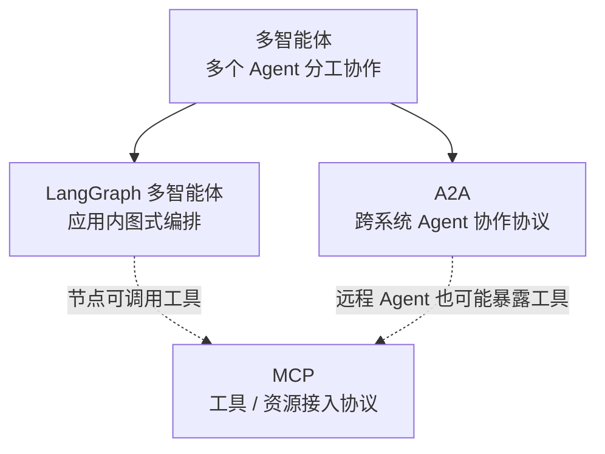
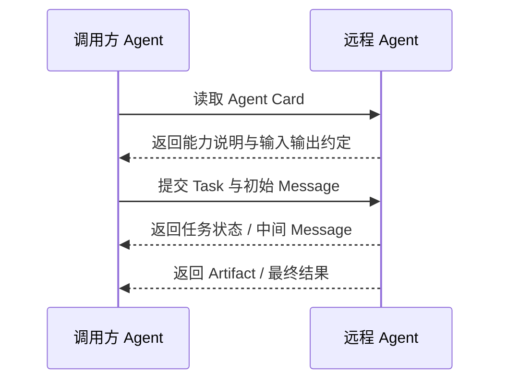
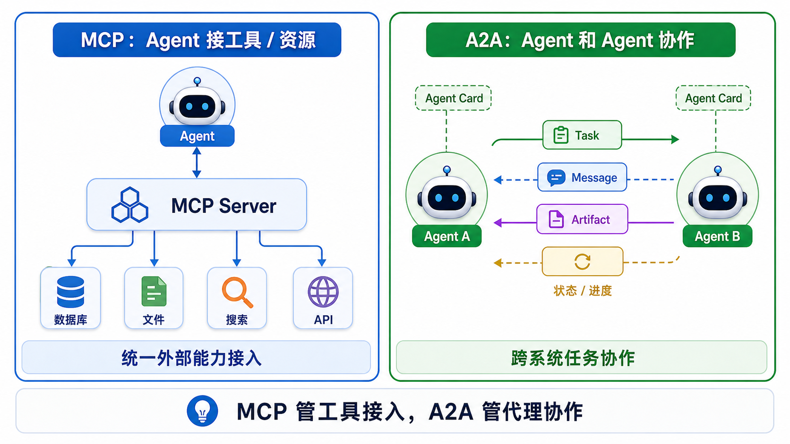
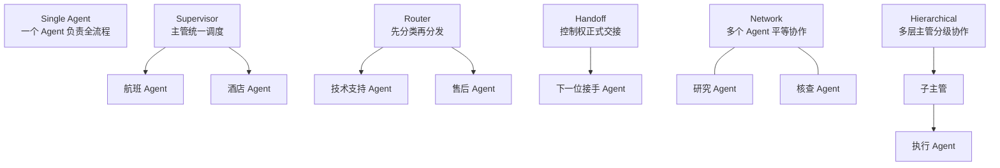
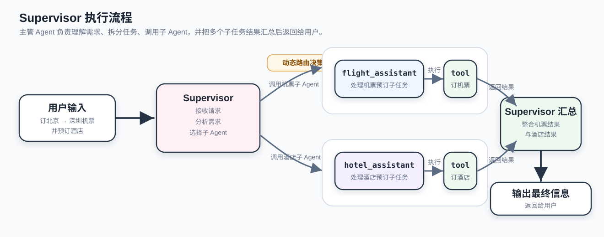
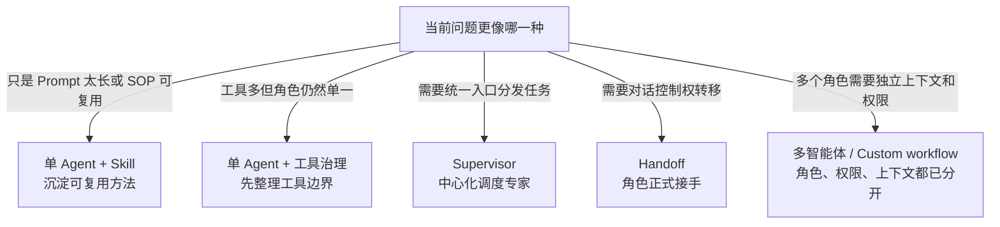

# 26 - LangGraph Multi-Agent and A2A

---

**Chapter Learning Objectives:**

- Understand what problems **Multi-Agent** actually solves, and know the boundary between it and "a slightly stronger single agent."
- Understand the essential difference between **A2A (Agent-to-Agent)** and **MCP (Model Context Protocol)**, and know why one leans more toward "agent collaboration" while the other leans more toward "tool / resource integration."
- Master common multi-agent patterns: **Subagents / Handoffs / Router / Skills / Custom Workflow**, and be able to make basic architectural choices by combining them with LangGraph's graph capabilities.

**Study Advice:** In this chapter, first separate the layers, then write code: Multi-Agent covers division of labor within an application, MCP covers external capability integration, and A2A covers collaboration between different agent systems. On the first pass, don't memorize A2A specification details; first clarify "who communicates with whom, what is passed, and where the boundaries are," then look at Supervisor, Handoff, and Skills.

**Official Documentation and Resources:** See [Tool Navigation and Reference Index - LangGraph](%E5%B7%A5%E5%85%B7%E5%AF%BC%E8%88%AA%E4%B8%8E%E5%8F%82%E8%80%83%E8%B5%84%E6%96%99%E7%B4%A2%E5%BC%95.md#LangGraph) and [Tool Navigation and Reference Index - Tool Calling, MCP, and Agents](%E5%B7%A5%E5%85%B7%E5%AF%BC%E8%88%AA%E4%B8%8E%E5%8F%82%E8%80%83%E8%B5%84%E6%96%99%E7%B4%A2%E5%BC%95.md#工具调用、mcp与智能体).

---

## 1. Multi-Agent and A2A

### 1.1 Overview

On the surface, this chapter introduces **LangGraph Multi-Agent**, **A2A**, **MCP**, **Supervisor**, **Handoff**, and **Skills** all at once, so it is easy to feel that the concepts are mixed together at first.

Let's first break it down into three layers:

| Layer          | Beginner-Level Understanding                                        |
| -------------- | ------------------------------------------------------------------- |
| **Multi-Agent**  | A system design approach: multiple Agents divide work and collaborate to complete tasks |
| **LangGraph**    | An implementation approach: orchestrating multiple Agents locally / within an application using a graph |
| **A2A**          | A communication protocol: enabling different Agent systems to converse in a unified way |

If you separate these three layers first, you won't feel like this chapter is teaching three different courses at the same time later on.



### 1.2 Multi-Agent Definition

Multi-Agent is not simply "opening a few more model calls." It refers to: **breaking complex tasks down and delegating them to multiple specialized Agents, allowing them to divide work, route, and collaborate to complete the overall task together.**

Compared to a single agent, the core change in multi-agent is not "a larger number," but rather: roles begin to divide labor, context begins to be isolated, and control flow begins to be explicitly orchestrated.

Here is the most straightforward example:

- **Single Agent**: One Agent is responsible for checking flights, booking hotels, answering users, and deciding the workflow all at once
- **Multi-Agent**: A supervisor Agent is responsible for dispatching; the flight Agent only handles flights, and the hotel Agent only handles hotels

Therefore, multi-agent is better suited not to tasks that "sound advanced," but to these scenarios:

- Too many tools, such that one Agent can no longer choose among them
- Too many domains, such that a single Agent's context becomes bloated
- Tasks that can naturally be split into multiple roles
- A desire for different teams to maintain different capability modules independently

### 1.3 Don't Default to Multi-Agent

The official LangChain multi-agent documentation also emphasizes: **not every complex task requires multi-agent.**

In many cases, when developers say they want "multi-agent," what they actually want are the following types of capabilities:

- Better context management
- Clearer module boundaries
- More efficient parallelization
- More stable task division

But if the task itself is simple, a single agent with appropriate tools, prompts, and workflows is often enough.

The judgment criterion for this chapter is simple: **multi-agent is not advanced by default; it is worth introducing only when a single agent is already struggling.**

### 1.4 A2A Protocol Definition

A2A stands for **Agent-to-Agent**. It is an open protocol for agent system interoperability, with the goal of enabling different Agents to discover each other, send tasks, exchange messages, and return results in a more standardized way.

In other words: **A2A is concerned with "how Agents collaborate with each other."**

Several core concepts in A2A include:

- **Agent Card**: Equivalent to an Agent's "business card / capability description"
- **Task**: A task sent to a remote Agent
- **Message**: Messages exchanged around a task
- **Artifact**: Content produced during the task process or as a result

1. **First discover the Agent**: The caller first reads `Agent Card` to confirm what the other party can do and what inputs and outputs it supports.
2. **Then submit a Task**: Send the task goal, context messages, and necessary parameters to the remote Agent.
3. **Track status during the process**: Long tasks usually do not finish in one go; the caller obtains task progress through polling, streaming updates, or notifications.
4. **Finally retrieve the result**: Read the final `Message` / `Artifact` and treat it as the output of another Agent system to continue integrating into your own system.

A2A mainly answers these questions:

- How do I know what Agent exists remotely
- What can it do
- How do I hand a task to it
- How does it send intermediate messages and results back to me



It is precisely because A2A is a **cross-agent-system interoperability protocol** that it naturally leans more toward:

- Remote discovery and capability description
- Cross-service task submission and tracking
- Long-task status updates
- Result artifact return

This is quite different from the `Supervisor` / `Handoff` we will look at later in this chapter. The latter mainly happens **within the same application's LangGraph graph**, and the focus is on "how to orchestrate multiple roles" rather than "how to enable two independent Agent platforms to interoperate according to a unified protocol."

### 1.5 The Difference Between A2A and MCP



From a more engineering-oriented perspective:

| Comparison Item | MCP                               | A2A                                 |
| --------------- | --------------------------------- | ----------------------------------- |
| Connection Target | Agents / models with tools, resources, and context | One Agent system with another Agent system |
| Focus           | How tools are exposed, how resources are read | How tasks are submitted, how status is tracked |
| Typical Problem | How a model calls databases, search, and files | How one Agent hands a task to a remote Agent |

A more precise conclusion is:

- **MCP is not responsible for collaboration and division of labor among agents**
- **A2A is not responsible for how specific tools are exposed to models**

They are not mutually exclusive, and they can absolutely coexist in the same system at the same time.

> **Terminology Convention:** In this chapter, "**LangGraph Multi-Agent**" by default refers to **in-application orchestration**, while "**A2A**" by default refers to the **cross-system Agent collaboration protocol**. If you separate these two contexts first, it will be much easier when you later look at Supervisor, Handoff, and remote Agent collaboration.

### 1.6 LangGraph and A2A

It is important to clarify here: **LangGraph Multi-Agent is not equal to A2A.** You can absolutely use LangGraph within a single application to orchestrate multiple Agents into a graph and have them collaborate to complete tasks. That is multi-agent, but it does not necessarily use the A2A protocol.

Conversely, A2A is better suited to describe: Agents in different systems, across processes, across services, across platforms, discovering and collaborating with each other through protocol standardization. So you can understand the relationship as: **LangGraph Multi-Agent** leans more toward "in-application orchestration," while **A2A** leans more toward "inter-system interoperability."

In terms of real projects:

- The same team uses LangGraph within a backend service to orchestrate `supervisor`, `research_agent`, and `writer_agent`; this is usually **in-application multi-agent**
- When your system needs to call a remote legal advisor Agent, reporting Agent, or procurement Agent deployed by another team, that is when **A2A** is more likely needed

Establish a stable judgment here: **LangGraph solves local orchestration problems, and A2A solves cross-system collaboration problems.**

### 1.7 Common Multi-Agent Patterns

The official LangChain multi-agent documentation summarizes the patterns quite clearly. What is most worth absorbing in this chapter is not the performance tables, but the five pattern categories themselves:

- **Subagents**: The main Agent calls sub-Agents as tools
- **Handoffs**: Control can be handed off between different Agents
- **Skills**: A single Agent loads specialized context / skill packages on demand
- **Route**: Route first, then hand the task to a more suitable Agent
- **Custom workflow**: Directly use LangGraph to customize workflows and mix the above patterns together

From a teaching perspective, they can be divided into two broad categories:

- **A central controller dispatching others**: Subagents, Router
- **Control itself is transferred**: Handoffs

And `Skills` is rather special: it is more like a case where you don't necessarily need multi-agent, but instead allow a single Agent to load specialized capabilities on demand.

Combining the typical trade-offs in the official documentation, a very practical judgment can also be derived:

- **Subagents / Router** place more emphasis on context isolation and are more suitable for parallelism
- **Handoffs / Skills** lean more toward state continuity, and repeated requests often save more calls
- **Custom workflow** is suitable when you already know that standard patterns are insufficient and need to mix routing, parallelism, loops, and human intervention yourself

### 1.8 Common Structural Forms of Multi-Agent

Combining official patterns and the LangGraph context, common multi-agent forms can be condensed into the following categories:

- **Single Agent**: One Agent is responsible for the entire task chain; suitable for simple tasks and tutorial beginnings.
- **Supervisor**: A central supervisor is responsible for deciding which sub-Agent to call; suitable for unified entry and centralized dispatching.
- **Handoff**: The current Agent can hand control over to another Agent; more suitable for role switching and session continuity.
- **Router**: First determine which category the task belongs to, then hand the task to a specialized Agent.
- **Network / Peer-to-peer**: Multiple Agents exchange information more equally, with no single supervisor; suitable for research and collaborative problem solving.
- **Hierarchical**: Multiple layers of supervisors and sub-supervisors divide tasks hierarchically; suitable for complex organizational structures.



### 1.9 Use Cases

Returning to real projects, the judgment criterion is not "which architecture sounds cooler," but the following questions:

- Is the context already too heavy?
- Are there so many tools that one Agent is prone to choosing incorrectly?
- Can the task naturally be split into specialized roles?
- Is parallelism needed?
- Is role switching with direct user interaction needed?

First use the following table to aid memory:

| Scenario                         | More Suitable Pattern                 |
| -------------------------------- | ------------------------------------- |
| Single domain, small tasks, unified control | Single Agent / Skills            |
| Multiple tools, multiple specialized roles, unified entry | Supervisor / Subagents     |
| Users switching back and forth between different roles | Handoffs                     |
| First classify, then hand to different experts | Router                       |
| Complex systems, strong workflow orchestration | Custom workflow (LangGraph) |

In modern Agent projects, the more common landing point for multi-agent / A2A is splitting a large task among multiple specialized roles for collaboration, rather than simply "having a few more Agents." For example:

- **Software engineering team-style collaboration**: A planning Agent is responsible for breaking down requirements, a code Agent is responsible for implementation, testing / review Agents are responsible for running verification and pointing out risks, and finally a coordinator aggregates the results.
- **Research agent team**: A retrieval agent gathers materials, a reading/summarization agent extracts evidence, a fact-checking agent performs cross-validation, and a reporting agent outputs structured conclusions with sources.
- **Data analysis agent team**: A data understanding agent explains metric definitions, a SQL/Python agent queries and computes, a chart agent generates visualizations, and a business explanation agent outputs conclusions and recommendations.
- **Parallel code tasks**: When multiple changes are independent of each other, different sub-agents can handle different modules separately, and a Supervisor then consolidates diffs, test results, and conflict risks.

The common thread in these scenarios is that role boundaries are clear, tasks can be split apart, and the process requires coordination or parallelism. If you only need one or two tool calls within a single domain, it is still better to start with a single Agent or a fixed workflow.

### 1.10 Case Study: Single Agent as the Starting Point for Multi-Agent Systems

Before formally moving into multi-agent systems, it is very necessary to keep this case study, because readers need to first see:

- What a single agent looks like
- What problems one Agent plus tools can already solve
- Why some scenarios still do not need multi-agent systems yet

This case can serve as the "starting-point control group" for this chapter. To put it in terms closer to a real project, this case answers the following question: if your system involves only one domain, two or three tools, a unified entry point, and no obvious role switching, then one Agent is often enough. Multi-agent is not the default answer; it becomes more worth introducing only when a single Agent starts to show context bloat, too many tools, or unclear role boundaries.

[Case source code]`案例与源码-3-LangGraph框架/08-multi_agent/LangGraphAgent.py`

[LangGraphAgent.py](../../%E6%A1%88%E4%BE%8B%E4%B8%8E%E6%BA%90%E7%A0%81-3-LangGraph%E6%A1%86%E6%9E%B6/08-multi_agent/LangGraphAgent.py ":include :type=code")

---

## 2. Supervisor and Handoff

### 2.1 Why Learn Supervisor First

Among all multi-agent structures, Supervisor is suitable as an entry point. It has a central supervisor, which makes the structure easier to understand; the control flow is more centralized; and it is closer to the intuition of "a project manager assigning tasks."

For beginners, it is easier to establish a stable understanding with this pattern than with a fully decentralized structure like Network.

### 2.2 Supervisor Definition

The Supervisor pattern can be understood as follows: **A supervisor Agent is responsible for deciding which sub-agent should work on the current task. After the sub-agent finishes, it returns the result to the supervisor.**

Therefore, in a Supervisor structure, the most important thing is not "how many sub-agents there are," but rather:

- Whether the supervisor is the sole dispatch center
- Whether sub-agents focus on their own narrow domains
- Whether users primarily interact with the supervisor

This pattern is especially suitable for enterprise assistants, travel booking, customer service triage, and multi-department collaboration scenarios.



Viewed in terms of the main LangGraph API thread, Supervisor still belongs to the control flow problem discussed in Chapter 24, except that the routing logic has been upgraded from an ordinary conditional function to a supervisor Agent:

- The supervisor Agent acts as a more advanced routing node, responsible for deciding who to hand the next step to.
- Sub-agents can be treated as tools, or they can be orchestrated as nodes in the graph.
- The results of sub-agents still need to return to the shared state and be consumed by subsequent nodes.

Therefore, Supervisor can be understood as follows: **Use the Agent's reasoning ability for dynamic routing, and then use LangGraph's graph and state to keep the collaboration process controllable.**

### 2.3 Supervisor and Subagents

Supervisor and Subagents can be understood together: in many cases, the supervisor does not hand a task over to "another completely independent system." Instead, it invokes sub-agents as a more advanced kind of tool.

If the supervisor invokes sub-agents as tools, it can be viewed this way: users always primarily interact with the supervisor, all routing is decided by the supervisor, and sub-agents act more like "advanced tools." The benefits of this pattern are stronger context isolation, stronger unified control, and clearer engineering boundaries. The costs are usually greater pressure on the supervisor and sometimes an extra layer of invocation overhead.

In many cases, a sub-agent is invoked not because its capabilities are completely different from the main Agent's, but because you want it to complete a full subtask in an **isolated context window** and then return a refined result to the supervisor. From this perspective, multi-agent is not just about "division of labor"; it is also a way to control context size.

### 2.4 Legacy API Case: SupervisorV0.3

This case is mainly meant to help you understand the historical evolution:

What the old approach looked like; why it is now more recommended to migrate to the new API; and how the LangGraph / LangChain multi-agent APIs have evolved.

It is better suited as a case for "understanding the old approach" and "not getting lost when reading old materials" rather than as the most recommended way to start today.

[Case source code]`案例与源码-3-LangGraph框架/08-multi_agent/SupervisorV0.3.py`

[SupervisorV0.3.py](../../%E6%A1%88%E4%BE%8B%E4%B8%8E%E6%BA%90%E7%A0%81-3-LangGraph%E6%A1%86%E6%9E%B6/08-multi_agent/SupervisorV0.3.py ":include :type=code")

### 2.5 Recommended API Case: SupervisorV1.0

This is the Supervisor case that deserves the most focused reading in this chapter. It is better suited to helping readers establish the following chain of understanding:

- How sub-agents are defined
- How the supervisor is created
- How the supervisor coordinates different sub-agents
- Why this structure is suitable for multi-role scenarios like travel booking

If you read it alongside the Agent discussion in Chapter 21 and the main LangGraph thread in Chapters 22-25, this case offers another teaching value: it lets you see that **an Agent created by `create_agent` can absolutely continue to be placed into a larger LangGraph multi-agent structure**. In other words, a single Agent is not the opposite of multi-agent; it is a foundational component within a multi-agent system.

[Case source code]`案例与源码-3-LangGraph框架/08-multi_agent/SupervisorV1.0.py`

[SupervisorV1.0.py](../../%E6%A1%88%E4%BE%8B%E4%B8%8E%E6%BA%90%E7%A0%81-3-LangGraph%E6%A1%86%E6%9E%B6/08-multi_agent/SupervisorV1.0.py ":include :type=code")

### 2.6 Handoff Definition

Handoff and Supervisor are easy to mix up, but they are fundamentally different.

First, look at the most intuitive difference: **Supervisor is more like "the supervisor keeps dispatching others," while Handoff is more like "the current role formally transfers control to the next role."**

In other words: Supervisor focuses on "centralized dispatch"; Handoff focuses on "transfer of control."

### 2.7 Handoff Use Cases

Handoff is especially suitable for these scenarios:

- The role in the conversation actually switches
- The next Agent needs to continue interacting with the user based on the current context
- It is not just an internal tool call, but rather "a different speaking role takes over"

For example:

- A general customer service representative receives the initial inquiry and then passes the issue to technical support
- A general advisor first assesses the situation and then hands it over to a flight specialist
- One Agent completes the analysis and then transfers control to an execution-oriented Agent

There is a point that is easy to misunderstand here: **Not every "role switch" must be split into multiple independent Agents.** Many handoff scenarios can be implemented with a **single Agent + middleware / state machine**. Only when role boundaries, context boundaries, and team maintenance boundaries are already very clear does splitting into multiple Agents yield more obvious benefits.

### 2.8 Case Study: SupervisorHandoff

This case demonstrates:

- Not just "the supervisor invokes sub-agents"
- But how to explicitly construct a handoff
- How to transfer state and task instructions together to the next Agent

From a teaching perspective, this is exactly the bridge from Supervisor to more flexible multi-agent structures.

It is best to focus on two things here:

- Handoff is not just "calling another Agent"; it is **explicitly specifying the next hop**
- During the handoff, you need to think not only about the target, but also about **what context to pass, which messages to retain, and whether to construct a new task description**

What is often truly difficult in multi-agent systems is not "jumping over," but **context engineering**.

From the perspective of the control primitives learned in Chapter 24, Handoff is more closely related to `Command`:

- `Command` is used to express "after the current Agent finishes processing, which Agent should receive control, while also updating the parent graph state."
- Usage like `Command.PARENT` shows that sub-agents or tools do not just return text; they can also influence the parent graph's next-step control flow.
- `Send` is better suited for dynamically opening up multiple parallel tasks. If it is just a single explicit role handoff, start by understanding it through `Command`; if you need to distribute multiple subtasks to multiple targets, then consider `Send`.

This is also why Handoff is more powerful than "treating sub-agents as ordinary tool calls": it changes the ownership of control over the entire graph, not just a single function call.

[Case source code]`案例与源码-3-LangGraph框架/08-multi_agent/SupervisorHandoff.py`

[SupervisorHandoff.py](../../%E6%A1%88%E4%BE%8B%E4%B8%8E%E6%BA%90%E7%A0%81-3-LangGraph%E6%A1%86%E6%9E%B6/08-multi_agent/SupervisorHandoff.py ":include :type=code")

### 2.9 Choosing Between Supervisor and Handoff

First, remember these two decision criteria:

- If you want **a central supervisor to always be responsible for coordination**, prefer **Supervisor**
- If you want **roles to be able to formally hand over control to one another**, prefer **Handoff**

You can use a more colloquial phrase to help you remember:

- **Supervisor**: The supervisor is always online
- **Handoff**: It is now someone else's turn to formally take over

In many real projects, these two are not mutually exclusive; they are used together:

- At the macro level, use Supervisor for unified dispatch
- Allow Handoff in certain local workflows

---

## 3. The Boundary Between Skills and Multi-Agent Systems

Chapter 27 will systematically cover Agent Skills. This chapter only keeps one boundary issue related to multi-agent design: **Skills can enhance an Agent, but Skills themselves are not a multi-agent pattern.**

### 3.1 A Skill Is Not an Independent Agent

A Skill is a reusable capability package, usually containing prompts, workflows, templates, scripts, and reference materials. It answers the question:

```text
遇到这类任务时，应该按什么方法做？
```

An Agent answers the question:

```text
当前任务该怎么拆、先做什么、调用什么工具、什么时候交给谁？
```

Therefore, a Skill is not responsible for autonomous decision-making, nor is it responsible for negotiating with other Agents. It is more like a professional instruction manual that can be loaded on demand. Both the main Agent and sub-agents can attach Skills, but it is still the Agent that truly decides whether to use a Skill.

### 3.2 Single Agent + Skills

Many tasks do not need to be broken into multiple agents immediately.

If the problem is only that:

- The main prompt is getting longer and longer;
- A certain type of task has a fixed SOP;
- Multiple tasks reuse the same set of templates or specifications;
- The Agent needs to load a large block of professional context on demand;
- There is not yet any clear role division or permission isolation.

Then it is usually better to consider **single Agent + Skills** first.

For example, a coding assistant may need to handle code review, test fixing, commit message generation, and documentation rewriting. These capabilities can first be built as Skills; there is no need to split them into four Agents from the start.

### 3.3 When Multi-Agent Is Actually Needed

It is more worthwhile to upgrade to multi-agent only when the system shows the following characteristics:

| Decision question                         | More likely choice | Reason                              |
| -------------------------------- | ---------------- | --------------------------------- |
| Just reusing a workflow, template, or checklist | Skill            | Capability reuse is enough; no independent role is needed      |
| The same Agent's prompt is too long        | Skill            | Use on-demand loading to reduce pressure on the main context        |
| Many tools but still a single task role       | Skill + tool governance | First sort out capability and tool-selection boundaries          |
| There is already a division among retrieval, analysis, execution, and review | Multi-agent         | Roles have different responsibilities and need independent contexts      |
| Different roles need different tool permissions         | Multi-agent         | Permission isolation is more important than prompt reuse        |
| Explicit transfer of control is needed               | Handoff          | The current conversation state must be taken over by another Agent |
| Centralized dispatch of multiple experts is needed           | Supervisor       | The controlling Agent needs to distribute tasks and consolidate results |



The relationship among the three can be summarized as follows:

```text
Supervisor 负责调度，Handoff 负责交接，Skills 负责沉淀可复用能力。
```

### 3.4 How to Use Skills in Multi-Agent Systems

Skills and multi-agent are not a replacement relationship, but a composition relationship.

A common design in real projects is:

```text
主 Agent
├─ 通用 Skills：任务规划、报告写作、结果汇总
├─ 检索 Agent
│  └─ 检索 Skills：搜索策略、网页摘要、引用规范
├─ 数据库 Agent
│  └─ SQL Skills：表结构说明、查询规范、性能注意事项
└─ 审核 Agent
   └─ 审核 Skills：事实核查、安全检查、格式检查
```

The benefits of doing this are:

- Each Agent's responsibility boundary is clearer;
- Each Agent loads only the Skills it needs;
- General capabilities can be reused, and specialized capabilities can be isolated;
- You don't need to cram all the rules into the main Agent's system prompt;
- Later, replacing a particular Skill usually does not require refactoring the entire multi-agent architecture.

### 3.5 How This Chapter Connects with Chapter 27

This chapter only answers "what is the relationship between Skills and multi-agent systems."

If you want to study these topics systematically:

- How to write `SKILL.md`;
- How to design `description`;
- How to understand progressive loading;
- How to distinguish Skill from Tool, MCP, Memory, and Rules;
- How to use Skills in Codex, Cursor, Claude Code, DeepAgents / LangChain;

Please continue reading [Chapter 27 Agent Skills: Agent Capabilities and AI Coding Tool Practices](27-Skills%E6%8A%80%E8%83%BD%E4%B8%8EAI%E7%BC%96%E7%A8%8B%E5%B7%A5%E5%85%B7%E5%AE%9E%E8%B7%B5.md).

---

**Chapter Review Questions:**

1. When should a single Agent be upgraded to a multi-Agent system?

   **Suggested approach:** Consider a multi-Agent system when the task clearly involves different specialized roles, tool permissions that need to be isolated, an overly long context, an increasingly messy main prompt, or the need for different execution strategies. Splitting just to "look intelligent" usually increases debugging cost.

2. What business scenario can explain the difference between Supervisor and Handoff?

   **Suggested approach:** Supervisor is like a general dispatcher that uniformly assigns tasks and aggregates results; Handoff is like transferring a customer to a more suitable specialist, who then continues handling the case. The former suits centralized control, while the latter suits natural handover between roles.

3. Where are MCP, A2A, and multi-agent systems most easily confused?

   **Suggested approach:** Multi-agent refers to role collaboration within an application, MCP is a protocol for integrating external capabilities, and A2A is a collaboration protocol between different agent systems. They are all related to "connection," but the objects and levels they connect are different.

4. In a multi-Agent system, should shared context be maximized?

   **Suggested approach:** Not necessarily. Sharing too little leads to repeated communication, while sharing too much leaks information and increases noise and cost. Decide which context to share and which to keep internal to a given Agent based on role responsibilities.

**Chapter Summary:**

- **Multi-agent** does not mean "calling a few more models"; it means having multiple specialized roles divide work and collaborate around one task.
- **A2A and MCP are not the same**: MCP is more about connecting models / Agents with tools and resources; A2A is more about interoperability and collaboration between Agents.
- **LangGraph multi-agent is not the same as A2A**: LangGraph is better suited for in-application multi-Agent orchestration, while A2A is better suited as a cross-system agent collaboration protocol.
- **Supervisor and Handoff are two patterns especially worth mastering first**: the former emphasizes central dispatch, while the latter emphasizes transfer of control.
- **Skills** are more like a supplementary layer for capability engineering and context engineering: they are not necessarily equivalent to multi-agent systems, but they can help both single-Agent and multi-Agent systems become more reusable and maintainable, and can also reduce the chaos of cramming all capabilities into one overall Prompt.
- After finishing this chapter, you should at least be able to judge when a multi-agent system is truly needed, rather than treating "the task is a bit complex" as automatically meaning "it must be multi-agent"; be able to distinguish the three boundaries of **LangGraph in-application multi-agent orchestration**, **A2A cross-system collaboration protocol**, and **MCP external capability integration protocol**; know what problems `Supervisor`, `Handoff`, and `Skills` each solve and where they fit; and understand why context passing is a key design point in multi-agent engineering.

**Suggested next step:** It is recommended to first run the 4 cases under `案例与源码-3-LangGraph框架/08-multi_agent` completely, then go back and study them together with [Chapter 20 MCP Model Context Protocol](20-MCP%E6%A8%A1%E5%9E%8B%E4%B8%8A%E4%B8%8B%E6%96%87%E5%8D%8F%E8%AE%AE.md), [Chapter 21 Agent](21-Agent%E6%99%BA%E8%83%BD%E4%BD%93.md), and [Chapter 25 LangGraph Advanced Features](25-LangGraph%E9%AB%98%E7%BA%A7%E7%89%B9%E6%80%A7.md). This will make it easier to truly connect the four layers of "tool integration, single-agent, multi-agent, and protocol interoperability."
