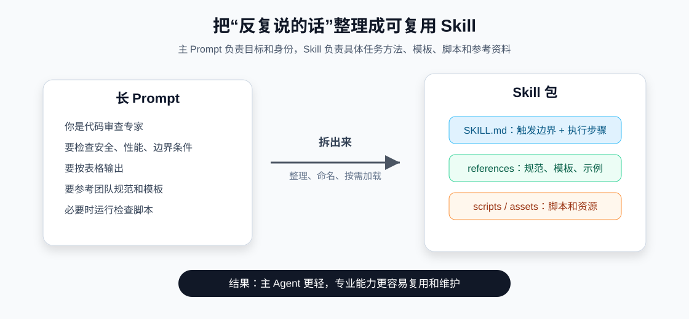
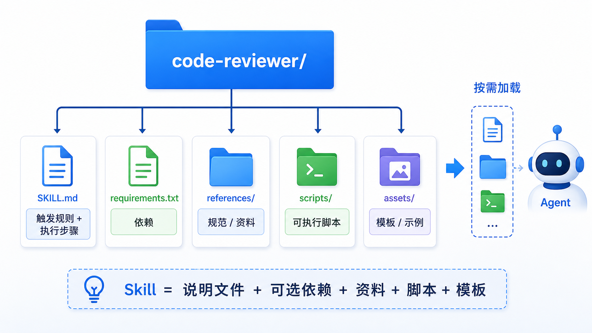
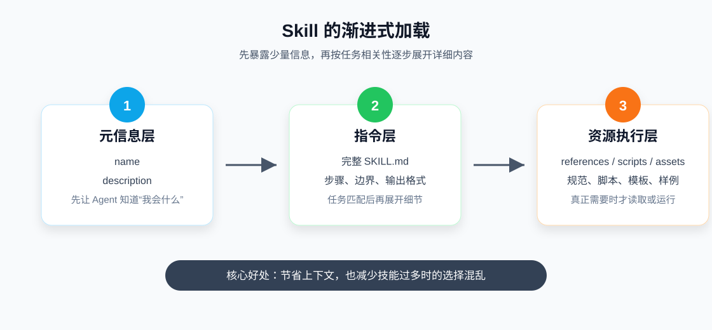
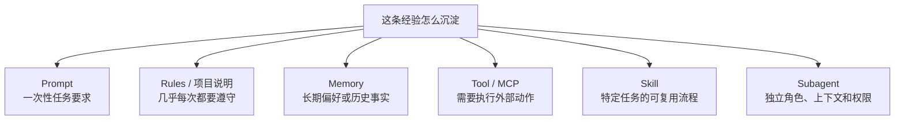

# 27 - Skills and AI Programming Tool Practices

---

**Learning objectives for this chapter:**

- Understand the core positioning of Agent Skills: packaging reusable prompts, workflows, resources, and scripts into capability bundles.
- Master the basic structure, metadata fields, directory organization, and progressive loading mechanism of `SKILL.md`.
- Distinguish the boundaries between Skills and Prompts, Rules, Memory, Tools, MCP, Agents, and Subagents.
- Know how to consolidate and use "skill-based capabilities" in AI programming tools such as Codex, Cursor, Claude Code, and DeepAgents / LangChain.

**Study suggestion:** You can start by thinking of a Skill as "externalizing the proven approach for a type of task into a manual." When reading this chapter, don't just focus on the concepts; it's best to follow the structure of `SKILL.md` and think of a repetitive task of your own: when it should be triggered, what rules to follow, and what scripts or resources are needed. After reading, you should be able to judge whether something should be written into the system prompt, made into a tool, placed into memory, or consolidated into a Skill.

**Official documentation and resources:** See [Tool Navigation and Reference Index - Tool Calls, MCP, Skills, and Agents](%E5%B7%A5%E5%85%B7%E5%AF%BC%E8%88%AA%E4%B8%8E%E5%8F%82%E8%80%83%E8%B5%84%E6%96%99%E7%B4%A2%E5%BC%95.md#工具调用、MCP、Skills与智能体).

---

## 1. Why Skills Are Needed

### 1.1 Problems That Start with "Long Prompts"

Many people, when building their first AI application, start by putting rules directly into the Prompt:

```text
你是代码审查专家。
你要检查安全问题。
你要检查性能问题。
你要按表格输出。
你要遵守团队规范。
你还要参考某个模板。
你还要必要时运行某个脚本。
```

This approach feels quick at first, but as the project grows more complex, it becomes difficult to maintain:

- The Prompt gets longer and longer, wasting context on every call.
- The same set of rules is copied everywhere, making it hard for multiple Agents to stay consistent.
- Rules, templates, scripts, and examples are scattered across chat history, code comments, and documentation.
- In multi-agent projects, it is unclear exactly which capabilities each Agent has.
- It is difficult for team members to reuse workflows that others have already refined.

The value of Skills is to organize these repeatedly used experiences into capability bundles that are reusable, discoverable, and loadable on demand.

### 1.2 Understanding Skill-Based Organization with a Diagram



First, remember a simplified formula: `Skill = 可复用提示词 + 专业流程 + 可选脚本 + 可选资源`

It is suitable for consolidating "not one-off questions, but a type of task that recurs frequently," such as code review standards, Git commit message formats, data analysis steps, weekly report/research report/PRD templates, API debugging workflows, frontend UI review checklists, SQL generation validation rules, and internal corporate documentation writing standards.

If a Tool is "enabling an Agent to perform an action," then a Skill is more like "telling the Agent what method, standards, and process to follow when doing this type of task."

### 1.3 Three Keywords

To understand Skills, you can start with three keywords:

| Keyword | Meaning | Example |
| -------- | ------------------------------ | ----------------------------------------------- |
| Reusable | One set of capabilities can serve multiple tasks | Code review standards, report templates, test repair workflows |
| Discoverable | The Agent can first see the skill name and description | Use `name` and `description` to decide whether to use it |
| On-demand loading | No need to stuff all content into context up front | After the task matches, read the full `SKILL.md`, templates, scripts, and resources |

Together, these three words capture the core engineering value of Skills.

---

## 2. What Exactly Is a Skill

### 2.1 Basic Definition

A Skill can be understood as an external capability bundle for an Agent. It usually contains high-quality prompts, task steps, trigger conditions, output specifications, and optional scripts, dependencies, templates, examples, and reference materials.

Once these contents are packaged, the Agent can load and use the capability in appropriate scenarios.

### 2.2 Engineering Essence

From an engineering perspective, the core of a Skill is not complicated:

```text
Skill = 可复用提示词 + SOP + 可选脚本 + 可选资源
```

For example, if you write a "code review skill," it can specify:

- Under what circumstances code review should be triggered;
- Which dimensions to review;
- Which issues must be highlighted;
- What output format to use;
- If scripts need to be run, where they are located;
- If no issues are found, how to express residual risk.

In the future, if other Agents need this capability, they don't have to rewrite the prompt from scratch; they just need to attach this Skill.

The difference between this and simply copying and pasting prompts is that a Skill has a fixed directory structure and metadata, can be recognized by Skill-supporting tools or frameworks, and can be loaded into context on demand.

### 2.3 A Skill Is Not a Replacement for an Agent

This is easy to confuse:

| Object | Question it answers | Essence |
| -------- | -------------------------- | ------------------------------------ |
| Skill | "How should this type of task be done?" | Reusable capability bundle, manual, workflow, and resources |
| Agent | "What should be done now, and what first?" | An entity with reasoning, planning, routing, and execution capabilities |
| Subagent | "Who is responsible for this type of subtask?" | A specialized Agent with independent context and responsibility boundaries |

A Skill is like a "standardized move," while an Agent is like "a person who can choose moves and combine them." An Agent can become more professional by loading Skills, and multiple Agents can reuse the same Skill or mount different Skills; however, a Skill does not make autonomous decisions—whether to use it is still up to the Agent to judge.

### 2.4 One Agent Can Master Multiple Skills

A simple analogy can help:

```text
厨师（Agent）
├─ 技能 1：备菜
├─ 技能 2：炒菜
├─ 技能 3：调味
└─ 技能 4：摆盘
```

AI programming assistants work similarly:

```text
代码助手（Agent）
├─ 技能 1：代码审查
├─ 技能 2：测试修复
├─ 技能 3：提交信息生成
└─ 技能 4：技术文档改写
```

A key judgment to form here is: **A Skill is not a replacement for an Agent, but a way of organizing an Agent's capabilities.**

---

## 3. SKILL.md and Directory Structure

### 3.1 Minimal Directory Structure

A standard Skill is usually a folder containing at least one `SKILL.md` file.

Illustrative structure:

```text
skills/
  emoji-translator/
    SKILL.md
```

Where:

- `skills/` is the skills directory;
- `emoji-translator/` is a specific skill bundle;
- `SKILL.md` is the descriptive file for that skill bundle.

`SKILL.md` usually consists of two parts:

1. YAML Frontmatter: metadata for the model or framework.
2. Markdown body: detailed instructions for the Agent when executing the task.

A minimal example:

```markdown
---
name: emoji-translator
description: 当用户明确要求把自然语言翻译成 Emoji、把 Emoji 解释成文字，或要求“表情翻译/emoji 翻译”时使用。
---

# Emoji Translator Skill

## 角色定位

你是一个表情翻译助手，负责在自然语言和 Emoji 之间转换。

## 触发边界

- 用户明确要求“用表情翻译”“转换成 Emoji”“解释这些 Emoji”时，使用本技能。
- 用户只是普通聊天、提问或写作时，不要主动把内容转成 Emoji。
- 如果用户要求“只用表情”，最终输出只包含 Emoji，不额外解释。
```

### 3.2 Metadata Fields

The two most important metadata fields are:

| Field | Purpose | Recommendation |
| ------------- | ---------------------------------------- | -------------------------------------------- |
| `name` | Unique skill name, usually matching the skill folder name | Use lowercase letters, numbers, and hyphens; avoid spaces and Chinese names |
| `description` | Tells the model when this skill should be used | Clearly state "what it does" and "when to use it" |

Not recommended:

```yaml
description: 一个有用的技能。
```

A clearer approach:

```yaml
description: 当用户要求将中文句子转成表情符号，或要求解释表情符号含义时使用。
```

This is because the model usually looks at `name` and `description` first before deciding whether to load the full Skill. If the description is too vague, the Skill may never be triggered; if it is too broad, it may be incorrectly triggered when it should not be.

### 3.3 Common Extended Fields

Fields supported by different platforms vary. The general approach treats `name` and `description` as the core, while other fields depend on whether the specific tool supports them.

Common extended fields include:

| Field | Common purpose |
| --------------- | ---------------------------------------------------- |
| `license` | Marks the skill's license |
| `compatibility` | Describes dependency environment, network access, and runtime restrictions |
| `metadata` | Stores author, version, team, and maintenance information |
| `allowed-tools` | Restricts the tools available after the skill is activated; supported by some platforms |
| `module` | Points to importable modules or auxiliary code; supported by some Agent Skills implementations |

Don't treat all extended fields as required. For beginners, the most important fields remain:

```yaml
---
name: your-skill-name
description: 这个技能做什么，以及什么情况下应该使用它。
---
```

### 3.4 Extended Directory Structure

A complex Skill does not necessarily contain only `SKILL.md`; it can also include scripts, dependencies, and resources.

```text
code-reviewer/
  SKILL.md
  requirements.txt
  references/
    java-style-guide.md
    security-checklist.md
  scripts/
    run_static_check.py
  assets/
    review-template.md
```



The responsibilities of each directory are as follows:

| Path | Purpose |
| ------------------ | ------------------------------ |
| `SKILL.md` | Skill description, trigger rules, and execution steps |
| `requirements.txt` | Python dependencies required by this skill |
| `references/` | Documents, specifications, and templates the skill needs to reference |
| `scripts/` | Scripts that may be invoked during skill execution |
| `assets/` | Samples, images, tables, and material files |

Among these, `references/` can be further divided by purpose:

| Subdirectory or file | Suitable contents |
| ---------------- | -------------------------------------- |
| `templates/` | Report templates, code templates, standard output templates |
| `examples/` | Input and output examples to help the Agent understand expected formats |
| `config/` | Configuration files such as check rules, field mappings, and default parameters |
| `style-guide.md` | Team coding standards, writing standards, and brand guidelines |

The model does not automatically know how to use these scripts and resources. You need to clearly document this in `SKILL.md`:

```markdown
当需要做静态检查时，运行 `scripts/run_static_check.py`。
当需要判断 Java 代码风格时，参考 `references/java-style-guide.md`。
最终输出格式参考 `assets/review-template.md`。
```

### 3.5 What the Body Should Clearly Specify

The body of `SKILL.md` should not just state wishes; it should describe the execution path.

| Information | Question it should answer |
| -------- | ------------------------------------ |
| Role positioning | What professional role this Skill makes the Agent play |
| Trigger boundaries | When to use it and when not to use it |
| Execution steps | In what order to complete the task |
| Resource references | Which templates, specifications, examples, or scripts need to be read |
| Output format | What the final result should look like |

Not recommended:

```markdown
请帮用户写出高质量报告。
```

More recommended:

```markdown
1. 先识别报告类型：调研、复盘、周报、项目总结。
2. 如果用户没有给出目标读者，默认目标读者是业务负责人。
3. 报告必须包含：背景、核心结论、证据、风险、下一步建议。
4. 如果证据不足，先列出需要补充的信息，不要强行下结论。
5. 最终输出使用 Markdown 二级标题组织。
```

---

## 4. Progressive Loading Mechanism

### 4.1 On-Demand Loading

If a project has many Skills, and each Skill has a large block of instructions, script introductions, and resource references, it is impossible to stuff everything into the model context from the start.

This causes three problems:

- The context window quickly gets overwhelmed.
- Token costs increase.
- The model has a harder time choosing when faced with too many skills.

Skills therefore typically use **Progressive Disclosure**.

### 4.2 Three-Layer Loading Diagram



The loading process can be understood as three layers:

| Layer | Loaded content | When loaded |
| ---------- | ------------------------------------ | -------------------------------------- |
| Metadata layer | `name`, `description`, and other Frontmatter | When the Agent starts or scans Skills |
| Instruction layer | Full `SKILL.md` body | When the model determines the current task requires this Skill |
| Resource execution layer | `references/`, `scripts/`, `assets/` | Only read or run further when the task truly requires it |

The loading order can be remembered as: first let the model know "what I can do," then after task matching, expand "how exactly to do it," and only read scripts, templates, and materials when truly needed.

### 4.3 description is the trigger sign

`description` is the "trigger sign" of a Skill.

If it is written too broadly:

```yaml
description: 用来处理文档。
```

It is hard for the model to judge: is it a Word document, PDF document, Markdown document, or technical document?

A better way to write it:

```yaml
description: 当用户要求审查 Markdown 技术教程的结构、标题层级、代码块说明和读者理解难度时使用。
```

This kind of description includes all of the following:

- Task object: Markdown technical tutorial;
- Task action: review structure, headings, and code block explanations;
- Trigger condition: the user asks for a document review;
- Applicable boundary: not all documents trigger it.

### 4.4 How to test whether triggering is stable

After writing a Skill, do not just check whether the file exists; more importantly, test whether it can be triggered in appropriate scenarios.

You can prepare three types of test sentences:

| Test sentence type | Purpose | Example |
| ---------- | ---------------------------- | ---------------------------------------- |
| Explicit trigger | Verify that the model knows it should use this Skill | "Please use the code review skill to review this diff." |
| Implicit trigger | Verify whether the description covers real-world expressions | "Help me check whether this PR has any security or boundary issues." |
| Should not trigger | Verify whether the boundary is clear | "Explain what this code is doing." |

If even explicit triggering is unstable, it is usually a problem with the path, metadata, or tool configuration.
If implicit triggering is unstable, it is usually because `description` is not written closely enough to real user expressions.
If it triggers frequently when it should not, it is usually because `description` is written too broadly.

---

## 5. Boundaries between Skills and other capabilities

### 5.1 Overview of boundaries


> **Caption:** Skill sits between "prompt engineering" and "Agent engineering". It does not directly replace Tool, MCP, or Agent, but organizes task methods and contextual resources into reusable units.

### 5.2 Prompt, Rules, Memory, and Skill

These four concepts are all related to "context", but they serve different purposes:

| Form | What to put in it | Typical example |
| ----------------- | -------------------------------- | -------------------------------------------- |
| Prompt | One-time requirements for the current task | "Rewrite this text to be more conversational" |
| Rules / AGENTS.md | Project rules that are relevant almost every time | "This project uses pnpm" "API response structure is unified" |
| Memory | Historical facts, user preferences, long-term state | "The user prefers concise answers" "This project has been migrated to FastAPI" |
| Skill | Processes, templates, and resources needed only for specific tasks | "Code review process" "Weekly report template" "SQL generation standards" |

A quick one-line summary:

```text
Prompt 是临时指令。
Rules 是常驻规矩。
Memory 是历史状态。
Skill 是可复用做法。
```

### 5.3 Tool, MCP, and Skill

Tool, MCP, and Skill are often discussed together, but they solve different problems:

| Form | What problem it solves | One-line understanding |
| ----- | ------------------------------ | ------------------------------ |
| Tool | Executes a specific action | "What action can I perform" |
| MCP | Connects external tools and resources through a unified protocol | "How to standardize the integration of external capabilities" |
| Skill | Encapsulates task methods, processes, rules, and resources | "What method should be followed for this type of task" |

For example:

```text
Tool：run_tests()
MCP：把 GitHub、数据库、文件系统按统一协议暴露给 AI 应用
Skill：测试修复流程，说明什么时候运行测试、如何定位失败、如何写回归用例、最终如何汇报
```

The two are often used together. A Skill can tell the Agent when to call which Tools, while the Tool is responsible for actually executing the action.

### 5.4 Agent, Subagent, and Skill

A Subagent is an independent role that usually has its own context, tools, and responsibility boundaries.

A Skill is a capability package that can be attached to a main Agent or a Subagent.

| Judgment question | What is more suitable |
| ------------------------------------- | ------------ |
| It is only an additional reusable process and output format | Skill |
| An Agent can already do it, but the Prompt is too long | Skill |
| It requires independent context, independent tools, and independent responsibilities | Subagent |
| It requires collaboration among multiple roles, task distribution, and result collection | Multi-agent |

A common misconception is: as soon as a task becomes complex, split it into Subagents.

A more reliable way to judge is:

```text
如果只是“同一个 Agent 需要掌握一套专业做法”，优先 Skill。
如果已经出现“不同角色、不同权限、不同上下文、不同工具集合”，再考虑 Subagent。
```

---

## 6. How to write a high-quality Skill

### 6.1 How to write the description

A good `description` should ideally answer four things at once:

| Key point | Example |
| ------------ | ------------------------------------------------ |
| What it does | Review Python / FastAPI backend code |
| When to use it | When the user requests a code review, looks for bugs or security risks |
| What input it handles | diff, PR, file path, code snippet |
| Do not be too broad | Do not write descriptions like "help write code" that could match any scenario |

Recommended template:

```yaml
description: 当用户要求【任务动作】，并且输入是【输入类型】，目标是【预期结果】时使用。不要用于【排除场景】。
```

For example:

```yaml
description: 当用户要求审查 React 组件的可访问性、响应式布局、状态交互和设计一致性时使用。不要用于普通业务逻辑解释。
```

### 6.2 Skills should be small and focused

A Skill should ideally solve only one type of capability.

Clear Skills:

- `python-code-reviewer`
- `fastapi-api-debugger`
- `markdown-doc-editor`
- `sql-query-writer`
- `frontend-accessibility-reviewer`

Overly large Skills:

- `developer-helper`
- `all-in-one-agent`
- `document-tool`
- `data-everything`

The larger a Skill is written, the vaguer the trigger conditions become, and the harder it is for the model to judge when to use it.

### 6.3 How to organize scripts and resources

Content suitable for scripts:

- Format checking;
- Static scanning;
- Data cleaning;
- Template rendering;
- Conversion logic with clear dependencies;
- Repeatable, testable, highly deterministic steps.

Content not suitable for scripts:

- Tasks that require a lot of subjective judgment;
- One-off temporary operations;
- Commands that depend on the user environment but lack documentation;
- Operations with high-risk side effects, such as dropping databases, sending emails, or charging payments.

A good rule of thumb is:

```text
能稳定自动化的部分交给脚本；
需要理解、判断和表达的部分交给模型；
两者之间的流程写在 SKILL.md 里。
```

### 6.4 Do not bypass safety boundaries

A Skill can describe a process, but do not let the Skill replace permission control.

High-risk actions include:

- Deleting files;
- Dropping databases;
- Sending emails;
- Calling payment APIs;
- Modifying production configuration;
- Executing irreversible scripts.

These actions should be controlled by tool permissions, manual approval, middleware, sandboxes, and business idempotency design. A Skill can only write rules; it cannot replace safety boundaries.

### 6.5 Naming and maintenance

Skills in a team should be treated as engineering assets:

- Stable names, preferably lowercase letters, numbers, and hyphens;
- Put them under version control;
- Clearly document the maintainer, version, and important changes;
- Provide example inputs and example outputs;
- Regularly remove outdated Skills;
- Perform minimum viable tests on scripts;
- Conduct security reviews of external dependencies and permissions.

---

## 7. Skills practices in AI programming tools

Different AI programming tools support Skills in different ways. When learning, do not just memorize directory names; understand the three types of capabilities behind them:

| Capability type | Representative form | Problem it solves |
| ------------ | -------------------------------------- | --------------------------- |
| Skill packages | `SKILL.md`, `skills/` directories | Load professional processes and resources by task |
| Persistent rules | `.cursor/rules`, `AGENTS.md`, project instructions | Keep the Agent consistently compliant with project conventions |
| External tool connections | MCP, plugins, Connectors | Allow the Agent to access external systems and actions |

### 7.1 How to understand Skills in Codex

OpenAI's Skills materials define a Skill as a reusable, shareable workflow that can include instructions, examples, and even code. The OpenAI Help Center also states that Skills support ChatGPT, Codex, and the API, and follow the Agent Skills open standard.

In AI programming tools like Codex, Skills are especially suitable for consolidating these capabilities:

- `code-reviewer`: unify code review standards;
- `test-driven-development`: fixed TDD process;
- `systematic-debugging`: when encountering a bug, first reproduce, then locate, then fix;
- `frontend-design-review`: check UI, accessibility, and responsive layout;
- `release-notes-writer`: generate release notes in the team format;
- `migration-planner`: framework upgrade or API migration plan.

The typical usage approach is:

1. Create an independent skill directory.
2. Put `SKILL.md` in the directory.
3. Use `name` and `description` to explain when the skill is triggered.
4. Write the detailed steps, checklists, and output format in the body.
5. If templates, scripts, or examples are needed, put them under the skill directory and explicitly reference them in `SKILL.md`.
6. Directly propose a task that matches the Skill to test whether triggering is stable.

In Codex, do not write all project rules as Skills. For example, content such as "this project responds in Chinese", "do not modify lock files", or "what is the test command" is relevant almost every time and is better placed in project-level instructions, rule files, or repository documentation. Skills should be reserved for specific tasks.

### 7.2 Skill-based consolidation in Cursor

The Cursor official documentation mainly introduces Rules. Rules can control the behavior of the Agent and Inline Edit, and are reusable, scope-limited system-level instructions.

Common Cursor rule directories:

```text
.cursor/
  rules/
    api-style.mdc
    frontend-components.mdc
    code-review.mdc
```

An example `.mdc` rule:

```markdown
---
description: 当修改 FastAPI 接口、Schema 或错误处理逻辑时使用。
globs: api/**/*.py
alwaysApply: false
---

- API 返回结构统一使用 `{ code, message, data }`。
- 新增接口时必须补充请求参数和错误响应说明。
- 修改数据库查询逻辑时，优先检查分页、空结果和异常处理。
```

Cursor Rules and Agent Skills are not exactly equivalent:

- Rules lean more toward project persistent rules, path rules, and team conventions;
- Skills lean more toward a complete capability package triggered by task;
- Cursor's `Agent Requested` rules are close to the triggering idea of Skills: both let the model judge whether it is needed based on the description;
- If you want to reuse the Skills approach in Cursor, you can write "skill-based content" as focused `.mdc` rules, or use `AGENTS.md` for project-level instructions.

Recommended usage:

| Scenario | Where it is more suitable in Cursor |
| ----------------------------- | ------------------------------ |
| Project architecture, code style, directory conventions | `.cursor/rules` or `AGENTS.md` |
| Development standards for a specific directory | Nested `.cursor/rules` |
| Processes that the Agent can judge whether it needs | `Agent Requested` type rules |
| One-off task prompts | Current conversation Prompt |

### 7.3 Agent Skills in Claude Code

Claude Code's support for Agent Skills is closer to the standard `SKILL.md` directory model.

Common locations:

```text
# 个人 Skills，跨项目使用
~/.claude/skills/

# 项目 Skills，跟随项目一起版本管理
.claude/skills/
```

Example within a project:

```text
.claude/
  skills/
    git-commit-writer/
      SKILL.md
    api-debugger/
      SKILL.md
      scripts/
        check_openapi.py
```

Claude Code Skills are triggered automatically by the model. You do not need to manually enter a command like a slash command. The key is still that `description` is written clearly enough.

When sharing within a team, you can put project-level Skills into `.claude/skills/` and commit them together with the code; keep each Skill small and focused, clearly document dependencies, scripts, and output format in `SKILL.md`, and remind team members to restart or reload Claude Code after changes.

### 7.4 Skills in DeepAgents / LangChain

DeepAgents Skills lean more toward framework capabilities. It reads `SKILL.md` from a specified directory, checks the metadata first, and then reads the full skill content as needed.

In DeepAgents, a common configuration approach is:

```python
from pathlib import Path

from deepagents import create_deep_agent
from deepagents.backends.filesystem import FilesystemBackend

current_dir = Path(__file__).parent

backend = FilesystemBackend(
    root_dir=str(current_dir),
    virtual_mode=True,
)

agent = create_deep_agent(
    model=llm,
    backend=backend,
    skills=[str(current_dir / "skills")],
    system_prompt="你是一个可以按需使用 Skills 的智能助手。",
)
```

Here, three paths need to be distinguished:

| Concept | Example | Description |
| -------------- | ------------------------------- | -------------------------------------------- |
| Physical path       | `base/skills/`                  | The directory on the local disk where Skills are actually stored              |
| Backend root directory | `base/`                         | The location that `FilesystemBackend(root_dir=...)` points to |
| Agent configuration path | `skills=[str(base / "skills")]` | The source of the Skill directory passed to `create_deep_agent`   |

DeepAgents Skills also require attention to three boundaries:

- `SKILL.md` is not suitable for being written too long. Large reference materials, templates, and examples should preferably be placed in directories such as `references/` and `assets/`, and then explained in the main text regarding when to read them.
- If multiple Skill sources are configured, priority issues usually arise when names are duplicated. Teams should avoid Skills with the same name as much as possible, or clearly define override relationships.
- Custom Subagents do not necessarily automatically inherit the main Agent's Skills. Skills needed by a child Agent must be explicitly declared in its own configuration.

In LangChain, a more general approach can also be used to implement Skills: give the Agent a `load_skill` tool, first inject the skill description into the system prompt, and then call the tool to load the full content when the model determines it is needed. This is consistent with the idea of progressive disclosure.

---

## 8. When Should You Write a Skill

### 8.1 Scenarios Suitable for Writing as a Skill

Scenarios suitable for using a Skill:

- A set of prompts will be reused by multiple Agents or across multiple tasks;
- A task has fixed steps and output formats;
- A capability needs to include scripts, templates, or reference materials;
- You want to separate the "capability description" from the main prompt;
- You want to reduce the length of the main Agent's system prompt;
- The team has a set of standard processes it wants to reuse;
- A certain type of task requires loading a large amount of context on demand, rather than stuffing it into the Prompt every time.

Typical examples:

| Skill name                        | Suitable content to encapsulate                             |
| --------------------------------- | ------------------------------------------ |
| `code-reviewer`                   | Review dimensions, severity levels, output format, test gap judgment |
| `markdown-doc-editor`             | Document structure, heading levels, code block explanations, reader perspective   |
| `frontend-accessibility-reviewer` | Accessibility, keyboard operation, semantic tags, visual hierarchy     |
| `sql-query-writer`                | Table structure descriptions, query specifications, performance considerations         |
| `incident-postmortem-writer`      | Postmortem template, timeline, scope of impact, improvement items     |

### 8.2 Scenarios Not Suitable for Writing as a Skill

Scenarios not suitable for using a Skill:

- It is just a one-off small tip;
- The task is very simple and not worth encapsulating separately;
- The trigger conditions are vague, making it difficult for the model to determine when to use it;
- Multiple Skill descriptions overlap and are likely to compete for the same task;
- The content needs to be loaded almost every time and is more suitable for Rules or project documentation;
- It is essentially an external action and is more suitable as a Tool or MCP;
- It requires independent context and responsibility isolation and is more suitable as a Subagent.

### 8.3 A Mnemonic for Judgment

You can use the following set of questions to judge:

```text
这个能力会重复用吗？
它有明确触发条件吗？
它有固定步骤或输出格式吗？
它需要附带模板、资料或脚本吗？
它不适合每次都放进主提示词吗？
```

If most of the answers are "yes," it is suitable to write as a Skill.



---

## 9. Common Issue Troubleshooting

| Problem symptom                    | Troubleshooting direction                                                 |
| --------------------------- | -------------------------------------------------------- |
| Agent is completely unaware of the Skill's existence | Check whether the directory is placed correctly, whether the tool supports that directory, and whether a restart or reload is needed |
| Skill directory exists but is not triggered    | Check whether `description` clearly states the trigger scenarios                       |
| Wrong Skill is triggered          | Check whether multiple Skill descriptions are too similar and whether responsibilities overlap                |
| Output remains unstable after triggering          | Check whether `SKILL.md` clearly specifies execution steps, output format, and failure handling          |
| Resources or scripts cannot be found            | Check whether relative paths are correct and whether they are explicitly referenced in `SKILL.md`           |
| Script fails to run                | Check whether dependencies are installed, whether permissions are sufficient, and whether the script depends on nonexistent environment variables |
| Skill keeps getting longer              | Consider whether it should be split into multiple smaller Skills, or whether large amounts of material should be moved into `references/` |
| Agent loads the Skill every time      | Check whether the description is written too broadly and whether it should be changed to Rules or project-level documentation      |

Remember this: a Skill is not an automatic plugin system. It mainly relies on metadata, descriptions, and task matching to let the model determine when to use which capability.

---

## 10. Complete Example: Code Review Skill

Below is a Skill example that can be directly referenced.

Directory structure:

```text
skills/
  code-reviewer/
    SKILL.md
    references/
      severity-guide.md
```

`SKILL.md`:

```markdown
---
name: code-reviewer
description: 当用户要求进行代码审查、审查 PR、审查 diff、查找 Bug、安全风险、性能问题、并发问题或测试缺口时使用。不要用于普通代码解释。
---

# Code Reviewer Skill

## 角色定位

你是一个严谨的代码审查助手。你的目标是发现真实风险，而不是泛泛表扬或重写代码。

## 适用场景

- 用户要求 code review、代码审查、PR 审查、diff 审查。
- 用户要求查找 bug、安全风险、性能问题、并发问题或测试缺口。
- 用户提供文件路径、代码片段、提交内容或 PR 内容，并要求评估风险。

## 不适用场景

- 用户只是要求解释代码。
- 用户只是要求实现新功能。
- 用户只是要求格式化或翻译注释。

## 审查范围

优先检查这些问题：

1. 安全风险：SQL 注入、命令注入、路径遍历、硬编码密钥、敏感信息泄露。
2. 正确性问题：边界条件、空值处理、异常处理、并发问题、状态不一致。
3. 性能问题：重复计算、无效循环、过大内存占用、明显低效的 I/O。
4. 可维护性：命名不清晰、职责混乱、重复代码、关键注释缺失。
5. 测试缺口：重要分支、异常路径或高风险逻辑缺少测试。

## 输出规则

- 先列问题，再给总结。
- 只报告有依据的问题，不要为了凑数量编造风险。
- 如果没有发现明确问题，直接说明“未发现明确问题”，并补充剩余风险或测试缺口。
- 每个问题都要包含：严重级别、位置、问题说明、修改建议。
- 严重级别使用：高危、中危、低危。

## 输出格式

| 严重级别       | 位置        | 问题     | 建议     |
| -------------- | ----------- | -------- | -------- |
| 高危/中危/低危 | 文件名:行号 | 具体问题 | 修改建议 |

## 参考资料

如需判断严重级别，参考 `references/severity-guide.md`。
```

This example reflects the engineering significance of a Skill: what it consolidates is not a single prompt sentence, but a reusable professional SOP. After other Agents or team members mount this Skill, they can reuse the same set of code review standards.

---

**Chapter reflection questions:**

1. What kind of experience is suitable to be consolidated into a Skill, rather than continuing to be stuffed into the main prompt?

   **Reference idea:** Experience that recurs frequently, has clear trigger scenarios, has relatively stable steps, and requires supporting resources or scripts is suitable for a Skill. Occasional one-time requirements can simply stay in the current Prompt.

2. What problems will arise if `description` is written too broadly or too narrowly?

   **Reference idea:** If it is too broad, it will be triggered incorrectly, and the model will want to use it for every task. If it is too narrow, it will not be triggered when it should be. A good description should clearly state "what it does, when to use it, and when not to use it."

3. How should the boundaries among Skill, Tool, and Subagent be judged?

   **Reference idea:** A Skill is a reusable method and material set, a Tool is an executable action, and a Subagent is an execution role with independent responsibilities. Writing a Skill is not the same as adding a new agent, nor is it the same as giving the model a new API.

4. If you were to write a Skill for code review, what content should be most clearly stated in the main text?

   **Reference idea:** Clearly state the review scope, priorities, output format, severity judgment, what not to do, files that need to be reviewed, and optional scripts. A Skill should be able to guide stable behavior, rather than just saying "please review carefully."

**Chapter summary:**

This chapter understands Agent Skills in an engineering context: a Skill is an external capability package used to encapsulate reusable prompts, execution rules, auxiliary scripts, and resource files. Its core file is `SKILL.md`, in which `name` and `description` are responsible for helping the model determine whether it needs to load the complete skill description.

The key mechanism of a Skill is progressive loading: first look at the name and description, then load the complete `SKILL.md` after task matching, and only read resources or run scripts when truly needed. This saves context and also makes it easier to reuse professional capabilities across different Agents.

Finally, it is important to distinguish the boundaries:

| Capability              | Primary problem it solves                        |
| ----------------- | --------------------------------------- |
| Prompt            | One-time instructions for the current task                    |
| Rules / AGENTS.md | Long-term project rules, team preferences, resident context      |
| Memory            | Historical facts, user preferences, long-term state            |
| Tool              | Execute explicit actions, such as search, database queries, file writes      |
| MCP               | Standardized integration with external tools, resources, and services          |
| Agent / Subagent  | Decision-making, planning, division of labor, and execution                  |
| Skill             | Provide reusable professional prompts, SOPs, scripts, and resources |

In real projects, a Skill is often not used alone but combines with Tools, MCP, Memory, Subagents, and middleware to form a complete agent system. The core criterion for deciding whether to write a Skill is: whether this capability will be reused, whether it has clear trigger boundaries, whether it has a fixed process or output format, and whether it is worth separating from the main prompt.
