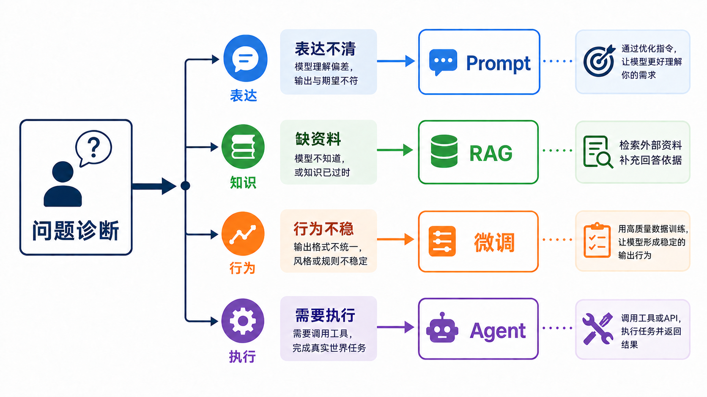
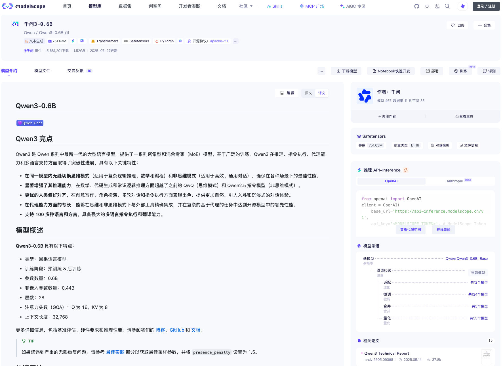
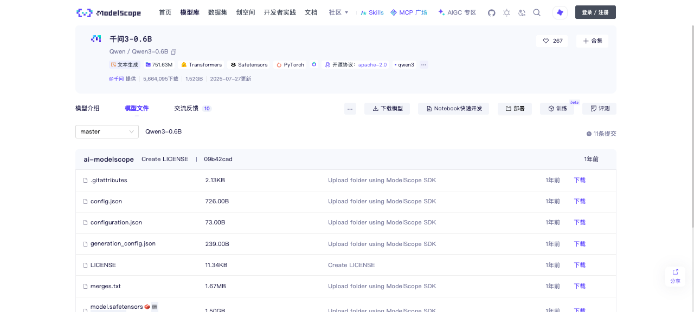
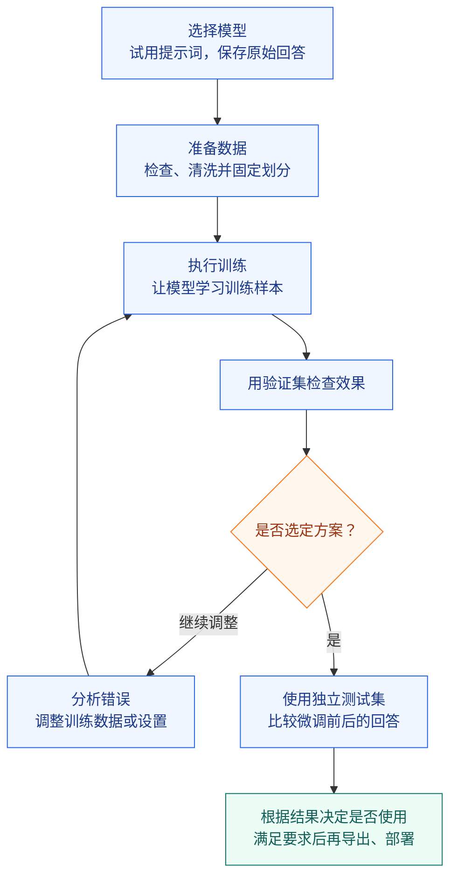

# 28 - Overview of LLM Fine-Tuning and the Overall Process

---

**Chapter learning objectives:**

- Be able to explain the difference between fine-tuning and inference, and describe what kind of samples are used to train a model in supervised fine-tuning.
- Be able to decide, based on the actual problem, whether to first adjust the prompt, add supporting materials, call tools, or consider fine-tuning.
- Be able to distinguish the basic roles of pre-training, supervised fine-tuning, and preference alignment, and choose a suitable starting point by reading model introductions.
- Be able to explain the relationship between SFT, LoRA, and QLoRA, and understand why this course can "use LoRA for SFT."
- Be able to clearly state task requirements, save a baseline, and describe the main outputs of the data preparation, training, evaluation, and export stages.

**Study suggestion:** Start with the short library passage to distinguish the input, expected output, and the actual problem, then build an overall understanding by following the sequence "judge whether fine-tuning is needed → select a model → prepare data → train → check results." On the first pass, focus on why each step is necessary and what it produces; formulas and training parameters are left for Chapter 30. After reading, organize the task agreement and baseline records according to Section 7, as a starting point shared by the following chapters.

**Official documentation and resources:** See [Tool Navigation and Reference Index - Fine-Tuning and Model Alignment](%E5%B7%A5%E5%85%B7%E5%AF%BC%E8%88%AA%E4%B8%8E%E5%8F%82%E8%80%83%E8%B5%84%E6%96%99%E7%B4%A2%E5%BC%95.md#fine-tuning-and-model-alignment).

---

## 1. A Fine-Tuning Project Starts from a Specific Problem

### 1.1 Task Description

Suppose we are developing an article management system. In addition to the title and body, each article also needs several keywords to help readers quickly understand the topic and to make it easier for the program to retrieve and organize content.

When there are few articles, keywords can be filled in manually; when there are many, we hope the model can automatically extract them after reading the body. This is **keyword extraction**: finding words or phrases from a piece of text that can summarize its topic.

Let us first look at an easy-to-understand example:

```text
文章：
市图书馆周末开设儿童阅读课，读者可通过公众号预约。

参考关键词：
市图书馆;儿童阅读课;公众号预约
```

Why were these keywords chosen?

- **City Library** indicates who offers the course.
- **Children's Reading Class** indicates what activity is being held.
- **Official Account Reservation** preserves the information about how to participate.

In contrast, words such as "offers" and "through," although they appear in the original text, can hardly summarize the topic on their own. Keyword extraction is not simply picking a few words that happen to appear.

The keywords here are a set of reference answers given for explanation; they do not mean this passage has only one reasonable choice. When actually preparing training data, the scope and phrasing of the selected words need to be unified.

**Output format requirements:**

Suppose the program receives the following result:

```text
市图书馆;儿童阅读课;公众号预约
```

It can then split it into three keywords using the English semicolon `;`, and then save or display them.

But if it receives:

```text
这篇文章介绍了市图书馆的阅读课，关键词包括：
1. 市图书馆
2. 儿童阅读课
3. 公众号预约
```

A human can still understand it, but the program cannot directly process it according to the same rules and would need to remove the explanatory text and numbering.

Therefore, the requirement in this course is: **input Chinese text and output topic keywords; separate keywords with English semicolons, without adding explanations, numbering, or a "Keywords:" prefix.** The English semicolon is the output format agreed upon for this project.

Chapters 28 to 33 will revolve around this task to learn data preparation, training, and validation. The library passage is a teaching example; actual exercises use the keyword data included with the course, and Chapter 29 will open real records and examine them item by item.

### 1.2 Save the Original Answer First: Understanding the Baseline

**Baseline** is the starting point for comparison: give the text and output requirements to a model that has not yet been fine-tuned for this task, and save its answers verbatim. This record is later used to determine what improvements fine-tuning has brought.

Continuing with the library teaching example, suppose the model returns the following answers. What issues can be recorded for each?

| If the model answers like this                         | What issue to record first                               |
| ---------------------------------------- | -------------------------------------------- |
| `关键词：市图书馆;儿童阅读课;公众号预约` | The chosen words basically meet the requirements, but there is an extra prefix                 |
| `市图书馆，儿童阅读课，公众号预约`       | The content is acceptable, but the specified delimiter is not used             |
| `市图书馆;读者`                          | The format is correct, but it fails to capture "Children's Reading Class," the main content |
| `市图书馆;儿童阅读课;公众号预约`         | No obvious problem has been found in this sample yet; other texts still need to be checked     |

The inspection results need to be divided into two things: **whether the format meets the agreement, and whether the content captures the topic.**

For comparison, always use the same text and the same task description. If before training you only say "find keywords," and only after training add "use English semicolons," then even if the format improves, that improvement cannot be directly attributed to fine-tuning.

### 1.3 Preliminary Judgment of Error Causes

Suppose the model adds "Keywords:" when answering. This may be because it is not good at following the format, or it may simply be that we did not state the requirement clearly.

If adding "do not add a prefix" solves the problem, use the revised prompt first. If the requirement is already clear and the same type of error still occurs across multiple passages of text, then continue to investigate the materials, model, and training data.

---

## 2. Problem Diagnosis Before Fine-Tuning

### 2.1 Clarify the Prompt Requirements

In the earlier [Prompt Engineering Basics](1-2-%E6%8F%90%E7%A4%BA%E8%AF%8D%E5%B7%A5%E7%A8%8B%E5%9F%BA%E7%A1%80.md), we learned that the vaguer the task description, the more likely the model is to answer in its own way. Here, we can apply that method directly to the keyword task.

If we only write "extract keywords" without specifying the output format, we can first change it to:

```text
请从下文中抽取能够概括主题的关键词。
只输出关键词，关键词之间使用英文分号分隔。
不要输出“关键词：”、序号和解释。

待抽取文本：
市图书馆周末开设儿童阅读课，读者可通过公众号预约。
```

Then observe the model's answer. If there are still format issues, we can add a set of "text → expected answer" examples to the prompt so that the model can see the format we want. This is the **Few-shot Prompt** introduced earlier: using a small number of examples to explain the task.

After adding examples, check again with short passages, long passages, and professional texts whose answers have not been shown. The fact that the model can follow the library example does not mean it can handle new articles.

During testing, save each modified prompt separately. That way you can know which modification helped.

In [Section 2.4 of Chapter 32](32-%E5%BE%AE%E8%B0%83%E6%95%88%E6%9E%9C%E8%AF%84%E4%BC%B0%E4%B8%8E%E6%A8%A1%E5%9E%8B%E9%83%A8%E7%BD%B2.md?id=_24-from-single-item-observation-to-batch-testing), this step will be turned into a verification exercise of "original instruction → clarified requirements → added examples." First determine the prompt, then have the original model and the fine-tuned model use the same prompt for comparison; in this chapter, just understand the sequence first.

### 2.2 How to Handle Different Problems

If the prompt is already clearly written but the results are still unsatisfactory, we need to see exactly where the model is stuck.

| Observed problem                                   | How to understand it               | What to try first                   |
| ---------------------------------------------- | -------------------------- | ---------------------------------- |
| Does not know that English semicolons are needed                             | Did not receive a clear format requirement     | Modify the prompt, and add examples if necessary        |
| Does not recognize a product name or abbreviation just released by a company               | Needs supplementary information beyond the original text     | Provide product materials, or retrieve them through RAG      |
| The original text is complete, but the small model always fails to capture the topic           | The current model may not be suitable for this type of text | Use the same text to compare other candidate models         |
| Requirements are clear and examples are consistent, yet the same type of error repeatedly appears across multiple texts | The model is not yet stable enough for this task | Prepare targeted data and evaluate fine-tuning       |
| After extracting keywords, they also need to be saved to a database or notifications sent         | The task includes operations beyond the model's answer | Use a program, workflow, or Agent to call tools |



These methods can be combined. For example, first retrieve a product terminology list, then have the model extract keywords, and finally have a program save the results. Choosing fine-tuning does not mean you no longer need prompts or tools.

For the short library passage, the main information is already in the original text, so it is generally unnecessary to build a knowledge base just for keyword extraction. For something like "how many reservation slots are left for today's reading class," real-time data needs to be queried; we cannot expect fine-tuning to memorize daily changes in slot availability.

For a complete comparison between approaches, see [Chapters 1-3](1-3-RAG%E3%80%81%E5%BE%AE%E8%B0%83%E3%80%81%E7%BB%AD%E8%AE%AD%E4%B8%8E%E6%99%BA%E8%83%BD%E4%BD%93%E9%80%89%E5%9E%8B.md).

### 2.3 When Fine-Tuning Is Appropriate

When prompts and candidate models have already been checked, yet the same type of error still occurs repeatedly, fine-tuning can be evaluated. The prerequisite is that **there is a clear improvement goal, there are correct samples with a consistent writing style**, and there are texts not involved in training that can be used to check results.

Conversely, if today you require semicolons as output, tomorrow you change it to a paragraph of explanation, and the training data contains answers that contradict each other, you should first unify the task and data. It is difficult for a model to learn a consistent approach from such examples.

There is also another common need: a larger model performs well, but the cost of running it is high, and you hope a smaller model can also complete this relatively fixed task. Fine-tuning can be tried, and then a decision can be made based on actual performance and cost.

---

## 3. Basic Concepts of Fine-Tuning

### 3.1 The Difference Between Fine-Tuning and Inference

In the previous chapters, we mainly used already trained models: input a prompt and get an answer. This process of using a model to process input and generate results is called **inference**.

Fine-tuning, on the other hand, adds one more step: **using task samples to continue training and update the trainable parameters in the model.** Parameters, also called weights, are the large number of numerical values inside the model that participate in computation; adjusting these values affects how the model understands input and generates answers.

Fine-tuning can be understood as giving an assistant who already knows how to read and write specialized practice. It is not learning Chinese from scratch, but rather building on existing abilities to learn keyword selection and output formats that better meet requirements.

Returning to the library example, the difference between the two approaches is:

| Approach                    | What we provide                   | Whether weights are updated               |
| ----------------------- | ------------------------------ | ---------------------------- |
| Modify the prompt and let the model answer | The task description for this time, plus reference examples | No; the model answers based on the current context |
| Fine-tune with samples          | Multiple texts and their corresponding standard keywords     | Yes; the training program updates the trainable parts   |

Therefore, **fine-tuning is a form of training**. Telling the model in a chat window to "use only English semicolons from now on," even if it complies afterward, does not constitute a completed fine-tuning.

After fine-tuning, when using the model, you still need to provide the task description and the article to be processed.

### 3.2 Supervised Fine-Tuning (SFT)

This course uses **Supervised Fine-Tuning (SFT)**. "Supervised" means that the samples provide reference answers that we hope the model will learn.

The library passage and reference keywords from Section 1.1 can be used to understand the two parts of a sample:

- **Input**: the article to be processed, together with a task instruction such as "find the keywords in the above text."
- **Standard output**: reference keywords that meet the word selection requirements and use English semicolons.

The training program uses such samples to adjust the trainable parameters so that the model learns the correspondence between articles and keywords, as well as our agreed output format. Whether it can apply this approach to new articles still needs to be checked.

### 3.3 What Is the Relationship Between SFT and LoRA

Later, when opening the training tool, we will select both `SFT` and `LoRA` at the same time. If we have already chosen supervised fine-tuning, why do we still need to choose a fine-tuning method? Because they answer two different questions:

| What to decide           | Choice in this course                           | How to understand it in the keyword task                 |
| -------------------- | -------------------------------------- | ------------------------------------ |
| What kind of feedback to use to teach the model | SFT: provide input and reliable reference answers          | Give an article, then give a compliant keyword demonstration |
| Which parameters are allowed to be updated     | LoRA: freeze the original weights and train a small newly added set of parameters | Use a small number of trainable parameters to learn the adjustments for this task   |

Therefore, **"using LoRA for SFT" is a combination of approaches that can be used together**. The same supervised fine-tuning task can also use full-parameter fine-tuning, updating a large number of parameters in the original model. In both cases, the final results must be checked through actual answers.

Chapter 30 will also introduce **QLoRA**: training a LoRA branch while quantizing the base weights to reduce part of the memory overhead. For now, "quantization" can be understood as approximating numerical values using fewer bits. It changes how the weights are stored and computed, but it does not turn "article + reference keywords" into a different kind of task.

**SFT describes how to teach, LoRA describes primarily what to change, and QLoRA further considers how to save GPU memory.** [Chapter 30](30-%E6%A8%A1%E5%9E%8B%E8%AE%AD%E7%BB%83%E5%8E%9F%E7%90%86%E4%B8%8E%E9%AB%98%E6%95%88%E5%BE%AE%E8%B0%83.md?id=_61-full-parameter-fine-tuning-and-lora) expands on the specific calculations and parameter settings. For your first run-through in this course, use the already-validated standard LoRA route.

---

## 4. Model types and model selection

Now that you understand "continuing to train on top of an existing model," the next step is to determine which "existing model" to use.

This course uses `Qwen/Qwen3-0.6B`. However, in the model library, you will also see `Qwen/Qwen3-0.6B-Base`, whose name is very similar. What is the difference between the two? Which one should you choose when downloading?

### 4.1 Base models and instruct models

First, review the model training process covered in [Chapter 1-1](1-1-%E5%A4%A7%E6%A8%A1%E5%9E%8B%E8%AE%A4%E7%9F%A5%E4%B8%8E%E5%B7%A5%E7%A8%8B%E6%A6%82%E8%A7%88.md):

| Training stage | What the model mainly learns                       | How to understand it                                       |
| -------- | -------------------------------------- | -------------------------------------------------- |
| Pretraining   | Learns language patterns and knowledge associations from large-scale corpora     | First acquires basic abilities such as reading and text continuation                         |
| Supervised fine-tuning | Learns standard responses based on instructions                   | Not just continuing to write text, but also completing tasks such as "summarization, classification, and extraction" |
| Preference alignment | Learns to prefer responses that meet requirements among candidate responses | Not only checks whether a response contains errors, but also compares which response is more appropriate           |

**Base Model** usually refers to a model that has mainly completed pretraining and has not yet undergone instruction training oriented toward assistant use. It can continue writing text, but it may not reliably complete tasks according to chat instructions.

**Instruct Model** has undergone instruction training and is usually better suited to directly handling requirements such as "please summarize," "extract keywords," and "output only in the specified format." The instruction training, preference optimization, and other processes after pretraining are also often collectively referred to as **post-training**.

Their general relationship is as follows. This is a common route to aid understanding and does not mean that every model's training steps and order are exactly the same.


#### 4.1.1 Model lineage

Open the [Qwen3-0.6B model page on ModelScope](https://modelscope.cn/models/Qwen/Qwen3-0.6B) and find "Model Lineage" on the right side of the page.

"Lineage" refers to the provenance relationship: **this model was produced by continuing to train on or process the foundation of which model.**



In the screenshot, the base model column shows `Qwen/Qwen3-0.6B-Base`, which is connected to the current model below through "fine-tuning." The corresponding relationship can be read as:

```text
Qwen/Qwen3-0.6B-Base
          ↓ 官方继续进行后训练
Qwen/Qwen3-0.6B
          ↓ 本课程继续做关键词任务的监督微调
面向关键词抽取任务的模型
```

The last step is the exercise you will complete next in this course. The official model's post-training approach should be confirmed against the model documentation.

The several names on the page can be distinguished as follows:

| Name                   | Meaning                     | When it is used                           |
| ---------------------- | ------------------------ | ---------------------------------------- |
| `千问3-0.6B`           | The Chinese display name shown to people | Browsing and identifying models                           |
| `Qwen/Qwen3-0.6B`      | The complete repository ID of the current model    | Downloading models and filling in tool configurations                   |
| `Qwen/Qwen3-0.6B-Base` | The repository ID of the corresponding Base version  | Checking model provenance, or used when the Base version is explicitly needed |

**This course uses `Qwen/Qwen3-0.6B`, not the `-Base` version.** It has already undergone post-training, can follow instructions, and supports both thinking and non-thinking modes. This information can be verified in the [official model documentation](https://huggingface.co/Qwen/Qwen3-0.6B).

The name of an instruct model does not necessarily contain `Instruct`. When downloading, use the complete repository ID given on the page; do not append the `-Instruct` suffix yourself.

### 4.2 Preference alignment

**Preference alignment** can make the model more inclined toward response styles that meet requirements by comparing candidate responses. It is also part of post-training; this course continues with keyword SFT on top of the already post-trained Qwen3-0.6B.

Suppose we are building an office services Q&A assistant. The user has not submitted all required materials, and two responses both point out this issue:

```text
回答 A：材料不完整，无法办理。

回答 B：还缺少申请表，请补充后再提交。
```

If it is known that the missing item is indeed the application form, B is more specific than A and better helps the user continue. We can record this kind of choice of "how we would prefer the assistant to respond" for use in preference training.

### 4.3 The ModelScope model page

Stay on the same ModelScope page and look at two more sections.

#### 4.3.1 Model introduction

**The description on the model introduction page is also often called the model card.** You can think of it as the model's user manual.

First, find the publisher `Qwen` and the repository ID to confirm that you have not landed on a similarly named third-party model page; then read the model overview to understand its scale, intended use, and usage.

Taking this course's model as an example, the official model documentation lists the parameter scale as `0.6B`. `B` means billion, so `0.6B` roughly means 600 million parameters. This refers to the number of values inside the model, not how many GB the files occupy; scale can serve as a selection reference, but whether a model is actually good still needs to be tested on tasks.

<details>
<summary>Optional reading: why 751.63M in the screenshot differs from 0.6B</summary>

`M` means million, and `751.63M` is about 752 million. The manifest of [that version's weight files](https://huggingface.co/Qwen/Qwen3-0.6B/blob/c1899de289a04d12100db370d81485cdf75e47ca/model.safetensors) stores both the input embedding and output layer weights, and the total number of entries is 751,632,384. However, after Qwen3-0.6B is loaded, it shares one set of weights between these two positions. The shared part is counted only once, giving an independent parameter count of 596,049,920, about 596 million, corresponding to the officially labeled `0.6B`.

This sharing setting can be verified in the [official configuration file](https://huggingface.co/Qwen/Qwen3-0.6B/blob/c1899de289a04d12100db370d81485cdf75e47ca/config.json) under `"tie_word_embeddings": true`.

</details>

#### 4.3.2 Model files

Click "Model Files" and you can see that a model is not a single isolated file, but a directory composed of weights and various configuration files.



Let's first get to know several types of files that will be used later:

| File or file category           | How to understand it                                                   |
| ------------------------ | -------------------------------------------------------------- |
| `model.safetensors`      | Stores the weight values the model has learned                                     |
| `config.json`            | Describes the configuration required by the model structure, such as the number of layers                         |
| `generation_config.json` | Stores some default generation settings                                           |
| Tokenizer-related files           | Help the program convert text into numbers the model can process, and convert output numbers back into text |

In the screenshot, `model.safetensors` is about 1.50 GB. This is the storage space occupied by the file, which is not the same unit as "0.6B parameters"; file size also cannot be directly treated as the GPU memory required for training.

When loading a model, the program first builds the computational structure based on the model implementation and configuration, and then reads files such as the weights and tokenizer. Therefore, when downloading a model later, you need to keep the complete set of required files rather than stopping after taking only one weight file.

### 4.4 Model trial and selection

First select 5 to 10 representative texts, covering short articles, long articles, and technical terminology, and compare candidate models using the same task instructions. Record issues according to the content and format requirements in Section 1.2. This kind of small-scale trial is suitable for screening candidate models; formal evaluation still requires independent data.

When candidate models have online trials or APIs, you can observe their responses first before deciding whether to download. This course consistently uses the smaller `Qwen/Qwen3-0.6B` to make it convenient to complete the full set of exercises for data, training, and validation.

---

## 5. Fine-tuning data preparation

### 5.1 Basic requirements for training samples

After deciding which model to use, the next step is to prepare the "input and standard answer" mentioned in Section 3.2.

For the keyword task, the article should be close to actual business, the reference keywords should summarize the topic, and the output should also conform to the semicolon format. You cannot require the model to output only keywords while at the same time putting a long explanation into the standard answer. If the answer itself is wrong, the model may also learn the wrong demonstration.

The course provides a keyword sample file `案例与源码-4-微调/keywords_data_sharegpt_small.jsonl` containing 2,000 records. [Chapter 29](29-%E5%BE%AE%E8%B0%83%E6%95%B0%E6%8D%AE%E5%87%86%E5%A4%87%E4%B8%8E%E5%AF%B9%E8%AF%9D%E6%A8%A1%E6%9D%BF.md) will inspect and clean these samples, and then the processed data will be used for training.

### 5.2 The role of data splitting

The fact that a model can answer well on articles it has practiced does not mean it can do the same on a different article. Therefore, before training, you should set aside a portion of the data specifically to check performance on new articles.

Later, the data will be divided into three parts according to their purposes:

- **Training set**: given to the training program for the model to learn.
- **Validation set**: used to check results while training and adjusting the approach.
- **Test set**: used for the final independent comparison after the approach is finalized.

For example, if you want to compare "train for one epoch or three epochs," use the validation set to help choose; keep the test set until after the approach has been finalized.

---

## 6. Overall fine-tuning workflow

### 6.1 Main steps

Connecting the previous content together, a fine-tuning project can proceed in the following order:



If during checking you find that the answers always contain extra explanations, go back to the task instructions and training samples: were the rules not written clearly, or does the data itself also carry explanations? Find the cause, adjust, and check again. Only after the actual results meet the usage requirements should you integrate it into the program.

### 6.2 Checking fine-tuning results

Return to the errors recorded in Section 1.2: after fine-tuning, does the model still add prefixes, use the wrong delimiter, or miss the article's topic? Only by comparing with the same input and task instructions can you know whether these issues have improved.

For example, no longer outputting "Keywords:" indicates that the format has improved; however, if at the same time more topical keywords are missed, you cannot only show the part of the results where the format improved.

Chapter 31 will actually complete the training; Chapter 32 will then load the model, inspect answers one by one, perform batch scoring, and learn how to export and use it.

---

## 7. Task conventions and baseline records

### 7.1 Task conventions

Use the following task conventions consistently when organizing data, filling in training configurations, and comparing responses.

| Item         | Convention for this course                                |
| ------------ | ----------------------------------------- |
| Task         | Chinese text keyword extraction                        |
| Input         | A passage of Chinese text and a keyword extraction instruction              |
| Output         | Keywords that can summarize the topic, separated by English semicolons `;` |
| Unwanted content | Explanations, numbering, Markdown lists, and the "Keywords:" prefix |
| Model         | `Qwen/Qwen3-0.6B`                         |
| Training method     | SFT with input and standard answer, using LoRA         |
| Data         | Fixed training, validation, and test splits after cleaning    |
| Format check     | Whether the output conventions are followed                          |
| Content check     | Whether the selected words are accurate and whether major topics are missed        |
| Comparison target     | The same model's performance before and after this fine-tuning            |

In the table, **LoRA** is the fine-tuning method adopted in this course. It usually saves training resources compared with updating all model weights; see [Chapter 30](30-%E6%A8%A1%E5%9E%8B%E8%AE%AD%E7%BB%83%E5%8E%9F%E7%90%86%E4%B8%8E%E9%AB%98%E6%95%88%E5%BE%AE%E8%B0%83.md) for the principles.

### 7.2 Example baseline record

A baseline record should let others know: what the model read, what it actually answered, and under what conditions it ran. It can be saved in the following table format:

| Record item             | What to save                                                 |
| ------------------ | -------------------------------------------------------- |
| Sample source and complete input | File name, sample location, full article text, and task instructions                     |
| Reference answer           | Manually verified keywords, saved separately for checking                   |
| Model and runtime settings     | Complete model ID, version, and the generation settings used by the tool                |
| Raw response           | Save all text returned by the model exactly as is, including incomplete or non-compliant responses |
| Issue log           | Record format errors and content omissions separately for comparison after fine-tuning                 |

Practice answering using the assumptions from Section 1.2: `关键词：市图书馆;儿童阅读课;公众号预约` should be placed in full in the "original answer," and in the "issue log," write "word choice matches the reference answer, but with an extra prefix." If you remove the prefix before saving, you lose the issue that needs to be compared.

During formal comparison, the original model should be the same starting version used for fine-tuning, with identical inputs and generation settings. Online trial answers with unclear configurations can only serve as preliminary observations and cannot be directly treated as a baseline for the local model. For sample answers and runtime settings, see [the original model comparison in Chapter 32](32-%E5%BE%AE%E8%B0%83%E6%95%88%E6%9E%9C%E8%AF%84%E4%BC%B0%E4%B8%8E%E6%A8%A1%E5%9E%8B%E9%83%A8%E7%BD%B2.md?id=_23-comparing-the-original-model-and-the-adapters-responses).

---

**Chapter reflection questions:**

1. What is the difference between fine-tuning and everyday chat inference? When you provide a few correct examples in a chat window versus using those examples for supervised fine-tuning, what changes in each case?

   **Reference ideas:** Inference uses the current parameters to process input, and chat examples become part of the context for that input; supervised fine-tuning uses a training program to update trainable parameters based on the samples. Even after fine-tuning, you still need to provide the current task description and the article to be processed; the model will not automatically know what the next business input is.

2. What do pretraining, supervised fine-tuning, and preference alignment each help the model learn? When choosing between a Base model and an instruction model, what information should you look at?

   **Reference ideas:** Pretraining mainly learns linguistic patterns and knowledge associations; supervised fine-tuning uses reference answers to teach the model to follow instructions; preference alignment makes the model more inclined toward answers that meet requirements. A Base model usually mainly undergoes pretraining, while an instruction model has undergone instruction-oriented training. When choosing, check the model description, input format, task performance, and resource requirements; the model's actual training process and repository name should be based on its introduction, and you cannot judge solely by the Instruct suffix.

3. In "using LoRA for SFT," what do SFT and LoRA each determine? After switching to QLoRA, do training samples such as articles and reference keywords need to become a different kind of task?

   **Reference ideas:** SFT determines that inputs and reference answers provide the learning signal; LoRA determines that base weights are frozen and mainly the newly added branches are trained. QLoRA further quantizes the base weights to reduce this part of the storage overhead, and the same articles and reference keywords can still be used for SFT. The training objective and the parameter update method are choices that can be combined.

4. Suppose the model adds an extra "Keywords:" prefix, does not recognize an abbreviation for a product your company just released, or needs to check today's remaining event slots. How should each of these three types of problems be handled first? Under what circumstances should fine-tuning be considered?

   **Reference ideas:** For the prefix problem, first clarify the prompt and check with several different articles; when terminology materials are missing, supplement the source text or retrieval documents; for real-time remaining slots, obtain them through a query tool. Only after the task requirements, materials, and candidate models have been checked, and the same kind of behavioral problem still occurs repeatedly, and you have reliable demonstrations and evaluation data, should you evaluate the investment and benefits of fine-tuning. Several methods can also be used in combination.

5. To prepare a supervised fine-tuning sample for "article → keywords," what must be provided at minimum? Why is a single source article alone not enough?

   **Reference ideas:** You need to provide the task requirements, the article to be processed, and reference keywords that are grounded in the source text and comply with the word-selection and separator conventions. The source article only provides the material; it does not state what kind of answer this lesson expects the model to generate. When preparing reference answers, check both format and content; when actually using new articles, check again whether the model has learned this mapping.

6. How do you establish a baseline that can be used for comparison before and after fine-tuning? If you also change the prompt after training, how should the change in scores be interpreted?

   **Reference ideas:** Save the model version, task description, representative inputs, reference answers, original answers, and generation settings, and record format and content issues separately. When comparing the impact of fine-tuning, have the original model and the model with the loaded Adapter use the same conditions; changing the prompt at the same time introduces another variable, so you cannot attribute all gains to fine-tuning. The specific comparison is completed in Chapter 32.

7. Starting from a keyword task that needs improvement, what are the main steps leading to inspectable training results? What should be retained at each step?

   **Reference ideas:** First clarify the task and save a baseline, then select a model, review and split the data, then configure training and save the Adapter, logs, and checkpoints, and finally compare answers, record errors, and learn to export. Data preparation leaves training, validation, and test sets; the validation set is used to adjust the approach, and the test set is used for inspection after the approach is finalized. Task conventions, data records, training configurations, and evaluation results should correspond to one another so that the work can be reproduced and further improved.

**Chapter summary:**

- Fine-tuning is continued training on an existing model, updating trainable parameters through samples so that the model adapts to a task. Inference uses the current parameters to generate answers; adding examples in a chat window does not automatically update parameters.
- Prompts describe the task, external materials supplement knowledge, and tools execute queries and operations. Whether fine-tuning is needed should be determined based on actual errors, business requirements, and the performance of existing solutions.
- Pretraining, supervised fine-tuning, and preference alignment respectively emphasize foundational capabilities, following instructions, and answer preferences. When choosing a Base or post-trained model, judge based on the model description, representative inputs, and resource conditions.
- SFT uses inputs and reference answers to provide the learning signal, LoRA mainly trains newly added branches, and QLoRA further quantizes base weights; they respectively involve the training objective, updated parameters, and weight representation.
- This course proceeds through task conventions, baseline, data preparation, training, evaluation, and export. Files and records from each stage should correspond to one another, and format improvements, content improvements, and the ability to handle new articles need to be checked separately.

**Suggested next step:** Complete the task conventions and baseline records according to Section 7, and try to explain "what to improve, why fine-tuning is being considered, and how the comparison will be made." Then proceed to [Chapter 29](29-%E5%BE%AE%E8%B0%83%E6%95%B0%E6%8D%AE%E5%87%86%E5%A4%87%E4%B8%8E%E5%AF%B9%E8%AF%9D%E6%A8%A1%E6%9D%BF.md) to organize reliable demonstrations into data that can be used for training and inspection.
