# 29 - Fine-tuning Data Preparation and Chat Templates

---

**Learning objectives for this chapter:**

- Be able to distinguish the file organization of JSONL from the sample structures of Alpaca and ShareGPT, and locate the task, input, and reference answer.
- Be able to review answers against the source text, handle formatting, duplication, and annotation disagreements, and determine which scenarios the data still lacks.
- Be able to explain the purposes of the training set, validation set, and test set, complete cleaning and fixed splitting, check for data leakage, and handle the report.
- Be able to explain the respective responsibilities of field mapping, chat templates, and tokenizers, and distinguish what is provided during training versus inference.
- Be able to organize the data and supporting records required for subsequent training, and explain what automated checks and manual review each accomplished.

**Study suggestion:** First, use a single library sample through Sections 1–3 to recognize the task, article, and answer, review the content, and compare the two data structures; then move to Section 5 to clean and split the data, and finally understand the input transformation in Section 6. Section 3.3 tool calling and Section 4 document Q&A are optional reading to practice as needed; run the Section 6 code only after the Chapter 31 environment is ready. At the end of the chapter, answer independently first, then check the reference ideas question by question.

---

## 1. Understanding Fine-tuning Data

In Chapter 28, we wanted the model to complete a very specific task: read a Chinese text, extract keywords that summarize the topic, separate them only with English semicolons `;`, and output no explanation.

Now turn this requirement into a training sample. Continuing with the library teaching example from Chapter 28, it is not part of the course data files:

```text
输入：市图书馆周末开设儿童阅读课，读者可通过公众号预约。
      请提取关键词，只输出关键词，并使用英文分号分隔。
参考答案：市图书馆;儿童阅读课;公众号预约
```

The input tells the model "what to read and what to do," and the reference answer tells it "how we want it to answer." When creating your own data, this answer may come from manual annotation, or it may be drafted by another model and then reviewed; never treat an unchecked reply directly as the correct answer.

For now, just find `keywords_data_sharegpt_small.jsonl` inside `案例与源码-4-微调/` on this machine; it is the starting point for this chapter. Use the cleaning script and processed results in Section 5, and locate the training, prediction, and export files when needed in later chapters.

<details>
<summary>Reference: Case directory and the purpose of each file</summary>

**First, get to know the case files.** Open `案例与源码-4-微调/` in the course repository. The main files are as follows. First locate the small sample, the cleaning script, and the processed results directory; expand the others when needed.

```text
案例与源码-4-微调/
├── README.md                         # 数据与使用说明
├── keywords_data_sharegpt_small.jsonl # 本章使用的 2,000 条关键词样本
├── keywords_data_sharegpt.jsonl       # 约 5 万条，供扩展练习使用
├── prepare_keywords_dataset.py       # 清洗、去重并划分数据
├── evaluate_keywords_predictions.py  # 第 32 章评分，清洗脚本也复用其格式检查
├── convert_keywords_predictions.py   # 第 32 章转换预测文件
├── processed/                        # 已处理的数据
│   └── keywords-clean/                # 课程使用的训练集、验证集和测试集
│       ├── keywords_train.jsonl      # 训练集：1,600 条，用于学习和更新参数
│       ├── keywords_validation.jsonl # 验证集：200 条，训练中检查表现
│       ├── keywords_test.jsonl       # 测试集：200 条，方案确定后检查最终效果
│       ├── cleaning_report.json      # 清洗报告：检查了什么、修改了什么
│       ├── manifest.json             # 数据说明单：条数、划分规则与文件校验值
│       └── dataset_info.json         # 数据集登记：告诉训练工具怎样读取三份数据
├── document-qa-demo/                 # 第 4 节的文档问答练习
├── configs/                          # 后续训练、预测和导出配置
├── examples/                         # 提示词、模板、标注审核与预处理示例
└── results/                          # 后续章节用到的训练曲线和预测结果
```

The full data of about 50,000 entries is `keywords_data_sharegpt.jsonl` in this directory. For the main walkthrough, using the small file is sufficient. It contains the small sample; do not treat the two as mutually non-overlapping training and test sets.

**What is listed above are the main entry points of the case directory, not all training data.** The three datasets are `keywords_train.jsonl`, `keywords_validation.jsonl`, and `keywords_test.jsonl` inside `keywords-clean/`; the Python scripts handle the data, the configuration files tell the tools how to run, and the reports and records save the results of processing and running.

</details>

This course starts from the 2,000 samples in the small file and, after processing and splitting, obtains 1,600 training samples, 200 validation samples, and 200 test samples. All three datasets retain the input and reference answer; they differ only in purpose: the training set is used to update model parameters, the validation set is used to check performance during training without updating parameters, and the test set is reserved until the approach is finalized, without participating in training or hyperparameter tuning.

`processed/keywords-clean/` is the processed result included with the course. Section 5 will guide you through running the script, saving to `keywords-clean-repro/`, and explaining how to split and why to separate them. Here, first get familiar with the files and their purposes.

Now open `keywords_data_sharegpt_small.jsonl`. The `small` in the filename indicates that it is a small amount of data for practice, with a total of 2,000 entries; it is not a new data format.

This file is JSONL: **each line is one JSON record**. The first sample introduces the smelting and processing of "high-fluorine beryllium ore." The original single line is very long; the line breaks below are automatically inserted according to the original fields and values only to make the structure clearer, without rewriting the data content.

The samples in the file save the user input and assistant reference answer, with the main fields as follows:

- `conversations`: the entire conversation in this sample;
- `role`: who said this sentence;
- `content`: the specific content of this sentence.

In this example, the `user` message contains the text to be extracted and the task instruction, and the `assistant` message stores the reference keyword answer.

Find three things in the figure: the article to be processed, the requirement "find the keywords in the above text," and the semicolon-separated answer at the end. These correspond one-to-one with the library example above.

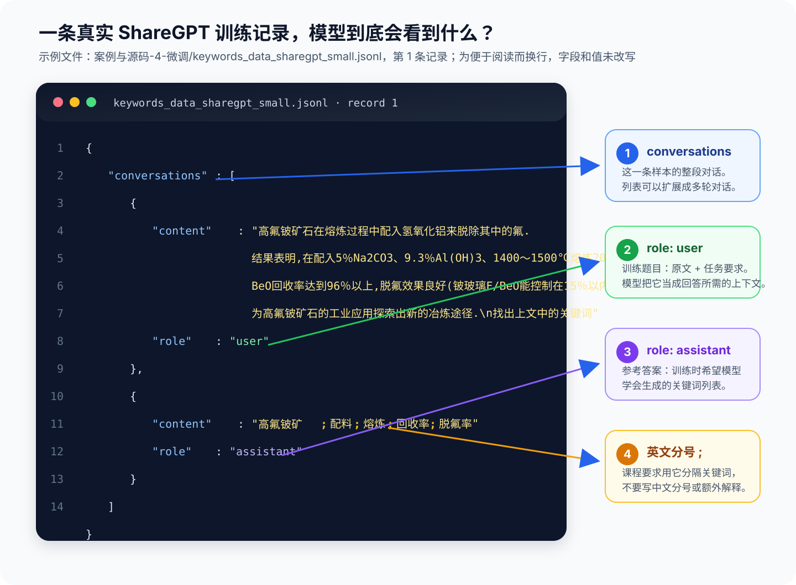

The figure shows the source record in the file; the title "What the model actually sees" first helps us recognize the article and the reference answer. The actual content fed to the model still undergoes the template processing in Section 6. Long lines overflow in the figure; see the expandable content below for the complete text.

<details>
<summary>Expand to read the complete first record (original fields and content preserved)</summary>

<pre><code style="white-space: pre-wrap; overflow-wrap: anywhere;">{
  "conversations": [
    {
      "content": "高氟铍矿石在熔炼过程中配入氢氧化铝来脱除其中的氟.结果表明,在配入5％Na2CO3、9.3％Al(OH)3、1400～1500℃熔炼20 min的情况下,BeO回收率达到96％以上,脱氟效果良好(铍玻璃F/BeO能控制在15％以内).为高氟铍矿石的工业应用探索出新的冶炼途径.\n找出上文中的关键词",
      "role": "user"
    },
    {
      "content": "高氟铍矿;配料;熔炼;回收率;脱氟率",
      "role": "assistant"
    }
  ]
}
</code></pre>

The layout here is expanded only for reading. When saved as JSONL, it is still one physical line, and newlines within messages are written as `\n`.

</details>

**Data preparation tasks:**

From the article to the training file, several tasks remain in between: select articles that match the task, verify answers, fix formatting, handle duplicate samples, and then split the data used for training and checking. Connecting all of these tasks is **data engineering** in fine-tuning, which is exactly the data preparation to be completed in this chapter.

## 2. Data Sources and Quality Requirements

### 2.1 Data Sources and Acquisition Methods

The content and answer format of fine-tuning data should match the target task.

| Data source     | Suitable for                           | Common problems                         |
| ------------ | ------------------------------------ | -------------------------------- |
| Public data     | Introductory practice, or as training data matching the task | May be irrelevant to your own task             |
| Real business data | Adapting the model to real business scenarios               | Raw formatting is often messy, and answers may not be consistent |
| Synthetic data     | Filling scarce scenarios and expanding boundary samples           | Generated quickly, but answers still need checking     |

For example, if you want to build an enterprise internal policy Q&A, general conversational data can help the model learn the Q&A format, but "how many annual leave days does the company have" must still follow the company's own policies. When preparing data for such tasks, you can combine enterprise policies, existing Q&A, customer service tickets, and manually verified standard answers.

If real samples are insufficient, you can also generate simulated samples based on task rules, then sample and check whether the answers are correct and meet business requirements.

#### 2.1.1 Searching for Datasets on ModelScope

Public data can be found on the [ModelScope datasets page](https://modelscope.cn/datasets). The "Model Library" introduced earlier is for finding models, while the "Datasets" section is for finding data needed for training or evaluation, including text, image, audio, and other types.

If you already know the dataset name, you can search directly at the top of the page; if you do not have a specific target yet, you can first browse by the task categories on the left. For example, for conversation or Q&A tasks, select "Intelligent Conversation" or "Q&A" under "Text," and then browse related datasets in the list.

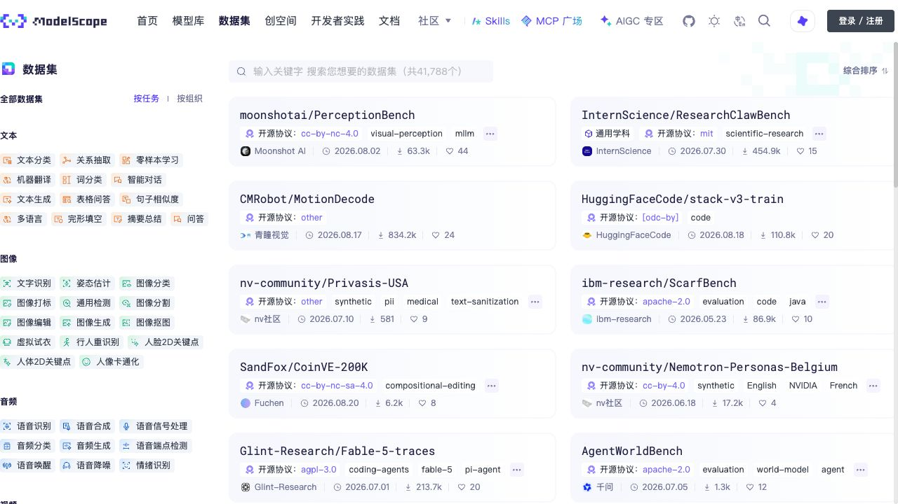

For example, opening the [Alimeeting4MUG dataset](https://modelscope.cn/datasets/modelscope/Alimeeting4MUG), you can see that it targets Chinese meeting scenarios and includes tasks such as keyword extraction and summarization. The page provides three entry points: "Dataset Introduction," "Data Preview," and "Dataset Files":

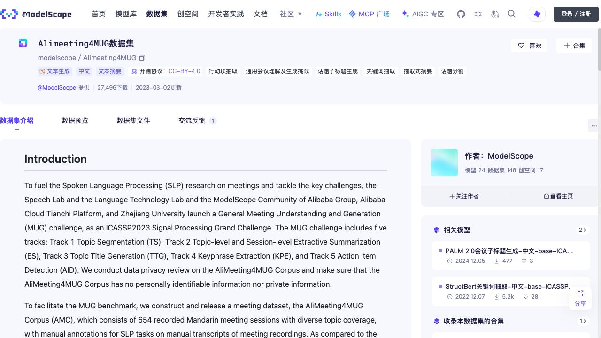

| Page entry   | What to focus on                                                                                   |
| ---------- | -------------------------------------------------------------------------------------------- |
| Dataset Introduction | Where the data comes from, what language it uses, what tasks it targets, how it was annotated, and whether the usage license fits your purpose.         |
| Data Preview   | Directly view several inputs and answers to judge whether the text content, length, and answer format are suitable. Not every dataset supports online preview. |
| Dataset Files | View the actual files, their format and size, confirm whether training, validation, or test sets already exist, and download according to the page instructions.           |

If a dataset has no online preview, you can first read the structure examples and loading instructions on the introduction page, or download a small amount of data for inspection; there is no need to download the entire set right away. After downloading, you still need to clean the data and organize it into the Alpaca or ShareGPT formats introduced later before it can enter the training workflow of this course.

#### 2.1.2 Common Data Preparation Tools

When you begin processing your own documents, you can learn about the following three data preparation tools:

| Tool                                                      | What it can help us do                                         | When it is worth learning                                     |
| --------------------------------------------------------- | ------------------------------------------------------ | ---------------------------------------------------- |
| [Easy Dataset](https://github.com/ConardLi/easy-dataset/) | Import documents through an interface, split content, and generate and edit Q&A data         | When you want to first organize a document into checkable Q&A samples                 |
| [DataFlow](https://github.com/OpenDCAI/DataFlow)          | Organize steps such as data extraction, transformation, cleaning, filtering, and generation into a processing pipeline | When there are many documents and you want to run a set of data processing rules in batch               |
| [GraphGen](https://github.com/InternScience/GraphGen)     | Use entities and their relationships in a knowledge graph to assist in generating training data         | When the data needs to reflect connections among multiple knowledge points; can be learned as an advanced tool |

The independent extension in Section 4 uses Easy Dataset to complete "import product documentation → generate Q&A → review → export." DataFlow and GraphGen can be chosen for batch processing and advanced practice.

### 2.2 Quality Requirements for Keyword Annotation

How do you judge whether a keyword answer is usable? Returning to the earlier teaching text: "The city library offers children's reading classes on weekends; readers can reserve through the official account." Compare several outputs:

| Output example                         | Check result                                             |
| -------------------------------- | ---------------------------------------------------- |
| `市图书馆;儿童阅读课;公众号预约` | Summarizes the main subject, activity, and participation method; it is a reference answer for this example |
| `图书馆;活动`                    | Not wrong, but too general, losing the main information of "children's reading class" |
| `市图书馆;成人培训`              | Format is fine, but the original text has no adult training; the content is incorrect           |
| `关键词：市图书馆;儿童阅读课`    | Content is related to the original text, but adds a prefix that the task does not allow             |

When checking a sample, you can proceed in this order: first read the source text and say to yourself what the article is mainly about; then see whether the reference answer captures the theme and whether it adds anything not supported by the source text; finally check the semicolons, prefixes, and duplicate keywords.

This is the **difference between content quality and format quality**. Issues such as semicolons and empty items can be left to scripts to check; whether the keywords are appropriately chosen still requires judgment against the source text. When uncertain about names in professional texts, ask someone familiar with the field to verify; do not delete a word just because it looks unfamiliar.

A keyword answer does not necessarily have only one reasonable formulation. For example, "reserve through the official account" can be seen as one participation method, or split into a channel and an action. However, you cannot casually switch criteria within the same dataset; the next section will agree on which formulation this example adopts.

When preparing your own data, first review a small batch to confirm that the word-selection requirements are executable, then expand the quantity. If a certain type of article frequently misses the theme, supplement that type of article with reliable answers; repeatedly copying existing samples will not fix this problem.

**Also check: whether the samples cover the articles you will actually receive.** If the training materials are all library event announcements, and after switching to agricultural summaries the model frequently misses variety names, first check whether such themes and names have been sufficiently demonstrated. Simply adding more event announcements may not solve the problem.

<details>
<summary>When preparing your own data: use a coverage table to decide what to supplement</summary>

Below is a coverage checklist you can use for your own project. The same article can belong to multiple categories at once, such as "long text" and "contains specialized terms"; you do not need to treat these as mutually exclusive classifications.

| Check dimension   | What to look for in the data                                   | What to check against the answer                                  |
| ----------------- | -------------------------------------------------------------- | ----------------------------------------------------------------- |
| Article topic     | Topics common in actual business, as well as rarer topics that still need support | Whether the main subject and matter are captured                          |
| Text length       | Short texts, longer texts; length counted by token count after tokenization      | Whether key content falls after the truncation position, see Chapter 30, Section 4 |
| Full names        | Place names, organization names, event names, variety names, etc.                   | Whether qualifiers that affect meaning are retained                        |
| Full name and abbreviation | Articles containing both the full name and abbreviation, and articles containing only the abbreviation             | Whether words are selected according to the same set of rules                            |
| Text noise        | Excess whitespace, recognition errors, incomplete sentences                     | Whether the answer can be confirmed from the available text; whether doubtful points are recorded separately      |

For each category, record "number of training samples, number of validation samples, number reviewed, main errors." If validation reveals that a category performs poorly, check whether the training side lacks such inputs or contains conflicting answers; supplement and review from new sources, and avoid moving validation questions directly into the training set. Whether each category has met the standard should be checked separately, as an overall average score may hide problems in a small number of categories.

**There is no fixed amount of data that applies to all tasks.** The 1,600 training examples in this course are a practice scale. For your own task, first ensure reliable demonstrations for common scenarios and key edge cases, then decide what data to supplement and whether it is worth expanding training based on validation results. An increase in the number of samples does not necessarily mean that coverage and answer quality will improve at the same time.

For inputs such as empty text that are outside the scope of the current exercises, first determine how to handle them according to the [Chapter 28 task conventions](28-%E5%A4%A7%E6%A8%A1%E5%9E%8B%E5%BE%AE%E8%B0%83%E6%A6%82%E8%BF%B0%E4%B8%8E%E6%95%B4%E4%BD%93%E6%B5%81%E7%A8%8B.md?id=_71-task-conventions). If you need to return a new status such as "unable to extract," you should uniformly revise the task rules and data version to avoid the same type of input corresponding to contradictory answers.

</details>

Now let us first write the output rules clearly.

### 2.3 Keyword annotation rules

"Annotation" here means determining the reference answer for an input; "annotation rules" are the agreements made in advance about what kind of answer is considered correct. Before cleaning the data, write these rules out clearly first. Keyword extraction should at minimum clarify:

| Content to agree on | Current rules for this course                           |
| ------------------- | ---------------------------------------- |
| Output content       | One line, containing one or more keywords that can summarize the topic     |
| Separator       | Use an English semicolon `;` between keywords               |
| Extra content       | Do not output explanations, numbering, a "Keywords:" prefix, or duplicate words |
| Number of keywords     | Determined according to the text topic; do not force a uniform number         |

Different articles contain different amounts of topic information, so you should not delete necessary keywords or stuff in irrelevant ones just to unify everything into "3 to 5." If the business really needs to limit the number, first establish the rule, then review samples according to that rule.

**Once the format is clear, you also need to agree on how to select words.** The following criteria are used for new annotations and draft review: extract information that can summarize the topic from the given text, keep the original language, and do not translate on your own or supplement background knowledge. These are not the only rules for all keyword tasks; if the business requires English labels, a fixed classification vocabulary, or a fixed number, first establish separate agreements, then prepare data consistently.

First, make word-selection judgments concrete in three respects: have a basis in the source text, retain complete names, and cover the article topic. For example, "children's reading class" cannot be shortened to the vague "activity," and in this example "official account reservation" is retained as a whole because it is a participation method. The complete rules are as follows; refer back to them when disagreements arise during review.

<details>
<summary>For reference during annotation: complete word-selection rules and disagreement handling</summary>

| Areas prone to disagreement       | How to handle during annotation                                                                               | Example                                                                                   |
| -------------------- | -------------------------------------------------------------------------------------------- | -------------------------------------------------------------------------------------- |
| Original wording or your own summary   | Prefer words from the original text; function words may be removed to form phrases, but do not change meaning, do not translate, do not add facts                     | "Reserve through the official account" can be organized as "official account reservation"; "children's reading class" is not changed to "parent-child education training"                 |
| Which information to include       | First keep the main object and matter the article discusses, then select methods, results, or participation methods that affect understanding of the topic; do not simply list every noun | In this example, retain the library, activity name, and reservation method; whether "weekend" should also be selected should be uniformly agreed according to business needs for time information |
| Keep the full name or shorten it | Retain qualifiers that affect meaning, and avoid leaving only an overly broad category                                               | In this example, choose "children's reading class," not "reading class" or "activity"                                             |
| Whether to split a phrase   | When a phrase jointly expresses a key piece of information, prefer to keep it as a whole and do not split words just to increase the count                                   | In this example, choose "official account reservation," not split into "official account;reservation"                                                |
| How to unify full and short names   | When the original text gives both the full and short name, choose the full name by default; when only the short name is given, keep the short name and do not expand it on your own                         | When the original says "High Level Architecture (HLA)," choose "High Level Architecture"; when only "HLA" appears, keep "HLA"                    |
| Whether to select both near-synonyms | When they express the same thing, keep one wording; whether they are synonyms must be judged in context                                       | Do not include both "children's reading class" and a self-rewritten "children's reading course" in the answer                                 |
| What to do when unsure about a technical meaning | Keep the original text and the question, check the source or ask a domain expert to confirm; when there are unresolved content doubts, do not include the entire record in new training data for now   | Do not expand an unfamiliar abbreviation on your own, and do not delete it simply because you cannot understand it                                               |

</details>

According to these criteria, the library short passage can be labeled as `市图书馆;儿童阅读课;公众号预约`. `图书馆;阅读课;公众号;预约` is also related to the original text, but it shortens the name and splits the participation method apart, so it is not suitable as a standard demonstration under this set of rules. If the business really needs "channel" and "action" extracted separately, first adjust the rules, then annotate similar samples consistently.

**First walk through one review demonstration.** Following "check against the original text → identify the problem → propose a revision → retain items for confirmation," examine the place name below. It comes from validation example 4 and is used to understand the review method; the suggested revision should first be treated as a draft pending review.

**Example 1: a truncated name—"Wan'an County" became "An County."**

Excerpt from the original text of example 4:

> In recent years, due to careless seedling transfer and introduction as well as production oversights, the damage caused by citrus scab in Wan'an County has shown a worsening trend

The original reference answer includes `安县`. Although these two characters can be found in the original text, they are only part of "Wan'an County."

| Review step     | Record for this example                                                                     |
| ------------ | ---------------------------------------------------------------------------- |
| Identify the problem     | The place name is truncated, losing its specific referent; a keyword cannot be judged correct merely because "these characters can be found"         |
| Propose a revision     | Suggest restoring it to `万安县`; the complete draft formed according to the article topic is `柑桔疮痂病;万安县;果业生产` |
| Retain items for confirmation | Whether to also include background information such as "introduction" requires a unified decision on the scope of word selection; this does not affect the judgment to restore the complete place name   |

This demonstration checks the reference answer itself. If an answer was drafted by another model, it must go through the same review; the two examples below use validation example 6 and an existing model answer for practice, and do not require first learning the scoring in Chapter 32.

<details>
<summary>Continue the exercise: check missed topics and unsupported numbering from an agricultural sample</summary>

**Example 2: every word has a basis in the source, yet the article topic is missed.**

Two excerpts from the original text of example 6 are as follows, retaining the original wording and punctuation:

> Shepody was bred through sexual hybridization at the Fredericton Agricultural Research Station in Canada, using "F58050" as the female parent and "Bakeking" as the male parent

> In 2003, it was introduced for trial planting in our city by the Yulin Agricultural Science Institute. Through five years of observation, this variety has high yield, and its frying quality and eating quality are excellent. It is suitable for promotion and cultivation in the windy sand beach and water areas in the northern part of our city. The planting performance and cultivation techniques are now briefly introduced as follows:

One saved model answer is:

```text
F58050;Bakeking
```

| Review step     | Record for this example                                                                                                                               |
| ------------ | -------------------------------------------------------------------------------------------------------------------------------------- |
| Identify the problem     | The two words do appear in the original text, but both describe the parent source. Listing only them cannot summarize the topic of "Shepody's planting performance"                                                   |
| Propose a revision     | The main variety and planting performance should be retained first. The suggested draft is `夏波蒂;榆林市;种植表现;推广栽培;炸条品质;食用品质`                                               |
| Retain items for confirmation | Whether to include parentage information needs to be agreed according to business needs; "potato" in the original reference does not appear directly in the given text and must be confirmed by checking the source. Suspected OCR issues such as "弓1人" and "栽·培" in the original text are also recorded separately |

Here it is not asserted that "potato" is definitely wrong; rather, "what can be confirmed from the current text" is separated from "what still needs to be checked." **Having a basis in the source text is a necessary check for word selection, but you also need to see whether the topic has been captured.**

**Example 3: the format is correct, but extra words without a basis have been added.**

Still using the original text of example 6, another saved answer is:

```text
F58050;Bakeking;F68050
```

| Review step     | Record for this example                                                                                         |
| ------------ | ------------------------------------------------------------------------------------------------ |
| Identify the problem     | One line, English semicolons, no duplicates—there is no problem with the format; but the original text says `F58050`, not `F68050`, and "Shepody" is still missed |
| Propose a revision     | If it is used as a draft for a new annotation, the unsupported `F68050` should be excluded, and then the topic should be added as in Example 2; simply deleting that word still leaves the answer incomplete  |
| Retain items for confirmation | We cannot guess that `F68050` is another valid number. If the input is thought to be wrong, the original source should be checked; until confirmed, do not use this draft as a training demonstration |

</details>

**When reviewing a training draft, you may propose revisions; when evaluating a model, you must preserve its original answer.** For example, you cannot first delete `F68050` on behalf of the model and then score the edited text.

When reviewing yourself, also keep the "original answer, suggested answer, source-text basis, and items for confirmation" for each sample. Record confirmed revisions and doubts requiring further verification separately, and only after confirmation is complete should the sample be included in newly added data.

The course exercise data has mainly undergone format and duplication checks, but some reference annotations still have content doubts, and they cannot all be regarded as manually reviewed standard answers. The revised suggestions above also need to be confirmed before being used for new data. The example scores in Chapter 32 are based on the accompanying reference files; [Section 4.1](32-%E5%BE%AE%E8%B0%83%E6%95%88%E6%9E%9C%E8%AF%84%E4%BC%B0%E4%B8%8E%E6%A8%A1%E5%9E%8B%E9%83%A8%E7%BD%B2.md?id=_41-format-checking-and-content-checking) will distinguish whether the format is acceptable, whether the reference answer is matched, and whether the content is reasonable.

<details>
<summary>Exercise: how two people review according to the same set of rules</summary>

Select a small batch of articles from the new material to be added, for example, start with 5 for practice. The two people read the original text and write keywords separately, without looking at each other's answers for the time being, then compare complete names, phrase splitting, the scope of word selection, and unsupported content.

If one person writes `公众号预约` and the other writes `公众号;预约`, first go back to the agreements in this section and explain why the whole phrase should be retained here; do not decide simply by voting. When a situation is not covered by the rules, add rules and examples, and then recheck this batch of articles using the revised rules. When unsure about technical facts, continue to keep items for confirmation.

Record the “sample number, two answers, reason for disagreement, final handling, and rule version.” This step is called **annotation calibration**, and its purpose is to ensure different people form a consistent understanding of the rules. When learning alone, you can first answer independently and then review against the rules; this self-check cannot replace independent review.

</details>

---

## 3. Common Fine-Tuning Data Formats

The file names we saw earlier end with `.jsonl`, and the content is also called ShareGPT. Later, Chat Template will also appear. They do not handle the same thing:

| Problem to solve                     | Corresponding name                  | Example in this course                        |
| -------------------------------- | ------------------------- | ------------------------------------- |
| How to put multiple records into a file             | JSONL                     | One complete JSON record per line          |
| How to save the instruction, input, and answer for each record | Alpaca, ShareGPT          | Three separate fields, or a group of messages arranged by role  |
| How to organize messages into input familiar to the model     | Chat Template | Add boundary markers for user and assistant; expanded in Section 6 |

Therefore, a file can be both a “JSONL file” and “ShareGPT data”; the two do not conflict. Let us first look at two common ways to write a single record.

| Format     | How one data record is saved                 | More suitable situations                       |
| -------- | -------------------------------- | ---------------------------------- |
| Alpaca   | `instruction`, `input`, `output` | Single-turn “instruction + input + answer” tasks     |
| ShareGPT | A group of messages arranged by role             | Use a unified message structure to save single-turn or multi-turn conversations |

### 3.1 Alpaca Data Format

The Alpaca format stores the task description, specific input, and standard answer separately. Still using the library teaching example from Section 1:

```json
{
  "instruction": "请提取关键词，只输出关键词，并使用英文分号分隔。",
  "input": "市图书馆周末开设儿童阅读课，读者可通过公众号预约。",
  "output": "市图书馆;儿童阅读课;公众号预约"
}
```

`instruction` is the task requirement, `input` is the article to be processed this time, and `output` is the reference answer. This separation is intuitive and suitable for single-turn tasks.

### 3.2 ShareGPT Data Format

The same teaching sample can also be saved in the ShareGPT style used in this course:

```json
{
  "conversations": [
    {
      "role": "user",
      "content": "市图书馆周末开设儿童阅读课，读者可通过公众号预约。\n请提取关键词，只输出关键词，并使用英文分号分隔。"
    },
    {
      "role": "assistant",
      "content": "市图书馆;儿童阅读课;公众号预约"
    }
  ]
}
```

The task and answer have not changed; only the instruction and article are put into `user.content`, and the answer is put into `assistant.content`. The outermost `conversations` is a message list:

```text
conversations
├── 第 1 条：role = user      → 待抽取的文本和任务指令
└── 第 2 条：role = assistant → 标准关键词答案
```

The above is expanded with line breaks for explanation; when saving as JSONL, the entire object must be placed on a single physical line, and line breaks inside messages are represented with `\n`. Do not treat the expanded dozen or so lines as a dozen or so training samples.

If there are multi-turn tasks later, you can also continue appending messages within the same sample:

```text
user1 → assistant1 → user2 → assistant2
```

The keyword data in this course is single-turn question and answer. The cleaning script used later also checks according to this single-turn structure; when switching to multi-turn data, the checking logic needs to be adjusted accordingly and cannot be applied directly.

Field names are not always necessarily called `conversations`, `role`, and `content`. Some datasets write the user as `human`, and some write the message list as `messages`. This does not necessarily mean the data is problematic; rather, the training tool needs a “field mapping table” to read it correctly. Section 6.2 of Chapter 31 will fill in this mapping table in `dataset_info.json`.

> **Alpaca and ShareGPT are used to organize samples; after the training tool reads these samples, it also needs to prepare model input through a chat template and tokenizer that match the model. Section 6 will show the difference before and after conversion.**

<span id="tool-calling-data"></span>

### 3.3 From Single-Turn Q&A to Tool Calling (Optional Reading)

The keyword task only requires “read the article → output keywords.” If you want the assistant to check whether there are still openings in the children’s reading class, it also needs to determine whether the information is complete, request a query, and answer based on the query result. Training samples must also include these observable steps.

<details>
<summary>Advanced reading: a complete sample from clarification to tool return</summary>

The following is a **fictional teaching illustration** used to understand a multi-turn sample. It is not an executed tool record, nor is it a file that can be directly uploaded for training. This example provides the `query_reading_class` tool, which only queries the remaining spots for the city library’s children’s reading class and accepts two parameters: `date` uses `YYYY-MM-DD`, and `time_slot` uses `morning` (morning) or `afternoon` (afternoon).

| Order | Who provides the content | Message or action illustration                                                                |
| ---- | ---------- | ----------------------------------------------------------------------------- |
| 1    | User       | Are there still openings for the children’s reading class?                                                        |
| 2    | Assistant       | Which day, morning or afternoon session, do you want to check?                                          |
| 3    | User       | Morning of September 12, 2026.                                                      |
| 4    | Assistant       | Request `query_reading_class`, with parameters `date="2026-09-12"`, `time_slot="morning"` |
| 5    | Tool       | After the program executes the query, it returns `remaining=6`, indicating that there are 6 spots remaining                           |
| 6    | Assistant       | The query result shows that there are 6 spots remaining for the children’s reading class on the morning of September 12, 2026.               |

The most critical point here is the difference between steps 4 and 5: **the model proposes the call request, the program is responsible for actually executing it, and then returns the result to the model.** The assistant cannot simply write `remaining=6` on its own and treat that as having found the real remaining spots. Only by saving the entire message chain and the tool description can the model learn “when to clarify, how to call, and how to use the result.”

When preparing this kind of data, you also need to cover different situations:

| Situation                               | Expected demonstration                                         |
| ---------------------------------- | -------------------------------------------------- |
| The user provides both the date and session from the start         | Directly fill in the available information and avoid asking repeatedly                     |
| The user has already pasted a notice and only asks to extract keywords | Answer based on the given text; do not call a tool just for the sake of using a tool           |
| The query returns “session does not exist” or temporarily fails     | Explain according to the actual result; if retry is allowed, follow the retry count and exit conditions |
| Insufficient user information                       | Clarify first; do not guess the date or session                           |

When putting this into a training file, you also need to verify the message fields, tool parameter descriptions (schema), the correspondence between calls and returns, and which assistant messages participate in supervision according to the tool being used. You can refer to [SFT Tool Calling Data Description](https://huggingface.co/docs/trl/sft_trainer#tool-calling-with-sft). **The single-turn keyword cleaning script in this chapter cannot directly validate this kind of multi-turn data**; field mapping and chat templates also need corresponding verification.

If another model is used to draft the trajectory, the call results should be verified through real execution or a clearly marked simulated environment; generated success descriptions cannot be used as evidence of execution. Subsequent evaluation should also separately check whether the tool was selected correctly, whether the parameters were correct, and whether the result was used correctly; see [Chapter 32](32-%E5%BE%AE%E8%B0%83%E6%95%88%E6%9E%9C%E8%AF%84%E4%BC%B0%E4%B8%8E%E6%A8%A1%E5%9E%8B%E9%83%A8%E7%BD%B2.md?id=finetuning-regression). Training only keyword extraction cannot prove that the model has learned these behaviors.

</details>

When continuing with the main line of this lesson, single-turn keyword data is still used; the document Q&A below is also an independent expansion and does not mix the three tasks into the same exercise.

---

<span id="_33-实操：把自己的文档做成问答训练数据"></span>
<span id="easy-dataset-qa"></span>

## 4. Use Easy Dataset to Create Q&A Data

**Independent expansion: read this when you have documents but no Q&A samples yet.** Readers who continue with the main keyword line can go directly to [Section 5, “Keyword Data Cleaning and Splitting”](29-%E5%BE%AE%E8%B0%83%E6%95%B0%E6%8D%AE%E5%87%86%E5%A4%87%E4%B8%8E%E5%AF%B9%E8%AF%9D%E6%A8%A1%E6%9D%BF.md?id=keywords-cleaning). The Q&A created in this section is only for data creation practice and is not mixed into the subsequent keyword training.

Suppose you want to create customer service Q&A data for “Qinghe Document Desk,” and you only have one product description on hand. Next, use Easy Dataset to generate questions and answers from the description, review them against the original document, and finally export a JSONL file.

This is a fictional product. The following demonstration uses Easy Dataset 1.7.3, and the included result contains 6 reviewed Q&A pairs; when following along yourself, the generated wording and number may differ.

### 4.1 Document Preparation and Task Description

Find and read `案例与源码-4-微调/document-qa-demo/product-manual.md` in the local course directory; this file will be uploaded to Easy Dataset later.

The document has only five parts: member management, file upload, deletion and recovery, task export, and summary notification. When following along, you only need to prepare this one document; the questions and answers will be generated in Easy Dataset.

Taking the upload requirements for scanned documents as an example, we hope to organize the following Q&A from the document:

```text
问题：扫描版 PDF 上传前需要做什么？
答案：先完成 OCR，检查识别出的文字是否准确，再上传处理。
```

When using your own document, first remove irrelevant content such as repeated headers and navigation, and keep numerical values, units, permissions, and exception conditions. For scanned documents, perform OCR first and check the text; for internal materials, also confirm whether sending them to the model service you are using is allowed.

### 4.2 Create a Project and Configure the Model

**Open the tool first.** This section uses the browser interface of Easy Dataset 1.7.3. If you already have the tool, you can create a project directly; if using it for the first time, you can choose a desktop client suitable for your system from the [official release page](https://github.com/ConardLi/easy-dataset/releases/tag/1.7.3), or run it from source according to the steps below.

<details>
<summary>First-time installation: build from source and start the browser interface</summary>

First confirm that Git, Node.js, and npm are installed on this machine, and open a terminal in the location where you want to store the tool source code.

Install the source code for the `1.7.3` tag according to the [Easy Dataset official installation instructions](https://github.com/ConardLi/easy-dataset/blob/1.7.3/README.zh-CN.md#本地运行). The example environment is macOS (Apple Silicon), Node.js `20.20.2`, npm `10.8.2`; first check your own versions with `node -v` and `npm -v`.

```bash
git clone --branch 1.7.3 --depth 1 https://github.com/ConardLi/easy-dataset.git
cd easy-dataset
git describe --tags --exact-match
npm install
```

After the dependencies are installed, run the build:

```bash
npm run build
```

<details>
<summary>Troubleshooting: first build on Mac reports Schema engine error</summary>

If only `Error: Schema engine error:` is displayed when initializing the database for the first time, you can enable the database engine log in the same directory and then retry:

```bash
RUST_LOG=info npm run build
```

`RUST_LOG=info` sets the database engine’s log level to obtain more error information; it is not a database repair switch. If it still fails after retrying, troubleshoot based on the new log; do not execute it repeatedly or delete the existing database.

</details>

After the build succeeds, start the service:

```bash
npm run start -- --hostname 127.0.0.1
```

After `Ready` appears in the terminal, keep the terminal running and open [http://127.0.0.1:1717](http://127.0.0.1:1717)。`--hostname 127.0.0.1` in a browser on the same computer so that this practice service only accepts local connections.

</details>

**Create the project.** Create a project named “Qinghe Document Desk · Document Q&A Practice,” and clearly state the source and purpose of the material in the description.

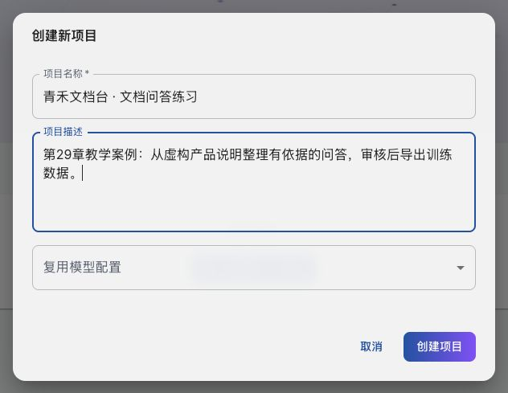

Click **「More → Project Settings」** at the top of the page, then switch to **「Model Configuration」** and fill in the API endpoint, API Key, and model ID provided by the service. After saving, open **「More → Model Test」**, select the model you just configured, and send a simple question.


During testing, select the configured model and wait for a normal response before continuing to create data. If authentication failure, nonexistent model, or connection failure is reported, correct the API configuration first.

The model configured here is responsible for generating Q&A drafts and may differ from the model fine-tuned later. Do not put the API Key into screenshots or course files; generation costs are billed according to the service used. If no API endpoint is available, you can first study the included results for reference.

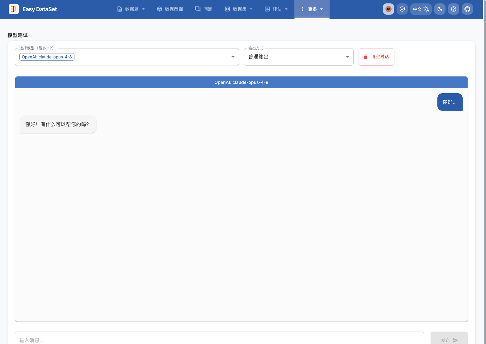

The interface types and model names in the figures are only for demonstrating where to configure them. The `OpenAI` label indicates the interface type and does not mean the model is provided by OpenAI; when following along, fill in the model ID supported by your own service. Receiving a response only confirms that the interface works; the generated Q&A still needs to be reviewed against the original text.

### 4.3 Import the document and check the chunks

Open **"Data Sources → File Processing"** at the top, click "Choose File" in the "Upload New File" area, select `product-manual.md`, and then click "Upload and Process File".

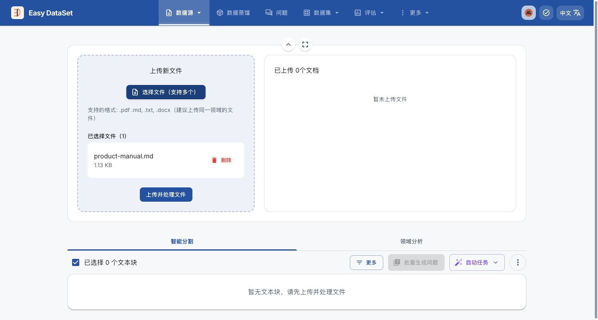

The tool processes the document into **text chunks** for the model to read, each of which is a relatively complete piece of material. After processing is complete, the uploaded document appears on the right, and the text chunk `product-manual-part-1` is displayed below, with a page count of 471 characters.

Click the **blue eye icon** in the bottom-right corner of the text chunk card. When you hover over it, "View Details" is displayed. Click it to read the complete processed text.

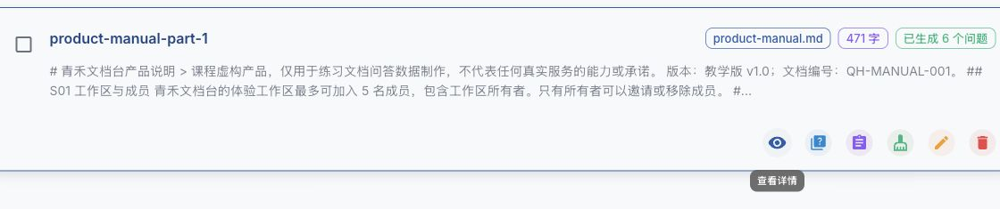

For now, just note the "View Details" entry point. After the first import, the card may not have any questions yet; the "6 questions generated" shown in the figure is from a later generation state and is not a completion requirement for this step.

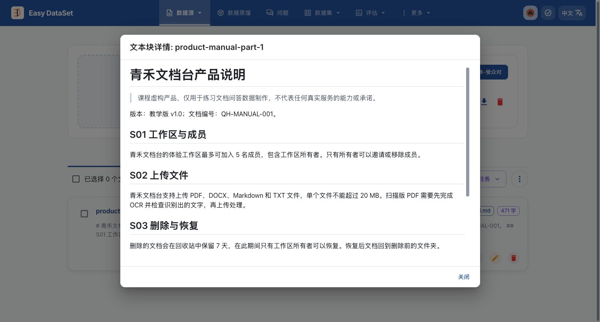

This document is very short, so keeping the five parts in the same chunk is fine. For long documents, try to split them along complete subsections instead of breaking apart related conditions such as "supports PDF" and "a single file must not exceed 20 MB"; otherwise, the generated answers are likely to omit constraints.

### 4.4 Generate questions and answers

Open **"More → Project Settings → Task Configuration"**, find "Question Generation Settings", move the first slider to **"Generate one question per 100 characters"**, set **"Concurrency Limit"** below to 2, and finally click "Save Task Configuration" at the bottom of the page.

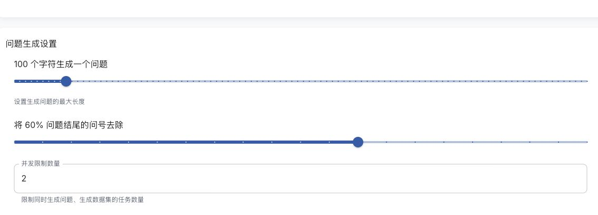

The question generation density controls how many questions you want to generate; a concurrency of 2 means that at most two tasks are processed at the same time. In practice, you can adjust these settings according to the document length and the limits of the model service.

Go back to the text chunk list, select `product-manual-part-1`, and click "Batch Generate Questions". Open the "Questions" page to view the generated questions and their source text chunks. The following six questions respectively cover the number of members, file limits, the recycle bin, task export, email summaries, and scanned document processing.

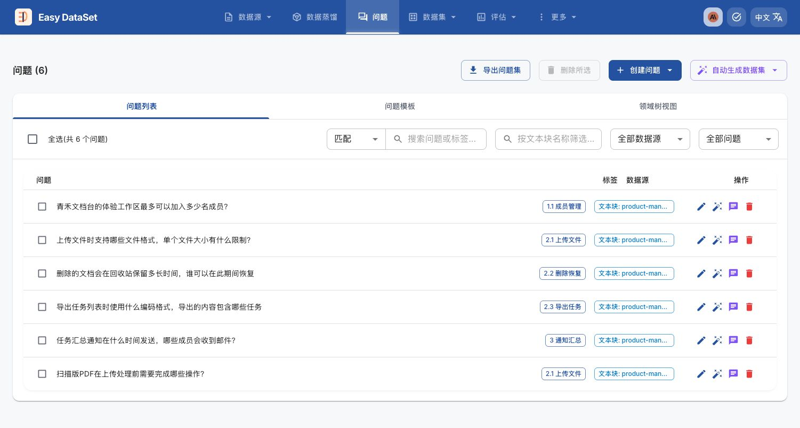

First delete questions that are duplicated or deviate from the document, then click "Generate Dataset" to the right of each question to generate answers for the questions. Here it is enough to generate once per question; while a task is still incomplete, check its status first and do not click repeatedly in succession.

### 4.5 Review the answers against the original text

Go to "Dataset → Single-Turn Q&A Dataset", open "View Details" for a record, and use the "Text Chunk" entry to review the original text. Focus on checking whether the answer changed any numbers, omitted conditions, or added conclusions without a basis. For example, "up to 5 people, including the owner" must not be turned into "5 additional people besides the owner".

The following draft answer for the scanned document Q&A adds an extra sentence:

> ...to ensure that subsequent processing and Q&A can proceed normally.

The original text only requires performing OCR first, checking the recognized text, and then uploading; it does not make this guarantee. Click the edit icon next to the answer and change the answer to:

> Before uploading a scanned PDF, first perform OCR (optical character recognition), check whether the recognized text is accurate, and then upload it for processing.

After saving, click "Confirm Keep". The revised answer is as follows:

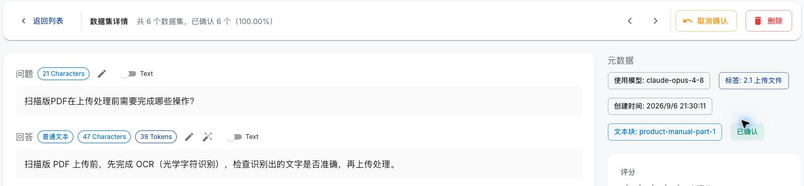

Review the other answers in the same way. After finishing, return to the list. In this example, all 6 Q&A items show "Confirmed", so you can proceed to the export step.

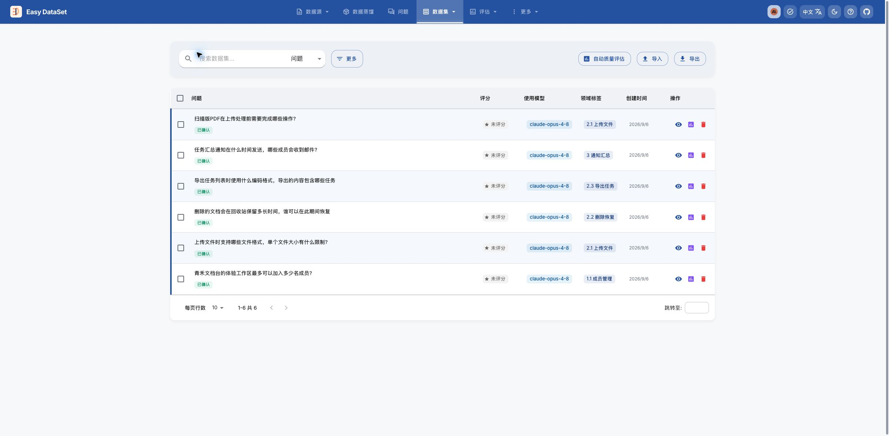

"Confirmed" is a manual review status, not an automatic quality score. For real business data, someone familiar with the business should perform the review.

### 4.6 Export and check the Q&A data

Click "Export" above the dataset list, select `JSONL` and `ShareGPT`, check "Export Only Confirmed Data", uncheck "Include Chain of Thought", and leave the system prompt empty for now. In this example, only the questions and the reviewed answers are kept, and the reasoning text generated by the model when producing the answers is not exported.

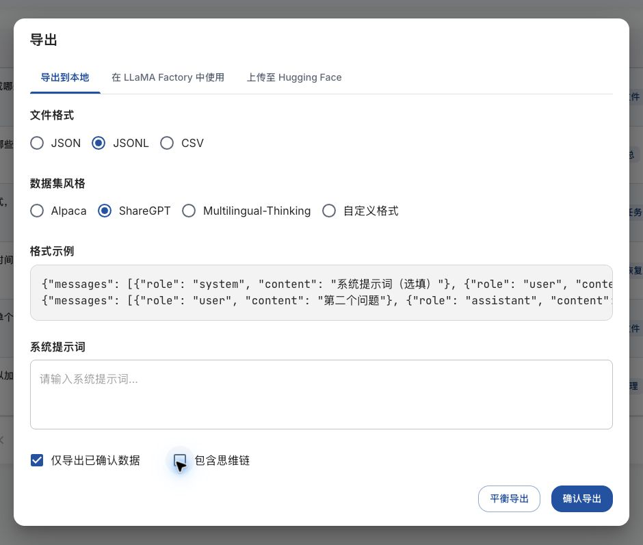

Click "Confirm Export", and the browser downloads a `.jsonl` file. The `案例与源码-4-微调/document-qa-demo/product_qa_reviewed.jsonl` saved for the course can be used for comparison.

Open the file in an editor. In this example there are 6 lines, each containing one Q&A pair; to make the fields visible, the line for the scanned document is expanded below, while the file itself still has one record per line:

```json
{
  "messages": [
    { "role": "user", "content": "扫描版PDF在上传处理前需要完成哪些操作？" },
    {
      "role": "assistant",
      "content": "扫描版 PDF 上传前，先完成 OCR（光学字符识别），检查识别出的文字是否准确，再上传处理。"
    }
  ]
}
```

Here `messages` stores a conversation, `role` indicates the role, and `content` stores the content: `user` corresponds to the question, and `assistant` corresponds to the reviewed answer. Compared with `conversations` in the keyword file, the field names in the message list are different, but they still contain roles and text; when handing the data to a training tool, you need to register the actual field names used.

After exporting, check three things:

1. **Does the number of records match?** In this example, 6 records were confirmed and kept, so the file should also contain 6 records; when following along on your own, use the number you actually kept as the standard.
2. **Are the Q&A pairs complete?** Each record has a question and an answer, the roles are not reversed, and the content has no gaps.
3. **Were the modifications saved?** Find the scanned document answer you just modified and confirm that the file contains the revised text, with no unsaved old answer and no extra chain-of-thought content.

If the file still contains the pre-modification answer, go back to the tool and check whether the record was saved and confirmed, then export again; if the number of records does not match, check the "Confirmed" status and the export filter conditions.

At this point, the output of the document Q&A exercise is the reviewed JSONL. Continue with this lesson by going back to the keyword small file to complete the next section; keep this Q&A file separately, because the subsequent keyword training still uses the keyword data.

---

<span id="keywords-cleaning"></span>

## 5. Keyword data cleaning and splitting

Organize the keyword samples according to the annotation rules in Section 2, then split them into training, validation, and test sets. The data processing in this section is done on your local machine.

### 5.1 Common problems and how to handle them

**Data cleaning means organizing records that are not suitable for direct training.** Format errors that can be determined confidently can be corrected in batch; if the answer content has problems, re-annotate it against the input. Records that cannot be corrected or confirmed should not be put into the training data for now.

The following teaching examples illustrate the handling methods:

| Problem                         | Example                                   | Handling method                                 |
| ---------------------------- | -------------------------------------- | ---------------------------------------- |
| Extra prefixes, Chinese semicolons, and trailing semicolons | `关键词：图书馆；阅读课;`              | Change to `图书馆;阅读课`, keeping the keyword content     |
| The same answer lists the same words repeatedly             | `图书馆;阅读课;图书馆`                 | Delete duplicate words and keep `图书馆;阅读课`         |
| Input or answer is empty               | There is `user`, but `content` has no text       | Check the source, complete it and review it; if it cannot be completed, do not use it for now |
| Answer lacks a basis                 | The input only discusses children's reading classes, but the answer contains "adult training" | Re-annotate according to the current input; do not only fix semicolons         |

Content review was already covered in Section 2. Here we need to distinguish two kinds of "duplication": the second row in the table above refers to **the same answer listing the same words repeatedly**; the following refers to **the same sample appearing multiple times**.

```text
输入 A → 图书馆;阅读课
输入 A → 图书馆;阅读课
```

If the input and answer are both identical, keep one record. If the same input corresponds to different answers, you cannot simply delete it as a duplicate record:

```text
输入 A → 图书馆;阅读课
输入 A → 图书馆;公众号预约
```

This is called an **answer conflict**. It may be that one annotation missed some content, or that both expressions are reasonable; you need to judge based on the article and the word selection rules. When the course script encounters this situation, it stops instead of arbitrarily keeping the first record.

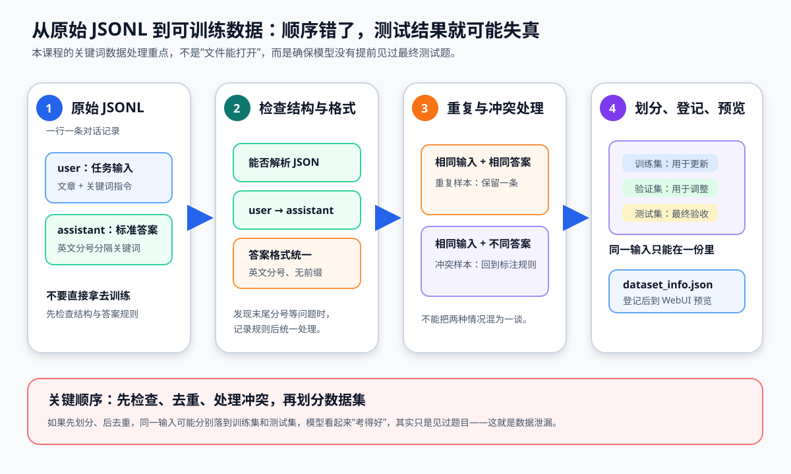

These operations should be completed before splitting; otherwise, the same question may end up in both the training set and the test set. Cleaning and subsequent scoring share the same format checking rules; keyword content still needs to be reviewed against the original text using the method in Section 2.2.

### 5.2 Training set, validation set, and test set

Chapter 28 introduced the purposes of the three datasets. In the keyword exercise, they can be understood as "practice, mock exam, and final exam":

| Set and file                         | Analogy                 | Are parameters updated? | How to use                           |
| ---------------------------------- | -------------------- | ------------ | ---------------------------------- |
| Training set `keywords_train.jsonl`      | Daily practice workbook           | Yes           | Let the model learn keyword extraction               |
| Validation set `keywords_validation.jsonl` | Mock exam during preparation   | No           | Compare configurations, observe performance, and select checkpoints     |
| Test set `keywords_test.jsonl`       | Final exam opened only at the end | No           | After the plan is finalized, compare the original model with the fine-tuned model |

All three files retain the reference answers. A **checkpoint** is a staged snapshot saved during training, for example saving one version after one epoch and another after two epochs, and then using the validation set to compare which one is more suitable.

#### 5.2.1 Generalization and overfitting

We train the model not so that it can only answer these 1,600 articles, but so that when it later receives another article of the same type, it can also extract keywords as required. This ability to apply learned patterns to new inputs that did not participate in training is called **generalization ability**.

Continuing the library example from Section 1. Suppose the model has practiced on the first article, and now we use a second article to check it. The following is a teaching example, not course data or actual model results:

| Purpose               | Article                                                 | Reference keywords                         |
| ------------------ | ---------------------------------------------------- | ---------------------------------- |
| Practice during training         | The city library offers children's reading classes on weekends, and readers can make reservations through the official account.   | `市图书馆;儿童阅读课;公众号预约`   |
| Check with another article of the same type | The district library holds a children's science lecture during the summer vacation, and parents can register through the mini program. | `区图书馆;少儿科普讲座;小程序报名` |

Both articles require keyword extraction, but the activity and participation method have changed. The model needs to select words based on the new article and cannot simply copy "children's reading class" and "reservation through the official account". Only if it can capture the topic and follow the semicolon format on many such new articles does it show that the learned approach can be applied to new inputs.

**Overfitting** means the model fits the training samples too closely and performs poorly on similar data that did not participate in training. It can be compared to repeatedly practicing one set of questions until the original questions are answered well, while new questions that cover the same content but with slightly changed conditions cannot be solved.

For example, after continued training, the model selects words more accurately for articles it has practiced on, but for held-out new articles it often misses the topic or carries over words from the training questions. If this happens repeatedly across many samples, you need to be alert to overfitting rather than only looking at the practice questions getting better and better.

However, **answering one new question incorrectly does not equal overfitting**. Incorrect reference answers, truncated articles, or new articles that clearly exceed the coverage of the training data can also cause poor responses. You need to judge based on multiple samples and the training process, and you cannot conclude "too much training" just from one error.

This also explains why the validation set should remain outside the training set: during training, you use it to observe how the model handles new articles, then decide whether to continue training and which checkpoint to select. For how to combine training and validation curves for judgment, see [Chapter 30, "Judging and Handling Overfitting"](30-%E6%A8%A1%E5%9E%8B%E8%AE%AD%E7%BB%83%E5%8E%9F%E7%90%86%E4%B8%8E%E9%AB%98%E6%95%88%E5%BE%AE%E8%B0%83.md?id=_931-identifying-and-handling-overfitting).

#### 5.2.2 Data Leakage

**Do not let test questions get mixed into the training set.** The complete keyword file contains the samples from small, so you cannot "train on the complete file and then test with small." The test questions have already been practiced on, which is a form of **data leakage**, and the scores cannot represent the model's ability to handle new articles.

The same applies to the validation set: if the articles used for checking have already participated in training, their performance can no longer be used as evidence of the model's ability to handle new articles. Overfitting is about how well the model has learned, while data leakage is about problems in the evaluation process; they are not the same thing, and data leakage may also mask problems the model has with new articles.

The same article with a different phrasing is not necessarily independent new material either. The course script only compares complete inputs after merging consecutive whitespace and cannot identify all similar samples. For the document Q&A in Section 4, grouping should be done by source document, and related question-answer pairs from the same document should not be casually split between training and test sides.

This case is split by `80% / 10% / 10%`, and the ratio can be adjusted according to the task. If you repeatedly modify parameters based on test results, the test set has also participated in development, and you will need separate independent test data afterward.

### 5.3 Running the Data Processing Script

Now use `prepare_keywords_dataset.py` to inspect, clean, and split the keyword data.

The script completes the following in order:

1. Check JSON, `conversations`, `user → assistant` order, and non-empty content.
2. Unify keyword prefixes, semicolons, and leading/trailing whitespace; remove empty items and duplicate keywords.
3. Deduplicate by input; stop when the same input corresponds to different answers and hand it over for manual review.
4. Perform a fixed split on the processed samples, and check that the inputs across the three datasets do not overlap.

Open the course project in a code editor, create a new terminal in the **project root directory**, enter the case directory, and confirm that Python is version 3.10 or above:

```bash
cd "案例与源码-4-微调"
python3 --version
```

If the terminal is already in the case directory, you do not need to run `cd` again. Then run:

```bash
python3 prepare_keywords_dataset.py \
  --source keywords_data_sharegpt_small.jsonl \
  --seed chapter-29-v1 \
  --output-dir processed/keywords-clean-repro
```

| Parameter | Purpose |
| -------------- | -------------------------- |
| `--source` | Specifies the keyword file to process |
| `--seed` | Seed used for the fixed split |
| `--output-dir` | Specifies a result directory that does not yet exist |

A **seed** can be understood as an agreed-upon value used during splitting. When the data, processing rules, and seed all remain unchanged, the ordering and grouping of each input will remain consistent. This case uses `chapter-29-v1` as the fixed seed; simply keep this value when following along.

For this exercise, save the output to `keywords-clean-repro/` so that you can verify your own processing steps. The subsequent training examples in the course always use the accompanying `keywords-clean/`, and the purposes of the two are compared in the next section. The script will stop if the output directory already exists to avoid accidental overwriting.

The script uses local Python to process files and does not require internet access or a GPU. It is only suitable for single-turn **keyword data** and cannot be used to clean the natural language Q&A from Section 4 according to semicolon rules.

### 5.4 Viewing the Processing Results

After successful completion, the terminal will list the counts of the three datasets. The main outputs are as follows:

```text
keywords_train.jsonl: 1600 条
keywords_validation.jsonl: 200 条
keywords_test.jsonl: 200 条
```

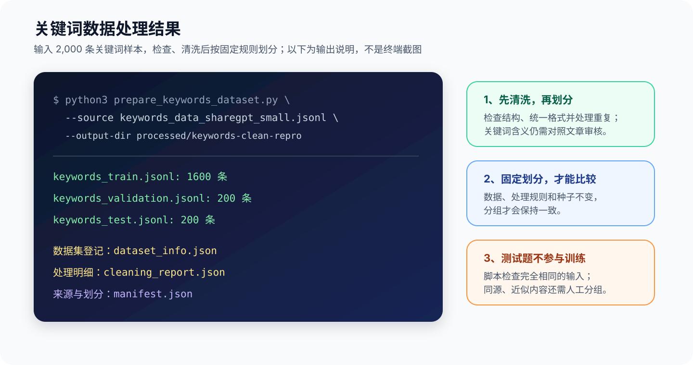

This is a processing flow diagram showing the relationship between the script, the three datasets, and the accompanying reports. When running it, use the complete command with the seed specified in Section 5.3.

Expand `processed/keywords-clean-repro/` in the editor and check the six generated files:

- **Three JSONL files** are the actual data. Open one entry from each, and you can still see the `user` input and `assistant` reference answer; the format has not changed because of the split.
- **`dataset_info.json`** is the dataset registry, read by LLaMA-Factory in Chapter 31.
- **`cleaning_report.json`** saves automatic modifications and items to be checked; **`manifest.json`** saves the source, split rules, and counts, for reference when verifying the processing results.

If the script stops midway, check according to the error:

| Message or symptom | Handling method |
| ------------------------------ | ---------------------------------------------------------------- |
| Input file not found | Check the terminal's current directory and the `--source` path |
| JSON, role order, or empty content error | Open the line indicated in the message and correct the sample structure and content |
| Answer conflict for the same input | Review the answers against the input; do not let the script replace judgment |
| Only the cleaning report is generated, without the three JSONL files | Check the `review_required` in the report, fix the remaining format issues, and retry with a new output directory |
| Output directory already exists | Use a new directory name to avoid overwriting saved results |

Completing the script only means that it has passed these structure, format, and duplication checks; it does not mean that every answer has been manually reviewed. When switching to your own data, you should also spot-check whether the articles and keywords correspond and whether same-source or similar samples cross groups.

**How do you connect your own processing results to later steps?** First, choose the file according to the current exercise to avoid mixing different versions together:

| What you are currently doing | Which output to use | Next step |
| -------------- | -------------------------------------------- | ---------------------------------------------------------------------------- |
| Learning cleaning and splitting | The `processed/keywords-clean-repro/` you generated yourself | Verify the counts, samples, cleaning report, and split record of the three datasets, and confirm which checks you completed |
| Reproducing this course's training | The accompanying `processed/keywords-clean/` | Upload this directory in Chapter 31; use train for training and validation for process checking, then use test in Chapter 32 |
| Switching to your own data | A new data version and matching registry saved after review | Register your own files as described in Chapter 31; training and evaluation always correspond to the same split version; save new experiments separately |

Two different directory names alone cannot prove that their contents are the same. If you want to replace the course data with your own recomputed data, you should first compare the processing rules, the three JSONL files, and the registry contents; do not only look at the total counts. Save prediction results separately, and continue to keep reference answers as the basis for comparison.

---

## 6. Chat Template and Model Input

The data obtained in the previous section is still individual `user` inputs and `assistant` reference answers. Next, we will look at: **after the training tool reads these messages, how does it pass them to the model.**

### 6.1 The Role of the Chat Template

Continuing with the library example from Section 1. We can use `role` to distinguish which part is the user's question and which part is the assistant's answer, and the model also needs to recognize these boundaries.

A **Chat Template** is the rule for organizing messages: how to mark the beginning and end of a user message, and how to mark the position of the assistant's response. Different models may use different rules, so the training tool needs to choose a template that matches the model.

This concept does not exist only in code. The LLaMA-Factory page used in Chapter 31 has a "chat template" option:

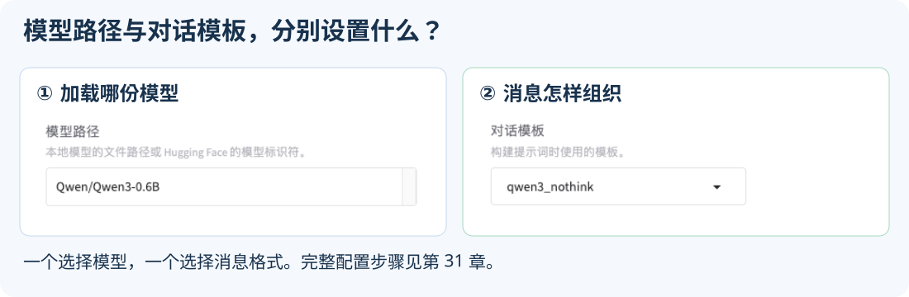

**The model path determines which model is loaded, and the chat template determines how messages are organized.**

Its division of labor differs from that of the [prompts and message templates in Chapter 13](13-%E6%8F%90%E7%A4%BA%E8%AF%8D%E4%B8%8E%E6%B6%88%E6%81%AF%E6%A8%A1%E6%9D%BF.md): previously you were filling in task instructions, variables, and conversation content; here, role boundaries are added to messages according to the model's requirements.

### 6.2 Viewing the Template and Conversion Results

**First, find the template rules.** Chapter 28 introduced the weights, configuration, and tokenizer files in the model directory. Taking this course's `Qwen/Qwen3-0.6B` as an example, open `tokenizer_config.json`, search for `chat_template`, and you can find the chat template provided by the model publisher.

If you have not downloaded the model yet, you can also open the [official model file page](https://huggingface.co/Qwen/Qwen3-0.6B/blob/c1899de289a04d12100db370d81485cdf75e47ca/tokenizer_config.json) and use the browser to search for `chat_template`. Compare with the figure below to find the file name and template field:

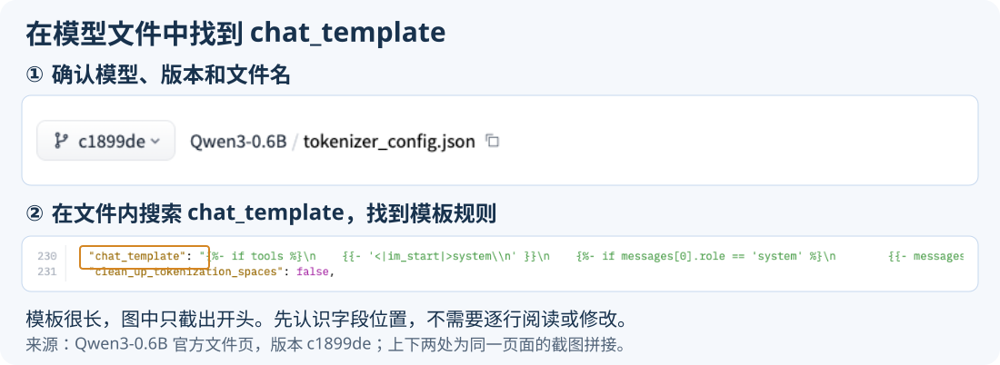

This field stores the processing rules for different roles and conditions, which are read and used by the tools.

**Next, look at how the same message changes before and after conversion.** Below, the official template that comes with the model is used to process the library teaching sample from Section 1, with thinking mode disabled, to observe how the message is organized.

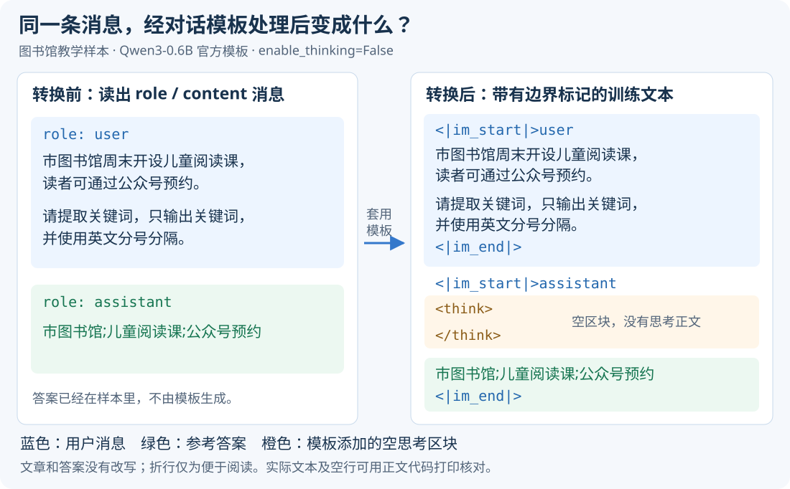

Comparing the left and right sides, both the article and the keyword answer are still present; the main change is in how message boundaries are represented:

- `<|im_start|>user`: the start of the user message, followed by the article and task instructions.
- `<|im_end|>`: the end of this message.
- `<|im_start|>assistant`: the start of the assistant message, followed by the reference answer.

The keywords here come from the `assistant.content` in the sample; the empty `<think>` block in the figure is added by the official template. **The template is responsible for organizing existing messages, while answer quality is still guaranteed by data review.**

<details>
<summary>When the answer does not end, look again: message boundaries, end of thinking, and EOS</summary>

You also need to distinguish between two kinds of "ends": `</think>` indicates the end of the thinking section, after which the answer can still continue; the message end marker is used to delimit messages. The inference program also needs to configure generation stop conditions to identify when to end the assistant's output. A common **EOS (End of Sequence)** marker participates in this determination as a token ID, and the specific ID and usage must correspond to the model, template, and inference engine; you cannot treat `</think>` directly as the end of the answer. Chapter 32 will examine the actual phenomenon together with [repetitive output and generation stopping](32-%E5%BE%AE%E8%B0%83%E6%95%88%E6%9E%9C%E8%AF%84%E4%BC%B0%E4%B8%8E%E6%A8%A1%E5%9E%8B%E9%83%A8%E7%BD%B2.md?id=_24-from-single-item-observation-to-batch-testing).

</details>

**This figure uses the official template to illustrate the conversion process; for actual training, refer to the preprocessing results of the training tool.** Chapter 31 uses LLaMA-Factory's `qwen3_nothink`, which may be processed differently from the official template, so you cannot directly reuse the token counts from this figure. Section 4.2 of Chapter 30 will guide you in verifying the actual input.

**Finally, turn text into IDs.** The previously mentioned **Tokenizer** converts text and markers into IDs that the model can compute over. Each basic unit is called a **Token**, which does not necessarily correspond to a single Chinese character.

For example, using the same Qwen3 tokenizer to process "市图书馆" separately yields:

| Human-readable content after tokenization | Corresponding ID |
| ---------------- | -------- |
| 市 | `22697` |
| 图书馆 | `106036` |

In this example, four Chinese characters are two tokens, corresponding to the input IDs `[22697, 106036]`. Special markers such as `<|im_start|>` also have their own IDs. `input_ids` refers to the model's input ID sequence.

The model input conversion process is: **read messages from JSONL → organize messages according to the template → convert them into token IDs.** In the first step, you also need to tell the tool which fields to look for the messages in; this is called field mapping, and it will be filled in when registering the dataset in Chapter 31. The latter two steps can usually be completed together by the tool, without the need to save an additional intermediate text.

### 6.3 Differences in Input Between Training and Inference

For the same library message, the input is different when preparing a training sample versus actually asking the model a question:

| Comparison Item | Preparing Training Samples | Preparing a Single Inference |
| -------------- | ---------------------------------- | ---------------------------- |
| What messages are provided | `user` input and `assistant` reference answer | Only the `user` input |
| What goes in the assistant position | The existing reference answer and the end marker | The starting position of the answer, waiting for the model to continue |

The preceding user article is the same in both cases; the key comparison is **the end of the assistant section**. Both of the following sections are actual processing results from the official template; the blank lines shown are also part of the template.

Training sample includes the reference answer:

```text
<|im_start|>assistant
<think>

</think>

市图书馆;儿童阅读课;公众号预约<|im_end|>
```

Inference input stops at the position prepared for the answer:

```text
<|im_start|>assistant
<think>

</think>

```

The model then generates keywords starting from this point. **During actual inference, you must not first insert the reference answer into the input and then treat the subsequent output as the model independently answering correctly.**

<details>
<summary>Code reproduction: print template results and token IDs</summary>

After completing the [environment setup and model download in Chapter 31](31-LLaMA-Factory%E7%8E%AF%E5%A2%83%E6%90%AD%E5%BB%BA%E4%B8%8E%E5%BE%AE%E8%B0%83%E5%AE%9E%E6%88%98.md?id=_51-model-and-fine-tuning-method), you can run the following code to view the template output.

In **AutoDL's JupyterLab file panel**, open `/root/autodl-tmp/LLaMA-Factory/`, create a new text file and name it `preview_chat_template.py`, paste the following Python code into it, and save it. Replace `model_dir` with the actual directory returned when the download completed; that directory needs to contain `tokenizer_config.json` and the tokenizer files. The code below only loads the tokenizer; it does not load model weights and does not start inference or training.

```python
from pathlib import Path
from transformers import AutoTokenizer

model_dir = Path("/root/.cache/modelscope/models/Qwen--Qwen3-0.6B/snapshots/master")
tokenizer = AutoTokenizer.from_pretrained(model_dir, local_files_only=True)  # 只读取本地分词器文件

messages = [
    {
        "role": "user",
        "content": "市图书馆周末开设儿童阅读课，读者可通过公众号预约。\n"
                   "请提取关键词，只输出关键词，并使用英文分号分隔。",
    },
    {"role": "assistant", "content": "市图书馆;儿童阅读课;公众号预约"},
]

for name, chat, generation_prompt in [
    ("训练样本", messages, False),
    ("推理输入", messages[:1], True),
]:
    text = tokenizer.apply_chat_template(
        chat,
        tokenize=False,  # 返回模板处理后的文字，方便观察消息边界
        add_generation_prompt=generation_prompt,  # 推理时补上助手回答的起始位置；训练样本不补
        enable_thinking=False,  # 关闭思考模式
    )
    token_ids = tokenizer.apply_chat_template(
        chat,
        tokenize=True,  # 将模板处理后的文字转换为 token 编号
        return_dict=False,  # 直接返回编号列表，便于用 len() 统计长度
        add_generation_prompt=generation_prompt,
        enable_thinking=False,
    )
    print(f"\n{name}，共 {len(token_ids)} 个 token：")
    print(text)

ids = tokenizer.encode("市图书馆", add_special_tokens=False)  # 不额外添加特殊标记，只观察短语本身
print("短语编号：", ids)
print("逐个解码：", [tokenizer.decode([token_id]) for token_id in ids])
```

After saving, open a new **AutoDL JupyterLab terminal** and run:

```bash
cd /root/autodl-tmp/LLaMA-Factory
source .venv/bin/activate
python preview_chat_template.py
```

The terminal will print the "training sample", the "inference input", and the tokenization results for the phrases in order. If it reports that the file cannot be found, check the directory where the Python file was saved; if the tokenizer cannot be found, verify `model_dir`.

The same set of messages calls the template twice: the first time to view the text, the second time to view the IDs. `return_dict=False` explicitly requests a list, so `len(token_ids)` counts the number of tokens. For parameter descriptions, see the [Transformers official documentation](https://huggingface.co/docs/transformers/main/en/main_classes/tokenizer#transformers.PreTrainedTokenizer.apply_chat_template).

**Example conditions:** Transformers `4.57.6`, Qwen3-0.6B [official tokenizer files for version `c1899de`](https://huggingface.co/Qwen/Qwen3-0.6B/tree/c1899de289a04d12100db370d81485cdf75e47ca). The library sample's training input is 51 tokens, and the inference input is 40 tokens; both include the article and template markers. The empty `<think>` block is added by this official template when thinking is disabled.

Chapter 31 uses Transformers `5.8.0`; at runtime, use the tokenizer and output actually loaded, and there is no need to change the training environment just to match the numbers here. For the differences between the official template demonstration and the tool's training input, see Section 6.2; for implementation details, refer to the [LLaMA-Factory template source code](https://github.com/hiyouga/LLaMA-Factory/blob/dced5f8804bfbf7109ef7c14401db6bd5cce7e53/src/llamafactory/data/template.py).

If you want to observe the real samples from the course, before the loop you can replace the teaching-use `messages` with the following code; leave the rest unchanged:

```python
import json

data_file = Path(
    "/root/autodl-tmp/LLaMA-Factory/data/keywords-clean/keywords_train.jsonl"
)
with data_file.open(encoding="utf-8") as source:
    record = next(json.loads(line) for number, line in enumerate(source, 1) if number == 484)
messages = record["conversations"]
```

This record is the "high-fluorine beryllium ore" sample shown in the Section 1 image; it is the first record in the small file and becomes the 484th record in the course training set after splitting. Under the fixed template above, the training input is 139 tokens and the inference input is 121 tokens.

</details>

### 6.4 Template Selection and Precautions

For the subsequent keyword exercises, select `qwen3_nothink` in LLaMA-Factory and disable the thinking setting. Complete the following three checks first; whether the actual answers meet the requirements will be verified in Chapter 32.

1. **The model and template must match.** After changing models, recheck the template, and keep training and inference consistent.
2. **Keep normal messages in the JSONL.** Do not stuff the entire template text printed above back into `user.content`, and do not manually add role markers, otherwise the tool may wrap them again during processing.
3. **Check the actual input of the training tool.** Before training, check the preprocessed length, roles, and answer position; see [Chapter 30, "Checking the Actual Training Length"](30-%E6%A8%A1%E5%9E%8B%E8%AE%AD%E7%BB%83%E5%8E%9F%E7%90%86%E4%B8%8E%E9%AB%98%E6%95%88%E5%BE%AE%E8%B0%83.md?id=_42-checking-the-actual-training-length).

Disabling the thinking setting still does not guarantee that there will be no analysis section. In the fixed course version, the two templates add empty thinking blocks in different ways; if you encounter this phenomenon, read the [template comparison in Chapter 32](32-%E5%BE%AE%E8%B0%83%E6%95%88%E6%9E%9C%E8%AF%84%E4%BC%B0%E4%B8%8E%E6%A8%A1%E5%9E%8B%E9%83%A8%E7%BD%B2.md?id=_24-from-single-item-observation-to-batch-testing) again. There is no need to troubleshoot inference details in this chapter first.

---

**Chapter review questions:**

1. What is the difference between JSON and JSONL in terms of how files are saved? If a single sample is expanded into more than ten lines for display, does saving it in that form turn it into more than ten training records?

   **Reference approach:** JSON represents one complete JSON value; JSONL requires that each non-empty physical line be a complete JSON value. In this lesson, each line stores one sample object. Expanding a sample across multiple lines for explanation still makes it the same sample; when writing it into this lesson's JSONL, it should be placed back into a single physical line. Newlines inside a message are stored in escaped form, and the number of samples cannot be counted by the number of display lines.

2. For the same "article → keywords" sample stored with Alpaca and ShareGPT, where are the task requirements, the article, and the reference answer placed?

   **Reference approach:** In this lesson's Alpaca example, the task requirement is placed in instruction, the article in input, and the reference answer in output. In the ShareGPT example, the task and article are placed in the user message, the reference keywords are placed in the assistant message, and the messages are organized with the conversations list. What changes is the organization method, not the task and answer; multi-turn messages should still remain in the conversation of the same sample.

3. What are the respective responsibilities of field mapping in the registry, the Chat Template, and the Tokenizer? How does a ShareGPT dataset that can be parsed become model input?

   **Reference approach:** Field mapping tells the training tool where to read messages and how to identify roles; the Chat Template organizes role markers, content, and conversation boundaries according to the model's requirements; the Tokenizer then converts the text into token IDs. A file being parseable only completes the prerequisite for reading; it is also necessary to confirm that the role mapping is correct, the template matches the model, and the converted input meets expectations.

4. During training, reference keywords are provided. What should be provided during independent inference? How can you check that you have not inserted the answer into the input in advance?

   **Reference approach:** The training sequence contains the task, the article, and the assistant reference answer, which are used for subsequent calculation of the learning objective. Independent inference only provides the required task and context, with generation starting at the assistant position waiting for the answer; the reference answer is saved separately for comparison. Check the conversion results shown in Section 6.3 to confirm that the inference input contains no reference keywords and that the already-wrapped template has not been further wrapped into the user message.

5. The library's original text describes a children's reading class, but the reference answer says "City Library; Adult training". The semicolon is correct, so why does it still need to be revised? When two annotators disagree about whether "official account reservation" should be split, how should it be handled?

   **Reference approach:** "Adult training" has no basis in the original text and is a content error; a correct separator cannot compensate for it. Phrase splitting should follow the annotation rules in Section 2.3 to unify the standard, explain the basis for keeping this example as a whole, and then re-examine related samples. Scripts are suitable for checking structure and format; professional meaning and annotation disagreements still require manual review.

6. What are the training set, validation set, and test set used for? Which data should be used when comparing whether to train for one epoch or three epochs, and which should be used for the final check?

   **Reference approach:** The training set participates in parameter updates, the validation set is used to compare training schemes and select checkpoints, and the test set is used for an independent check after the scheme is finalized. This example uses an 80%/10%/10% split, but the proportions should be determined by the task. If the test results have already been used repeatedly during development, separate data that did not participate in selection should be prepared; independence cannot be restored by simply re-splitting randomly.

7. The same article is rewritten into two different phrasings of the question, with one placed in the training set and the other in the test set. Why may exact deduplication still fail to detect the leakage?

   **Reference approach:** Exact deduplication can only identify duplicates covered by its rules; different question phrasings may make the two records no longer identical, but they still share the same source and answer information. The data should be split by original text or related material groups, and then set intersections should be checked. The complete data in this lesson also overlaps with the small file, so they cannot be treated separately as a training set and an independent test set.

8. The training data is mostly activity announcements, but during validation, agricultural summaries often omit variety names. How should the next batch of data be prepared?

   **Reference approach:** First verify the errors against the original text, check whether scenarios such as agricultural topics, complete names, and long texts lack reliable demonstrations, and then add reviewed relevant samples. If the name annotation itself is disputed, unify the rules first; repeatedly adding similar announcements cannot fill these gaps. After modifying the data, use validation results to check whether the target errors have decreased.

9. After cleaning and splitting are complete, which files should be handed over for subsequent training? How should you explain what has already been processed in this batch of data and what still needs checking?

   **Reference approach:** Hand over the three JSONL files for training, validation, and testing, along with the registry, cleaning report, and manifest. Check file locations, record counts, split records, duplicates, and set intersections; spot-check actual samples; and explain the scope of automated checks, manual review results, and pending items. Successful file generation only proves that the process produced files; it does not prove that all answers have passed semantic review.

<details>
<summary>Optional exercise: document Q&A and tool calling</summary>

1. When using Easy Dataset to create Q&A from documents, why is it necessary to go through "check chunks → generate Q&A → review against sources → export and check"?

   **Reference approach:** Chunking affects the context visible during generation, and the generated results may omit restrictions or state facts incorrectly, so it is necessary to return to the source to check numbers, conditions, and answer basis, then save revisions before exporting. Open the exported file to check the record count, roles, and revised answers, confirming that the review results actually entered the subsequent data.

2. How does a tool-calling training sample differ from an ordinary single-turn question and answer? If there is only the response "Query successful, 6 spots remaining", what is missing?

   **Reference approach:** It also needs the user context, tool description, call name and parameters, corresponding tool result, and subsequent response; include a clarification process when necessary. Tool results should come from real execution or from a clearly labeled and verified simulated environment, and should cover cases such as no call needed and call failures. The single-turn keyword script cannot directly verify the correspondence among these messages.

</details>

**Chapter summary:**

- JSONL requires each line to store one JSON value, and in this lesson each line is one sample; Alpaca and ShareGPT define how the task, input, answer, or messages are organized. File format and sample structure should be understood separately.
- Training answers must not only be readable, but must also have a basis in the original text and comply with annotation rules. The data should cover the topics, lengths, and professional names of the actual task; format cleaning cannot replace semantic review.
- The training set is used for parameter updates, the validation set for choosing schemes, and the test set for independent checks. Cleaning, deduplication, and source-based grouping together reduce leakage; exact deduplication cannot find all approximate samples from the same source.
- Field mapping helps the tool read roles and content, the conversation template organizes text according to the model's requirements, and the tokenizer converts it into token IDs. Training provides reference answers, while independent inference only provides the content to be processed and the necessary context.
- After cleaning, retain the three data files, the registry, the cleaning report, and the manifest, and verify the actual content. Document Q&A requires review against sources, and tool calling also requires checking the correspondence among requests, execution results, and subsequent responses.

**Suggested next step:** Check the generated files against Section 5.4, spot-check the three data files, and explain what has already been processed and what still needs review. For subsequent work, use the `keywords-clean/` specified in the main text, and keep your own reproduction directory separate. Bring this data description with you into [Chapter 30](30-%E6%A8%A1%E5%9E%8B%E8%AE%AD%E7%BB%83%E5%8E%9F%E7%90%86%E4%B8%8E%E9%AB%98%E6%95%88%E5%BE%AE%E8%B0%83.md) to understand how the model uses these answers to update its parameters.
