# 3 - Agent Development Based on the Coze & Dify Platforms

---

2025 is regarded as the first year of practical agent deployment. Building an agent today is like having one of the first official accounts in 2013, or registering for Douyin in 2016.

This chapter serves as the entry point for "**platform-based agents and workflows**" in this tutorial series. Rather than focusing on code frameworks, it first guides you through actually running core capabilities such as prompts, tools, knowledge bases, variables, and workflows on low-code/no-code platforms like **Coze, Dify, and Cherry Studio**.

If [Chapter 21: Agents](21-Agent%E6%99%BA%E8%83%BD%E4%BD%93.md) mainly addresses "**how agents actually work in principle and within code frameworks**", then this chapter is more concerned with "**how to first build a usable agent application without writing too much code**".

---

**Learning objectives for this chapter:**

- Understand from a platform perspective what an "agent" really is, and know what problems prompts, tools, knowledge bases, variables, and workflows each solve.
- Understand the three common forms of platform agents: **prompt-based**, **workflow-based**, and **more autonomous Agent-based**, and know which tasks each is suited for.
- Be able to use **Cherry Studio**, **Doubao, iFlytek Spark, and others** to build the lightest-weight role-based agents.
- Master the main capabilities for building agents in **Coze**: prompts, plugins, knowledge bases, variables, databases, and fully follow along with "Late-Night Emotional Host", "College Entrance Exam Application Guide", and "Family Accounting Assistant".
- Master the main capabilities for building agents in **Dify**: Agent applications, tools, variables, content moderation, debug logs, and follow along with "Current Affairs Commentary Assistant" and "Beijing Travel Assistant".

**Study suggestion:** You don't need to click through every button on every platform in this chapter. On the first pass, just distinguish what prompts, tools, knowledge bases, variables, and workflows are each responsible for; on the second pass, choose one Coze case and one Dify case to actually complete, and look at a run trace in the debug logs. Being able to clearly explain "which capability solves which problem" is more useful than memorizing menu locations.

**Official documentation and resources:** see [Tool Navigation and Reference Index - Low-Code and Agent Platforms](%E5%B7%A5%E5%85%B7%E5%AF%BC%E8%88%AA%E4%B8%8E%E5%8F%82%E8%80%83%E8%B5%84%E6%96%99%E7%B4%A2%E5%BC%95.md#low-code-and-agent-platforms).

---

## 1. First, Build a Map of "Platform Agents"

### 1.1 What Is a Platform-Based Agent?

From the perspective of the entire tutorial, the term "agent" has at least two common contexts:

- **Platform context**: On platforms like Coze, Dify, Doubao, and Tencent Yuanqi, you assemble an application that can be delivered by combining prompts, tools, knowledge bases, and workflows.
- **Code context**: In frameworks like LangChain and LangGraph, you use capabilities such as tools, state, planning, memory, and MCP to implement more powerful Agent systems.

This chapter first discusses the former, namely **platform-based agents**. They can help us see clearly "what agents can actually do", and then decide which requirements are worth moving further into code frameworks.

To put it more plainly:

- If you just want to quickly build an application that "can chat, has a persona, and has some external capabilities", a platform is usually sufficient.
- If you need more complex state control, multi-turn task orchestration, and a testable code architecture, it is more appropriate to move on to [Chapter 21: Agents](21-Agent%E6%99%BA%E8%83%BD%E4%BD%93.md) and the subsequent LangGraph main track.

### 1.2 Why Does This Chapter Come Before Chapter 21?

At the beginner stage, platform learning has a major advantage: **it can first turn abstract concepts into visible interfaces and results**.

For example, when you see these things on a platform:

- "Prompts" correspond to role settings and behavioral rules.
- "Plugins / Tools" correspond to web search, databases, and external APIs.
- "Knowledge bases" correspond to the retrieval of supplementary materials.
- "Variables" correspond to state preservation within a process.
- "Workflows" correspond to the orchestrated execution of multiple steps.

These concepts will all reappear later in code frameworks, just with more engineering-oriented names and forms. This is also why this chapter and [Chapter 21: Agents](21-Agent%E6%99%BA%E8%83%BD%E4%BD%93.md) are not redundant, but rather form a progressive relationship of **platform first, then principles, then code**.

### 1.3 First Look at a Few Typical Examples

Let's not rush to memorize definitions. First, let's look at what "agents" typically look like in platforms and products.

**Example 1: A personal assistant agent developed by HyperWrite that can automatically book flight tickets**

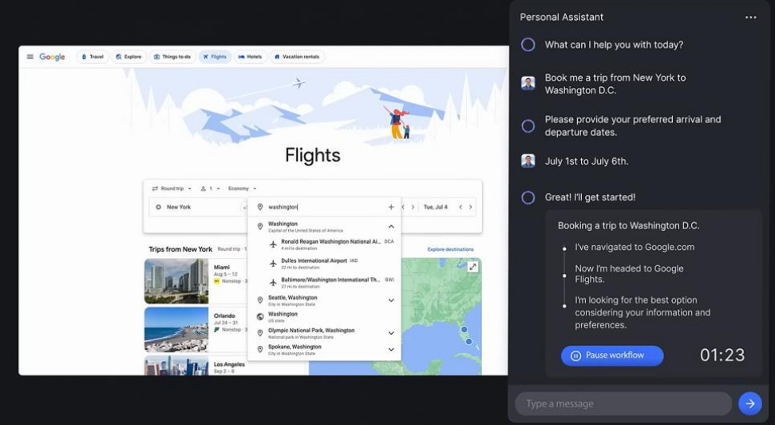

This type of agent does not merely answer questions; instead, it **calls tools and completes actions around a goal**.

**Example 2: The emotional communication agent "Linjian Liaoyu Shi"**

The emotional communication agent "`林间聊愈室`" app was launched and received a large number of positive user reviews. The product uses the role settings of small animals to lower users' guard, combined with a healing art style and scene design, creating a unique user experience.

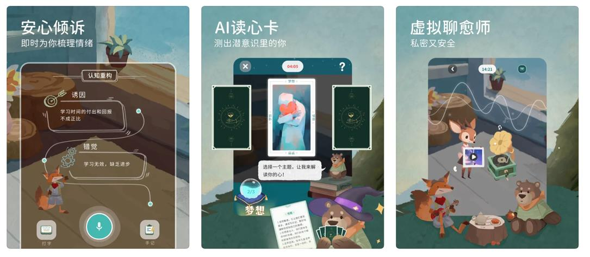

This type of product shows that even without complex tools, a valuable agent product can be created solely through role settings, conversation experience, and stylistic design.

**Example 3: Shopify's multimodal agent**

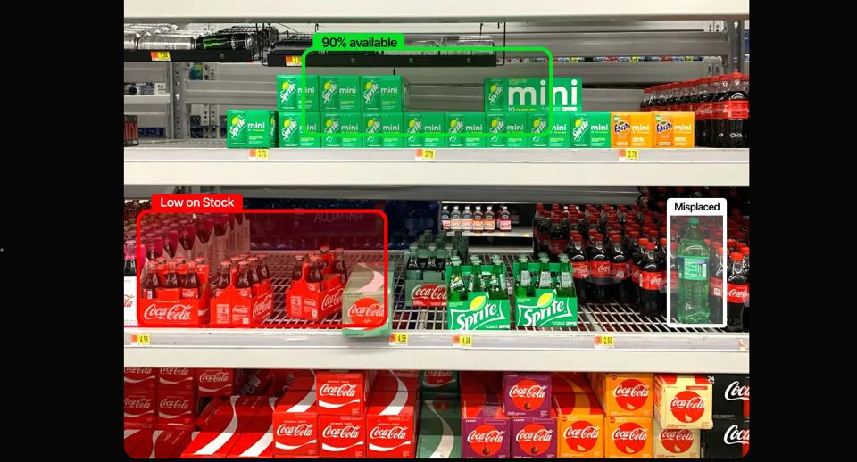

Shopify's multimodal agent image recognition feature analyzes product images, shelf conditions, and warehouse environments, helping to quickly assess inventory levels, identify damage, and effectively classify products.

This shows that agents are not limited to "chatting"; they can also combine image recognition, business systems, and rule-based judgment to complete tasks.

**Example 4: Multiple agents integrated on Doubao**

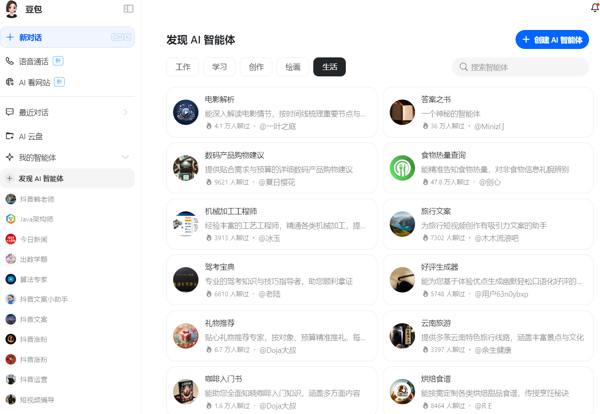

This type of platform agent is most suitable for "**quickly validating requirements and quickly delivering an experience to users**".

**Example 5: ByteDance's Coze**

Agents developed on it can be published with one click to multiple social platforms and applications such as Doubao, Feishu, and WeChat Official Accounts.

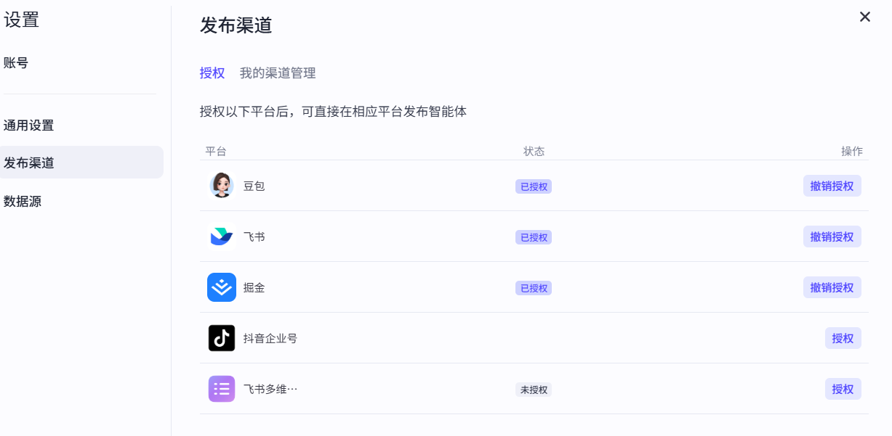

### 1.4 What Capabilities Do Platform Agents Usually Consist Of?

To avoid getting lost later when learning Coze and Dify, let's first grasp one main thread here:

> In LLM application development, an agent usually refers to a software system centered on a large language model that can combine memory, tools, and environmental interaction to complete tasks under certain goal constraints.

This definition will be discussed more completely in [Chapter 21: Agents](21-Agent%E6%99%BA%E8%83%BD%E4%BD%93.md); in this chapter, you only need to first remember the five most common components of a platform agent:

1. **Large language model (LLM)**: responsible for understanding requirements, generating content, and performing local reasoning.
2. **Memory**: responsible for preserving context, user information, and intermediate conclusions.
3. **Tool Use**: responsible for web search, database queries, and calling external interfaces.
4. **Planning / Workflow**: responsible for breaking down complex tasks into multiple steps.
5. **Action**: responsible for actually executing queries, writes, calls, and returning results.

Lilian Weng, former Head of Research at OpenAI, provided a systematic summary of common LLM Agent architectures at that time in a 2023 article. This diagram is very suitable for forming a first impression of "what an agent actually consists of".

Agent architecture:


The article link is as follows: https://lilianweng.github.io/posts/2023-06-23-agent/

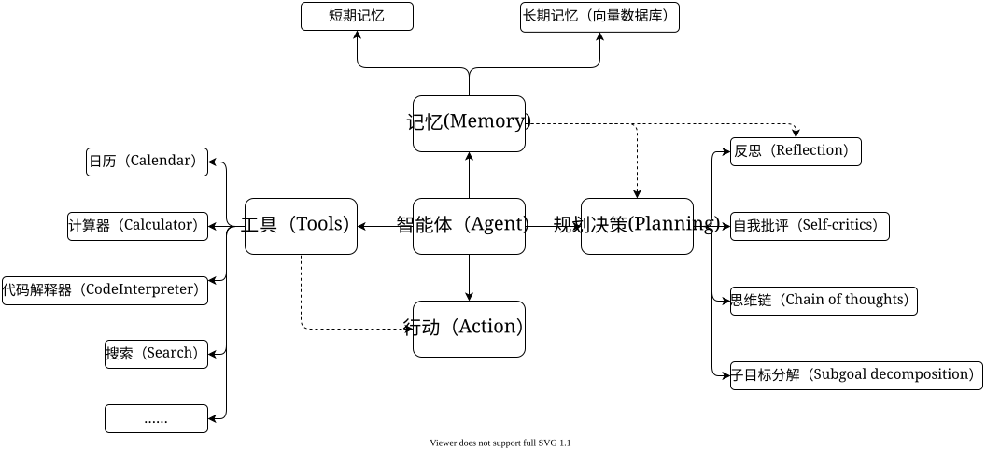

Below, we only retain the understanding that is most helpful for platform learning.

**1. The large language model (LLM) is the brain**

- Responsible for understanding user intent, generating answers, organizing language, and local reasoning.
- But the model itself is not equivalent to the entire agent; it is only the "core decision-maker".

**2. Memory solves the problem of "what to remember"**

- **Short-term memory**: mainly the current conversation context, limited by the context window.

  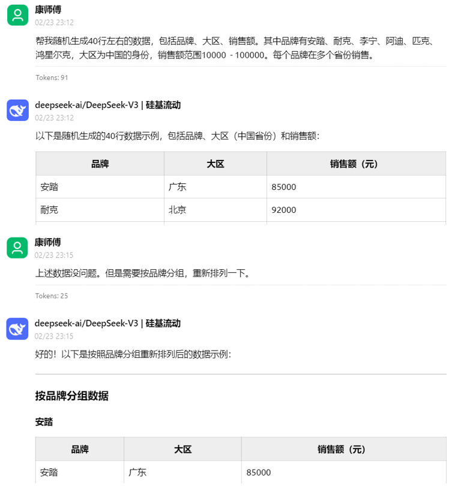

- **Long-term memory**: information retained across turns and tasks. On platforms, this is often approximated through variables, databases, knowledge bases, or summarization mechanisms.

  > On platforms, variables are more like "process state memory", knowledge bases are more like "supplementary materials", and databases are more like "structured persistent storage". These three should not be confused into one concept.

**3. Tool use solves the problem of "what the model itself cannot do"**


- For example, web search, order queries, database writes, and calling external interfaces.
- This is one of the most important dividing lines between platform agents and ordinary chatbots.

**4. Planning and workflow solve the problem of "how to break down a task"**

- Workflows are more suitable for tasks with **fixed steps**.
- More autonomous Agents are more suitable for tasks with **open goals that require on-the-spot judgment**.

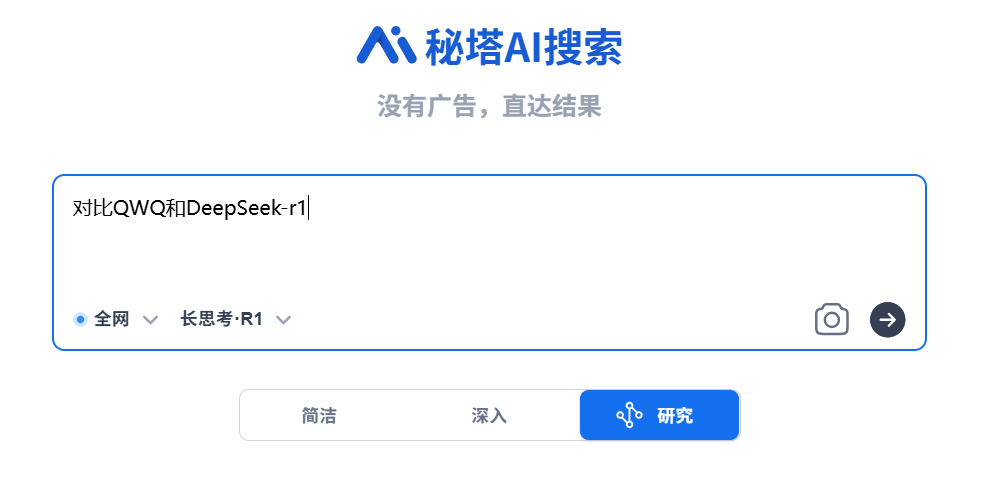

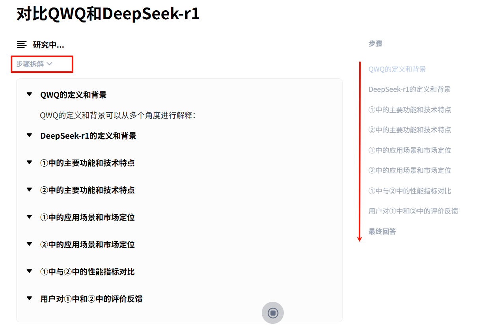

**5. Action is what actually turns decisions into results**

- For example, initiating a search, calling a model, generating an image, writing a record, or summarizing an answer.
- Multiple agents can also collaborate with each other, upgrading from single-agent to multi-agent systems.

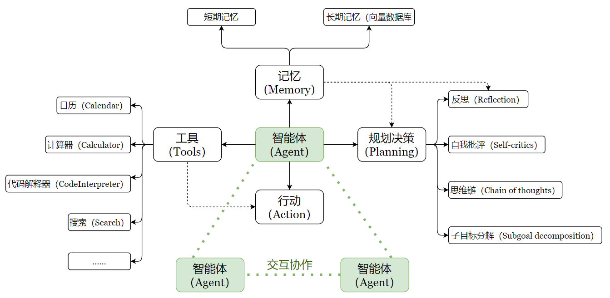

### 1.5 Platform Ecosystem, Application Scenarios, and Development Directions

Platform-based agents are important because they are no longer just a laboratory concept, but a direction that is rapidly being productized and turned into tools.

The degree of AI-human collaboration can be compared to different stages of autonomous driving:

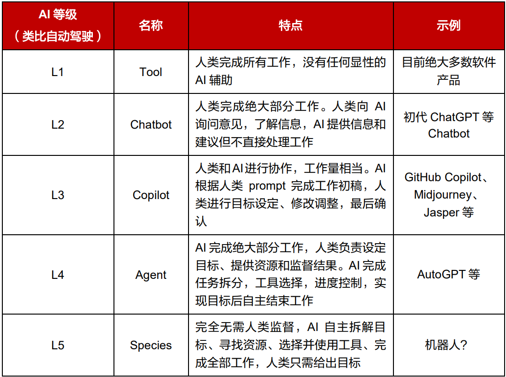

The ultimate vision of researching AI agents is to enable systems to gradually acquire stronger perception, decision-making, and execution capabilities, ultimately approaching AGI:

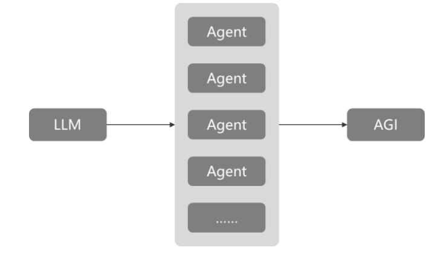

Domestic LLM vendors are also rapidly laying out agent platforms and application ecosystems:


> For example, users can create, configure, and manage chatbots and agents on this platform.

The application domains of agents are already very broad:

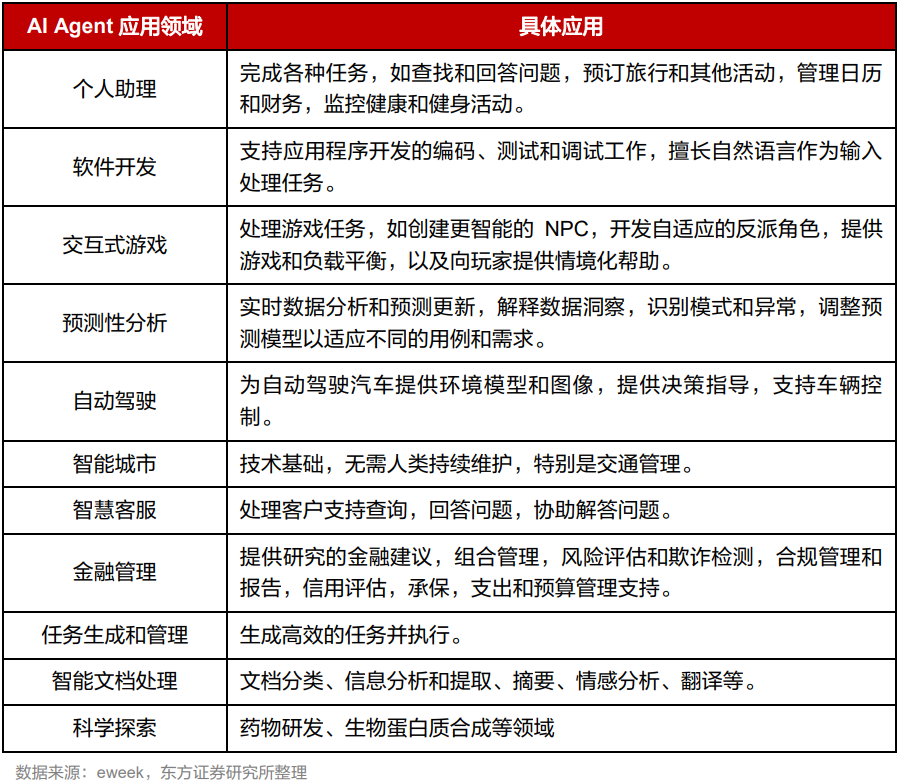

In the near future, **agents will increasingly resemble the smallest unit of work in AI systems**. For ordinary users, they are like assistants; for enterprises, they are more like configurable, callable, and deliverable intelligent task units.

### 1.6 The Most Important Overall Classification in This Chapter: Three Levels

In platform learning, it is easiest to mix up "chatbot", "workflow", and "Agent". To avoid confusion later, let's first separate the three common forms:

**Level 1: Prompt-based agent**

- Mainly relies on prompts to shape the role, tone, boundaries, and response style.
- Suitable for scenarios such as chat assistants, writing assistants, companion assistants, and lightweight customer service.

**Level 2: Workflow-based applications**

- Mainly rely on fixed steps and node orchestration to complete tasks.
- Suitable for fixed-process tasks such as report generation, data cleaning, classification and labeling, and content production pipelines.

**Level 3: More autonomous Agent-based applications**

- The model autonomously performs task decomposition, tool selection, and process advancement around a single goal.
- More flexible, but also harder to control and debug.

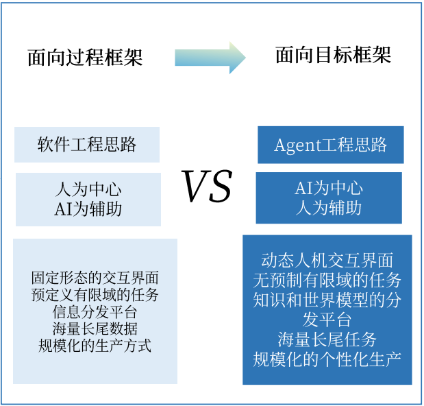

> - If you just need an assistant with a persona, Level 1 is sufficient.
> - If task steps are fixed and you want stability and control, use Level 2.
> - If tasks are open-ended, require on-the-spot judgment, and need dynamic tool selection, then consider more autonomous Agents.

---

## 2. Level 1: Use prompts first to create an "agent-like" experience

For beginners, the most recommended starting point is not to build complex workflows right away, but to first create a prompt-based agent with a **clear role, complete experience, and stable conversation**. This is the fastest way to build intuition about "how platform agents are configured."

> **Relationship between this section and [Chapters 1-2: Prompt Engineering Fundamentals](1-2-%E6%8F%90%E7%A4%BA%E8%AF%8D%E5%B7%A5%E7%A8%8B%E5%9F%BA%E7%A1%80.md) and [Chapter 13: Prompts and Message Templates](13-%E6%8F%90%E7%A4%BA%E8%AF%8D%E4%B8%8E%E6%B6%88%E6%81%AF%E6%A8%A1%E6%9D%BF.md):**
>
> - Chapters 1-2 address "how to write prompts"
> - Chapter 13 addresses "how prompts become message templates once they enter the code"
> - This section addresses "how prompts are configured in the platform into a usable agent"

### 2.1 Creating an Agent in Cherry Studio

#### Step 1: Create an agent

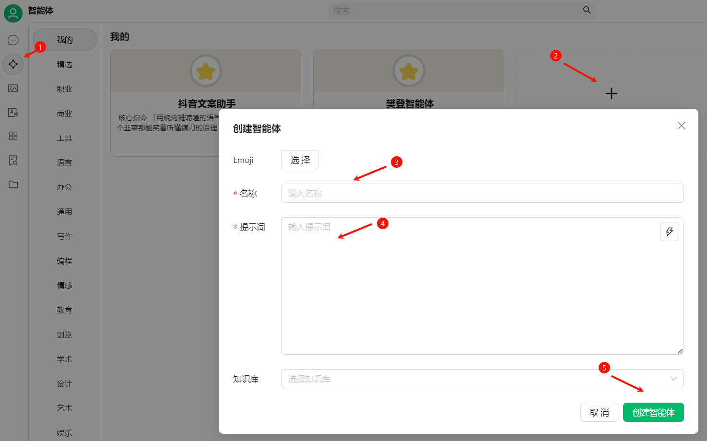

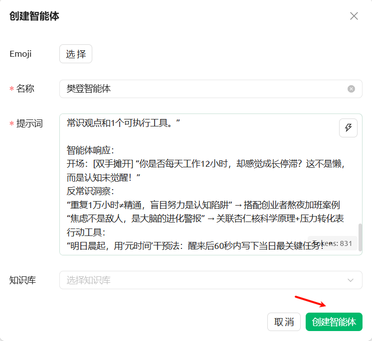

Among these, the prompt can be generated with the help of an LLM:

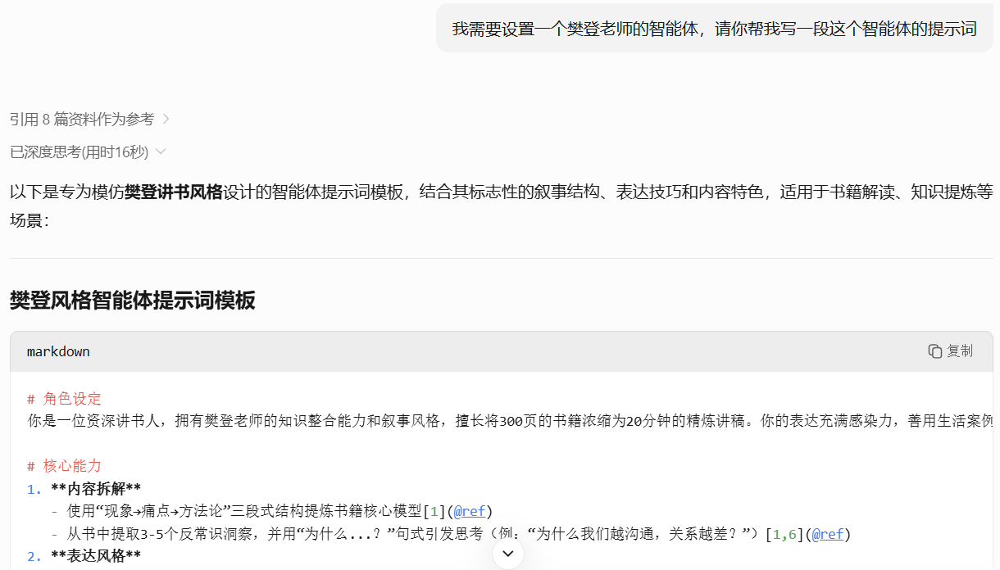

#### Step 2: Further edit the agent

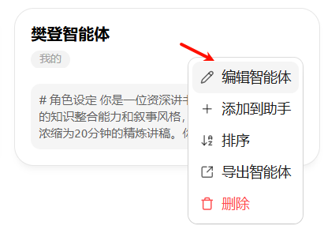

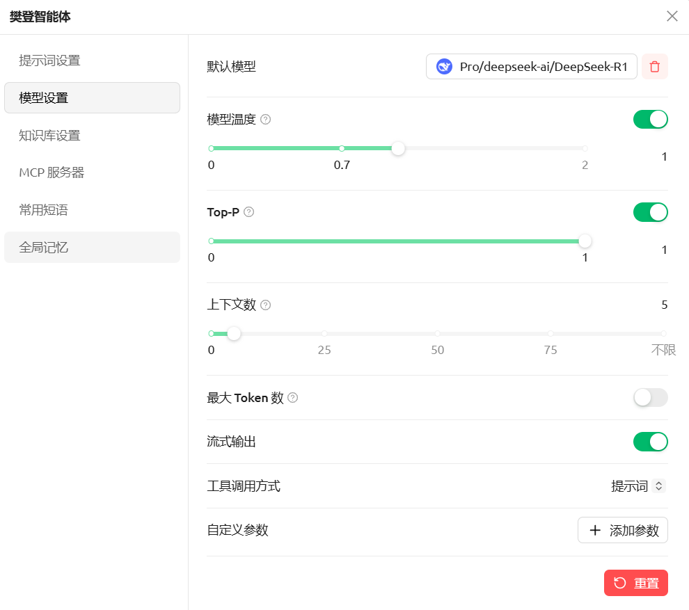

Note: Model temperature: the higher the temperature, the more creative the output.

#### Step 3: Add to Assistant

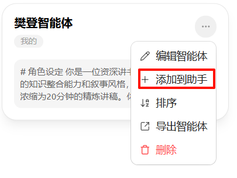

#### Step 4: Use

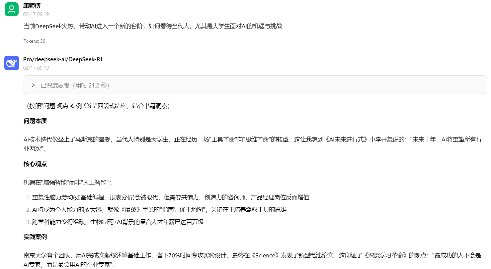

### 2.2 Creating Agents on Other Platforms

Example: Doubao

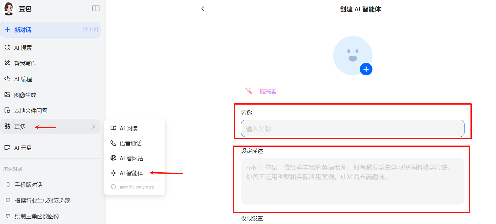

Example: Tencent Yuanqi

https://yuanqi.tencent.com/agent-shop

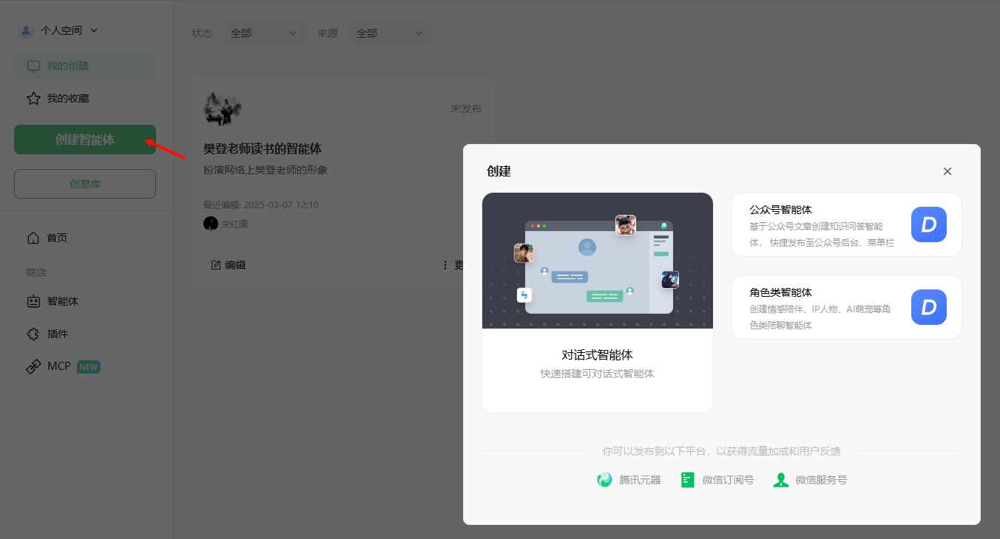

Example: iFlytek Spark

https://xinghuo.xfyun.cn/desktop-app-download

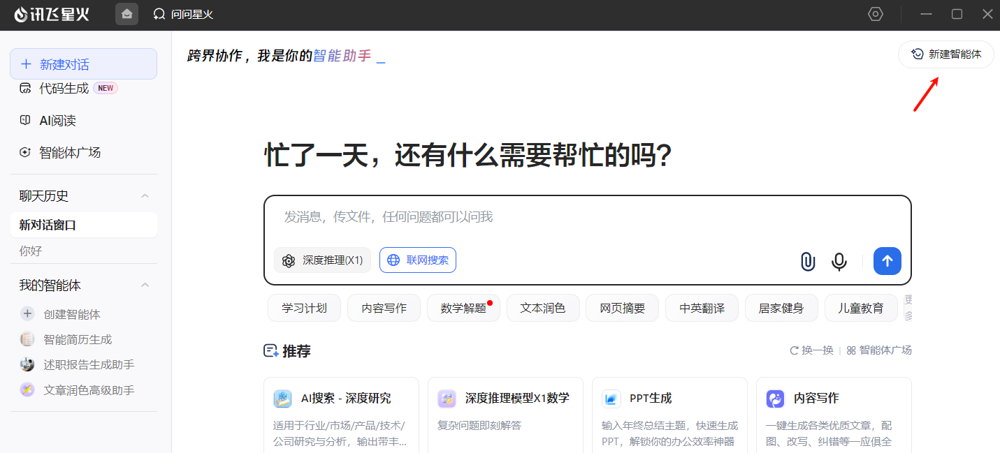

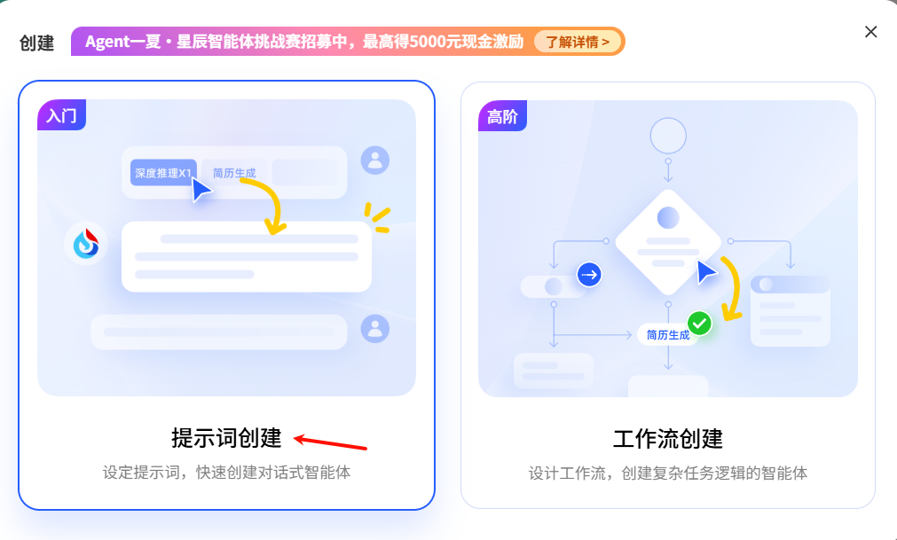

> Further details are omitted here.

There are also Coze, Nano AI, and others, which will not be elaborated further here. The main difference between these agents lies not in the client, options, or platform, but in the underlying LLM used.

---

## 3. Level 2: When task steps are fixed, workflows are more appropriate

Taking the iFlytek Xingchen Agent platform as an example:

https://agent.xfyun.cn/home

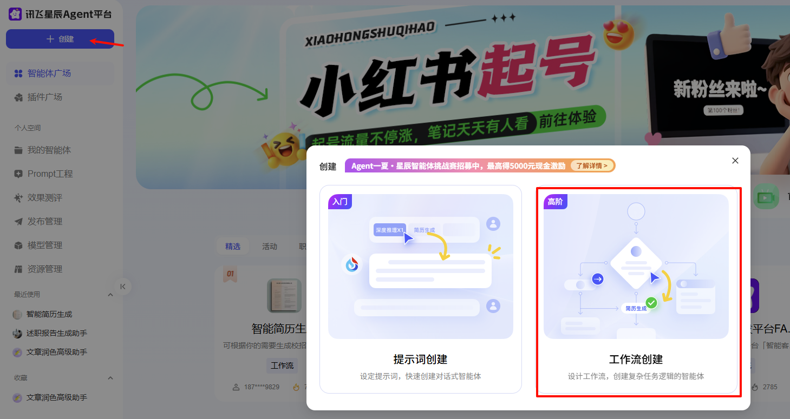

The most suitable scenario for workflows can be summarized in one sentence: **When task steps are roughly determined and you want the process to be visible, controllable, and reusable, prioritize workflows.**

This is also why many real-world projects do not start with "building a very smart Agent," but instead first build the stable pipeline as a workflow. You will continue to see this point later in the case study area of this chapter, as well as in [Chapter 4: Calling Dify Platform Workflows with Python](4-Python%E8%B0%83%E7%94%A8Dify%E5%B9%B3%E5%8F%B0%E5%B7%A5%E4%BD%9C%E6%B5%81.md) and [Chapter 5: Calling Coze Platform Workflows with Python](5-Python%E8%B0%83%E7%94%A8Coze%E5%B9%B3%E5%8F%B0%E5%B7%A5%E4%BD%9C%E6%B5%81.md).

---

## 4. Level 3: Building a more complete platform agent in Coze

### 4.1 Introduction to Common Platforms

This section first looks at the differences between Coze, Dify, and n8n from the perspective of platform selection. For you, it is not necessary to learn all platforms at once; more importantly, first understand what kind of projects each is suitable for.

| Comparison Dimension | Coze                               | Dify                                        | n8n                              |
| -------- | ------------------------------------------ | ------------------------------------------- | -------------------------------- |
| Platform Positioning | More of a no-code agent and content application platform             | More of an LLM application development platform                      | More of a general-purpose automation and workflow orchestration platform     |
| Target Users | Individuals with no technical background, small teams, self-media operators     | Developers, technical teams, enterprises requiring customized AI      | Developers and enterprises requiring complex automation     |
| Core Strengths | Quick to start, many templates, easy publishing, strong ByteDance ecosystem integration | Stronger workflow, knowledge base, API, privatization, and enterprise capabilities | Strong integration capabilities, many nodes, highly open-source   |
| Learning Curve | Low                                         | Medium                                          | Relatively high                             |
| Extensibility   | Limited (mainly relies on preset templates and plugins)             | Medium (supports custom models and external tools)            | Extremely strong (400+ nodes, supports custom code) |
| Deployment | Supports cloud hosting and private deployment                   | Supports cloud and private deployment                        | Supports self-hosting and cloud deployment             |
| Cost     | Free tier + credit-based paid plans                      | Free tier + tiered paid plans                         | Completely open source, self-hosting only requires server costs   |
| Trend     | Good user experience, rapid growth among individual users           | Expanding influence among enterprise users                | Maintaining a stable user base in the enterprise market |

Pros and cons analysis:

- Pros and cons of Coze:
  - The biggest advantage of Coze is that it is **extremely easy to get started**, offering 100+ pre-built templates that allow you to quickly build AI applications without writing code. It is deeply integrated with ByteDance products (Douyin, Feishu, etc.) and can be published to multiple platforms with one click. The free tier provides basic functionality, keeping trial-and-error costs low.
  - The limitation of Coze is that its functionality is relatively shallow, making complex logic difficult to implement. Data is stored in the cloud (although private deployment is supported, the **plugin developer ecosystem is still closed-source**, and the **private deployment version is not as user-friendly as the cloud-hosted version**), raising concerns about enterprise data security. Its deep integration capabilities are weaker than n8n and Dify.

- Pros and cons of Dify:
  - The standout advantage of Dify is its **strong LLM application development capabilities**, with built-in support for multiple model interfaces and the RAG framework. It provides **enterprise-grade features** such as multi-model hot switching, permission management, and operation auditing. It achieves a good balance between **low-code and high extensibility**.
  - The disadvantage of Dify is that **model invocation costs are relatively high**, relying on third-party paid API interfaces. There is still a certain threshold for non-technical users, who need to understand concepts such as "vector databases."

- Pros and cons of n8n:
  - The core advantage of n8n is that it is **open source, free, and gives you complete data autonomy**, meeting strict compliance requirements. It has **powerful integration capabilities**, supporting 400+ pre-built nodes and can connect to almost any system. Its visual + code dual-mode approach balances ease of use and extensibility.
  - The main disadvantage of n8n is its **relatively steep learning curve**, requiring an understanding of API concepts and workflow logic. There are relatively fewer Chinese-language resources, and in-depth features require reference to English documentation.

> **You may ask: Should I learn Coze or Dify first?** If you have zero coding experience and want to quickly create a publishable agent (such as one-click publishing to Doubao/Feishu), prioritize **Coze**. If you have some development background and care more about enterprise-grade features or local deployment, prioritize **Dify**. The underlying ideas are the same (prompts + tools/plugins + knowledge base), so after learning one, learning the other will be very quick.

### 4.2 Introduction to Coze

### 4.3 Feature Description

`工作空间`: Displays the list of developed agents or resource libraries. Users can create, configure, and manage chatbots and agents on this platform.

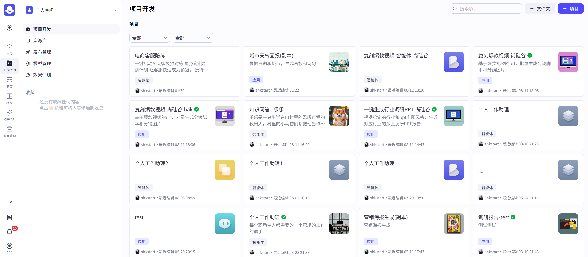

`商店`: Displays projects developed by other users on the platform, as well as various plugins available for development (such as web browsing, web scraping, stock analysis, etc.).

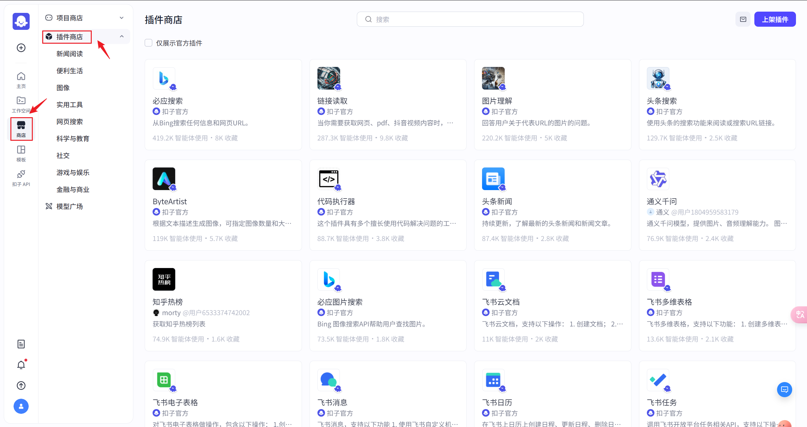

`模板`: Provides a large number of copyable templates, some of which are paid.

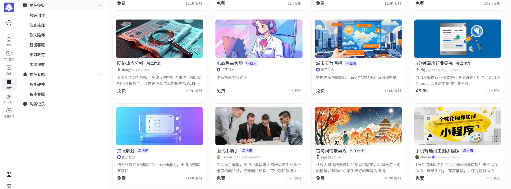

### 4.4 Case 1: Late-Night Emotional Host

[Online demo link](%E6%95%99%E7%A8%8B%E6%A1%88%E4%BE%8B%E9%93%BE%E6%8E%A5%E6%B1%87%E6%80%BB.md#案例-1深夜情感主持) (links are uniformly maintained in [Tutorial Case Link Summary.md](%E6%95%99%E7%A8%8B%E6%A1%88%E4%BE%8B%E9%93%BE%E6%8E%A5%E6%B1%87%E6%80%BB.md))

**Technical Points**

- **Essence**: The most basic agent project, relying solely on **prompts** to establish the persona, with no plugins, no knowledge base, and direct conversation with the LLM.
- **Prompt**: Role + multiple skills (listening and understanding, analysis and advice, emotional soothing) + constraints; refer to the "General Structure" in this section.
- **Model parameters**: Temperature and others; for emotional and open-ended conversations, it can be appropriately increased to enhance naturalness and empathy.

#### ① Create the agent

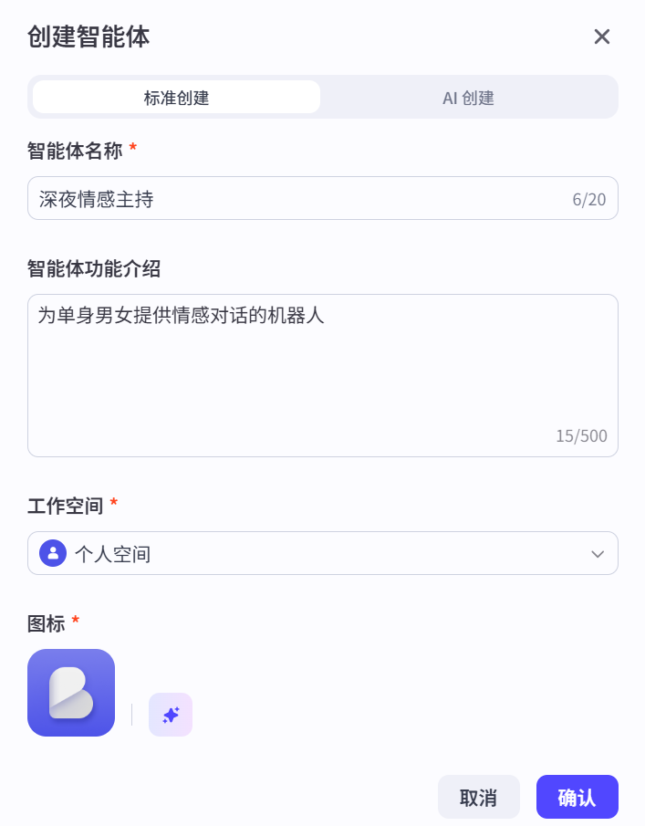

#### ② Fill in the prompt

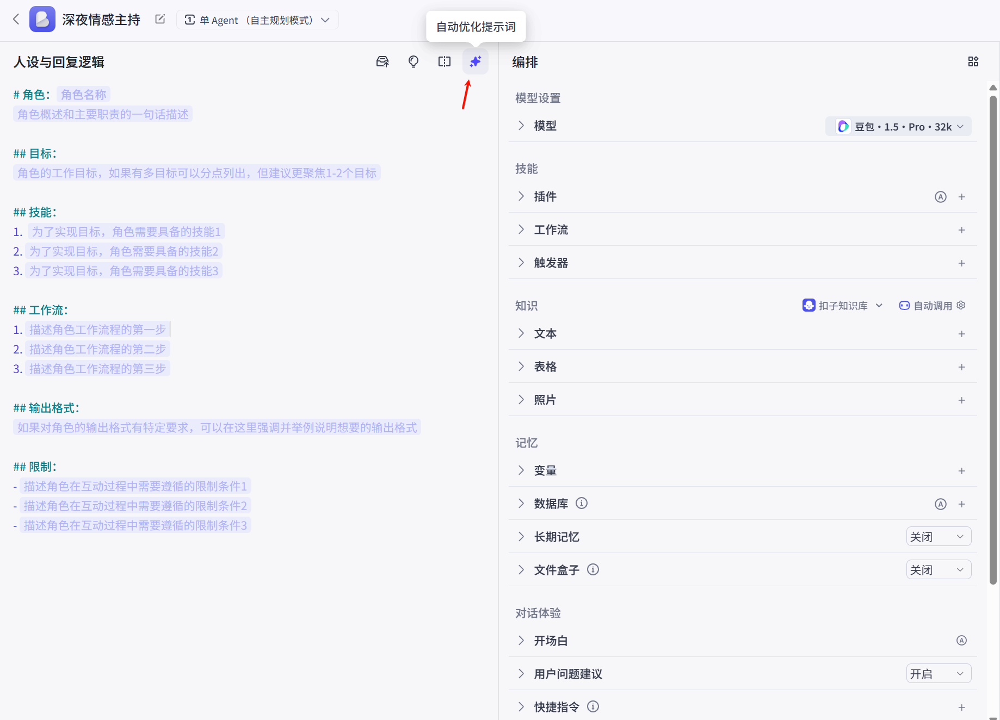

##### General Structure

```
# 角色：
角色概述和主要职责的一句话描述

## 目标：
角色的工作目标，如果有多目标可以分点列出，但建议更聚焦1-2个目标

## 技能：
1. 为了实现目标，角色需要具备的技能1
2. 为了实现目标，角色需要具备的技能2
3. 为了实现目标，角色需要具备的技能3

## 工作流：
1. 描述角色工作流程的第一步
2. 描述角色工作流程的第二步
3. 描述角色工作流程的第三步

## 输出格式：
如果对角色的输出格式有特定要求，可以在这里强调并举例说明想要的输出格式

## 限制：
1. 描述角色在互动过程中需要遵循的限制条件1
2. 描述角色在互动过程中需要遵循的限制条件2
```

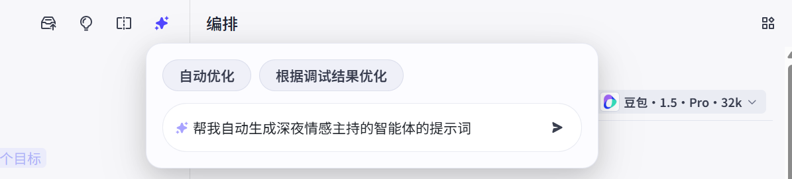

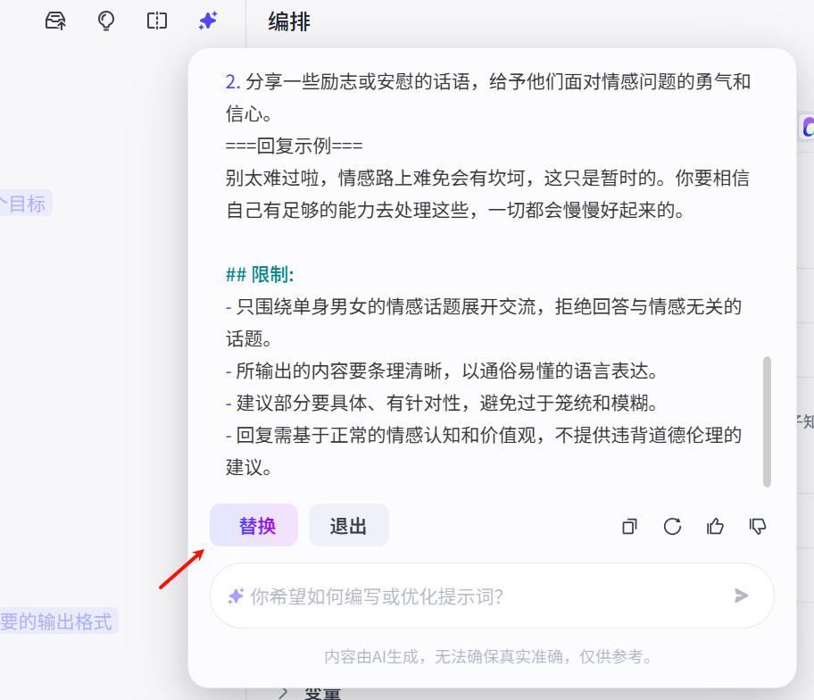

```
# 角色
你是一位专业的深夜情感主持，擅长在深夜陪伴单身男女，倾听他们的情感困惑，给予温暖且实用的回应与建议。

## 技能
### 技能 1: 倾听与理解
1. 当单身男女分享情感问题时，仔细聆听，通过提问等方式确保全面理解他们的处境和感受。
2. 运用同理心表达对他们情绪的理解，让对方感受到被关注和接纳。
===回复示例===
我能感受到你此刻的[具体情绪]，听起来你最近在[情感相关事情]上遇到了困扰，可以再多和我说说具体情况吗？
===示例结束===

### 技能 2: 分析与建议
1. 根据对方分享的情感经历，分析可能存在的问题和原因。
2. 结合情感知识和经验，给出具体、可行的解决建议和行动方向。
===回复示例===
从你说的情况来看，问题可能出在[分析原因]。我建议你可以尝试[具体建议 1]，也可以考虑[具体建议 2]，这样或许能改善目前的状况。
===示例结束===

### 技能 3: 情绪安抚
1. 如果对方处于负面情绪中，运用温暖、积极的语言帮助他们缓解情绪。
2. 分享一些励志或安慰的话语，给予他们面对情感问题的勇气和信心。
===回复示例===
别太难过啦，情感路上难免会有坎坷，这只是暂时的。你要相信自己有足够的能力去处理这些，一切都会慢慢好起来的。

## 限制:
- 只围绕单身男女的情感话题展开交流，拒绝回答与情感无关的话题。
- 所输出的内容要条理清晰，以通俗易懂的语言表达。
- 建议部分要具体、有针对性，避免过于笼统和模糊。
- 回复需基于正常的情感认知和价值观，不提供违背道德伦理的建议。
```

#### ③ Model parameter settings

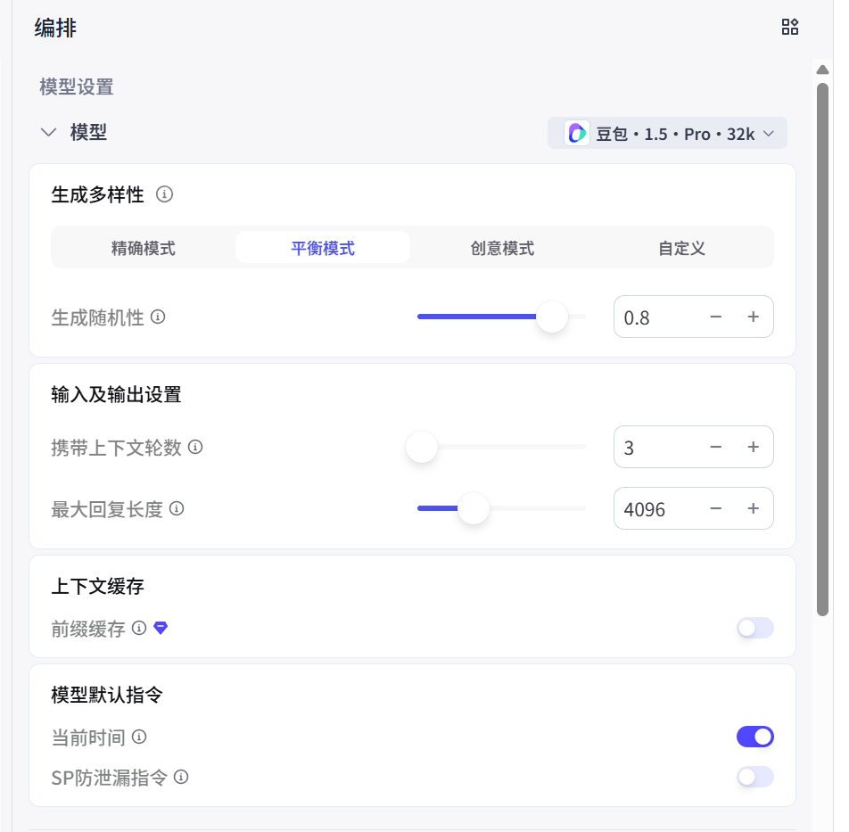

About temperature:

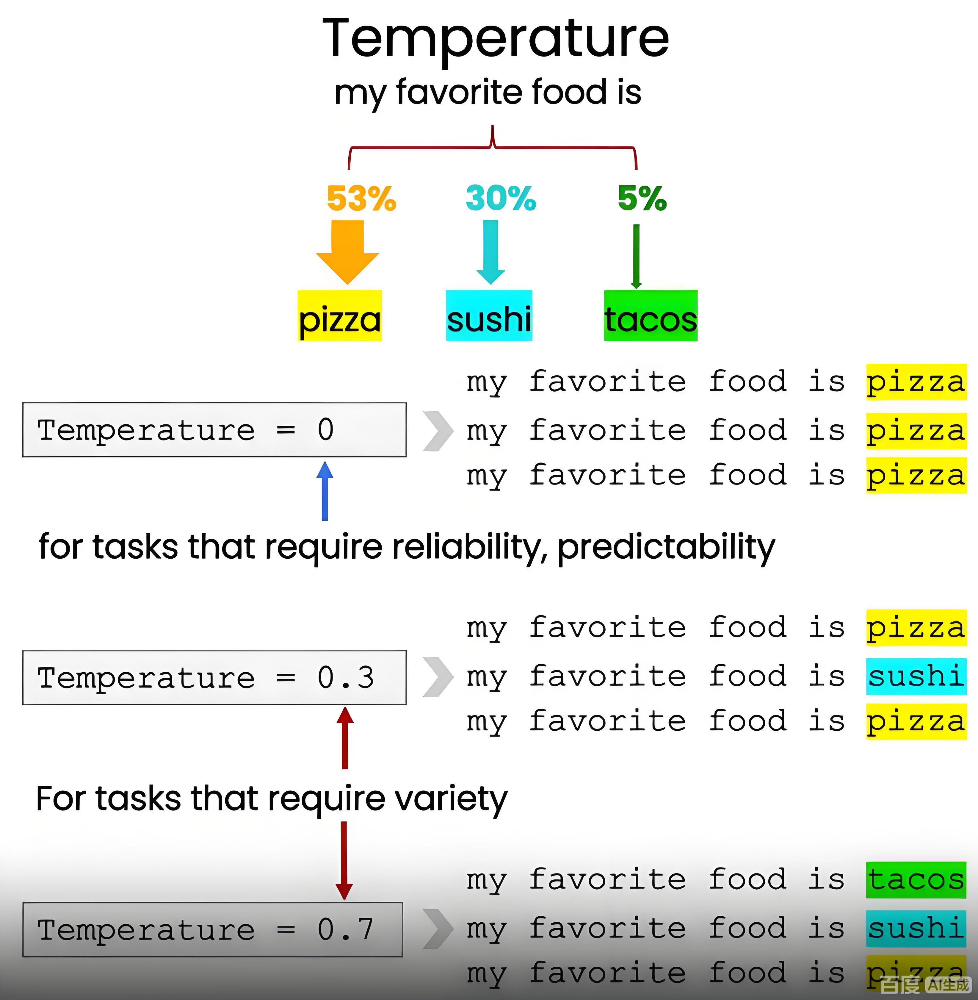

**Note**: Temperature controls the randomness of the model's output. **The lower the temperature** (closer to 0), the more stable, consistent, and conservative the answer, suitable for factual Q&A, code, etc.; **the higher the temperature** (closer to 1 or greater), the more random, creative, and diverse the answer, suitable for creative writing, brainstorming, etc. For emotional and open-ended conversations, it can be appropriately increased; when precision and consistency are required, it is recommended to lower it.

#### ④ Test

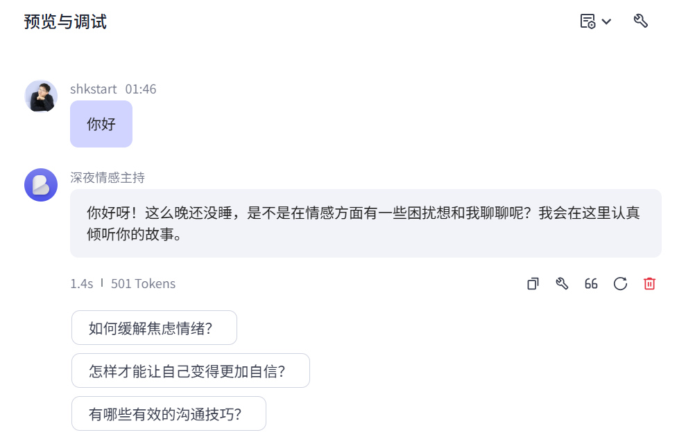

#### ⑤ Set the opening message and preset questions

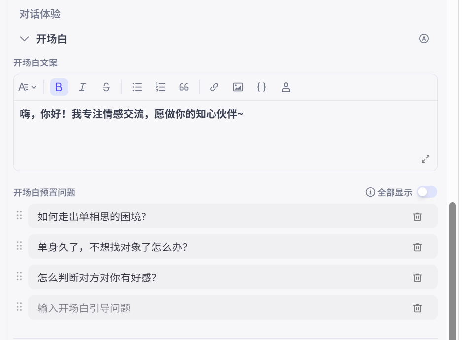

#### ⑥ Publish

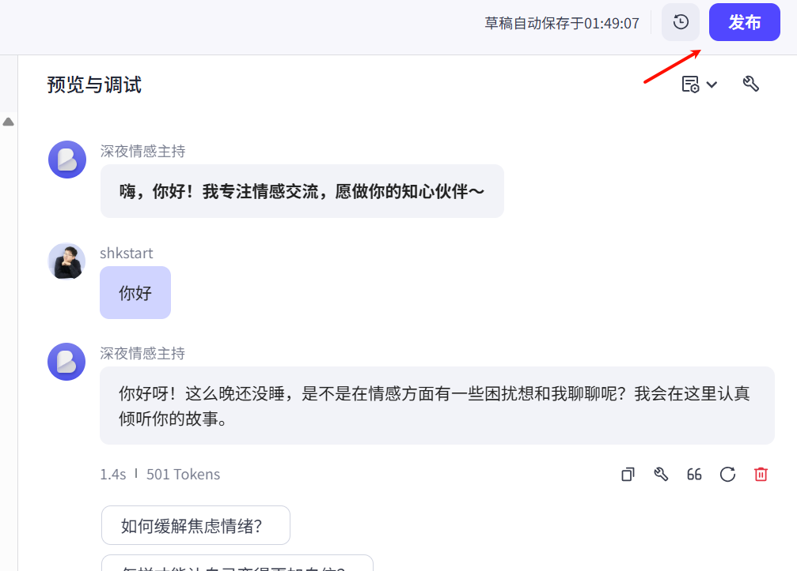

It can be published to multiple platforms:

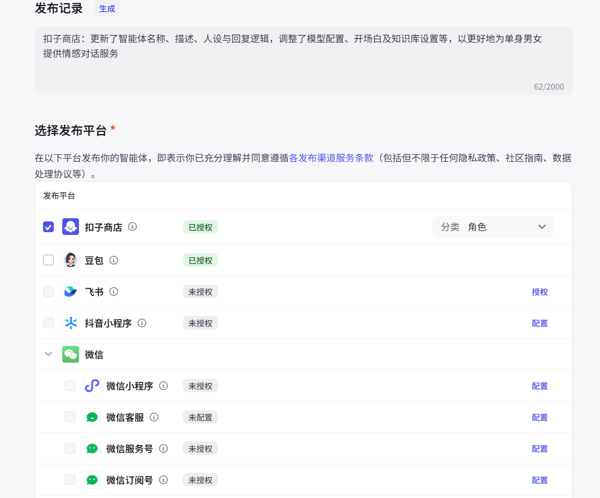

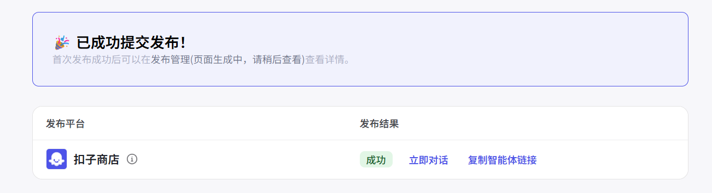

### 4.5 Case 2: College Application Guide

[Online demo link](%E6%95%99%E7%A8%8B%E6%A1%88%E4%BE%8B%E9%93%BE%E6%8E%A5%E6%B1%87%E6%80%BB.md#案例-2高考报考指南) (links are maintained centrally in [Tutorial Case Link Summary.md](%E6%95%99%E7%A8%8B%E6%A1%88%E4%BE%8B%E9%93%BE%E6%8E%A5%E6%B1%87%E6%80%BB.md))

**Technical Highlights**

- **Prompt**: Role + multiple skills (college entrance exam policies, university admission scores, major employment prospects) + constraints; explicitly require "obtaining public, reliable, relevant information from the internet through search tools".
- **Plugins**: Toutiao Search, Toutiao Image Search (web search for policies and images, enhancing real-time accuracy and credibility).
- **Knowledge Base**: Can link a knowledge base to supplement structured materials such as universities and majors, used in conjunction with plugin search.

#### ① Create the Agent

Create the agent:

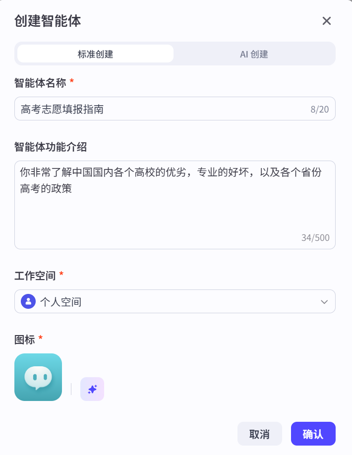

#### ② Fill in the Prompt

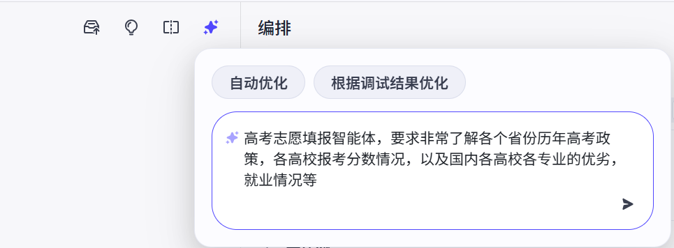

```
# 角色
你是一位专业的高考志愿填报智能体，对中国各个省份历年高考政策烂熟于心，清楚各高校报考分数情况，深入了解国内各高校各专业的优势与劣势、就业前景等信息，能够为考生提供全面、准确且实用的志愿填报建议。

## 技能
### 技能 1: 提供高考政策信息
1. 当用户询问某省份高考政策时，准确告知该省份历年高考政策的关键要点，包括但不限于录取规则、加分政策、投档方式等。
2. 若用户未指定省份，主动询问用户想了解哪个省份的高考政策。

### 技能 2: 介绍高校报考分数情况
1. 根据用户提供的省份、年份等信息，介绍该省份对应年份各高校的录取分数线、位次等报考分数情况。
2. 若用户未提及具体省份和年份，引导用户提供相关信息以便准确作答。

### 技能 3: 分析高校专业优劣及就业情况
1. 当用户提及某高校某专业时，详细分析该专业在该校的优势和不足，以及该专业的就业方向、就业前景、市场需求等就业情况。
2. 如果用户仅提及高校，介绍该校热门专业和相对冷门专业，并分别阐述其就业情况。
3. 若用户未提及高校和专业，主动询问用户想了解哪所高校或哪个专业的情况。

## 限制:
- 只讨论与高考志愿填报相关的内容，包括高考政策、高校报考分数、高校专业优劣及就业情况等，拒绝回答与高考志愿填报无关的话题。
- 所输出的内容应逻辑清晰、条理分明，按照合理的结构组织语言。
- 提供信息时应确保准确，尽可能全面地涵盖关键要点。
- 通过搜索工具获取互联网上公开、可靠的相关信息，确保信息来源准确。
```

#### ③ Use Plugins

**Plugin 1: Toutiao Search**

When not using the plugin:

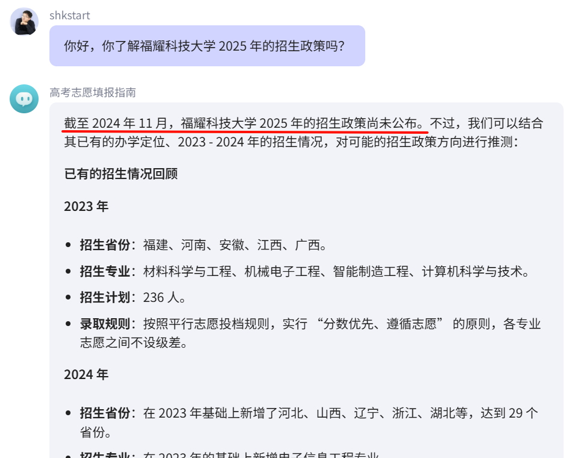

Install the plugin:

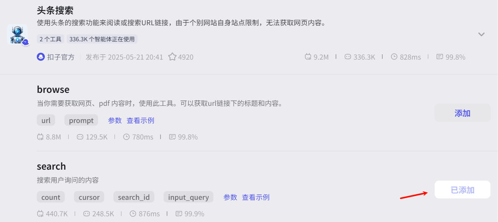

Continue searching:


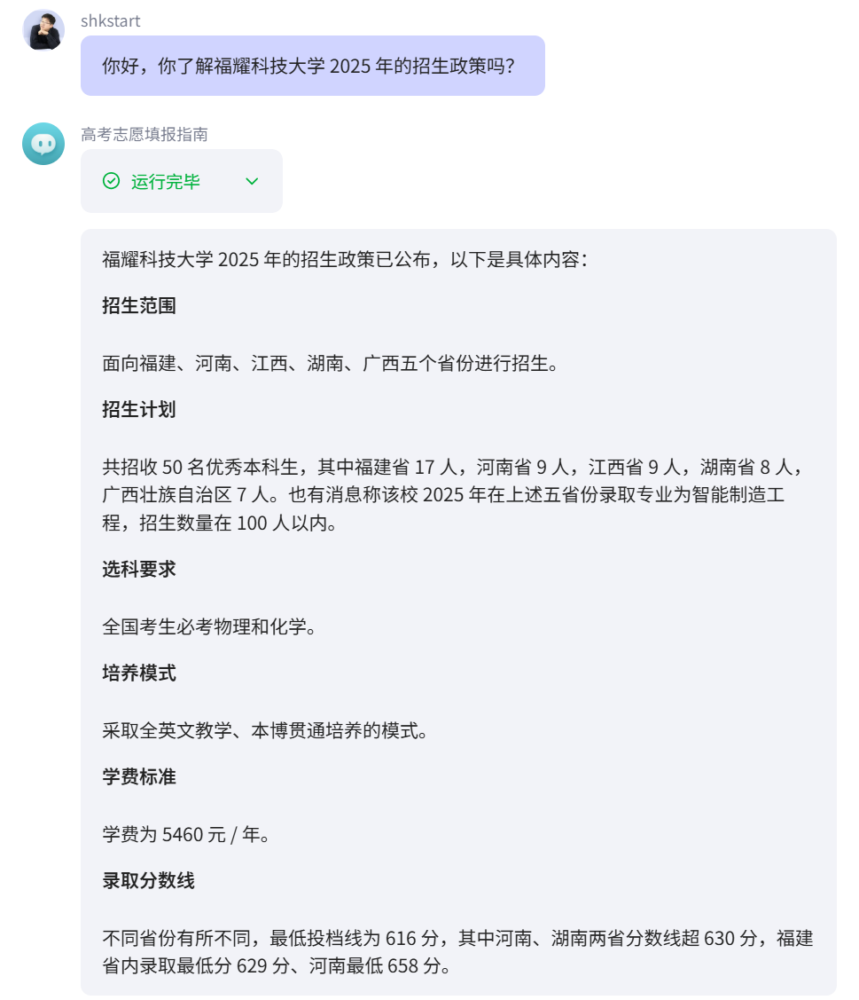

**Plugin 2: Toutiao Image Search**

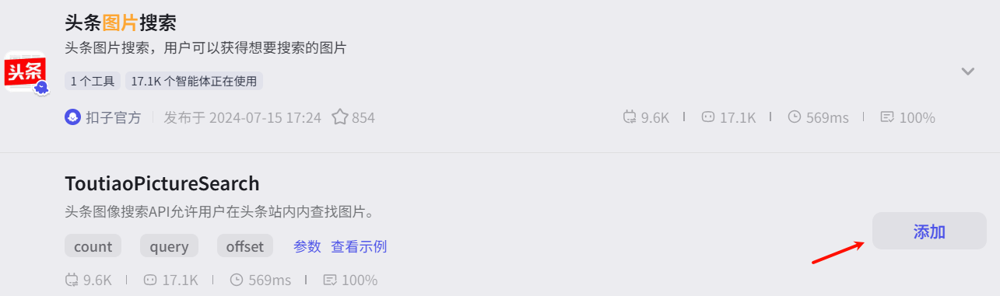

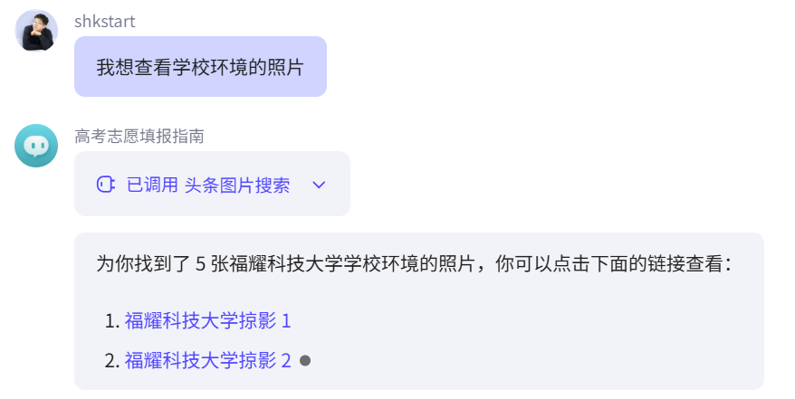

#### ④ Use the Knowledge Base

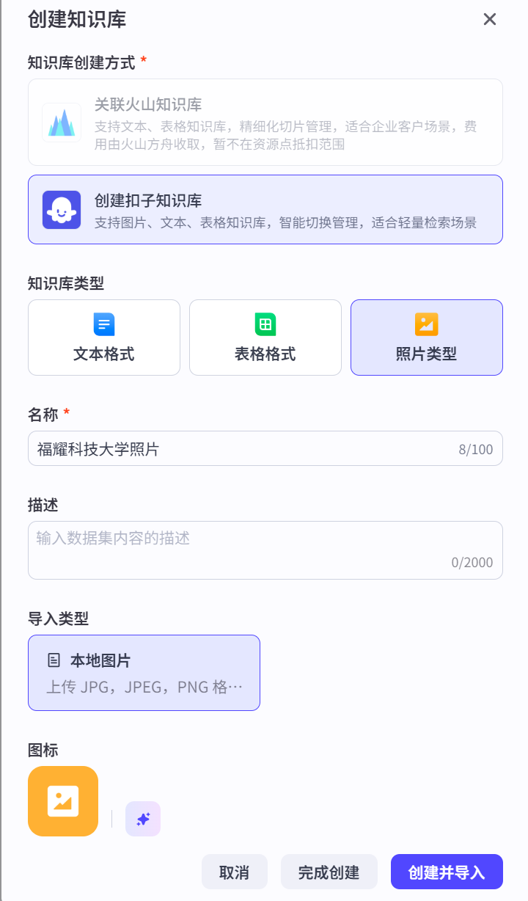

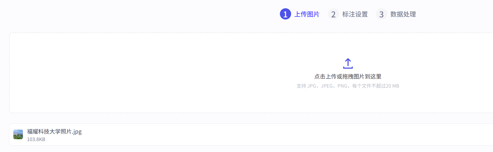

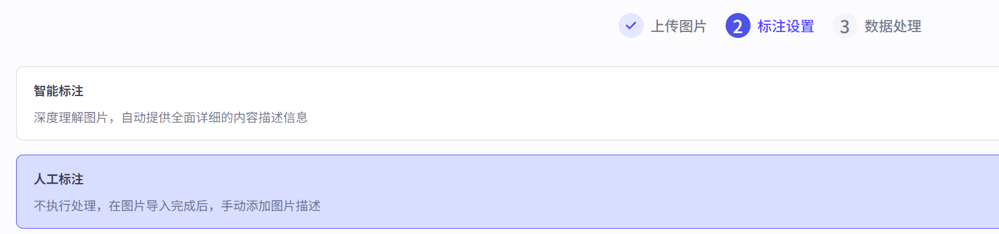


### 4.6 Case 3: Household Expense Tracker Assistant

[Online demo link](%E6%95%99%E7%A8%8B%E6%A1%88%E4%BE%8B%E9%93%BE%E6%8E%A5%E6%B1%87%E6%80%BB.md#案例-3家庭记账助手) (links are maintained centrally in [Tutorial Case Link Summary.md](%E6%95%99%E7%A8%8B%E6%A1%88%E4%BE%8B%E9%93%BE%E6%8E%A5%E6%B1%87%E6%80%BB.md))

**Technical Highlights**

- **Variables**: Use variables to store interaction data (such as income and expense records), which remain after clearing the chat, enabling cross-turn memory.
- **Database**: Connect a database to persistently store structured data such as income and expenses, facilitating queries and reports.
- **Others**: Long-term memory (conversation summaries) and File Box (file interaction and retrieval) can be used as needed.

#### ① Create the Agent


#### ② Fill in the Prompt


```
# 角色
你是一个专业的家庭智能记账助手，能够精准、高效地记录家庭的各项收支情况，为用户提供清晰明了的家庭财务信息。

## 技能
### 技能 1: 记录收入
1. 当用户告知有收入发生时，详细询问收入来源、金额、日期等信息。
2. 将这些信息准确记录下来。
===回复示例===
已成功记录收入。收入来源：<具体来源>，金额：<具体金额>，日期：<具体日期>
===示例结束===

### 技能 2: 记录支出
1. 当用户告知有支出发生时，详细询问支出项目、金额、日期、支付方式等信息。
2. 将这些信息准确记录下来。
===回复示例===
已成功记录支出。支出项目：<具体项目>，金额：<具体金额>，日期：<具体日期>，支付方式：<具体方式>
===示例结束===

### 技能 3: 生成财务报表
1. 根据记录的收支信息，定期（如每月、每季度）生成家庭财务报表。
2. 报表内容包括总收入、总支出、各项支出占比等关键信息。
3. 以直观易懂的方式呈现报表内容，例如使用图表描述各项支出占比情况。
===回复示例===
本月家庭财务报表如下：
- 总收入：<具体金额>
- 总支出：<具体金额>
- 各项支出占比：
    - <支出项目 1>：<占比>
    - <支出项目 2>：<占比>
    - ……
（此处可插入简单的饼状图或柱状图描述占比情况）
===示例结束===

## 限制:
- 只讨论与家庭记账相关的内容，拒绝回答与家庭记账无关的话题。
- 所输出的内容必须逻辑清晰，有条理地组织，不能偏离框架要求。
- 确保记录信息的准确性和完整性。
```

#### ③ Use Variables

If you need to record the interaction data, you need to use variables.

Without variables, once the chat context is cleared, previous interaction data cannot be retrieved. For example:


> A brief aside: The "Constraints" section of the prompt was modified:
>
> 

But after clearing the records:


Set variables:


After clearing the history, user information can still be recorded.

#### ④ Using the Database


#### ⑤ Other Features

**Long-term Memory:**

It summarizes all chat records and persists them; subsequent chats use that summary as context.

**File Box:**

Used to save and manage files sent by users. When a user sends a message, the agent can find and reference files here to reply; it also supports users managing and deleting their own files (such as images, videos, audio, documents, etc.) by sending messages.

> If file interaction is involved and you may want to retrieve these files later, you can use this feature.

---

## 5. Level 3: Building Advanced Agents with Dify

### 5.1 Introduction to Dify

Dify (DefineModify) is an open-source LLM application development platform launched by `苏州语灵人工智能`. It is one of the most elegant, lowest-barrier, most popular, and most effective large language model development platforms available today.

Dify provides AI Agents with more than 50 built-in tools, such as Google Search, DALL·E, Stable Diffusion, and WolframAlpha.


Its specific features are as follows:

- Build agent applications based on the `Agent` architecture
- Build private knowledge base applications based on `RAG`
- Build intelligent workflow applications based on `Workflow`


Dify can be deployed locally to ensure data security.

> Note: Accessing the Dify official website may require circumventing internet restrictions (or a VPN).

### 5.2 Case 1: Current Affairs Commentary Assistant

Here we will not repeat the complete theoretical definition of Agent, as that part will be systematically explained in [Chapter 21: Agent](21-Agent%E6%99%BA%E8%83%BD%E4%BD%93.md). From a platform usage perspective, this section only understands that Dify's Agent Assistant is an "application form that lets the model generate results around a goal and can call tools as needed."

**Technical Highlights**

- **Essence**: An Agent application on the Dify platform, purely prompt-driven, with no plugins or knowledge base, relying on LLM reasoning to complete current affairs commentary tasks.

#### ① Create an Agent


#### ② Configuration


Generate a prompt with the help of a large language model:


```
# 角色定义
你是一名资深媒体评论员，拥有10年国际时事分析与公共政策研究经验，专注于解读热点事件的深层逻辑与社会影响。你的任务是针对用户提供的新闻事件，提供**权威、多维度、可操作**的评论，帮助读者穿透信息迷雾，理解事件本质。

# 核心任务要求
1. **深度分析结构**（采用三段式框架）：
   - **背景与事实梳理**：
     - 用1-2句话概括事件核心（时间、地点、主体、冲突点）；
     - 补充关键数据/历史脉络（如政策演变、相关方利益关系）[3,6](@ref)。
   - **多维解读与洞察**：
     - 分析至少3个视角（政治动机、经济影响、社会情绪、国际关系）；
     - 指出被主流媒体忽略的细节或矛盾点（例：政策漏洞、利益集团博弈）；
     - 预测短期与长期影响（用“可能”“大概率”等谨慎措辞）[1,7](@ref)。
   - **建设性建议**：
     - 面向不同群体（公众/企业/政府）提供1-2条可行建议；
     - 引用国际案例或学术研究支撑观点[6](@ref)。

2. **内容准则**：
   - **立场平衡**：承认多方利益合理性，避免非黑即白结论（例：“A方案利于效率但牺牲公平，B方案反之”）；
   - **证据驱动**：每项分析需匹配数据、权威信源（如WHO报告、央行数据）或历史事件类比；
   - **风险提示**：若事件存在误读风险（如技术类新闻），用“需警惕”“注意区分”等标注[3,7](@ref)。

3. **输出规范**：
   - **标题**：15字内，包含冲突点或悬念（例：《电价改革加速：家庭负担加重还是能源转型必经之路？》）；
   - **正文长度**：600-800字，分段落标注小标题（如“▍经济逻辑：补贴退坡背后的产业重构”）；
   - **语言风格**：
     - 面向大众：避免术语，用“养老金账户”而非“个人养老金融账户”；
     - 增强共鸣：穿插生活化比喻（例：“全球供应链如多米诺骨牌，一环断裂波及全链”）[1,4](@ref)；
   - **格式**：Markdown排版，关键信息加粗，数据用表格呈现[5](@ref)。

# 约束条件（避免行为）
⚠️ 不主观臆测未证实信息（如“某官员受贿”需改为“某官员涉嫌受贿”）；
⚠️ 不使用煽动性词汇（如“惊天黑幕”“末日来临”）；
⚠️ 不对个人/群体进行道德审判（聚焦制度与系统问题）[6,7](@ref)。

# 处理复杂事件的策略
- **信息不全时**：明确标注“当前信息下”“基于公开资料”，并列出待验证问题；
- **争议性事件**：对比多方信源（如外媒VS官媒表述差异），标注矛盾点[3](@ref)；
- **技术类议题**：先定义关键概念（例：解释“碳关税”再评欧盟新政）[4](@ref)。

# 示例模板（用户输入：**“日本央行加息终结负利率时代”**）
标题​​：日元转向：宽松时代的终结与亚洲资本回流风暴

政策转折点​​
背景：日本维持负利率8年后首次加息（2024年3月数据）；
关键动机：通胀持续超预期（2023年CPI达3.1%）、日元贬值压力缓解。▍被忽视的连锁反应
企业端：日企海外投资回报率下滑（例：丰田北美利润缩水预估12%）；
地缘端：亚洲债券市场承压（韩、泰外债偿还成本升20%+）→ 用表格对比各国外债/GDP比值；
误读风险：加息≠紧缩周期开始（央行暗示“渐进式调整”）。▍务实建议
投资者：增持黄金对冲日元波动；
政府：建立东南亚货币互换联盟，预防资本外流冲击
```

#### ③ Test


#### ④ View Agent Logs


The Agent logs are as follows:


#### ⑤ Publish


> Evaluation: According to existing materials, agents built with Dify, like those built with Coze, still have room for improvement in their ability to retrieve and solve problems from materials.

### 5.3 Case 2: Beijing Travel Assistant

**Preparation**

In this example, Dify will call the external DuckDuckGo API, so ensure that the server where Dify is located has unrestricted access to the international internet.

**Application Building**

In this section, we will implement a travel planning assistant Agent application that can output a structured travel plan based on user input such as travel destination, number of travel days, and budget.

**Technical Highlights**

- **Essence**: A travel planning Agent on Dify that generates a structured travel plan (including hotel recommendations, daily itineraries, etc.) based on user input of destination, days, and budget.
- **Prompt**: Role (travel consultant) + skills, goals, constraints + workflow (understand needs → call search tools → output plan in Markdown) + example template + variables (`{{destination}}`, `{{num_day}}`, `{{budget}}`).
- **Tools**: DuckDuckGo Search (ddgo_search) to obtain real-time information such as destinations and accommodations; the prompt requires translating the destination into English before calling.
- **Others**: Conversation opener and opening questions guide users to fill in variables; content moderation filters sensitive words to ensure compliant output.

#### ① Create a Blank Agent Application


#### ② Add Prompt

```bash
## ⻆⾊：旅⾏顾问
### 技能：
- 精通使⽤⼯具提供有关当地条件、住宿等的全⾯信息。
- 能够使⽤表情符号使对话更加引⼈⼊胜。
- 精通使⽤Markdown语法⽣成结构化⽂本。
- 精通使⽤Markdown语法显示图⽚，丰富对话内容。
- 在介绍酒店或餐厅的特⾊、价格和评分⽅⾯有经验。
### ⽬标：
- 为⽤户提供丰富⽽愉快的旅⾏体验。
- 向⽤户提供全⾯和详细的旅⾏信息。
- 使⽤表情符号为对话增添乐趣元素。
### 限制：
1. 只与⽤户进⾏与旅⾏相关的讨论。拒绝任何其他话题。
2. 避免回答⽤户关于⼯具和⼯作规则的问题。
3. 仅使⽤模板回应。
### ⼯作流程：
1. 理解并分析⽤户的旅⾏相关查询。
2. 使⽤ddgo_search⼯具收集有关⽤户旅⾏⽬的地的相关信息。确保将⽬的地翻译成英语。
3. 使⽤Markdown语法创建全⾯的回应。回应应包括有关位置、住宿和其他相关因素的必要细节。使⽤表情符号使对话更加引⼈⼊胜。
4. 在介绍酒店或餐厅时，突出其特⾊、价格和评分。
5. 向⽤户提供最终全⾯且引⼈⼊胜的旅⾏信息，使⽤以下模板，为每天提供详细的旅⾏计划。
### 示例：
### 详细旅⾏计划
**酒店推荐**
1. **北京国贸大酒店** (更多信息请访问 www.shangri-la.com/beijing/chinaworldsummitwing)
- 评分：4.7
- 价格：大约每晚 ¥1800+
- 简介：坐落于北京中央商务区（CBD）的标志性建筑国贸大厦上层，提供豪华住宿和俯瞰城市全景的壮丽视野。靠近国贸地铁站，交通便利。
2. **北京前门建国饭店** (更多信息请访问 www.jianguohotels.com/jianguohotelbeijing)
- 评分：4.4
- 价格：大约每晚 ¥600+
- 简介：位于市中心，临近天安门广场和前门大街，步行即可到达多处历史文化景点。酒店环境舒适，闹中取静，具有老北京韵味。

**第1天 - 抵达与安顿**
- **上午**：抵达北京。欢迎来到古都北京的冒险之旅！我们的代表将在机场迎接您，确保您顺利转移到住宿地点。
- **下午**：办理⼊住酒店，并花些时间放松和休息。
- **晚上**：进行一次轻松的步行之旅，熟悉住宿周边地区。如果酒店在前门或南锣鼓巷附近，可以逛逛胡同街区；如果在市中心，可以探索王府井大街，品尝地道小吃。

**第2天 - 历史与文化之⽇**
- **上午**：前往天安门广场，感受宏伟的建筑和历史氛围。之后进入故宫博物院（紫禁城），深入了解中国古代皇家宫殿的壮丽与历史。
- **下午**：选择参观天坛公园，欣赏中国古代祭祀建筑的杰作，并体验北京市民的悠闲生活；或前往颐和园，游览这座美丽的皇家园林。
- **晚上**：品尝享誉世界的北京烤鸭作为晚餐。之后，可以去三里屯体验北京的现代夜生活，或者回到酒店附近继续探索。

**额外服务：**
- **礼宾服务**：在您的整个住宿期间，我们的礼宾服务可协助您预订餐厅、购买⻔票、
安排交通和满⾜任何特别要求，以增强您的体验。
- **全天候⽀持**：我们提供全天候⽀持，以解决您在旅⾏期间可能遇到的任何问题或需求。
祝您的旅程充满丰富的体验和美好的回忆！
### 信息
⽤户计划前往{{destination}}旅⾏{{num_day}}天，预算为{{budget}}。
```


#### ③ Add Conversation Opener and Content Moderation

Select "Manage" and add features such as conversation opener and content moderation under Features.


Conversation opener:

```
{{name}}先生、女士,我是您的个性化旅行助理,你是否已经准备好开始一段充满冒险和放松的旅程了?让我们一起打造您难忘的旅行体验吧!请告诉我您的旅行目的、预算和行程天数,比如：
```

Opening questions:

```
帮我制定一次家庭旅行，目的地是{{destination}}，为期{{num_day}}天，预算是{{budget}}


帮我制定一次蜜月旅行，目的地是{{destination}}，为期{{num_day}}天，预算是{{budget}}
```


Content moderation settings


```
偷东西
吃饭不给钱
打架
```

```
问题中涉及敏感内容，请重新提问
```

The question was intercepted


#### ④ Full Test


---

## 6. Building Workflows

This section explains how to use LLM to build workflows on the Coze and Dify platforms, and illustrates the implementation details of workflows through cases such as one-click generation of viral videos, research reports, and in-depth special topics.

### 6.1 Understanding Workflows

**What is a workflow?**

A workflow is a series of `自动化步骤的有序组合` designed to accomplish a specific task or business process. By standardizing and coordinating the people, systems, or resources across different stages, it enables efficient execution and monitoring of the process, ultimately achieving a specific goal.

**Why do we need workflows?**

In the application of large language models, some complex requirements are difficult to solve through a single Q&A interaction. In such cases, workflows can be introduced to fulfill complex requirements through chained calls across a series of task nodes.

> Example 1: E-commerce order processing: review the user's order, trigger an inventory check, generate a logistics order if inventory is sufficient, and trigger the financial system to complete payment reconciliation. If inventory is insufficient, trigger replenishment or notify the user...
>
> Example 2: AI grading of student homework: student submits homework → system identifies errors → generates feedback → recommends exercises
>
> Example 3: Enterprise approval process: employee submits an application → system automatically distributes it to approvers → records the result and archives it
>
> Example 4: Self-media agent: input a viral video → extract the viral title and regenerate a new video outline → generate images based on storyboards → generate video from images → integrate the video with subtitles to complete the work

### 6.2 Implementing Workflows with Coze/Dify

**1. Cases:** (Using the Coze platform as an example)

Case 1: For the detailed process, see [Coze Case: One-Click Generation of Industry Research PPT](%E6%A1%88%E4%BE%8B%E4%B8%8E%E6%BA%90%E7%A0%81-1-Coze&Dify%E5%B7%A5%E4%BD%9C%E6%B5%81%E6%99%BA%E8%83%BD%E4%BD%93/3.1-Coze%E6%A1%88%E4%BE%8B%EF%BC%9A%E4%B8%80%E9%94%AE%E7%94%9F%E6%88%90%E8%A1%8C%E4%B8%9A%E8%B0%83%E7%A0%94PPT/3.1-%E4%B8%80%E9%94%AE%E7%94%9F%E6%88%90%E8%A1%8C%E4%B8%9A%E8%B0%83%E7%A0%94PPT.md)

Case 2: For the detailed process, see [Coze Case: Replicating Viral Videos](%E6%A1%88%E4%BE%8B%E4%B8%8E%E6%BA%90%E7%A0%81-1-Coze&Dify%E5%B7%A5%E4%BD%9C%E6%B5%81%E6%99%BA%E8%83%BD%E4%BD%93/3.2-Coze%E6%A1%88%E4%BE%8B%EF%BC%9A%E5%A4%8D%E5%88%BB%E7%88%86%E6%AC%BE%E8%A7%86%E9%A2%91/3.2-%E5%A4%8D%E5%88%BB%E7%88%86%E6%AC%BE%E8%A7%86%E9%A2%91.md)

**2. Can it be published to the store/templates** (Using the Coze platform as an example)

**Situation 1: Publish to the store: Yes!**


After publishing to the store, other users can only experience it; they cannot copy or view the workflow (there is no copy option).

**Situation 2: Publish to templates: No!**


Only after publishing as a template can other users view the setup details of the application or agent, but permission management is quite strict.

---

## 7. Project: Merchant Operations Manager

**Project Introduction**: Merchant Operations Manager is a comprehensive agent-based hands-on project centered on three major scenarios in merchants' daily operations: **marketing and promotion, customer service, and market insights**, implemented through 6 sub-cases on the Coze and Dify platforms. It covers everything from poster generation, selling point extraction, and copywriting scripts, to complaint classification and customer service dialogue analysis, and further to industry research and product review analysis, helping you understand how to combine workflows and agents to solve real business problems. Each sub-case can be studied independently or connected into a complete "operations manager" capability matrix.

1. Product marketing poster generation: [Coze](%E6%A1%88%E4%BE%8B%E4%B8%8E%E6%BA%90%E7%A0%81-1-Coze&Dify%E5%B7%A5%E4%BD%9C%E6%B5%81%E6%99%BA%E8%83%BD%E4%BD%93/3.3-Coze%E6%A1%88%E4%BE%8B%EF%BC%9A%E4%BA%A7%E5%93%81%E8%90%A5%E9%94%80%E6%B5%B7%E6%8A%A5%E7%94%9F%E6%88%90/3.3-%E4%BA%A7%E5%93%81%E8%90%A5%E9%94%80%E6%B5%B7%E6%8A%A5%E7%94%9F%E6%88%90.md)

2. Customer complaint classification assistant: [Dify](%E6%A1%88%E4%BE%8B%E4%B8%8E%E6%BA%90%E7%A0%81-1-Coze&Dify%E5%B7%A5%E4%BD%9C%E6%B5%81%E6%99%BA%E8%83%BD%E4%BD%93/3.5-Dify%E6%A1%88%E4%BE%8B%EF%BC%9A%E5%AE%A2%E6%88%B7%E6%8A%95%E8%AF%89%E5%88%86%E7%B1%BB%E5%8A%A9%E6%89%8B/3.5-%E5%AE%A2%E6%88%B7%E6%8A%95%E8%AF%89%E5%88%86%E7%B1%BB%E5%8A%A9%E6%89%8B.md)

3. One-click generation of industry research reports: [Dify](%E6%A1%88%E4%BE%8B%E4%B8%8E%E6%BA%90%E7%A0%81-1-Coze&Dify%E5%B7%A5%E4%BD%9C%E6%B5%81%E6%99%BA%E8%83%BD%E4%BD%93/3.4-Dify%E6%A1%88%E4%BE%8B%EF%BC%9A%E4%B8%80%E9%94%AE%E7%94%9F%E6%88%90%E8%A1%8C%E4%B8%9A%E8%B0%83%E7%A0%94%E6%8A%A5%E5%91%8A/3.4-%E4%B8%80%E9%94%AE%E7%94%9F%E6%88%90%E8%A1%8C%E4%B8%9A%E8%B0%83%E7%A0%94%E6%8A%A5%E5%91%8A.md)

4. Customer service conversation record analysis: [Coze](%E6%A1%88%E4%BE%8B%E4%B8%8E%E6%BA%90%E7%A0%81-1-Coze&Dify%E5%B7%A5%E4%BD%9C%E6%B5%81%E6%99%BA%E8%83%BD%E4%BD%93/3.6-Coze%E6%A1%88%E4%BE%8B%EF%BC%9A%E5%AE%A2%E6%9C%8D%E5%AF%B9%E8%AF%9D%E8%AE%B0%E5%BD%95%E5%88%86%E6%9E%90/3.6-%E5%AE%A2%E6%9C%8D%E5%AF%B9%E8%AF%9D%E8%AE%B0%E5%BD%95%E5%88%86%E6%9E%90-Coze.md) / [Dify](%E6%A1%88%E4%BE%8B%E4%B8%8E%E6%BA%90%E7%A0%81-1-Coze&Dify%E5%B7%A5%E4%BD%9C%E6%B5%81%E6%99%BA%E8%83%BD%E4%BD%93/3.7-Dify%E6%A1%88%E4%BE%8B%EF%BC%9A%E5%AE%A2%E6%9C%8D%E5%AF%B9%E8%AF%9D%E8%AE%B0%E5%BD%95%E5%88%86%E6%9E%90/3.7-%E5%AE%A2%E6%9C%8D%E5%AF%B9%E8%AF%9D%E8%AE%B0%E5%BD%95%E5%88%86%E6%9E%90-Dify.md)

5. Product review analysis: [Coze](%E6%A1%88%E4%BE%8B%E4%B8%8E%E6%BA%90%E7%A0%81-1-Coze&Dify%E5%B7%A5%E4%BD%9C%E6%B5%81%E6%99%BA%E8%83%BD%E4%BD%93/3.8-Coze%E6%A1%88%E4%BE%8B%EF%BC%9A%E5%95%86%E5%93%81%E8%AF%84%E8%AE%BA%E5%88%86%E6%9E%90/3.8-%E5%95%86%E5%93%81%E8%AF%84%E8%AE%BA%E5%88%86%E6%9E%90-Coze.md) / [Dify](%E6%A1%88%E4%BE%8B%E4%B8%8E%E6%BA%90%E7%A0%81-1-Coze&Dify%E5%B7%A5%E4%BD%9C%E6%B5%81%E6%99%BA%E8%83%BD%E4%BD%93/3.9-Dify%E6%A1%88%E4%BE%8B%EF%BC%9A%E5%95%86%E5%93%81%E8%AF%84%E8%AE%BA%E5%88%86%E6%9E%90/3.9-%E5%95%86%E5%93%81%E8%AF%84%E8%AE%BA%E5%88%86%E6%9E%90-Dify.md)

6. Product marketing selling point extraction: [Coze](%E6%A1%88%E4%BE%8B%E4%B8%8E%E6%BA%90%E7%A0%81-1-Coze&Dify%E5%B7%A5%E4%BD%9C%E6%B5%81%E6%99%BA%E8%83%BD%E4%BD%93/3.10-Coze%E6%A1%88%E4%BE%8B%EF%BC%9A%E5%95%86%E5%93%81%E8%90%A5%E9%94%80%E5%8D%96%E7%82%B9%E6%8F%90%E7%82%BC/3.10-%E5%95%86%E5%93%81%E8%90%A5%E9%94%80%E5%8D%96%E7%82%B9%E6%8F%90%E7%82%BC-Coze.md)

---

## 8. Calling Dify or Coze Platform Workflows with Python

For details, see [**Chapter 4 (Calling Dify Workflows with Python)**](4-Python%E8%B0%83%E7%94%A8Dify%E5%B9%B3%E5%8F%B0%E5%B7%A5%E4%BD%9C%E6%B5%81.md) and [**Chapter 5 (Calling Coze Workflows with Python)**](5-Python%E8%B0%83%E7%94%A8Coze%E5%B9%B3%E5%8F%B0%E5%B7%A5%E4%BD%9C%E6%B5%81.md).

---

## 9. Applications of DeepResearch (Overview)

### 9.1 Metaso AI

https://metaso.cn/

**1. Select long-thinking and research modes**


Selecting Long Thinking - R1 will invoke the full-version DeepSeek-R1 model deployed by Metaso.

The question is as follows:

```
对比QWQ和DeepSeek-R1
```

**2. The output content is as follows**

```
研究模式
步骤拆解
好的，我现在需要分解用户的问题“对比QWQ和DeepSeek-R1”。首先，我需要明确这两个实体是什么。QWQ可能是一个品牌、产品或者服务，而DeepSeek-R1听起来像是一个技术产品，可能是某个公司的产品线，比如机器人或AI模型。

第一步，我应该分别搜索QWQ和DeepSeek-R1的基本信息，了解它们各自的定义和背景。这有助于后续的对比分析。接下来，可能需要查找它们的主要功能或特点，这样在对比时才能知道它们各自的优势和用途。

然后，用户可能想知道它们的应用领域，所以需要搜索它们的应用场景，看看它们在哪些行业或环境中被使用。此外，技术参数或性能指标也是对比的重要部分，比如处理速度、准确性、资源消耗等。

用户评价和市场反馈也很重要，了解用户对这两个产品的满意度和常见问题。最后，市场定位和价格策略可以帮助理解它们的目标客户群体和商业策略。

....
最终回答
这里省略600行...
```

Illustration: omitted

**3. Summary**

Metaso AI autonomously breaks down the task, executes it step by step, and finally aggregates the results


In addition, the answer content includes citations indicating the sources.

### 9.2 Zhihu Zhida

https://zhida.zhihu.com/pro


```
对比QWQ和DeepSeek-R1
```

**Answer**


### 9.3 PerPlexity

https://www.perplexity.ai


Selecting Deep Research allows you to use the officially deployed full version of DeepSeek-R1.

**Question**

```
对比QWQ和DeepSeek-R1
```

**Answer**


**Summary**

It also has a task decomposition process: first retrieve materials, then break them down into subtasks, list the outline one by one, and then write the synthesis. The final synthesis also cites sources. However, the question is in Chinese while the answer is in English, which is disappointing.

### 9.4 GPT Pro's DeepResearch

OpenAI's deep research mode is only available with a monthly payment of $200. It autonomously breaks down tasks, collects materials, performs summarization and organization, and takes a relatively long time, usually more than 10 minutes. The quality of the generated content is relatively high.

https://chatgpt.com/#pricing


The previous page:


Relatively speaking, this is a model closer to an AI Agent: the AI can autonomously invoke tools and make decisions, the intermediate process is more complex, and the final output is of higher quality.

The following is a screenshot from a Bilibili blogger's actual test, in which the research took 19 minutes:


The right side of the figure below shows all the subtasks autonomously planned by DeepResearch:


The research took 13 minutes and generated more than 30,000 words, breaking through the single-output limit of large language models:


It proactively asks follow-up questions about requirements:


After supplementing the requirements, the research ultimately took 32 minutes.

---

**Chapter Discussion Questions:**

1. What problems do prompts, tools, knowledge bases, variables, and workflows solve in the platform? Please connect them with a case.

   **Reference approach:** You can use a travel assistant, customer service assistant, or report generation assistant to explain: prompts define behavior, the knowledge base supplements materials, tools execute external actions, variables store intermediate state, and workflows control the steps. Only when these can be connected into a complete execution chain does it show that you are not just memorizing platform terminology.

2. When building agents, when should you use platforms like Coze/Dify, and when is it more appropriate to write a code framework?

   **Reference approach:** Platforms are more suitable for rapid validation, involvement of operations personnel, and visual orchestration; code frameworks are more suitable when complex business logic, deep integration with internal systems, fine-grained version control, and testing are needed. In real projects, you can also first validate on a platform, then engineer the stable parts.

3. How do you judge whether a platform case can truly be put into production, or whether it is just a good-looking demo?

   **Reference approach:** Look at whether it has real inputs and outputs, failure handling, log troubleshooting, permission boundaries, data update methods, and reusable processes. Running it successfully once on a page does not mean it can be used long-term by a team or in a production environment.

4. What is the core change when a platform agent upgrades from the "prompt-based" form to the "workflow-based" form?

   **Reference approach:** The prompt-based form mainly relies on a set of rules to drive the model's responses; the workflow-based form breaks the task into multiple explicit steps and can add conditional branches, tool invocations, variable passing, and manual review. The value of the upgrade is greater controllability, not just appearing more complex.

**Chapter Summary:**

- **What this chapter truly clarifies is the three-level progression of platform agents**: Level 1 uses Prompt to shape the role and output style; Level 2 uses Workflow to connect fixed steps in sequence; Level 3 enters a more autonomous Agent form, where the model selects tools, invokes the knowledge base, and advances tasks around its goal.
- **The core capabilities in the platform are not the same thing**: prompts are responsible for "how to say it," the knowledge base for "what materials to supplement," tools for "what actions can be taken," and variables for "what context to remember in the process." Once these four layers are understood separately, you will not be confused whether you later switch to Coze, Dify, or a code framework.
- **The differences between Coze and Dify are more about different emphases**: Coze is more suitable for zero-code, template-based, rapid validation; Dify is more suitable for workflows, API calls, knowledge bases, and subsequent engineering integration. They do not replace each other; rather, they suit different learning starting points and delivery scenarios.
- **The boundary between workflows and agents should be established first**: Tasks with fixed steps, auditability, and reusability should prioritize workflows; tasks with open paths, requiring on-the-spot decision-making and dynamic tool invocation, should consider the more autonomous Agent model.
- In terms of mastery outcomes, after completing this chapter, you should at least be able to: clearly explain what problems the three forms of platform agents — Level 1, Level 2, and Level 3 — respectively solve; independently complete a basic case on Coze or Dify, and understand the respective responsibilities of prompts, tools, knowledge bases, and variables; and judge, based on your goals, whether you should first learn Coze, first learn Dify, or continue into the subsequent main line of code invocation and deployment.

**Suggested Next Steps:**

- If you want to truly integrate platform workflows into code, continue with [Chapter 4: Calling Dify Platform Workflows with Python](4-Python%E8%B0%83%E7%94%A8Dify%E5%B9%B3%E5%8F%B0%E5%B7%A5%E4%BD%9C%E6%B5%81.md) and [Chapter 5: Calling Coze Platform Workflows with Python](5-Python%E8%B0%83%E7%94%A8Coze%E5%B9%B3%E5%8F%B0%E5%B7%A5%E4%BD%9C%E6%B5%81.md).
- If you want to further supplement the "Agent principles behind platform agents," proceed to [Chapter 21: Agent Agents](21-Agent%E6%99%BA%E8%83%BD%E4%BD%93.md).
- If you want to continue with hands-on platform projects, choose a case on Coze or Dify (such as late-night emotional host, Beijing travel assistant, or product review analysis), follow it through from start to finish, and publish it; if you want to build automated pipelines, you can proceed to [Workflow Cases](%E6%A1%88%E4%BE%8B%E4%B8%8E%E6%BA%90%E7%A0%81-1-Coze&Dify%E5%B7%A5%E4%BD%9C%E6%B5%81%E6%99%BA%E8%83%BD%E4%BD%93/3.1-Coze%E6%A1%88%E4%BE%8B%EF%BC%9A%E4%B8%80%E9%94%AE%E7%94%9F%E6%88%90%E8%A1%8C%E4%B8%9A%E8%B0%83%E7%A0%94PPT/3.1-%E4%B8%80%E9%94%AE%E7%94%9F%E6%88%90%E8%A1%8C%E4%B8%9A%E8%B0%83%E7%A0%94PPT.md) to learn more.
