# 30 - Model Training Principles and Efficient Fine-tuning

---

**Chapter learning objectives:**

- Be able to explain token prediction, loss, gradients, and optimizer updates by following a single sample, and distinguish between input context and directly supervised positions.
- Be able to calculate the impact of batch, gradient accumulation, and epochs on effective batch size and update steps, and explain the roles of learning rate, warmup, and decay.
- Be able to describe the main components of training memory usage, distinguish numerical precision from quantization, and understand the impact of sequence length, truncation, and gradient checkpointing.
- Be able to compare full-parameter fine-tuning, LoRA, and QLoRA, and understand the basic meaning of rank, alpha, target, and dropout.
- Be able to connect configuration, training and validation logs, checkpoints, and actual responses to determine what to check or adjust next.

**Study suggestion:** First use the semicolon example to clearly explain "prediction → loss → gradient → update," then sequentially understand batches, learning rate, length, memory usage, and LoRA. Section 8.1 consolidates a complete training arrangement; look up English configuration fields only when needed. Do not reread the entire table every time you learn a new concept. Use the mainline questions at the end of the chapter to test yourself in that order. Manual cross-entropy calculations and matrix derivations can be reviewed later. After reading, you should be able to explain how a configuration arranges training, then proceed to Chapter 31 for hands-on practice.

---

Chapter 29 has already prepared 1,600 training samples, 200 validation samples, and 200 test samples. Next, we will have `Qwen/Qwen3-0.6B` practice extracting keywords as required based on the "article → keywords" examples.

**First, distinguish: training settings, model weights, and observations.**

The training program adjusts the numerical values inside the model that participate in computation based on articles and reference answers. These values are called **model parameters, also known as weights**, and are calculated and updated by the program.

What we fill in are **training settings**: how many samples to process at once, how many times to train over the entire dataset, and how to control the magnitude of each update. In everyday conversation, "adjusting training parameters" usually refers to modifying these settings. Later references to "updating model parameters" mean the program is changing internal weights.

The program also calculates **Loss** and records training progress for us to observe. These do not need to be pre-filled in as some target value; for example, "train for 3 epochs" is something we set, while "how many steps have been completed now" is something the program records.

**First, familiarize yourself with five settings.** For now, only look at what question each one answers; specific changes are expanded upon in the corresponding subsections:

| Question we need to decide | Training setting | Arrangement in this course |
| ---------------------------- | ------------------------ | ----------------------------------- |
| How many samples to process at once? | Batch size | 4 samples per batch |
| After processing how many batches is the model updated once? | Gradient accumulation steps | Accumulate 8 batches before updating |
| How many times to train over the entire training dataset? | Epochs | Train for 3 epochs |
| How large is each update step? | Learning rate | Set according to `5e-5`, adjusted with training progress |
| What is the maximum length retained for one training sample? | Truncation length (cutoff_len) | 2048 tokens, including input and answer content |

This course uses **LoRA**: during training, the original model weights remain unchanged, and mainly a small set of newly added weights is adjusted. Section 6 introduces how it works and how it reduces training overhead.


**Reading arrangement:** The main text explains the training process and parameter purposes with examples, while manual calculations and derivations are placed in collapsible optional reading sections.

- **Training principles:** The roles of the five settings above, how training uses reference answers, which part LoRA modifies, and why Loss cannot replace actual answer quality.
- **Configuration parameters:** Optimizer, warmup and scheduling, LoRA rank and alpha, computational precision, gradient checkpointing, and so on. The complete configuration is consolidated in Section 8.1; during actual execution, conditions such as precision and GPU compatibility also need to be verified.
- **Advanced optional reading:** Cross-entropy manual calculation, label arrays, matrix derivation, quantization encoding, and further experimental comparisons.

---

## 1. Fine-tuning Training Process

**What to master first in this section:** Training revolves around "prediction → loss → adjustment." The model predicts an answer based on the input, the program compares the prediction with the reference answer to calculate loss, and then adjusts the trainable weights.

Continuing with the library example from Chapter 29, first look only at the input and the reference answer:

```text
输入：市图书馆周末开设儿童阅读课，读者可通过公众号预约。
      请提取关键词，只输出关键词，并使用英文分号分隔。
参考答案：市图书馆;儿童阅读课;公众号预约
```

Chapter 28 already distinguished between ordinary inference using existing weights and fine-tuning updating trainable weights. Now track only this one sample to see how the training program uses the reference answer.

First follow this sample through the process. After "市图书馆" in the answer, an English semicolon should follow. Suppose the model is not yet very inclined to use a semicolon here; what will the training program do?

1. The model reads the article, task instructions, and the preceding answer fragment, and calculates the prediction for the next token.
2. The program checks the prediction against the semicolon in the reference answer and converts the probability the model assigned to the correct item into a loss value.
3. The program derives the adjustment direction for internal parameters from the loss, and then changes the trainable parameters according to the update rules we set.
4. After the update is applied, subsequent samples are computed using the new parameters. In practice, information from multiple batches can be accumulated before updating; Section 2 will explain this arrangement.

**The article and reference answer are not rewritten; what changes are the numerical values inside the model used to compute predictions.** The above only tracks one position to understand the process. Actual training aggregates information from multiple positions and multiple samples, and a single update does not guarantee that every position will be predicted better. Below, first look at how the program measures predictions, and then how it updates parameters.

### 1.1 Prediction Results and Loss

After "市图书馆", the model computes probabilities for many candidate tokens, and the English semicolon is just one of them. The reference answer requires a semicolon here, so we first check how much probability the model assigned to it. The following comparison shows two hypothetical predictions at the same position, not actual measured model output:

| Prediction for the same correct token | Probability of semicolon | How to interpret |
| ------------------------- | ---------- | ------------------------------------------ |
| Prediction A | 10% | The model assigns a low probability to the correct item, so the loss at this position is large |
| Prediction B | 80% | The model assigns a high probability to the correct item, so the loss at this position is small |

The program needs a computable number to measure prediction, and that number is **Loss**. Here, the higher the probability assigned to the correct token, the smaller the calculated loss. It provides the objective that training works to reduce; Section 1.2 will explain how parameters are adjusted based on this.

This course uses **cross entropy** to convert the probability the model assigns to the correct token into a loss.

Therefore, even if two predictions both ultimately select the semicolon, their losses may differ. Cross entropy also checks "how much probability the model assigned to the correct item," not just recording a simple correct or incorrect result.

**First, for judgment: Loss is prediction loss, not keyword accuracy.** It is aggregated from multiple positions that need to be learned in the reference answer. The specific correspondence of positions can be expanded for viewing.

<details>
<summary>Advanced optional reading: How prediction positions correspond, and why the model cannot see the answer in advance</summary>

**How is the prediction for the semicolon obtained?** Chapter 29 has already organized the input and reference answer into a training sequence. For ease of explanation, assume the answer begins with `[市] [图书馆] [;]` as the split; actual tokenization is subject to the tool's processing results:

| Position to predict | Content the model can use | Reference token used to check the prediction |
| --------------- | -------------------------------------- | ------------------------ |
| Beginning of the answer | User article, task instructions, and the assistant response start marker | `市` |
| After `市` | The above context + `市` from the reference answer | `图书馆` |
| After `市图书馆` | The above context + `市图书馆` from the reference answer | `;` |

The last row in the table is the position just checked. Although the training sequence contains the complete reference answer, when the model predicts the semicolon, it can only use the content before it and cannot see the semicolon to be predicted or what follows. The training framework can compute multiple positions simultaneously, and every position follows this restriction.

During training, the preceding answer fragments come from the reference answer. When actually letting the model respond, it must continue predicting based on content it has already generated. Therefore, training is not about first generating an entire response and then finding word-for-word differences between two pieces of text.

Text, semicolons, and end markers within a reference answer may all have positions that need to be predicted. The program calculates and aggregates the positions that need to be included to obtain the training loss; which positions are not included will be explained in the next subsection. **The Loss in logs is not how many words were answered incorrectly, nor is it keyword accuracy.** Section 9 will further explain the aggregation scope in combination with actual logs.

</details>

<details>
<summary>Advanced optional reading: How 10% and 80% become loss values</summary>

In this example, each prediction position has one definite reference token, and the loss at that position under ordinary cross entropy can be written as:

```text
这个位置的 Loss = -ln(正确 token 的概率)

概率 0.1：-ln(0.1) ≈ 2.3026
概率 0.8：-ln(0.8) ≈ 0.2231
```

`ln` is the natural logarithm, a mathematical operation. Here it converts probabilities into loss: the closer the probability is to 1, the closer the calculated loss is to 0; the smaller the probability, the larger the loss.

Now suppose a short answer has only two positions that need scoring, with losses of `2.3026` and `0.2231` respectively. If we average over these two positions, we get approximately `1.2629`. Actual logs further aggregate over multiple samples and recording intervals; see Section 9.

The formula and the rule for ignoring labels can be compared with the [PyTorch Cross Entropy documentation](https://docs.pytorch.org/docs/2.14/generated/torch.nn.CrossEntropyLoss.html). The probability interpretation is used here; when directly calling PyTorch's `CrossEntropyLoss`, the interface receives the model's raw scores that have not yet been converted to probabilities. Do not treat this manual calculation as interface calling code.

</details>

#### 1.1.1 Training Labels and Loss Computation Positions

The input contains both the article and task instructions, as well as the reference answer. So should every position directly compute loss?

Returning to this task: we want the model to learn to "read articles and extract keywords," not to practice continuing the user-submitted article. Therefore, this course keeps the user article as context for understanding the task and mainly computes loss based on prediction positions in the assistant's answer.

This is controlled by `train_on_prompt: false` in the course configuration: the user article provides context, and its corresponding prediction positions are not included in the loss; prediction positions corresponding to the assistant's answer participate in loss computation. The label example below illustrates this distinction.

<details>
<summary>Look again when adjusting: What changes if train_on_prompt is set to true</summary>

If changed to `true`, the token predictions corresponding to the user article would also be included in the loss, and the program would simultaneously practice continuing this content. Especially when the article is long and the keyword answer is short, a large number of article positions would be added to the loss. The composition of the training objective changes, so the magnitude of Loss before and after the modification cannot be directly compared to determine whether keyword extraction has improved. This course keeps `false`, concentrating direct supervision on the assistant's answer.

</details>

<details>
<summary>Optional reading: How training labels, -100, and prediction positions correspond</summary>

The training program uses **labels** to specify these positions; they are a sequence of target IDs corresponding to input positions. With the `train_on_prompt=False` setting in this example, labels corresponding to the Prompt are usually recorded as `-100`, meaning that position is ignored when computing the loss; positions in the assistant's answer retain the target IDs to be predicted.

By separating the "visible context" from the "target used to check predictions", you can understand why the article needs to be retained but does not necessarily directly count toward the loss:


In the figure, labels are marked according to the position of the target token; internally, training aligns the prediction from the previous position with the next target. Tokenization, role boundaries, and end markers are all instructional illustrations, and the actual preprocessed results still need to be verified.

**`-100` only marks the positions where loss is ignored, and the user's article is still fully retained in `input_ids`.** The article still participates in computation and occupies sequence length, helping the model understand the task.

The template text printed in Chapter 29 only shows the input form and does not show the training labels. To confirm which positions actually participate in the loss calculation, you also need to check the `input_ids` and `labels` obtained from LLaMA-Factory preprocessing; you cannot judge based solely on the template name. Section 4.2 will continue to examine this in conjunction with length and truncation.

</details>

**The quality of the reference answers also directly affects training.** If the answer includes extra keywords not mentioned in the article, the training program will still try to increase the probability of those words. This is why the previous chapter required checking not only the semicolons but also the keyword meanings, rather than only confirming that the JSON format is correct.

### 1.2 Gradients and Parameter Updates

Now, the probability that the model assigns to the correct semicolon is low, and the loss reflects this problem. But with only a single loss value, the program still does not know how the many internal parameters should be changed.

The program calculates adjustment clues for each trainable parameter based on the loss, and these clues are called **gradients**. The **optimizer** then performs the updates according to rules, and the **learning rate** controls the step size. The course has already selected the AdamW optimizer; we fill in the training settings, and the calculation and updates are completed by the program.

Loss describes the current prediction situation, gradients provide adjustment clues, and the optimizer performs the adjustments.

The model first computes a prediction from the input, which is called **forward computation**; after obtaining the loss, it works backward along the computation process to obtain gradients, which is called **backpropagation**. Obtaining the gradients does not mean the weights have been changed; the actual update is performed by the optimizer.

**Putting the library sample back into the training process:**

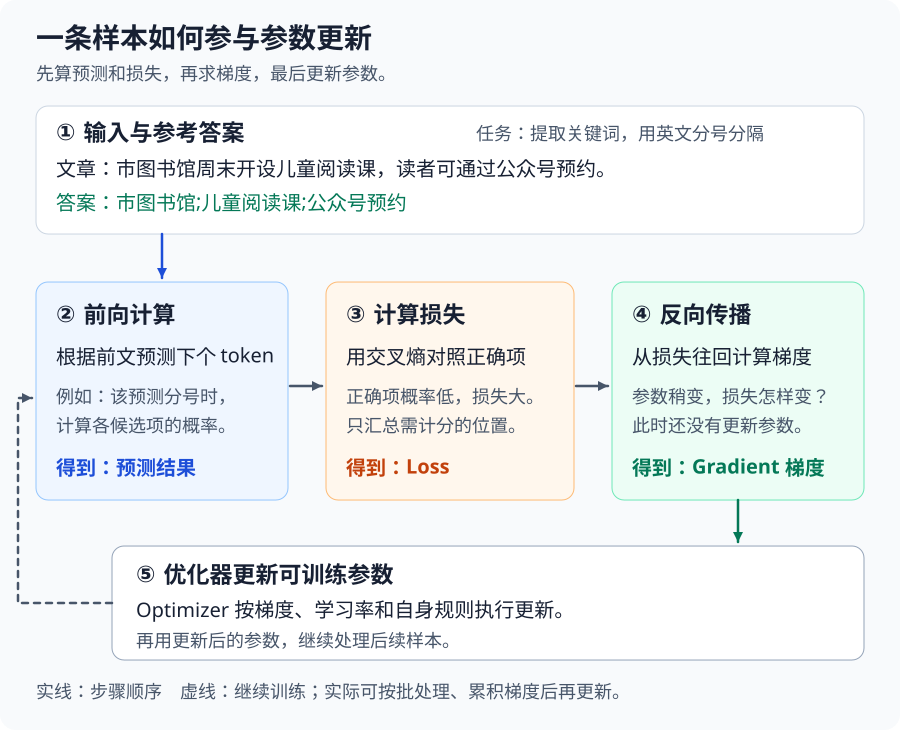

When reading the diagram, follow "prediction → loss → gradient → parameter update" once through, and then look at the dashed line back to the model: the next batch of data will use the updated parameters to recompute predictions. What changes is how the calculation results are produced; the articles and answers in the training file remain exactly as they are.

<details>
<summary>Advanced reading: how gradients provide adjustment clues, and a hand-calculated update</summary>

First consider only one parameter: with all other parameters temporarily held constant, if it is increased slightly, does the loss tend to increase or decrease, and how obvious is the change? The rate of change of the loss with respect to this parameter provides the adjustment clue for the current position. Putting together these rates of change for all trainable parameters is the **gradient**.

Gradients are computed by the training framework through backpropagation; we do not need to modify parameters one by one to test, nor are they numbers manually filled in on the training page.

Once the gradient is available, the **optimizer** actually changes the parameters according to update rules, and the **learning rate** controls the step size of the update. Suppose a certain parameter and its gradient are as follows, and calculate one update using the simplest rule:

```text
某个可训练参数：0.30
当前梯度：0.20
学习率：0.10

按最简单的梯度下降规则：
新参数 = 原参数 - 学习率 × 梯度
       = 0.30 - 0.10 × 0.20
       = 0.28
```

The gradient of this parameter is positive `0.20`, meaning that near the current value, increasing it will tend to increase the loss. Therefore, simple gradient descent adjusts in the opposite direction, reducing the parameter from `0.30` to `0.28`; when the gradient is negative, the opposite applies. The gradient describes the situation near the current position, and if the step is too large, it may still overshoot the appropriate position, so it does not guarantee that the loss decreases at every step.

The above is a **simple gradient descent calculation example**. The course training uses the **AdamW optimizer**, which also references statistical information from previous gradients and adjusts the update magnitude for each parameter. Both rules require calculating the gradient first, then performing the parameter update.

</details>

Returning to the library task, when the loss is high, the next step is to inspect the data and the training process; after training ends, check again whether the keywords in new articles are extracted completely and separated by semicolons.

In actual training, multiple samples are usually processed together, and gradients may first be accumulated over several batches before a parameter update is executed. The next section introduces the settings that control this process.

---

## 2. Training Epochs and Batches

**What to master in this section:** Distinguish between "how many samples are processed at a time" and "how many batches are processed before one update", and calculate why the course has 50 steps per epoch and 150 steps over 3 epochs.

The previous section introduced one parameter update. Now there are 1,600 training samples, and we need to decide: how many samples to process at a time, after how many batches to update the parameters, and how many epochs to train on the entire dataset.

First, look at the **Train page** of LLaMA-Factory. After selecting the model and data, the training parameters are below. The following screenshots are taken from the real interface and show the three items covered in this section: batch size, gradient accumulation, and number of training epochs. The screenshots are only for becoming familiar with the fields; the complete configuration is summarized in Section 8.1 and will be filled in in Chapter 31.

<div role="group" aria-label="Three real interface sections of training parameters" style="display: flex; flex-wrap: wrap; gap: 12px; align-items: flex-start; margin: 1em 0;">
<div style="position: relative; flex: 0 1 290px; width: 100%; max-width: 100%; aspect-ratio: 290 / 108; overflow: clip; border: 1px solid #e5e7eb; border-radius: 6px;">
  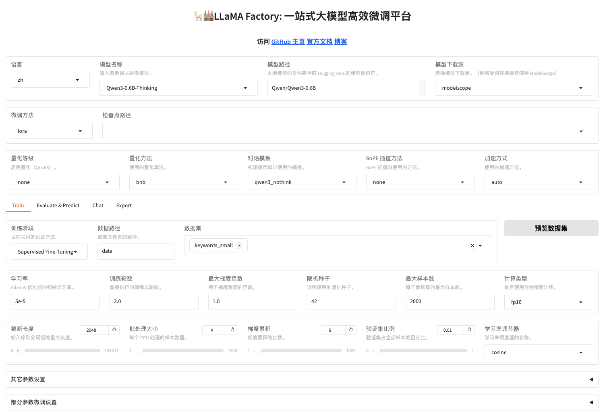
</div>
<div style="position: relative; flex: 0 1 290px; width: 100%; max-width: 100%; aspect-ratio: 290 / 108; overflow: clip; border: 1px solid #e5e7eb; border-radius: 6px;">
  
</div>
<div style="flex: 0 1 290px; width: 100%; max-width: 100%; min-height: 108px; border: 1px solid #e5e7eb; border-radius: 6px;">
<div style="position: relative; width: 238px; max-width: 100%; aspect-ratio: 238 / 101; overflow: clip;">
  
</div>
</div>
</div>

Here we only look at the batch and epoch fields. During training, use `keywords_train` and a separate `keywords_validation`, and fill in `0` for the validation set ratio; the `keywords_small` and ratio `0.01` in the larger screenshot are not used for this exercise. The complete filling method is described in Chapter 31.

The calculations later in this chapter uniformly assume `Qwen/Qwen3-0.6B`, a single GPU, 1,600 training samples, 4 samples per batch, gradient accumulation of 8, and 3 training epochs. First, get to know the following three items; the remaining settings will be explained as they are used:

| Interface name | Field in the configuration file | Value and role in this chapter |
| -------------- | -------------------------------- | ------------------------------- |
| Batch size | <code style="white-space: normal; overflow-wrap: anywhere;">per_device_train_batch_size</code> | `4`: each GPU processes 4 samples at a time |
| Gradient accumulation | <code style="white-space: normal; overflow-wrap: anywhere;">gradient_accumulation_steps</code> | `8`: update parameters once after processing 8 batches |
| Number of training epochs | <code style="white-space: normal; overflow-wrap: anywhere;">num_train_epochs</code> | `3`: train on the entire training data for 3 epochs |

These settings are also saved in `案例与源码-4-微调/configs/keywords_clean_train.yaml`. YAML is a configuration file format in which each line records a setting as "parameter name: value"; for example, `num_train_epochs: 3` corresponds to "number of training epochs: 3" in the interface. It saves the training schedule, not the training samples.

### 2.1 Batch Size, Training Epochs, and Update Steps

First, match the interface settings with the English names in the logs:

- **Batch**: a group of samples put into the model for processing together. Here, one batch is 4 samples.
- **Epoch**: each sample in the training set has generally been seen once, counted as one epoch.
- **Step**: the training program completes one parameter update, counted as one step. When gradient accumulation is not used, processing one batch usually completes one update step.

**In this course's configuration, which trains by epochs, step is the update progress calculated by the program, and there is no need to fill in a total number of steps separately.**

1,600 happens to be divisible by 4:

```text
1 个 epoch：1,600 ÷ 4 = 400 个小 batch
```

This 400 is the **number of mini-batches processed**. The course also sets gradient accumulation to 8, so this does not mean 400 updates were performed. Next, calculate clearly: if an update is performed only after every 8 batches, how many update steps will there be?

### 2.2 Gradient Accumulation and Effective Batch Size

**Gradient accumulation** means: after processing a mini-batch, do not update the parameters yet, but temporarily store the gradients obtained this time; after processing several mini-batches consecutively, update the parameters once together.

First, walk through the course configuration: using one GPU (usually called "single GPU"), the first batch processes 4 samples without updating; the second batch processes another 4 samples and continues accumulating gradients... after the 8th batch is processed, one update is performed. Then the next group begins:

```text
单卡 batch size = 4
梯度累积次数 = 8

4 条 × 8 次 = 32 条样本后更新一次参数
```

These 32 samples are called the **effective batch size**. In the single-GPU scenario, it can initially be understood as follows:

```text
有效批次大小 = 单卡 batch size × 梯度累积次数
```

**Suppose a batch of longer articles is used instead, the model loads successfully, but the GPU memory is insufficient when processing 4 samples at a time.** We want to change to processing 2 samples at a time while still updating once every 32 samples. Which setting should be changed together?

If only the batch is changed first: with 2 samples per batch and still accumulating 8 batches, it becomes an update every 16 samples. The number of samples processed simultaneously is smaller, but updates also become more frequent.

If you still want to update once every 32 samples, the accumulation count must be changed to 16 at the same time. **Batch controls how many samples are processed at a time, and gradient accumulation controls how many batches are processed before updating.** The data is not halved; what changes is the grouping method:

| Single-GPU setting | Processed at a time | Batches processed before update | Effective batch |
| ------------------ | ------------------- | ------------------------------- | --------------- |
| Original: batch 4, accumulation 8 | 4 samples | 8 batches | 32 samples |
| Only batch changed: 2, accumulation 8 | 2 samples | 8 batches | 16 samples |
| Matching change: batch 2, accumulation 16 | 2 samples | 16 batches | 32 samples |


The figure compares the first and third arrangements from the table. Each small box is one batch, and the number inside the box is the number of examples; they are processed sequentially along the arrows, and the 32 examples are not all placed into the GPU at once. The update happens only after 32 examples have been accumulated, and the next group then uses the new parameters.

When conditions such as example length are the same, processing 2 examples at a time usually saves more intermediate computation results than processing 4 at a time. **Reducing this part of the memory usage relies on decreasing the per-GPU batch size; increasing the number of accumulation steps is done to keep the number of examples used per update the same.** If the batch size remains 4 and only the number of accumulation steps is increased, the space required for the current batch of 4 examples will not shrink as a result.

<details>
<summary>Check again when tuning: if the effective batch is the same, will the run necessarily be the same</summary>

Conversely, when memory is sufficient, batch 8 with accumulation 4 can also yield an effective batch of 32, but more examples are processed at the same time in one go. The same effective batch does not mean the speed and training results are exactly the same, nor does it guarantee that no error will occur after tuning; Section 5 will explain the other memory usage.

</details>

Now calculate a full epoch:

```text
训练样本：1,600 条
小批次数：1,600 ÷ 4 = 400 批
每轮更新：400 ÷ 8 = 50 步
训练 3 轮：50 × 3 = 150 步
```

This calculation assumes a single GPU, sequence packing disabled, and that all 1,600 training examples are retained; "packing" means concatenating multiple short examples for processing together, and the course configuration does not enable it. The sample startup log in Chapter 31 also corresponds to 50 steps per epoch and 150 steps in total. After the number of examples or the packing method changes, you should re-check the log; the validation set does not participate in these parameter updates.

<details>
<summary>Further comparison: update frequency, validation timing, and real resource changes</summary>

Calculate all three arrangements, and you can see the knock-on effects of the changes:

| Single-GPU setting        | Update steps per epoch | Total steps over 3 epochs | Validation every 50 steps corresponds to |
| ---------------- | ----------------- | ---------- | ------------------------ |
| batch 4, accumulation 8  | `1600 ÷ 32 = 50`  | 150        | Checking once per epoch             |
| batch 2, accumulation 8  | `1600 ÷ 16 = 100` | 300        | Checking once every half epoch           |
| batch 2, accumulation 16 | `1600 ÷ 32 = 50`  | 150        | Checking once per epoch             |

All three configurations train on the training set for 3 passes, but the second one updates more frequently, and the step-based validation interval also lands on different progress points. **After adjusting the batch size, you need to check the effective batch, total number of steps, and validation timing together.** Section 9 will explain the specific settings for validation and saving.

How much resource benefit will this change bring? Chapter 33 already has a real comparison: on the same V100, with the same model and course data, both groups completed 50 steps. At batch 4/accumulation 8, the peak sampled memory was about **27.92 GiB**, and the entire command took about **301 seconds**; at batch 2/accumulation 16, it was about **21.71 GiB and 560 seconds**. This time, fewer examples were processed per batch, leaving more memory headroom, but more time was spent.

This 50-step experiment measured the peak sampled memory from loading to saving and the total elapsed time, for the purpose of comparing resource costs; task performance still needs to be evaluated separately. For the complete record and reproduction method, see [the batch comparison in Chapter 33](33-%E5%BE%AE%E8%B0%83%E6%98%BE%E5%AD%98%E4%BC%98%E5%8C%96%E4%B8%8E%E5%A4%9A%E5%8D%A1%E8%AE%AD%E7%BB%83.md?id=_26-how-to-determine-whether-an-adjustment-is-effective).

</details>

**Self-check while reading up to here:** When processing 2 examples at a time, can you update only once every 32 examples? Yes, you need to accumulate 16 batches; "one batch" and "one update" do not have to be the same thing.

### 2.3 More epochs are not always better

**If the model gets better and better on practice questions but worse on new articles, should you continue increasing the number of epochs?** Increasing epochs makes the model see the same batch of training examples over and over. Appropriate repetition helps learn task patterns, but whether to continue depends on data that did not participate in training.

Chapter 29 explains [generalization and overfitting](29-%E5%BE%AE%E8%B0%83%E6%95%B0%E6%8D%AE%E5%87%86%E5%A4%87%E4%B8%8E%E5%AF%B9%E8%AF%9D%E6%A8%A1%E6%9D%BF.md?id=_521-generalization-and-overfitting). Applied to epochs, this means that for each additional training pass, you should also check whether similar articles that did not participate in training also improve.

For example, with the other batch settings kept at the course values, 1 training epoch corresponds to 50 updates, and 3 epochs correspond to 150. The extra two epochs provide more learning opportunities but also more computation; whether they are worthwhile depends on the answers on new articles and the validation loss.

Section 9 of this chapter already has results saved from the same training run at steps 50, 100, and 150. You can compare these stages first before deciding whether new experiments are needed. If validation performance continues to deteriorate, you should investigate the causes according to Section 9.3.1, rather than continuing to add epochs just because the training loss is still decreasing.

---

## 3. Learning rate and scheduling

**What to master in this section first:** The learning rate controls the update step size; increasing it does not mean learning better. For warmup and decay, first understand the direction of change, and use the course settings for your first training run.

Batch size and epochs determine "how often to update and how many updates in total." The learning rate affects "how large a step to take for each update."

### 3.1 Learning rate settings

**If you increase the learning rate, will you necessarily learn keyword extraction faster?** The learning rate controls the step size of each update. If the step is too small, the changes may be insufficient within a limited number of epochs; if the step is too large, training may also become unstable. It is not a direct measure of "learning speed" or "amount of knowledge mastered."

The "Learning rate" on the training page corresponds to the configuration field `learning_rate`. The course value is `5e-5`, written in YAML as `learning_rate: 5.0e-5`; the two notations represent the same number:

```text
5e-5 = 5 × 10⁻⁵ = 0.00005
```

Here, `e-5` is scientific notation, used to represent such a small decimal concisely. Although the value is small, whether it suits the current training still needs to be judged together with the model, data, and optimizer.

| Learning rate situation | What may happen                                     |
| ---------- | ------------------------------------------------ |
| Too large       | Parameter updates are too drastic, and the loss may fluctuate sharply or even get worse with more training    |
| Too small       | Parameter changes are slow, and within a limited number of epochs the model may not yet learn the task patterns |
| Appropriate       | Under the current settings, training is relatively stable, and validation performance also improves       |

Applying this meaning to the course settings: if you retrain from the original model and keep all other settings the same, changing `5e-5` to `1e-4` raises the configured learning rate from `0.00005` to `0.0001`, doubling it. It will make the optimizer update with a larger learning rate; after multiple steps, the gradients and parameters will also differ, and you cannot infer that the loss decrease or learning speed will exactly double.

<details>
<summary>Check again when tuning: what evidence to use for comparing learning rates</summary>

**How do you judge whether it is worth changing?** First confirm that the examples, answer labels, and Adapter loading are all correct. If over multiple record intervals the improvement in both training and validation loss is very slow, a larger learning rate can be taken as a hypothesis to compare; if training repeatedly shows large fluctuations, a smaller learning rate can be compared. A single increase in loss is only worth continued observation and is not enough to justify changing the value.

When comparing, first confirm from the log that the actual learning rate changes according to the new settings, then look at the loss trends at the same training progress and the answers on the same batch of validation inputs. If the numbers drop faster but there are more missing words or format errors, you cannot keep the new configuration based on the drop speed alone.

</details>

<details>
<summary>Advanced optional reading: changing only the learning rate, and calculating an update magnitude by hand</summary>

Return to that parameter from Section 1.2: the original value is `0.30`, and the gradient is `0.20`. For now keep both unchanged, change only the learning rate, and calculate according to the same simple gradient descent rule:

| Learning rate | Value subtracted this time        | Parameter after update           |
| ------ | --------------------- | ---------------------- |
| `0.10` | `0.10 × 0.20 = 0.02`  | `0.30 - 0.02 = 0.28`   |
| `0.01` | `0.01 × 0.20 = 0.002` | `0.30 - 0.002 = 0.298` |

When the learning rate is reduced to one tenth, the update magnitude in this example also shrinks to one tenth. It controls "how large a step to take in this direction," not "how much knowledge is learned this time." The table above continues to use pedagogical numbers and a simple rule; the actual AdamW update also involves gradient history and cannot simply be read from the table.

</details>

### 3.2 Learning rate warmup and decay

If the learning rate is filled in as a fixed number, why does the number in the log still change? Because a **learning rate scheduler** is also configured, which changes the learning rate according to training progress.

The "Learning rate scheduler" in the interface is where you choose the scheduling rule; expanding "Other parameter settings" also reveals the warmup steps. These three items work together:

| Interface name     | Configuration notation                    | Function                            |
| ------------ | --------------------------- | ------------------------------- |
| Learning rate       | `learning_rate: 5.0e-5`     | The learning rate reached at the end of warmup in this example      |
| Learning rate scheduler | `lr_scheduler_type: cosine` | After warmup, gradually decreases along a cosine curve        |
| Warmup steps     | `warmup_steps: 5`           | The first 5 update steps gradually increase the learning rate |

**Warmup** means using a smaller learning rate at the beginning of training and then gradually raising it to the configured value, to soften the initial parameter updates.

Here, the first 5 update steps are used for warmup, and they are included within the total of 150 steps. The warmup phase increases linearly; after the warmup ends, the learning rate gradually decreases along a cosine curve, and this second half is called **decay**.

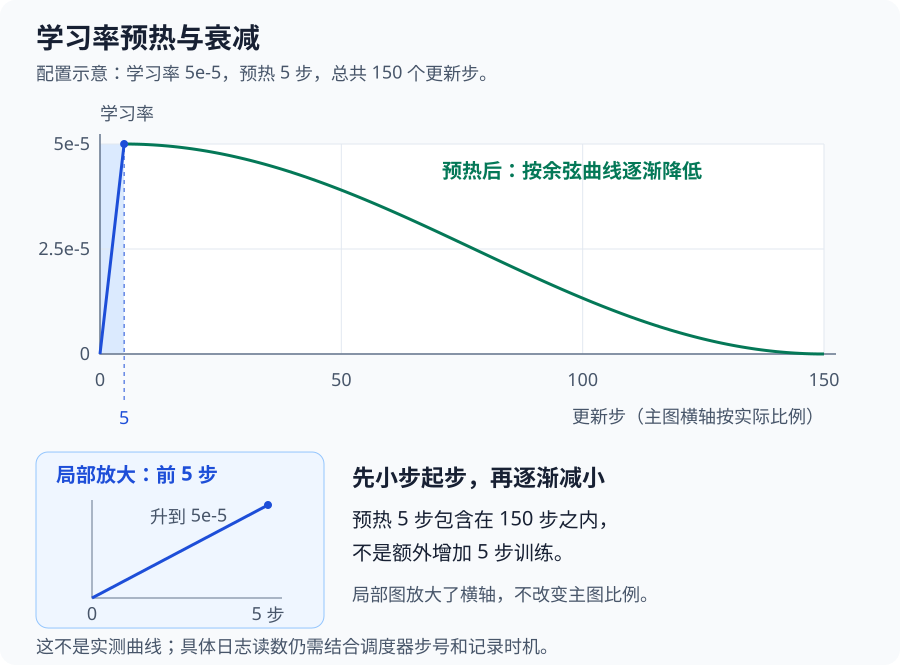

The main chart is drawn with the horizontal axis proportional to actual steps, so the first 5 steps appear very narrow; below, the warmup region is enlarged separately to make the startup process easier to see. This is a configuration illustration; the actual values in the log will be examined together in Section 9.1.

Why does it gradually decrease later? The parameters have already been adjusted many times, and continuing with a large step size may cause oscillation back and forth near a good position. Decay makes later updates gradually smaller, but it proceeds according to a preset schedule and does not automatically judge what knowledge the model has already mastered.

<details>
<summary>Check again when tuning: what changes in warmup steps and total steps affect</summary>

Suppose the total number of steps remains 150, and only the warmup is changed from 5 steps to 15 steps; the model will use more update steps to gradually rise to `5e-5`, and the subsequent decay phase shrinks from 145 steps to 135 steps. This change can be calculated directly; whether training becomes more stable needs to be checked against the log. If the warmup is dragged on too long, more steps in the limited training will also be spent at a smaller learning rate.

The total number of steps itself also participates in scheduling. If Section 2 only reduces the batch size, making the total steps go from 150 to 300, then even if `cosine` and 5 warmup steps are still filled in, the decay will unfold according to the new total progress. Therefore, comparing step 50 and step 150 of the same training run is not the same experiment as separately running "50 total steps" and "150 total steps." See the [Transformers learning rate scheduling documentation](https://huggingface.co/docs/transformers/en/main_classes/optimizer_schedules#transformers.get_cosine_schedule_with_warmup) for the specific rules.

</details>

---

## 4. Sequence length and truncation

**What to master in this section:** The length limit includes both the input and the reference answer. Before shortening, check what will be lost; raising the limit does not necessarily increase the actual training content.

The "Truncation Length" on the training page corresponds to `cutoff_len` and limits the maximum number of tokens in a training sequence. Chapter 29 already covered chat templates and tokenization results; this length must include both the input and the reference answer:

```text
用户文本 + 任务指令 + 模板标记 + 助手参考答案
                    ↓
             完整训练序列的 token
```

Continuing with the library samples, the content that actually counts toward the length includes:

```text
[用户角色标记] 市图书馆周末开设儿童阅读课……请提取关键词……
[助手角色标记] 市图书馆;儿童阅读课;公众号预约 [结束标记]
└──────────────── 整段分词后的 token 总数 ────────────────┘
```

This is a schematic illustration of the content composition; the actual format of role markers is determined by the template. `cutoff_len: 2048` means the upper limit for this complete sequence is 2,048 tokens - not the number of articles, not the number of Chinese characters, and not the "Max Generation Length" set separately on the Chat page.

### 4.1 Impact of the Length Limit

Length first affects what the model can see, and only secondarily affects VRAM and speed. Suppose the library originally provided a very long activity introduction, and "readers can make reservations through the official account" appears in the latter half of the article. If this sentence is removed after truncation, but "official account reservation" in the reference answer is still retained, what happens?

The model no longer sees the reservation method in the article, yet the training program still requires it to predict this keyword. As a result, an answer that originally had supporting evidence may lose that evidence after truncation. **Chapter 29 checks whether the original samples are reasonable; here you also need to check whether the samples the model actually receives are complete.**

Expressed in terms of length, suppose a training sample has 2,300 tokens before processing, but the limit is only 2,048, so it cannot be fully retained. Truncating different parts produces different effects:

| Content truncated | Impact on keyword task |
| ---------------------- | -------------------------------------- |
| Part of the user's article | The answer may mention content the model can no longer see |
| Part of the reference answer | The model cannot learn the complete keyword and ending style |
| Necessary task instructions or context | The input and answer may no longer form a clear, complete task |

The tool allocates input and answer lengths according to its own preprocessing rules; you cannot simply assume that only the end of the article is deleted.

<details>
<summary>Advanced reading: What is the difference between padding and truncation? Are short samples also padded to the limit?</summary>

Length also involves **padding**: when two samples of different lengths are placed in the same batch, the tool usually needs to arrange them to be the same length. For example, one sample has 120 tokens and another has 200 tokens; if they are padded to the longest sample in this batch, the shorter one needs 80 additional padding positions.

The tool marks these padding positions used for alignment so that they are not included in the loss as prediction targets; the label masking rules from Section 1.1.1 also apply here.


When reading the diagram, you can distinguish the two issues with two questions: the top half is "This batch has different lengths, how do we align them?" and the bottom half is "This one is too long, which content can still be retained?" The diagram does not specify which segment the tool actually truncates; the actual result needs to be checked using the method in the next section.

Therefore, `cutoff_len: 2048` is a length upper limit, not an indication that every short sample is padded to 2,048. Where padding stops also depends on the batch and tool settings. Raising the limit to 8,192 also does not mean you can directly assume that all samples will occupy 8,192 positions.

</details>

Also remember: **2048 is an upper limit, not an indication that every short sample will occupy all 2048 positions.** Actual usage is also related to the batch and padding settings.

### 4.2 Checking the Actual Training Length

First check the length of the course data after processing by LLaMA-Factory. The results below correspond to `Qwen/Qwen3-0.6B`, the `qwen3_nothink` template, `cutoff_len: 2048`, and `train_on_prompt: false`. This check only runs data preprocessing and does not require loading model weights or training.

**First check whether any samples were discarded or truncated:**

| Data file | Original count → Processed count | Longest complete sequence | Number truncated |
| --------------------------- | --------------------- | ------------ | ------------ |
| `keywords_train.jsonl`      | 1,600 → 1,600         | 957 token    | 0            |
| `keywords_validation.jsonl` | 200 → 200             | 604 token    | 0            |

The length here includes role markers, user input, assistant answer, and the end marker, not the number of characters in the article. Both datasets are below the 2,048 limit, the counts before and after preprocessing are the same, and there are no samples whose answer targets were changed by truncation.

Now you can determine how to change the limit based on the actual lengths. Keeping the current data and template unchanged, first go through the following configuration analysis:

| Truncation length setting | What can be concluded for the current data | What to check |
| ------------ | ---------------------------------------- | ------------------------------------ |
| Keep 2048 | Existing preprocessing evidence shows all samples are fully retained | Compare against the counts and lengths above |
| Raise to 4096 | The current longest is only 957, so this will not read more article content | Whether actual sequences and padding change, then observe resources |
| Lower to 512 | At least the longest existing sample cannot be fully retained | Recheck which inputs, answers, and sample counts were truncated |

**The length setting must first ensure that the input and answer are complete.** The 4096 and 512 values above are inferences based on existing sample lengths; actual VRAM usage is also affected by batch lengths and padding method. When troubleshooting your own data, you can expand the label verification below.

<details>
<summary>Reading: Verifying input, answer labels, and length on actual samples</summary>

**Next, check whether `input_ids` and `labels` correspond.** From these 1,800 samples, select the shortest, middle, and longest three by complete sequence length:

| Sample position (file line numbers start from 1) | Complete length | Number of `labels = -100` positions | Positions involved in loss calculation |
| ----------------------------- | -------- | ------------------------ | -------------------- |
| Short: validation set line 133 | 39       | 28                       | 11                   |
| Middle: training set line 636 | 158      | 136                      | 22                   |
| Long: training set line 631   | 957      | 938                      | 19                   |

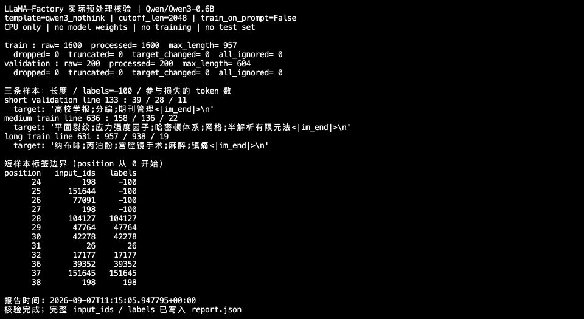

In the diagram, the short sample's answer is `高校学报;分编;期刊管理`. Its first 28 positions are the user input and role markers, and `labels` is `-100`; starting from position 28 (indexed from 0), the labels retain the answer's token IDs. The trailing `<|im_end|>` and newline are also included in the target, so the number of positions involved in loss calculation is not equal to the number of characters in the keyword. `-100` only means that position is not a prediction target; **it does not mean the model cannot see this input**.

When verifying labels, check the decoded input, answer, and role boundaries, and also confirm that every sample has answer positions involved in loss calculation. The three samples in the table correspond to their source records, and none of the 1,800 samples have all answer labels set to `-100`. You can search for `decoded_input`, `decoded_target`, and the label array in the companion `examples/preprocessing/report.json`; the method for running the inspection script is shown below.

</details>

<details>
<summary>Code reproduction: Upload and run the preprocessing inspection script</summary>

First complete the environment installation, [model download](31-LLaMA-Factory%E7%8E%AF%E5%A2%83%E6%90%AD%E5%BB%BA%E4%B8%8E%E5%BE%AE%E8%B0%83%E5%AE%9E%E6%88%98.md?id=_51-model-and-fine-tuning-method), and [data upload](31-LLaMA-Factory%E7%8E%AF%E5%A2%83%E6%90%AD%E5%BB%BA%E4%B8%8E%E5%BE%AE%E8%B0%83%E5%AE%9E%E6%88%98.md?id=_61-data-upload-and-integrity-check) from Chapter 31; you do not need to start training first. The script only uses the CPU to inspect the data and will not download the model for you.

In **AutoDL's JupyterLab terminal**, prepare the directory:

```bash
cd /root/autodl-tmp/LLaMA-Factory
source .venv/bin/activate
mkdir -p configs
```

Upload the two local files in the JupyterLab file panel:

| File in local `案例与源码-4-微调/`  | Upload location on AutoDL     |
| ----------------------------------- | ------------------------ |
| `audit_keywords_preprocessing.py`   | `LLaMA-Factory/` root directory  |
| `configs/keywords_clean_train.yaml` | `LLaMA-Factory/configs/` |

This uses the CLI training YAML provided with the course, not the WebUI's "Save Training Parameters" file. If a file with the same name has already been uploaded, verify its contents first; this script requires that `model_name_or_path` in it remains `Qwen/Qwen3-0.6B`, and the actual local model location read is specified separately by `--model-dir` below.

Return to the AutoDL terminal from earlier, check the files first, then run the script:

```bash
ls audit_keywords_preprocessing.py configs/keywords_clean_train.yaml
ls data/keywords-clean/keywords_train.jsonl data/keywords-clean/keywords_validation.jsonl

python audit_keywords_preprocessing.py \
  --data-dir data/keywords-clean \
  --config configs/keywords_clean_train.yaml \
  --model-dir /root/.cache/modelscope/models/Qwen--Qwen3-0.6B/snapshots/master \
  --output-dir /root/autodl-tmp/keywords-preprocessing-check
```

Replace `--model-dir` with the actual directory returned when the model download completed; `--output-dir` must be a new directory that does not yet exist, and must not point to an existing training result. `--data-dir` is the data location to be inspected, and `--config` provides inspection conditions such as template and length; it will not start training simply because `do_train: true` is written in it.

After completion, open `report.json` in the output directory in the file panel and compare it against the counts, truncation, and label statistics above. If the script reports that configuration conditions do not match, first verify the uploaded YAML; do not delete the inspection conditions to force it to run.

</details>

After switching to your own data or adjusting the template, you need to rerun the preprocessing inspection above and compare against the original text to see what articles and answers the model actually receives, confirming that both remain complete and correspond. The specific decoding, label verification, and script operations are kept in the expandable boxes. **The current data is suitable for the 2,048 limit, but that does not mean it will remain suitable after switching to a different set of documents.**

---

## 5. Training VRAM

**What to master in this section:** Even if the model loads successfully, training may not fit. Distinguish between weights and intermediate computation results, know which part is mainly reduced by decreasing batch size, and choose precision based on hardware support.

**VRAM** can initially be understood as the workbench where the GPU (the graphics card that primarily performs computation during training) places the model and intermediate computation results. If the workbench cannot fit everything, training will report out-of-memory; a larger workbench can usually hold a larger model, longer samples, or a larger batch.

This also connects the earlier interface settings: "Truncation Length" affects how long a single sample is, "Batch Size" determines how many samples are processed simultaneously, and "Compute Type" affects how numerical values are represented. All of these affect VRAM, so you cannot choose a GPU based only on the model file size.

### 5.1 Main VRAM Usage

Following the order of Section 1, look at what needs to be placed on this training "workbench":

1. **When loading the model, weights are placed first.** The model uses these numerical values for computation, so the weights themselves occupy some space. At this point, no training samples have been processed yet.
2. **When processing a batch of samples, computation drafts are produced.** The intermediate results computed by each layer of the model are called **activations**. Some of these results are needed later when computing gradients, so you cannot immediately discard all the drafts after computing the predictions.
3. **Gradients are computed backward from the loss.** The program traces back through the computation relationships just used to compute gradients; this process is called **backpropagation**. Gradients also need to be stored; when gradient accumulation is enabled, already accumulated gradients must be retained before processing the next mini-batch.
4. **When updating parameters, information needed for the update must also be retained.** AdamW references historical gradient statistics; this information is called **optimizer state** and is used continuously for subsequent updates.

Therefore, "the model loaded successfully" and "a batch of training can complete" are two different things. The later steps also require space; the training framework, temporary workspace, and so on also incur additional **runtime overhead**.

This also explains the configuration adjustment in Section 2: for the same model, changing the batch size from 4 to 2 does not shrink the model weights by half. Instead, fewer samples are processed at the same time, so the intermediate results that need to be stored are usually also smaller. Longer articles, however, increase this part of the burden.

Therefore, **weight size mainly depends on the model and numeric representation; activation size also depends on the actual sequence length and per-GPU batch size.** The gradient checkpointing in Section 5.3 is a trade-off between "keeping drafts" and "recomputing when needed".


First compare the two workbenches: **the model on the right is not larger; what increases is the other content required for training.** Then look at how each of the three methods below reduces a different part. The object sizes in the diagram do not represent actual measured proportions.

When you encounter "insufficient VRAM", first identify the stage at which it occurs, and then compare what each method reduces:

| What you prepare to adjust | Which part of the workbench is mainly affected | How to judge whether the direction is appropriate |
| ---------------- | -------------------------------- | -------------------------------- |
| Reduce per-GPU batch size | Intermediate results produced by processing samples simultaneously | The model has loaded, but space is insufficient when processing batches |
| Reduce the actual training length | Intermediate results produced by each sample | First check whether the input and answer are still complete |
| Use LoRA | Gradients and optimizer states corresponding to a large number of original weights | Accept freezing the original weights and training only the newly added branches |
| Quantize the base weights | The original model weights themselves | Weight already takes up too much space when loading a large model |

For example, if an error occurs before the model has even finished loading, changing the batch size cannot shrink the weights that still need to be loaded; if the error occurs only when processing long articles after loading is complete, you should first check the actual length and batch size. The learning rate changes the magnitude of parameter updates, but does not reduce the number of these values, so it cannot be used to solve VRAM capacity problems.

### 5.2 Numeric Precision and Weight Size

Model parameters are numbers, and when a computer stores a number, it also needs to choose a representation. The **numeric precision** discussed here is not the accuracy of the model's answers, but how finely these numbers can be represented.

You can borrow the idea of recording decimals to understand this: writing `0.12345` as `0.12` is coarser, and writing it as `0.1235` is finer; in addition, whether a format can represent especially large or especially small numbers involves its **numeric range**. This is an example to help distinguish "fineness" from "range", and FP16 does not simply keep exactly two decimal places.

FP32, FP16, and BF16 are several formats for storing and computing numeric values. In the "Compute Type" field on the training page, the course selects `fp16`, and the configuration corresponds to `fp16: true`, `bf16: false`. First look at the space they occupy:

| Format | How many bits per number | Equivalent bytes |
| ---- | -------------- | ------------ |
| FP32 | 32 bit         | 4 bytes       |
| FP16 | 16 bit         | 2 bytes       |
| BF16 | 16 bit         | 2 bytes       |

8 bits equal 1 byte. Although FP16 and BF16 occupy the same number of bytes, their numeric ranges and precision allocations are different; it is not just a different name. This time AutoDL V100 uses FP16 and does not use native BF16. Specific hardware and installation checks are covered in Chapter 31.

<details>
<summary>Advanced optional reading: calculating weight size by bytes, and why the entire training VRAM does not shrink by the same proportion</summary>

If 0.6B is roughly calculated as 600 million parameters, and each weight is stored in 2 bytes:

```text
600,000,000 × 2 = 1,200,000,000 字节 ≈ 1.2 GB
```

For the same 600 million numbers, if all are stored in FP32 at 4 bytes, the weights alone would be about 2.4 GB. The number of values has not changed; what changed is the space used to represent them. These are rough calculations in decimal GB and **only account for the weights themselves**, without yet including intermediate results, gradients, and optimizer states.

Therefore, after switching from FP32 to FP16, you cannot simply assert from this calculation that the whole training VRAM is halved. In practice there is a mixed-precision arrangement, and some states still use FP32; whether it is stable and whether the hardware supports it must also be confirmed through the actual computation checks in Chapter 31. Similarly, the proportion of LoRA trainable parameters cannot be directly converted into the overall training VRAM.

</details>

"Compute Type" is also different from the "Quantization Level" in the model area. This chapter uses FP16 computation without enabling quantization; Section 7 explains what quantization changes.

<details>
<summary>Optional reading: after selecting FP16, why does FP32 still appear in the logs</summary>

**Mixed precision** means different computations or states use different precisions; not all values become uniformly 16-bit. The example configuration enables FP16, but the startup log also records `Upcasting trainable params to float32`, indicating that trainable parameters are promoted to FP32. These are not contradictory: computation settings, parameter storage, and optimizer states need to be viewed separately.

</details>

### 5.3 Gradient Checkpointing and VRAM

If the "drafts" used for backpropagation in Section 5.1 take up too much VRAM, can we save fewer of them and recompute when needed?

**Gradient checkpointing (also called activation checkpointing)** saves fewer intermediate results and recomputes them when needed. You can understand it this way: not all drafts remain on the desk; only necessary positions are kept, and the rest are recomputed later when used. The cost is more computation in exchange for lower VRAM usage.

Do not confuse it with training checkpoints:

| Name | What it does here |
| ------------------------------ | ------------------------------------------------------ |
| Gradient checkpointing | Reduces the storage of intermediate results within a single training computation, saving VRAM |
| Training checkpoints, such as `checkpoint-50` | Save the weights, states, and other data at a particular update step to disk for later loading or recovery |

With all other settings identical, enabling gradient checkpointing is equivalent to "storing fewer drafts and doing more recomputation"; disabling it removes that part of recomputation but requires storing more intermediate results. If it originally fit exactly, disabling it may cause insufficient VRAM when processing batches; whether enabling it can complete in an acceptable time depends on both resources and elapsed time.

The startup log this time already contains `Gradient checkpointing enabled.`, indicating that it is enabled. When following along, first verify the enabled status; if you want to compare the impact of enabling versus disabling it, record the usage and time during a complete run, and do not use "saving a file every 50 steps" as a substitute for this switch. Specific troubleshooting methods are left to Chapter 33.

Another major cost in VRAM is the gradients and optimizer states corresponding to a large number of trainable parameters. The LoRA introduced next mainly reduces the training burden from this part.

---

## 6. LoRA Efficient Fine-Tuning

**What to master first in this section:** The original weights continue to participate in computation, and training mainly changes the newly added branches; the resulting Adapter still requires the original model to work with it. Sections 6.2-6.6 explain the purpose of the settings. In the first round, keep rank 8, alpha 16, dropout 0, and target all, and first verify training and actual answers. When you need to compare a particular setting, design an experiment with a clear purpose; there is no need to tune all options from the very beginning.

### 6.1 Full-Parameter Fine-Tuning and LoRA

Chapter 28 distinguishes ["what feedback to use to teach the model" from "which parameters to update"](28-%E5%A4%A7%E6%A8%A1%E5%9E%8B%E5%BE%AE%E8%B0%83%E6%A6%82%E8%BF%B0%E4%B8%8E%E6%95%B4%E4%BD%93%E6%B5%81%E7%A8%8B.md?id=_33-what-is-the-relationship-between-sft-and-lora). This section keeps the SFT articles and reference answers unchanged and focuses on the second question.

Keyword extraction requires the model to understand the articles and also to follow unified output requirements. If you directly update almost all parameters in the original model, that is **full-parameter fine-tuning**. The correspondingly large number of gradients and optimizer states also occupies VRAM.

**LoRA** uses a different approach: the original weights continue to handle the original computation, and a trainable branch is added alongside selected layers so it can learn the adjustment amount that needs to be added. Both paths participate in computation together, and during training only the small number of parameters in the newly added branch are changed.

This belongs to **parameter-efficient fine-tuning (PEFT)**: during training, only a subset of parameters are updated, reducing the related overhead. This chapter only covers LoRA and its quantized form QLoRA, which the course will use.

The group of new weights added by LoRA is called the **Adapter**. It is not an independent complete model; the original model is still needed during computation. Here, "base model" refers to the original model it attaches to, `Qwen/Qwen3-0.6B`, and does not have to be the `-Base` pretrained version introduced in Chapter 28.

| Training method | Original model weights | Newly added parameters | Main task weights to save |
| ---------- | ------------ | ------------------------ | -------------------- |
| Full-parameter fine-tuning | Participate in updates | Usually no LoRA branch needed | Updated full model weights |
| LoRA | Frozen, not updated | Add and train small branches on selected layers | Adapter incremental weights |


The diagram only zooms in on one computation position in the model. **Both paths participate in computation; only the small branch receives training.** What is added here is the computation result, not the final keywords; the block sizes in the diagram also do not indicate VRAM proportions.

"Freezing" does not mean locking the model file, nor does it mean not loading it during training. The original weights still participate in computation; the only difference is that gradients and optimizer states for updating these frozen parameters are not computed and stored. Backpropagation still needs to pass through the relevant computations in order to obtain the gradients for the trainable branch.

Returning to VRAM composition, with the gradients and optimizer states for a large number of parameters reduced, this part of the overhead decreases; the original weights and computational intermediate results still need to be retained. As for whether keyword extraction improves, that depends on the validation results after training.

**Freezing the original weights also does not guarantee that all old tasks remain unchanged after loading LoRA.** The new branch affects the computation results, and the model's response behavior may still change. In addition to checking keyword extraction performance, you should also check the behaviors you need to preserve, as described in [the regression checks in Chapter 32](32-%E5%BE%AE%E8%B0%83%E6%95%88%E6%9E%9C%E8%AF%84%E4%BC%B0%E4%B8%8E%E6%A8%A1%E5%9E%8B%E9%83%A8%E7%BD%B2.md?id=finetuning-regression).

On the training page, expand the "LoRA parameter settings" area and first locate the three items at the top: rank, scaling factor, and random dropout:

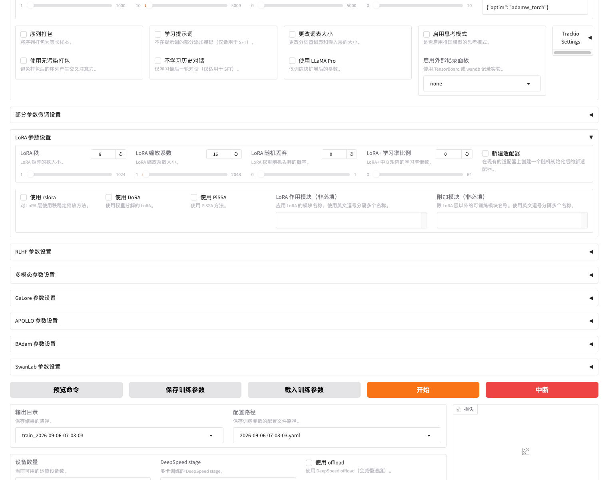

The "LoRA target modules" below are left blank in the image; the course configuration fills in `all` here, and the "LoRA additional modules" on the right remains blank. Section 6.5 explains the target location, and Section 7.4 of Chapter 31 shows the complete filled-in result.

| Interface name | Configuration value | Understand what it controls first |
| ------------- | ------------------ | ------------------------------------------ |
| LoRA rank | `lora_rank: 8` | How wide the middle of the new branch is, affecting the number of trainable parameters |
| LoRA scaling factor | `lora_alpha: 16` | Works with rank to control the incremental scaling of the new branch |
| LoRA random dropout | `lora_dropout: 0` | Whether to randomly mask part of the branch input during training; not enabled in this chapter |
| LoRA target modules | `lora_target: all` | On which available linear layers in the current model the branches are added |

First understand the positions and purposes of these four items; the following sections explain each of them separately. Other LoRA variants remain disabled, and the matrix diagram and complete manual calculation process can be expanded as needed.

### 6.2 A, B Matrices and the Computation Process

The original weights remain unchanged, yet the output can still change because the new branch contributes a learnable adjustment. LoRA represents this branch as two small parameter matrices, **A** and **B**; a matrix is a table of values arranged in rows and columns.

The same input flows through the original path as usual, while also passing through A and then B to produce the adjustment. The two results are added together and then passed on to the subsequent layers.

**Will adding a branch immediately disrupt the original output?** A common default initialization sets A to random values and B to all zeros. After the input passes through A, no matter what numbers are produced, passing through the all-zero B makes the branch contribution zero; training then gradually allows this increment to change. Therefore, the initial branch can avoid altering the original path's results at first.

Do not change it to "both A and B are all zeros": in this two-matrix multiplication structure, setting both to zero would prevent conventional gradient updates from training the branch. The default initialization and other options can be found in the [PEFT LoRA documentation](https://huggingface.co/docs/peft/package_reference/lora). This lesson keeps the tool's default initialization.

<details>
<summary>Advanced optional reading: matrix diagrams of A and B, vectors, and a complete manual calculation</summary>

Why can the output change if the original model weights are not updated? Understanding this question reveals why LoRA must be loaded together with the original model.

Inside a model, calculations are performed with sets of numbers. A sequence of numbers arranged in order is called a **vector**, and a table of values arranged in rows and columns is called a **matrix**. The **linear layers** discussed in this section use parameter matrices to perform calculations on input vectors, producing another set of numbers. LoRA adds two small matrices, denoted A and B, at these selected locations.

Only one linear layer is shown below, not the entire model. `x` represents the set of numbers fed into this layer, and `h` represents the result computed by this layer, which is not yet the final keyword. **On the first pass, just follow the arrows to see "two paths → addition"; leave the row and column counts in the figure until Section 6.3, when parameter counts are calculated.**

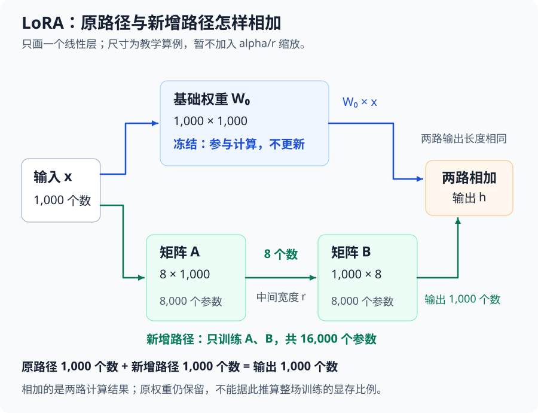

The same input travels along two paths: the original weights compute as usual, the newly added A and B branch computes an adjustment, and the outputs of the two paths are added before being passed to the next layer. During training, only A and B are updated, while the original weights remain unchanged. This is the difference between "frozen" and "trainable" in the figure.

Instead of doing matrix multiplication for now, let's just look at the result of a two-dimensional teaching example. Suppose the same input passes through the original path and produces an output of `[1, 2]`; after passing through A and B, the resulting adjustment is `[0.1, 0.2]`. Ignoring the scaling factor for now, adding the corresponding positions gives `[1.1, 2.2]`, which is then passed to the later layers for processing.

This is why "the original weights do not change, yet the computed result can still change." The numbers here are intended to illustrate the addition of two paths, not actual model weights; these intermediate numbers are also not yet keywords. To learn how the adjustment is calculated, you can expand the manual calculation below.

**Optional reading: how text becomes vectors that participate in computation**

Chapter 29 converted text into token IDs. For example, the ID for "市" is `22697`, but this ID only serves to locate the corresponding token and does not mean its meaning is a numeric value of more than twenty thousand.

The model first retrieves a set of values according to the ID as the initial representation of this token. This step is called **Embedding**. This vector continues through the model's layers for computation and combines with context, rather than directly using the token ID as a word-meaning magnitude for addition and subtraction. The correspondence between IDs and vectors can be found in the [PyTorch Embedding documentation](https://docs.pytorch.org/docs/2.14/generated/torch.nn.Embedding.html).

**Optional reading: how A and B multiply, and a manual calculation of an output using two-dimensional values**

Following the order in the figure of "first through A, then through B," and ignoring scaling for now:

```text
权重增量：ΔW = B × A
等效新权重：W = W₀ + ΔW

原路径的输出：W₀ × x
新增路径的输出：B × (A × x)
这个线性层的输出：h = W₀ × x + B × (A × x)
```

`W₀` is the original weight, and `ΔW` is read as "the change in weight." **Weight is added to weight, and output is added to output**; you cannot directly add the result of `W₀ × x` to the matrix `B × A`. Both paths must process the same `x`.

During training, keep `W₀` and update A and B; multiple samples jointly influence the values in these small matrices. This is the [basic structure of LoRA](https://arxiv.org/abs/2106.09685).

**Calculate once with small numbers.** For manual computation, shrink the 1000 dimensions in the figure to 2 dimensions, and assume the following is a set of post-training values; still no scaling factor for now:

```text
输入 x = [1, 2]ᵀ        （ᵀ 表示把这两个数竖着排列）

原权重 W₀ = [1  0]      A = [0.1  0.2]      B = [0.2]
            [0  1]                              [0.4]
```

The original path keeps the input unchanged; the new path first reduces two numbers to one, then returns it to two numbers:

```text
原路径：W₀ × x = [1, 2]ᵀ

先经过 A：0.1 × 1 + 0.2 × 2 = 0.5
再经过 B：[0.2 × 0.5, 0.4 × 0.5]ᵀ = [0.1, 0.2]ᵀ

两路相加：h = [1, 2]ᵀ + [0.1, 0.2]ᵀ = [1.1, 2.2]ᵀ
```

These two numbers are not yet the final keywords; they are intermediate outputs passed on to later layers. This example is only meant to illustrate "two paths process the same input, and the results are then added"; its dimensions are too small to calculate a savings ratio. The next section will use large matrices again when calculating parameter counts.

</details>

### 6.3 Rank and Trainable Parameter Count

**rank (rank, abbreviated r) controls how wide the middle of the added branch is.** The course sets `lora_rank: 8`, meaning that after the input passes through A, it first forms 8 intermediate numbers, which are then further processed by B.

Changing from 8 to 16 gives the branch more adjustable values, providing more room to express adjustments, and the related training overhead also increases. **More trainable parameters do not guarantee better keyword extraction.** For the first round, continue using 8. When you need to compare branch capacity, look at the quantity calculation below, and also check alpha in the next section.

<details>
<summary>Advanced optional reading: parameter counts for rank 8 and 16, actual logs, and comparison methods</summary>

If the branch in Section 6.2 is drawn wider, how many more parameters are there exactly? Suppose the input and output of a certain linear layer each contain 1000 numbers; A first turns the 1000 numbers into `r`, and B then turns them back into 1000:

| rank | A's parameter count     | B's parameter count     | Total newly added trainable parameters |
| ---- | ----------------------- | ----------------------- | -------------------------------------- |
| 8    | `8 × 1000 = 8,000`     | `1000 × 8 = 8,000`     | 16,000                                 |
| 16   | `16 × 1000 = 16,000`     | `1000 × 16 = 16,000`     | 32,000                                 |

**Changing from 8 to 16 gives this branch more adjustable values, allowing a larger range of corrections to be expressed; the newly added weights and their gradients and optimizer states also increase.** The 1 million weights of the original path are still there. The table above is a size comparison for the same teaching layer; it cannot be used to infer that the entire training memory usage doubles.

When is it worth comparing rank? If the inputs are complete, annotations are consistent, and the Adapter is loaded correctly, but the current training continues to underperform on both the training and validation sets, branch capacity can be considered as a factor to verify. If the training questions are already answered well but validation questions become worse, check the overfitting issue in Section 9 first.

When comparing, create a new Adapter from the same base model, verify the number of trainable parameters in the logs, and then compare the loss, keyword answers, and resource costs on the same validation data. When adjusting, also consider alpha from the next section; the two together determine the scaling of the increment.

**Using rank 8 from the table, calculate how many trainable parameters are saved.** A has dimensions `8 × 1000`, and B has dimensions `1000 × 8`. After matrix multiplication, `B × A` is still `1000 × 1000` and can serve as an increment with the same shape as the original weight.

```text
全参数更新这一个矩阵：1,000,000 个可训练参数
LoRA 更新 A 和 B：8,000 + 8,000 = 16,000 个可训练参数

16,000 ÷ 1,000,000 = 1.6%
1,000,000 ÷ 16,000 = 62.5
```

What is reduced is **the trainable parameters of this layer**, not the deletion of the original 1 million weights. At this point, the original weights plus A and B still total `1,016,000` parameters, of which only `16,000` need to be updated. You cannot conclude from this that "the entire training memory usage is reduced by 62.5 times" or "the speed is improved by 62.5 times."

**What is the relationship between the "rank" here and the original matrix?**

The rank of `B × A` does not exceed `r` and is not guaranteed to be exactly `r`. This small width limits the changes that the increment can express, but it does not require the rank of the original matrix itself to be 8.

**How many parameters were actually updated in the real model?** This cleaned training run used `r=8`, and the startup log recorded:

```text
trainable params: 5,046,272
all params: 601,096,192
trainable%: 0.8395
```

That is, about 5.05 million parameters participated in the update, accounting for about 0.8395% of all parameters counted in the log; the denominator includes the base model and the newly added Adapter.

The teaching layer's 1.6% and the full model's 0.8395% are not contradictory: the real model has multiple layers, different matrix sizes, and different application locations. The complete startup record is in Chapter 31's training log `案例与源码-4-微调/results/keywords-clean/training/train.log`.

</details>

### 6.4 Alpha and Increment Scaling

**alpha controls how the result of the added branch is scaled before being added.** In this course's standard LoRA, the scaling factor is `alpha/r`. The course uses `rank=8、alpha=16`, so the branch result is first multiplied by 2 and then added to the original path's result.

First, distinguish between two steps: **the learning rate controls how weights are updated during training, while alpha/r controls how the branch result is incorporated during computation.** alpha does not directly change the matrix size, nor can it be used as a substitute for the learning rate.

For the first run, keep `rank=8、alpha=16`. Later, when changing rank, look at this ratio together: if only rank is changed to 16 while alpha remains 16, the ratio changes from 2 to 1. Expand the example below when you need to make matching comparisons.

<details>
<summary>Advanced optional reading: numerical examples of alpha, matching changes with rank, and the formula</summary>

Using the teaching numbers from Section 6.2, temporarily fix the input, A, and B: the original path output is `[1, 2]`, and the added branch computes `[0.1, 0.2]`. When `alpha/r` is 1, the two paths add to give `[1.1, 2.2]`; keeping rank unchanged and doubling alpha makes the coefficient 2, so the branch is first multiplied by 2 and then added to give `[1.2, 2.4]`. **The matrix size does not change; what changes is how large the same branch result is when it is added.**

This also explains why alpha needs to be considered together when modifying rank:

| Setting                                    | rank | alpha | alpha/r | What happens                             |
| ------------------------------------------ | ---- | ----- | ------- | ---------------------------------------- |
| Course starting point                      | 8    | 16    | 2       | Current branch width and scaling         |
| Increase rank only                         | 16   | 16    | 1       | Branch widens, scaling factor also halves |
| Increase rank while keeping the coefficient | 16   | 32    | 2       | Branch widens, scaling factor remains 2  |

If an experiment aims to compare "the branch width changes while the pre-addition scaling factor remains the same," the third row is a matching arrangement. It still does not guarantee that the two groups have identical gradients, training processes, or outputs. The second row can also be used as an experiment, but the conclusion must acknowledge that it changes both capacity and scaling, and cannot be entirely attributed to rank.

This section uses the standard LoRA rule `alpha/r`; other variants may differ. [Scaling implementation in this PEFT 0.18.1 run](https://github.com/huggingface/peft/blob/v0.18.1/src/peft/tuners/lora/layer.py)

Changes in how the branch participates in computation also affect the gradients subsequently derived. When comparing alpha, first fix rank and the application locations, verify the coefficient in the configuration, and then compare validation performance.

**Optional reading: putting alpha/r back into the formula**

```text
权重增量：ΔW = (alpha / r) × B × A
线性层输出：h = W₀ × x + (alpha / r) × B × (A × x)
```

Temporarily fix A and B, and assume that a certain position in `B × A` is `0.01`, while the corresponding position in the original weight is `0.30`: when the coefficient is 1, the equivalent weight is `0.31`; when the coefficient is 2, it is `0.32`. This is an example of how weights are combined during forward computation, not a claim that the optimizer necessarily doubles the update every time.

</details>

### 6.5 Target modules and where they apply

The “LoRA 作用模块” option in the UI corresponds to **target modules**, which specify the layers to which LoRA branches are added. The course uses `lora_target: all`, which lets the tool identify the linear layers applicable to LoRA for the current model. It is not the same as the adjacent “附加模块” option; in this course, “附加模块” is left empty.

The same layer name may appear repeatedly in a model, and each matched layer has its own A and B; the original weights remain frozen.

<details>
<summary>When tuning: what happens if the scope is narrowed, and which layers actually receive branches</summary>

Suppose the rank remains 8 and the target location is narrowed from the current `all` to only `q_proj、v_proj`: layers matching these two names still get branches, while branches at the other original locations are no longer added. As a result, trainable parameters and related state decrease, but the model also has fewer positions available for learning adjustments. **Rank determines how wide each branch is; target determines where branches exist.**

This kind of comparison is suitable for answering: “Can narrowing the scope retain task performance while reducing overhead?” First check the trainable parameter count in the startup log, and inspect the `adapter_config.json` of `target_modules` to confirm the actual target locations; then compare responses on the same validation data.

**Which layers of this Qwen3 received LoRA branches:**

The cleaned Adapter configuration records the following names:

| Layer name                             | Computational component                          | What to understand here               |
| -------------------------------- | ------------------------------------ | ------------------------------ |
| `q_proj、k_proj、v_proj、o_proj` | Linear projections in the attention component    | These positions receive and train LoRA branches |
| `gate_proj、up_proj、down_proj`  | Feed-forward network, the part of each layer that continues transforming values | These positions also participate in this LoRA training |

These names repeat across different network layers, and each can have its own corresponding A and B. When switching models, you should re-check its layer names and actual target locations.

</details>

### 6.6 LoRA dropout

The “LoRA 随机丢弃” option in the UI corresponds to **LoRA dropout**, which randomly drops part of the input values to the LoRA branch during training: this time some inputs are temporarily masked, and next time they are randomly selected again.

The auxiliary text in the screenshot in Section 6.1 was written as “the probability of randomly dropping LoRA weights,” which may easily be misread as deleting weights. Here, following the [actual computation of this PEFT implementation](https://github.com/huggingface/peft/blob/v0.18.1/src/peft/tuners/lora/layer.py), it is understood as applying dropout to the branch input; the A and B weights are still retained.

The course sets it to `lora_dropout: 0`, meaning it is disabled. If it were changed to `0.1`, each value in the branch input would be temporarily set to zero with a 10% probability during training, while the sizes of A and B and the number of parameters remain unchanged.

<details>
<summary>When tuning: when to compare dropout and how to check the effect</summary>

The purpose is to make the branch less dependent on fixed combinations of certain input values. It sometimes helps alleviate overfitting, but it may also make learning more difficult with limited training. If, after checking the data and preprocessing, training performance continues to improve while validation performance continues to deteriorate, dropout can be one candidate adjustment. It is not responsible for correcting mislabeled data, nor is it a switch for saving GPU memory.

If a controlled comparison is conducted, both groups should start from the same base model and keep other training conditions identical; focus on whether validation loss and actual responses improve. Even if training loss is slightly higher, judge based on validation results.

</details>

During normal inference, dropout is disabled. For the first training run, keep the course's `0`, and only consider comparing other values if overfitting issues arise.

Now let's reread the four configuration items at the beginning of this section: target determines **where branches are added**, rank determines **how wide the branches are**, alpha/r determines **how results are scaled before being added**, and dropout determines **whether to randomly mask part of the branch input during training**.

---

## 7. QLoRA quantized fine-tuning

**This section first introduces its purpose:** QLoRA further saves storage for the base weights, but other training overhead still exists. The first run of this course does not enable quantization, and the implementation details are advanced optional reading.

In this course, first keep the fine-tuning method as `lora` and the quantization level as `none`, and use Qwen3-0.6B to practice ordinary FP16 LoRA. If, after switching to a larger model, the base weights take too much GPU memory, then consider the QLoRA below; do not enable everything just because the page provides quantization options.

**QLoRA** can first be understood as a “quantized version of LoRA.” It still trains LoRA Adapters; the difference is that the base model loaded during training is saved at a lower bit width, thereby reducing the GPU memory occupied by the base model weights.

Here, **quantization** means approximating model parameters using fewer bits. For example, a weight originally saved in 16 bits is represented with 4-bit encoding after quantization; space is saved, but the values may have approximation errors, and task performance still needs to be verified.

<details>
<summary>Optional reading with diagram: a complete comparison of full fine-tuning, LoRA, and QLoRA</summary>

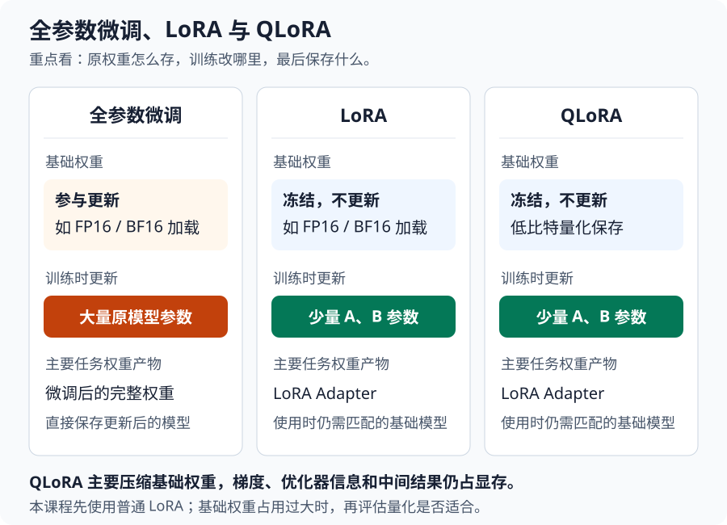

</details>

### 7.1 Quantization and approximation error

Quantization can be understood as follows: prepare a finite set of representative values, replace each original number with a nearby representative value, and save the corresponding index. 4 bits can represent 16 indices, so arbitrary decimals cannot be preserved exactly. During computation, approximate values are restored from the indices; this step is called **dequantization**.

First track only one number: in the evenly spaced quantization teaching example below, the original `0.27` goes through “choose a nearby representative value → save the index and scaling factor → restore,” and the result is `0.304`, a difference of `0.034`.

Why is it no longer `0.27` after restoration? Because what is saved is an index from a finite set of options, not all the information of the number. **Quantization trades space for approximation, and dequantization retrieves an approximate value.** For details on how the index is calculated and how the representative values used by QLoRA differ, see the optional reading below.

<details>
<summary>Optional reading: how a weight becomes a 4-bit index and then is restored</summary>

Expanding the teaching example above, suppose a group of parameters is:

```text
0.27，0.58，-0.75，1.52
```

The number with the largest absolute value in this group is `1.52`. We keep it as the scaling factor, then divide each number by it to scale the values into the range of -1 to 1. Here, we track only the first number `0.27`:

| Step           | Calculation or saved content                    | What this step does                              |
| -------------- | ----------------------------------- | ------------------------------------------- |
| Scale to a unified range | `0.27 ÷ 1.52 ≈ 0.1776`              | First turn it into a decimal convenient for table lookup        |
| Find the nearest representative value | `0.1776 → 0.2`                      | Choose the nearest one among 16 evenly spaced representative values in -1 to 1 |
| Save the index       | `0.2` corresponds to index `9`, binary `1001` | The index needs only 4 bits; the group's scaling factor is also retained      |
| Dequantize         | `0.2 × 1.52 = 0.304`                | Use the index to look up the representative value, then restore the original scale        |

The 16 representative values are indexed from 0 to 15 in ascending order, and index 9 corresponds to `-1 + 9 × 2/15 = 0.2`. The index records “which representative value was chosen,” not the original number `0.1776`.

Therefore, after restoration it is `0.304`, not the original `0.27`, with an absolute error of `0.034`. **Dequantization restores an approximate value, not lossless decompression.** Whether the model can still complete the task must continue to be evaluated; do not judge performance merely because the file is smaller.

This uses an **evenly spaced quantization example**. The **NF4** commonly used in QLoRA is not this evenly spaced table, but a set of non-evenly spaced representative values designed for the weight distribution; here we only use simple numbers to understand “store the index, store the scaling factor, and accept approximation error.” [QLoRA paper](https://arxiv.org/abs/2305.14314)

</details>

<details>
<summary>Extended calculation: why actual 4-bit storage still includes additional overhead</summary>

In addition to the parameter indices, auxiliary information such as the scaling factor used to restore this group of numbers to their original scale must also be saved. Suppose four numbers form a group, and originally they are all saved in FP16, totaling `4×16=64 bit`. Now four 4-bit indices take `16 bit`; if the scaling factor for this group is saved in FP32, an additional `32 bit` is needed, totaling `48 bit`. Even if other overhead is temporarily ignored, the total in this small example is not one quarter of the original.

Grouping four numbers is only for convenient calculation. If instead every 64 numbers share one FP32 scaling factor, the indices and scaling factor together take `64×4+32=288 bit`, which is equivalent to an average of `4.5 bit` per number. This shows that the scaling factor also takes space, but it is amortized across a group of numbers. This still does not count other overhead such as the codebook, nor does it include the double quantization described in the next section.

</details>

### 7.2 QLoRA GPU memory overhead

Returning to the GPU memory breakdown in Section 5: LoRA has already reduced the parameters and related state that need updating, and QLoRA further compresses the **base model weights** that still need to be loaded. The gradients, optimizer state, and intermediate computation results of the Adapter still require space.

During training, the quantized base weights remain frozen. When computation is needed, they are restored to the corresponding computation precision according to the implementation; the trainable LoRA parameters are not simply all converted to 4-bit. Therefore, you cannot assume that training will definitely work just because “the model has been quantized.” Sequence length, per-GPU batch size, the implementation of the training tool, and the actual GPU still determine whether it can run stably.

Also distinguish at which step the error occurs: **if GPU memory runs out before the base weights finish loading**, first check the model size, loading precision, and other processes on the GPU; **if it runs out after the weights are loaded and batch processing begins**, then prioritize checking sequence length and per-GPU batch size. Reducing batch size does not shrink the base weights themselves; detailed troubleshooting is left to Chapter 33.

<details>
<summary>Extended terminology: double quantization and paged optimizer</summary>

QLoRA also adopts two optimizations: **double quantization** further quantizes auxiliary constants such as scaling factors, reducing storage for this additional information; **paged optimizer** migrates optimizer state between CPU and GPU on demand, alleviating peak GPU memory during training, but may increase transfer wait time. Neither changes the update scope of “freezing quantized base weights and training LoRA parameters,” nor do they guarantee that any configuration can fit into GPU memory. [QLoRA paper](https://arxiv.org/abs/2305.14314)

</details>

### 7.3 Choosing between LoRA and QLoRA

| Current situation                                   | What to consider first                                     |
| ------------------------------------------ | ------------------------------------------------ |
| This course's Qwen3-0.6B can complete LoRA on existing GPUs  | Keep LoRA, and first check the training and task results                  |
| After switching to a larger model, just loading the base weights takes up too much memory   | Check the loading precision, then evaluate QLoRA                       |
| Can load the model, but runs out of memory when processing long samples or large batches | First check the length and batch; quantization alone cannot solve this             |
| Need to verify the resource differences between the two methods                 | Fix the model, data, and all other configurations, and separately record the actual resources and results |

<details>
<summary>Check when adjusting: what results should be compared when switching from LoRA to QLoRA</summary>

Change the quantization level in the current configuration from `none` to an appropriately configured 4-bit load. The main change is in how the base weights are stored and computed; what is still learned is the LoRA branch. The additional quantization, dequantization computation, and specific implementation will affect speed, so QLoRA may also be slower. Whether the approximation error it introduces affects keyword selection still needs to be checked through the answers.

For the 0.6B model in this course, which can already complete ordinary LoRA, first complete training and effect checks with the existing configuration. In the future, when switching to a larger model, if weight occupancy becomes the main limitation, then compare QLoRA: verify whether quantization actually takes effect, record whether it can run completely, the memory usage, and the elapsed time, and finally compare the loss and answers on the same validation data. **Being able to fit the model, having acceptable runtime cost, and having acceptable task performance are three results that need to be checked separately.**

</details>

Quantization dependencies, configuration, and resource comparison are left for the optional Sections 2.5 and 2.6 of [Chapter 33](33-%E5%BE%AE%E8%B0%83%E6%98%BE%E5%AD%98%E4%BC%98%E5%8C%96%E4%B8%8E%E5%A4%9A%E5%8D%A1%E8%AE%AD%E7%BB%83.md). For how to organize the results, see Section 5.5 of that chapter.

---

## 8. Training Configuration and Memory Estimation

**What to master first in this section:** Using Section 8.1 as a reference, read the configuration as a complete training arrangement. The calculator in Section 8.2 is an optional tool for when you change configurations; estimates still need to be verified on actual hardware.

Now return to the task at the beginning of this chapter: use the data cleaned and split in Chapter 29 to perform LoRA fine-tuning on `Qwen/Qwen3-0.6B` on AutoDL's existing single V100-32GB GPU. Below, we do not add new parameters, but instead try to read the entire configuration as a training arrangement.

### 8.1 First-Round Training Configuration

Section 2 first introduced the training page and the three batch parameters. Now return to `案例与源码-4-微调/configs/keywords_clean_train.yaml` and read the entire set of settings together:

First, use the five settings from the beginning of this chapter to state the arrangement clearly: 4 samples per batch, update after accumulating 8 batches, train on 1,600 training samples for 3 epochs; the learning rate follows the `5e-5` schedule, and each complete training sequence retains at most 2048 tokens. The expected number of updates is 50 steps per epoch, for a total of 150 steps.

Then verify two conditions: use a matching model and template, and use the verified FP16 on the V100. LoRA continues to use the course settings for now; logging, validation, and saving intervals are part of the observation and retention arrangement.

<details>
<summary>For runtime reference: complete fields and values for the first-round training</summary>

| Chinese name and configuration field                                                                                               | Value used this time              | Corresponding meaning learned earlier                                                                                           |
| ---------------------------------------------------------------------------------------------------------------- | --------------------- | ------------------------------------------------------------------------------------------------------------ |
| Model path<br>`model_name_or_path`                                                                                 | `Qwen/Qwen3-0.6B`     | Specifies the model to be fine-tuned                                                                                             |
| Chat template<br>`template`                                                                                           | `qwen3_nothink`       | Organizes the input and answer according to the model's requirements                                                                                     |
| Thinking mode<br>`enable_thinking`                                                                                    | `false`               | Requests that thinking be disabled; actual processing depends on the template, see [the Chapter 32 comparison](32-%E5%BE%AE%E8%B0%83%E6%95%88%E6%9E%9C%E8%AF%84%E4%BC%B0%E4%B8%8E%E6%A8%A1%E5%9E%8B%E9%83%A8%E7%BD%B2.md?id=_24-from-single-item-observation-to-batch-testing) |
| Training set<br>`dataset`                                                                                              | `keywords_train`      | 1,600 samples, used to update parameters                                                                                   |
| Validation set<br>`eval_dataset`                                                                                         | `keywords_validation` | 200 samples, used for checks during training                                                                                   |
| Automatic validation split<br>`val_size`                                                                                       | `0`                   | A separate validation file already exists, so no additional split is performed                                                                               |
| Truncation length<br>`cutoff_len`                                                                                         | `2048`                | Upper limit on the number of tokens per training sequence                                                                                  |
| Per-device batch size<br><code style="white-space: normal; overflow-wrap: anywhere;">per_device_train_batch_size</code> | `4`                   | Each GPU processes 4 samples per micro-batch                                                                                |
| Gradient accumulation steps<br><code style="white-space: normal; overflow-wrap: anywhere;">gradient_accumulation_steps</code>   | `8`                   | Update parameters once after accumulating 8 micro-batches                                                                                |
| Number of epochs<br>`num_train_epochs`                                                                                   | `3`                   | Learn the training set 3 times, for an expected total of 150 update steps                                                                         |
| Optimizer<br>`optim`                                                                                                | `adamw_torch`         | Use PyTorch's AdamW to update parameters                                                                               |
| Learning rate<br>`learning_rate`                                                                                        | `5.0e-5`              | The learning rate reached at the end of warmup in this example                                                                                   |
| Learning rate scheduler<br>`lr_scheduler_type`                                                                              | `cosine`              | Reduce the learning rate along a cosine curve after warmup                                                                                   |
| Warmup steps<br>`warmup_steps`                                                                                       | `5`                   | Gradually increase the learning rate during the first 5 update steps                                                                                  |
| FP16 mixed precision<br>`fp16`                                                                                          | `true`                | Enable the mixed-precision training used this time on the V100                                                                             |
| BF16 mixed precision<br>`bf16`                                                                                          | `false`               | BF16 is not enabled this time                                                                                              |
| LoRA rank<br>`lora_rank`                                                                                           | `8`                   | Set the intermediate width of the added branch                                                                                       |
| LoRA scaling factor<br>`lora_alpha`                                                                                    | `16`                  | Combined with rank, scales the branch result by `alpha/r`                                                                         |
| LoRA dropout<br>`lora_dropout`                                                                                  | `0`                   | Do not randomly drop branch inputs                                                                                           |
| LoRA target modules<br>`lora_target`                                                                                   | `all`                 | Add branches to the applicable linear layers identified by the tool                                                                               |
| Logging interval<br>`logging_steps`                                                                                      | `5`                   | Record a log every 5 update steps                                                                                    |
| Validation interval<br>`eval_steps`                                                                                         | `50`                  | Check the validation loss every 50 update steps                                                                               |
| Saving interval<br>`save_steps`                                                                                         | `50`                  | Save a checkpoint every 50 update steps                                                                                 |

</details>

The 200 test samples are reserved for the final check and do not participate in this round of training or checkpoint selection. Chapter 31 will map this configuration to the WebUI input locations and provide an optional command-line entry.

The rationale for the values in this configuration needs to be understood separately: the model and template must match, the compute precision must suit the hardware, and the length must be able to preserve complete samples; these all have clear check conditions. Batch, learning rate, number of epochs, and LoRA parameters together form a starting arrangement that has already been run. Existing records make reproduction and comparison convenient, but they cannot be used to claim that this is the optimal combination.

<details>
<summary>Optional diagram: correspondence between the entire training configuration and the training outputs</summary>

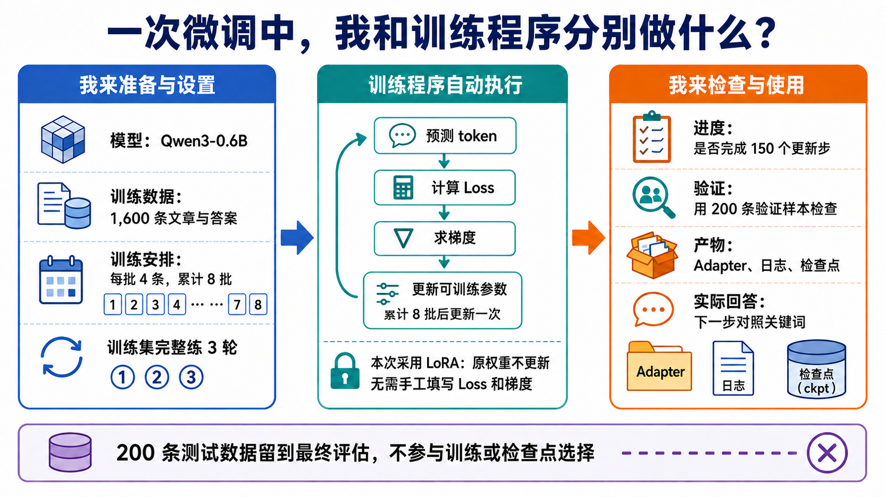

</details>

**Do not look back at the previous text yet; try to explain this training to someone else:**

1. How many samples are used for training, validation, and testing respectively? Which data will cause parameters to be updated?
2. Only 4 samples are processed at a time, so why is it not 400 updates per epoch? What is planned at step 50?
3. After using LoRA, what do you get when training is complete? Once you have this file, does it prove that keyword extraction has improved?

<details>
<summary>Reference answer: connect the configuration into a complete training description</summary>

We train on 1,600 articles and reference answers, updating only the LoRA branches of the selected layers. Each batch processes 4 samples, and after accumulating 8 batches, that is, 32 samples, we update once; each epoch has 50 steps, and 3 epochs total 150 steps. Logs are recorded every 5 steps, and every 50 steps we use the 200 validation samples to check and save a checkpoint. The validation process does not update parameters, but its results are used to select checkpoints; the 200 test samples remain reserved.

Training produces the Adapter, logs, and checkpoints. The Adapter needs to be used together with the corresponding original model; next, you must also compare the actually generated keywords. You cannot declare that the task performance has improved just because the Loss decreased or the files were saved successfully.

</details>

After you can explain this arrangement, do one more configuration judgment exercise: **Suppose the model loads successfully, but there is not enough memory when processing batches. A fellow student suggests simultaneously changing batch to 2, learning rate to `1e-4`, rank to 16, and truncation length to 512. How would you handle this?** First state which part of memory usage the error corresponds to, and then decide which changes to keep.

<details>
<summary>Reference judgment: every change must have a purpose and a basis for checking</summary>

First change batch to 2, and use accumulation of 16 along with it, maintaining the effective batch size of 32; keep the course values for learning rate and rank. What needs to be solved this time is the space problem of processing samples simultaneously. Increasing the learning rate does not reduce usage, and increasing rank would also increase the overhead related to trainable parameters.

Keep the length at 2048 for now. In the existing records, the longest sample is 957, and directly reducing it to 512 would prevent some samples from being preserved completely. If it really does need to be shortened later, first check the truncated inputs and answers; do not lose the source of the keywords just to get through the first batch.

Then check the startup logs: the effective batch size is still 32, and the total number of update steps is still 150. Observe whether the original error location passes, and continue looking at longer batches and the validation process, recording memory usage and elapsed time; if an error still occurs, follow Chapter 33 to check other memory usage. After the resource problem is solved, the actual answers are still verified according to Chapter 32.

</details>

Before modifying the configuration, you can record the purpose of the experiment in one sentence: "What am I going to change, which step do I hope it will affect, and what results will I use to judge it afterward." For example, when comparing learning rates, fix the data, model, template, and other training settings; when comparing rank while maintaining the scaling factor before addition, handle alpha accordingly as described in Section 6.4. **One comparison should center on one clear question, and record the changes in the relevant settings.** Different experiments should start from the same agreed starting point and use different output directories so that the results can be matched up.

### 8.2 Using the Memory Calculator

**This subsection is optional.** If you are following the existing course configuration for the first time, you can continue to Section 9 first. Later, when changing models or training settings, use the calculator for a rough estimate, and then verify it through an actual trial run on the machine.

Remember one boundary: the calculator's estimated value is not equal to the real peak value, nor can it prove that the GPU precision is compatible or that training will definitely complete.

<details>
<summary>Optional operation: fill in the memory calculator, understand the results, and compare them with an actual run</summary>

Open the [ApX memory calculator](https://apxml.com/zh/tools/vram-calculator), select "Fine-tuning" and "LoRA", and then fill in the model and main training parameters. Do not use the "Inference" page to estimate training, because it does not include the same training state.

Referring to the table above, fill in the model Qwen3-0.6B, rank 8, batch 4, length 2048, and gradient accumulation 8:

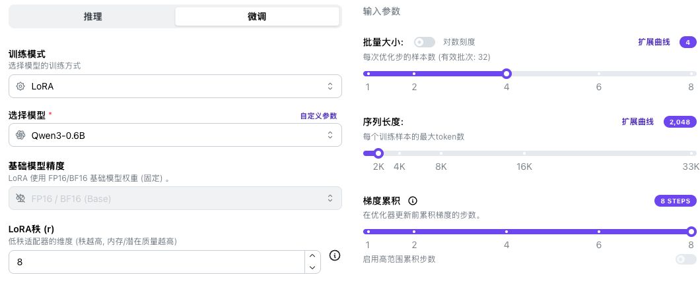

In the figure, the batch tooltip mentions "each optimization step". When reading it, make a distinction: the `4` in the input box is the sample count of each small batch on a single GPU. Only after combining it with `8` accumulation steps do you get the effective batch `32` for each parameter update.

There are also three points worth noting in the calculator:

- The precision is uniformly displayed as FP16/BF16; this V100 configuration uses FP16. You cannot judge hardware compatibility based on this combined option.
- When there is no V100 preset, select a single GPU and customize the 32 GB VRAM capacity; this only matches capacity and cannot be used to estimate V100 training speed.
- For the optimizer, choose AdamW, with gradient checkpointing enabled and a page ratio of 100%. This is the reduction in intermediate result storage mentioned in Section 5.3, not the frequency at which training files are saved.

The result for the same set of settings is approximately **9.8 GB**:


This figure is a budget obtained by adding up line items according to the page assumptions: approximately 1.2 GB for model weights, approximately 7.1 GB for intermediate results, approximately 0.01 GB for the LoRA optimizer and gradients, and approximately 1.5 GB for framework overhead, totaling approximately 9.8 GB. Each item is an estimate from the calculator, not a value measured during training.

**Why did the actual sampling in Chapter 33 reach approximately 27.92 GiB?** The two records have different scopes:

| Comparison item       | The calculator's 9.8 GB                                                 | The 27.92 GiB from the batch 4 control experiment                               |
| --------------------- | ----------------------------------------------------------------------- | ------------------------------------------------------------------------------ |
| How it was obtained   | Each budget item estimated from inputs such as length 2048 and page formulas | Ran LLaMA-Factory and sampled the entire GPU's used VRAM every 200 milliseconds |
| What conditions it includes | Uses assumptions such as default page padding and runtime overhead; no separate entries for alpha or target | Includes actual allocation and caching during model loading, training, validation, and saving |
| What the value represents | The total of a simplified budget                                                  | The highest sampled value during the entire run: 28,588 MiB, approximately 27.92 GiB, or approximately 29.98 GB     |

Actual software requests temporary space at different stages and retains some cache; the calculator's fixed budget cannot fully reflect this process. The existing records do not include per-item VRAM tracking, so the difference cannot yet be attributed to any single component. Use estimates to screen configurations when choosing settings, but whether it can run stably depends on the [actual resource records in Chapter 33](33-%E5%BE%AE%E8%B0%83%E6%98%BE%E5%AD%98%E4%BC%98%E5%8C%96%E4%B8%8E%E5%A4%9A%E5%8D%A1%E8%AE%AD%E7%BB%83.md?id=_26-how-to-determine-whether-an-adjustment-is-effective).

After reading this set of screenshots, you can use what you have learned earlier to check your understanding: if the model and precision remain unchanged and you only change the batch from 4 to 8, the model weights will not double accordingly; the main increase is the computational footprint of processing samples in parallel. If you only raise the length limit, the impact still depends on the actual sample lengths, the padding method, and the calculator's assumptions.

When you need to estimate a new configuration, you can first change only the batch and record the new reading; then restore the original value and compare the length limit. If the calculator gives a higher estimate as the limit increases, first check whether it calculates based on the length you entered, and do not directly apply it to the current actual data with a maximum of 957 tokens. Estimates help screen candidate setups; which setting to actually keep still needs to be compared against the actual memory footprint, time cost, and sample completeness.

**Estimation example: why inference and full-parameter training of the same 8B model differ in memory usage**

The following compares estimates from the same calculator under two input conditions to help understand the differences in the computation process:

| Mode                  | Estimated input conditions                                                       | Page estimate |
| --------------------- | -------------------------------------------------------------------------------- | ------------- |
| Inference             | Qwen3-8B, FP16 weights, FP16/BF16 KV cache, batch 1, length 1024, concurrency 1 | 17.2 GB       |
| Full-parameter fine-tuning | Qwen3-8B, FP16/BF16, batch 1, length 1024, gradient accumulation 1                | 143.4 GB      |

Full-parameter training also needs to save a large amount of gradients and optimizer states, so the estimate increases significantly. 143.4 GB is not the VRAM requirement for 8B LoRA, nor can the ratio between the two be treated as a fixed rule for all models.

</details>

---

## 9. Training Logs and Checkpoints

**What to master first in this section:** See how far training has progressed, whether validation results have improved, and where the outputs are saved. After the training Loss decreases, you still need to inspect the actually generated keywords.

The configuration determines expectations, and the logs tell us what actually happened. The following uses a 150-step training run with the `keywords-clean` data as an example: this chapter teaches you how to read logs, Chapter 31 teaches you how to run training, and Chapter 32 will examine the corresponding Adapter's answers.

First, look at three locations in chronological order: **a training log appears at step 5, step 50 completes the first epoch with validation and saving, and step 150 completes three epochs, after which checkpoints are selected based on validation results.** The logs, curves, and file lists below are read in this order.

### 9.1 Reading a Training Log Entry

After training starts, the interface log area or terminal first lists the training schedule. The following excerpt shows key fields from the sample log, omitting the time and log prefix:

```text
Num examples = 1,600
Num Epochs = 3
Instantaneous batch size per device = 4
Total train batch size (w. parallel, distributed & accumulation) = 32
Gradient Accumulation steps = 8
Total optimization steps = 150
```

First find `Num examples = 1,600`, `Num Epochs = 3`, and `Total optimization steps = 150` to correspond with the calculations in Section 2. The effective batch corresponds to `Total train batch size = 32`; the `21/150` in the progress bar indicates that 21 update steps have been completed.

In the sample `trainer_state.json`, step 5 contains the following information. Only four fields are excerpted here, and the Loss is kept to four decimal places:

```json
{
  "step": 5,
  "epoch": 0.1,
  "loss": 4.1185,
  "learning_rate": 0.00004
}
```

| Field                     | What this record means                               |
| ------------------------- | ---------------------------------------------------- |
| `step: 5`                | 5 parameter update steps completed                          |
| `epoch: 0.1`             | The first epoch is about 10% complete; each epoch has 50 steps in this run, and 5 ÷ 50 = 0.1 |
| `loss: 4.1185`           | The aggregated training loss within the most recent recorded interval                   |
| `learning_rate: 0.00004` | The learning rate used for the 5th update, i.e., `4e-5`             |

In this run, `logging_steps: 5`, meaning a record is written every 5 update steps. Combined with gradient accumulation of 8, it can be read as: under normal circumstances, after processing 40 small batches, the next training loss record appears.

<details>
<summary>For later review when tuning: does less frequent logging mean fewer training updates</summary>

If you only change the logging interval from 5 to 10, the normal record points change from 5, 10, 15... to 10, 20, 30..., and the aggregation interval for each training Loss changes accordingly. The number of parameter updates has not been halved as a result; you are simply observing more sparsely. Fewer log points may miss brief fluctuations; do not mistake fewer record points and a smoother-looking curve for the model learning more stably.

</details>

At this point, first confirm that progress is increasing, the Loss is a valid number, and the learning rate changes according to the warmup and decay schedule. The precise timing of a specific step's record can be checked later when needed.

<details>
<summary>For later review when checking logs: why is the learning rate at warmup step 5 equal to 4e-5</summary>

**The configuration is `5e-5`, so why does step 5 record `4e-5`?** This run uses 5 warmup steps, and the log records the learning rate used for the current update. Before the 5th update begins, the scheduler has already advanced 4 times, so the learning rate is `5e-5 × 4/5 = 4e-5`; only after this update completes does the scheduler advance to 5, preparing `5e-5` for the next update. This is the recording and scheduling order of [Transformers 5.8.0](https://github.com/huggingface/transformers/blob/v5.8.0/src/transformers/trainer.py#L1766-L1786) in this run.

</details>

The log may also include `grad_norm`, which is an aggregate measure of the overall gradient magnitude and can be used to investigate gradient anomalies.

**When encountering anomalies, first identify which kind it is.** You can choose a direction for investigation based on the following symptoms:

| What you see                       | What to check first                                                                                  |
| ---------------------------------- | ---------------------------------------------------------------------------------------------------- |
| Loss fluctuates between finite values | Judge based on multiple record points and validation performance; batches differ in difficulty, and a single increase does not prove training has failed |
| Loss or gradients repeatedly show `NaN` or `Inf` | Keep the logs and configuration near the first anomaly, and check the data, valid answer labels, learning rate, and numerical precision; do not try to fix it by adding more epochs |
| `grad_norm` is occasionally very large             | Compare the anomalous batch with the records before and after it; this value is affected by the model, data, and statistical method, and there is no universal normal threshold across tasks            |
| The error message contains `CUDA out of memory`    | Check VRAM usage according to the error stage in Chapter 33; this is a different problem from values becoming NaN                                 |

`NaN` indicates that the computation did not produce a valid number, and `Inf` indicates an infinite value, which may be related to issues such as numerical overflow. First review the actual input, the truncated answer, and `labels` from Section 4.2 to confirm that there are still answer positions involved in the computation; then check the precision and the original configuration. Keep the problematic version and change only one candidate factor at a time so that you can determine which treatment is effective. If the anomaly persists, stop the current run and investigate; do not directly treat the saved weights as a valid result.

<details>
<summary>For later review when troubleshooting: gradient clipping, FP16, and anomalous values in the log</summary>

**Gradient clipping** is a method of limiting the overall magnitude of gradients before updating parameters. Taking the norm-based clipping used in ordinary single-GPU training in this course as an example, when the overall gradient magnitude exceeds `max_grad_norm`, the program scales down the gradient proportionally; it limits the gradient, not pressing the Loss down to this value.

The `grad_norm` recorded by Transformers 5.8.0 in this course comes from the norm before clipping. Therefore, assuming the threshold is `1.0` and the log shows `4.0`, it does not mean that clipping is not working. The numbers here are illustrative examples; the clipping and recording order can be checked in the [corresponding version's source code](https://github.com/huggingface/transformers/blob/v5.8.0/src/transformers/trainer.py#L2496-L2500).

FP16 has a limited numerical representation range. Mixed-precision training typically uses **gradient scaling**, which first amplifies the loss to reduce underflow of very small gradients, and then restores the gradient scale before the update; it operates at a different stage from clipping and cannot fix erroneous data or guarantee that any model is suitable for FP16. Precision troubleshooting still needs to follow the GPU compatibility conditions in Chapter 31; you cannot simply switch to BF16 on a V100. See the [PyTorch mixed precision documentation](https://docs.pytorch.org/docs/2.14/amp.html#gradient-scaling) for details.

Also note that training tools may filter non-finite Loss values in log summaries. The `logging_nan_inf_filter` in this course's version only affects log statistics and is not responsible for fixing gradients; a normal-looking curve cannot replace inspection of anomalous logs and actual answers. See the [training parameter source code](https://github.com/huggingface/transformers/blob/v5.8.0/src/transformers/training_args.py) for the specific definition.

</details>

### 9.2 Training Loss and Validation Loss

Every time a batch of training data is processed, the program computes the loss and participates in the parameter update; **during validation, the loss is computed on another dataset, and no parameter update is performed**.

In this run, `eval_steps: 50` means that after every 50 update steps, a check is performed using all 200 validation samples. Therefore, there is exactly one validation at the end of each epoch:

| Update step | Training progress    | Validation Loss |
| ------ | ----------- | --------- |
| 50     | End of round 1 | 1.7238    |
| 100    | End of round 2 | 1.5951    |
| 150    | End of round 3 | 1.5880    |

These three validation runs use the same data. From step 50 to step 100, validation loss decreases by about `0.1287`; from step 100 to step 150, it decreases by about `0.0071`. The improvement in the last 50 steps is smaller, but three points alone cannot prove that more training is definitely better or that overfitting has already occurred.

What this table supports is: **in this training run, later checkpoints have lower loss on the same validation set.** To decide whether another round of training is worthwhile, the next step is to have these checkpoints answer the same batch of validation inputs under identical generation settings, then check for missing words, names, and formatting. Whether the extra computation time also reduces task errors requires this step to answer.

For example, suppose candidate A has lower validation loss, while candidate B misses fewer complete names in the keyword check. How should you choose? First confirm that both use the same validation inputs, templates, and generation settings, then compare them against the pre-defined task acceptance requirements. **“The best checkpoint selected by loss” only means it is best on this selection metric.** If you instead select models by task metrics, record the new selection rationale and leave final verification to independent testing.

<details>
<summary>For log inspection later: why the final loss differs from the full-run train_loss</summary>

When training ends, `train_loss` also appears. It is not the same statistical interval as the `loss` in the intermediate logs:

| Record                    | This run's value | Statistical meaning                   |
| ----------------------- | -------- | -------------------------- |
| `loss` at step 150      | 1.4353   | Training loss for the most recent logging interval |
| `train_loss` in the final summary | 1.8547   | Aggregated training loss across the entire run       |
| `eval_loss` at step 150 | 1.5880   | Validation loss for this round's validation data       |

Therefore, “the last loss is 1.4353, so why is the final summary 1.8547” is not contradictory; earlier higher losses are also included in the full-run statistics. These are not percentages, nor are they keyword accuracy.

</details>

Values in the table are kept to four decimal places. If you need to recalculate, check `trainer_state.json` and `train_results.json` in the accompanying `results/keywords-clean/training/`; when reading, first clarify the statistical scope of each field.

### 9.3 Loss Curves and Common Patterns

Below are the training curve and validation curve from the example training run:

**Training curve: recorded every 5 update steps.**


**Validation curve: actually checked only at steps 50, 100, and 150, for a total of three recorded points.**

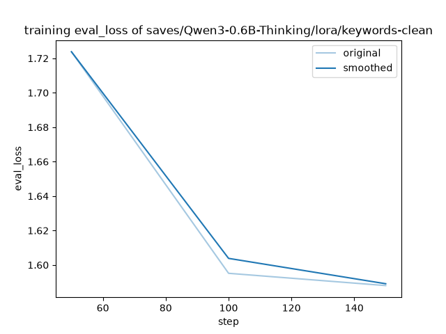

_Lines connecting validation points are drawn only to show the trend; there are no additional validation records in between._

The horizontal axis of the curves represents training progress, and the vertical axis is loss. In each figure, the lighter `original` is the raw record, and the darker `smoothed` is the smoothed line. Both lines come from the same type of loss; one is not training and the other validation. Smoothing is only for observing trends; no additional training or validation run is performed. **The vertical axis ranges of the two figures are different, so you cannot directly compare the magnitude of decline by the steepness of the lines.**

First observe the overall trend, then go back to the logs to locate where changes occurred:

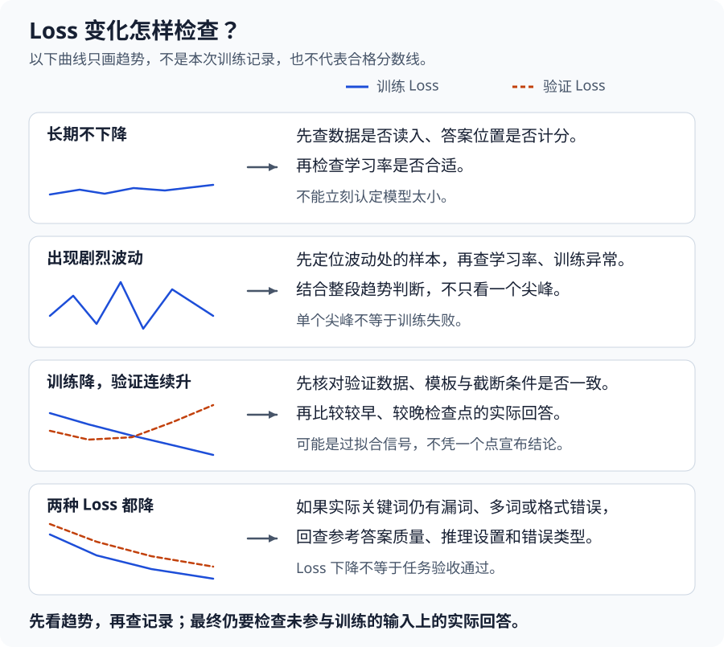

_Figure: illustrative teaching diagram, not the actual training curve from this run. The blue solid line represents training loss, and the orange dashed line represents validation loss; the two rows without a validation line only discuss phenomena in the training logs._

Do not set a passing threshold such as “loss must drop to 0.1” for all tasks. What is compared here is how the model predicts the reference answers; actual keywords still need to be checked separately.

**After loss drops, you still need to check actual answers.** The example Adapter can output in semicolon-separated format for an article on mine cooling, but compared with the reference answer it still misses words such as “refrigeration cooling” and “enthalpy difference”. Chapter 32 will [break down this answer item by item](32-%E5%BE%AE%E8%B0%83%E6%95%88%E6%9E%9C%E8%AF%84%E4%BC%B0%E4%B8%8E%E6%A8%A1%E5%9E%8B%E9%83%A8%E7%BD%B2.md?id=_23-comparing-the-original-model-and-the-adapters-responses), and then use batch evaluation to determine whether the problem is widespread.

#### 9.3.1 Identifying and Handling Overfitting

First, practice reading a set of changes. **The table below contains constructed numbers for explanation, not real run results, nor a passing score.** Assume that at the end of each round, loss is computed the same way and the same validation set is used:

| Training progress    | Training Loss | Validation Loss | What can be observed                                    |
| ----------- | --------- | --------- | ------------------------------------------------- |
| End of round 1 | 1.8       | 2.0       | Keep the first checkpoint result                                |
| End of round 2 | 1.4       | 1.6       | Both drop; predictions on validation data are also improving              |
| End of round 3 | 1.1       | 1.7       | Training keeps improving, validation starts to worsen; further checking is needed          |
| End of round 4 | 0.9       | 1.9       | Validation worsens for two consecutive rounds; do not choose round 4 just because training loss is lower |

After round 2, the model fits the training answers more closely, but the loss on validation questions rises instead. This is a signal that overfitting needs to be checked. The key is **the trend of both sides within the same training process**, not requiring the two losses to be equal, nor drawing conclusions from a single difference.

When you encounter this pattern, check in the following order:

1. **First confirm the comparison conditions are unchanged.** Have you always used the same validation data, the same templates and preprocessing? Are articles or reference answers truncated? Rule out data and processing errors first.
2. **Then look at actual answers.** Use earlier and later checkpoints to answer the same batch of validation inputs under identical generation settings. Compare against reference answers and check for newly appearing missing words, extra words, and formatting errors; do not just stare at the two curves.
3. **Adjust based on validation results.** If later checkpoints are worse in both validation loss and actual answers, keep the earlier checkpoint and reduce the number of training rounds; then check whether the training data is overly repetitive, too narrow in subject matter, or contains incorrect answers, rather than continuing to add rounds.

These choices all use the validation set, and **the test set is not used to repeatedly select checkpoints**. The test set remains reserved for final comparison after the approach is determined, as agreed in Chapter 29.

Returning to the real log example in this chapter: all three validation losses are declining, so the pattern from the last two rounds of the table above does not apply to it. A smaller improvement also does not mean overfitting has already occurred. The next section looks at how the example configuration saves and selects checkpoints.

### 9.4 Training Checkpoints and Adapter

Saving the training state at regular intervals produces an archive called a **training checkpoint**. In this run, `save_steps: 50` actually saved `checkpoint-50`, `checkpoint-100`, and `checkpoint-150`, corresponding respectively to the states after 50, 100, and 150 updates.

Matching the validation table in Section 9.2 with the archives explains why “validation” and “saving” are configured together: at steps 50, 100, and 150, there is a validation result for each step, and also a loadable model archive for each.

If both the validation and saving intervals are changed from 50 to 25, this 150-step training run would check and save at steps 25, 50, 75, 100, 125, and 150. Candidate checkpoints become denser, but validation computation, file writes, and disk overhead for retaining archives may also increase. Neither frequency directly changes the learning rate or batch of each parameter update; when adjusting, you must also satisfy the tool's interval requirements for best-checkpoint selection. Chapter 31 keeps the two consistent.

The configuration also sets `load_best_model_at_end: true`: after training ends, select the checkpoint with the lowest validation loss according to `eval_loss`. In this run, the lowest value happens to occur at step 150, so `checkpoint-150` is selected. If the lowest value occurs at an earlier checkpoint, that one should be selected according to the configured rule, rather than always choosing the last one.

When following along, checkpoints are saved in the training output directory configured in Chapter 31. For now, just understand the two types of content; specific file inspection and downloading are left to Chapter 31:

- `adapter_model.safetensors` and `adapter_config.json`: save the LoRA incremental weights and configuration, and require the matching base model when loading.
- `checkpoint-*`: in addition to the corresponding Adapter, also saves the optimizer, scheduler, training state, and so on, for resuming training or inspecting the process; copying only one copy of the incremental weights does not equal a complete resumable training archive.

The example Adapter weights are about 20 MB, saving only the newly added LoRA weights; this does not mean the complete Qwen model is only this large. When downloading and saving, you still need to distinguish between the “Adapter for loading” and the “complete checkpoint for continuing training”.

At inference time, you can load the base model together with the Adapter, or, in supported configurations, merge the incremental weights into the corresponding base weights and then export a complete model:

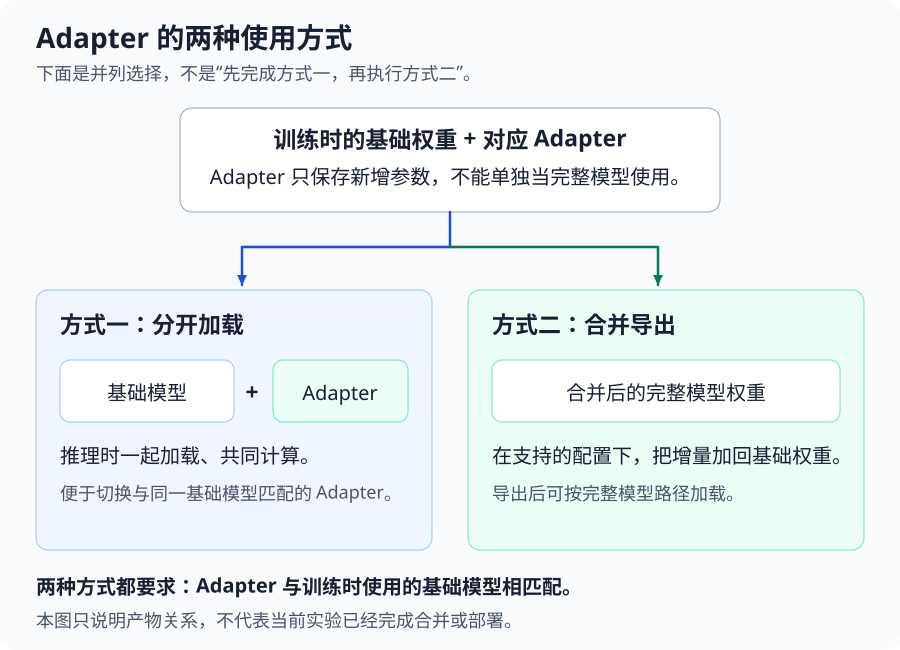

The figure shows the relationship between the two artifacts. Chapter 31 completes training and file saving first, and Chapter 32 actually [loads, compares, and exports models](32-%E5%BE%AE%E8%B0%83%E6%95%88%E6%9E%9C%E8%AF%84%E4%BC%B0%E4%B8%8E%E6%A8%A1%E5%9E%8B%E9%83%A8%E7%BD%B2.md).

---

**Chapter review questions:**

1. In keyword SFT, what is the model predicting? How do loss, gradients, and the optimizer use the reference answers to update parameters?

   **Reference thoughts:** The model predicts subsequent tokens based on the article, task instructions, and the preceding reference answer fragments. Cross-entropy measures loss using the probability the model assigns to the correct token; backpropagation uses this to compute gradients for trainable parameters, and the optimizer then updates parameters according to its rules. Loss and gradients are computed by the program, while settings such as learning rate are configured by us; training does not first generate the entire answer and then count how many keywords are wrong.

2. In this lesson, train_on_prompt is turned off. Why must the user article still be retained? If the reference answers contain unfounded keywords, what does a decrease in loss mean?

   **Reference thoughts:** Turning off this setting means the prediction positions corresponding to user content are not directly included in the loss, but the article still participates in computation as context and takes up sequence length. Incorrect references also become learning targets, and training may increase the predicted probability of those incorrect words. Therefore, a decrease in loss only means the model is closer to the current training objective; you still need to check the quality of the reference answers and the actual generation results.

3. With a single GPU, no packing, all 1,600 samples retained, batch of 4, gradient accumulation of 8, and 3 training rounds: what are the effective batch size and total number of update steps? After changing only batch to 2, how can you maintain the original update schedule?

   **Reference thoughts:** The original effective batch size is 4×8=32, each round is 1,600÷32=50 steps, and 3 rounds total 150 steps. If only batch is reduced, the effective batch size becomes 16 and the total number of steps becomes 300; validation every 50 steps also becomes once every half round. Increasing accumulation to 16 at the same time restores an effective batch size of 32 and a total of 150 steps, but runtime and numerical results still need to be compared in practice.

4. What do learning rate, warmup, and decay control respectively? The configuration sets learning_rate=5e-5, so why does the learning rate still change in the logs?

   **Reference approach:** The learning rate controls the parameter update step size; warmup causes the learning rate to gradually increase from a smaller value at the start, while decay causes it to gradually decrease later. This lesson uses both a cosine schedule and 5 warmup steps. 5e-5 is the value reached at the end of warmup, and it then changes according to the schedule. A larger learning rate does not necessarily mean better learning; whether it is appropriate must be judged together with training stability and validation responses.

5. Where is most training VRAM used? Adapter files are very small, so why can VRAM still be insufficient? What part does gradient checkpointing save?

   **Reference approach:** It mainly includes model weights, gradients, optimizer states, and intermediate computation results, as well as runtime overhead. Adapter files only reflect part of the training artifacts and do not include the space required for the entire computation. Gradient checkpointing saves fewer intermediate results and recomputes them when needed, trading extra computation for VRAM; it is not the same thing as training checkpoints written to disk by step count.

6. How many bytes do FP32, FP16, and BF16 each occupy to store a number? Why does enabling FP16 not mean the VRAM for the entire training run is halved, and why is it different from 4-bit quantization?

   **Reference approach:** They occupy 4, 2, and 2 bytes respectively; FP16 and BF16 differ in numerical range and precision allocation, and hardware support must also be checked when choosing. Mixed precision allows different computations or states to use different precisions, and some states may still remain in FP32. The entire training run also has other consumption. 4-bit quantization uses fewer bits to approximately store the base weights, and does not mean that all training computations or LoRA parameters become 4-bit.

7. Which parameters do full fine-tuning, LoRA, and QLoRA update respectively? After LoRA freezes the original weights, why can it still change the output, and why does it still need the base model?

   **Reference approach:** Full fine-tuning updates the original model parameters; LoRA freezes the base weights and mainly trains newly added low-rank branches, whose results are added to the original layer results and thereby affect the output. QLoRA further quantizes the base weights to low-bit precision on this basis while still training the LoRA parameters. LoRA reduces the gradients and optimizer states for a large number of base parameters, but the base model still participates in computation; quantization further saves weight storage while also introducing approximation error.

8. In the configuration, what do rank=8, alpha=16, target=all, and dropout=0 mean respectively? Why does increasing rank not necessarily lead to better results?

   **Reference approach:** rank controls the intermediate width of the branch. Standard LoRA scales the update by alpha/r, which is 2 here. target determines where the branches are added, and all refers to the applicable linear layers recognized by this tool. dropout=0 means branch inputs are not randomly masked. They affect different parts. Increasing rank increases trainable parameters, but does not guarantee better task performance; when adjusting it, record other settings and compare validation results.

9. Does cutoff_len limit the number of characters or the number of tokens? The current longest training sequence is 957 tokens. If the limit is changed from 2048 to 4096 or 512, how should each be judged?

   **Reference approach:** It limits the length of the preprocessed token sequence, which includes the task, article, answer, and template markers. 2048 can already contain the current samples. Changing it to 4096 will not add content out of thin air, and VRAM still depends on the actual length and padding; reducing it to 512 may truncate long samples, so the article, answer, and number of retained samples must be checked. After changing the data, template, or tokenizer, the statistics should be recomputed.

10. What do training loss and validation loss reflect respectively? If training loss keeps decreasing while validation loss keeps increasing, how should the follow-up plan be chosen?

    **Reference approach:** The former comes from the data participating in learning, while the latter comes from validation data not used for parameter updates. A persistent divergence may suggest overfitting, but the data and preprocessing should also be checked first. Compare the responses of earlier and later checkpoints on the same batch of validation inputs, and then decide whether to reduce the number of epochs or adjust training. A lower loss does not directly prove that keywords are more accurate, and the test set should not be used for repeated parameter tuning.

<details>
<summary>Advanced exercises: LoRA computation and parameter changes</summary>

1. In the common default LoRA initialization, A is random and B is zero. Why does the branch not change the original output at the beginning? Is making both A and B zero equivalent?

   **Reference approach:** When B is zero, the product update is zero, but training can first update B and then gradually learn the branch. If both matrices are zero, the conventional gradient updates for this product structure cannot learn the branch. This discussion concerns the common default approach in Section 6.2; other initialization methods should be understood according to their corresponding designs.

2. Change rank from 8 to 16 while keeping alpha at 16. How does the standard LoRA scaling coefficient change? How can the original coefficient be maintained?

   **Reference approach:** alpha/r changes from 2 to 1. If it should remain 2, alpha can be changed to 32. Increasing rank also increases the branch parameter count. Maintaining the scaling coefficient does not mean the output or task performance remains unchanged, so validation results and cost must still be compared.

3. With a total of 150 steps, if warmup is changed from 5 steps to 15 steps, how will the training arrangement change? How can one judge whether this adjustment is helpful?

   **Reference approach:** Warmup is included within the total budget. The total remains 150 steps, and the subsequent decay phase changes from 145 steps to 135 steps. It is certain that the learning rate ramp-up is lengthened; whether training is more stable and whether task performance improves must be compared through logs and validation responses under the same starting point and other conditions.

4. If LoRA dropout is changed from 0 to 0.1, will some weights of A and B be deleted? Is random dropping still applied during inference?

   **Reference approach:** During training, it randomly masks part of the branch inputs. The weight dimensions and parameter counts of A and B remain unchanged, and it is turned off during normal inference. This setting sometimes helps alleviate overfitting, but it may also affect learning in limited training; it cannot correct mislabeled data, nor is it a switch for saving VRAM.

</details>

**Chapter summary:**

- The model first predicts tokens based on context. Loss measures the prediction, backpropagation computes gradients, and the optimizer performs parameter updates. This lesson mainly supervises the positions of assistant answers directly, while the user article remains part of the context involved in computation.
- batch, gradient accumulation, and epoch determine how samples are divided into batches, how often updates occur, and how many total passes are made. The learning rate controls the update step size, while warmup and decay arrange how it changes with progress.
- Training VRAM includes weights, gradients, optimizer states, and intermediate results, and cannot be estimated based on weight size alone. Mixed precision selects appropriate precision for different computations or states; sequence length must be checked in full, and gradient checkpointing reduces storage of some intermediate results through recomputation.
- Full fine-tuning updates the original model parameters. LoRA mainly trains newly added branches, and QLoRA further quantizes the base weights. rank controls branch width, alpha controls scaling, target determines where the effect is applied, and dropout randomly masks part of the branch inputs during training.
- Training and validation loss help observe the learning process. Checkpoints save stage results, and actual responses are used to inspect task performance. Whether a configuration is appropriate must be judged together with data, resources, and validation results, and cannot be concluded from a single curve or the size of an Adapter file alone.

**Suggested next step:** Return to Section 8.1, explain the purpose of each configuration item, calculate the effective batch size and update steps, and then describe which files training will leave behind and how to inspect the results. Then proceed to [Chapter 31](31-LLaMA-Factory%E7%8E%AF%E5%A2%83%E6%90%AD%E5%BB%BA%E4%B8%8E%E5%BE%AE%E8%B0%83%E5%AE%9E%E6%88%98.md) and apply this understanding to environment preparation, configuration entry, and checking real training logs.
