# 31 - LLaMA-Factory Environment Setup and Fine-Tuning in Practice

---

**Learning objectives for this chapter:**

- Be able to complete environment preparation, page connection, data registration, parameter configuration, training startup, and result saving in order, and distinguish between local and remote responsibilities.
- Be able to check actual GPU computation, data preview, and model template configuration to determine whether the conditions for starting training are met.
- Be able to map WebUI settings to YAML and logs, and explain key settings such as independent validation sets, batches, and training methods.
- Be able to observe training progress, distinguish between page connection failures and training interruptions, and select checkpoints based on logs and status.
- Be able to organize adapters, configurations, data versions, and experiment records, check backup completeness, and distinguish between the materials required for inference loading and full continued training.

**Study suggestions:** Follow the main text in order to complete "Prepare environment → Connect page → Register and preview data → Configure training → Start and observe → Save results." At each step, first explain whether you are working on the local machine or the remote machine, and then check the completion indicators; for example, after seeing the GPU, you should also run a Python computation check, and after uploading data, you should also preview it. First use the main exercises to recount the normal workflow, then address connection, checkpoint, and recovery issues, and finally fill in the experiment record in Section 9.5.

---

## 1. Experiment Tasks and Environment

Chapter 29 has already prepared the keyword training data, and Chapter 30 has explained how to set the training parameters. This chapter hands these files and parameters to the training tool to obtain a LoRA Adapter that can be loaded in the next chapter.

This chapter uses **AutoDL + LLaMA-Factory**: AutoDL provides a remote machine with a GPU, and LLaMA-Factory provides the training program and WebUI (browser-based operation page). You fill in the parameters in the browser on your own computer, while the actual model download and training are completed inside the AutoDL instance.

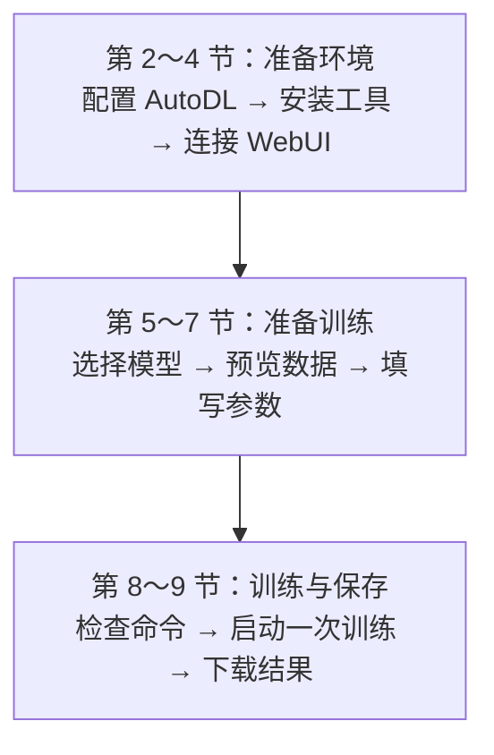

The division of responsibilities between the local machine and the AutoDL instance is as follows:

| Location | Work in this chapter | Where commands are executed |
| ----------- | -------------------------------------- | ---------------------------------------- |
| Your own computer | Open the console and training page, save data backups | Data cleaning is done on the local machine; the SSH tunnel is also established on the local machine |
| AutoDL instance | Install tools, download models, read data, execute training | JupyterLab terminal |

The `/root/autodl-tmp` mentioned later is the **data disk directory inside the AutoDL instance**, and the related commands are executed in the JupyterLab terminal.

---

## 2. AutoDL Instance Configuration

Chapter 7’s [AutoDL Deployment Operations](7-%E4%BC%81%E4%B8%9A%E7%BA%A7%E5%A4%A7%E6%A8%A1%E5%9E%8B%E9%83%A8%E7%BD%B2.md) have already introduced this platform. This chapter creates a single-card instance in the [AutoDL GPU Marketplace](https://www.autodl.com/market/list) to complete LoRA training for Qwen3-0.6B.

**If you already have an available instance, there is no need to rent another one.** First compare it against the configuration below, and then proceed from Section 2.5 to enter JupyterLab. Only readers who have not yet prepared an instance need to complete the creation steps.

### 2.1 Single Card and VRAM Selection

The following set of hardware and environment is used for the `keywords-clean` training in this chapter. First prepare the instance and tools, and then upload the data cleaned and split in Chapter 29.

| Item | Example environment | What to look at when following along |
| ---------------- | --------------------------------------- | ------------------------------------------------- |
| Number of GPUs | 1 | Multiple cards are not needed |
| GPU model / VRAM | Tesla V100-PCIE-32GB / 32 GB | The AutoDL page shows V100-32GB; confirm the full model in the terminal |
| Data disk | Start at 50 GB | Stores training tools, data, and output; see Section 2.5 for the model cache location |
| Base image at creation | PyTorch 2.8.0 / Python 3.12 / CUDA 12.8 | This is the installation starting point, not the final training environment |
| Final training environment | Python 3.12.3, PyTorch 2.14.0+cu126 | Section 3 explains installation and the actual computation check |
| Training compute type | FP16 | V100 follow-along uses FP16 |

The example GPU has 32 GB of VRAM; when selecting a GPU, you should also estimate actual usage based on sample length, batch, and tool version.

If you are using an existing RTX 3090, RTX 4090, or another GPU, first check in Section 3.4 whether actual computation is available, and then fill in the training parameters.

Chapter 32 will continue to use this machine for checking answers and exporting the model; if you proceed to deploy a vLLM service, you will also need to verify GPU compatibility according to [that chapter](32-%E5%BE%AE%E8%B0%83%E6%95%88%E6%9E%9C%E8%AF%84%E4%BC%B0%E4%B8%8E%E6%A8%A1%E5%9E%8B%E9%83%A8%E7%BD%B2.md) and use a separate inference environment.

### 2.2 Region and Host Selection

On the marketplace page, switch regions, choose a host with idle cards, set the actual rental quantity to **1 card**, and check the final cost.

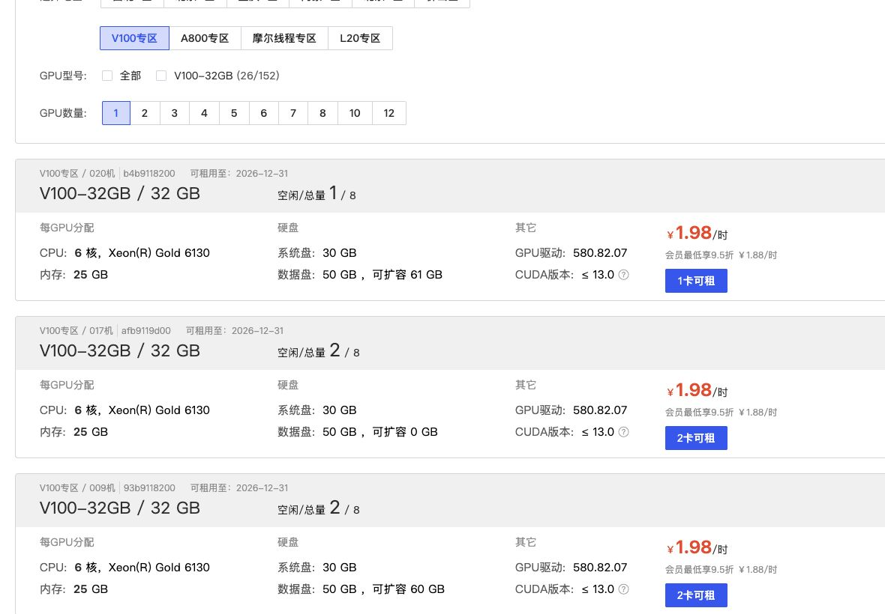

When reading the image, check in this order:

1. The **GPU model** and **GPU quantity** at the top: only 1 card is needed for the first round of this course;
2. The VRAM in the instance card title: in the image, `V100-32GB / 32 GB` indicates that the per-card VRAM is 32 GB;
3. The **data disk** in the "Hard Disk" area: the image shows 50 GB, used to store training tools, data, and training artifacts;
4. The **CUDA version** in the "Other" area: this is host environment information; you still need to enter the creation page later to select an image and check the PyTorch/CUDA actually used by the virtual environment.

> The image uses V100 as an example to explain the selection locations; inventory, prices, and the number of idle cards may change, so use the console as the authoritative source when renting.

<details>
<summary>Further reading: there may be no idle GPU after shutdown, how to plan ahead</summary>

After shutdown, the GPUs on the host may be rented by others, which may affect the next boot with a GPU. When selecting a host, you can refer to the remaining card count, but idle cards are not automatically reserved for you. If you temporarily set the marketplace quantity filter to 2 or 4 to view hosts with more resources, you must change the actual rental quantity back to 1 on the creation page and verify the cost.

</details>

### 2.3 Data Disk and Base Image

An image is an environment starting point with some software preinstalled; Section 3 will create a separate `.venv`, install and verify the actual training dependencies. Click "Rentable" to enter the instance configuration page, and select a single card, 50 GB data disk, and base image as shown below. [AutoDL Base Image Documentation](https://www.autodl.com/docs/base_config/)

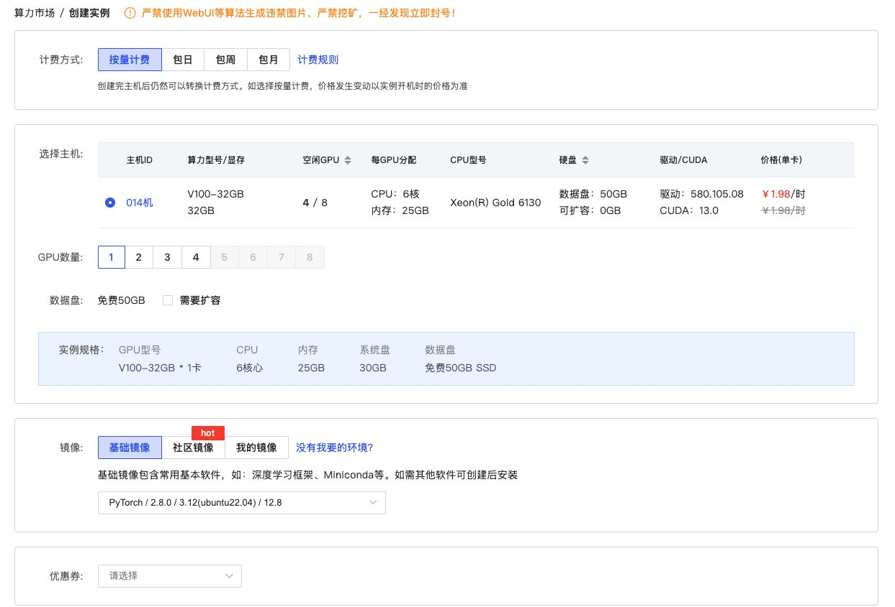

When comparing with the screenshot, first identify the following four locations:

| Page area | Configuration in the screenshot | What to note when following along |
| -------- | --------------------------------------- | ------------------------------------------------------ |
| Select host | `V100-32GB`, single card 32 GB | For V100 follow-along, select FP16 and check whether PyTorch includes the sm_70 kernel |
| GPU quantity | 1 | First run the complete process on a single card, and do not introduce multi-card variables prematurely |
| Data disk | Free 50 GB SSD | Stores LLaMA-Factory, data, and training output |
| Base image | PyTorch 2.8.0 / Python 3.12 / CUDA 12.8 | The image and virtual environment versions may differ; check according to Section 3 after installation |

After confirming that the configuration is correct, click "Create and Start" at the bottom of the page.

### 2.4 Cardless Mode

When downloading models and uploading files, the GPU is often not involved in the work. If these preparations take a long time, you can use AutoDL's **cardless mode** to reduce costs during the preparation phase:

1. Find the newly created instance in the console, confirm that no tasks are running, and then shut it down.
2. For the **same instance**, select "Start in Cardless Mode."
3. Open JupyterLab, complete the environment installation in Section 3, download the model in advance according to Section 5.1, and upload data according to Section 6; these tasks do not require a GPU.
4. Wait for the download and installation tasks to complete, save the files, and then shut down this instance.
5. Start the same instance normally, reopen the terminal and activate the environment, then check the GPU and start training.

When the instance is in the "Powered off" state, click "More" on the right, and then select "Start in Cardless Mode":


A confirmation dialog will then appear, clearly showing no GPU, CPU and memory configuration, and a prompt about hourly billing:

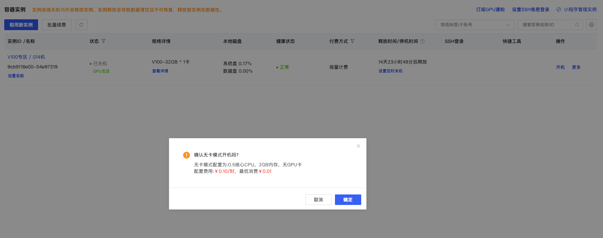

> The fees, instance numbers, and downtime in the screenshots only represent the page state at the time of capture. Cardless mode is suitable for preparation work; when you need to train or view GPU memory, you must return to the GPU-enabled startup method.

Cardless mode is not free, and the CPU and memory configurations are also reduced. It is suitable for file preparation, but not for the GPU training or vLLM services in this course, nor for installation tasks that require large amounts of memory or compilation of CUDA extensions. If you encounter such installation requirements, restore normal startup before proceeding.

### 2.5 JupyterLab and Working Directory

After the instance is started, click **JupyterLab** in the "Quick Tools" section of the AutoDL console. After entering, click **+** at the top of the file panel, and select **Terminal** in the "Other" area of the launcher page.

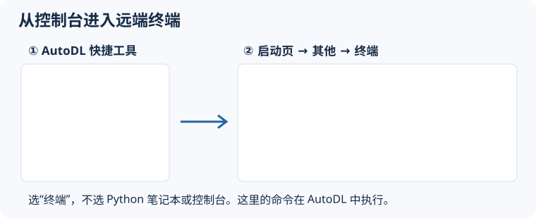

The following installation commands are all executed in this remote terminal:

```bash
cd /root/autodl-tmp
pwd
df -h .
```

Expected first-line output:

```text
/root/autodl-tmp
```

This is the working root directory for the course, used to store the LLaMA-Factory source code, data, training output, and exported models. The Qwen3-0.6B download example uses the ModelScope default cache `/root/.cache/modelscope/`, which is located on the system disk; check the remaining space before downloading, and refer to Section 5.3 if you need to place it on the data disk instead.

The following is the actual output of the data disk check. The first line is the current directory; the last column of the table is the mount point, and both places should be `/root/autodl-tmp`. `Avail` indicates the remaining available space, which is 39 GB in the image; your own instance should be based on the actual reading.

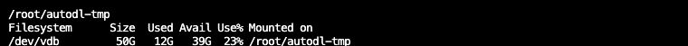

```text
/root/autodl-tmp/
├── LLaMA-Factory/            # 第 3 节克隆的训练工具
│   ├── data/keywords-clean/ # 第 6 节上传的数据与独立登记文件
│   └── saves/                 # 本章产生的 Adapter、日志和 checkpoint
├── models/                    # 可选：从缓存移到数据盘的基础模型
└── exports/                   # 第 32 章导出的完整模型
```

> Checkpoints and exported models will continue to consume disk space, and placing them on the data disk makes management easier. Important results on the data disk should also be downloaded to the local machine; "Save System Image" will not automatically package the contents of the data disk. [AutoDL Disk Documentation](https://www.autodl.com/docs/env/)

---

## 3. LLaMA-Factory Installation

### 3.1 Source Code Download and Version Selection

The following commands are all executed in the **AutoDL JupyterLab terminal**. First enter the data disk and clone the source code:

```bash
cd /root/autodl-tmp
git clone --depth 1 https://github.com/hiyouga/LLaMA-Factory.git
cd LLaMA-Factory
git fetch --depth 1 origin dced5f8804bfbf7109ef7c14401db6bd5cce7e53
git checkout --detach dced5f8804bfbf7109ef7c14401db6bd5cce7e53
```

The last two commands pin the **newly cloned repository** to the source code version used in the course, so that the pages, parameters, and example results correspond. [Course Source Code Version](https://github.com/hiyouga/LLaMA-Factory/tree/dced5f8804bfbf7109ef7c14401db6bd5cce7e53)

<details>
<summary>When source code download is very slow or a TLS connection error occurs</summary>

If `git clone` download is very slow, or if `GnuTLS recv error (-110)` or TLS connection interruption occurs, check the current command in AutoDL's **Help Documentation → Academic Resource Acceleration**, execute it in the same terminal, and then retry:

```bash
source /etc/network_turbo
```

The settings affect the current terminal and programs it starts, but are not automatically applied to other terminals. When acceleration is no longer needed, disable it in the same terminal:

```bash
unset http_proxy https_proxy
```

Supported sites and current commands are subject to the [AutoDL Academic Resource Acceleration Guide](https://www.autodl.com/docs/network_turbo/).

</details>

### 3.2 Project Directory and Configuration Files

After cloning is complete, open `LLaMA-Factory/` on the left side of JupyterLab. This chapter mainly uses the following locations, where course data, environments, and training results will be created in later steps:

```text
LLaMA-Factory/
├── data/keywords-clean/   第 6 节上传的课程数据与独立登记文件
├── .venv/                第 3.3 节创建的 Python 环境
└── saves/                训练生成的 Adapter、日志和检查点
```

**Training settings can also be saved in a YAML text file.** Open the `案例与源码-4-微调/configs/keywords_clean_train.yaml` included with the course materials on your local machine; it uses this chapter's Qwen3-0.6B, keyword data, and FP16 configuration. A few items are excerpted below with Chinese annotations:

```yaml
# 训练阶段：SFT（监督微调），用输入和参考答案训练模型
stage: sft

# 微调方式：采用 LoRA，只训练新增的少量参数
finetuning_type: lora

# LoRA 的秩：设为 8，这个值会影响新增可训练参数的数量
lora_rank: 8

# 对话模板：使用 Qwen3 的非思考模式模板组织输入
template: qwen3_nothink

# 截断长度：每条训练样本的长度上限为 2048 个 token，包含输入和答案
cutoff_len: 2048

# 梯度累积步数：累积 8 个小批次的梯度后，再更新一次参数
gradient_accumulation_steps: 8
```

For example, `lora_rank: 8` corresponds to "LoRA rank 8" in the WebUI. Sections 5–7 will fill in these settings in the page, and Section 8.1 will review the training parameters they are converted into; when choosing the command-line approach, Section 8.3 will upload and use this course YAML.

<details>
<summary>Optional reading: tool source code, official examples, and dependency lists</summary>

In the JupyterLab project file panel, `src/` stores the program source code, `examples/` stores training, inference, and merging examples, and `requirements/` stores the optional dependency lists:

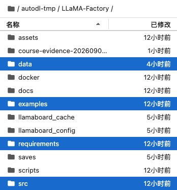

The image below opens the tool's built-in `examples/train_lora/qwen3_lora_sft.yaml`. It uses `Qwen/Qwen3-4B-Instruct-2507`, `identity,alpaca_en_demo`, and BF16, and is suitable for referencing the configuration structure; this chapter runs with the course YAML above. [Pinned official example](https://github.com/hiyouga/LLaMA-Factory/blob/dced5f8804bfbf7109ef7c14401db6bd5cce7e53/examples/train_lora/qwen3_lora_sft.yaml)

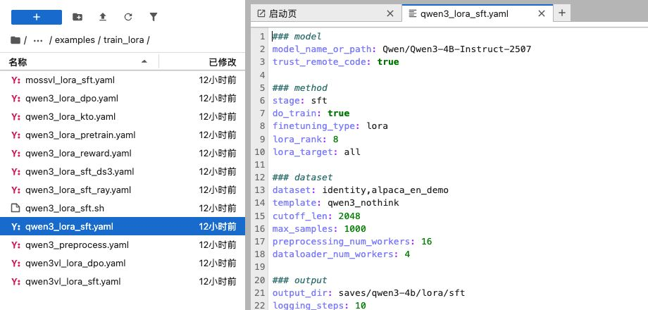

During installation, `uv pip install -e .` reads the basic dependencies such as `torch`, `transformers`, and `peft` from `pyproject.toml` ([official source](https://github.com/hiyouga/LLaMA-Factory/blob/dced5f8804bfbf7109ef7c14401db6bd5cce7e53/pyproject.toml)). Additional lists are installed by purpose:

| List                                                                                                                                                                | Contents in pinned version                | Purpose                            |
| ------------------------------------------------------------------------------------------------------------------------------------------------------------------- | -------------------------------- | ------------------------------- |
| `requirements/metrics.txt` ([official source](https://github.com/hiyouga/LLaMA-Factory/blob/dced5f8804bfbf7109ef7c14401db6bd5cce7e53/requirements/metrics.txt))           | `nltk`、`jieba`、`rouge-chinese` | Some text evaluation features                |
| `requirements/bitsandbytes.txt` ([official source](https://github.com/hiyouga/LLaMA-Factory/blob/dced5f8804bfbf7109ef7c14401db6bd5cce7e53/requirements/bitsandbytes.txt)) | `bitsandbytes>=0.39.0`           | bitsandbytes quantization; quantization is not enabled in this round |

</details>

### 3.3 Python Environment and Dependency Installation

Next, use **uv** to create an isolated Python environment and install dependencies. First check whether it is available:

```bash
uv --version
```

If it prompts `uv: command not found`, install it in the current AutoDL terminal and then check again:

```bash
python -m pip install uv
uv --version
```

This is the pip installation method supported by uv; if a usable uv already exists, there is no need to reinstall it. [uv installation guide](https://docs.astral.sh/uv/getting-started/installation/)

Make sure the terminal is still in `/root/autodl-tmp/LLaMA-Factory`, then run:

```bash
uv venv --python 3.12
source .venv/bin/activate
uv pip install -e .
uv pip install -r requirements/metrics.txt
```

The `.` in `uv pip install -e .` means the current directory, and `-e` means installing the current project in editable mode; therefore it should be run at the repository root and the source code here should be kept. `metrics.txt` supplements the dependencies needed for some later evaluation features.

**If following along on a V100, install the CUDA 12.6 build below.** The default software source may select packages that do not include V100 kernels. After the installation above finishes, run the following in the same virtual environment:

```bash
uv pip install --reinstall \
  --index-url https://download.pytorch.org/whl/cu126 \
  torch==2.14.0 torchvision==0.29.0 torchaudio==2.11.0
```

These three packages correspond to the course's V100 training environment. If a usable environment already exists, check the versions first and do not reinstall; after preparation is complete, actually run a small matrix computation as instructed in Section 3.4.

Wait for the installation command to finish and for the terminal to again show a prompt where you can enter commands before proceeding to the next step. Do not start another installation process while packages are still downloading.

Each time you open a new terminal, you must re-enter the project directory and activate the existing environment so that the current terminal uses the project's Python and dependencies:

```bash
cd /root/autodl-tmp/LLaMA-Factory
source .venv/bin/activate
```

The prompt may show `(LLaMA-Factory)` and not necessarily directly show `.venv`; the next section will confirm using Python's actual path.

<details>
<summary>How to retry installation when downloads are very slow or interrupted</summary>

When running `uv pip install -e .` for the first time, `uv` will first resolve dependencies and then download larger installation packages such as PyTorch and NVIDIA CUDA. Even if the speed is slow, as long as the progress bar, downloaded size, or the number of "Preparing packages" is still changing, the command is still working; wait for the current command to finish first.

The `source /etc/network_turbo` run earlier is mainly for accessing academic resources such as GitHub and Hugging Face; it should not be assumed that PyPI downloads are necessarily accelerated. The [AutoDL documentation](https://www.autodl.com/docs/network_turbo/) also explicitly lists the site ranges it covers.

If the total download volume has not increased at all for several consecutive minutes, or the terminal has already reported a network error, then press `Ctrl+C` to terminate this installation. In the **same terminal where `.venv` has already been activated**, temporarily switch to a PyPI mirror and then re-run the following two installation commands:

```bash
source /etc/network_turbo

UV_DEFAULT_INDEX="https://mirrors.tuna.tsinghua.edu.cn/pypi/web/simple/" \
  uv pip install -e .

UV_DEFAULT_INDEX="https://mirrors.tuna.tsinghua.edu.cn/pypi/web/simple/" \
  uv pip install -r requirements/metrics.txt
```

`UV_DEFAULT_INDEX` only takes effect for the single command that immediately follows it and will not modify the system's global software sources; this is the default index environment variable officially supported by `uv`. The mirror may be faster under certain network conditions, but it is not guaranteed to always be faster; the Tsinghua mirror site also provides corresponding configuration instructions for PyPI and `uv`. [uv environment variable documentation](https://docs.astral.sh/uv/configuration/environment/); [Tsinghua PyPI mirror documentation](https://mirrors.tuna.tsinghua.edu.cn/help/pypi/).

Do not add `--no-deps` just to be "a little faster," and do not delete the already-created `.venv`; the former will cause dependencies required for training to be missed. Furthermore, do not run two `uv pip install` commands at the same time; they will compete for network, cache, and disk resources, making it harder to judge progress.

</details>

### 3.4 Version and GPU Computation Check

First confirm that the instance has been started with a GPU attached. In the **AutoDL terminal**, enter the project directory, activate the environment, and then run:

```bash
llamafactory-cli version
git rev-parse HEAD
nvidia-smi
```

The first two commands check the tool version and source commit respectively; the third shows the GPU model, memory, and current usage. The course uses tool version `0.9.6.dev0` and source commit `dced5f8804bfbf7109ef7c14401db6bd5cce7e53`.

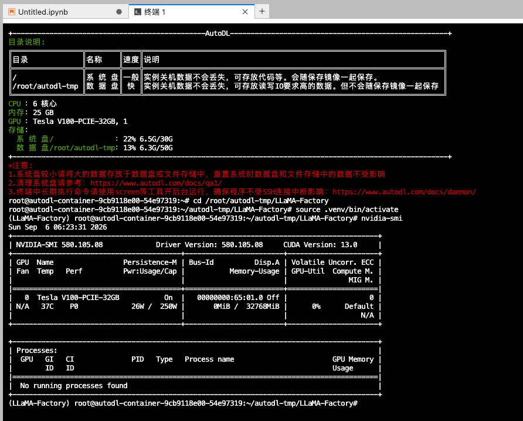

The `Tesla V100-PCIE-32GB` in the image corresponds to the V100-32GB in the console, and `32768 MiB` is the memory capacity.

**After seeing the GPU, you must also confirm that the current Python environment can use it for computation.** Copy the entire block below into the same terminal and run it. It only performs a small matrix multiplication, without loading any model or training:

```bash
python - <<'PY'
import sys
import torch

print("Python 路径:", sys.executable)
print("Python 版本:", sys.version.split()[0])
print("PyTorch 版本:", torch.__version__)
print("PyTorch 构建使用的 CUDA:", torch.version.cuda)
assert torch.cuda.is_available(), "当前环境未发现可用 GPU，请先检查开机模式与安装结果"
print("GPU 型号:", torch.cuda.get_device_name(0))
print("GPU 计算能力:", torch.cuda.get_device_capability(0))
print("编译的 GPU 架构:", torch.cuda.get_arch_list())
x = torch.randn((1024, 1024), device="cuda", dtype=torch.float16)
y = x @ x
torch.cuda.synchronize()
print("计算完成，结果设备:", y.device)
PY
```

When following along, verify the following items:

| Check item              | Result in the example environment               | Description                                        |
| ------------------- | ---------------------------- | ------------------------------------------- |
| Python path         | Project `.venv/bin/python`      | The project environment is being used, not the system Python         |
| PyTorch / CUDA build | `2.14.0+cu126` / `12.6`      | Corresponds to the V100 installation configuration in Section 3.3             |
| GPU compute capability        | `(7, 0)`, i.e., 7.0             | V100's hardware capability version, not the CUDA software version     |
| Compiled architectures          | Includes `sm_70`                 | The current installed package includes kernels for this type of GPU                |
| Last line            | `计算完成，结果设备: cuda:0` | Actual FP16 computation succeeded; `cuda:0` indicates the first GPU |


The result should include `cu126` and `sm_70`, and confirm successful FP16 computation with `计算完成，结果设备: cuda:0`.

<details>
<summary>Further understanding: why the two CUDA version numbers can be different</summary>

The CUDA Version at the top of `nvidia-smi` is the highest CUDA version supported by the driver; `torch.version.cuda` is the version used by the current PyTorch build. The two do not need to show the same number; what really needs to pass is the actual computation above. [AutoDL CUDA documentation](https://www.autodl.com/docs/cuda/)

</details>

<details>
<summary>When the GPU check fails or an OMP_NUM_THREADS message appears</summary>

If the check fails, first verify the Python path, whether the instance was started with a GPU attached, and whether the installation in Section 3.3 completed fully. Resolve the error and pass the FP16 computation before starting the WebUI.

The `OMP_NUM_THREADS` message in the first line of the screenshot relates to a CPU thread variable; whether the GPU is usable still depends on whether the matrix computation completes. If it indicates that the GPU kernel is incompatible, go back and check the PyTorch build and `sm_70` support.

</details>

---

## 4. WebUI Startup and Connection

### 4.1 Starting the WebUI Service

Run the following in the LLaMA-Factory root directory:

```bash
cd /root/autodl-tmp/LLaMA-Factory
source .venv/bin/activate
llamafactory-cli webui
```

When the terminal shows information similar to the following, the service has started inside the AutoDL instance:

```text
Running on local URL:  http://0.0.0.0:7860
```

`0.0.0.0:7860` means the service is listening on port `7860` inside the AutoDL instance. Keep this terminal running; in the next step, access it from your local machine through an SSH tunnel.

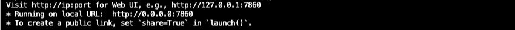

### 4.2 SSH Tunnel Connection

An **SSH tunnel** is a forwarding channel: the browser accesses port `7860` on your own computer, and the request travels through the tunnel to port `7860` in the AutoDL instance. This chapter uses local forwarding and does not use the console's "Custom Service" public entry point.

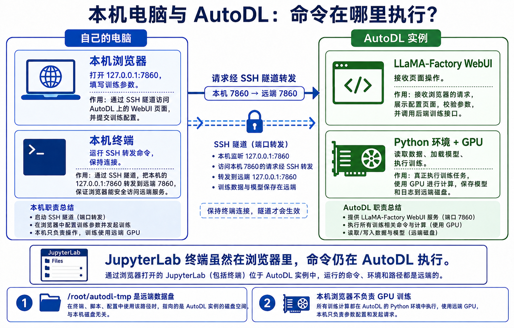

When reading the diagram, follow the middle arrow: **local browser → local 7860 → SSH tunnel → AutoDL WebUI**. Do not confuse the two types of terminals in the diagram: the local terminal is responsible for keeping the tunnel alive; the JupyterLab terminal, although also opened in the browser, runs commands inside AutoDL.

**Mac / Linux: open a terminal on your own computer.**

Find the SSH login command for the current instance in the AutoDL console. Assuming its structure is `ssh -p SSH端口 root@实例主机`, substitute the host and SSH port into the following command:

```bash
# 将 SSH端口 和 实例主机 替换为控制台中的真实值，再执行
ssh -N -L 127.0.0.1:7860:127.0.0.1:7860 -p SSH端口 root@实例主机
```

This command is executed in the **local terminal**, not in JupyterLab. Complete the login as prompted; when entering the password, the terminal usually does not display characters, so just press Enter after typing. Do not write the password into the command or share it with others.

| Position in the command            | Purpose                                |
| ----------------------- | ----------------------------------- |
| First `127.0.0.1:7860` | Entry point on your own computer for browser access        |
| Second `127.0.0.1:7860` | Address of the WebUI in the AutoDL instance          |
| SSH port after `-p`      | From the console login command; usually not `7860` |
| `-N`                    | Only sets up forwarding; does not open a remote command line        |

After logging in, the terminal remains waiting and does not return a command prompt; this is a normal state for tunnel operation. Keep it open, then access the following in **your local browser**:

```text
http://127.0.0.1:7860/
```

After opening, confirm that the page is LLaMA-Factory, switch the language to Chinese, and continue configuring the model and data.

<details>
<summary>Windows: Use the AutoDL graphical tunnel tool</summary>

1. Download and open the tool from [AutoDL SSH Tunnel Instructions](https://api.autodl.com/docs/ssh_proxy/).
2. Enter the SSH login information for the instance where the WebUI is running.
3. In "Forward to local port," enter `7860`, not "Forward to remote port."
4. Start the proxy and keep the tool running, then access `http://127.0.0.1:7860/` in your browser.

Different instances have different hosts, SSH ports, and login credentials; use the information from your own console.

</details>

<details>
<summary>When the page cannot be opened or the connection is interrupted</summary>

Check these three places:

1. AutoDL: Whether the terminal that started the WebUI is still running and whether the `7860` listening message has appeared.
2. Local terminal: Whether the tunnel is still running and whether it is connected to the same instance; if the port is reported as occupied, first confirm whether a tunnel already exists, and do not start another one.
3. Browser: Whether the address is the local `127.0.0.1:7860` and whether the target service is open.

Open another local terminal to check whether the entry point responds:

```bash
curl -I --max-time 5 http://127.0.0.1:7860/
```

A return of `HTTP/1.1 200 OK` indicates that this local entry point can respond to HTTP requests. Then open the browser and confirm that the page is indeed the target instance's LLaMA-Factory; the status code alone cannot distinguish between different services.

If the message `Failed to connect` appears or the page shows `Connection errored out`, check the connection first; do not reinstall or retrain. Closing only the local tunnel disconnects access, but it does not mean remote training has stopped.

After reconnecting, verify the model, template, precision, and data according to Sections 5-7, and then perform the pre-launch checks; the page may have reverted to different parameters.

</details>

### 4.3 Running in the Background (Optional)

<details>
<summary>Read about background startup only when you need to close the remote terminal</summary>

Running in the foreground is convenient for seeing errors the first time; when preparing for long training sessions, you can switch to background execution. **If training has not yet started**, first press `Ctrl+C` in the remote terminal running the foreground WebUI to stop it. After confirming it has exited, execute the following in the same project directory and the same virtual environment:

```bash
mkdir -p logs
nohup llamafactory-cli webui > logs/webui-keywords.log 2>&1 < /dev/null &
WEBUI_PID=$!
ps -p "$WEBUI_PID" -o pid,ppid,lstart,args
```

Here `nohup` is used to keep the process running after the terminal disconnects, and `&` makes the command execute in the background, with output and errors written to this log file. If a log file with the same name already exists, use a new file name to avoid overwriting old records. To check whether startup succeeded:

```bash
tail -n 50 logs/webui-keywords.log
```

After seeing the `7860` startup message, reopen the page through the tunnel described in Section 4.2. Do not start a second WebUI at the same time, occupying the same port.

**How to confirm that the service is still running after the terminal exits?**

`$!` is the process ID of the background process just started. Note the PID and startup time from the `ps` output; in the remote terminal, run `exit` to exit the shell, reopen the terminal, enter the recorded PID, and then check the process and service again:

```bash
read -r -p "输入刚记录的 WebUI PID：" webui_pid
ps -p "$webui_pid" -o pid,ppid,lstart,args
curl -I --max-time 5 http://127.0.0.1:7860/
```

Compare the PID and startup time before and after exiting the terminal to confirm that it is still the same WebUI process; then check whether HTTP returns `200 OK`. The two screenshots below show these check locations; use the actual numbers from your own output:

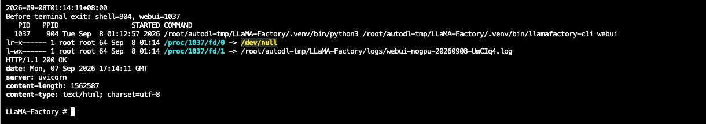

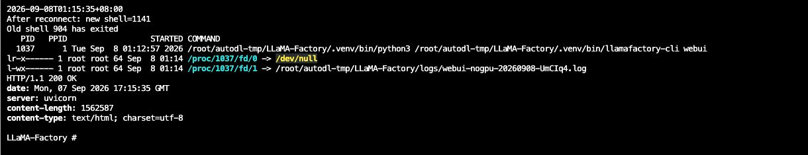

After the remote service is working normally, establish a local SSH tunnel as described in Section 4.2, and then confirm from the browser that the LLaMA-Factory page can be opened:


**If the webpage can be opened, it only means the service is accessible.** Before training, you still need to complete the model and data configuration in Sections 5-7; if training has already started, do not press `Ctrl+C` just to change the startup method. Background execution only handles terminal disconnection; shutting down the instance will still stop the task.

**How to stop the background WebUI?**

First make sure that training on the Train page has ended or been interrupted, and that the model loaded on the Chat page has been unloaded. Stopping the WebUI service and stopping the training within it are two separate matters; for the training interruption entry point, see Section 8.2.

In the **AutoDL terminal**, list the WebUI processes:

```bash
ps -eo pid,ppid,lstart,args | grep '[l]lamafactory-cli webui'
```

Verify that the command contains `llamafactory-cli webui` and that the startup time matches the target service. In this terminal, enter the PID you just found and check again; do not copy the process ID from the screenshot:

```bash
read -r -p "输入要停止的 WebUI PID：" webui_pid
ps -p "$webui_pid" -o pid,ppid,lstart,args
```

Only after confirming that it is the target service should you execute the following stop command. The conditional check only accepts process IDs greater than `1`, preventing empty values, `0`, or the system's main process from being treated as the target:

```bash
[[ "$webui_pid" =~ ^[1-9][0-9]*$ ]] && (( webui_pid > 1 )) && kill -TERM "$webui_pid"
ps -p "$webui_pid" -o pid,ppid,lstart,args
python - <<'PY'
import socket
with socket.socket() as s:
    s.settimeout(2)
    print("7860 连接检查：", s.connect_ex(("127.0.0.1", 7860)))
PY
```

Here Python is used to check the port, with no need to install additional network tools. A return of `0` indicates that it can still be connected; a non-`0` value indicates that the connection was unsuccessful, and you should also use `ps` to determine whether the target process has exited. Only after confirming that the target process has exited and the port cannot be connected should you start a new WebUI; if the port is still occupied, first check for leftover processes. Closing the local SSH tunnel, exiting `tail`, or closing the webpage does not stop the remote service.

</details>

---

## 5. Model and Chat Template Configuration

### 5.1 Model and Fine-tuning Method

On the WebUI training page, make selections according to the first round of exercises in this course:

| Page Item | Selection for This Course                                                      |
| -------- | --------------------------------------------------------------- |
| Model Name | Search for `Qwen3-0.6B`; the option shown in this chapter's interface example is called `Qwen3-0.6B-Thinking` |
| Model Path | First confirm it is `Qwen/Qwen3-0.6B`; after downloading, you can also fill in the local model directory          |
| Model Source | ModelScope                                                      |
| Training Stage | SFT (Supervised Fine-Tuning)                                                 |
| Fine-tuning Method | LoRA                                                            |
| Quantization Level | Not enabled                                                          |

"Model Name" is the display name in the WebUI, while the repository ID used for downloading is `Qwen/Qwen3-0.6B`. **The model path determines which weights are loaded, and the chat template determines how messages are organized**; the template is set in the next subsection.

The figure below only shows the model settings at the top of the page. Check them row by row: in the first row, look at the model name, repository ID, and ModelScope; in the second row, select LoRA and leave the checkpoint path empty; in the third row, do not enable quantization and select the `qwen3_nothink` template to be used in the next subsection.

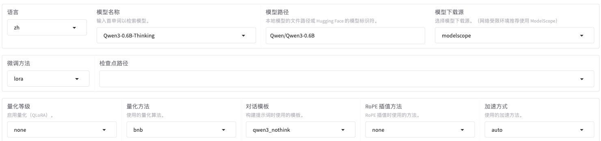

The `fp16` used for the V100 is located under "Compute Type" on the Train page; in Section 7.3 it will be filled in together with batch size and other parameters, not in the three rows above.

After selecting ModelScope as the download source, you can download the model in advance as described below, or let the tool download it during the first official loading.

<details>
<summary>Hands-on: Download the model in advance without starting training</summary>

This step can also be completed in cardless mode. First install the environment as described in Section 3, then execute the following in the **AutoDL JupyterLab terminal**:

```bash
cd /root/autodl-tmp/LLaMA-Factory
source .venv/bin/activate
df -h /root /root/autodl-tmp
```

The download command below uses the ModelScope default cache, usually located on the system disk at `/root/.cache/modelscope/`. First confirm that the system disk still has download space, then execute the entire command block:

```bash
python - <<'PY'
from modelscope import snapshot_download

model_dir = snapshot_download("Qwen/Qwen3-0.6B")
print("模型下载目录：", model_dir)
PY
```

`snapshot_download` downloads the model repository files and returns the local directory; an existing cache of the same version will be reused. [ModelScope Download Interface](https://github.com/modelscope/modelscope/blob/master/modelscope/hub/snapshot_download.py)

After the download is complete, the terminal will print "Model download directory." Open this directory in the JupyterLab file panel and confirm that `config.json`, the weight files, and the tokenizer files are present. **Note down the actual returned path**: you will need it in Chapter 29 when printing the template and in Chapter 30 when checking preprocessing results.

When the cache is still in the default location, the WebUI and the course YAML can continue to use the repository ID `Qwen/Qwen3-0.6B`. If you need to move the downloaded model to the data disk, continue to Section 5.3; before switching to a larger model such as 8B, plan a separate download location on the data disk, and do not directly reuse this small model's default cache scheme.

</details>

### 5.2 Chat Template and Thinking Mode

Chapter 29 already used the library example to explain chat templates and compared the model path with template options. Here the settings are applied to keyword training:

| Page Item | Setting for This Session                           |
| -------- | ---------------------------------- |
| Chat Template | `qwen3_nothink`                    |
| Thinking Mode | Off, corresponding to `enable_thinking=False` |

The assistant answers in the keyword samples contain only keywords and no reasoning process, so this training session does not provide thinking text as a demonstration. The `Thinking` in the model display name does not complete these settings for us; you still need to verify the template and thinking switch separately. **If no thinking text is trained, there is no guarantee that the model will not analyze when answering.** This version of `qwen3_nothink` will not insert an empty thinking block because of this switch; for measured differences at the generation stage, see [Chapter 32, Section 2.4](32-%E5%BE%AE%E8%B0%83%E6%95%88%E6%9E%9C%E8%AF%84%E4%BC%B0%E4%B8%8E%E6%A8%A1%E5%9E%8B%E9%83%A8%E7%BD%B2.md?id=_24-from-single-item-observation-to-batch-testing).

For message boundaries and the handling of the `<think>` tag, see the [template explanation in Chapter 29](29-%E5%BE%AE%E8%B0%83%E6%95%B0%E6%8D%AE%E5%87%86%E5%A4%87%E4%B8%8E%E5%AF%B9%E8%AF%9D%E6%A8%A1%E6%9D%BF.md?id=_64-template-selection-and-precautions); for where loss is calculated, see the [training labels in Chapter 30](30-%E6%A8%A1%E5%9E%8B%E8%AE%AD%E7%BB%83%E5%8E%9F%E7%90%86%E4%B8%8E%E9%AB%98%E6%95%88%E5%BE%AE%E8%B0%83.md?id=_111-training-labels-and-loss-computation-positions).

After changing the model or reopening the page, always confirm that the template has not reverted to the default. In the next chapter, first use this set of settings to reproduce existing results, and then read the template inference comparison separately. If the current version cannot find `qwen3_nothink`, first go back to Section 3 and check the tool version; do not substitute another similar name.

### 5.3 Local Model Path (Optional)

<details>
<summary>Expand only when the model has finished downloading and you need to load it from the data disk</summary>

When using the repository ID for the first time, you can keep the above settings and do not need to move a model that has not finished downloading. **Perform the operations in this section only when the model has already been downloaded, no task is currently loading it, and you need to organize the system disk cache onto the data disk.**

First check the two locations in the JupyterLab file panel or terminal:

```bash
ls -ld /root/.cache/modelscope/models
ls -ld /root/autodl-tmp/models
```

The first command should find the downloaded cache directory; if the second command reports that it does not exist, that meets the precondition for the following move command. If both directories exist, do not continue copying the move command; first inspect the existing contents.

After confirming that the source directory exists and the target directory does not, execute:

```bash
mv /root/.cache/modelscope/models /root/autodl-tmp/
```

This will result in:

```text
/root/autodl-tmp/models/
```

This moves the entire `models/` cache directory. Afterward, the training configuration must use the moved local path.

Under `models/`, continue into the Qwen3-0.6B directory and find the level that contains the weights, `config.json`, and tokenizer files together. For example, the directory structure may be:

```text
/root/autodl-tmp/models/Qwen--Qwen3-0.6B/snapshots/master/
├── config.json
├── model.safetensors
├── tokenizer.json
└── tokenizer_config.json
```

**The model path should be exactly this directory that contains the configuration, weights, and tokenizer together.** It is the parent directory of the weight files, not the directory above this one. Different cache versions may have different outer directory names; use the contents that actually exist in the file panel.

Note that **double-clicking a folder in the left file panel does not change the directory of an already-open terminal**. If your model is indeed at the example location above, run the following separately in the AutoDL terminal `cd`:

```bash
cd /root/autodl-tmp/models/Qwen--Qwen3-0.6B/snapshots/master
pwd
ls config.json tokenizer_config.json
```

If the path differs, replace the path after `cd` with the actual directory found in the file panel. After confirming that `cd` succeeds and that `ls` found the config file, paste the **complete output of `pwd`** into the model path in the WebUI; if `cd` reports an error, the terminal is still at the original location, so do not copy `pwd`. Do not copy only the parent directory of `models/`, and do not copy an individual `model.safetensors` file.

Previously, when you filled in `Qwen/Qwen3-0.6B`, the tool located the model by repository ID; now, when you fill in the full local directory, the tool reads files from that directory. Do not put the local path into "Checkpoint path"; that field is reserved for the Adapter trained later.

If you still fill in the repository ID after moving the files, the tool may download another copy to the default cache location. When using a local path, you must also update `model_name_or_path` in the training YAML, and use the same model for subsequent prediction and export; do not change only the page while still running the old YAML.

If you do not need to reorganize the cache location, continue using the repository ID and skip the moving steps in this section.

</details>

When using the repository ID, the model is loaded from the already-downloaded cache; the course example corresponds to `/root/.cache/modelscope/models/Qwen--Qwen3-0.6B/snapshots/master`. If you switch to a local model directory on the data disk, subsequent training, prediction, and export should also point to the same base model.

---

## 6. Data Upload and Registration

Chapter 29 already generated `keywords-clean`. This section directly uses the cleaned and split data from that chapter; it does not clean or randomly split the data again. After uploading, first check the files, then have LLaMA-Factory read the registration information, and finally preview it on the page.

### 6.1 Data Upload and Integrity Check

In the AutoDL JupyterLab file panel, go to `/root/autodl-tmp/LLaMA-Factory/data/` and create a folder named `keywords-clean`. Open it, click "Upload Files" at the top of the file panel, and select the six files from the local `案例与源码-4-微调/processed/keywords-clean/` directory; you can also drag these files into the current file panel. After the upload completes, you should see:

```text
data/keywords-clean/
├── keywords_train.jsonl        # 1,600 条，用于训练
├── keywords_validation.jsonl   # 200 条，用于开发和选择检查点
├── keywords_test.jsonl         # 200 条，留给第 32 章最终测试
├── dataset_info.json           # 三份文件的登记
├── manifest.json               # 条数、文件校验值、原始行号
└── cleaning_report.json        # 自动处理明细与检查范围
```

If a directory with the same name already exists on the server, check the version first and do not overwrite the data inside. Even if the test file has been uploaded, it should not be added to training or used for validation during training.

Check the uploaded content in the **root directory of LLaMA-Factory on AutoDL**:

```bash
cd /root/autodl-tmp/LLaMA-Factory
python - <<'PY'
import hashlib
import json
from pathlib import Path

folder = Path("data/keywords-clean")
manifest = json.loads((folder / "manifest.json").read_text(encoding="utf-8"))
for name, info in manifest["splits"].items():
    file = folder / info["file"]
    assert hashlib.sha256(file.read_bytes()).hexdigest() == info["sha256"], file
    rows = [json.loads(line) for line in file.read_text(encoding="utf-8").splitlines()]
    assert len(rows) == info["records"], file
    print(f"{name}: {len(rows)} 条，校验通过")
PY
```

The SHA-256 here can be understood as a "fingerprint" of the file content: it is only when the fingerprint is the same before and after upload that the server is reading this exact data. The code above checks both file fingerprints and record counts; the expected normal result is:

```text
train: 1600 条，校验通过
validation: 200 条，校验通过
test: 200 条，校验通过
```

If the check fails, first verify whether the upload is complete and whether another version was mixed in; do not modify training parameters to bypass the check.

In the figure below, all three datasets pass both the file fingerprint and record count checks:

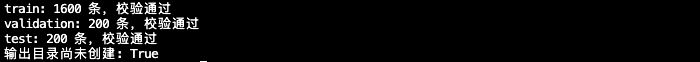

The first three lines in the figure correspond to the data verification results; this step only checks the fingerprint and record count. The last line, "Output directory has not been created yet," is not part of the output of this code; the training output directory is checked in Section 8.

### 6.2 Dataset Path and Registration File

For this WebUI session, fill in `data/keywords-clean` in the **Data path** field. The tool reads `dataset_info.json` inside this directory; there is no need to modify LLaMA-Factory's built-in `data/dataset_info.json`.

What you upload is files, but what you select on the page is the **registration name**. Taking the training set as an example, the tool locates it according to the following relationships:

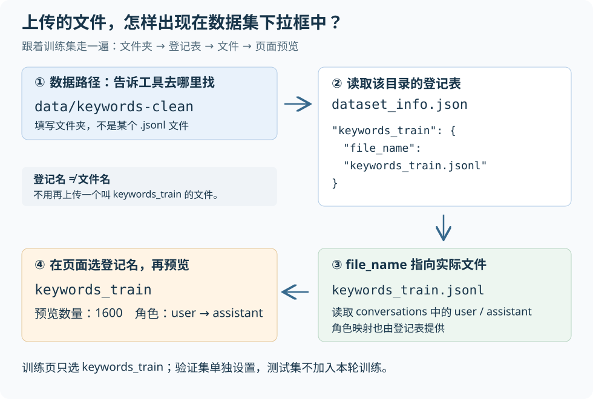

Therefore, fill in the folder in the data path field and select `keywords_train` from the dropdown; do not put `keywords_train.jsonl` into the data path, and do not treat the registration name as another file that needs to be uploaded.

The cleaning script has already registered three items:

| Registration name                | Target file                  | Purpose             |
| --------------------- | --------------------------- | ---------------- |
| `keywords_train`      | `keywords_train.jsonl`      | Training             |
| `keywords_validation` | `keywords_validation.jsonl` | Validation during training     |
| `keywords_test`       | `keywords_test.jsonl`       | Testing after the plan is finalized |

<details>
<summary>When you need to verify the field mapping: how dataset_info.json reads a sample</summary>

The structure of one of the entries is as follows; the other two entries change only the registration name and file name:

```json
{
  "keywords_train": {
    "file_name": "keywords_train.jsonl",
    "formatting": "sharegpt",
    "columns": { "messages": "conversations" },
    "tags": {
      "role_tag": "role",
      "content_tag": "content",
      "user_tag": "user",
      "assistant_tag": "assistant"
    }
  }
}
```

This snippet is for reading the fields; when uploading, still use the complete registration file generated by the cleaning script. Use the following mapping to understand how it reads one sample:

| Config field             | Chinese meaning       | What it tells the tool in this example                             |
| -------------------- | -------------- | -------------------------------------------- |
| `file_name`          | Data file name     | Read samples from `keywords_train.jsonl` in the same directory   |
| `formatting`         | Data format       | `sharegpt` means read according to the conversational message structure            |
| `columns.messages`   | Message list field   | Messages in a sample are stored in `conversations`        |
| `tags.role_tag`      | Role field       | Each message uses `role` to indicate the role                   |
| `tags.content_tag`   | Content field       | The text of each message is stored in `content`            |
| `tags.user_tag`      | Value for the user role | When `role` is `user`, it is recognized as user input          |
| `tags.assistant_tag` | Value for the assistant role | When `role` is `assistant`, it is recognized as the assistant reference answer |

</details>

In JupyterLab, open the just-uploaded `dataset_info.json` on the left, expand `keywords_train`, and then expand `columns` and `tags`. The left side of the figure below shows the six actual files, and the right side shows the registration content: first compare `file_name`, then check `messages` and the two roles.

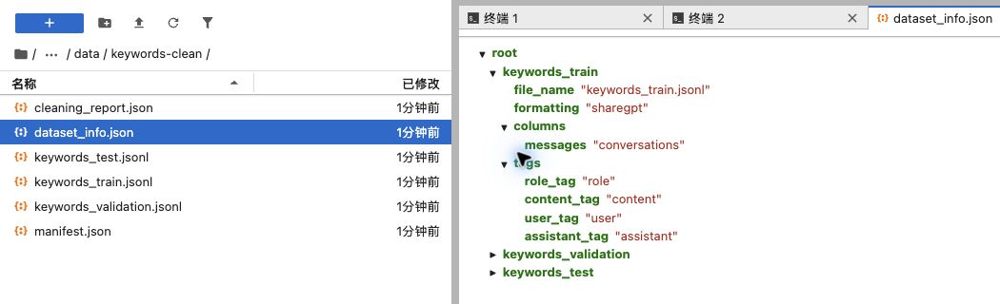

### 6.3 Dataset Preview and Selection

After filling in the data path, select `keywords_train` in the dataset dropdown and click "Preview dataset". The count should be **1,600**, and each sample should be `user → assistant`, with the assistant answer containing only semicolon-separated keywords.

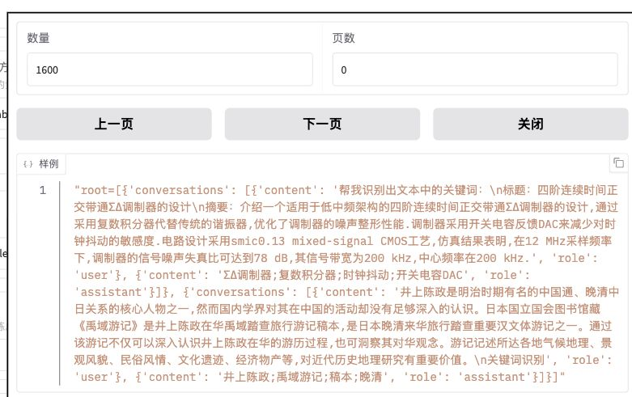

First look at the **count of 1600** at the top, and then find `conversations`, `role: user`, and `role: assistant` in the samples. This version displays the samples as longer text; you do not need to read the articles word by word. The key points are confirming that the Chinese text is not garbled, the roles are mapped correctly, and the separator in the answer is still an English semicolon.

When previewing the validation set, first clear the training set option, then select `keywords_validation` and confirm that the count is 200. After previewing, restore the training page's dataset selection to only `keywords_train`; the validation set is specified separately in Section 7.2, and the test set is reserved for final evaluation.

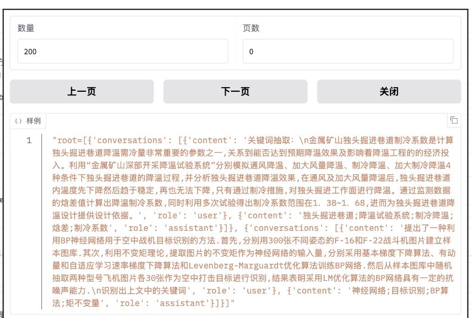

Preview is used to check files, roles, Chinese display, and field mapping; the actual token length and which positions participate in loss calculation must still be checked according to [Chapter 30, "Checking Actual Training Length"](30-%E6%A8%A1%E5%9E%8B%E8%AE%AD%E7%BB%83%E5%8E%9F%E7%90%86%E4%B8%8E%E9%AB%98%E6%95%88%E5%BE%AE%E8%B0%83.md?id=_42-checking-the-actual-training-length), not just by whether the preview succeeds.

<details>
<summary>When there are problems with the dataset dropdown or preview</summary>

- **The dropdown does not contain `keywords_train`.** First confirm that the data path is `data/keywords-clean`, then open this directory in JupyterLab and check whether `dataset_info.json` exists and whether `keywords_train` is registered in it.
- **The name can be selected, but the file cannot be found.** Check the `file_name` field in the registration entry, confirm that it is filled with `keywords_train.jsonl`, and that the file is indeed located in the same data directory.
- **The roles or content are incorrect after opening.** Compare `conversations`, `role`, and `content` in the JSONL against the field mapping in Section 6.2; in this example, `user` should be recognized as input and `assistant` as the reference answer. If a JSON format error is reported, open the record corresponding to the error and check it.

</details>

---

## 7. LoRA Training Parameter Configuration

After selecting the model, template, and data, fill in the three areas on the training page: **main parameters, other parameter settings, and LoRA parameter settings**; keep RLHF, multimodal, and other areas at their defaults. Chapter 30 already explained the reasons for these values; here, fill them in by location, and finally confirm in Section 8.1 that the settings are actually passed to the program; the complete field tables for each area are provided for reference.

### 7.1 Training Method and Output Directory

Continue using the model settings from Section 5: SFT, LoRA, quantization level `none`, `qwen3_nothink`, and turn off thinking mode. Keep the model display name as `Qwen3-0.6B-Thinking` and fill in `keywords-clean` as the output directory; with this display name and fine-tuning method, the result path should be:

```text
saves/Qwen3-0.6B-Thinking/lora/keywords-clean
```

If that directory already exists, choose a new experiment name and update the Adapter path in the subsequent prediction and export configurations accordingly. If you only want to reopen the logs, do not click "Start" again.

This round creates a new Adapter from the base model, so leave the "Checkpoint path" field above empty and do not select previous training results. Loading an existing Adapter and resuming from an interrupted point are separate operations and should not be mixed into this first training run.

### 7.2 Independent Validation Set Configuration

On the training page, fill in:

| Page item   | Value                    |
| ---------- | --------------------- |
| Data path   | `data/keywords-clean` |
| Dataset     | Select only `keywords_train` |
| Max samples | `1600`                |
| Validation split | `0`                   |

Two settings here need to work together: set the main page's "Validation split" to `0`, which means no split is made from the training data; the independent validation file is specified in "Extra arguments". Expand **Other parameter settings**, find the **Extra arguments** JSON input box on the right, and replace the original `{"optim": "adamw_torch"}` with the complete content below; do not append a new fragment after the existing braces:

```json
{
  "optim": "adamw_torch",
  "preprocessing_num_workers": 4,
  "eval_dataset": "keywords_validation",
  "val_size": 0,
  "eval_strategy": "steps",
  "eval_steps": 50,
  "per_device_eval_batch_size": 4,
  "load_best_model_at_end": true,
  "metric_for_best_model": "eval_loss",
  "greater_is_better": false
}
```

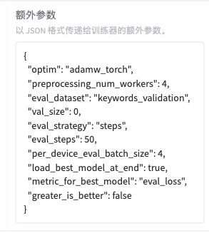

This partial screenshot corresponds to the entire JSON input box above. After filling it in, first find the two lines `eval_dataset` and `eval_steps`, and check the registration name of the validation file and the evaluation interval respectively; whether they are ultimately passed to the training program can be confirmed in the command preview in Section 8.1.

Loss is calculated on these 200 validation examples every 50 steps, and the checkpoint is selected based on the lower validation loss. This is only a candidate selection criterion and does not mean the keyword content is necessarily better; the next chapter will also examine the actual answers.

<details>
<summary>Reference: meaning of each field in the extra arguments</summary>

Compare field by field:

| Chinese name and config field                                                                                            | Value used this time              | What it does in this training run                            |
| ------------------------------------------------------------------------------------------------------------- | --------------------- | --------------------------------------------- |
| Optimizer<br>`optim`                                                                                             | `adamw_torch`         | Use PyTorch's AdamW to update parameters                |
| Number of data preprocessing workers<br>`preprocessing_num_workers`                                                               | `4`                   | Use 4 processes to handle data, distinct from how many samples are trained at a time |
| Validation set<br>`eval_dataset`                                                                                      | `keywords_validation` | Find 200 validation records from the registry                    |
| Automatic validation split<br>`val_size`                                                                                    | `0`                   | No longer split extra data from the 1,600 training records             |
| Validation strategy<br>`eval_strategy`                                                                                   | `steps`               | Schedule validation by parameter update steps                         |
| Validation interval<br>`eval_steps`                                                                                      | `50`                  | Run validation once every 50 update steps               |
| Validation batch size per device<br><code style="white-space: normal; overflow-wrap: anywhere;">per_device_eval_batch_size</code> | `4`                   | Process 4 records per batch during validation on each GPU, set separately from the training batch |
| Load best checkpoint at the end<br>`load_best_model_at_end`                                                              | `true`                | Load the selected best checkpoint after training finishes                 |
| Metric for comparing best checkpoints<br>`metric_for_best_model`                                                               | `eval_loss`           | Use validation loss to compare candidate checkpoints                     |
| Whether a larger metric value is better<br>`greater_is_better`                                                                       | `false`               | In this example, a smaller validation loss is better                           |

</details>

**When an independent `eval_dataset` is present, `val_size` must be `0`**; specifying `eval_dataset` together with a non-zero `val_size` will raise an error. What is configured here is validation during training; the "Evaluate & Predict" tab is a separate entry point. [WebUI parameter merging](https://github.com/hiyouga/LLaMA-Factory/blob/dced5f8804bfbf7109ef7c14401db6bd5cce7e53/src/llamafactory/webui/runner.py#L174), [data parameter constraints](https://github.com/hiyouga/LLaMA-Factory/blob/dced5f8804bfbf7109ef7c14401db6bd5cce7e53/src/llamafactory/hparams/data_args.py#L164-L167).

### 7.3 Batch, Learning Rate, and Training Epochs

First, select only `keywords_train` as described in Section 6.3, and then fill in the parameters shown directly on the Train page. The same real screenshot below is split into enlarged regions and checked from top to bottom; on narrow screens, you can scroll horizontally within the image.

**First look at the learning rate, number of training epochs, random seed, maximum number of samples, and compute type.**

<div role="region" aria-label="Real training parameters left half row: learning rate 5e-5, 3 epochs, max gradient norm 1; scroll horizontally on narrow screens" tabindex="0" style="overflow-x: auto; margin: 12px 0;">
<div style="position: relative; width: 100%; max-width: 735px; min-width: 640px; aspect-ratio: 735 / 114; overflow: clip;">
  
</div>
</div>

<div role="region" aria-label="Real training parameters right half row: random seed 42, max samples 1600, compute type fp16; scroll horizontally on narrow screens" tabindex="0" style="overflow-x: auto; margin: 12px 0;">
<div style="position: relative; width: 100%; max-width: 738px; min-width: 640px; aspect-ratio: 738 / 114; overflow: clip;">
  
</div>
</div>

**Next look at length, batch, gradient accumulation, validation ratio, and scheduler.**

<div role="region" aria-label="Real training parameters section: cutoff length 2048, batch size 4, gradient accumulation 8; scroll horizontally on narrow screens" tabindex="0" style="overflow-x: auto; margin: 12px 0;">
<div style="position: relative; width: 100%; max-width: 883px; min-width: 640px; aspect-ratio: 883 / 103; overflow: clip;">
  
</div>
</div>

<div role="region" aria-label="Real training parameters section: validation set ratio 0, learning rate scheduler cosine; scroll horizontally on narrow screens" tabindex="0" style="overflow-x: auto; margin: 12px 0;">
<div style="position: relative; width: 100%; max-width: 590px; min-width: 590px; aspect-ratio: 590 / 103; overflow: clip;">
  
</div>
</div>

[View the full training parameter screenshot](../../images/31/31-7-3-1.jpg ":ignore"), and confirm that the data path is `data/keywords-clean` and the training set is `keywords_train`.

When filling in the form as shown, use this short table to verify the values:

| Page section                                    | Values to enter this time                          |
| -------------------------------------------- | --------------------------------- |
| Learning rate, epochs, random seed, max samples, compute type | `5e-5`, `3`, `42`, `1600`, `fp16` |
| Cutoff length, batch, accumulation, validation ratio, scheduler       | `2048`, `4`, `8`, `0`, `cosine`   |
| Logging interval, save interval, warmup steps in other parameters     | `5`, `50`, `5`                    |

Expand the corresponding tables when you need to check English key names or for review purposes.

<details>
<summary>Reference: correspondence between main page parameters and YAML fields</summary>

| WebUI item and configuration field                                                                                         | Value this round   | Meaning                                                 |
| ------------------------------------------------------------------------------------------------------------ | -------- | ---------------------------------------------------- |
| Cutoff length<br>`cutoff_len`                                                                                     | `2048`   | The training sequence composed of input and answer keeps at most 2,048 tokens      |
| Per-device batch<br><code style="white-space: normal; overflow-wrap: anywhere;">per_device_train_batch_size</code> | `4`      | Process 4 records per mini-batch on each GPU                            |
| Gradient accumulation<br><code style="white-space: normal; overflow-wrap: anywhere;">gradient_accumulation_steps</code>   | `8`      | Update once every 8 accumulated batches, with an effective batch size of 32                   |
| Learning rate<br>`learning_rate`                                                                                    | `5e-5`   | Controls the parameter update step size; in this example it is the learning rate at the end of warmup         |
| Number of training epochs<br>`num_train_epochs`                                                                               | `3`      | Learn through the training set 3 times                                      |
| Random seed<br>`seed`                                                                                           | `42`     | Controls random initialization, shuffling, and other processes in this training run               |
| Compute type<br>`fp16`, `bf16`                                                                                   | `fp16`   | Corresponds to `fp16: true`, `bf16: false`, using FP16 mixed precision |
| Learning rate scheduler<br>`lr_scheduler_type`                                                                          | `cosine` | Reduce the learning rate along a cosine curve after warmup                           |
| Warmup steps<br>`warmup_steps`                                                                                   | `5`      | Gradually increase the learning rate over the first 5 update steps                          |
| Logging interval<br>`logging_steps`                                                                                  | `5`      | Record a log entry every 5 update steps                            |
| Save interval<br>`save_steps`                                                                                     | `50`     | Save once every 50 update steps, consistent with the validation interval               |

</details>

Logging interval, save interval, and warmup steps are in **Other Parameter Settings**, not in the main parameter row above. Fill in `5 / 50 / 5` as shown in the following image:

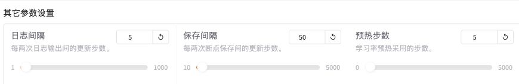

When all 1,600 training samples are retained and packing is not enabled: `1600 ÷ 4 ÷ 8 = 50` steps per epoch, with an expected total of **150 steps** over 3 epochs. This is an expectation calculated from the configuration; you still need to verify the actual number of preprocessed records and the startup logs in the end.

The random seed can be understood as a number that controls random processes; for this round, just record `42`. The data split in Chapter 29 has already been written into the files, so changing the seed here will not re-split the three datasets; and the same seed cannot guarantee bit-identical results across different hardware and software versions.

If you run out of GPU memory during training, distinguish the stage where it occurs according to the warning instructions in Section 8.5, and then refer to Chapter 33 for handling.

### 7.4 LoRA and Other Options

Expand **LoRA Parameter Settings**. In the upper part of the image below, fill in rank, alpha, and dropout as `8`, `16`, and `0` respectively; the lower left side is for target modules, and the lower right side is for additional modules. This time, fill in only `all` in the target modules, and leave the additional modules empty.

<div role="region" aria-label="Real LoRA parameters: rank 8, alpha 16, dropout 0; scroll horizontally on narrow screens" tabindex="0" style="overflow-x: auto; margin: 12px 0;">
<div style="position: relative; width: 100%; max-width: 858px; min-width: 640px; aspect-ratio: 858 / 95; overflow: clip;">
  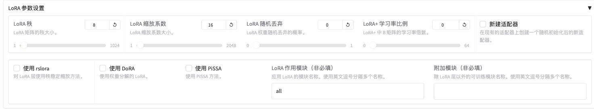
</div>
</div>

<div role="region" aria-label="Real LoRA parameters: target modules all, additional modules empty; scroll horizontally on narrow screens" tabindex="0" style="overflow-x: auto; margin: 12px 0;">
<div style="position: relative; width: 100%; max-width: 798px; min-width: 640px; aspect-ratio: 798 / 110; overflow: clip;">
  
</div>
</div>

[View the full LoRA parameter screenshot](../../images/31/31-7-4-1.jpg ":ignore").

<details>
<summary>See also: fields and purposes of LoRA and other switches</summary>

| Page item and configuration field              | Value for this run              | Purpose                                           |
| ------------------------------- | ------------------- | ---------------------------------------------- |
| LoRA rank<br>`lora_rank`          | `8`                 | Sets the intermediate width of the added branch                         |
| LoRA scaling factor<br>`lora_alpha`   | `16`                | Works with rank to scale the branch result by `alpha/r`           |
| LoRA random dropout<br>`lora_dropout` | `0`                 | Does not randomly drop branch input                             |
| LoRA target modules<br>`lora_target`  | `all`               | Adds branches to the applicable linear layers identified by the tool; the preview takes precedence     |
| Sequence packing<br>`packing`           | `false` (off)     | Does not pack multiple short samples into one training sequence               |
| Learn prompt words<br>`train_on_prompt` | `false` (off)     | User input provides context and is not included in the loss as a prediction target |
| Thinking mode<br>`enable_thinking`   | `false` (off) | Actual behavior depends on the template; this round of training answers do not include the thinking content   |
| Experiment reporting platform<br>`report_to`     | `none` (not enabled)    | Does not report to external platforms; training logs are still saved locally         |

</details>

Leave "Additional modules" empty; LoRA variants, quantization, DeepSpeed, and offload are not enabled in this round. Keep RoPE scaling at `none` and the acceleration method at `auto`.

`all` goes in target modules, not additional modules. If the current page interprets an empty target modules field as the default "all", still verify `lora_target` in the preview. When the quantization level is "none", the appearance of "bnb" next to it does not mean QLoRA is already in use.

Back in **other parameter settings**, confirm that "Sequence packing," "Learn prompt words," and "Enable thinking mode" are all unchecked. After selecting the conversation template `qwen3_nothink`, also check the thinking mode switch separately.

<div role="region" aria-label="Actual other parameters section: sequence packing and learn prompt words are both unchecked; scroll horizontally on narrow screens" tabindex="0" style="overflow-x: auto; margin: 12px 0;">
<div style="position: relative; width: 100%; max-width: 660px; min-width: 640px; aspect-ratio: 660 / 138; overflow: clip;">
  
</div>
</div>

<div role="region" aria-label="Actual other parameters section: thinking mode unchecked and external recording panel set to none; scroll horizontally on narrow screens" tabindex="0" style="overflow-x: auto; margin: 12px 0;">
<div style="position: relative; width: 100%; max-width: 320px; min-width: 320px; aspect-ratio: 320 / 180; overflow: clip;">
  
</div>
</div>

[View the full other parameters screenshot](../../images/31/31-7-4-2.jpg ":ignore").

---

## 8. Training Launch and Log Checking

After completing the pre-launch checks, choose either the WebUI or the CLI (command line) entry in Section 8.3, and **launch only once for the same round**.

### 8.1 Parameter Preview and Pre-Launch Checks

On the Train page, click "Preview command". It will not start training; instead, it converts the choices you just made into parameters received by the training program. First check them against three groups:

1. **Task and model:** The model, template, and training data are correct, a separate validation set has been passed in, and the test set is not involved.
2. **Training arrangement:** Batch, accumulation, epochs, and precision match Section 7, with the same validation and saving intervals.
3. **Result location:** Output goes to the new directory for this round, with no old Adapter mistakenly attached and no old checkpoint restored.

Click the checklist below and compare it with the page preview item by item; this checks whether the settings take effect, not re-explaining the parameter principles.

<details>
<summary>Pre-launch checklist: key fields in the actual preview</summary>

```text
dataset_dir = data/keywords-clean       # 数据目录
dataset = keywords_train               # 训练集登记名
eval_dataset = keywords_validation     # 验证集登记名
val_size = 0                           # 不再自动划分验证集
max_samples = 1600                     # 最大样本数
per_device_train_batch_size = 4        # 每张卡每个小批次处理的样本数
gradient_accumulation_steps = 8        # 更新前累积的小批次数
num_train_epochs = 3                   # 训练轮数
save_steps = 50                        # 每隔多少个更新步保存检查点
eval_steps = 50                        # 每隔多少个更新步验证一次
load_best_model_at_end = True          # 结束时加载最佳检查点
template = qwen3_nothink               # 对话模板
enable_thinking = False               # 关闭思考模式
fp16 = True                           # 开启 FP16 混合精度
```

</details>

The default zero value of `val_size` is sometimes not displayed, but no non-zero value may appear. Confirm that the full output path matches Section 7.1 and that there is no `adapter_name_or_path` or `resume_from_checkpoint`; if the parameters do not match, go back to the page and correct them.

<details>
<summary>Compare with the actual command preview: model and training data → validation set and LoRA</summary>

In the command preview below, the first half is the model and training data, and the second half is the validation set and LoRA settings.

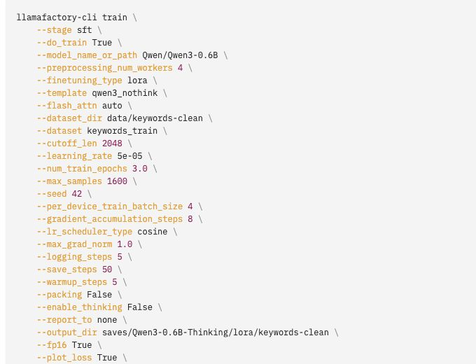

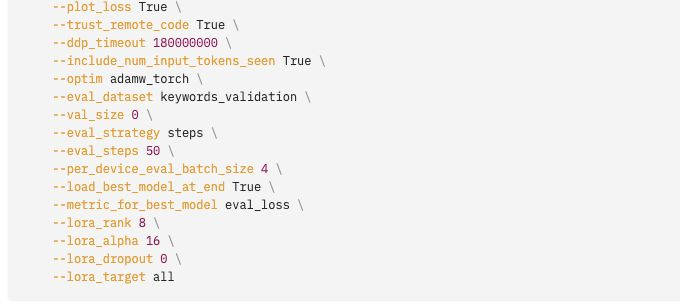

First check `dataset_dir`, `dataset`, and `fp16` in the first half, then check `eval_dataset`, `eval_steps`, and `lora_target` in the second half.

</details>

**Confirm three things before starting:** the actual GPU computation in Section 3.4 has passed; the files uploaded in Section 6 have been verified; and the output directory has no existing training results.

All commands below in this chapter use `keywords-clean` as the experiment name. If you change the output directory when reproducing, also change the paths in the commands for viewing logs, reading checkpoints, and packaging together.

### 8.2 Launching in the WebUI

1. In the "Config path" field at the bottom of the page, enter a new file name, such as `keywords-clean-webui-20260907.yaml`, then click **Save training config**. Confirm that the page shows "Training config saved to" and the corresponding path, and that it does not overwrite a previously saved file with the same name.
2. After confirming the preview command is correct, click "Start" once on the Train page. Do not also run the launch command in Section 8.3 at the same time.
3. Wait for the page logs to update. On the first run, the model may first be downloaded and the data processed, so it is normal not to see a loss curve immediately.

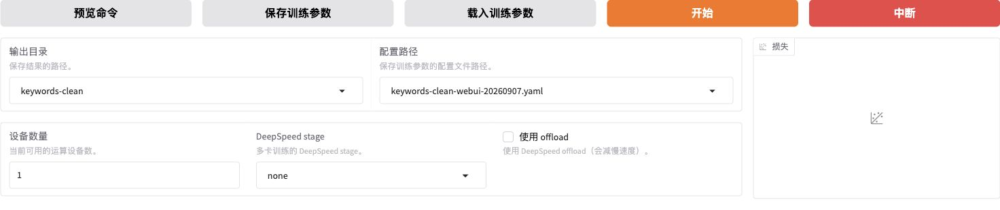

**Output directory** stores training results, and **Config path** stores the page settings. After saving, the page should prompt `训练参数已保存至：llamaboard_config/keywords-clean-webui-20260907.yaml`; then confirm in JupyterLab that the file exists.

What is saved here is the **page settings for reloading in the WebUI**; CLI launch uses the course training YAML from Section 8.3. In this version, when launching WebUI training, the parsed parameters are also written to `training_args.yaml` in the results directory. After reloading the page settings, you still need to verify the model path, output directory, and command preview. [Config saving and launch implementation](https://github.com/hiyouga/LLaMA-Factory/blob/dced5f8804bfbf7109ef7c14401db6bd5cce7e53/src/llamafactory/webui/runner.py)

If the page logs are not fully visible, you can read the WebUI training logs for this round in another **AutoDL terminal**:

```bash
tail -n 80 /root/autodl-tmp/LLaMA-Factory/saves/Qwen3-0.6B-Thinking/lora/keywords-clean/webui_subprocess.log
```

`tail -n 80` shows the last 80 lines of the log. If the file does not exist yet, check whether the page has created a training process and whether the output directory has been changed; the CLI log location is in the next section.

**To end training early:** go back to the **bottom of the Train page** in LLaMA-Factory, and click the red **"Interrupt"** button to the right of the orange "Start" button. Wait for the log to show that the task has been interrupted and the training progress no longer increases. This is not the shutdown button in the AutoDL console.


"Interrupt" does not guarantee that an additional checkpoint will be saved; you must go to the output directory to confirm which files have already been saved. Do not treat the current progress as saved progress. If training was started in a terminal as in the next section, go to the **AutoDL terminal where the training was launched** and press `Ctrl+C`, rather than clicking "Interrupt" on this page.

### 8.3 Launching with YAML (Optional)

<details>
<summary>Expand when switching to terminal launch; skip if already launched from the WebUI</summary>

Use the course training YAML `案例与源码-4-微调/configs/keywords_clean_train.yaml`, and upload, check, and run it as follows.

First prepare the config and log directories in the **AutoDL terminal**:

```bash
cd /root/autodl-tmp/LLaMA-Factory
source .venv/bin/activate
mkdir -p configs logs
```

In JupyterLab, open `LLaMA-Factory/configs/` on the left and upload the local `案例与源码-4-微调/configs/keywords_clean_train.yaml`. If a file with the same name already exists, open and compare it first; do not overwrite it directly.

After uploading, view the contents; focus on the model, data paths, validation set, and output directory:

```bash
sed -n '1,100p' configs/keywords_clean_train.yaml
```

If you previously switched to a local model path, update `model_name_or_path` in this YAML accordingly; changes on the page are not automatically written back to this file. After confirming, run the following in the same AutoDL terminal:

```bash
(
  set -e
  if [ -e saves/Qwen3-0.6B-Thinking/lora/keywords-clean ] ||
     [ -e logs/keywords-clean-train.log ]; then
    printf '输出目录或日志已经存在，请先核对；本次不启动训练。\n'
    exit 1
  fi

  OMP_NUM_THREADS=4 USE_MODELSCOPE_HUB=1 \
    llamafactory-cli train configs/keywords_clean_train.yaml \
    > logs/keywords-clean-train.log 2>&1

  printf '训练命令正常结束，请继续检查日志和输出文件。\n'
)
```

The preceding check avoids overwriting an experiment with the same name. `USE_MODELSCOPE_HUB=1` specifies the model download source, and `OMP_NUM_THREADS=4` sets the number of CPU threads; `> ... 2>&1` writes the runtime output and errors together into the log. The parentheses make this check run in a separate subshell, so a failure will not close your terminal.

During training, this terminal will wait and may not display text continuously, because the output has been written to a file. Keep it running and view it in another **AutoDL terminal**:

```bash
tail -n 80 /root/autodl-tmp/LLaMA-Factory/logs/keywords-clean-train.log
```

If you need to watch continuously, replace `-n 80` with `-f`; pressing `Ctrl+C` in the terminal viewing the log only exits the viewing and does not stop the training in the other terminal. This example does not use background launch, so do not close the training terminal; if "training command completed normally" does not appear, first open the end of the log to check for errors.

</details>

### 8.4 Launch Logs and Training Progress

After launching, check model loading, data processing, and training progress according to the logs. **Your own logs, checkpoints, and the Adapter loaded in the next chapter should all be based on the directory for this round from Section 7.1.** The WebUI screenshots and CLI numbers below come from two separately saved demonstrations; do not mix them into a single run of your own.

<details>
<summary>Correspondence of the example files</summary>

The text logs, the standalone loss chart, and the evaluation in Chapter 32 correspond to the CLI example `keywords-clean`; the WebUI page screenshots correspond to `keywords-clean-webui-20260908`. The two examples use the same data and core parameters, each trained for 150 steps, but the output directory and Adapter are saved separately.

All supporting files are under `案例与源码-4-微调/results/`. When following along yourself, always use the output directory set in Section 7.1; you can find the example materials in the [supporting file description](%E6%A1%88%E4%BE%8B%E4%B8%8E%E6%BA%90%E7%A0%81-4-%E5%BE%AE%E8%B0%83/README.md).

</details>

| Log stage     | What is happening           | What to look at                                                  |
| ---------------- | ---------------------- | ----------------------------------------------------------- |
| Model download and loading   | Preparing base weights and tokenizer   | Whether the model is Qwen3-0.6B, and whether there are download or dependency errors                 |
| Data reading, preprocessing | Read the registration file and process samples | Whether the training file is `keywords_train`, and whether there are format errors or discarded samples |
| Training startup statistics     | Summarize the training arrangement for this run       | Number of samples, LoRA parameter count, batch, gradient accumulation, total steps                |
| Step count begins to increase    | Parameters are being updated           | Progress, Loss, learning rate, elapsed time, and estimated remaining time                      |

**First, look at the startup statistics.**

```text
Num examples = 1,600
Num Epochs = 3
Num update steps per epoch = 50
Instantaneous batch size per device = 4
Total train batch size (w. parallel, distributed & accumulation) = 32
Gradient Accumulation steps = 8
Total optimization steps = 150
Number of trainable parameters = 5,046,272
```

Verify the number of samples **1,600**, total steps **150**, effective batch **32**, and the trainable LoRA parameter count. The trainable parameter ratio recorded in the same log is approximately 0.8395%.

**WebUI demonstration: startup and training progress.**

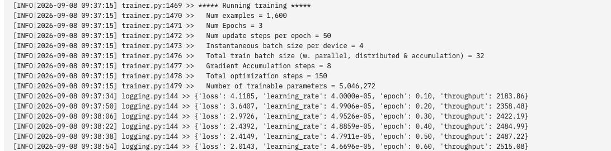

These statistics should also appear in the page logs, after which the step count and Loss continue to update.

If the total number of steps does not match expectations, check the selected data, validation split, sequence packing, and the actual number of samples retained.

The `当前步数/总步数` in the progress bar indicates how many updates have been completed; the time area generally shows both elapsed time and estimated remaining time at the same time. The first few steps are still warming up, so the speed may be unstable; defer judging the time cost until later. `s/it` is the number of seconds spent per iteration, and `it/s` is the number of iterations completed per second; read them together with their units.

This chapter logs every 5 steps, and validates and saves every 50 steps; at validation steps, progress pauses temporarily until validation completes before continuing.

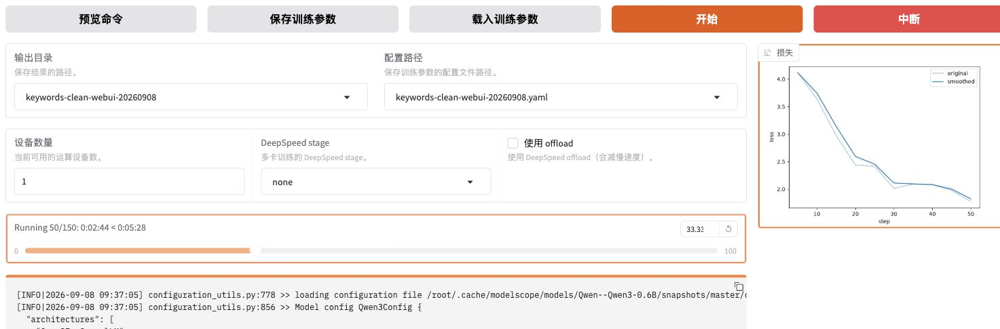

The output directory in the figure identifies the current experiment, `Running 50/150` indicates that 50 parameter updates have been completed, and the right side shows the recorded training Loss.

### 8.5 Loss Curve and Completion Status

**Confirm the completion status.** The page should show "Training completed", then check the completed step count, best checkpoint, and Adapter files in the output directory in `trainer_state.json`. The example below completed 150 steps and selected `checkpoint-150`:

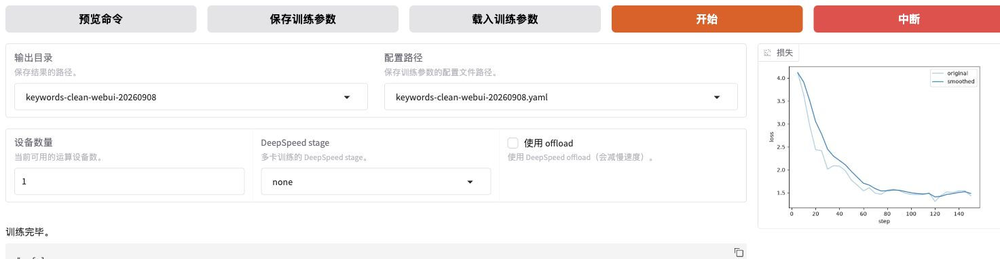

Open `training_loss.png` and `training_eval_loss.png` in your own results directory to view the training and validation losses respectively; for details on how to read them, see [the log and curve explanation in Chapter 30](30-%E6%A8%A1%E5%9E%8B%E8%AE%AD%E7%BB%83%E5%8E%9F%E7%90%86%E4%B8%8E%E9%AB%98%E6%95%88%E5%BE%AE%E8%B0%83.md?id=_9-training-logs-and-checkpoints). The values are recorded in `trainer_log.jsonl` and `trainer_state.json` in the same directory.

**Next, look at the Loss chart and completion statistics.**

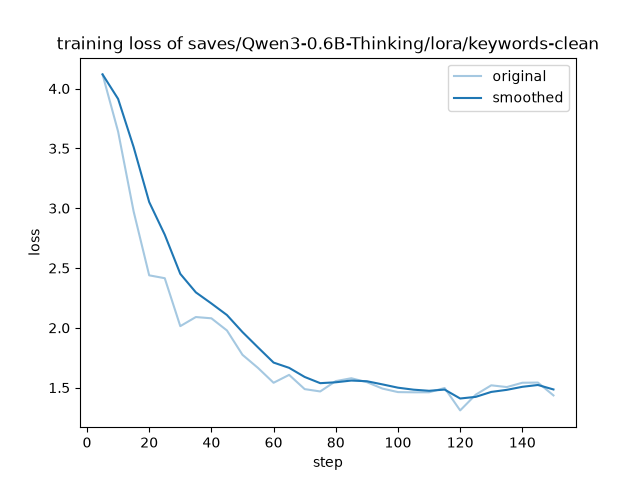


| Statistic               | Example result                   |
| ---------------------- | -------------------------- |
| Completed steps               | 150                        |
| Validation Loss of the best checkpoint  | 1.5880                     |
| Training time recorded by Trainer | 519.8399 seconds, about 8 minutes 40 seconds |
| Best checkpoint             | `checkpoint-150`           |

The time in the table refers only to the training process counted by Trainer, excluding installation, upload, and backup. After the log reaches `150/150`, it still needs to load the best checkpoint, save the final Adapter, and complete validation; the evaluation summary is saved in `eval_results.json`.

**Completion check:** the progress reaches the end, and the log provides completion and save information; then confirm that the artifacts are complete according to Section 9. Keyword extraction effectiveness will be checked in Chapter 32.

<details>
<summary>When plotting metric missing or memory allocation warnings appear</summary>

- `No metric eval_accuracy to plot`: indicates there is no `eval_accuracy` available for plotting; the course validates according to `eval_loss` and does not require an accuracy curve to be generated. Check the actually recorded metrics and the training completion status.
- `memory allocation failed with OOM`: verify whether subsequent steps increase, whether the process continues running, and whether validation and saving are completed. This line alone cannot determine whether the entire training run was aborted; if progress stalls or the process exits abnormally, troubleshoot according to [Chapter 33](33-%E5%BE%AE%E8%B0%83%E6%98%BE%E5%AD%98%E4%BC%98%E5%8C%96%E4%B8%8E%E5%A4%9A%E5%8D%A1%E8%AE%AD%E7%BB%83.md).

If memory is insufficient while processing a training batch, first change batch to 2 and gradient accumulation to 16 to maintain an effective batch of 32; if it is insufficient during weight loading, check the model size, precision, and existing memory usage. The 9.8 GB from the calculator in Chapter 30 is only an estimate; your own resource usage should be observed using the methods in Chapter 33.

</details>

---

## 9, Training Results and Backup

### 9.1 Training Output Files

After training completes, open `saves → Qwen3-0.6B-Thinking → lora → keywords-clean` in sequence on the left side of JupyterLab, or run the following in the **AutoDL terminal**:

```bash
ls -lh /root/autodl-tmp/LLaMA-Factory/saves/Qwen3-0.6B-Thinking/lora/keywords-clean
```

Check and keep the output files according to the following purposes:

| File                                                   | Purpose for viewing or keeping                                                            |
| ------------------------------------------------------ | --------------------------------------------------------------------------- |
| `adapter_model.safetensors`, `adapter_config.json`     | LoRA weights and loading configuration for this run; keep them together                                          |
| `checkpoint-50/`, `checkpoint-100/`, `checkpoint-150/` | Training archives saved at different update steps                                                    |
| `trainer_state.json`                                   | View training progress, best checkpoint, and corresponding validation loss                                      |
| `training_args.bin`, startup YAML                         | Keep the training settings; WebUI generates `training_args.yaml`, while a CLI-uploaded YAML must be backed up separately |
| `llamaboard_config.yaml` (WebUI route)                 | Page settings record, kept separate from the training parameter files                                          |
| `trainer_log.jsonl`, Loss charts, run logs                 | Review the training and validation process                                                          |
| `train_results.json`, `eval_results.json`              | Summary statistics, not per-record keyword prediction answers                                            |

The example Adapter is about **20 MB** and stores LoRA incremental weights; Chapter 32 will load it together with the corresponding Qwen3-0.6B.

The accompanying `results/keywords-clean/training/` provides logs, curves, and statistics, with a training configuration of `configs/keywords_clean_train.yaml`, making it convenient for studying without enabling a GPU. This is a reference material directory and does not include Adapter weights or complete checkpoints, so it cannot be used directly as a checkpoint path in WebUI.

The WebUI route keeps the subprocess logs and automatically saved training parameters in the results directory; the CLI route also needs to keep the YAML and redirected logs specified in Section 8.3.

### 9.2 Verifying the Best Checkpoint

In the **AutoDL project root directory**, read `trainer_state.json` to verify the completed steps and the selected checkpoint:

```bash
python - <<'PY'
import json
from pathlib import Path

result_dir = Path("saves/Qwen3-0.6B-Thinking/lora/keywords-clean")
state = json.loads((result_dir / "trainer_state.json").read_text(encoding="utf-8"))
print("完成步数:", state["global_step"])
print("最佳检查点:", state["best_model_checkpoint"])
print("对应验证损失:", state["best_metric"])
PY
```

The example completed 150 steps, with the best checkpoint being `checkpoint-150`, corresponding to a validation loss of about `1.5880`. When training on your own, read the results according to the rules in Section 7.2; the lowest loss may also appear at an earlier checkpoint.

Loading the Adapter to check answers requires the corresponding weights and configuration; complete continued training also requires the optimizer, scheduler, and random state, so the entire checkpoint directory should be kept when backing up.

**When backing up, distinguish between two purposes:** inference requires the Adapter and loading configuration; resuming training also requires the optimizer, scheduler, and other state. Check your own files using the method below, and do not treat a weights-only backup as a complete continued-training archive.

<details>
<summary>If training is interrupted, read this: how to resume from a complete checkpoint</summary>

**First, confirm whether the interruption was to access or to training.** A browser disconnect or SSH tunnel exit only indicates an access problem. After reconnecting to AutoDL, first check the process and the original training log in the terminal:

```bash
ps -eo pid,etime,args | grep -E 'llamafactory|keywords'
```

The process list may show WebUI, the training subprocess, and the search command itself at the same time; judge based on the complete command. Check the log for that run according to Sections 8.3-8.4; if training is still in progress, restore access and continue observing, and do not start a second training run. Only consider resuming when the process has exited and the log has no record of normal completion.

**Next, find the last fully written checkpoint.** For example, suppose the original plan was to train for 150 steps and it was interrupted around step 120, and the last complete save was `checkpoint-100`; then you can only resume from the state at step 100, and unsaved updates need to be redone. You cannot fabricate a `checkpoint-120` based on the maximum step number in the log.

Check the files in the output directory of your own training run. The following uses this course's single-GPU, ordinary LoRA, AdamW, and FP16 route as an example; replace the path with the checkpoint that actually exists for your run. This command only inspects files and JSON and does not load the model:

```bash
python - <<'PY'
import json
from pathlib import Path

checkpoint = Path("saves/Qwen3-0.6B-Thinking/lora/keywords-clean/checkpoint-100")
required = [
    "adapter_config.json", "adapter_model.safetensors", "trainer_state.json",
    "optimizer.pt", "scheduler.pt", "rng_state.pth", "scaler.pt",
]
missing = [name for name in required if not (checkpoint / name).is_file()]
if missing:
    raise SystemExit(f"缺少本路线的恢复文件，请核对原配置与备份：{missing}")
state = json.loads((checkpoint / "trainer_state.json").read_text(encoding="utf-8"))
print("检查点路径:", checkpoint.resolve())
print("已保存的更新步:", state["global_step"])
print("文件存在性检查通过；仍需在恢复时确认状态能够加载。")
PY
```

`optimizer.pt` and `scheduler.pt` save the update rules and learning rate progress, `rng_state.pth` saves the random state, and `scaler.pt` saves the FP16 gradient scaling state for this route. Files for other precision or distributed routes may differ, so this checklist cannot be applied directly. If only Adapter files are found, you can still perform inference or later training, but you cannot claim to have the complete recovery state of the original training run. If `save_only_model: true` was used during that run, changing to `false` later cannot recover state that was not saved at the time.

**Finally, prepare the recovery configuration.** In JupyterLab, copy the complete YAML you actually used in Section 8.3 for that run, and save it under `LLaMA-Factory/configs/` as `train_keywords_resume.yaml`. Keep the base model, data and order, template, LoRA structure, batch, learning rate, precision, seed, and total training epochs consistent; only add or replace the following two fields in the copy. This is a snippet and cannot be used alone as a training configuration:

```yaml
output_dir: saves/Qwen3-0.6B-Thinking/lora/keywords-clean-resume
resume_from_checkpoint: saves/Qwen3-0.6B-Thinking/lora/keywords-clean/checkpoint-100
```

Choose a new, unused directory for the recovery output, and keep the original directory for verification. The original `num_train_epochs: 3` indicates a total of three training epochs; keep three epochs when resuming, and do not mistakenly fill in "how many epochs remain." This example resumes from step 100 to the originally planned 150 steps. Also, do not additionally fill the checkpoint into `adapter_name_or_path`: this section demonstrates resuming the original SFT state through `resume_from_checkpoint`.

After confirming that the original process has exited, the recovery files are complete, and the configuration matches the environment, first enter the **AutoDL project root directory and activate the original `.venv`** as described in Section 8.3, then execute. The following reuses the original download source and thread settings, and saves the recovery log separately:

```bash
(
  set -e
  if [ -e saves/Qwen3-0.6B-Thinking/lora/keywords-clean-resume ] ||
     [ -e logs/keywords-clean-resume.log ]; then
    printf '恢复输出目录或日志已存在，请先核对；本次不启动训练。\n'
    exit 1
  fi
  OMP_NUM_THREADS=4 USE_MODELSCOPE_HUB=1 \
    llamafactory-cli train configs/train_keywords_resume.yaml \
    > logs/keywords-clean-resume.log 2>&1
)
```

This terminal will wait for training; in another AutoDL terminal, use `tail -n 80 /root/autodl-tmp/LLaMA-Factory/logs/keywords-clean-resume.log` to view the recovery log. Verify the loaded checkpoint path, the resumed step count, and subsequent progress, and confirm that it continues from the saved position; if state loading fails or data or configuration does not match, stop and troubleshoot first, and do not treat "the program can start" as a successful recovery. Changing data, model, or training plan should be set up as a new experiment, not passed off as continuing the same training run.

See [the course's fixed-version SFT source code](https://github.com/hiyouga/LLaMA-Factory/blob/dced5f8804bfbf7109ef7c14401db6bd5cce7e53/src/llamafactory/train/sft/workflow.py#L119-L122) for how parameters are passed; see the [official documentation](https://llamafactory.readthedocs.io/zh-cn/latest/getting_started/merge_lora.html) for the difference between saving a model only and complete continued training.

</details>

### 9.3 Packaging and Downloading

The training results are saved on AutoDL; next, package and download them to your own computer.

**First confirm that training has finished, then package.** The following command uses the paths from this chapter as an example; `mktemp -d` creates a new backup directory and does not overwrite an existing backup.

When following this chapter's main route and using the **WebUI method from Section 8.2**, execute in the AutoDL terminal. The training parameters and WebUI subprocess logs are already in the results directory:

```bash
cd /root/autodl-tmp/LLaMA-Factory
keyword_backup_dir=$(mktemp -d /root/autodl-tmp/keywords-backup-XXXXXX)
tar -czf "$keyword_backup_dir/keywords-clean-training-backup.tar.gz" \
  saves/Qwen3-0.6B-Thinking/lora/keywords-clean \
  data/keywords-clean
```

<details>
<summary>If started via CLI, use this set of packaging commands instead</summary>

For the CLI route, the startup YAML and run logs are outside the results directory and need to be packaged together. Choose either the command below or the one above:

```bash
cd /root/autodl-tmp/LLaMA-Factory
keyword_backup_dir=$(mktemp -d /root/autodl-tmp/keywords-backup-XXXXXX)
tar -czf "$keyword_backup_dir/keywords-clean-training-backup.tar.gz" \
  saves/Qwen3-0.6B-Thinking/lora/keywords-clean \
  data/keywords-clean \
  configs/keywords_clean_train.yaml \
  logs/keywords-clean-train.log
```

</details>

What is packaged here is the current round's training output and data records. It does not include the base model's large weights, nor the entire `.venv`. The base model must still be kept separately or prepared again according to the records.

After the packaging command finishes without errors, continue in the **same AutoDL terminal** to check the archive, generate the checksum file, and print the backup directory:

```bash
cd "$keyword_backup_dir"
gzip -t keywords-clean-training-backup.tar.gz &&
  sha256sum keywords-clean-training-backup.tar.gz > keywords-clean-training-backup.tar.gz.sha256
pwd
ls -lh
```

`gzip -t` usually produces no text when successful; if it reports an error, stop the download step first and check whether there is insufficient disk space or missing files. `pwd` prints the backup directory that was just created.

Open this directory in the JupyterLab file panel, right-click the archive and the `.sha256` file respectively, and choose "Download / Download". Save the two files to the same folder on your local machine. Before sharing operation screenshots or logs, remove any instance connection information and passwords from them.

### 9.4 Local Backup Verification

Using Mac as an example, create a dedicated local folder for this round's backup and place the two downloaded files into it. Open a terminal in this folder; you can also type `cd ` first, then drag the folder into the terminal to complete the path, and press Enter.

After confirming that the downloaded files are in the current directory, run:

```bash
shasum -a 256 -c keywords-clean-training-backup.tar.gz.sha256
gzip -t keywords-clean-training-backup.tar.gz
tar -tzf keywords-clean-training-backup.tar.gz
```

The first command should display the archive name and `OK`, indicating that it matches the file on the server; the second command checks whether the archive is intact; the third command lists the files inside the archive, where you should be able to find the Adapter, all checkpoints, the three JSONL files, and the registry file. The CLI route should also include the uploaded YAML and run logs. If the verification is not `OK`, first re-check the downloaded files and do not treat this archive as a usable backup.

Passing file verification means the downloaded content matches the server files; whether the model can be loaded normally from the backup still needs practical inspection. When saving training results, keep the model name, environment, and training configuration together, and load the Adapter for verification in the next chapter.

### 9.5 Use a Record Card to Tie Together This Round's Experiment

To make it easier to verify the data, template, and training configuration used by the Adapter, create `实验记录.md` in the **local folder where this round's backup is stored**, summarizing this information and the locations of existing files.

| What to record       | Where to fill it in                                                               |
| -------------- | ------------------------------------------------------------------------ |
| This round's name and purpose | Describe in one sentence what to check, for example, "Complete first keyword LoRA training with cleaned data"       |
| Model and input     | Base model ID, downloaded version or weight verification record, tokenizer, chat template, and thinking settings          |
| Data version       | Paths, counts, and `manifest.json` for the three datasets; also record the annotation rule version used         |
| Environment and training configuration | LLaMA-Factory version, environment check results, the actual configuration for this round, and log locations, including the random seed |
| Saved results     | The selected checkpoint, selection rationale, backup archive name, and checksum file                             |
| Actual answers and conclusions | After Chapter 32 is completed, add the prompt, generation settings, raw predictions, scoring report, and unresolved issues   |

When training ends, fill in the first five items first. The configuration paths must correspond to the files actually run in this round, not point to a general YAML that was modified repeatedly afterward.

**What is handed over to Chapter 32 is this round's Adapter and this record card.** If the experiment name changes, the next chapter's checkpoint selection, prediction, and export configuration should also point to it; predictions and scoring should be saved to a new directory for this round. This way, you can trace back from one set of answers to the data, model, and settings used. Even if the scores are poor in the next chapter, record the raw outputs and limitations together as the basis for comparison in the next round.

---

**Chapter Reflection Questions:**

1. Starting from the data in Chapter 29 and ending with obtaining the Adapter in this chapter, in what order should the operations be performed? Which tasks are done locally, and which are done on AutoDL?

   **Reference approach:** First prepare the remote environment and verify GPU computation, start the WebUI and establish a local SSH tunnel, then upload the registered data, preview samples, configure the model and training parameters, and finally start training and back up the results. Model loading and training run on AutoDL, while the local machine is used for browser access and saving backups. After nvidia-smi can recognize the GPU, you should also complete this lesson's computation check in the current Python environment.

2. What do model_name_or_path, stage=sft, finetuning_type=lora, and template in the configuration respectively determine? How should the page settings be verified before submitting them for training?

   **Reference approach:** They specify the model, training stage, parameter update method, and dialogue template in that order. This lesson chooses Qwen/Qwen3-0.6B, SFT, LoRA, and the matching template; the model name and template name must not be conflated into one item. Preview the actual command or YAML, and verify these fields as well as output directory, batch size, learning rate, precision, and other settings; after startup, confirm from the logs what was actually loaded and used.

3. What are the respective purposes of the registered name, file path, and field mapping in dataset_info.json? When a separate validation file already exists, how should you select the data and set the validation ratio?

   **Reference approach:** The registered name is for reference by the training configuration, the file path points to the specific data, and the field mapping explains how messages and roles are read. After previewing to confirm that the training set has 1,600 entries, the validation set has 200 entries, and the content is correct, the training page should keep only keywords_train, separately specify eval_dataset as keywords_validation, and set val_size to 0, meaning no additional splitting. The test set does not participate in training or checkpoint selection.

4. After verifying the configuration, how do you start and determine whether a training round is complete? What do a successful command preview, progress showing 150/150, and successful file saving each indicate?

   **Reference approach:** For the same round, choose either the WebUI or YAML method to start. A successful preview only means the configuration was generated; 150/150 means the displayed training progress reached the planned number of steps. You should also confirm that the log ended normally, that the progress in trainer_state.json matches the actual configuration, and that the Adapter and related files were saved successfully. The current data and configuration expect 150 steps; other configurations should be recalculated.

5. Suppose the validation Loss is lowest at step 100, and step 150 ends normally. How should you decide which checkpoint to load subsequently?

   **Reference approach:** Check best_metric and best_model_checkpoint in trainer_state.json, and then verify the settings for saving and loading the best model. When selecting by validation Loss, pay attention to the recorded best checkpoint; do not assume the last step is the best version by default. Then compare actual answers using the same validation inputs. A lower Loss is only one basis for selection; keyword quality continues to be checked in Chapter 32.

6. If the local machine suddenly cannot open 127.0.0.1:7860, in what order should you troubleshoot? If this round was started via YAML, where is the training log?

   **Reference approach:** Check the local SSH tunnel, the remote WebUI, and the training process separately, and observe whether the corresponding logs continue to update, to confirm which link was interrupted. The YAML startup method in this chapter writes the log to logs/keywords-clean-train.log in the remote project; webui_subprocess.log belongs to the WebUI route. Do not start training again while it is still running; first restore the access connection.

7. To let a colleague load this Adapter and review the results, what materials should be handed over? If continuing training from the interruption point is also required, what additional requirements are there?

   **Reference approach:** Save the Adapter weights and configuration, the matching base model and version, tokenizer and template information, the actual training configuration, data records and logs, and verify the downloaded backup. Reproducing answers also requires inputs and generation settings; complete continued training additionally requires the optimizer, scheduler, random number, and other states in the checkpoint. Refer to the Section 9.5 record card to explain the location and purpose of each material.

<details>
<summary>Advanced exercise: resuming training after interruption</summary>

1. A total of 150 steps is planned. At step 120, the connection drops, and the most recent complete checkpoint is at step 100. After confirming that the training process has exited, how should recovery be arranged?

   **Reference approach:** Follow Section 9.2 to check whether the step-100 archive retains the required training state, keep the original data and configuration, and then resume from the complete checkpoint. Updates after step 100 that were not saved need to be redone; after resuming, check the starting point and total plan in the logs, and do not run another full 150 steps. Having only the Adapter weights is not enough to prove that the original optimizer and scheduler states were continued; if the data changes, it should be recorded as a new experiment instead.

</details>

**Chapter Summary:**

- AutoDL handles model loading and training, while the local machine accesses the page through an SSH tunnel and saves backups. Environment preparation must check whether the current Python and GPU can actually perform the required computation.
- Data registration connects names, files, and message fields, and preview is used to verify the actual inputs. A separate validation set is specified through eval_dataset, with val_size kept at 0; the test set is left for later evaluation.
- Model, training stage, fine-tuning method, and dialogue template are different settings. The WebUI, YAML, and startup logs should be consistent; for the same round, choose one startup method, and observe progress through processes and logs during training.
- Training completion must be confirmed by a normally ending log, state, and output files together; checkpoint selection must also be combined with validation performance. Page disconnection, training exit, and poor model results should be located separately.
- Training results include the Adapter, configuration, logs, and checkpoints; after downloading, the backup must also be verified. Complete continued training requires more training state than inference loading, and experiment records help with subsequent reproduction, evaluation, and handover.

**Suggested next step:** Complete the Section 9.5 experiment record, confirm that the results and backup are usable, and then proceed to [Chapter 32](32-%E5%BE%AE%E8%B0%83%E6%95%88%E6%9E%9C%E8%AF%84%E4%BC%B0%E4%B8%8E%E6%A8%A1%E5%9E%8B%E9%83%A8%E7%BD%B2.md). First use validation inputs to check loading and dialogue, then compare answers on a fixed test set; if running conditions are temporarily unavailable, you can use the prediction exercises and scoring attached to the next chapter, and note that the materials come from the course case.
