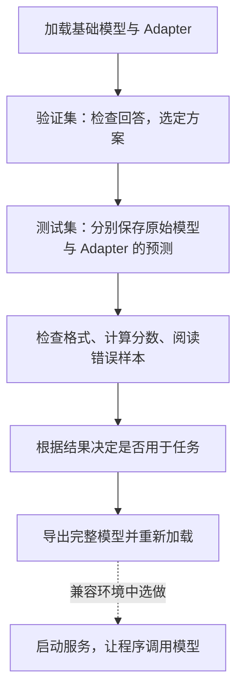
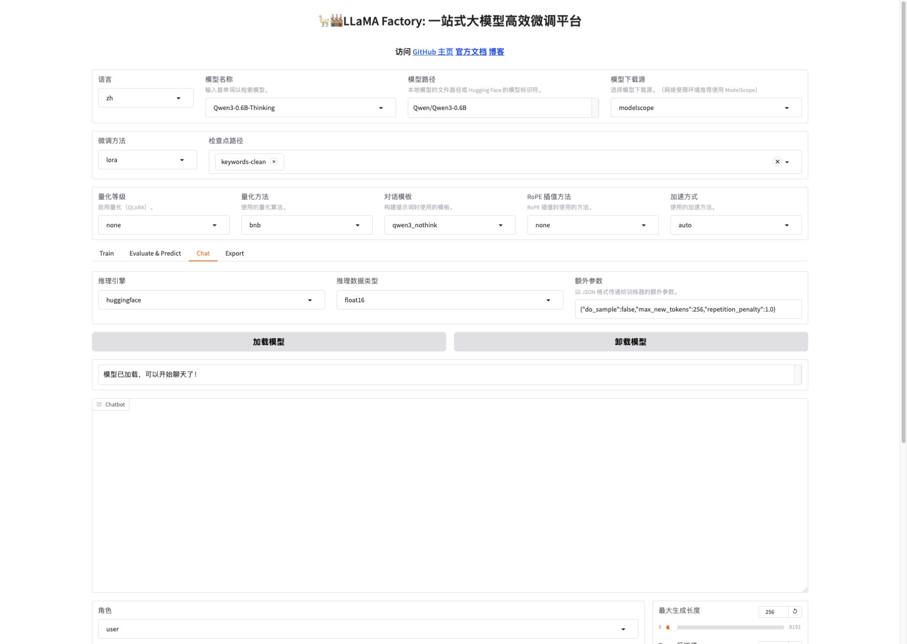
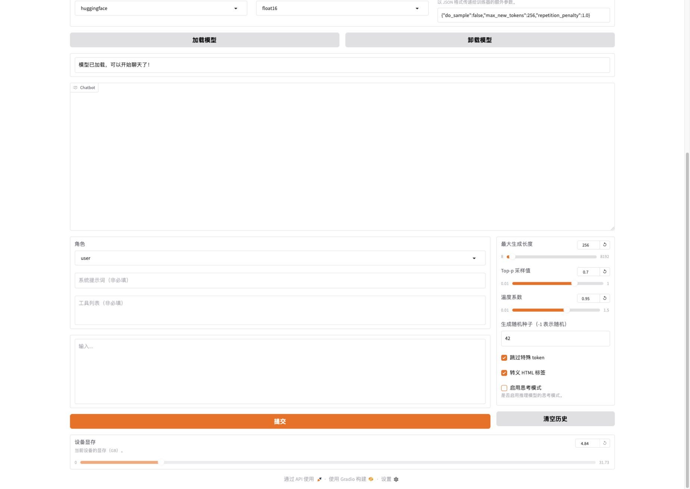
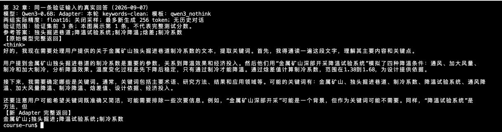
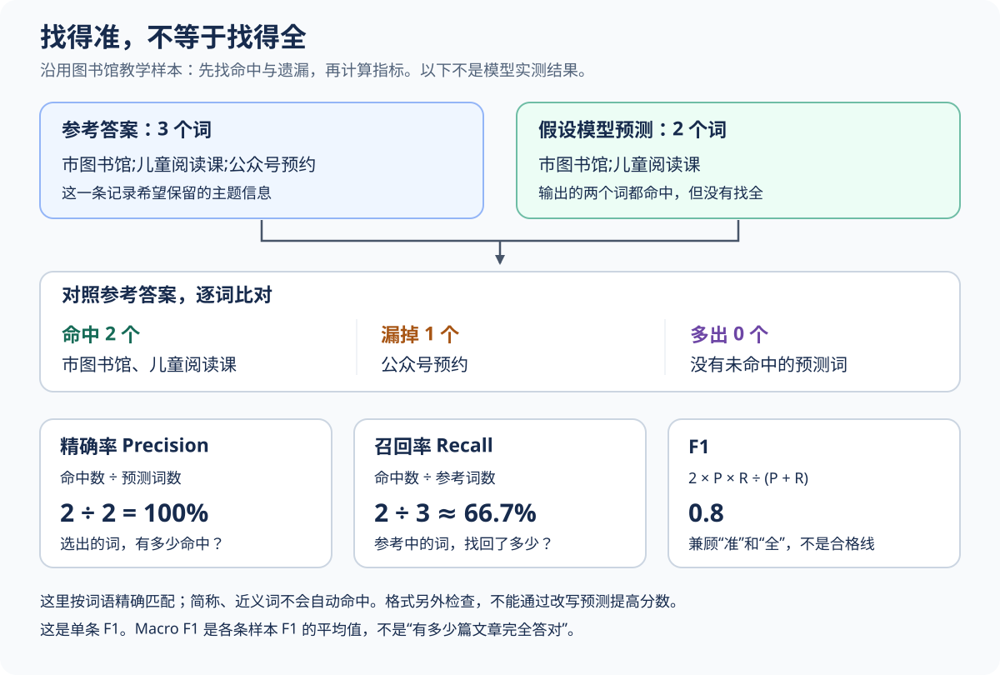
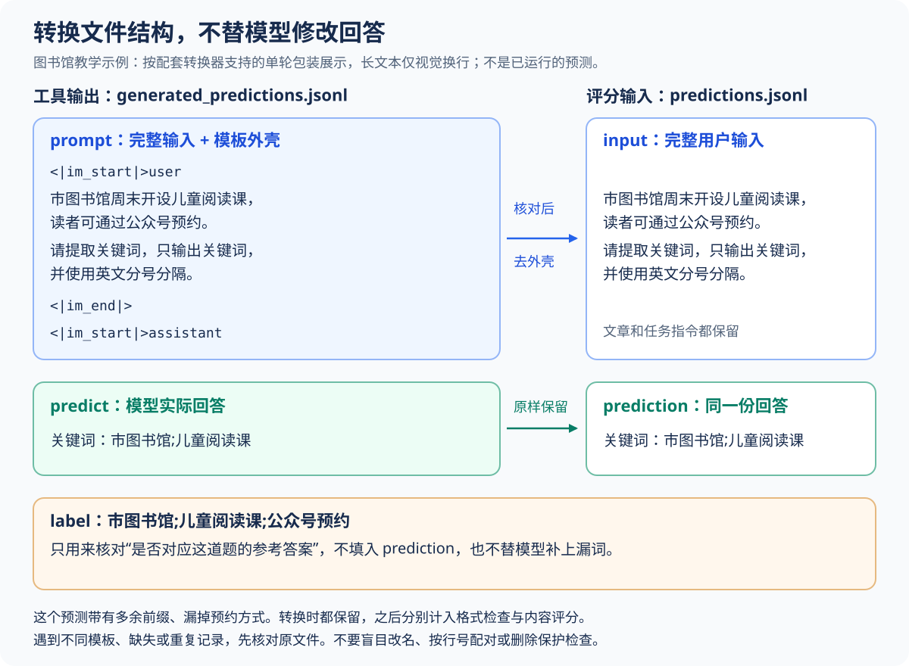
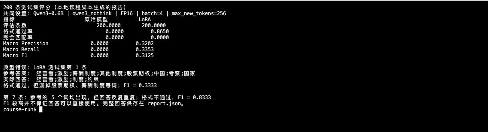
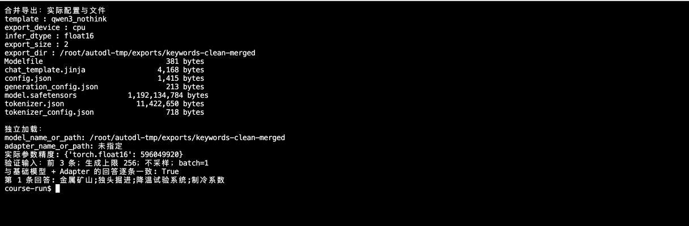
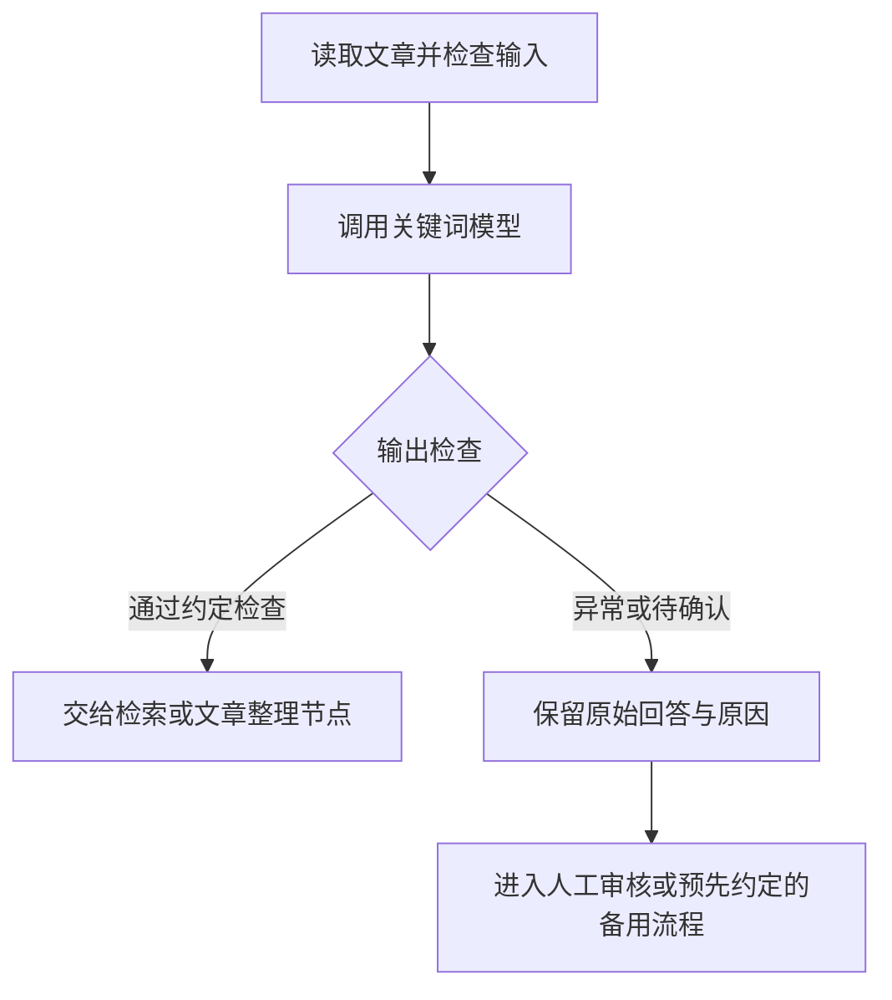
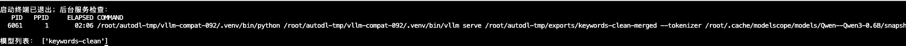

# 32 - Fine-tuning Evaluation and Model Deployment

---

**Learning objectives for this chapter:**

- Be able to have the original model and the fine-tuned model answer the same question, and explain whether the comparison conditions are fair.
- Be able to calculate precision, recall, and F1 for a single sample, and then understand the full report in combination with format issues and actual errors.
- Be able to decide whether to continue improving or adopt the model based on evidence, and plan the next round of data inspection and regression validation.
- Be able to distinguish between an Adapter, a merged model, and an API service, and complete export checks; optionally perform deployment when needed.

**Study advice:** Focus on the question "Is this fine-tuning worth adopting, and what is the evidence?" First look at one answer, then at a batch of results, and finally decide how to improve and deliver. The English parameters and commands are used to complete these checks; you are not required to memorize them on first reading.

First follow the main text to understand Sections 1–4, and personally calculate the library sample in Section 4.2; expand the advanced comparison and troubleshooting notes when needed. When following along, if you have an Adapter, complete the loading and prediction in Sections 2–3; if you do not have a GPU for the moment, you can directly use the two sets of predictions included with the course to complete Section 4.4, requiring only Python 3. Both paths require you to write your own evaluation conclusion in Section 4.6.

Section 5 teaches how to deliver model files, and Section 6 then explains how a program calls the model. Installing vLLM is optional depending on your environment; it is still worth reading and understanding how to check the API response after it is returned and how to handle failures.

---

## 1. Model Validation Tasks and Preparation

### 1.1 From Training Results to Actual Answers

In Chapter 31, we completed a round of LoRA training and saved the Adapter. Next, load it together with the original Qwen3-0.6B and see whether the model can extract keywords as required.

The Loss in Chapter 30 tells us how well the model predicts the reference answers; what we need to check now is: **when the model is actually asked to answer, can it directly output keywords, and is the extracted content appropriate?** This is the model validation covered in this chapter.

Continuing with the article management scenario from Chapter 28: after the program receives the answer, it needs to split the keywords by English semicolons and then use them for display and retrieval. If the model outputs an explanation or misses the article topic, then even if training completed successfully, the problem has still not been solved.

To place a single evaluation into a complete project, you can proceed in the following order:



Chapter 29 already split the data into training, validation, and test sets. In your own project, first use the validation set to choose a solution, and then use the test set, which was not involved in that selection, for acceptance; **the test set should not be used to repeatedly pick checkpoints or tune parameters.** The 200 predictions included with this chapter preserve the fixed settings used at the time, and we use them to practice recalculation and error analysis; they are saved separately from the troubleshooting experiments in Section 2.4 and cannot be combined into one post-optimization acceptance result.

For beginners, you may also export a model that has not yet met the task requirements, to practice file saving and loading. A successful export only means that this step was completed; it does not mean the model is already suitable for actual business use.

### 1.2 Files Used in This Chapter

First, recognize three things clearly: validation/test data are the "questions," the Adapter is the product of this round of training, and the two sets of prediction files are the model's "raw answer sheets." Which file is used at each step will be explained at the corresponding operation.

<details>
<summary>Reference while following along: file locations in this chapter</summary>

In the local course project, first locate the following files. They were already introduced or uploaded in Chapters 29 and 31, and you do not need to recreate the test set:

```text
案例与源码-4-微调/
├── processed/keywords-clean/
│   ├── keywords_validation.jsonl       # 200 条，用于检查与选择方案
│   └── keywords_test.jsonl             # 200 条，用于最后比较
├── configs/
│   ├── keywords_clean_predict_base.yaml # 不加载 Adapter 的预测配置
│   ├── keywords_clean_predict_lora.yaml # 加载 Adapter 的预测配置
│   └── keywords_clean_export.yaml       # 合并导出配置
├── examples/prompt-comparison/ # 第 2.4 节的提示词与 Adapter 对照
├── examples/thinking-control/ # 思考模式诊断与标注审核
├── results/keywords-clean/
│   ├── base/generated_predictions.jsonl # 课程附带的 200 条原始模型预测
│   └── lora/generated_predictions.jsonl # 课程附带的 200 条 LoRA 预测
├── audit_keywords_prediction.py          # 运行预测并核对实际精度、条数与数据
├── convert_keywords_predictions.py      # 把预测文件整理为评分脚本的输入
└── evaluate_keywords_predictions.py     # 对照参考答案评分
```

</details>

The Adapter obtained from training is located on **AutoDL**:

```text
/root/autodl-tmp/LLaMA-Factory/saves/Qwen3-0.6B-Thinking/lora/keywords-clean/
```

Use your own trained directory; if the name is different, the checkpoint options and configuration paths later must also be modified accordingly. The base model still uses the same `Qwen/Qwen3-0.6B` file as during training.

In this chapter, **loading, prediction, and export are done on AutoDL; file conversion and scoring after downloading are done locally**. The latter only processes text and does not require a GPU.

### 1.3 Comparing the Original Model and the Fine-tuned Model

Chapter 28 referred to the pre-fine-tuning performance as the **baseline**. Now we actually compare the two states:

| Comparison target     | What to load                              |
| --------------------- | ----------------------------------------- |
| Original model        | Qwen3-0.6B, without loading this round's Adapter |
| Fine-tuned model      | The same Qwen3-0.6B, plus the Adapter from Chapter 31 |

For example, for the same library article, the original model added "Keywords:" before the output, while after loading the Adapter there is no prefix; only then is it possible to say the output behavior has changed. If the second time an additional instruction such as "no prefix" was added separately, the improvement cannot be attributed solely to fine-tuning.

Therefore, the two comparisons must use **the same complete input, model file, chat template, and generation settings**. Section 2 first practices observing a single example, and Section 3 then uses the two paired configurations for batch prediction. The records in Chapter 28 help us understand the problem, but answers obtained with different inputs or unknown settings cannot replace the comparison here.

---

## 2. Model Loading and Single-example Validation

### 2.1 Loading the Model on the Chat Page

First open the LLaMA-Factory WebUI from Chapter 31 and go to the **Chat** page. If a model has already been loaded, click "Unload Model" first, then fill in:

| Page field                | Value to fill in this chapter            | Purpose                       |
| ------------------------- | ---------------------------------------- | ----------------------------- |
| Model name / path         | `Qwen3-0.6B-Thinking` / `Qwen/Qwen3-0.6B` | Select the base model         |
| Model download source     | `modelscope`                        | Use the same model files as during training |
| Fine-tuning method / quantization level | `lora` / `none` | Load ordinary LoRA this time, without additional quantization |
| Checkpoint path           | `keywords-clean`                        | Point to the Adapter obtained from Chapter 31 training |
| Chat template             | `qwen3_nothink`                        | Organize the conversation according to the selected rules |
| Inference engine / inference dtype | `huggingface` / `float16` | Engine and precision settings used for this chat |

The `Thinking` in the model name is the name shown on the page and does not mean thinking must always be enabled. Select the template according to the conventions in Chapter 29, and in the chat area uncheck "Enable thinking mode."

In the **"Additional Parameters" on the Chat page**, fill in:

```json
{ "do_sample": false, "max_new_tokens": 256, "repetition_penalty": 1.0 }
```

`do_sample: false` means turning off random sampling; `max_new_tokens` limits the maximum number of tokens to generate; `repetition_penalty: 1.0` means not applying an additional repetition penalty. Also set the maximum generation length at the bottom of the page to `256`, the random seed to `42`, and leave the system prompt empty.

Chapter 11 earlier introduced temperature and generation length. Since sampling is turned off this time, the chat engine used will not use temperature and top-p for random word selection, so do not look only at the temperature slider in the screenshot and assume random generation is enabled this time.

Click "Load Model" and wait for "The model has been loaded and you can start chatting." Below, the key areas are enlarged by model location, loading status, and generation settings for item-by-item verification:

First verify the **model name, model path, checkpoint, and template**. This screenshot has selected `keywords-clean`:

<div role="region" aria-label="Chat 实际加载配置：Qwen3-0.6B、keywords-clean 与 qwen3_nothink，窄屏可横向滚动" tabindex="0" style="overflow-x: auto; margin: 12px 0;">
<div style="position: relative; width: 100%; max-width: 815px; min-width: 640px; aspect-ratio: 815 / 350; overflow: clip;">
  
</div>
</div>

<details>
<summary>Expand when following along: screenshots of precision, additional parameters, and chat settings</summary>

Next, look at the **inference engine, FP16 precision, and model loading success message**:

<div role="region" aria-label="Chat 推理引擎 huggingface、精度 float16 与模型加载成功提示，窄屏可横向滚动" tabindex="0" style="overflow-x: auto; margin: 12px 0;">
<div style="position: relative; width: 100%; max-width: 975px; min-width: 640px; aspect-ratio: 975 / 245; overflow: clip;">
  
</div>
</div>

Finally, verify the "Additional Parameters," and in the chat area below set **maximum generation length to 256, random seed to 42, and uncheck "Enable thinking mode."** Keep the system prompt blank:

<div role="region" aria-label="Chat 额外参数：关闭采样、生成上限 256、重复惩罚 1.0，窄屏可横向滚动" tabindex="0" style="overflow-x: auto; margin: 12px 0;">
<div style="position: relative; width: 100%; max-width: 485px; min-width: 485px; aspect-ratio: 485 / 110; overflow: clip;">
  
</div>
</div>

<div role="region" aria-label="Chat 生成设置：最大长度 256、种子 42、未勾选启用思考模式，窄屏可横向滚动" tabindex="0" style="overflow-x: auto; margin: 12px 0;">
<div style="position: relative; width: 100%; max-width: 322px; min-width: 322px; aspect-ratio: 322 / 452; overflow: clip;">
  
</div>
</div>

[View full loading area screenshot](../../images/32/32-2-1-1.jpg ":ignore") · [View full chat settings screenshot](../../images/32/32-2-1-2.jpg ":ignore"). Use your own actual training result directory name for the actual path.

</details>

When switching between the two models, follow this order:

| Which group to check        | Operation order                        |
| --------------------------- | -------------------------------------- |
| Original model              | Unload model → clear checkpoint path → load model |
| Base model + Adapter        | Unload model → select your own checkpoint → load model |

Just changing the dropdown is not enough; the model from the previous load may still be in memory. Each time before submitting the comparison input, also click "Clear History" to avoid the previous round of conversation affecting this answer.

### 2.2 Reading Input and Reference Answers from the Validation Set

Start with the validation input below for practice. Provide the article together with the "keyword extraction" task to the model, and save the reference answer for review after the response. First check whether the response directly gives keywords and preserves the complete names from the reference answer, then check whether any topics are missed.

<details>
<summary>When switching to other validation articles: reading the input and reference answers</summary>

Open a terminal in the **root directory of this course project on your local machine** and run the following code. It only reads the validation set and does not call the model:

```bash
python3 - <<'PY'
import json
from pathlib import Path

path = Path("案例与源码-4-微调/processed/keywords-clean/keywords_validation.jsonl")
sample_number = 1  # 验证集中的第几条，从 1 开始
with path.open(encoding="utf-8") as f:
    samples = [json.loads(line) for line in f]
sample = samples[sample_number - 1]

print("【粘贴到 Chat 的完整输入】")
print(sample["conversations"][0]["content"])
print("\n【回答后再对照的参考答案，不粘贴到 Chat】")
print(sample["conversations"][1]["content"])
PY
```

**Paste only the input text from the first section into Chat, without the printed prompt heading and without the reference answer.** Chapter 29 already explains that during inference, the model should generate an answer based on user input; you must not provide the reference answer to it first.

When you want to switch to another article later, change `sample_number` to `2`, `3`, and so on, then run it again. The current validation set contains 200 records, with indices ranging from `1～200`; this section first looks at record 1.

</details>

The first record in the current validation set discusses cooling in mine tunnels. The complete input is as follows; when copying it, preserve the "keyword extraction" task requirement. The phrase "工程的的" in the text is a duplicated character in the original data and is kept as is here to ensure the same input is used for comparison:

```text
关键词抽取：
金属矿山独头掘进巷道制冷系数是计算独头掘进巷道降温需冷量非常重要的参数之一,关系到能否达到预期降温效果及影响着降温工程的的经济投入。利用“金属矿山深部开采降温试验系统”分别模拟通风降温、加大风量降温、制冷降温、加大制冷降温4种条件下独头掘进巷道的降温过程,并分析独头掘进巷道降温效果,在通风及加大风量降温后,独头掘进巷道内温度先下降然后趋于稳定,再也无法下降,只有通过制冷措施,对独头掘进工作面进行降温。通过监测数据的焓差值计算出降温制冷系数,同时利用多次试验得出制冷系数范围在1．38~1．68,进而为独头掘进巷道降温设计提供设计依据。
```

The reference answer is:

```text
独头掘进巷道;降温试验系统;制冷降温;焓差;制冷系数
```

First check whether the response directly provides a keyword list, then compare it with the original text and annotation rules to see whether the chosen words are justified and whether the names are complete.

### 2.3 Comparing the original model and the Adapter's responses

The Chat operations above are for manual inspection of responses. To save a formal comparison that can be reviewed later, we switch to command-line prediction with fixed settings; Section 3 will guide you through running the full test. Here, first read the first record among the **first 3 validation records** that the course has already saved, which is the mine cooling article above.

Both groups use the same Qwen3-0.6B, the `qwen3_nothink` template, and generation settings, with the actual parameter precision being `torch.float16`; one group loads an Adapter trained on the current `keywords-clean` data.

After loading the Adapter, the result is:

```text
金属矿山;独头掘进;降温试验系统;制冷系数
```

Without the Adapter, the original model starts its analysis from `<think>` and does not provide a complete keyword list within the 256-token generation limit, ending on an unfinished sentence.

<details>
<summary>Expand to view the original model's complete response text</summary>

```text
<think>
好的，我现在需要处理用户提供的关于金属矿山独头掘进巷道制冷系数的文本，提取关键词。首先，我得通读一遍这段文字，理解其主要内容和关键点。

用户提到金属矿山独头掘进巷道的制冷系数是重要的参数，关系到降温效果和经济投入。然后他们用“金属矿山深部开采降温试验系统”模拟了四种降温条件：通风、加大风量、制冷和加大制冷，分析降温效果。温度变化过程是先下降后稳定，只有通过制冷才能降温。通过焓差值计算制冷系数，范围在1.38到1.68，为设计提供依据。

接下来，我需要确定哪些是关键词。通常，关键词包括主要术语、研究方法、结果和应用领域等。可能的关键词有：金属矿山、独头掘进巷道、制冷系数、降温试验系统、通风降温、加大风量降温、制冷降温、焓差值、设计依据、经济投入。

还要注意用户可能希望关键词既准确又简洁，可能需要排除一些次要信息。例如，“金属矿山深部开采”可能是一个背景，但作为关键词可能不需要。同样，“降温试验系统”是方法，但
```

</details>

The following figure shows the complete responses from both groups and their shared settings. First look at the response format, then compare the reference words:



Putting the two responses and the reference answer together:

| Check item             | Original model                         | With Adapter                                           |
| ------------------ | -------------------------------- | ------------------------------------------------------ |
| Directly outputs keywords? | No, still analyzing when the length limit is reached       | Yes, provides 4 semicolon-separated words                              |
| Matches target format?   | No, contains an analysis paragraph and no final list | Yes, no prefix, numbering, or explanation                             |
| Words consistent with the reference answer | No final keyword list yet to compare | `降温试验系统`, `制冷系数`                             |
| What still needs checking       | Why the task was not completed within the length limit   | Misses "refrigeration cooling" and "enthalpy difference"; shortens "single-heading tunnel" to "single-heading" |

There is an easily overlooked detail here: **"metal mine" appears in the original text, but is simply not included in the reference answer.** In the later exact-match scoring, it counts as an "extra word," but that alone does not mean the model fabricated information. Whether it is worth keeping still depends on the article topic and the word-selection rules.

In this example, the Adapter's answer is closer to the target format, but it still has missing words and shortened names. Next, we use more inputs to check whether these issues are common.

<details>
<summary>Comparison conditions and supporting files for the example</summary>

The example Adapter was trained for 3 epochs and 150 steps on 1,600 training records, with the checkpoint selected according to validation Loss: `checkpoint-150`. Both groups use the same base model, complete input, and `qwen3_nothink` template; sampling and thinking settings are disabled, the maximum generation length is 256, the repetition penalty is 1.0, the seed is 42, and no system prompt or conversation history is added.

In this section, each single validation item is processed in batches of 1, and both groups of model parameters are `torch.float16`; the full test in Section 3 processes 4 items per batch. Do not mix these two batch settings when comparing.

In the example, the original model still returns analysis text even with thinking settings disabled. Section 2.4 will examine the cause from the actual input; this only shows that the current invocation conditions did not produce the target output, and cannot be used to conclude that other prompts or thinking-control methods are also ineffective.

The complete validation records for the three inputs are available in [Validation and merged model comparison](../../%E6%A1%88%E4%BE%8B%E4%B8%8E%E6%BA%90%E7%A0%81-4-%E5%BE%AE%E8%B0%83/results/keywords-clean/%E9%AA%8C%E8%AF%81%E4%B8%8E%E5%90%88%E5%B9%B6%E6%A8%A1%E5%9E%8B%E5%AF%B9%E7%85%A7.json ":ignore"):

- `configuration`: the shared template, precision, and generation settings.
- `models`: the original model, the Adapter-loaded state, and the merged model, along with their actual precisions.
- `samples`: the complete inputs, reference answers, and raw responses under the three states.
- `merge_check`: independent loading of the merged model and consistency checks for the three responses; read together with Section 5.

</details>

### 2.4 From single-item observation to batch testing

Chat is good for quickly spotting obvious problems. But seeing that the original model's format is wrong, we still need to answer the question left from Chapter 28: **Has making the requirements clear already led to improvement?** We can first run a small-scale validation, then decide whether continued training is worthwhile.

For a first reading, keep these three judgments in mind: **task requirements must be made clear; when comparing fine-tuning effects, conditions must be the same; passing the format check still requires checking the content.** The corresponding exercises and results are preserved below; once you understand the conclusions, you can move on to Section 3 without completing every experiment first.

When working on your own project, expand Section 2.4.1 to actually compare prompts; when you encounter analysis paragraphs, repetition, or incomplete answers, refer to Section 2.4.3.

#### 2.4.1 Fix the input and compare prompts and models

First fix a small set of validation articles and observe three prompts: A uses the original requirement, B specifies the format and word-selection requirements clearly, and C adds an example on top of B. After choosing a prompt, have the original model and the Adapter-loaded model use the same version so that the effect of fine-tuning can be compared further.

<details>
<summary>Advanced exercise: complete the A/B/C prompt and Adapter comparison</summary>

**Step 1: Fix the validation input and change only the prompt.** First load the original model as in Section 2.1, leaving the checkpoint path empty. For initial practice, you can fix the first 10 validation records and modify `sample_number` as described in Section 2.2 to read them one by one. Compare the following three versions for each record; do not give any version easier articles on its own:

| Version        | What is given to the model                                | What to observe                                 |
| ----------- | --------------------------------------------- | ------------------------------------------ |
| A: Original instruction | Paste the complete user input printed in Section 2.2 as is         | Whether the task instruction in the current data enables the model to meet the requirements     |
| B: Explicit requirements | Add the format and word-selection requirements below before A               | Whether errors decrease after specifying the delimiter, prefix, and word-selection scope |
| C: Add an example | Add a demonstration between B's requirements and the input to be processed | Whether it is easier to follow the requirements after seeing how the expected answer is written   |

Version B can be organized like this. Replace the placeholder description on the last line with the **complete user input** printed in Section 2.2, keeping the article and the original task instruction:

```text
请从下面的输入中抽取能够概括文章主题的关键词。
只输出一行关键词，关键词之间使用英文分号 ; 分隔。
不要输出“关键词：”、序号、解释或分析过程，不要重复关键词。
关键词应有原文依据，保留影响含义的完整名称，不为凑数量拆开短语。
原文同时给出全称和简称时优先使用全称，只有简称时保留简称。

待处理输入：
【替换为第 2.2 节打印的完整用户输入，不粘贴参考答案】
```

Version C inserts the following demonstration between the same requirements and the "input to be processed," keeping everything else the same. This is the teaching example from Chapter 29; the answer was written by us to illustrate the format and word-selection approach, not an actual model output:

```text
示例文章：市图书馆周末开设儿童阅读课，读者可通过公众号预约。
示例答案：市图书馆;儿童阅读课;公众号预约
```

When preparing your own examples, you may select reviewed records from the training set; do not put the validation or test questions you are comparing, or their answers, into the prompt.

**Step 2: Save the original responses, then choose a prompt.** Clear the history before each send, and keep the template, precision, generation length, and other settings from Section 2.1. Do not manually delete explanations or correct delimiters; record them in the table below, with one row for each validation input:

| Validation index | Prompt version            | Model's original response | Does the format meet requirements           | Word-selection issues                                 |
| ---------- | --------------------- | ------------ | -------------------------- | ---------------------------------------- |
| 1          | A / B / C (record separately) | Paste the actual response | Check semicolons, prefixes, explanations, and duplication | Compare with the original text and record missing words, over-abbreviations, unsupported content, etc. |

Also save the complete input texts for A, B, and C and the shared generation settings for later review. First see how many of the 10 records pass the format check, then check word-selection quality; do not pick only the best single response. If none of the approaches is satisfactory, continue examining the causes of problems in the validation set. This small-sample exercise is for screening approaches and cannot be used to estimate the success rate in formal use.

**Step 3: Fix the selected prompt, then compare Adapters.** Using the same version selected during validation, run the original model and "base model + Adapter" separately, with the same input and generation settings. Chapter 31 already selects the checkpoint according to validation Loss; see [Best checkpoint verification](31-LLaMA-Factory%E7%8E%AF%E5%A2%83%E6%90%AD%E5%BB%BA%E4%B8%8E%E5%BE%AE%E8%B0%83%E5%AE%9E%E6%88%98.md?id=_92-verifying-the-best-checkpoint) for the checking method. Load that selected Adapter, then judge based on the actual responses; a lower Loss does not guarantee that every keyword is better.

</details>

#### 2.4.2 How to interpret this set of comparison results

The following uses validation records 1–10: the original model uses prompts A, B, and C respectively, and the Adapter uses B. Four groups of 10 records each, all FP16, 1 record per batch, with all other generation settings the same.

| Comparison group       | Format-passing count | Findings from reading each record                                             |
| ------------ | ------------ | ------------------------------------------------------------ |
| Original model + A | 0/10         | Responses contain analysis paragraphs and do not deliver a valid list                               |
| Original model + B | 0/10         | Still contain analysis paragraphs after adding explicit requirements; some responses also contain English rewrites or unsupported content   |
| Original model + C | 0/10         | Adding an example still does not solve the format problem; some analyses treat the example's three words as a quantity hint |
| Adapter + B  | 7/10         | More often outputs a list directly, but still has duplication, missing words, split words, and unsupported words           |

**B is used to fix a clear task requirement, not because it performs best.** The original model fails the format check under all three prompts; without an additional example, B is suitable for continuing to observe the effects of the template and the Adapter.

How should we interpret the Adapter's `7/10`? Just look at the actual response for record 6. The original text says that `F58050` was used as the female parent and `Bakeking` as the male parent to breed "Shepody," and the Adapter returns:

```text
F58050;Bakeking;F68050
```

It satisfies the formal rules of one line, English semicolons, and no duplication, **but `F68050` has no basis in the original text, and it also misses the variety name "Shepody"**. In addition, records 3, 7, and 8 each repeat English fragments and do not become valid lists. Therefore, `7/10` cannot be treated as "seven items with completely correct content," let alone as business accuracy.

**Reference answers also need review.** In entry 4, the original text says “万安县,” but the reference keyword is “安县.” Issues like this affect scores calculated against the reference answers; for review methods, see [the annotation rules and three examples in Chapter 29](29-%E5%BE%AE%E8%B0%83%E6%95%B0%E6%8D%AE%E5%87%86%E5%A4%87%E4%B8%8E%E5%AF%B9%E8%AF%9D%E6%A8%A1%E6%9D%BF.md?id=_23-keyword-annotation-rules). When evaluating models, distinguish between matching the reference and being factually correct; after revising the reference answers, all comparison groups should be re-evaluated using the same new standard.

The complete articles, reference answers, and 40 responses are in the [prompt comparison examples](%E6%A1%88%E4%BE%8B%E4%B8%8E%E6%BA%90%E7%A0%81-4-%E5%BE%AE%E8%B0%83/examples/prompt-comparison/review.md). For the original file locations of the prompt and template examples, comparison settings, and how to reproduce the results locally, see the [example notes](%E6%A1%88%E4%BE%8B%E4%B8%8E%E6%BA%90%E7%A0%81-4-%E5%BE%AE%E8%B0%83/examples/README.md).

#### 2.4.3 Check the template and generation stop conditions

As discussed in Chapter 29, the template determines the actual input the model receives. In the course’s few-shot comparison, changing the input wrapper reduced the analysis sections, but word omissions and repetition still appeared; this shows that **thought control, formatting, and word-selection quality need to be checked separately**.

Another point is that reaching the generation length limit only means it cannot continue generating, not that the task is complete. First save the original responses and the stop reason, then check the input and settings. Specific experiments and troubleshooting methods are provided below; first-time readers do not need to memorize the token markers.

<details>
<summary>When analysis sections or repetition appear: examine template experiments and stop conditions</summary>

**Why does the base model still analyze after the option is unchecked?** As discussed in Chapter 29, the model receives the input as reformatted by the template. In the fixed LLaMA-Factory version used in the course, `qwen3_nothink` does not add an empty thinking block at the end of the input; `qwen3` combined with `enable_thinking: false` does. You can understand this block as: at the position where the model starts answering, a marker saying “the thinking section has ended” is written in advance. **The setting names are similar, but what is actually sent to the model differs.**

Below, with prompt B fixed, take validation-set entries **1, 6, and 8** to observe normal output, unsupported words, and repetitive output respectively. There are 3 entries per group and 12 responses in total; the base model, Adapter, FP16 precision, and other generation settings remain unchanged, and only the template’s effect is compared:

| Comparison group | Template | Contains analysis section | Format qualified |
| -------- | --------------- | -------- | -------- |
| Base model | `qwen3_nothink` | 3/3 | 0/3 |
| Base model | `qwen3` | 0/3 | 2/3 |
| Adapter | `qwen3_nothink` | 0/3 | 2/3 |
| Adapter | `qwen3` | 0/3 | 2/3 |

All four configurations have `enable_thinking: false` enabled. After switching the base model to the input with the empty thinking block, these 3 responses no longer contain analysis sections, **but keyword quality still fails**: entry 6 returns only `F58050;Bakeking`, omitting the theme variety “夏波蒂”; entry 8 still outputs repetitive English words. The Adapter’s entry 6 still contains the unsupported word `F68050`, and the repetition in entry 8 also persists.

This few-shot comparison demonstrates how the input wrapper affects analysis sections, but it cannot prove that “changing the template solves keyword extraction” or that “fine-tuning is better than a sufficiently optimized base model.” **Thought control, answer formatting, and word-selection quality need to be checked separately.**

<details>
<summary>Optional reading: what extra content appears in the actual input</summary>

In the course’s fixed [source code version](https://github.com/hiyouga/LLaMA-Factory/blob/dced5f8804bfbf7109ef7c14401db6bd5cce7e53/src/llamafactory/data/template.py), `qwen3_nothink` uses the ordinary `Template`; `qwen3` uses `ReasoningTemplate`, which handles the empty block when thinking is turned off. The name or switch state alone cannot replace direct inspection of the actual input.

When comparing the text and token IDs of the two templates, the user message is the same, while `qwen3` has extra `<think>\n\n</think>\n\n` after the assistant start marker, corresponding to **4 tokens** in the example tokenizer; among them, `\n` represents a newline. This is consistent with the official input for the thinking-off template. The inference input contains only the user message and the answer starting point; the reference answer is stored separately for evaluation.

The four groups share the following settings: FP16, batch size 1, sampling disabled, generation limit 256, repetition penalty 1.0, seed 42. When reviewing prediction files, first confirm that the actual input matches the selected template before evaluating the model’s responses.

The complete responses are in the [template comparison examples](%E6%A1%88%E4%BE%8B%E4%B8%8E%E6%BA%90%E7%A0%81-4-%E5%BE%AE%E8%B0%83/examples/thinking-control/review.md). What was changed here is the **inference template**, and the same Adapter trained with `qwen3_nothink` was used, so this should not be interpreted as a comparison between two training templates.

</details>

**If the model stopped, does it mean the answer is complete?** You also need to check why it stopped. `max_new_tokens: 256` is only the maximum number of tokens allowed for this generation; the model could generate the specified end marker early, or it could keep writing until the limit. Setting it to 256 does not mean it automatically knows how many keywords to deliver.

<details>
<summary>When repetition or incomplete answers appear: check the generation stop conditions</summary>

Let’s look at the message boundaries from Chapter 29 together with the generation settings in this chapter:

| Marker or setting | What it indicates | What it cannot be taken to mean |
| -------------------------------- | --------------------------------------------------------------------------- | -------------------------------------------------- |
| `</think>` | The thinking section has ended; the final answer can still follow | Cannot be treated as the end of the entire response |
| EOS / configured stop token | When the inference program recognizes the specified token, it may terminate generation; the specific ID must match the model, template, and engine | Normal generation termination does not guarantee the content is correct |
| `max_new_tokens` | Maximum number of new tokens to generate, excluding input tokens | Not the expected number of keywords, nor a length that must be filled |
| API returns `finish_reason: length` | The length limit was reached; the actual test in Section 6.3 reached the requested generation limit | Does not prove the end-marker configuration is wrong, nor that the answer is complete |

For example, ending after `市图书馆;儿童阅读课;公众号预约` can be a complete answer; writing `book;book;book` repeatedly until the limit is reached requires investigation. Raising the limit may only allow the repetition to continue longer; the repetition penalty may also affect word selection and cannot be treated simply as a switch for fixing content.

First save the complete responses and the stop reason, then check in order: **whether the actual input is correct → whether the stop tokens of the template and engine match → whether the training answers and their ending positions were truncated → whether the generation settings are appropriate.** When viewing decoded text, the end marker may already be hidden by the tool; if necessary, verify it against the raw token IDs, and do not conclude that the model did not generate it just because the marker is not visible on the page. For the relationship between templates and EOS, refer to [TRL’s documentation](https://huggingface.co/docs/trl/sft_trainer#instruction-tuning-example); the specific values used in the course are still subject to the actual input and configuration of the fixed version.

The empty thinking block explains the difference in input wrapping, but it alone cannot explain repetitive output. When repetition occurs, still follow the above order of checks rather than treating a single setting as a universal fix.

</details>

</details>

**Before moving to batch testing, make sure you know which set of experiments you are running.** The table below is for locating results and does not require you to rerun all three groups:

| Comparison scope | Main purpose | Where the results are used |
| ------------------------------------- | ---------------------------------------------- | -------------------------------- |
| 10 validation inputs: A/B/C prompts and Adapter | The effect of prompt and model on format and word selection | Small-scale troubleshooting and approach selection |
| 3 validation inputs: template and model combinations | Whether analysis sections and keywords change after changing the input wrapper | Identifying template effects; cannot estimate overall success rate |
| 200 test inputs from Sections 3–4 | Batch performance of the two models under the original instructions and `qwen3_nothink` | Reproducing the evaluation results under this round’s fixed conditions |

**Next, reproduce the course experiment with fixed conditions to learn the complete evaluation method.** If the prompt or template changes, save it as a new experiment; this course’s results cannot yet prove that fine-tuning is better than a sufficiently optimized base model. For your own projects, still follow the workflow of “select an approach on the validation set → freeze settings → test independently.”

---

## 3. Batch prediction and saving results

### 3.1 Understanding the two prediction configurations

Copying articles one by one is suitable for initial observation; with 200 test entries, you can have a program read inputs sequentially, call the model, and write the responses to a file. This is **batch prediction**, and it does not require retraining.

The test data was uploaded to AutoDL in Chapter 31:

```text
/root/autodl-tmp/LLaMA-Factory/data/keywords-clean/keywords_test.jsonl
```

Its registered name is `keywords_test`. During this comparison round, the questions, reference answers, and data split remain unchanged; this is a **fixed test set**.

In the local course directory `案例与源码-4-微调/configs/`, examine these two prediction configurations:

- Baseline prediction configuration: `keywords_clean_predict_base.yaml`.
- Adapter prediction configuration: `keywords_clean_predict_lora.yaml`.

These two configurations only generate responses and do not update model parameters.

<details>
<summary>Expand while checking the configuration: why the command name contains “train,” yet it only performs prediction</summary>

First, confirm the three switches that determine the task behavior:

| Configuration field | Meaning | Arrangement in both configurations |
| ----------------------- | ------------------ | ---------------------------------------- |
| `do_train` | Whether to perform training | Not enabled; model parameters are not updated |
| `do_predict` | Whether to perform prediction | `true`; reads the specified data and runs prediction |
| `predict_with_generate` | Whether to generate responses during prediction | `true`; lets the model generate text for subsequent keyword scoring |

The `stage: sft` field in the configuration specifies the task pipeline to use, but whether training actually occurs is still determined by the switches above. The `train` in `llamafactory-cli train` is also the name of a unified entry point; when these two configurations are passed to it, prediction is performed.

</details>

Next, look at the key differences between the two configurations:

| Configuration item | Baseline prediction | Adapter prediction |
| ---------------------- | ------------------------------------- | ----------------------------------------------- |
| `model_name_or_path` | `Qwen/Qwen3-0.6B` | Same |
| `adapter_name_or_path` | Left empty | `saves/Qwen3-0.6B-Thinking/lora/keywords-clean` |
| `output_dir` | Final directory is `keywords-clean-test-base` | Final directory is `keywords-clean-test-lora` |

The only change between the two groups is whether the Adapter is loaded, and the responses are saved separately. The matching conditions are the same test set, the same template, FP16, batch size 4, sampling disabled, and a maximum of 256 tokens generated; the complete fields are as follows, and you can check them item by item before execution.

<details>
<summary>Checklist when following along: prediction settings shared by both groups</summary>

The base model remains unchanged; the second group loads an additional Adapter and writes results to a different location to avoid mixing the two groups’ responses. The remaining main settings in the two files are the same:

| Configuration item | Value | Purpose |
| ------------------------------- | ---------------------------- | ----------------------------------- |
| `eval_dataset` / `max_samples` | `keywords_test` / `200` | Use the registered complete test set |
| `template` / `enable_thinking` | `qwen3_nothink` / `false` | Keep the conversation organization consistent |
| `cutoff_len` | `2048` | Length limit for data preprocessing |
| `per_device_eval_batch_size` | `4` | Both groups process 4 entries per batch; 200 entries make 50 batches |
| `infer_dtype` / `fp16` / `bf16` | `float16` / `true` / `false` | Explicitly specify precision settings |
| `fp16_full_eval` | `true` | Convert model parameters to FP16 during pure prediction |
| `do_sample` / `max_new_tokens`  | `false` / `256`              | Disable sampling and limit answer length              |
| `repetition_penalty` / `seed`   | `1.0` / `42`                 | Keep repetition penalty and seed consistent              |

</details>

The generation length should be long enough to accommodate the keyword list. When adapting this to your own task, first check on the validation set whether answers are frequently truncated, then choose an upper limit shared by both groups. The prediction script this time also checks the actual parameter precision to confirm that both groups run in FP16.

Two YAML files are used here to save the complete conditions. After leaving the Chat page, you need to explicitly specify the template and generation parameters in the prediction configuration; Chat page settings are not automatically passed in full to batch tasks.

<details>
<summary>Optional reading: verifying prediction precision and page settings</summary>

`fp16` is the mixed-precision switch; `fp16_full_eval` is used for the evaluation process with no training this time, converting model parameters to FP16. The model loader in the version used for this course automatically selects the initial precision based on the weight file, so in addition to `infer_dtype: float16` in the configuration, you also need to read the actual parameter precision during prediction.

Fixing the seed makes it easier to review this setup, but output differences may still occur across hardware and inference frameworks. The generation length should also be chosen during validation and kept the same for both groups during testing.

LLaMA-Factory's **Evaluate & Predict** page can also launch batch tasks. See Chapter 31 for the relationship between page parameters and the CLI; for the specific passing process, see the [WebUI parameter assembly code for the course version](https://github.com/hiyouga/LLaMA-Factory/blob/dced5f8804bfbf7109ef7c14401db6bd5cce7e53/src/llamafactory/webui/runner.py).

</details>

### 3.2 Running prediction on AutoDL

First unload the model on the Chat page to free up VRAM. Open **AutoDL's JupyterLab terminal**, enter the project, activate the training environment, and prepare the directory for prediction configurations:

```bash
cd /root/autodl-tmp/LLaMA-Factory
source .venv/bin/activate
mkdir -p configs
```

`configs/` is an extra directory prepared for this course; if you only followed the Chapter 31 WebUI route, it may not exist yet. `mkdir -p` can create the directory, and if the directory already exists, it will keep the files inside.

In JupyterLab's left file panel, enter `LLaMA-Factory/configs/` and upload the local case directory's `keywords_clean_predict_base.yaml` and `keywords_clean_predict_lora.yaml`; then return to the `LLaMA-Factory/` root directory and upload `audit_keywords_prediction.py`. If already uploaded, check whether the YAML contains this section's `fp16_full_eval` and batch settings; if the Adapter directory name is different, first modify the second configuration's `adapter_name_or_path`.

Keep the terminal in `LLaMA-Factory/` and check that all three files are in the expected locations:

```bash
ls configs/keywords_clean_predict_base.yaml configs/keywords_clean_predict_lora.yaml audit_keywords_prediction.py
```

Normally, three file paths will be listed. If `No such file or directory` appears, first check the upload location and filename according to the error path before continuing.

Run the base model first:

```bash
USE_MODELSCOPE_HUB=1 python audit_keywords_prediction.py configs/keywords_clean_predict_base.yaml
```

Confirm that the first group finishes without errors, then run the Adapter group. Do not launch two GPU tasks at the same time:

```bash
USE_MODELSCOPE_HUB=1 python audit_keywords_prediction.py configs/keywords_clean_predict_lora.yaml
```

This script calls LLaMA-Factory to generate answers and saves the actual parameter precision, prediction count, and data verification results as `prediction-evidence.json`. If the output directory already exists or conditions do not match, the script will stop.

### 3.3 Saving and downloading prediction files

After successful execution, check the following two locations:

```text
saves/Qwen3-0.6B-Thinking/lora/
├── keywords-clean-test-base/generated_predictions.jsonl
└── keywords-clean-test-lora/generated_predictions.jsonl
```

`generated_predictions.jsonl` saves each input, the model-generated answer, and the reference label. First confirm in the log that the task ended successfully, then check whether the file contains the results from this run.

Use JupyterLab's left file panel to enter the corresponding directory and right-click to download the respective `generated_predictions.jsonl`. On the **local** case directory, create your own experiment directory, for example the `keywords-my-run-1` below, and place the files in there separately:

```text
案例与源码-4-微调/results/keywords-my-run-1/
├── base/generated_predictions.jsonl   # 原始模型回答
└── lora/generated_predictions.jsonl   # 加载 Adapter 后的回答
```

Use the parent directories `base` and `lora` to distinguish these two files with the same name. Use a new directory for your own experiment; keep the course-provided `results/keywords-clean/` unchanged. The next section will read the predictions downloaded here, verify the count, and score them.

The course-provided base model prediction `案例与源码-4-微调/results/keywords-clean/base/generated_predictions.jsonl` and LoRA prediction `案例与源码-4-微调/results/keywords-clean/lora/generated_predictions.jsonl` each contain the complete 200 results. They use the same `keywords_test.jsonl`, with actual parameters in FP16 and prediction batch size 4; the template, input length, and generation settings are also consistent. The LoRA uses the `checkpoint-150` selected after training on this round's `keywords-clean` data, not an Adapter from another data version.

When downloading your own prediction results, also keep the actual configuration, data fingerprint, and completion count for easy verification of comparison conditions. The accompanying directory's `prediction-evidence.json` shows these check items; the next section uses the base answers for scoring.

---

## 4. Keyword scoring and result analysis

### 4.1 Format checking and content checking

Chapter 28 already distinguished between these two matters: whether an answer can be processed directly by a program, and whether the word selection is accurate. Chapter 29's [annotation rules and review examples](29-%E5%BE%AE%E8%B0%83%E6%95%B0%E6%8D%AE%E5%87%86%E5%A4%87%E4%B8%8E%E5%AF%B9%E8%AF%9D%E6%A8%A1%E6%9D%BF.md?id=_23-keyword-annotation-rules) further explain that word selection must be supported by the source text and also capture the topic. At the evaluation stage, it is also necessary to distinguish between "matching the reference answer" and "content being reasonable".

Continue with the short library passage from Chapter 29. **This is a teaching example, not actual model output:**

```text
文章：市图书馆周末开设儿童阅读课，读者可通过公众号预约。
参考答案：市图书馆;儿童阅读课;公众号预约
```

| Hypothetical model answer                             | Format acceptable | Matches reference answer                   | Content reasonable                                                     |
| ---------------------------------------- | ------------ | ---------------------------------- | ---------------------------------------------------------------- |
| `市图书馆;儿童阅读课;公众号预约`         | Yes           | All three words matched                     | Conforms to the example's specified scope of object, activity, and participation method                           |
| `关键词：市图书馆;儿童阅读课;公众号预约` | No, extra prefix | Last two words matched; the prefixed first item did not match | Related information can be inferred, but it was not delivered as required                                 |
| `市图书馆;成人培训`                      | Yes           | Only "市图书馆" matched                   | "成人培训" has no basis in the source text                                        |
| `市图书馆;儿童阅读课`                    | Yes           | Both output words matched, but not all were found       | Has basis, but omitted the reservation method required by this example                                   |
| `市图书馆;儿童阅读课;公众号预约;周末`    | Yes           | Three reference words matched, with extra "周末"         | "周末" has basis in the source text; this example did not include time in the target scope, so judgment must follow the rules for a different business scenario |

**Format checking** looks at form such as delimiters, prefixes, and repetition; **reference answer matching** compares words according to established rules; **content review** then returns to the source text to judge basis, names, and topic coverage. The three cannot replace one another: an extra unmatched word may be unsupported content, or it may be reasonable information from the source text or a difference in annotation scope.

The "matches" in the table follow the existing script rules and do not remove prefixes in advance; the later precision, recall, and F1 are also based on the accompanying reference answer, not equivalent to human-judged content correctness.

Chapter 29 taught cleaning answers, so why not remove the prefix here before scoring?

**Cleaning training answers is to provide correct examples; keeping prediction errors is to check whether the model has learned.** If the script removed "关键词：" for the model before scoring, it would no longer be visible that the model originally failed to meet the format requirement.

Therefore, the model's explanations, line breaks, prefixes, and errors are all kept in the prediction file. The script calculates format and content metrics separately; the normalization rules used for content calculation are explained in Section 4.5.

The course input does not explicitly state the English semicolon requirement in every example, so "not meeting this course's target format" is not always the same as "violating an instruction explicitly written in this input". Keep the same original task requirements for both groups when comparing.

<details>
<summary>How to adjust evaluation for QA, classification, or summarization tasks</summary>

Chapter 29's Easy Dataset expansion generates QA data, which cannot directly use this chapter's semicolon parsing and keyword set scoring. First determine what the new task expects to deliver, then choose the checking method:

| Task         | What automatic checking can do first                     | How to further read the results                                 |
| ------------ | ---------------------------------------- | -------------------------------------------------- |
| Keyword extraction   | Check format, calculate matches and omissions of reference keywords     | Compare against the source text to judge names, topics, and basis                       |
| Fixed-category classification | Check whether categories are valid, calculate accuracy and per-category performance | Look at which categories are often confused with each other, to avoid overall scores hiding poor performance in a few categories |
| Document QA     | Check required fields or clearly verifiable answer points       | Verify factual sources, whether the question is answered, whether premises and restrictions are omitted     |
| Summarization     | Check length, format, and specified required information           | Check whether main information is retained, and whether facts not present in the source text are added       |

For example, if the reference says "can make a reservation through the official account" and the answer says "complete the reservation in the official account", exact string matching differs, but they may express the same information; if the answer changes to "only on-site reservation is allowed", it may be wrong even if it contains "reservation". When QA and summarization allow different wording, content review rules should be established first, rather than treating identical strings as the only standard.

Another model can assist with review, but you still need to check its judgment against samples already verified by humans, and professional doubts should be confirmed by someone familiar with the domain. Having a model score does not automatically eliminate bias. Related methods are covered in the [Hugging Face custom evaluation course](https://huggingface.co/learn/llm-course/chapter11/5); this course's keyword scoring script still calculates according to the rules above and does not include such human or model review.

</details>

### 4.2 Precision, recall, and F1

Still using the teaching sample above. Suppose the model answers:

```text
市图书馆;儿童阅读课
```

The two words it output are both in the reference answer, but it did not find all of them. We ask two separate questions:

| Question                             | Metric name          | Calculation for this example                      |
| -------------------------------- | ----------------- | ----------------------------- |
| Of the words selected, how many match the reference answer? | Precision | 2 matched ÷ 2 output = 100%  |
| Of the words in the reference answer, how many were retrieved? | Recall    | 2 matched ÷ 3 reference ≈ 66.7% |

High precision does not mean everything was found; high recall does not mean nothing extra was selected. For example, if all three reference words are output plus two unmatched words, recall would be 100%, but precision would only be 3/5.

**F1** combines these two into a single number, avoiding looking only at "accuracy" or only at "completeness". It is not a simple arithmetic mean; the formula is:

```text
F1 = 2 × 精确率 × 召回率 ÷（精确率 + 召回率）
   = 2 × 1 × (2/3) ÷ (1 + 2/3)
   = 0.8
```

The figure marks "matches" and "misses" on the same sample:



These metrics take values from 0 to 1 in this course's script; when displayed as percentages, `0.8` is 80%. When a sample matches no reference words, the script records the F1 for that item as 0.

**F1 = 0.8 does not mean "80% of the articles were answered correctly", nor is it the passing threshold specified in this course.** It describes the matching situation calculated under the current rules; whether it is usable still depends on task requirements and actual errors.

### 4.3 Converting prediction files to scoring files

Each result saved by LLaMA-Factory contains `prompt`, `predict`, `label`; the accompanying scoring script reads `input` and `prediction`.

Conversion is organizing the same prediction into the fields required by the scoring script. The following teaching sample shows this relationship:



`案例与源码-4-微调/convert_keywords_predictions.py` checks each record against the complete input and reference answer, then saves the model response. What you need to understand is: **answer sheets correspond one-to-one with questions, and content that the model writes incorrectly is also retained verbatim.** Field conversion does not fix answers for the model.

For example, a converted row uses this structure:

```json
{ "input": "完整文章与关键词抽取指令", "prediction": "模型实际返回的全部文字" }
```

The converter checks the correspondence between each prediction and the reference answer against the complete input, handles template markers in `prompt`, and retains the model response verbatim.

<details>
<summary>When conversion fails: check template wrapping and the original input</summary>

The user input introduced in Chapter 29 is message content, while the `prompt` saved by the tool may contain dialogue template markers. Therefore, conversion needs to recognize the template shell and pair by input content; only changing field names or pairing by file line numbers may go wrong.

This converter supports checked single-turn Qwen3 wrapping and allows one extra newline at the end of the reference label. The scoring script merges consecutive whitespace in the input before matching, but the complete article and task instructions must still be preserved. When encountering an unsupported output structure, first check the template and original files, and then decide whether the converter needs to be extended.

</details>

### 4.4 Running the Conversion and Scoring Scripts

This section continues with the two sets of predictions downloaded in Section 3.3: convert first, then score. Readers who have not run cloud predictions can choose the "Use course-provided predictions" entry below; after selecting the input, both routes execute the same set of commands.

Open a terminal in **the local project root directory** and enter the case directory; if you are already in that directory, you do not need to run `cd`:

```bash
cd "案例与源码-4-微调"
```

First specify the directories for the original predictions and scoring results. Then, when following Section 3.3, execute:

```bash
prediction_dir="results/keywords-my-run-1"
score_dir="results/keywords-my-run-1-score"
```

`prediction_dir` points to the directory where the downloaded files are located, and `score_dir` points to the newly created scoring directory for this run. They are two variables that save paths in the current terminal and are used later with `$prediction_dir` and `$score_dir`; if your own experimental directory name is different, just modify it here once.

<details>
<summary>No GPU: use course-provided predictions</summary>

The course has saved 200 predictions each for the original model and LoRA. To directly recalculate them, use the following two paths in the same terminal instead:

```bash
prediction_dir="results/keywords-clean"
score_dir="results/keywords-clean-rescore"
```

This entry only requires Python 3. The input still reads the course-provided files, and your own conversion results and reports are saved separately; just continue executing the commands below.

</details>

**The scoring results use a new directory that does not yet exist.** If `score_dir` points to a previously used directory, change the name first. Then create this run's directory:

```bash
mkdir "$score_dir"
mkdir "$score_dir/base" "$score_dir/lora"
```

If the error "directory already exists" appears during creation, modify `score_dir` and create it again, then continue. All subsequent commands are executed in the current terminal.

First process the original model's prediction file:

```bash
python3 convert_keywords_predictions.py \
  --reference processed/keywords-clean/keywords_test.jsonl \
  --predictions "$prediction_dir/base/generated_predictions.jsonl" \
  --output "$score_dir/base/predictions.jsonl"
```

After the conversion succeeds, score it:

```bash
python3 evaluate_keywords_predictions.py \
  --reference processed/keywords-clean/keywords_test.jsonl \
  --predictions "$score_dir/base/predictions.jsonl" \
  --output "$score_dir/base/report.json" \
  --require-all
```

| Parameter            | What to fill in here                                   |
| --------------- | ---------------------------------------------- |
| `--reference`   | The same test set, which contains the complete input and reference answer         |
| `--predictions` | For conversion, fill in the file exported by the tool; for scoring, fill in the converted file   |
| `--output`      | The location of the newly generated file for this step                         |
| `--require-all` | Scoring must cover all reference inputs, not just part of them |

**After the original model scoring succeeds, use the same reference data to process the Adapter group.** Both groups execute the same "convert → score" flow, only changing the paths:

| Comparison group   | Original prediction location        | Report save location                  |
| -------- | ----------------------- | ----------------------------- |
| Original model | `$prediction_dir/base/` | `$score_dir/base/report.json` |
| Adapter  | `$prediction_dir/lora/` | `$score_dir/lora/report.json` |

Expand the commands below to continue; there is no need to manually replace each item. After completion, you should get two reports, and then proceed to Section 4.5; if the input uses course-provided predictions, the scores should match Section 4.6.

<details>
<summary>Continue: complete conversion and scoring commands for the Adapter group</summary>

Next, process the Adapter group. The reference data remains unchanged; replace `base` in the result path with `lora`:

```bash
python3 convert_keywords_predictions.py \
  --reference processed/keywords-clean/keywords_test.jsonl \
  --predictions "$prediction_dir/lora/generated_predictions.jsonl" \
  --output "$score_dir/lora/predictions.jsonl"
```

After confirming that the conversion succeeds, execute:

```bash
python3 evaluate_keywords_predictions.py \
  --reference processed/keywords-clean/keywords_test.jsonl \
  --predictions "$score_dir/lora/predictions.jsonl" \
  --output "$score_dir/lora/report.json" \
  --require-all
```

</details>

Taking the follower's original model predictions as an example, the three types of files are located at:

```text
results/
├── keywords-my-run-1/base/generated_predictions.jsonl  # 原始回答
└── keywords-my-run-1-score/base/
    ├── predictions.jsonl                              # 转换后的评分输入
    └── report.json                                    # 本次评分报告
```

The LoRA group is located in the corresponding `lora/` directory. Regardless of which entry is chosen, scoring reads the converted `predictions.jsonl`, and the `assistant.content` in the test set is always retained as the reference answer.

<details>
<summary>When the script reports an error: check files, templates, and data according to the prompt</summary>

If the script reports an error, first read the prompt and do not continue to the next step:

| Prompt or symptom               | What to check first                                                                      |
| ------------------------ | ------------------------------------------------------------------------------- |
| File not found               | Current terminal directory, download location, and whether `base` / `lora` are swapped                           |
| `FileExistsError`        | The converter refuses to overwrite old files; change to a new `score_dir` and re-execute from directory creation, keeping the original answers |
| Input or template cannot be matched       | Whether the complete article and task instructions are retained, and whether the template shell matches the form supported by the converter                |
| `label` is inconsistent with the reference answer | Whether a different dataset was used, or the answer was truncated or modified                                          |
| Missing predictions or duplicates       | Whether only part of the data was run, or results from other experiments were mixed in                                      |
| Reference answer fails format check   | Re-examine the reference data and annotation rules, rather than modifying the model response first                                    |

</details>

### 4.5 Reading the Scoring Report

After running completes, open `base/report.json` and `lora/report.json` in the directory pointed to by `score_dir`. Section 4.6 shows the scores of the course-provided predictions; when choosing the course entry to recalculate, the results should match it. Your own model predictions may differ; first answer three questions:

| What to ask first           | Where to look                       | How to judge for this run                             |
| ------------------ | ---------------------------- | ------------------------------------------ |
| Were all questions scored?     | Reference count, evaluated count, missing count     | The first two are both 200, missing is 0                   |
| How are format and word choice?   | Format pass rate, Macro F1         | Check whether delivery meets requirements and whether reference words are matched       |
| Which errors affect usability? | Original text, reference, and prediction in `items` | Find specific causes such as missing words, incomplete names, and content without basis |

The remaining fields help further explain the score; consult the table below when needed.

<details>
<summary>Reference: complete field descriptions of the scoring report</summary>

| Reading order | Field and Chinese name                    | Question to answer                                         |
| -------- | --------------------------------- | ---------------------------------------------------- |
| 1        | `reference_samples`: number of reference samples   | How many records should be evaluated this time? Should be 200 for this example                       |
| 2        | `evaluated_samples`: number of evaluated samples | How many records were actually evaluated? Does it cover the complete test set?               |
| 3        | `missing_predictions`: number of missing predictions | How many reference inputs have no corresponding model response?                 |
| 4        | `format_pass_rate`: format pass rate    | What proportion of responses pass the format check?                       |
| 5        | `macro_precision`: macro precision   | In each article, what proportion of keywords given by the model hit the reference answer? |
| 6        | `macro_recall`: macro recall      | In each article, what proportion of reference keywords were found by the model?       |
| 7        | `macro_f1`: macro F1             | After combining precision and recall for each article, what is the average F1?      |
| 8        | `exact_match_rate`: exact match rate    | What proportion of responses have a keyword set exactly identical to the reference?           |
| 9        | `items`: per-record results                 | Specifically which article is missing words or has extra words, and how should it be improved?               |

</details>

**Macro** here means "calculate each record first, then average." For example, if the F1 scores of three teaching samples are `1.0`, `0.8`, and `0`, the Macro F1 is:

```text
(1.0 + 0.8 + 0) ÷ 3 = 0.6
```

Each article contributes one F1; it is not calculated by first mixing all articles' keywords together, nor does it mean "60% of articles are completely correct." `macro_precision` and `macro_recall` are also averaged separately for each record result; do not use these two averages to recalculate F1 and replace the script's `macro_f1`.

In this run, "exact match" requires the predicted word set to be the same as the reference set; automatic scoring does not automatically treat synonyms or abbreviations as the same word. After seeing a low score, you still need to go back to the original text for judgment.

<details>
<summary>Advanced reading: exact match and scoring normalization rules</summary>

**Exact match** checks the keyword set: words only need to be the same, and order is not compared. For example, `图书馆;阅读课` and `阅读课;图书馆` are the same in terms of content set, but as long as one reference word is missing, it is not an exact match.

**Format and content use different checking methods.** Content scoring unifies semicolons, normalizes whitespace, deduplicates, and then compares words exactly; format checking always targets the model's original response. Therefore:

- Chinese semicolons may not affect word hits, but they still cause format failure.
- Duplicate words do not increase content hits, and they will also be detected by format checking.
- `独头掘进` will not automatically match `独头掘进巷道`; abbreviations and synonyms will not automatically be counted as identical.
- Passing format does not guarantee that all content consists of keywords; the rules cannot identify all explanatory sentences, and they cannot replace semantic judgment.

</details>

### 4.6 From Scores Back to Specific Errors

In the report's `items`, each record has `reference`, `prediction`, `missing_keywords`, and `extra_keywords`. The last two list the words missed and added relative to the reference answer, respectively.

First look at the overall performance of both groups, and then analyze specific mistakes along the line of "original text → reference answer → model response."

**Actual results of this test:**

The two groups below use the configuration from Section 3, and the scores come from the original model report `案例与源码-4-微调/results/keywords-clean/base/report.json` and the LoRA report `案例与源码-4-微调/results/keywords-clean/lora/report.json`.

| Metric            |  Original model |    After loading LoRA |
| --------------- | --------: | --------------: |
| Complete evaluation count    | 200 / 200 |       200 / 200 |
| Format pass rate      |        0% | 86.5% (173 records) |
| Macro Precision |    0.0000 |          0.3202 |
| Macro Recall    |    0.0000 |          0.3353 |
| Macro F1        |    0.0000 |          0.3125 |
| Exact match rate      |        0% |              0% |



The image shows the report generated by the local course script, viewed side by side in the terminal. First note two places that are easy to misread:

- **The base model's score of 0 reflects that this output did not meet the scoring rules.** Under this template, the original task instruction, and a maximum generation limit of 256 tokens, it produced reasoning, explanations, and other content without forming a keyword list that the script could match. This result does not represent the model's overall capability; performance after stronger prompts or adjusted generation methods requires separate comparison.
- **Improved LoRA formatting does not mean keyword extraction is already accurate.** There are still 27 entries that failed the format check, and none had a keyword set exactly identical to the reference set. It is suitable for analyzing the next improvement, but should not be used to declare that it can go live directly.

The [few-shot comparison in Section 2.4](32-%E5%BE%AE%E8%B0%83%E6%95%88%E6%9E%9C%E8%AF%84%E4%BC%B0%E4%B8%8E%E6%A8%A1%E5%9E%8B%E9%83%A8%E7%BD%B2.md?id=_24-from-single-item-observation-to-batch-testing) helps us discover issues with prompts, templates, and annotations. To judge "how much improvement fine-tuning can still bring after optimizing prompts," the plan should be selected on the validation set, and then compared under identical conditions on test data that was not used for selection; this table cannot replace that acceptance check.

**Walking through one real result: format passes, why is the F1 only 0.3333?**

The complete input for test set entry 1 is:

<pre><code style="white-space: pre-wrap; overflow-wrap: anywhere;">帮我识别出文本中的关键词：
标题：经营者激励的国情约束
摘要：我们能否仿效西方国家的做法,对经营者给予股票期权等种种薪酬呢?在考虑完善中国的薪酬制度时,还需要对与薪酬制度密切相关的其他制度情况作一考察.
</code></pre>

```text
参考答案：经营者;激励;薪酬制度;其他制度;股票期权;中国;考察;国家
LoRA 回答：经营者;激励;制度;约束
```

The answer uses English semicolons, with no prefix or explanation, so the format passes. Then compare word by word against the reference answer:

| Comparison result | Words                                           | Count |
| ----------------- | ---------------------------------------------- | ----: |
| Hit               | 经营者, 激励                                    |     2 |
| Missed            | 薪酬制度, 其他制度, 股票期权, 中国, 考察, 国家  |     6 |
| Extra             | 制度, 约束                                      |     2 |

Therefore, precision is `2 ÷ 4 = 0.5`, recall is `2 ÷ 8 = 0.25`, and F1 is `2 × 0.5 × 0.25 ÷ (0.5 + 0.25) ≈ 0.3333`. It produced a list that is easy to split, but only matched two of the eight reference words.

Returning to the original text to judge the nature of the errors: `制度` wrote "薪酬制度" and "其他制度" from the article more broadly, losing the specific referents; `约束` appears in the title and has textual support, but was simply not included in the reference answer. "Extra" in the report means extra relative to the reference set; whether they are suitable as keywords still needs to be judged according to the annotation rules.

This record helps us raise questions for the next round of checks: does the training data often shorten specific names, and are the reference word-selection rules consistent? If preparing to improve, you should search the **training set and validation set** for similar samples, recheck complete names and word-selection scope, and then compare candidate solutions on the validation set. This test record is retained as the current result; do not use it to select parameters or temporarily modify reference answers.

<details>
<summary>Continue the exercise: why do abbreviation differences and repeated output affect judgment</summary>

Compare two different types of errors to understand why scores still need to be interpreted together with the original text:

| Test entry              | Actual phenomenon                                                          | How to understand                                                                                                                                |
| ----------------------- | ------------------------------------------------------------------------- | ------------------------------------------------------------------------------------------------------------------------------------------------ |
| Entry 3: submarine combat simulation | The answer used `HLA`, while the reference used "高层体系结构"; this entry's F1 was 0           | The original text already gives this Chinese-English correspondence, and exact matching does not automatically convert; at the same time, terms such as `RTI` in the reference do not clearly appear in the given text, so annotation must be rechecked. Not all mismatches should be treated as model fabrication. |
| Entry 7: new plant in Yunnan   | All 5 words in the reference appeared, but were repeated continuously afterward; F1 was 0.8333, and the format failed | Content scoring deduplicates, so the F1 is still high; but what readers actually receive is a repeated list, so usability cannot be judged by F1 alone.                                                    |

</details>

The conclusion from this set of results is: **this round of LoRA is more likely to answer in keyword form, but missed words, name inconsistencies, and repeated output still need to be addressed, and reference annotations also need continued review.** Format issues can be checked on the validation set by inspecting Adapter loading and generation settings, while content issues should be analyzed together with training samples and annotation rules.

**If it is to be used in an article management system, what decision should be made now?** Continue improving and validating, and postpone automatic tag writing. The evaluation conclusions can be organized according to the following three items:

| Business requirement                 | Current evidence                                       | Next step                                               |
| ------------------------------------ | ------------------------------------------------------ | ------------------------------------------------------- |
| Answers can be parsed reliably       | 173/200 entries passed the format check, but there are still issues such as repetition | Keep the original answers; anomalies go to review or an agreed fallback process           |
| Tags are grounded and cover the topic | Missed words and name shortening have been observed; validation samples also show unsupported numbers | Review training and validation samples, and compare data improvement plans                 |
| More worthwhile than other candidate solutions | There is not yet an optimized baseline, or a comparison of target business cost and latency | Under the same business requirements, supplement testing of quality, response time, call cost, and maintenance cost |

There is no universal F1 go-live threshold suitable for all tasks. Candidate tags used for retrieval prompts and tags written directly into official records can have different acceptance requirements; it should first be agreed which errors are acceptable and which must be intercepted.

The test set is used to evaluate an already selected solution. After continuing development based on this round of results, the next independent acceptance check requires new held-out data; before use on enterprise articles, it also needs to cover the target scenario, not just scores on data from the same source as the practice data.

<span id="finetuning-regression"></span>

### 4.7 Regression check: are the tasks that previously worked still reliable

Suppose the next round adds agricultural articles, and variety name extraction improves, but the original library articles start repeatedly outputting keywords; then this round of changes has introduced new problems. A **regression check** means fixing a set of requirements that must be continuously satisfied and rechecking them after every change of data, model, or prompt.

First determine what the model is responsible for. The current Adapter is only responsible for the keyword node, so the focus should be on article type, word-selection rules, format, and stopping behavior. Only when the same Adapter is intended to continue handling tasks such as Q&A and summarization do those tasks that must be preserved also need to be added to the check.

**First use four short passages to understand the checking method.** The following are all self-created teaching samples, and no actual responses before and after fine-tuning are attached. Each item includes the same keyword task instruction, and the reference answer is reviewed according to the rules in Chapter 29, then used for your own development regression practice:

| ID | Sample article                                           | Focus of check                                                  |
| -- | -------------------------------------------------------- | --------------------------------------------------------------- |
| K01  | The city library holds children's reading classes on weekends, and readers can make reservations through the official account. | Whether it can still summarize the activity and participation method; whether semicolons, prefixes, and repetition are qualified |
| K02  | Qinghe City Library holds children's reading classes at the North Branch. | Whether it retains institution and branch names that affect meaning, instead of leaving only "图书馆;活动" |
| K03  | High Level Architecture (HLA) is used to connect simulation systems. | Whether it gives priority to the full name given in the original text according to the rules of this lesson. |
| K04  | Qinghe No. 1 was bred from the cross of A17 and B08. | Whether it retains the main variety name; whether it fabricates similar numbers without basis.       |

When comparing, fix the samples, reference rules, and common generation settings, and save the original responses of the old and new solutions separately. For each entry, record "format check, content issues, whether worse than before," read them one by one first, and then summarize. These four entries are only enough to demonstrate the method; actual projects also need to include representative topics, longer inputs, and key boundary cases, and cannot use "all four passed" to guarantee that there is no regression.

You can also use the [coverage table from Chapter 29](29-%E5%BE%AE%E8%B0%83%E6%95%B0%E6%8D%AE%E5%87%86%E5%A4%87%E4%B8%8E%E5%AF%B9%E8%AF%9D%E6%A8%A1%E6%9D%BF.md?id=_22-quality-requirements-for-keyword-annotation) to view results by group: how many entries there are for professional names, full names and abbreviations, long texts, and so on, and what errors occur in each. A sample can belong to multiple groups, so the counts of each group cannot simply be added together as the total sample count; when a group has very few samples, scores are also more likely to fluctuate.

Once this set of questions is used repeatedly to select plans, it belongs to **development check data**. Final acceptance still requires held-out data that did not participate in these selections. The comparison conditions and result locations can then be recorded in the [experiment record card in Chapter 31](31-LLaMA-Factory%E7%8E%AF%E5%A2%83%E6%90%AD%E5%BB%BA%E4%B8%8E%E5%BE%AE%E8%B0%83%E5%AE%9E%E6%88%98.md?id=_95-use-a-record-card-to-tie-together-this-rounds-experiment).

<details>
<summary>If the model is also responsible for selecting tools, what should be added to the regression check?</summary>

Referring to the [tool-calling illustration in Chapter 29](29-%E5%BE%AE%E8%B0%83%E6%95%B0%E6%8D%AE%E5%87%86%E5%A4%87%E4%B8%8E%E5%AF%B9%E8%AF%9D%E6%A8%A1%E6%9D%BF.md?id=tool-calling-data), check separately: whether it clarifies when information is insufficient, whether the tool is selected correctly when information is complete, whether parameters conform to the agreement, whether query failures are handled truthfully, whether the final answer conforms to the tool result, and whether unnecessary calls are avoided when no tool is needed.

A correct final answer does not mean every intermediate step was correct; nor is it required to reproduce a unique call sequence every time. Judgment should be based on task requirements, tool execution records, and final results. The current keyword training did not validate tool-selection capability; these are evaluation requirements for extended tasks.

</details>

When performance degradation is found, first check the actual input, template, Adapter loading, and generation settings, and then investigate the data and training. Deteriorating generalization on the target task and declining capability on other old tasks may appear at the same time, so a single low score cannot be used to attribute the cause to "catastrophic forgetting." [Chapter 30](30-%E6%A8%A1%E5%9E%8B%E8%AE%AD%E7%BB%83%E5%8E%9F%E7%90%86%E4%B8%8E%E9%AB%98%E6%95%88%E5%BE%AE%E8%B0%83.md?id=_931-identifying-and-handling-overfitting) covered the comparison between training and validation; what is supplemented here are the actual behaviors that must be continuously maintained.

<span id="finetuning-data-iteration"></span>

### 4.8 From error samples to the next round of data improvement

Section 4.6 has already found name shortening, missed words, and repetition. Should the next step be to supplement data or adjust parameters? First separate the **observed phenomena** from the **explanations still to be validated**. Below is a round of improvement practice; no post-retraining results are included for now. Complete the data review and experimental design first, and then actually run it.

Taking the "Wan'an County" problem in validation as an example, what can be confirmed is that the original reference answer truncated the place name. From this, a direction for checking can be proposed: "do other reference answers also have name truncation?" But it cannot yet be concluded that all model errors are caused by it. Continue in the following order:

| Step                  | What to do specifically                                                                                           | What result to keep                                           |
| --------------------- | ---------------------------------------------------------------------------------------------------------------- | ------------------------------------------------------------- |
| 1. Check similar problems       | Search the training set and validation set for samples containing complete place names, institution names, or variety names, and review them against the original text and Chapter 29 rules                     | Sample ID, original answer, suggested answer, basis, and items to be confirmed             |
| 2. Determine revision scope       | Only adopt revisions that have been confirmed; existing samples retain their training or validation assignment, and new material is arranged by source group                             | New data and change description, keep the old version; historical test questions do not enter training       |
| 3. Recheck files       | Follow the format and deduplication checks from Chapter 29, check set overlaps, and use a separate output directory for the new version; new acceptance questions are additionally reserved from sources that never participated in development | New three data files, registration file, cleaning report, and file fingerprints; semantics still require review |
| 4. Compare one explicit change | First fix the base model and training settings, retrain the candidate solutions from the same starting point, and compare using the validation set and regression questions                           | This round's actual configuration, logs, checkpoints, and original responses                   |
| 5. Accept the selected solution       | Compare on new held-out data that did not participate in development, judging by format, content, and failure samples                                         | Predictions and reports under identical conditions, as well as what was improved and what problems remain       |

For example, if this round only wants to verify whether "revising name annotations helps," first keep the learning rate, rank, template, and other settings the same. **If the data changes, it should be treated as a new experiment; do not use the checkpoint restoration from Chapter 31 to impersonate a continuation of the original training.** If you choose to continue training from the old Adapter, you need to record the starting point and training budget separately, and its results cannot be conflated with retraining from the base model.

After supplementing samples, even if the epoch remains unchanged, the update steps and training workload may increase, and these should be recorded together during comparison. Randomly re-splitting the old data may also move previous validation or test questions into training; do not treat this change as having obtained another independent validation set.

If the reference answers are modified at the same time, the comparison group must also be re-scored against the same new reference. Scores from the old version retain their original basis; you cannot attribute all changes caused by "switching to a different ruler" as model improvement. Fixing one name also does not mean the entire dataset has completed semantic review.

In this round, the result may still be "format improved, but full names did not improve." Record it as-is, then decide the next step without presupposing how many points must be gained. After completion, note in the experiment record card the location of the new data, configuration, original predictions, and the conclusions of this round.

---

## 5. Model Merging and Export

### 5.1 From Adapter to a Complete Model

Chapter 30 explained that the main product of LoRA training is the newly added weights, usually saved as:

```text
adapter_config.json        # Adapter 配置与基础模型信息
adapter_model.safetensors  # LoRA 增量权重
```

These two files need to work together with the corresponding base model. The example Adapter in Chapter 31 is about 20 MB; it is not the complete Qwen model compressed to 20 MB.

The Chat page has already helped us load both together. If you want another program to specify only a single model directory, you can merge the incremental weights into the base weights and export a complete model:

```text
导出前：Qwen3-0.6B 基础模型 + keywords-clean Adapter
导出后：keywords-clean-merged/ 完整模型目录
```

Exporting will additionally generate the merged model files, while the original Adapter can still be kept for use. The service route that loads the base model and Adapter separately is described in Section 6.5.

### 5.2 Export Configuration and Operation

View the export configuration `案例与源码-4-微调/configs/keywords_clean_export.yaml` in a local editor and check:

| Configuration Item                          | Value                                               | Purpose                                   |
| ------------------------------- | ------------------------------------------------ | -------------------------------------- |
| `model_name_or_path`            | `Qwen/Qwen3-0.6B`                                | Base model used during training                       |
| `adapter_name_or_path`          | `saves/Qwen3-0.6B-Thinking/lora/keywords-clean`  | Adapter selected this time                     |
| `template`                      | `qwen3_nothink`                                  | Continue using the chat template from this session                       |
| `export_dir`                    | `/root/autodl-tmp/exports/keywords-clean-merged` | New directory for saving the complete model                   |
| `export_device` / `infer_dtype` | `cpu` / `float16`                                | Export on CPU and set the weight data type    |
| `export_size`                   | `2`                                              | Maximum size of a single weight shard, expressed in GB                |
| `export_legacy_format`          | `false`                                          | Use safetensors and do not export the legacy format         |

**Sharding** means splitting larger weights into several files for storage. `export_size: 2` sets the maximum size of each shard; when exceeded, the tool will split the weights into multiple files. The entire directory is still used when loading.

On the **Export** page of the WebUI, you can find the corresponding options for maximum shard size, export device, legacy format, and directory. This time we will not perform export quantization, nor fill in repository information for automatic upload to Hugging Face. Exporting on CPU does not mean that CPU-only inference is required in the future.

First, through the JupyterLab file panel, upload the local `案例与源码-4-微调/configs/keywords_clean_export.yaml` to the cloud path `/root/autodl-tmp/LLaMA-Factory/configs/`. If the cloud already has a configuration with the same name, open it and check it first; do not overwrite it directly. Confirm that `adapter_name_or_path` points to the Adapter you want to export, and that `export_dir` is a new directory that has not been used yet.

After unloading the model on the Chat page, execute in the **AutoDL terminal**:

```bash
cd /root/autodl-tmp/LLaMA-Factory
source .venv/bin/activate
USE_MODELSCOPE_HUB=1 llamafactory-cli export configs/keywords_clean_export.yaml
```

CPU export still requires memory and disk space. Before starting, confirm that the target directory does not yet exist; if a directory with the same name already exists, choose a different export directory to avoid mixing old and new files. If exporting via the WebUI, also check the base model, Adapter, and options against the table above.

### 5.3 Viewing Exported Files

After the log indicates successful export, execute on AutoDL:

```bash
ls -lh /root/autodl-tmp/exports/keywords-clean-merged
```

Below is the complete export directory from the course example, containing 7 files:

```text
keywords-clean-merged/
├── config.json                 # 模型配置
├── model.safetensors           # 合并后的完整权重
├── generation_config.json      # 生成配置
├── tokenizer.json              # 分词器文件
├── tokenizer_config.json       # 分词器配置
├── chat_template.jinja         # 保存的对话模板
└── Modelfile                   # 工具生成的附加模型配置
```

The example `model.safetensors` is about 1.19 GB, and the weight type inside the file is FP16, without being split into multiple shards. Other models may generate multiple `model-00001-of-...safetensors` files and a weight index file; they are different parts of one model, not multiple models that can be used separately. Do not omit shards or the index when copying.

When saving to the local machine, download the entire directory or a complete archive, not just the weight files. Follow the backup method in Chapter 31 to check the archive size, SHA-256, and files inside; confirm that the model configuration, tokenizer, and all weights have been saved.

In Chapter 28, when introducing the model directory, we saw weights, configuration, and tokenizer; what is saved here is already the merged model. The existence of a directory only proves that a location was created; you should also check the export log and actually load it once.

### 5.4 Loading the Merged Model Independently

Return to the Chat page and operate in the following order:

1. Unload the current model.
2. Change the **model path** to `/root/autodl-tmp/exports/keywords-clean-merged`.
3. **Clear the checkpoint path** and no longer select an Adapter.
4. Keep `qwen3_nothink`, `float16`, and the generation settings from Section 2, and turn off thinking mode.
5. Load the model, clear history, and submit the same validation input from Section 2.

The checkpoint is cleared here because the merged directory already contains the modifications from this LoRA training, and the same Adapter should not be stacked on top again.

When checking, first confirm: can the model be loaded from this complete directory alone and generate answers normally? Then compare with the pre-merge results to check format and keywords. If differences appear, first check the input, template, history, and generation settings; do not directly conclude that the merge failed. Different numerical implementations may also cause output differences.

**Comparison example of independent loading:** Use the first three validation inputs, keeping the template, generation settings, and FP16 precision consistent. The loading configuration specifies only the merged directory and no longer fills in `adapter_name_or_path`; then compare the answers before and after merging:



All three inputs generated normally, and the answers matched the pre-merge results one by one. The answer for the mining article from Section 2 is still:

```text
金属矿山;独头掘进;降温试验系统;制冷系数
```

These three answers show that the example's merged directory can be loaded independently and retains the pre-merge performance; the missing-word issue found in Section 4 also still exists. Merging solves the problem of weight organization and delivery, but it does not automatically fix task errors.

---

## 6. vLLM Deployment and Interface Invocation (Optional)

The article management program needs to complete "send article → receive answer → check keywords → save or handle failure." This section uses vLLM to turn the merged model from Section 5 into a callable service, and Section 6.3 explains how to connect it back to the agent workflow.

First read the purpose and results of each section. When preparing for actual deployment, expand and follow the operations in Sections 6.1–6.4 in order. The example installation plan targets the V100 and specific versions, and cannot be applied as-is to all environments. Section 6.5 introduces another loading method; understanding the difference is sufficient.

### 6.1 Deployment Environment and Installation

The Chat page is suitable for manual questions; the article management program needs to submit articles and obtain keywords through an interface. The **vLLM** used here is an inference framework responsible for loading models, processing inputs, and generating answers, and it can also provide these functions as a program-callable interface. Next, use it to run the model exported in Section 5.

The result of this step is: in an independent inference environment, dependencies can be loaded and GPU computation can be completed. The training environment continues to be responsible for training, and the Python paths of the two environments must be distinguished clearly.

<details>
<summary>Optional hands-on: install and verify vLLM 0.9.2 on V100</summary>

First check the deployment instance against the environment requirements below and confirm that it is in the **normally powered-on** state. If the LLaMA-Factory **Chat page** still has a model loaded, click "Unload Model" to release VRAM.

When the WebUI is no longer needed, first confirm that there are no training tasks: for a foreground service, go to the **AutoDL terminal that started `llamafactory-cli webui`** and press `Ctrl+C`; for a background service, follow [Chapter 31 "How to stop the background WebUI"](31-LLaMA-Factory%E7%8E%AF%E5%A2%83%E6%90%AD%E5%BB%BA%E4%B8%8E%E5%BE%AE%E8%B0%83%E5%AE%9E%E6%88%98.md?id=_43-running-in-the-background-optional) to check the PID and then stop it. Do not press `Ctrl+C` in the local SSH tunnel terminal as a substitute; that will only disconnect access.

This section fixes **vLLM 0.9.2**; the [official installation requirements](https://docs.vllm.ai/en/v0.9.2/getting_started/installation/gpu.html) for this version list the V100. Keep the version number when following along; when changing the vLLM version or GPU, recheck compatibility requirements. The **compute capability** indicates the version of GPU hardware features, and should be checked separately from VRAM capacity and CUDA software version.

The reproduction environment for this section is V100-32GB, driver `580.105.08`, with the following versions:

| Component                     | Example version        |
| ------------------------ | --------------- |
| Python                   | 3.12.3          |
| vLLM                     | 0.9.2           |
| PyTorch / CUDA build      | 2.7.0 / 12.6    |
| Transformers             | 4.53.3          |
| xFormers / OpenAI client | 0.0.30 / 1.90.0 |

Next, open a new JupyterLab terminal, do not activate the training environment `.venv`, and create an independent inference environment:

```bash
cd /root/autodl-tmp
uv venv vllm-compat-092/.venv --python 3.12 --seed
cd vllm-compat-092
source .venv/bin/activate
UV_CACHE_DIR=/root/autodl-tmp/vllm-compat-092/cache uv pip install \
  --python .venv/bin/python \
  --index-url https://pypi.tuna.tsinghua.edu.cn/simple \
  vllm==0.9.2 transformers==4.53.3
python -m pip check
```

`uv` continues to use the tool installed in Chapter 31. If the environment directory already exists, first check the path, then activate the existing environment.

This and the LLaMA-Factory `.venv` from Chapter 31 are two separate environments:

```text
LLaMA-Factory/.venv  → 训练和 WebUI
vllm-compat-092/.venv → 本节的推理服务
```

All subsequent `vllm serve` commands are executed in the inference environment. Before running, check that `which python` points to `vllm-compat-092/.venv` to avoid mixing dependencies between the training and inference environments. The complete dependency list can be found in the [supporting file description](%E6%A1%88%E4%BE%8B%E4%B8%8E%E6%BA%90%E7%A0%81-4-%E5%BE%AE%E8%B0%83/README.md).

After installation, run the GPU check code from Section 3.4 of Chapter 31 in the inference environment. The figure below shows example check results for version, GPU architecture, and FP16 computation:


Focus on checking the Python path, `sm_70`, and the final `cuda:0` to confirm that the current inference environment can perform FP16 computation on the V100.

</details>

### 6.2 Foreground Startup and Interface Check

First understand the service as a window for receiving articles: the model directory specifies "who answers," the service address specifies "where to send," and the model name in the request specifies "which one to call." This example uses:

| Item                    | Value in this example                                         |
| ----------------------- | ------------------------------------------------ |
| Model directory                | `/root/autodl-tmp/exports/keywords-clean-merged` |
| Interface address within the AutoDL instance | `http://127.0.0.1:8000/v1`                       |
| Model name in the request          | `keywords-clean`                                 |

When actually following along, first expand the steps below to start the service, and then execute the subsequent requests. Keep parameters such as context length and VRAM budget as in this example for now; check their meanings before adjusting them.

<details>
<summary>Optional hands-on: prepare the model, start the service, and check parameters</summary>

**First confirm that the complete exported model exists on the deployment machine.** If deployment and training are not on the same machine, the files exported in Section 5 will not automatically appear on the new machine. First archive and download the entire `keywords-clean-merged/` folder to the local machine, then upload and extract it to `/root/autodl-tmp/exports/` through the deployment instance's JupyterLab. You cannot transfer only the Adapter, nor can you copy only one weight file.

Check in the **AutoDL terminal of the deployment instance**:

```bash
ls -lh /root/autodl-tmp/exports/keywords-clean-merged
```

Compare against the exported file list in Section 5.3: confirm that the model configuration, tokenizer, and all weight files are complete; when the model uses sharded weights, the index file and each shard must also be transferred. If the directory differs, update the address after `vllm serve` below accordingly. If the files have not yet been uploaded or extracted, complete the file preparation first and do not proceed to the startup steps.

For compatibility with the Transformers version used in this section, pass `--tokenizer` at startup to specify the original Qwen3-0.6B tokenizer, and pass `--chat-template` to specify the chat template from the export directory. Find the base model cache location as described in Chapter 31, Section 5.3; when moving to another machine, also prepare this tokenizer and update the paths in the command.

<details>
<summary>Compatibility note: why specify the tokenizer separately?</summary>

The export tool in Section 5 saves `extra_special_tokens` in list form inside `tokenizer_config.json`; when the Transformers 4.53.3 used in this section reads it as a dictionary, it raises `AttributeError: 'list' object has no attribute 'keys'`.

Here, the original model tokenizer and the exported chat template are selected through launch arguments. Before replacing the tokenizer, you should compare the token IDs of identical text to confirm they match the model; in the example, the token IDs for the three spot-checked texts are identical.

</details>

Then start the service in an AutoDL terminal where **`vllm-compat-092/.venv`** is already activated:

```bash
VLLM_USE_V1=0 vllm serve /root/autodl-tmp/exports/keywords-clean-merged \
  --tokenizer /root/.cache/modelscope/models/Qwen--Qwen3-0.6B/snapshots/master \
  --chat-template /root/autodl-tmp/exports/keywords-clean-merged/chat_template.jinja \
  --served-model-name keywords-clean \
  --dtype half \
  --enforce-eager \
  --max-model-len 2048 \
  --max-num-seqs 4 \
  --gpu-memory-utilization 0.30 \
  --host 127.0.0.1 --port 8000 \
  --generation-config vllm
```

Compare this startup command by purpose:

| Parameter or environment variable                                                                                   | Meaning in Chinese             | Purpose of the setting                                           |
| ------------------------------------------------------------------------------------------------ | -------------------- | ---------------------------------------------------- |
| First path after `vllm serve`                                                                      | Model directory             | Load the complete model exported in Section 5                            |
| `--tokenizer`                                                                                    | Tokenizer location           | Use the original Qwen3-0.6B tokenizer for compatibility with the tool versions in this section         |
| `--chat-template`                                                                                | Chat template file         | Use `chat_template.jinja` from the export directory to structure messages      |
| `--served-model-name`                                                                            | Model name exposed by the service | Fill in `keywords-clean` when calling the API                      |
| `VLLM_USE_V1=0`                                                                                  | Engine version selection         | Use the V0 engine                                         |
| `--dtype half`                                                                                   | Weight data type         | Use FP16; `half` is the value name here                   |
| `--enforce-eager`                                                                                | Force eager execution         | Disable CUDA Graph and use the example's execution mode                  |
| `--max-model-len 2048`                                                                           | Service context length limit   | Input and output together total at most 2,048 tokens                    |
| `--max-num-seqs 4`                                                                               | Maximum number of sequences processed concurrently | Each scheduling round processes at most 4 sequences simultaneously                        |
| <code style="white-space: normal; overflow-wrap: anywhere;">--gpu-memory-utilization 0.30</code> | GPU memory budget ratio         | Set about 30% of GPU memory as the budget for this service; model weights are still fully loaded    |
| `--host 127.0.0.1`                                                                               | Listen address             | Accept only internal connections within the instance; the local machine accesses it through an SSH tunnel            |
| `--port 8000`                                                                                    | Listen port             | The service receives requests on port 8000 of the instance                     |
| `--generation-config vllm`                                                                       | Default generation config source     | Use vLLM defaults; temperature and output length are explicitly set by the request below |

See Section 6.4 for how to connect to this service from your local machine.

These values are used for small-model connectivity practice, not for performance-optimal configuration. The startup logs should match the settings: the example uses the V0 engine, the xFormers backend, and FP16 weights. Confirm that the service has started successfully before testing the API.
The 2048 here is the same value as the training truncation length in Chapter 30, but it is not the same switch. **The service context includes both input and output**: if the input after applying the template already takes up 1800 tokens, you cannot generate 1024 tokens within this limit. The maximum generation length in the request only limits the output, and it is still subject to the total service length constraint. [vLLM length parameter documentation](https://docs.vllm.ai/en/stable/configuration/engine_args/#max-model-len)

</details>

When running in the foreground, the terminal will keep showing logs; it is normal that the command prompt does not return immediately. Keep this terminal open, open another **AutoDL terminal**, and first check the model list:

```bash
curl http://127.0.0.1:8000/v1/models
```

`/v1/models` is used to confirm that the service is reachable and what the model name is; it does not perform keyword extraction yet. Next, send an actual request:

```bash
curl http://127.0.0.1:8000/v1/chat/completions \
  -H "Content-Type: application/json" \
  -d '{
    "model": "keywords-clean",
    "messages": [
      {
        "role": "user",
        "content": "市图书馆周末开设儿童阅读课，读者可通过公众号预约。请提取关键词，只输出关键词，并使用英文分号分隔。"
      }
    ],
    "temperature": 0,
    "max_tokens": 1024,
    "top_p": 1,
    "chat_template_kwargs": {"enable_thinking": false}
  }'
```

On a normal return, the response is JSON, and the model's answer is located at `choices[0].message.content`: `choices[0]` means taking the first candidate result, and `message.content` is its answer text. Open this item and check whether it contains only semicolon-separated keywords; do not only check that the HTTP request succeeded.

The library input here is for API connectivity practice, not part of the previous 200-item test. Both curl and the Python requests below uniformly use temperature `0`, Top-p `1`, and maximum generation length `1024`, with thinking mode disabled; the input and generation length differ from the previous batch test, so it is not treated as a same-condition effect retest. A temperature of 0 also does not guarantee verbatim consistency across environments.

### 6.3 Calling the Model in Python

When connecting with LangChain, you can reuse the [ChatOpenAI call from Chapter 11](11-Model-I-O%E4%B8%8E%E6%A8%A1%E5%9E%8B%E6%8E%A5%E5%85%A5.md?id=_324-example-2-using-chatopenai), change the service address and model name to the vLLM configuration here, and continue using the keyword task for the message content.

**Connect this model back to the earlier agent workflow.** The keyword model is responsible for "reading the article and providing keywords"; other nodes handle checking and subsequent processing. The following is a teaching illustration of the connection flow; only answers that pass the business check enter the automatic saving step:



You can save `article`, `raw_answer`, `keywords`, and `status` separately in the state from Chapter 23: `raw_answer` keeps the original text, `keywords` only receives the list parsed after passing the format check, and `status` determines the next step. When the model call raises an exception, it should also enter the failure branch; do not treat an empty result as success by default.

Two layers of checking are needed here: the program first checks the prefix, delimiter, empty items, duplicates, and whether the output was truncated by the length limit; the word selection basis and topic completeness are then reviewed according to business rules. **The program being able to split out a list does not mean the content is already correct.** For example, this time `F58050;Bakeking;F68050` can be split into three words, but it contains unsupported content and should still remain in the review stage.

This also corresponds to [output parsing and validation in Chapter 14](14-%E8%BE%93%E5%87%BA%E8%A7%A3%E6%9E%90%E5%99%A8.md?id=_91-misconception-1-being-able-to-parse-it-as-json-means-the-data-is-fine): the program can read the structure of the result, but it still needs to check whether the fields or words meet the task requirements. Fine-tuning, format constraints, and subsequent validation can be used together.

The workflow branches can reuse the [conditional edges from Chapter 24](24-LangGraphAPI%EF%BC%9A%E8%8A%82%E7%82%B9%E3%80%81%E8%BE%B9%E4%B8%8E%E8%BF%9B%E9%98%B6.md?id=_25-conditional-edges). If retries are allowed, specify the number of attempts and the exit condition; do not retry the same failed request indefinitely, and do not silently replace the answer with another model's output and still count it as the effect of this Adapter.

If you further want the model to choose tools on its own, fill in parameters, and read tool results, first refer to the [tool-calling samples in Chapter 29](29-%E5%BE%AE%E8%B0%83%E6%95%B0%E6%8D%AE%E5%87%86%E5%A4%87%E4%B8%8E%E5%AF%B9%E8%AF%9D%E6%A8%A1%E6%9D%BF.md?id=tool-calling-data) and the [regression checks in Section 4.7 of this chapter](32-%E5%BE%AE%E8%B0%83%E6%95%88%E6%9E%9C%E8%AF%84%E4%BC%B0%E4%B8%8E%E6%A8%A1%E5%9E%8B%E9%83%A8%E7%BD%B2.md?id=finetuning-regression). Keyword-only training does not prove these capabilities; for complete training, the [Function Calling fine-tuning course](https://huggingface.co/learn/agents-course/en/bonus-unit1/introduction) can be used as advanced optional reading.

`curl` is suitable for checking the API, but projects usually call it through code. Chapter 11 already covered [OpenAI-compatible APIs and model integration](11-Model-I-O%E4%B8%8E%E6%A8%A1%E5%9E%8B%E6%8E%A5%E5%85%A5.md?id=_32-connecting-openai-and-compatible-interfaces): here we reuse the same client and only point the service address and model name at the model we deployed ourselves; this is not switching to OpenAI's cloud models.

If you want to follow along, first confirm that the service from Section 6.2 is still running, then expand the client code below.

<details>
<summary>Optional hands-on: create and run a Python calling file</summary>

The code below first runs in the **AutoDL `vllm-compat-092/.venv` environment**; `127.0.0.1` refers to this AutoDL instance. The client is installed along with the above dependencies; first confirm the version:

```bash
python -m pip show openai
```

In AutoDL, create a new `call_keywords.py` and fill in the following code:

```python
from openai import OpenAI

client = OpenAI(
    base_url="http://127.0.0.1:8000/v1",
    api_key="none",  # 当前 vLLM 启动命令未启用 API 密钥；这里只是 SDK 必填占位符
)

response = client.chat.completions.create(
    model="keywords-clean",
    messages=[
        {
            "role": "user",
            "content": "市图书馆周末开设儿童阅读课，读者可通过公众号预约。请提取关键词，只输出关键词，并使用英文分号分隔。",
        }
    ],
    temperature=0,
    top_p=1,
    max_tokens=1024,
    extra_body={
        "chat_template_kwargs": {"enable_thinking": False}
    },
)

print(response.choices[0].message.content)
```

After saving the file, run it in the directory where it is located:

```bash
python call_keywords.py
```

The `base_url`, model name, and the curl request from Section 6.2 here must correspond to the same AutoDL instance and the same vLLM service. The purpose of `enable_thinking: false` is to make Qwen3 return keywords directly, without mixing thinking content into the task output.

</details>

**Check the returned content, not just whether the request succeeded.** The example response below has no thinking section, but the keywords are still not qualified; the original answer begins with this content:

```text
children;reading;library;weekends;public;book;book;book;book;book
```

Only the beginning is shown here; the following text continues to repeat `book`. In the response, `completion_tokens` is `1024` and `finish_reason` is `length`, indicating that the generation length limit was reached and it cannot be treated as a normally completed keyword list.


**The API can be called, but the answer may still be unqualified.** This input and generation setting differ from the batch test in Section 4, so the scores cannot be compared directly. When encountering similar problems, go back to the validation set with fixed input, then check the template, generation settings, and execution environment separately.

### 6.4 Running in the Background and Access from the Local Machine

Foreground running is convenient for viewing logs; background running makes it easier to continue using the service after closing the terminal. Both methods use the same set of model and service parameters; before switching, stop the original service to avoid duplicate port and GPU memory usage.

For local access, the SSH tunnel forwards port `18000` on the local machine to port `8000` on AutoDL; therefore, the local client address changes to `http://127.0.0.1:18000/v1`. The tunnel only handles forwarding; the service must still run on AutoDL.

<details>
<summary>When a background service or local calls are needed: complete startup, tunnel, and stop steps</summary>

After confirming that the foreground API can return responses, go back to **the AutoDL terminal where `vllm serve` is running from Section 6.2**, press `Ctrl+C`, and wait for the service to exit. Do not do this in the terminal that sent the request or in the local SSH tunnel terminal. If the process still exists, verify the PID according to the collapsible instructions below before stopping, confirm that GPU memory and the port are released, and then switch the running method. Then, still in the inference environment, keep all parameters from Section 6.2 and start it in the background:

```bash
nohup env VLLM_USE_V1=0 vllm serve /root/autodl-tmp/exports/keywords-clean-merged \
  --tokenizer /root/.cache/modelscope/models/Qwen--Qwen3-0.6B/snapshots/master \
  --chat-template /root/autodl-tmp/exports/keywords-clean-merged/chat_template.jinja \
  --served-model-name keywords-clean \
  --dtype half \
  --enforce-eager \
  --max-model-len 2048 \
  --max-num-seqs 4 \
  --gpu-memory-utilization 0.30 \
  --host 127.0.0.1 --port 8000 \
  --generation-config vllm \
  > /root/autodl-tmp/vllm-keywords.log 2>&1 < /dev/null &
VLLM_PID=$!
ps -p "$VLLM_PID" -o pid,ppid,lstart,args
```

View the background log:

```bash
tail -f /root/autodl-tmp/vllm-keywords.log
```

`nohup` together with the trailing `&` makes the service run in the background, and `>` with `2>&1` writes output and errors to the log together. Closing the log viewer or pressing `Ctrl + C` to exit `tail` at this point will not stop the background service.

<details>
<summary>When ending this deployment or switching the loading method: stop the background vLLM</summary>

Complete the API access later first; only when you are ready to end the service or switch to Section 6.5 should you perform the stop operation here. Run the following command in the AutoDL terminal to find the process ID of this service, and verify the model path and startup time:

```bash
ps -eo pid,ppid,lstart,args | grep '[v]llm serve'
```

A new terminal will not retain the `VLLM_PID` variable from before. Enter the verified PID, then check the target once more:

```bash
read -r -p "输入要停止的 vLLM PID：" vllm_pid
ps -p "$vllm_pid" -o pid,ppid,lstart,args
```

Stop it only after confirming it is correct; do not use the old number from a screenshot:

```bash
[[ "$vllm_pid" =~ ^[1-9][0-9]*$ ]] && (( vllm_pid > 1 )) && kill -TERM "$vllm_pid"
ps -p "$vllm_pid" -o pid,ppid,lstart,args
python - <<'PY'
import socket
s = socket.socket()
s.settimeout(2)
print("8000 连接检查：", s.connect_ex(("127.0.0.1", 8000)))
s.close()
PY
nvidia-smi
```

Here, use Python to check the port: a return of `0` means it is still connectable, so you cannot start a second service occupying the same port. After confirming that the target process has exited, the port is no longer connectable, and the model's GPU memory has been released, start another loading method. If the port is still occupied, first check for leftover processes and do not terminate all Python processes in bulk.

</details>

The API service runs on port `8000` of the AutoDL instance. To call it from your own computer, continue using the **SSH tunnel** from Chapter 31, rather than entering the "Custom Service" section to fill in a local proxy. **The ports on both ends do not need to be the same**: if local port `8000` is already in use by another program, you can choose an idle `18000`, while the remote target remains `8000`. Windows tunnel tools also require entering the local port and the remote target port separately; on Mac/Linux, run the following in the **local terminal**:

```bash
# 替换为当前部署实例的 SSH 登录信息；不要照抄其他实例
ssh -N -L 127.0.0.1:18000:127.0.0.1:8000 -o ExitOnForwardFailure=yes -p SSH端口 root@实例主机
```

First confirm that the remote service is started and passes the checks in Section 6.2, then keep the tunnel running and access it locally:

```text
http://127.0.0.1:18000/v1/models
```

When running the Python code from Section 6.3 locally, change `base_url` to `http://127.0.0.1:18000/v1` as well; when running it in the AutoDL terminal, still use `http://127.0.0.1:8000/v1`. The tunnel is only responsible for forwarding traffic; it will not start the model service for us.

**Confirm the background service and local access.** After exiting the terminal used for startup, check in another terminal whether the process is still alive, and request `/v1/models` to confirm that the list contains the expected `keywords-clean`. The following figure shows the process and model list that need attention:



This figure mainly shows the service process and the returned model name. `PPID` as `1` is the parent process status in the example and is not a sufficient condition for interface health; you still need to initiate a request to check. The command on the right is not fully displayed; when running it, copy the command from this section and use the PID you found yourself.

When accessing locally through the `18000 → 8000` tunnel, also check the response content and `finish_reason`. HTTP `200` means the request succeeded, but it does not mean the keywords are acceptable; when stopping the service, re-query and verify the PID according to the collapsible instructions.

</details>

### 6.5 Loading the Base Model and Adapter Separately

For example, with the same Qwen3 base model, one training run produced a keyword Adapter, and another produced a translation Adapter. Saving them separately allows you to choose which task version to call in a supporting service, without having to save a separate set of merged weights for each task.

**For the course walkthrough, use the merged model deployment from Section 6.2.** Separate loading also depends on compatibility among the inference engine, GPU, and LoRA kernel; the course example's combination of V100, vLLM 0.9.2, and Triton 3.3.0 has LoRA kernel compilation issues. The following only explains the configuration relationship and is not intended as a set of runtime steps for this environment.

<details>
<summary>Optional reading: what needs to be configured for separate loading</summary>

With separate loading, the service reads the original base model directory and the Adapter directory, rather than stacking the same Adapter onto a merged model again. The main settings are as follows:

| Setting             | Purpose                                               |
| ---------------- | -------------------------------------------------- |
| Base model directory     | Points to the original model weights matching the training                       |
| `--enable-lora`  | Enables LoRA loading support                                 |
| `--lora-modules` | Registers the incremental weights using "Adapter name in the service=Adapter directory" |
| Model name in the request   | Selects the base model or Adapter actually provided by the service               |

For how to fill in the model directory, see [Chapter 31: local model paths](31-LLaMA-Factory%E7%8E%AF%E5%A2%83%E6%90%AD%E5%BB%BA%E4%B8%8E%E5%BE%AE%E8%B0%83%E5%AE%9E%E6%88%98.md?id=_53-local-model-path-optional). When preparing to use another environment, first check the support conditions against the [vLLM LoRA service documentation](https://docs.vllm.ai/en/v0.9.2/features/lora.html) for the corresponding version.

Only after the service starts successfully can you view `/v1/models` and call it using the Adapter name actually returned. The appearance of an Adapter name in the startup parameters does not mean the request has already used it; also check the service loading information and the actual response.

</details>

| Method                       | Suitable situations                                                 |
| -------------------------- | ------------------------------------------------------------ |
| Loading a merged model               | The weights have already been merged, and no Adapter is registered separately in the service; the course walkthrough uses this route |
| Loading base model + Adapter separately | One base model corresponds to multiple task Adapters, requiring flexible switching               |

Choose only one of the two methods. When starting a merged model, do not add `--enable-lora` and `--lora-modules`; when loading separately, do not use the merged directory from Section 5 as the base model path.

---

**Organizing results:** Keep the two sets of original predictions, scoring reports, and comparison conditions, and clearly record in the Chapter 31 experiment log card "what improved, what is still wrong, and what to do next." When using course predictions, note that this is a reproduction of the case; when training on your own, link the actual Adapter, save the complete model directory when exporting, and save the startup command if you choose to deploy.

When presenting this project experience, you can follow the narrative "business requirement -> why compare these approaches -> how to evaluate -> what errors were found -> why adopt or defer." Even if the conclusion does not yet meet deployment requirements, you can still explain how you made decisions based on evidence. The reflection questions below are used to check these judgments; there is no need to memorize all parameters.

**Chapter reflection questions:**

1. After obtaining the Adapter in Chapter 31, how should you begin checking its effectiveness in this chapter? Why should you first test with validation inputs before running batch tests?

   **Reference thoughts:** First load the matching base model and Adapter, verify the template and generation settings, and use validation inputs to check whether it can answer normally. Then fix the approach, run batch predictions, save the raw outputs, and score them. Trial queries are used to discover loading or input issues and to select an approach, while test data is saved until after the approach is finalized. A single response is only a partial observation and cannot represent performance across the entire dataset.

2. How should you compare the original model and the fine-tuned model to determine where the differences come from? If the two groups use different prompts, how should the experiment be arranged and explained?

   **Reference thoughts:** When comparing the impact of fine-tuning, fix the base model version, inputs, prompts, template, generation settings, and scoring rules, and confirm that the Adapter is loaded correctly. If each side's usage approach is optimized separately, that should first be completed and frozen on the validation set, and then compared on test data not involved in debugging, with the conclusion clearly tied to those conditions. If prompts are changed for both groups simultaneously, the entire difference cannot be attributed to fine-tuning.

3. For one sample, the reference has 8 keywords, the prediction has 4, and 2 are matched. What are the precision, recall, and F1? What does each reflect?

   **Reference thoughts:** Precision is 2/4=0.5, indicating how many of the predicted words match the reference; recall is 2/8=0.25, indicating how many of the reference words were retrieved. F1 combines both and is calculated as 2×0.5×0.25÷(0.5+0.25), approximately 0.3333. Looking only at precision may overlook many missed words, while looking only at recall may also overlook inappropriate over-generated words.

4. How should the course report's format compliance rate of 86.5%, Macro F1 of 0.3125, and exact match rate of 0 be interpreted? What should be checked before aggregation?

   **Reference thoughts:** Among 200 entries, 173 meet the format requirements; Macro F1 is the average of per-entry F1 scores, not the proportion of articles that are completely correct, nor an F1 recomputed from average precision and average recall. An exact match rate of 0 means no prediction's keyword set exactly matches its reference. First verify that both the expected and actual counts are 200, that the two groups correspond entry by entry with no missing data, and then interpret the results under those conditions.

5. For the prediction "Keywords: library; library; parent-child reading", why should the original text be retained while also performing separate normalized scoring?

   **Reference thoughts:** The original text preserves issues such as prefixes, duplicate words, and separators, so format checking should be performed on the original output. Content scoring can unify separators, whitespace, and deduplication according to established rules, but the original output should not be fixed before reporting the compliance rate. Even if the normalized content scores well, the problems in the original output must still be recorded; cleaning training references also requires reviewing the answer basis and annotation rules.

6. If "constraint" in the Section 4.6 prediction did not match the reference, does that necessarily mean it was fabricated? How should missing words, abbreviations, or multi-word expressions be analyzed?

   **Reference thoughts:** "Constraint" appears in the source text, so failing to match the reference does not mean it lacks a basis. Put the source text, reference, and prediction together, and separately examine missed key information, overly broad or truncated terms, content with no actual source, and whether the reference itself is reasonable. First determine the error type and annotation standard, then decide whether to fix the data, supplement samples, or continue examining model behavior.

7. After determining that the name annotations for some agricultural samples need revision, how should the next round of experiments be designed to determine whether the data modification is effective?

   **Reference thoughts:** Review and revise while retaining the old version, sources, and set assignments; group newly added material by source, and recheck format, duplicates, and cross-set overlap. First fix the base model and training settings, compare candidate datasets from the same starting point, select an approach using the validation set, and then check with data not involved in development. If the reference standard changes, re-score both groups using the same version; changes in update steps and workload caused by changes in sample size should also be recorded.

8. After keyword test scores improve, why is regression checking still necessary? Which inputs would you choose, and how would you use the check results?

   **Reference thoughts:** Improvement in the target task does not guarantee that general Q&A, instruction following, clarification, or other behaviors that must be preserved remain unchanged. Select representative inputs and compare the original model and the Adapter under fixed conditions; if the model is also responsible for tool calling, also check tool selection, parameters, and use of results. If these questions are used repeatedly to select an approach, they become development check data, and final acceptance still requires held-out data not involved in the selection.

9. What is the difference in loading between a base model plus an Adapter and a merged exported full model? How can you confirm that the merged result can be used independently?

   **Reference thoughts:** The former requires loading the base model together with the corresponding Adapter, while the latter writes the mergeable increments into the full weights and can be loaded from the export path. Check that files such as weights, configuration, and tokenizer are complete, remove settings that repeatedly mount the Adapter, and then compare responses and scores before and after merging using the same inputs and generation conditions. A successful export does not yet mean the task quality meets the standard.

<details>
<summary>Optional exercise: deployment and API calls</summary>

1. /v1/models returns a list, but the keyword request produces repeated output and finish_reason is length. What should you check next about the service?

   **Reference thoughts:** The model list only proves that part of the interface is accessible; you still need to check the actual task request and returned content. length indicates that the generation length limit was reached, but it alone cannot determine the cause of the repetition; continue checking the model, input, template, stop tokens, and generation settings, and then observe the response. Simply raising the output limit may only produce more repetition.

</details>

**Chapter summary:**

- Effectiveness evaluation starts from loading the model correctly: first test with validation data and select an approach, then generate predictions, score, and analyze on fixed test data. Comparison conditions and raw outputs should be saved together so that changes caused by fine-tuning can be explained.
- Precision measures the hit rate among predicted words, recall measures the retrieval rate among reference words, and F1 combines the two. Macro F1 is calculated entry by entry and then averaged, while format compliance and exact match measure other requirements separately.
- Before scoring, verify sample completeness and entry-by-entry correspondence; after scoring, return to the source text to distinguish missing words, extra words, improper generalization, and reference issues. Normalized scores must not mask format and duplication problems in the original output.
- Data improvements should preserve versions and sources, fix the comparison starting point and conditions, select an approach using the validation set, and then validate with independent data. Regression checking is used to observe legacy behaviors that must be preserved, not just keyword scores.
- The adapter must match the base model. For merged models, you should verify independent loading and compare response performance before and after merging. When deployment is selected, also check interface connectivity, task output, and generation completion.

**Suggested next step:** Save the two sets of predictions, scoring reports, error analysis, and regression records, and clearly note what improved, what remains unsatisfactory, the comparison conditions, and the next-round plan. Then proceed to [Chapter 33](33-%E5%BE%AE%E8%B0%83%E6%98%BE%E5%AD%98%E4%BC%98%E5%8C%96%E4%B8%8E%E5%A4%9A%E5%8D%A1%E8%AE%AD%E7%BB%83.md) to learn how to choose a training plan under resource constraints. When completing exercises with the course-provided predictions, note that they are results from the course case studies.
