# 33 - Fine-tuning Memory Optimization and Multi-GPU Training

---

**Chapter Objectives:**

- Be able to choose the first thing to check based on the stage at which an error occurs, and distinguish the memory pressure from weights, batch computation, and parameter updates.
- Be able to adjust common single-GPU settings, explain which part of memory is saved, and what cost may be incurred.
- Be able to explain the division of labor across multiple GPUs and what ZeRO shards, and calculate the effective batch size based on the actual number of data-parallel replicas.
- Be able to decide whether to continue training, adjust the approach, or stop the experiment, using memory and time records for the same workload.

**This chapter revolves around one question: when resources are insufficient, what should you check first, and what adjustments are worth making?** Sections 1–2 first address common single-GPU issues; Sections 3–4 explain how multiple GPUs cooperate; Section 5 applies this knowledge to trial runs and decision-making.

On first study, you should be able to describe the troubleshooting sequence clearly and understand the real resource comparison in Section 2.6. For the multi-GPU section, first grasp "what each GPU does and stores"; you are not required to configure multiple GPUs immediately. Full procedures for quantization, DeepSpeed, and large-model trial runs should be expanded as needed; even without the corresponding hardware, you can complete the judgment exercises using the course records.

---

## 1. Diagnosing Training Resource Issues

### 1.1 From Small-Model Practice to Real Tasks

In previous chapters, we used Qwen3-0.6B to complete a keyword extraction task and learned data preparation, training, and validation. Now we continue with this task and consider resource requirements when the input is longer or the model is larger.

Suppose we now need to process longer articles with more specialized vocabulary. After checking with the methods from Chapter 32, we find that the small model still often misses topics, so we can continue comparing more suitable candidate models.

But two things need to be kept separate here:

- **Whether the answers are better:** Check using inputs that were not involved in training, comparing the keyword content and format.
- **Whether the current machine can train:** Check whether the model can be loaded, whether training reports errors, and how long it takes.

This chapter focuses on solving the second problem: determining whether resources are sufficient and how to adjust. For example, if the model has already been loaded and an out-of-memory error occurs only when processing the first batch of articles, first check the batch and actual length; if the weights have not even finished loading, switch to a different troubleshooting direction. Below, we first distinguish these two situations clearly; for answer quality, continue comparing using the methods from Chapter 32.

### 1.2 Distinguishing Loading Failures, Training Errors, and Slow Speed

After starting training, the program first loads the model, reads and processes the data, and only then enters the training process of computing loss, computing gradients, and updating parameters.

The same phrase "it won't run" has different meanings and remedies depending on where it occurs:

| What you see                         | What to determine first                 | What to check first                                   |
| ---------------------------------- | -------------------------- | ------------------------------------------ |
| Out of memory occurs before the model weights finish loading | Whether the model or loading process fits | Model path, loading precision, existing GPU usage           |
| Weights are loaded, but out of memory occurs when processing a training batch | Whether too much data is involved in computation at once | Per-GPU batch, actual sequence length, intermediate computation results     |
| Error occurs during parameter update, after forward and backward computation | Whether there is enough space for updating parameters | Optimizer state, training method; consider offloading or sharding if necessary |
| Steps keep increasing, but each step is very slow      | How much work is actually completed per unit of time | Sample count, speed, data preparation, and inter-GPU communication           |
| Training finishes, but keywords still do not meet requirements         | This is not purely a memory issue       | Data quality, template, Adapter loading, and validation methods     |

**OOM** is an abbreviation for _out of memory_. The `CUDA out of memory` seen here usually means **GPU memory** is insufficient, not that the disk is full.

The AutoDL page in Chapter 31 shows GPU memory, system memory, and data disk capacity at the same time. They are used respectively for GPU computation, CPU-side execution, and file storage, and cannot directly replace one another. Increasing data disk capacity allows you to store more model files, but it does not give the GPU more computation space.

### 1.3 First Check Existing Usage

Suppose a card with 32 GB of memory already has part of it occupied by another model service. At this point, a training error does not necessarily mean that the target model itself cannot be trained on this card.

Open another terminal in AutoDL's JupyterLab and run:

```bash
nvidia-smi
```


Read this image from top to bottom:

1. **GPU model:** `Tesla V100-PCIE-32GB`. First confirm which card the program sees.
2. **Memory-Usage:** `0MiB / 32768MiB`. The number before the slash is the currently used memory, and the one after it is the total capacity.
3. **Processes:** `No running processes found` indicates that this check did not list any processes using the GPU.

This image shows an idle state. If your own page already shows significant usage, continue checking which task it comes from.

In containers, there are sometimes cases where "GPU memory is already in use, but the process list shows no tasks." Therefore, you should also judge based on the memory reading above and the training logs; you cannot conclude that the GPU is idle just because `No running processes found` is empty.

If a model was previously loaded on LLaMA-Factory's **Chat page**, first click **"Unload Model"** on that page. For training and inference services that are still running, first confirm whether they can be stopped, and then choose the corresponding stopping method according to [Section 5.6](33-%E5%BE%AE%E8%B0%83%E6%98%BE%E5%AD%98%E4%BC%98%E5%8C%96%E4%B8%8E%E5%A4%9A%E5%8D%A1%E8%AE%AD%E7%BB%83.md?id=_56-stopping-tasks-shutting-down-and-saving-files); do not just close the web page.

Only after eliminating extra usage should you adjust the training settings. This way you can distinguish whether there are too many tasks on the same card or whether the current training itself genuinely requires more memory.

---

## 2. Single-GPU Memory Troubleshooting and Optimization

Chapter 30 already introduced that training memory contains model weights, as well as gradients, optimizer state, and intermediate computation results. Now apply these concepts to troubleshooting:

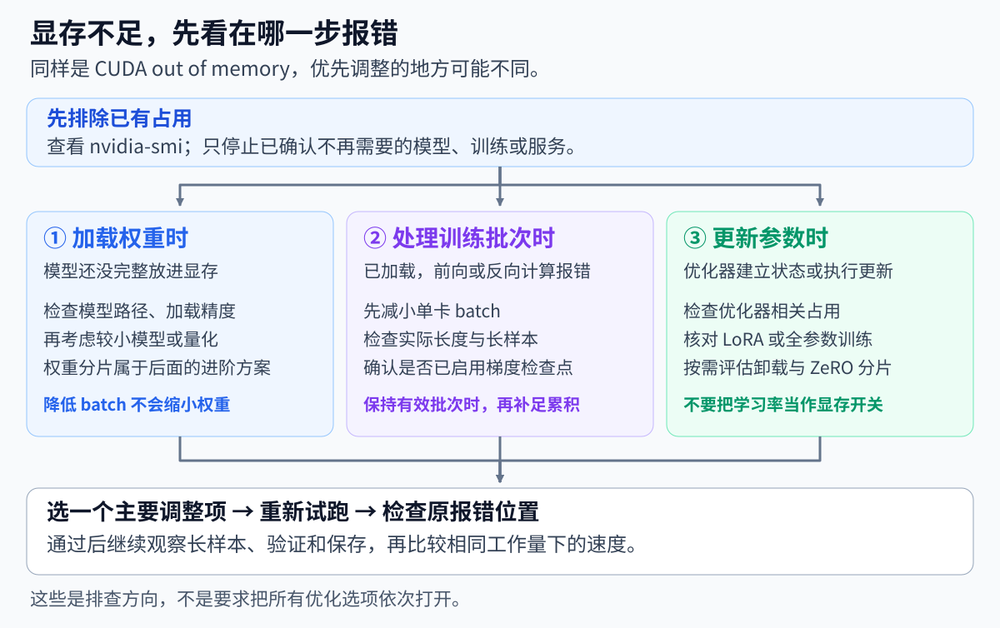

The optimization options in the figure are not meant to be all enabled. First identify where the usage comes from, then choose the corresponding method.

### 2.1 Per-GPU Batch Size and Gradient Accumulation

Continuing with the configuration from Chapter 31, per-GPU batch size is 4, and gradient accumulation is 8.

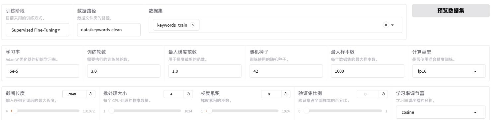

Below the screenshot, find **Batch Size** and **Gradient Accumulation**. They correspond to `per_device_train_batch_size` and `gradient_accumulation_steps` in the configuration, respectively; this section only looks at these two input boxes and does not revisit other training parameters.

You can first understand it in terms of the number of articles: process 4 articles at a time, and after processing 8 consecutive batches, update the parameters once. Therefore, one update uses a total of:

```text
4 篇 / 批 × 8 批 = 32 篇
```

Now suppose you have switched to a larger model, and **the weights have been loaded, but the first training batch causes OOM**. You can first change the batch size from 4 to 2 so that fewer articles participate in computation at once.

If training can continue this way, then change gradient accumulation from 8 to 16:

| Setting             | Processed at once per step | Accumulated before update | Effective batch |
| ---------------- | ------------ | -------------- | -------- |
| Before adjustment           | 4 articles         | 8 batches           | 32 articles    |
| Only reducing batch size     | 2 articles         | 8 batches           | 16 articles    |
| Also increasing accumulation steps | 2 articles         | 16 batches          | 32 articles    |

**Reducing batch size is to reduce the usage of one computation; increasing accumulation steps is to keep the amount of data used per update the same.** These are two different effects; do not attribute the memory decrease to a larger gradient accumulation count.

When actually adjusting, first change "Batch Size" to `2`; when you need to maintain an effective batch of 32 articles, change "Gradient Accumulation" to `16`. Click "Preview Command" to verify these two fields, and use a new output directory for the trial run. The figure above shows the settings before adjustment.

The same effective batch does not mean the speed and training results are exactly the same. The number of batch processing steps and the order of computation have changed, so you still need to observe the logs and validation performance.

If the weights themselves do not fit, changing batch size from 4 to 1 will not make the weights smaller; you should first address the loading branch in the flowchart.

### 2.2 Length Limit and Actual Training Length

Continuing from the example above: if you still get an error after reducing batch size to 2, check long samples, and then determine whether the cutoff length (`cutoff_len`) needs adjustment.

First, recall a point from Chapters 29–30: a training sequence includes the template, user content, and reference answer, and length must be judged by the total number of tokens they produce. **The length limit is only the maximum number to retain; it does not mean every sample is already that long.**

First look at the preprocessing check results already obtained in Chapter 30:


The two lines `train` and `validation` above the screenshot show: training set contains 1,600 examples, with the longest being `957` tokens; validation set contains 200 examples, with the longest being `604` tokens. `truncated=0` indicates that this check did not truncate any samples.

This result uses Qwen3-0.6B, the `qwen3_nothink` template, and the current data; see [Chapter 30, "Checking Actual Training Length"](30-%E6%A8%A1%E5%9E%8B%E8%AE%AD%E7%BB%83%E5%8E%9F%E7%90%86%E4%B8%8E%E9%AB%98%E6%95%88%E5%BE%AE%E8%B0%83.md?id=_42-checking-the-actual-training-length) for the specific method.

Samples in the same batch usually need to be arranged to the same length. For example, if two samples have 200 and 500 tokens respectively, **padding** to the longest sample in the batch will add 300 placeholders to the shorter sample so that both are organized for computation at 500 positions; padding does not add article content.

In this example, changing the length limit from 2048 to 1024 still preserves the original content of both samples, and the padded batch is still 500 positions. The current course data has a maximum of only 957 tokens, so you also cannot infer that memory is halved simply because the limit was halved.

If you lower the limit to 512, the latter part of long articles or the reference answer may be truncated. Before adjusting, check what training content is retained; after changing the model, tokenizer, or data, recalculate the actual lengths. When the task genuinely requires long articles, continue to consider the memory options below.

### 2.3 Mixed Precision and Gradient Checkpointing

The previous two items adjust "how much data goes in each time." The next two items adjust "how values are represented during computation and how many intermediate results are saved."

**Mixed precision:**

Mixed precision allows suitable operations to use lower precision while necessary parts retain higher precision; the principle is covered in [Chapter 30](30-%E6%A8%A1%E5%9E%8B%E8%AE%AD%E7%BB%83%E5%8E%9F%E7%90%86%E4%B8%8E%E9%AB%98%E6%95%88%E5%BE%AE%E8%B0%83.md). The V100 baseline in this course already uses `fp16: true` and `bf16: false`, and gradient checkpointing is also already enabled; when troubleshooting, first verify the current state, and do not treat options that are already enabled as new optimizations. After changing environments, confirm the appropriate precision according to the actual GPU compute capability check in Chapter 31.

**Gradient checkpointing:**

Backpropagation needs the intermediate results computed earlier. Gradient checkpointing chooses to save fewer of them and recomputes them when needed, trading extra computation for memory space.

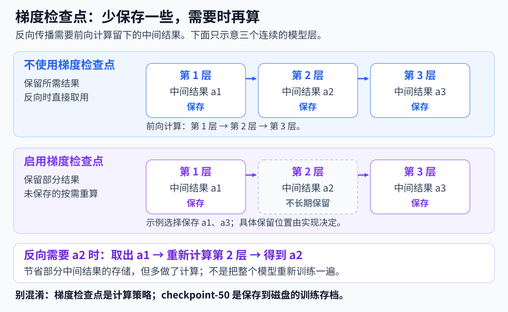

Refer to the `a2` in the figure: when this method is not used, save it and directly retrieve it during the backward pass; after adopting the illustrated saving approach, when `a2` is needed, use the retained `a1` to recompute layer 2. What is saved is storage for some intermediate results, at the cost of performing the corresponding computation once more.

The course's existing training logs contain:

```text
Gradient checkpointing enabled.
```

This log entry can be used to confirm that gradient checkpointing is enabled. It is responsible for reducing the storage of computational intermediate results; the `checkpoint` files saved every 50 steps are used for training archiving.

These two methods do not have to be changed at the same time. Mixed precision may further improve speed on suitable hardware; gradient checkpointing usually requires additional recomputation, so actual speed depends on the runtime results.

### 2.4 CPU Offload: Using System Memory to Share VRAM Pressure

In addition to GPU VRAM, AutoDL instances also have system memory used by the CPU. **CPU offload** means that some training data or state does not remain on the GPU at all times.

It is suitable for sharing the footprint of selected states or parameters, but transferring data and performing CPU computation takes time. First confirm which part does not fit: LoRA has few trainable parameters, and optimizer states may already be small to begin with, so offloading only the optimizer may not solve the problem of base weights being too large.

<details>
<summary>Further understanding: What the GPU and CPU each store and compute</summary>

Take the optimizer as an example. As discussed in Chapter 30, the optimizer saves some information that helps with subsequent updates. In schemes that support optimizer offload, these states can be placed in CPU memory, and some implementations also let the CPU perform the corresponding update computation.

The following figure uses a scheme in which both optimizer states and update computation are offloaded to the CPU:

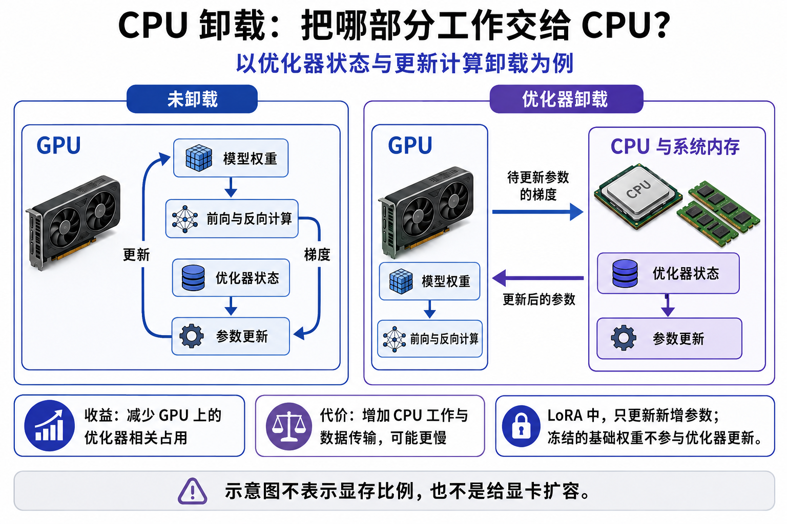

When reading the figure, follow the two arrows on the right: the GPU completes the forward and backward computation and sends the gradients of the parameters to be updated to the CPU; the CPU uses the optimizer states to compute the updates and then sends the updated parameters back to the GPU for subsequent computation. The base model still participates in computation on the GPU; the entire training process is not moved to the CPU.

In LoRA, the base weights are frozen, and the optimizer mainly handles the newly added trainable parameters. Therefore, how much can be saved by offloading the optimizer depends on how much space this part originally occupied; you cannot directly apply the savings ratio from full-parameter training. For the illustrated principle, refer to the [DeepSpeed ZeRO-Offload official documentation](https://www.deepspeed.ai/tutorials/zero-offload/).

If parameter offload is also enabled, how model parameters are stored and retrieved will also change. When DeepSpeed is introduced later, you will see **optimizer offload** and **parameter offload** separately; the two must not be written interchangeably.

</details>

System memory also has capacity limits; CPU processing and data transfer also take time. Once the model fits, if each step becomes noticeably slower, you need to judge whether this trade-off is acceptable, rather than only looking at the VRAM number getting smaller.

### 2.5 From Standard LoRA to QLoRA (Optional)

If the main pressure comes from base model weights, consider QLoRA introduced in Chapter 30: store the base weights in low-bit form while still training the newly added LoRA parameters.

Standard LoRA uses unquantized base weights; QLoRA adds a quantized loading step. Both train the newly added LoRA parameters.

First master the selection criteria: when the base weights take up a lot of space, quantization is worth considering; if the main problem is that intermediate results for long sequences do not fit, you still need to continue handling length and batch size. 4 bit describes how the weights are stored, while training computation can still use FP16.

Quantization may save VRAM, but it may also affect speed and output quality. When preparing a comparison, keep other conditions consistent and record resources and actual responses separately; installation, NF4, and double quantization fields can be found below.

<details>
<summary>Optional hands-on: Check dependencies, set 4-bit quantization, and prepare a trial run</summary>

**First check quantization dependencies.**

In the LLaMA-Factory directory on AutoDL, enter the Python environment created in Chapter 31:

```bash
cd /root/autodl-tmp/LLaMA-Factory
source .venv/bin/activate
uv pip show torch bitsandbytes
sed -n '1,20p' requirements/bitsandbytes.txt
```

`bitsandbytes` is the dependency used for quantization here. If it is not installed, only handle it when preparing the optional quantization experiment; there is no need to install it in advance for standard LoRA.

You can first check what changes the installation will bring:

```bash
uv pip install --dry-run -r requirements/bitsandbytes.txt
```

If the plan involves replacing the currently verified PyTorch or CUDA-related packages, stop first and check compatibility; do not upgrade directly. Only after confirming it is suitable for the current environment should you perform the actual installation:

```bash
uv pip install -r requirements/bitsandbytes.txt
uv pip check
```

After installation, you also need to use a short training run to check whether quantized loading, forward computation, and backward computation work properly.

**Then compare the page and parameters.**

First find "Quantization level" and "Quantization method" in the model settings area:


The figure above still shows standard LoRA settings: the quantization level is `none`. Even though `bnb` is displayed next to it, that does not mean 4-bit quantization is enabled.

When preparing the optional QLoRA experiment, keep the model, data, and LoRA settings, change the quantization level from `none` to `4`, and select `bnb` (bitsandbytes) as the quantization method. Then preview the command and check the quantization fields. The relevant configuration for this version can be written as:

```yaml
# 量化相关设置片段，不是完整训练配置
# 微调方式：仍然训练 LoRA 新增参数
finetuning_type: lora

# 量化工具：bnb 是 bitsandbytes 的简称
quantization_method: bnb

# 量化位数：基础权重采用 4 bit 编码保存
quantization_bit: 4

# 量化类型：NF4，针对权重分布设计的 4 bit 表示方式
quantization_type: nf4

# 双重量化：进一步量化缩放因子等辅助数据，减少存储开销
double_quantization: true

# 计算精度：本次使用 FP16 混合精度，不启用 BF16
fp16: true
bf16: false
```

Here `nf4` and double quantization follow this version's default settings; the preview command may omit unchanged default values.

`4 bit` refers to how weights are stored; `fp16` refers to the precision setting for the corresponding training computation. They are not either-or choices, and they do not mean that all computation uses 4 bit.

Set up a separate output directory for the QLoRA exercise, for example `saves/Qwen3-0.6B-Thinking/lora/keywords-qlora-trial/`. This path is created by the training program and cannot be treated as a model directory that already contains weights.

When comparing standard LoRA and QLoRA, try to keep the model, data, batch, length, and accumulation count the same, then observe VRAM and speed. **Quantization may save VRAM, but it does not guarantee faster training, nor does it guarantee completely unchanged response quality.**

For configuration fields, refer to [the quantization parameter definitions for this course version](https://github.com/hiyouga/LLaMA-Factory/blob/dced5f8804bfbf7109ef7c14401db6bd5cce7e53/src/llamafactory/hparams/model_args.py); for hardware requirements, see the [bitsandbytes official documentation](https://huggingface.co/docs/transformers/quantization/bitsandbytes).

</details>

### 2.6 How to Determine Whether an Adjustment Is Effective

When weights are already loaded and OOM is only reported at the first batch, first reduce the batch size and observe whether it can get past the previous error location; if the effective batch needs to be maintained, then increase the accumulation count. If it still reports an error, continue checking the actual length and existing optimizations. Each time, adjust only one issue so you can identify which change had an effect.

<details>
<summary>When testing on your own: Monitor VRAM and cover the stages most prone to problems</summary>

When observing GPU usage, **open another terminal in AutoDL's JupyterLab** so as not to occupy the terminal running training, and execute:

```bash
watch -n 1 nvidia-smi
```

This means refreshing once per second. Pressing `Ctrl+C` in this monitoring terminal will only exit `watch` and will not stop the training in the other terminal.

Also continue to watch for:

- Whether an error is reported again when longer samples enter the batch;
- Whether usage changes after validation starts, and whether the validation batch needs separate adjustment;
- Whether new problems appear when parameters are first updated and when checkpoints are saved.

</details>

**Actual comparison: What happened after halving the batch size?**

The following two groups use the same V100 32 GB, Qwen3-0.6B, and `keywords-clean` data, both performing standard LoRA training with all other settings kept the same. Only batch / accumulation is changed from 4 / 8 to 2 / 16, and then the results for the same amount of work are compared:

| Configuration      | Highest overall sampled VRAM        | Total command time              | Run result                                                     |
| ------------------ | ----------------------------------- | ------------------------------- | -------------------------------------------------------------- |
| batch 4, accumulate 8 | 28,588 MiB (about 27.92 GiB)        | 300.54 seconds, about 5 minutes | A VRAM allocation warning appeared, then it ended normally and saved `checkpoint-50` |
| batch 2, accumulate 16 | 22,230 MiB (about 21.71 GiB)        | 560.27 seconds, about 9 min 20 s | Ended normally and saved `checkpoint-50`                         |

Both groups completed 50 update steps, with an effective batch of 32, meaning each processed 1,600 training samples. The time includes loading, training, validation, and saving; the VRAM figure is the highest reading sampled every 200 milliseconds throughout the run and may miss instantaneous peaks.

Subtracting the two sets of numbers makes the cost of this adjustment clear: **with batch 2, the highest sampled usage decreased by 6,358 MiB, about 6.21 GiB; the entire command instead took 259.73 seconds longer, about 4 minutes 20 seconds.**

<details>
<summary>Verify the evidence: Raw logs, screenshots, and timing differences for the two groups</summary>

Both groups used the `keywords-clean` data from Chapter 29: 1,600 training samples and 200 validation samples. The template was `qwen3_nothink`, the length limit was 2048, the compute precision was FP16, LoRA rank was 8, alpha was 16, and the learning rate was `5e-5`. The model, data, and other settings remained the same, each group created a new Adapter from the original model, and used a different output directory.

First look at the actual saved logs of the first group. Find `Instantaneous batch size`, `Gradient Accumulation steps`, and `Total train batch size`; they are **4, 8, and 32** respectively:

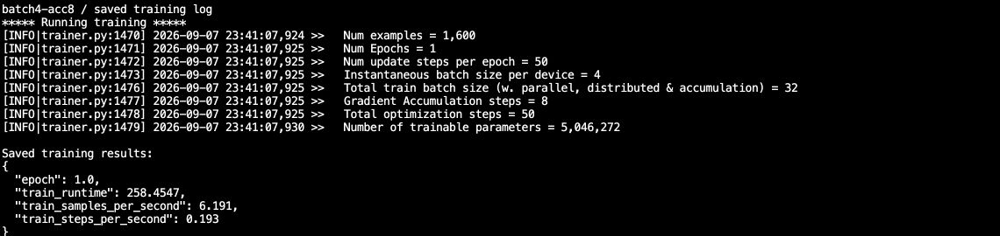

In the figure, `train_runtime: 258.4547` is the runtime recorded by Trainer itself, and `Num Epochs = 1` corresponds to this 50-step short run. The table in the main text uses `300.54 秒` to record the total time from command start to exit, which includes work outside the scope of Trainer's timing; the two have different start and end ranges.

Now look at the screenshot of the second group during the run. The three positions have become **2, 16, and 32**, meaning fewer articles are processed simultaneously each time, but 32 articles are still accumulated before each parameter update:

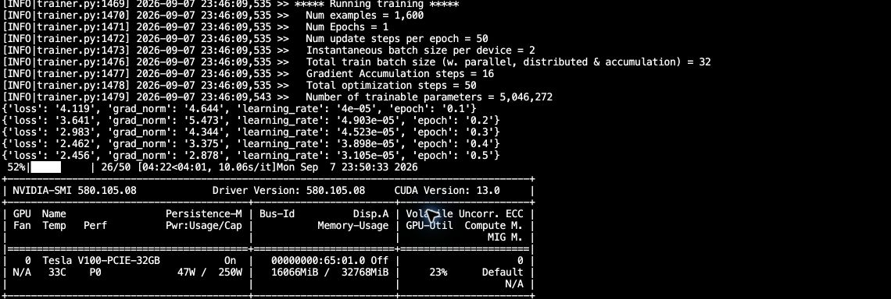

Both groups ran **50 update steps**: `50 × 32 = 1,600` samples, exactly completing one pass over the current training set; at step 50, validation was performed and `checkpoint-50` was saved. In the configuration, `max_steps: 50` takes precedence over `num_train_epochs: 3`, so this comparison ended after 50 steps.

**Statistical scope:** The time includes loading, training, validation, and saving after the command starts; the VRAM in the table is the highest reading sampled every 200 milliseconds within the same range, and may miss instantaneous peaks between sampling intervals. The `16066MiB` in the second figure is only the usage at the moment of the screenshot. Both groups used the same Trainer memory statistics settings; its per-stage metrics and the whole-card VRAM readings here are recorded separately.

The batch 4 log showed one VRAM allocation failure of about 2.17 GiB around step 30, after which it still continued to step 50 and exited normally. This indicates that although it completed the task, it still encountered VRAM pressure during the run.

</details>

Why can a smaller batch still be slower when processing the same 1,600 articles? Each update still accumulates 32 articles, but the number of mini-batches executed during training changes:

```text
batch 4、累积 8：50 次更新 × 8 批 = 400 个小批次
batch 2、累积 16：50 次更新 × 16 批 = 800 个小批次
```

In the second group, each micro-batch processes only half the articles, but more iterations are required. A single batch saves more VRAM, and an identical effective batch does not guarantee identical speed; actual time is also affected by compute efficiency, loading, validation, and saving.

If batch 4 runs stably in your own task, you can keep its speed advantage; if warnings have already appeared, or if you will need to process longer articles later, consider whether the extra time is worth the additional VRAM headroom. The differences here apply only to this model, data, and environment; after changing tasks, you still need to compare again.

When you need to review resource comparisons, enter `results/batch-comparison/` from [Companion File Notes](%E6%A1%88%E4%BE%8B%E4%B8%8E%E6%BA%90%E7%A0%81-4-%E5%BE%AE%E8%B0%83/README.md) and inspect `comparison.json`, configuration, logs, and sampled data. This location preserves resource statistics, logs, and curves, and does not contain Adapter weights or complete continued-pretraining checkpoints; after training your own model, check the files in the actual output directory.

The validation loss for both groups is about 2.171, but keyword quality still needs to be checked against actual answers as described in Chapter 32. The resource records should lead to one decision here: **how much VRAM headroom you need, and how much extra time you are willing to spend for it.** You are not required to copy either group's settings from this example.

<details>
<summary>Optional: Reproduce this comparison on the original V100 instance</summary>

First prepare the environment, model, and current course data as described in Chapter 31, and make sure there are no other GPU tasks. In the **AutoDL JupyterLab terminal**, prepare the configuration directory:

```bash
cd /root/autodl-tmp/LLaMA-Factory
source .venv/bin/activate
mkdir -p configs
```

Then upload the following two local files in the JupyterLab file panel:

| Files in local `案例与源码-4-微调/`  | Upload destination on AutoDL     |
| ----------------------------------- | ------------------------ |
| `compare_batch_resources.py`        | `LLaMA-Factory/` root directory  |
| `configs/keywords_clean_train.yaml` | `LLaMA-Factory/configs/` |

When you followed the WebUI route in Chapter 31, you may not have uploaded this YAML file; you cannot just upload the script and run it. Use the CLI configuration included with the course here, not the WebUI "Save Training Parameters" file. If a file with the same name already exists, first check whether it is still the course configuration, and do not overwrite a version you have modified yourself.

The script always checks `model_name_or_path: Qwen/Qwen3-0.6B` and finds the ModelScope cache by repository ID; you cannot simply replace it with a local path or an 8B model. If you previously moved the default cache, first confirm that the repository ID can still find the model, otherwise it may download again.

Return to the AutoDL terminal you just used and verify the files and configuration:

```bash
ls compare_batch_resources.py configs/keywords_clean_train.yaml
ls data/keywords-clean/keywords_train.jsonl data/keywords-clean/keywords_validation.jsonl
sed -n '1,100p' configs/keywords_clean_train.yaml
```

Only when everything is ready and you really want to start both training runs, execute:

```bash
python compare_batch_resources.py \
  --config configs/keywords_clean_train.yaml \
  --output-root /root/autodl-tmp/keywords-batch-trial \
  --steps 50
```

`--output-root` must be a new directory that does not yet exist. The script verifies the single V100, model, precision, and course data fingerprint, then starts the two training runs in sequence. It does not install dependencies or modify the original training configuration. Each group of commands runs for at most 10 minutes; if a failure or timeout occurs, it stops and does not retry automatically. **This limit does not shut down the AutoDL instance for you**; you still need to save results and shut down as described in Section 5.6.

The `comparison.json` in the output summarizes the results; each group has `config.yaml`, `train.log`, and `gpu-samples.csv`. The sampled files record time, memory usage (MiB), GPU utilization (%), and power (W); see the table explanation above for the statistical method.

</details>

---

## 3. How Multiple GPUs Divide Work

Only when single-GPU tuning is still insufficient, or when you want to shorten training time, do you need to consider multiple GPUs further. First understand three ways of dividing work: data parallelism splits articles, tensor parallelism splits computation within the same layer, and pipeline parallelism splits model layers.

After reading this section, you should be able to explain the three using article examples and determine whether adding more GPUs solves the current problem. When reading the figure, always ask: **Are the two cards receiving the same batch of articles? What is passed between the cards?**

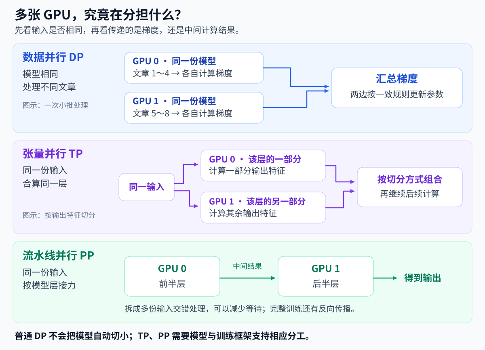

_Figure: Division of labor in the three types of parallelism. The tensor parallelism and pipeline parallelism panels show only the forward data flow._

### 3.1 Data Parallelism: The Same Model Processing Different Articles

Suppose a single GPU can already train, but the speed is simply not enough. Now that you have two GPUs, you can have them process different articles at the same time.

First let both GPUs each hold the same model, and then divide the work like this:

```text
GPU 0：处理文章 1～4 → 算出这批文章的梯度
GPU 1：处理文章 5～8 → 算出另一批文章的梯度
                       ↓
             汇总梯度，再更新两边的参数
```

Chapter 30 explained gradients as the directional information needed for parameter updates. They need to be aggregated here because the two cards practice on different articles; if each updated independently and never communicated, the model parameters would gradually diverge.

In common distributed data parallel training, both sides synchronize gradients and update according to consistent rules, jointly training **the same model**.

This division of labor is called **Data Parallelism (DP)**; one of the common implementations is called **DDP**, or Distributed Data Parallel.

**In ordinary DDP, each GPU still needs to hold a full copy of the model.** Therefore, two 24 GB cards do not automatically become a 48 GB GPU that can be used arbitrarily. If a single card cannot even fit the base weights, simply adding more data-parallel replicas will not solve that.

### 3.2 Tensor Parallelism: Computing the Same Layer Together

Chapter 30 used matrices to explain the computation of model layers. Tensor Parallelism (TP) does not have the two cards each read four different articles; instead, it splits **a single computation within the same layer** between them.

For example, if a layer needs to compute several groups of output features, you can have GPU 0 compute one part, GPU 1 compute another part, and then concatenate or aggregate the results according to the splitting method and continue to the next layer.

The difference can be expressed in two sentences:

- Data parallelism: You process these articles, I process the others, and we communicate before updating.
- Tensor parallelism: We process this input together; you compute this part, and I compute the other part.

Once a layer's computation is divided, the related weights can also be stored separately. However, results usually need to be exchanged between layers, and communication affects speed.

Therefore, TP is not simply "selecting a few more GPUs." The model structure, training framework, and configuration must all support this splitting; you cannot directly treat the number of GPUs displayed in LLaMA-Factory as the TP count.

### 3.3 Pipeline Parallelism: Relaying by Model Layer

Pipeline Parallelism (PP) uses a different approach: place the first several layers on GPU 0 and the remaining layers on GPU 1.

One input first passes through GPU 0, and then the intermediate result is passed to GPU 1. This is like two consecutive processing steps, where the later step must wait for the earlier step to produce its result.

Relaying by layer can share the model burden, but the later card must wait for the earlier card's result. In practice, training interleaves multiple inputs to reduce waiting; see the following figure for the specific timeline. You cannot estimate the speedup simply from the number of GPUs.

<details>
<summary>Further reading: How micro-batches reduce waiting, and what pipeline bubbles are</summary>

To reduce waiting, one batch can be split into several smaller parts so that different GPUs process them in an interleaved manner. These smaller parts are often called **micro-batches**. Below, the three inputs are labeled A, B, and C, and two arrangements are compared:

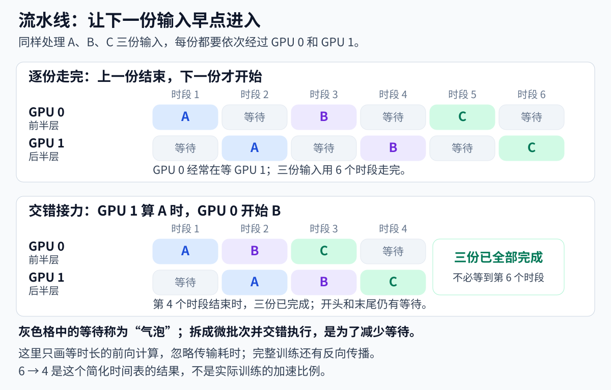

First follow the blue A horizontally: it always passes through GPU 0 first, then GPU 1. Now look at the second time slot of the interleaved relay: while GPU 1 is processing A, GPU 0 has already begun processing B, so it does not need to wait for A to finish completely before taking the next input.

There are still cards waiting at the beginning and end; these idle gaps are often called **pipeline bubbles**. The figure assumes each stage takes the same amount of time and shows only the forward computation; actual training also includes backpropagation and data transfer, so you cannot directly treat the six time slots in the figure as four time slots and use that as the training speedup ratio.

</details>

### 3.4 Calculating Effective Batch Size for Multiple GPUs

Start by calculating the most common case: two GPUs performing data parallelism, with each GPU processing 4 articles at a time and updating after 4 accumulation steps.

```text
有效批次 = 单卡 batch × 数据并行卡数 × 梯度累积次数
         = 4 × 2 × 4
         = 32 篇
```

This is the same as the single-GPU `4 × 1 × 8 = 32` in Chapter 31: each update uses 32 articles in total.

The difference is that the two-GPU scheme processes 8 articles at a time and accumulates 4 times, while the single-GPU scheme processes 4 articles at a time and accumulates 8 times. The two GPUs need to communicate, so the time is not necessarily halved.

If two GPUs use TP to jointly compute one copy of the model, they process the same batch of input, so you cannot multiply the sample count by 2.

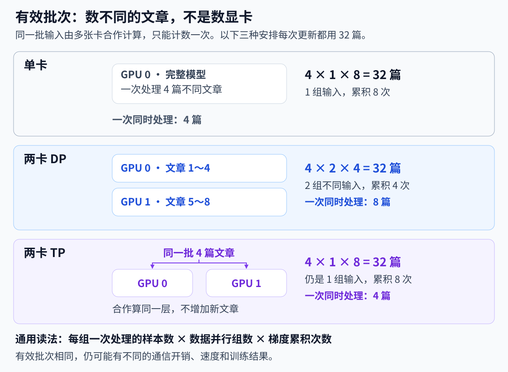

All three arrangements in the figure produce 32 articles, but only the data-parallel row multiplies the number of groups by `2`. What you count when making this judgment is the **data-parallel groups that independently process different articles**, not the number of GPUs installed in the chassis.

<details>
<summary>Optional reading: How do you calculate when data parallelism and model splitting are used together?</summary>

Suppose there are four GPUs: GPU 0 and 1 use TP to jointly compute one model copy; GPU 2 and 3 jointly compute another. The two groups process different articles.

In this case, the number of data-parallel groups is 2, not 4. If each group processes 4 articles at a time and accumulates 4 times:

```text
有效批次 = 每组一次处理的样本数 × 数据并行组数 × 累积次数
         = 4 × 2 × 4
         = 32
```

TP and PP share the model computation for the same batch of input and cannot be counted again as new samples. ZeRO, which will be discussed later, shards training state within data parallelism; do not mistakenly count the data-parallel groups as TP groups because of that.

</details>

### 3.5 More GPUs Are Not Necessarily Faster

When multiple GPUs work together, they need to exchange data in addition to computing. Link speed between cards, transfer volume, and whether each card's workload is balanced all affect training time.

GPUs need to exchange gradients, parameters, or intermediate results. Interconnect information such as NVLink mentioned in the instance notes is related to this exchange capability.

First check whether each GPU is participating in computation as expected, then compare **training time for the same amount of work**; see Section 5 for specific inspection methods.

Also, do not switch directly from LoRA to full-parameter training just because you see multiple GPUs. Full-parameter training needs to store gradients and optimizer states for far more parameters, and resource requirements change substantially.

If you are only checking whether multiple GPUs can start normally, keep the existing LoRA task and adjust only the necessary distributed configuration. Only when the task actually requires it and both VRAM and time are acceptable should you continue comparing full-parameter options.

<details>
<summary>Optional reading: Total parameters and active parameters in MoE models</summary>

Some model descriptions provide both "total parameters" and "parameters activated per token." This is because the model has multiple groups of "experts" internally, and only a portion of them participate in each computation; this structure is called a **Mixture of Experts (MoE)** model.

For now, you can understand it as follows: the model has many available processing branches, but not every branch is used every time. The process of selecting branches is usually called routing.

"Only some experts are used this time" mainly affects the amount of computation involved; it does not mean that training only needs to save all related files and states for those experts. You cannot estimate the entire model's loading VRAM based only on the active parameter count.

Distributing different experts to different devices involves expert parallelism. The single-GPU keyword workflow in this course does not use this configuration.

</details>

---

## 4. DeepSpeed and ZeRO

The previous section asked "how is computation divided"; this section asks "which training contents do not need to be fully stored on every card." First understand the storage tables for Stages 1, 2, and 3; only expand the specific configuration when you are preparing for the corresponding training.

### 4.1 From Duplicate Storage to Sharded Storage

In the ordinary DDP introduced earlier, each GPU holds a complete copy of the model; during training, gradients and optimizer states may also be stored redundantly.

Suppose both GPU 0 and GPU 1 store the same complete set of optimizer states. Training needs this information, but it does not necessarily require every GPU to hold a full copy at all times. Could each GPU take responsibility for a portion and cooperate when needed?

**ZeRO uses this sharding idea to reduce redundant storage.** DeepSpeed is one of the tools that supports this training approach.

"Sharding" can first be understood as: dividing one set of data into several parts, with different GPUs each responsible for a portion.

Chapter 30 already explained weights, gradients, and optimizer states. The table below compares which parts are split at each stage.

### 4.2 ZeRO Stage 1, 2, and 3

| Approach | Model Parameters | Gradients | Optimizer States |
| -------------------------- | ------------ | ------------ | ------------ |
| Ordinary data parallelism without ZeRO | Complete copy per GPU | Complete copy per GPU | Complete copy per GPU |
| Stage 1 | Complete copy per GPU | Complete copy per GPU | Sharded |
| Stage 2 | Complete copy per GPU | Sharded | Sharded |
| Stage 3 | Sharded | Sharded | Sharded |

You can read them in order: Stage 1 first handles optimizer states; Stage 2 then handles gradients; Stage 3 shards even the parameters.

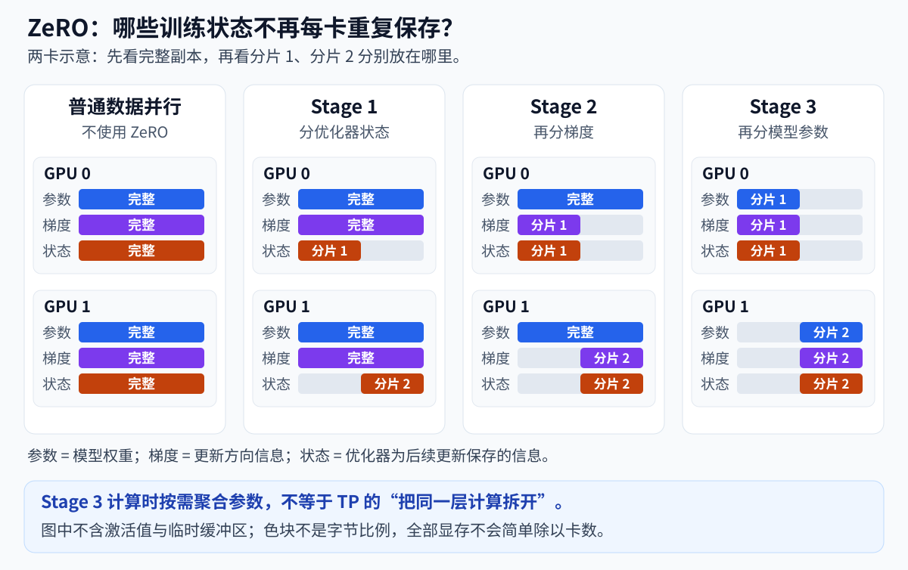

_Figure: Illustration of how the same set of training states is stored across two GPUs; "states" in the figure refers to optimizer states, and the color blocks do not represent actual byte proportions._

**Why is Stage 3 not tensor parallelism?**

Stage 3 gathers the relevant parameters when computation needs them, and after computation manages them according to the framework's arrangement; TP, on the other hand, splits the computation of the same layer across different GPUs. Both may result in weights no longer residing fully on a single GPU, but the division of labor differs.

Sharding is not without cost. Parameters and states need to be communicated across GPUs, and Stage 3 in particular must fetch parameters in coordination with computation, so the communication pattern and overhead will change; you cannot simply assume that "3 is bigger than 2" means Stage 3 is always the best.

Also note two limitations:

- Activations, temporary buffers, and the like will not all shrink proportionally to the number of GPUs simply because ZeRO is used.
- LoRA only trains a small number of newly added parameters, so it already has far fewer trainable states than full-parameter training; the benefits of Stage 1 and 2 cannot be directly carried over from full-parameter training examples.

If GPU memory is already sufficient, there is no need to add configuration just to use a higher stage. If the model weights themselves cannot fit, then parameter-sharding approaches like Stage 3 become more worth considering.

For principles and parameter aggregation methods, see the [DeepSpeed ZeRO official tutorial](https://www.deepspeed.ai/tutorials/zero/).

### 4.3 Configuration Locations in LLaMA-Factory (Optional)

The Stage option on the page selects the sharding level, while offload determines whether to offload the corresponding states or parameters to CPU memory; they are not the same switch. The page in the course version provides `none`, `2`, `3`; you do not need to memorize the JSON fields on first reading.

Before actually doing the optional exercise, first confirm the available GPUs and dependencies, and preview the configuration you are about to use. The screenshots only show the entry points; whether multi-GPU actually takes effect must be checked through the launched processes, device logs, and running results.

<details>
<summary>Optional hands-on: page entry points, dependency checks, and the actual configuration file</summary>

Return to the **Train** page from Chapter 31, scroll to the bottom, and below the "Start" button you will find "Device count", "DeepSpeed stage", and "Use offload".


In the LLaMA-Factory version used in this course, the page items are as follows:

| Page Item | Actual Meaning |
| --------------- | ----------------------------------------------- |
| Device count | A read-only count box; the actually available devices still need to be confirmed through GPU checks |
| DeepSpeed stage | The dropdown options are `none`, `2`, `3` |
| Use offload | Whether to use the offload configuration for the corresponding stage |

Open the Stage dropdown, and you can see the three actual options:

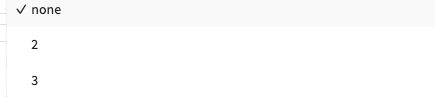

`none` means DeepSpeed is not enabled; this page provides two sharding options: Stage 2 and Stage 3.

_The screenshot is for identifying the configuration location. The "Device count" in the interface cannot replace runtime environment checks; confirm the actually available GPUs, GPU memory, and compute capability as described in Chapter 31._

**Check dependencies before doing the optional exercise.** DeepSpeed is an additionally installed tool; first check it in the current `.venv`:

```bash
uv pip show deepspeed
```

If it is not installed, first look at the dependency list in the project and the expected installation changes:

```bash
sed -n '1,40p' requirements/deepspeed.txt
uv pip install --dry-run -r requirements/deepspeed.txt
```

The dependency list for this version requires `deepspeed>=0.10.0,<=0.18.4`. The version range is only an installation constraint; you still need to confirm that the specific version is compatible with PyTorch and CUDA, and then install according to the list:

```bash
uv pip install -r requirements/deepspeed.txt
uv pip check
```

These dependencies are installed when actually doing the optional exercise; you can continue reading the configuration directly. For version requirements, see [the dependency list for this version](https://github.com/hiyouga/LLaMA-Factory/blob/dced5f8804bfbf7109ef7c14401db6bd5cce7e53/requirements/deepspeed.txt).

The project's `examples/deepspeed/` provides configuration examples. Open the standard Stage 2 configuration and the offload configuration, and you can compare the differences:

```bash
sed -n '1,160p' examples/deepspeed/ds_z2_config.json
sed -n '1,160p' examples/deepspeed/ds_z2_offload_config.json
```

The core settings of the latter include:

```json
{
  "zero_optimization": {
    "stage": 2,
    "offload_optimizer": {
      "device": "cpu",
      "pin_memory": true
    }
  }
}
```

This is only a fragment illustrating the offload location; the complete file also contains settings such as batch size and precision. Read through each item according to the JSON hierarchy:

| Configuration Field | Chinese Meaning | Role in This Example |
| ------------------- | ---------------- | ------------------------------------------------------------------- |
| `zero_optimization` | ZeRO optimization settings | Places the sharding level and offload options in the same group |
| `stage` | ZeRO sharding level | `2` means sharding gradients and optimizer states; distinct from `stage: sft` in the training configuration |
| `offload_optimizer` | Optimizer offload settings | Arranges optimizer-related states and update computations to the CPU |
| `device` | Offload target device | `cpu` means using the CPU and system memory |
| `pin_memory` | Whether to use pinned memory | `true` means using memory pages that will not be swapped out by the system, facilitating data transfer between CPU and GPU |

Therefore, this set of settings changes the storage and computation location of the optimizer; the model layers are not all moved to the CPU.

The Stage 3 offload configuration can also include `offload_param`, namely parameter offload. Which specific fields are used should be confirmed by opening the actual configuration, rather than interpreting all offload as one single action.

**When preparing for the optional exercise, check in the following order:**

1. Keep the current model, data, and LoRA task, and confirm the number of visible GPUs.
2. Choose a stage based on the memory issue, and adjust only one optimization setting at a time so that the effect can be judged clearly.
3. On LLaMA-Factory's **Train page**, click "Preview command", find the `deepspeed` configuration path in the command, then open it using the method below and check the `stage`, offload, and batch settings. Preview will not start training.
4. After launch, check the distributed processes and device logs to confirm that the expected GPUs are actually being used, and then observe whether normal training has begun.

For example, if the preview command for Stage 2 + offload points to `llamaboard_cache/ds_z2_offload_config.json`, open this file in the **AutoDL terminal**:

```bash
cd /root/autodl-tmp/LLaMA-Factory
sed -n '1,160p' llamaboard_cache/ds_z2_offload_config.json
```

Use the path in your own preview command as the authoritative reference, and verify the `stage`, offload, and batch settings in the actual file. After clicking "Start" on the Train page, the WebUI will launch training according to the selected configuration; when using a YAML command line, start according to the [official distributed training instructions](https://llamafactory.readthedocs.io/zh-cn/latest/advanced/distributed.html) and confirm the GPUs participating in computation through the logs.

<details>
<summary>Optional reading: the source of WebUI configuration files</summary>

In the fixed version used in this course, when the WebUI starts, configurations are generated in `LLaMA-Factory/llamaboard_cache/`. The standard Stage 2 configuration is `ds_z2_config.json`, and when offload is checked, `ds_z2_offload_config.json` is used; for Stage 3, the corresponding filename contains `z3`.

The `examples/deepspeed/` mentioned earlier provides a reading example, while `llamaboard_cache/` stores the configuration actually referenced by the WebUI command. For the generation and selection process, see [configuration generation implementation](https://github.com/hiyouga/LLaMA-Factory/blob/dced5f8804bfbf7109ef7c14401db6bd5cce7e53/src/llamafactory/webui/common.py), [WebUI initialization entry](https://github.com/hiyouga/LLaMA-Factory/blob/dced5f8804bfbf7109ef7c14401db6bd5cce7e53/src/llamafactory/webui/engine.py), and [page source](https://github.com/hiyouga/LLaMA-Factory/blob/dced5f8804bfbf7109ef7c14401db6bd5cce7e53/src/llamafactory/webui/components/train.py).

</details>

**When conducting multi-GPU experiments, first confirm that the environment has multiple available GPUs and that matching dependencies are installed.** After launch, verify the distributed processes, the GPUs participating in computation, and the actual memory usage and speed; page options can only express configuration, not prove that multi-GPU training has actually taken effect.

</details>

### 4.4 After the Training Method Changes, the Output Must Also Be Rechecked

Chapter 31 saved a LoRA Adapter. After using DeepSpeed, you cannot assume that the adapter is exactly the same as before simply because `checkpoint` appears in the directory.

First look at the training method used this time:

- **LoRA:** Pay attention to the adapter of newly added parameters, as well as other states needed to resume training.
- **Full-parameter training:** The goal is to save the parameters of the complete model, not just to output a LoRA Adapter.
- **ZeRO sharded checkpoints:** They may contain training states saved in a distributed manner and may not necessarily be directly loadable as an ordinary model directory.

<details>
<summary>When saving Stage 3 weights: verify the parameter aggregation settings</summary>

When Stage 3 saves complete weights, parameter aggregation settings are also involved, such as `stage3_gather_16bit_weights_on_model_save`. Whether these are enabled and which files are ultimately saved must be confirmed in combination with the framework and training method used.

</details>

After determining what the files mean, perform reloading and answer checks as described in Chapter 32; the deliverable must be a model file that can be loaded completely.

---

## 5. Large Model Trial Run and Result Assessment

Before switching models, first arrange a short, clearly scoped trial run to answer the questions "Can it run, how long is it expected to take, and is it worth continuing?" This section uses an 8B candidate model for configuration estimation, and uses teaching logs to practice assessment; no measured results from this 8B training are included.

You can directly read the preparation table, logs, and selection method. When you decide to try the 8B model, then expand the download and configuration instructions; the small-model resource figures from Section 2.6 cannot be directly applied.

### 5.1 Preparing a Clearly Scoped Trial Run

A short training run first answers: **whether the current model and settings can run, and approximately how long the planned run will take.**

Still use the `keywords-clean` data split from Chapter 29: use `keywords_train` for training and `keywords_validation` for in-process checks; do not mix the test set into training, and do not re-split the data randomly for every trial run.

First check the model file size, download location, and loading precision, then prepare the model and data. For the download method, see [Chapter 31 "Download the model in advance without starting training"](31-LLaMA-Factory%E7%8E%AF%E5%A2%83%E6%90%AD%E5%BB%BA%E4%B8%8E%E5%BE%AE%E8%B0%83%E5%AE%9E%E6%88%98.md?id=_51-model-and-fine-tuning-method), which can also be completed in no-GPU mode. For large models, check the remaining space according to the file sizes below and choose an appropriate download location.

For the configuration, you can start from the accompanying `案例与源码-4-微调/configs/keywords_clean_train.yaml`, save an experimental copy in the editor, and then adjust:

| What to Adjust | How to Handle It |
| ------------------ | ---------------------------------------------------- |
| Model path and template | Point to the model you intend to try; reconfirm its tokenizer, template, and length |
| Batch and accumulation | Start with a batch that fits, then calculate the effective batch |
| Training method | Clearly identify ordinary LoRA, QLoRA, or full-parameter training; do not try multiple approaches at the same time |
| Output directory           | Use a new trial run directory; do not overwrite the Chapter 31 training results             |
| Training epochs or step limit | Clearly state whether this is only testing a short run or observing the full planned training before stopping early |

First, keep in mind one estimation principle: **the model file fitting on disk, the weights fitting in GPU memory, and the entire training being able to run are three separate checks.** Training also requires intermediate results and training state, so you cannot directly answer how much GPU memory is needed based on the model file size alone.

<details>
<summary>Optional hands-on: 8B weight estimation, download location, and configuration copy</summary>

For example, the candidate model could be from the same series as `Qwen/Qwen3-8B`. The [official model documentation](https://huggingface.co/Qwen/Qwen3-8B) lists the parameter count at approximately 8.2B, and the [model file page](https://huggingface.co/Qwen/Qwen3-8B/tree/main) shows the total file size is approximately 16.4GB. Before downloading, first check available space with `df -h / /root/autodl-tmp`, place the new model on the data disk, and leave margin for the download process and training output; do not look only at the disk's total capacity.

Using a rough estimate of 2 bytes per parameter, this model's weights alone take up about 15.3GiB. **This is not the full GPU memory required for training**: you also need room for intermediate computation results, LoRA parameters, and training state, and you cannot directly reuse the batch size from smaller models. The official configuration indicates weight precision of BF16, while this course's V100 training computation uses FP16; after downloading, you still need to verify the actual loading precision and cannot assume all weights are loaded in FP16 just because the page has FP16 checked. [Official model configuration](https://huggingface.co/Qwen/Qwen3-8B/blob/main/config.json).

When deciding to download, change the candidate model ID in the `snapshot_download` call from Chapter 31, set `cache_dir="/root/autodl-tmp/model-cache"`, and have the new files go to the data disk. Note the specific model directory returned by the function, then fill it into the configuration later. Below only shows the model and output locations:

```yaml
# 只列出模型与输出位置，不是可直接启动的完整配置
model_name_or_path: /root/autodl-tmp/model-cache/替换为下载返回的模型子目录
finetuning_type: lora
output_dir: saves/Qwen3-8B/lora/keywords-trial
```

Replace the first item with the model subdirectory returned by the download. Then follow Section 2 to check the actual loading precision, re-count token lengths, and start the trial run with the smallest batch that fits; keep the other task settings identical so you can judge the impact of the model change.

</details>

When suitable hardware is not available, you can first complete the configuration reading and the log exercise below to understand how to estimate resources, identify errors, and judge results.

### 5.2 Where does "five minutes" start counting

The first launch may take time to load weights and prepare caches before the steadily growing training progress appears. When estimating training speed, you should observe after normal training step processing begins, not start timing from clicking the button or downloading the model.

You can run it for a few minutes first and observe:

- whether the step count keeps increasing, and whether there are repeated errors;
- whether the speed gradually stabilizes;
- whether GPU memory samples are clearly approaching the upper limit;
- whether the estimated remaining time is within a reasonable range.

"Five minutes" is only a short-run length that is easy for getting started, not a reliability guarantee. It may not have encountered the longest samples, the validation phase, or the first save yet.

For example, Chapter 31 saves once every 50 steps. If the short run stops at step 30, the directory may not yet contain a recoverable `checkpoint-50`, and in that case you cannot resume training from this checkpoint that has not been generated yet.

If you want to verify the saving process, you should observe an actual save within the allowed runtime, or explicitly set the save timing in the new trial-run configuration; this change will also increase save overhead.

### 5.3 Reading the progress bar and estimated duration

The following is an **instructional example**, not the measured performance of a particular 8B model in this course:

```text
30/150 [04:00<16:00, 8.00s/it]
```

First, break it down by position:

| Content       | How to read it                               |
| ---------- | ------------------------------------ |
| `30/150`   | 30 update steps completed, 150 total planned |
| `04:00`    | approximately 4 minutes elapsed                      |
| `<16:00`   | based on current progress, approximately 16 minutes remaining       |
| `8.00s/it` | average of about 8 seconds per progress iteration              |

What is discussed here is the Trainer's update progress bar, not the model download or data preprocessing progress bar. Combined with the gradient accumulation from Chapter 30, multiple batches of data may have already been processed before one update step.

A rough calculation at the example speed:

```text
剩余步数 = 150 - 30 = 120
预计剩余 = 120 × 8 秒 = 960 秒 = 16 分钟
预计总计 = 4 + 16 = 20 分钟
```

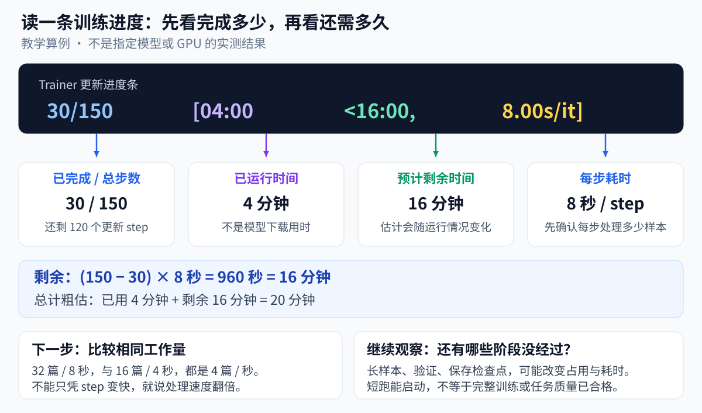

_Figure: First read the progress and speed, then judge whether to continue. All times are instructional examples, not performance promises for specific hardware._

Some progress bars show `it/s`, meaning how many iterations are completed per second, where larger values are usually faster; `s/it` is how many seconds each one takes, where smaller values are usually faster. Read the unit first; you cannot compare numbers alone.

Estimated times are affected by long and short samples, validation, saving, and run fluctuations. Do not write down a single estimate from just after startup as the final training duration.

If you directly set `max_steps: 30` in the trial-run configuration, the total progress may be 30 steps. In that case, the progress bar is estimating this short task, and you cannot treat its remaining time as the remaining time for three full rounds of training.

### 5.4 Before comparing speed, first compare workload

"Twice as fast per step" may simply mean each step processes half as many articles.

Suppose both approaches can run normally and produce the following set of **instructional data**:

| Approach | Processed per update | Time per update step | Average processing speed |
| ---- | ------------ | ------------------ | ------------ |
| A   | 32 articles        | 8 seconds               | 4 articles / second    |
| B   | 16 articles        | 4 seconds               | 4 articles / second    |

B's step time is shorter, but the number of articles processed per unit time has not increased. To complete the same number of data epochs, it still requires more update steps.

Therefore, when comparing single-GPU vs. multi-GPU, or LoRA vs. QLoRA, at least first align the data scope, actual length, and effective batch size, and then look at the elapsed time. You should not change the batch size on one side while using only `s/it` to claim a speedup ratio.

When article lengths vary greatly, you can also refer to the `tokens/s` reported by the tool, that is, how many tokens are processed per second. When comparing, you still need to confirm whether it includes padding positions and which part of the run is being counted.

Under the same data and the same task settings, judge performance changes by combining the total elapsed time with the sample processing speed.

### 5.5 Decide the Next Step Based on the Results

After the trial run, put the original configuration and the adjusted results together, compare whether the errors disappear and how speed and VRAM change, and then decide the next step.

[The single-GPU comparison in Section 2.6](33-%E5%BE%AE%E8%B0%83%E6%98%BE%E5%AD%98%E4%BC%98%E5%8C%96%E4%B8%8E%E5%A4%9A%E5%8D%A1%E8%AE%AD%E7%BB%83.md?id=_26-how-to-determine-whether-an-adjustment-is-effective) has already demonstrated one trade-off: batch 4 is faster, while batch 2 leaves more VRAM headroom. When choosing, you should consider your own operating conditions and judge whether the additional time is worth it, rather than simply selecting the group with the smallest VRAM number.

Different results lead to different next steps:

- **Path, data, or template errors:** Stop first, go back to Chapters 29–31 to fix them. If you are not using the GPU for the time being, shut down the machine.
- **Still OOM:** Return to Section 2 of this chapter and continue troubleshooting according to the stage at which the error occurs.
- **Runs but is very slow:** First compare under the same workload, and then judge whether the resource plan needs to be adjusted. QLoRA should not be treated directly as a speedup switch.
- **Runs and the estimated duration is acceptable:** You can continue the current task, or save the configuration and schedule the full training.
- **Training completes but quality is insufficient:** Check the answers according to Chapter 32, and do not simply attribute it to “the GPU is not good enough.”

A short trial run answers the resource question. After full training, you still need to use a validation set to select the plan. Once the plan is fixed, use an independent test set to compare results. Neither sufficient resources nor acceptable quality can be omitted.

If you repeat the experiment because you changed the model, quantization method, or data, it should be started as a new task. Only compatible configurations and a complete recovery state are suitable for continuing from a checkpoint. Do not confuse “loading an Adapter” with “resuming the original training progress.”

Record this decision in the experiment log card: what the bottleneck was this time, which setting was changed, how much time was spent or saved under the same workload, and what still needs to be verified. When explaining the plan in an interview or to colleagues, these supporting details explain your choices better than listing every optimization switch.

### 5.6 Stopping Tasks, Shutting Down, and Saving Files

First identify where the task was started, and then stop it in the corresponding location:

| Currently running task                             | Where to operate                                                                                                                                                                                                                                                      | How to confirm                                                   |
| ------------------------------------------ | ----------------------------------------------------------------------------------------------------------------------------------------------------------------------------------------------------------------------------------------------------------------------- | ---------------------------------------------------------- |
| Training started from the LLaMA-Factory WebUI             | Go back to the bottom of the **Train page** and click the red **“Interrupt”** button to the right of “Start”                                                                                                                                                  | The log shows interruption, and the training progress no longer increases; continue to check whether the training process has exited |
| Training started from the YAML command in Chapter 31 or the comparison script in this chapter | Return to **the AutoDL terminal that launched it** and press `Ctrl+C`                                                                                                                                                               | The command exits and returns to the prompt, and the related training process has exited                   |
| Model loaded on the Chat page                          | LLaMA-Factory **Chat page → Unload Model**                                                                                                                                                                    | The page indicates unloading is complete, and then verify the VRAM changes                           |
| Background WebUI or vLLM service                    | Follow the steps in [Chapter 31 Background WebUI](31-LLaMA-Factory%E7%8E%AF%E5%A2%83%E6%90%AD%E5%BB%BA%E4%B8%8E%E5%BE%AE%E8%B0%83%E5%AE%9E%E6%88%98.md?id=_43-running-in-the-background-optional) or [Chapter 32 Background vLLM](32-%E5%BE%AE%E8%B0%83%E6%95%88%E6%9E%9C%E8%AF%84%E4%BC%B0%E4%B8%8E%E6%A8%A1%E5%9E%8B%E9%83%A8%E7%BD%B2.md?id=_64-running-in-the-background-and-access-from-the-local-machine), check the PID in the AutoDL terminal, and then stop it | The corresponding process exits and the listening port is closed; if a model was loaded, also check the VRAM       |


In the `tail -f` terminal for viewing logs, the `watch` terminal for monitoring VRAM, or the **local SSH tunnel terminal** pressing `Ctrl+C`, none of these are the same as stopping the remote training. After training ends, you can use `ps -eo pid,ppid,args | grep '[l]lamafactory'` in the AutoDL terminal to check the related processes, and then use `nvidia-smi` to check usage; the WebUI service itself still remains in the list, which does not mean training is still running; you need to look at the specific command.

After deciding not to continue, wrap up in the following order:

1. Save the current configuration, logs, and error messages; when taking screenshots, hide connection addresses, account information, and other sensitive details.
2. Stop the corresponding task according to the table above and confirm that the training process has exited. Closing the webpage itself does not stop training.
3. Check which files are actually in the output directory. Back up only the logs, Adapter, or checkpoints that have already been generated, and do not assume that a short run necessarily saved the model.
4. Download them to your local machine or another independent storage location using the method in Chapter 31, and confirm that the backup can be read.
5. When the GPU is temporarily not needed, shut down in the AutoDL console and confirm the status.

**Stopping training** only ends the training task and does not automatically stop instance billing. **Shutting down** is also different from **releasing the instance**: releasing will clear the instance's local data and cannot be used as a substitute for ordinary shutdown.

Files saved on the same instance's data disk are not considered independent backups. If you need to release the instance later, you should first verify the backup and then follow the console prompts; the data retention conditions are subject to the [AutoDL official documentation](https://www.autodl.com/docs/instance_data/) and the current console.

---

**Chapter reflection questions:**

1. What different memory usages might correspond to OOM when loading the model versus OOM only when processing long samples? Why should you check existing processes on the GPU before troubleshooting?

   **Reference approach:** During the loading phase, first look at base weights, loading precision, device placement, and existing usage; during the batch computation phase, focus on actual length, number of samples per batch, and intermediate results. Other processes may already be occupying GPU memory, so you should first confirm their ownership and purpose before deciding how to adjust the current task. Reducing the batch size does not shrink the base weights themselves, and you should not directly terminate processes whose purpose is unclear.

2. The model can load, but the training batch does not fit; currently batch=4, accumulation=8. How can I first reduce per-batch pressure while keeping the effective batch size? Should the maximum length also be halved directly?

   **Suggested approach:** You can first change to batch=2, accumulation=16, keeping the effective batch size at 32, and verify the actual configuration and run results. The maximum length should be judged based on actual token counts, padding, and truncation; in this lesson the longest training sequence is 957, so changing 2048 to 1024 will not automatically halve the computed length, while changing it to 512 may drop articles or answers. First confirm where the problem is, then adjust each factor separately.

3. Which parts of GPU memory pressure are gradient checkpointing, QLoRA, and CPU offloading respectively suitable for alleviating? What costs does each incur?

   **Suggested approach:** Gradient checkpointing reduces saved intermediate results at the cost of recomputation; QLoRA quantizes the base weights at low bit width, introducing approximation error and corresponding computational and dependency requirements; CPU offloading moves selected states or parameters to system memory, potentially increasing transfer and CPU overhead. Optimizer offloading and parameter offloading target different objects, and the specific benefit depends on which part occupies the most memory; even after quantization, activation and trainable parameter overhead still remain.

4. How do data parallelism, tensor parallelism, and pipeline parallelism each arrange articles and model computation? Why is it necessary to distinguish these three methods before increasing the number of GPUs?

   **Suggested approach:** Ordinary data parallelism lets model replicas process different samples, tensor parallelism lets multiple GPUs share the computation of the same layer, and pipeline parallelism lets different devices handle different layers and pass work along. Data parallelism does not automatically solve the problem of a single model replica not fitting in memory; the latter two also involve model support and communication arrangements. First clarify whether the goal is to improve throughput or to distribute the model and computation, then choose the division of labor.

5. With two GPUs doing data parallelism, each with batch=4 and accumulation=4, what is the effective batch size? If two GPUs use TP to cooperate on the same batch of 4 articles and still accumulate 4 times, what is it?

   **Suggested approach:** The former is 4x4x2=32, and the latter is 4x4=16. The effective batch size counts the number of different samples, so the same inputs processed cooperatively by TP cannot be counted repeatedly. In hybrid parallelism, calculate according to the actual number of data-parallel groups, not simply multiply by the total number of GPUs.

6. What do ZeRO Stage 1, 2, and 3 shard respectively? How does Stage 3 differ from TP, and why is it not always necessary to choose the highest stage?

   **Suggested approach:** Stage 1 shards optimizer states, Stage 2 additionally shards gradients, and Stage 3 additionally shards parameters. ZeRO organizes the sharding and on-demand retrieval of training states, while TP splits the computation of the same layer. Higher stages may introduce more communication, and activation memory still needs to be handled; when LoRA has few trainable parameters, some states are already small, so the choice should be based on actual memory usage and time cost.

7. Originally each step processed 32 articles in 8 seconds. After adjustment, it processes 16 articles in 4 seconds. Has throughput improved? Looking again at the two sets of measurements in Section 2.6, how would you compare and choose?

   **Suggested approach:** Both are 4 articles per second, so speed cannot be judged by per-step time alone. In the main text, both sets complete the same 50 steps, and batch=2, accumulation=16 saves more GPU memory than batch=4, accumulation=8, but the command takes longer. When comparing, fix the model, data, and workload, record the measurement scope, and then choose based on the required memory headroom, time, and task performance; for tasks of different lengths, token throughput can also be compared.

8. Before switching to a larger model or multiple GPUs, which stages should a short run cover and what should be recorded? When do you have a basis for deciding on full training?

   **Suggested approach:** After the environment is ready, observe loading, training batches, validation, and saving, and cover representative long samples as much as possible; record the configuration, actual samples and steps, GPU memory, and time cost. Based on these records, judge feasibility and estimate the cost of equivalent workloads; not reporting an error within five minutes does not mean all stages have been covered. After full training, the model still needs to be checked for task performance and previous capabilities according to Chapter 32.

**Chapter Summary:**

- GPU memory troubleshooting starts from the error stage and existing usage. Weight loading, batch computation, and parameter updates have different main pressures, so weights, gradients, optimizer states, and intermediate results should be analyzed separately.
- Reducing batch size can be combined with gradient accumulation to maintain the effective batch size, and shortening sequences requires checking truncation. Mixed precision is selected according to hardware and computational needs, while recomputation, quantization, and offloading each exchange computation, numerical approximation, or data movement for some GPU memory space.
- Data parallelism processes different samples, TP shares computation within the same layer, and pipeline parallelism passes work along by layer. The multiplier in the effective batch size depends on the actual number of data-parallel replicas.
- ZeRO shards optimizer states, gradients, and parameters stage by stage, reducing duplicated training states. ZeRO distributes states across multiple GPUs, while CPU offloading moves selected states or parameters to system memory; whether to use them should be judged based on specific usage, communication, and time cost.
- Resource comparisons should fix the workload and state the measurement scope, and short runs are used to confirm the feasibility of the stages already covered. When deciding on full training, cost should also be considered; after training is completed, continue to verify quality with actual answers and metrics.

**Suggested next step:** Review Chapters 28-33 and prepare a brief project retrospective: use the task agreement and data explanation to explain why fine-tuning was performed and how samples were prepared; use configuration, logs, and resource records to explain training choices; use predictions and reports to explain results, limitations, and the next round of planning. Practice explaining these judgments clearly to colleagues, and use your own files and results to answer follow-up questions in hands-on work and interviews. For any parts you have not run yourself, note that they come from course cases.
