# 4 - Calling Dify Platform Workflows from Python

This chapter focuses on **platform invocation practice**: learn to call the workflows you have already built on Dify using APIs and Python, turning "workflows on the page" into "services callable from code."

---

**Chapter objectives:**

- Know that before calling a workflow, you need to **publish the workflow** in Dify, and that you need to **create an API key** (keys correspond one-to-one with workflows).
- Master the five most essential elements for calling Dify workflows: URL, Authorization, `inputs`, `response_mode`, `user`.
- Be able to use **Postman** or **Python + requests** to successfully trigger a Dify workflow and obtain the final output from the streaming results.
- Be able to view run logs in the Dify workspace, and correlate "code-side logs" with "platform-side logs" for troubleshooting.

**Study suggestion:** This article is about bringing Dify workflows from the page into your code. As you read, keep an eye on five things: publish status, API Key, `inputs`, streaming events, and run logs. It is recommended to first get a minimal call working with Postman or `requests`, and then go back and fill in the details of each field; otherwise, it is very easy to confuse "the API did not connect" with "the workflow itself did not run correctly." If you have already seen the platform examples in [Chapter 3](3-%E5%9F%BA%E4%BA%8ECoze&Dify%E5%B9%B3%E5%8F%B0%E7%9A%84%E6%99%BA%E8%83%BD%E4%BD%93%E5%BC%80%E5%8F%91.md), this chapter will be a very natural next step.

---

## 1. Three Things You Must Do Before Calling

### 1.1 Publish the Workflow First

To start a workflow through the API, **the workflow must be in published status**.

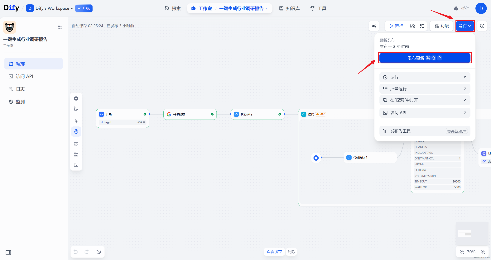

This step is easy to understand: an unpublished workflow is still in edit mode, and its nodes, variables, and prompts may change at any time, making it unsuitable as a service interface for external code to depend on.

### 1.2 Check the API Documentation

Dify provides an API documentation entry for workflows.

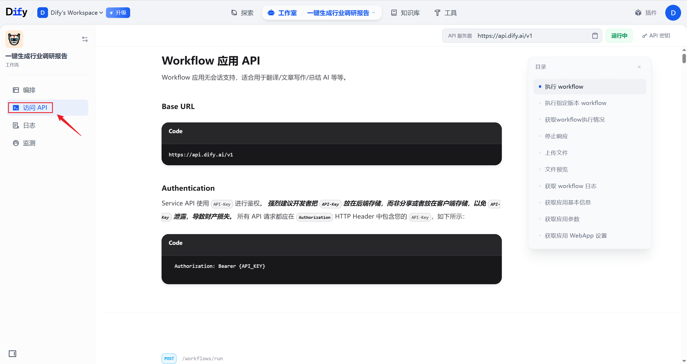

When learning for the first time, it is recommended that you do not skip this step, because the URL, request headers, and request body structure used later in the Python code are already explained for you on the platform.

### 1.3 Create an API Key

#### 1.3.1 Create the Key

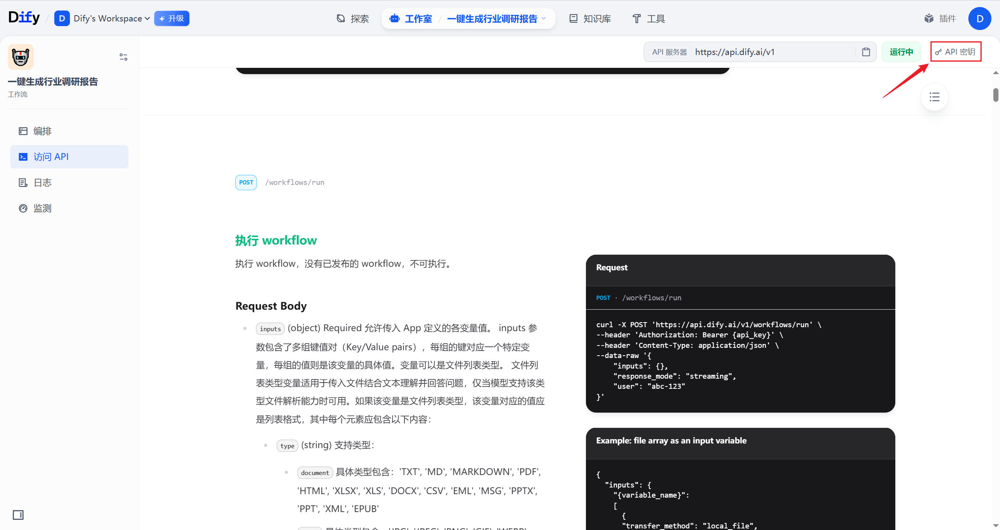

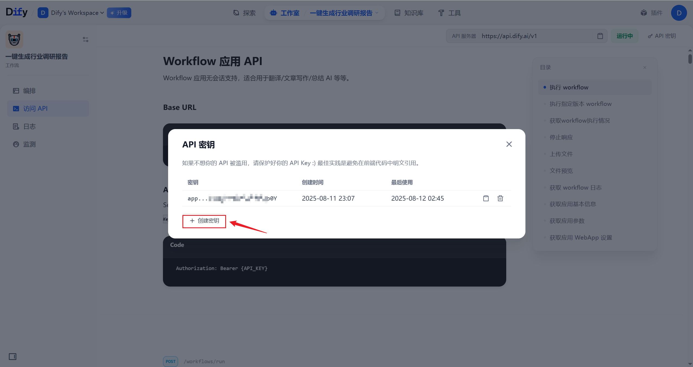

After creation, simply copy it.

#### 1.3.2 The Relationship Between Workflows and API Keys

Dify API keys are **bound to workflows**. A single API Key can only be used to **access a specific workflow**, while a single workflow can correspond to multiple API Keys.

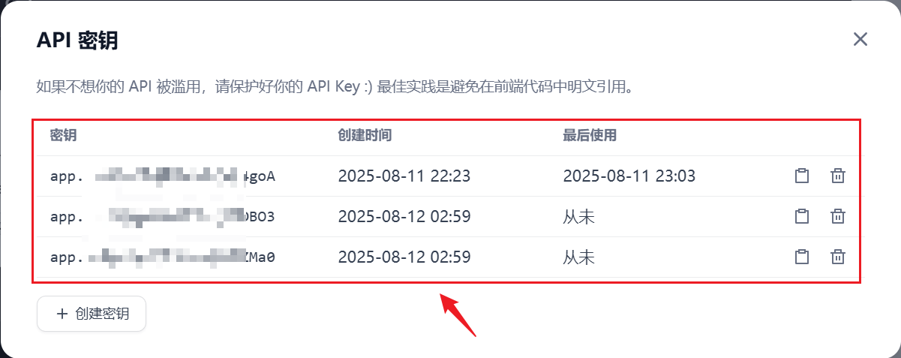

This is similar to permission control in real projects: the same workflow can be issued different keys to different environments, services, and callers, but the key itself is not a universal key for the entire workspace.

---

## 2. First Understand the Request Structure

To start a workflow through a POST request, the common official example is as follows:

```sh
curl -X POST 'https://api.dify.ai/v1/workflows/run' \
--header 'Authorization: Bearer {api_key}' \
--header 'Content-Type: application/json' \
--data-raw '{
  "inputs": {},
  "response_mode": "streaming",
  "user": "abc-123"
}'
```

### 2.1 URL

```text
https://api.dify.ai/v1/workflows/run
```

If you are using a locally deployed version of Dify, it is usually changed to:

```text
http://localhost/v1/workflows/run
```

If it is deployed on a server, replace it with your own domain name or server address.

### 2.2 Request Headers

| Key           | Value              |
| ------------- | ------------------ |
| Authorization | `Bearer {api_key}`  |
| Content-Type  | `application/json`  |

Replace `api_key` with the key created in the previous step.

### 2.3 Request Body

```json
{
  "inputs": {},
  "response_mode": "streaming",
  "user": "abc-123"
}
```

These three fields solve different problems:

- `inputs`: the business input passed to the workflow. Field names must align with the input variables defined in the workflow.
- `response_mode`: determines the response mode, whether streaming or blocking.
- `user`: identifies the caller, helping platform logs distinguish different users or request sources.

### 2.4 The Difference Between streaming and blocking

- **Streaming**: based on SSE (Server-Sent Events), returns results while executing, suitable for long-running tasks and scenarios where you need to see process logs.
- **Blocking**: waits for the entire workflow to finish and then returns all results at once. It is simpler to write, but long-running processes are more prone to timing out.

> **A way to remember this:** In debugging and real projects, it is generally better to use `streaming` first, because it allows you to obtain the final result while also seeing what happened in intermediate nodes.

---

## 3. First Verify Once with Postman

This section is not mandatory, but it is highly recommended, because many issues can be clearly identified with Postman before integrating with Python.

### 3.1 Create a New POST Request and Fill in the URL

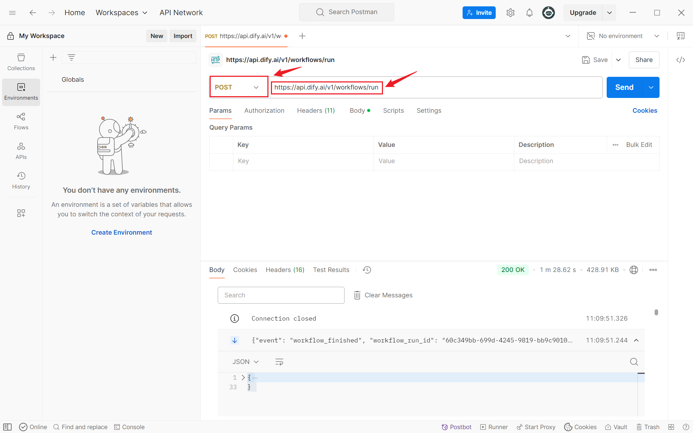

### 3.2 Add Request Headers

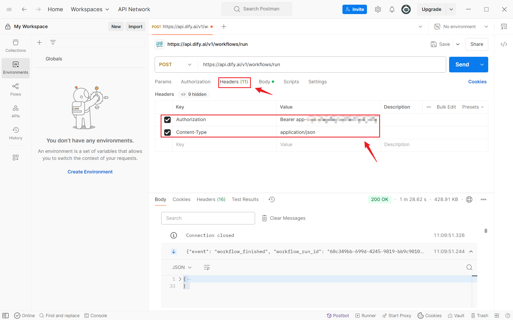

### 3.3 Add the Request Body

For Body, select `raw`, and for the format, select `JSON`.

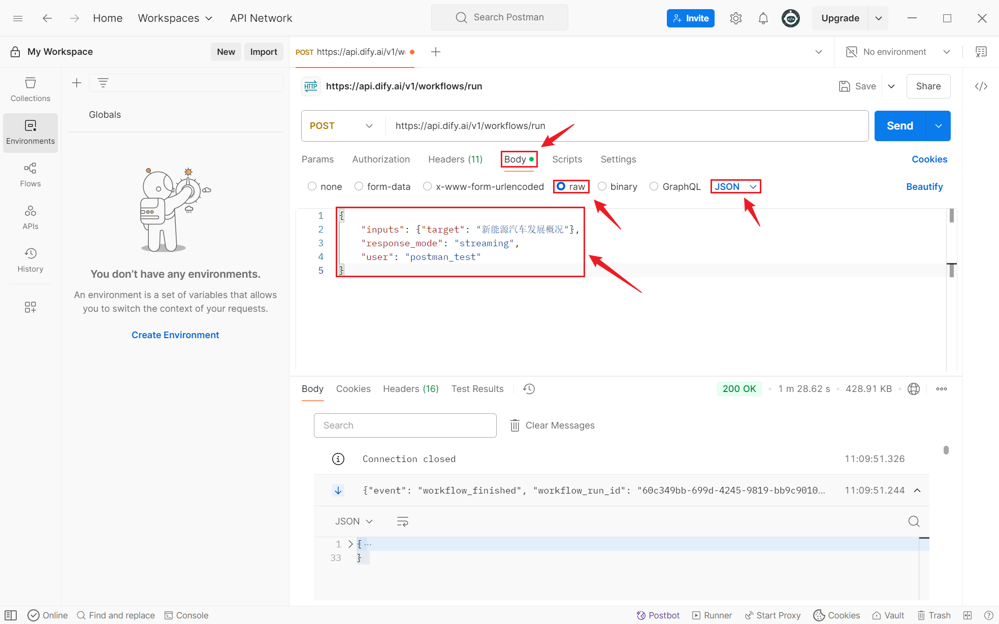

Example request body:

```json
{
  "inputs": {
    "target": "新能源汽车发展概况"
  },
  "response_mode": "streaming",
  "user": "postman_test"
}
```

Here, `target` is the workflow input variable name and must match the field defined in your Dify workflow exactly.

### 3.4 Send the Request

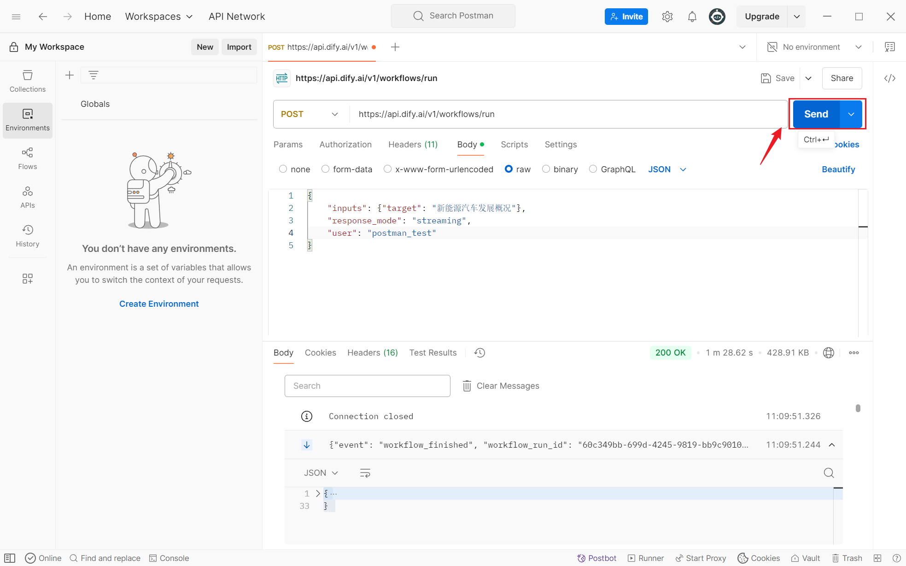

### 3.5 Understand the Response

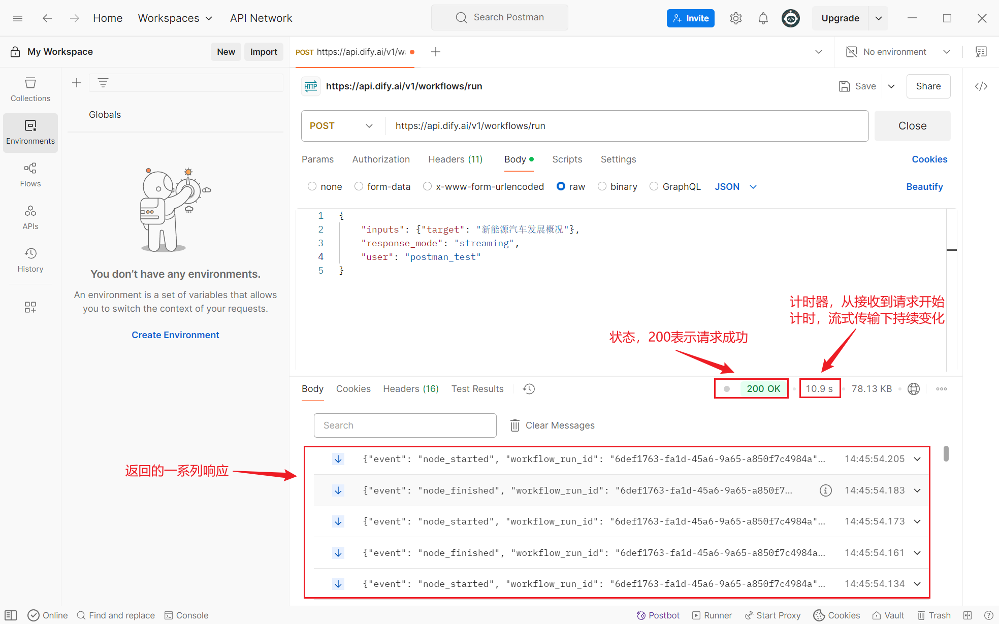

Response start marker:

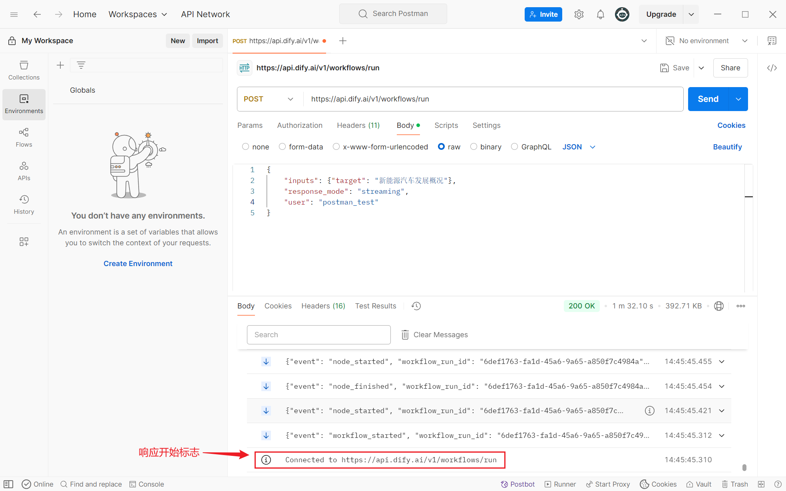

Response end marker:

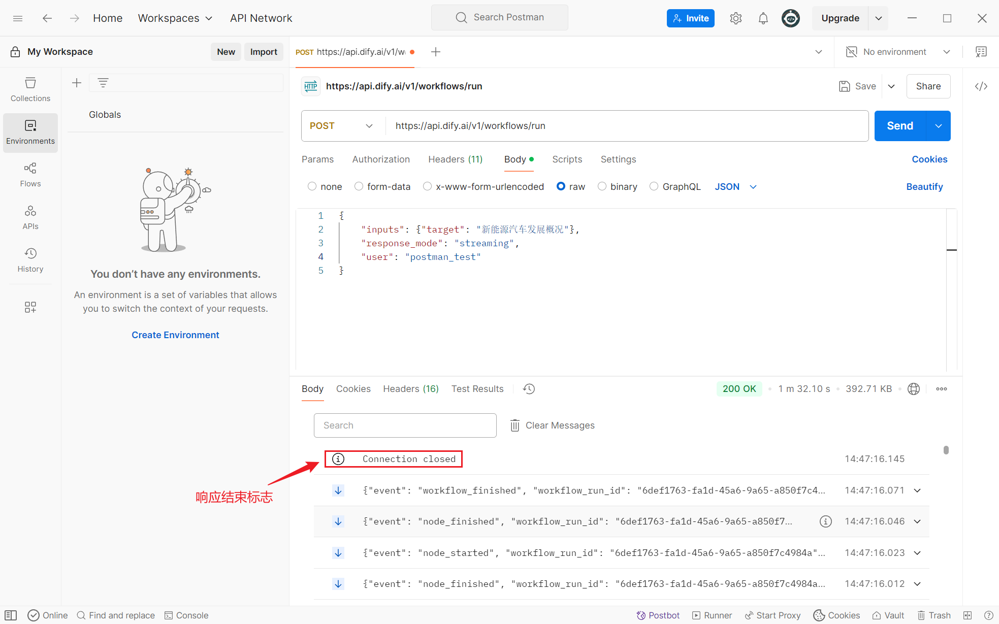

The final response body carries the workflow's final output:

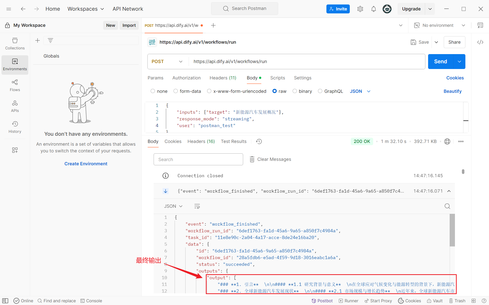

### 3.6 How to Understand the Response Body

The last key event is usually:

```json
{
  "event": "workflow_finished",
  "workflow_run_id": "xxx",
  "task_id": "xxx",
  "data": {
    "status": "succeeded",
    "outputs": {
      "output": ["...最终结果..."]
    }
  }
}
```

When learning for the first time, it is enough to remember one sentence:

> **As long as you ultimately receive `workflow_finished`, and `status` is `succeeded`, this workflow call can usually be considered successful.**

---

## 4. View Run Logs in the Dify Backend

### 4.1 Open the Logs Page

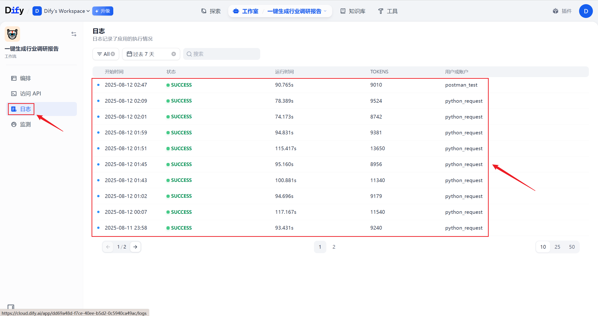

### 4.2 View Results

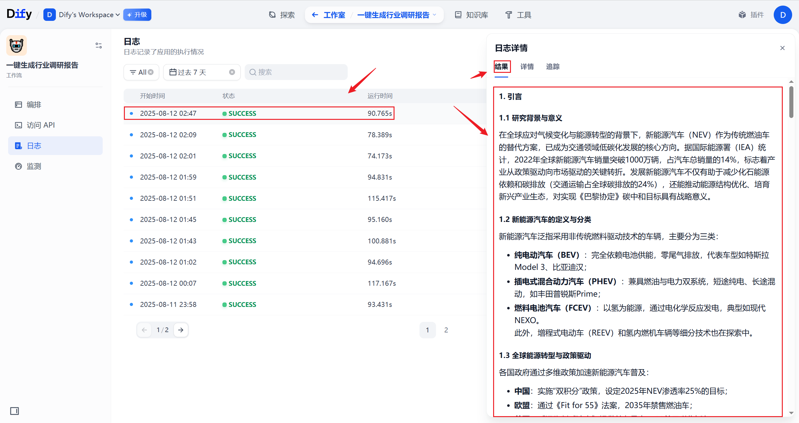

### 4.3 View Details

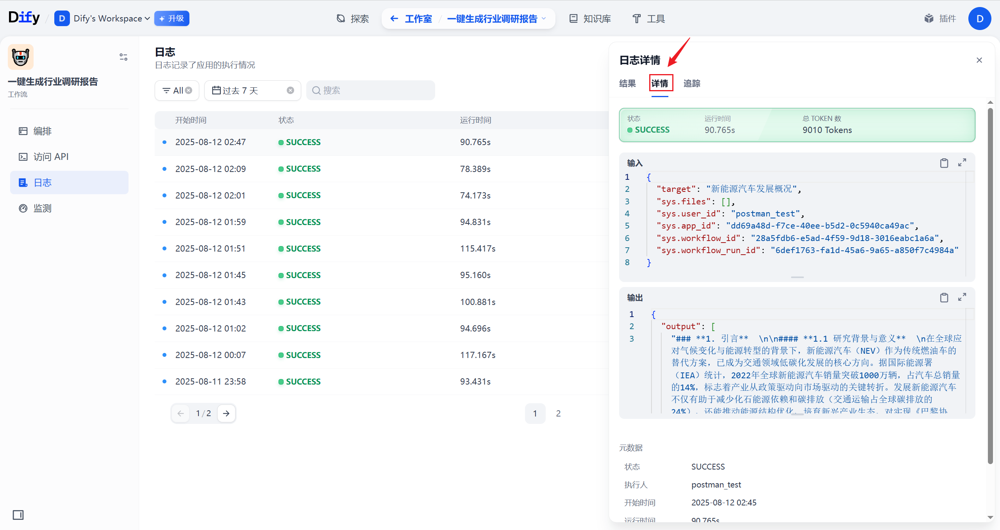

### 4.4 View Tracing Information

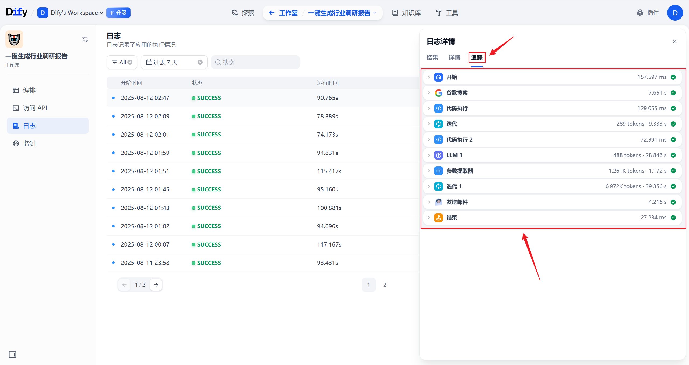

The value of platform logs is very significant, because they can tell you: whether this request actually entered the workflow; which node reported an error; whether the input variables were passed correctly; and whether the final output matches what was received on the code side.

In many cases, the problem is not that the Python code was written incorrectly, but that there is a problem with the **nodes, variable names, or tool configuration inside the workflow itself**. In such cases, platform logs are more intuitive than local logs.

---

## 5. Calling Dify Workflows with Python

### 5.1 Install Dependencies

```sh
pip install requests
```

### 5.2 A Sample Code Better Suited for Real Projects

```python
import requests
import json

# 响应返回模式
# 流式，基于 SSE（Server-Sent Events）实现类似打字机输出方式的流式返回
STREAMING_MODE="streaming"
# 阻塞式，等待执行完毕后返回结果（流程较长则可能会被中断）。由于 Dify 云/网关限制，请求在约 100 秒无返回后会超时中断
BLOCKING_MODE="blocking"

# 工作流的API_KEY
API_KEY="{your key}"
# Dify base_url，如果是本地部署，替换为 http://localhost/v1
BASE_URL="https://api.dify.ai/v1"

# 工作流完成标志
WORKFLOW_FINISHED="workflow_finished"
# 工作流成功标志
WORKFLOW_SUCCESS="succeeded"

# 用于启动工作流
def stream_dify_workflow(target, api_key=API_KEY, base_url=BASE_URL, username="python_request", mode=STREAMING_MODE):
    # 拼接用于启动工作流的 url
    url = f"{base_url}/workflows/run"

    # 拼接头信息，包括API Key和数据类型
    headers = {
        "Authorization": f"Bearer {api_key}",
        "Content-Type": "application/json"
    }

    # 拼接请求体
    payload = {
        "inputs": {"target": target},
        "response_mode": mode,
        "user": username
    }

    try:
        # 使用stream=True保持连接打开
        with requests.post(url, headers=headers, json=payload, stream=True) as response:
            if response.status_code != 200:
                print(f"请求失败，状态码: {response.status_code}")
                print(response.text)
                return

            print("=== 开始接收流式响应: ===")
            # 逐行读取服务器推送的数据
            for line in response.iter_lines():
                if line:
                    # 解码
                    decoded_line = line.decode('utf-8')

                    # 将 JSON 中的 Unicode 转义序列（如 \uXXXX）解码为对应字符
                    fixed_line = decoded_line.encode("utf-8").decode("unicode_escape")

                    # 打印由二进制解析为 UTF-8 后的响应
                    print(f"decoded_line: {decoded_line}")
                    # 解码后换行会导致日志非常乱，一般不打开
                    # print(f"fixed_line: {fixed_line}")
                    # print(fixed_line)

                    # 去除SSE格式前缀
                    if(decoded_line.startswith("data: ")):
                        decoded_line=decoded_line[6:]

                        try:
                            # 尝试解析为JSON
                            json_data = json.loads(decoded_line)
                            if(json_data.get("event")==WORKFLOW_FINISHED):
                                print("---> 工作流执行完毕 <---")
                                print(f"{json_data.get("data")=}")
                                data = json_data.get("data")
                                workflow_status = data.get("status")
                                if (workflow_status == WORKFLOW_SUCCESS):
                                    print("---> 工作流执行成功 <---")

                                    try:
                                        # 获取工作流最终输出
                                        result = data.get("outputs").get("output")

                                        # 返回结果
                                        return result
                                    except Exception as e:
                                        print("工作流输出解码错误: ", e)
                                        print("data: ", data)
                                        return None
                                else:
                                    print("---> 工作流执行失败 <---")
                                    return None
                        except Exception as e:
                            print("JSON解析错误: ", e)
                            return None

            print("=== 流式响应结束 ===")

    except requests.exceptions.RequestException as e:
        print(f"请求发生错误: {e}")
        return None


if __name__ == "__main__":
    result = stream_dify_workflow("新能源发展现状")
    print("----------> result <----------")

    # 若成功返回，遍历结果列表并打印最终输出（失败时 result 为 None）
    if result:
        for item in result:
            print(item)
```

### 5.3 The Three Most Critical Things in the Code

The most important thing to truly understand in this code is not the syntax, but these three things:

1. Complete authentication through `Authorization: Bearer ...`.
2. Pass business parameters to the workflow through `inputs`.
3. Obtain the final result by listening for the `workflow_finished` event.

### 5.4 What to Change for a Locally Deployed Version of Dify?

If you are calling a self-deployed Dify instance, you usually only need to change the environment variables to:

```bash
export DIFY_BASE_URL=http://localhost/v1
export DIFY_API_KEY=your_api_key
```

On Windows PowerShell, you can use:

```powershell
$env:DIFY_BASE_URL="http://localhost/v1"
$env:DIFY_API_KEY="your_api_key"
```

---

## 6. How to Read Streaming Logs

### 6.1 Logs Are Divided into Two Types

#### 1. Lines starting with data:

These are the actual workflow run logs.

```text
decoded_line: data: {"event": "iteration_next", ...}
```

#### 2. Lines starting with event:

These are usually communication-layer heartbeats or event type notifications.

```text
decoded_line: event: ping
```

### 6.2 The Main Thread You Really Need to Follow

```text
workflow_started
-> node_started / node_finished（每个节点的开始与结束）
-> iteration_next（如果有循环或迭代）
-> workflow_finished
```

A log fragment that is easier to read is as follows:

```text
=== 开始接收流式响应 ===
decoded_line: data: {"event":"workflow_started", ...}
decoded_line: data: {"event":"node_started", "data":{"title":"开始", ...}}
decoded_line: data: {"event":"node_finished", "data":{"title":"开始", "status":"succeeded", ...}}
decoded_line: data: {"event":"node_started", "data":{"title":"谷歌搜索", ...}}
decoded_line: data: {"event":"node_finished", "data":{"title":"谷歌搜索", "status":"succeeded", ...}}
decoded_line: data: {"event":"workflow_finished", "data":{"status":"succeeded", "outputs":{...}}}
```

These events correspond to different stages of the workflow: `workflow_started` indicates that the entire workflow has started executing, `node_started / node_finished` indicates that a specific node has started or finished, and `workflow_finished` indicates that the entire process has finished, with the final result provided in `outputs`.

### 6.3 Why It Is Not Recommended to Print the Full Text Verbatim into Documentation

If your workflow output is a long article, it is not recommended to print the entire text verbatim into teaching documentation. More common practices in real projects are:

1. In the logs, confirm whether `status` is `succeeded`
2. Extract the final field from `outputs`
3. Print only the first few hundred characters for debugging preview
4. When the complete content is needed, write it to a file, database, or the response of an upper-level interface

For example:

```python
final_text = outputs["output"][0]
print(final_text[:300])
```

### 6.4 Check the Dify Backend Logs

Comparing the Dify backend logs with the Python console logs, the final run results should correspond to each other.

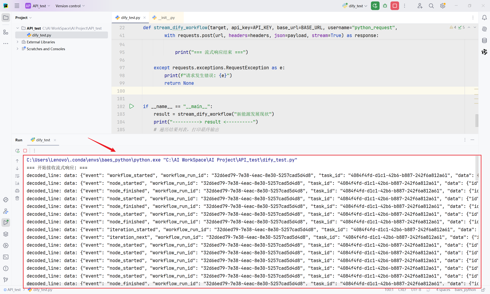

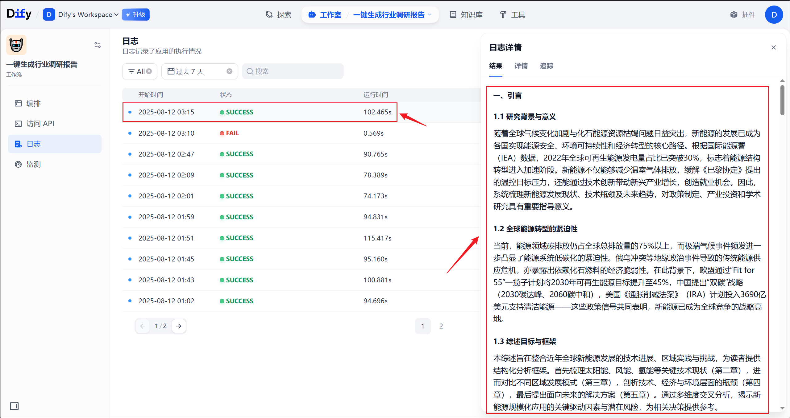

---

## 7. The Most Common Troubleshooting Order in Real Projects

If an API call fails, it is recommended to troubleshoot in the following order:

1. **First check the platform**: whether the workflow is published and whether the API Key corresponds to this workflow.
2. **Then check the request**: whether the URL, Headers, `inputs` field names, and variable types are correct.
3. **Then check the event stream**: whether `workflow_finished` was received and whether `status` is `succeeded`.
4. **Finally check the backend logs**: which node failed and whether it is a platform-side internal logic problem.

This order is more reliable than "focusing wherever an error is reported" because it divides problems into four layers: **entry layer, request layer, execution layer, and platform layer**.

---

**Chapter reflection questions:**

1. From a Dify workflow on the page to calling it from Python code, which points must be confirmed along the way?

   **Reference thinking:** First confirm that the workflow is published, then confirm the API Key, invocation URL, `inputs` field, `response_mode`, `user`, and log entry. The fact that the page can run is only the first step; on the code side, you also need to verify that authentication, parameters, and returned events are consistent.

2. If the API returns an exception, how do you determine whether the workflow was not published, there is an authentication error, an input parameter error, or an event parsing error?

   **Suggested approach:** First check the HTTP status code and platform logs; for 401/403, check the API key first; for 404 or application not found, check the publishing status and address; for parameter errors, check `inputs`; if the code does not get the final result, then check streaming event parsing. Do not rush to modify the workflow nodes right away.

3. Why can you not focus only on the final text when calling a workflow, but also need to look at intermediate events?

   **Suggested approach:** Streaming events can tell you which step the workflow execution has reached, which node reported an error, and which event the final output comes from. In real projects, troubleshooting, progress display, and timeout handling all depend on this intermediate information.

**Chapter summary:**

- **Prerequisites for calling**: A Dify workflow must be published first, and an API Key bound to it must be created.
- **Core of calling**: The most critical request elements are the URL, Authorization, `inputs`, `response_mode`, and `user`; together they determine "which workflow to call, what identity to use, what input to pass, and how to get the result."
- **Distinguish return modes**: `blocking` is suitable for simple calls, while `streaming` is more suitable for real project debugging and long-running tasks.
- **Main troubleshooting path**: The most important thing in this chapter is not memorizing a specific piece of code, but mastering a stable troubleshooting path: **Publish and test on the platform first -> Verify with Postman / curl -> Integrate with Python -> Cross-check with Dify logs**.

**Suggested next steps:**

- If you also need to call Coze platform workflows, go to [Chapter 5: Calling Coze Platform Workflows with Python](5-Python%E8%B0%83%E7%94%A8Coze%E5%B9%B3%E5%8F%B0%E5%B7%A5%E4%BD%9C%E6%B5%81.md).
- If you want to connect platform capabilities with Agent principles, go to [Chapter 21: Agents](21-Agent%E6%99%BA%E8%83%BD%E4%BD%93.md).
- If you are preparing to deploy your own Dify environment, go to [Chapter 6: Installing and Starting Dify](6-Coze%E4%B8%8EDify%E7%9A%84Windows%E5%B9%B3%E5%8F%B0%E9%83%A8%E7%BD%B2.md#_4、dify-的安装和启动) or [Chapter 7: Enterprise-level Large Model Deployment](7-%E4%BC%81%E4%B8%9A%E7%BA%A7%E5%A4%A7%E6%A8%A1%E5%9E%8B%E9%83%A8%E7%BD%B2.md).
