# 5 - Calling Coze Platform Workflows with Python

This chapter focuses on **platform invocation practice**: learn to use the API and Python to call workflows you have already built on Coze, integrating the "workflow inside Coze" into local code and business systems.

---

**Chapter objectives:**

- Know that before making calls you must **publish the API** in Coze, and obtain `workflow_id`, `app_id`, and the API Key from the API debugging page.
- Understand the most critical request fields in Coze workflow invocation: `workflow_id`, `app_id`, `parameters`.
- Be able to read the common events in Coze streaming responses: `PING`, `Message`, `Done`.
- Be able to use the official **cozepy** SDK to complete a minimal local invocation, and understand why real projects use environment variables instead of hardcoding secrets in code.

**Study suggestion:** This chapter is best read alongside Chapter 4. You will find that although the two platforms differ in interface, SDK, and field naming, the underlying main flow is the same: **platform publish -> authentication -> pass business parameters -> receive event stream -> check results in platform logs**.

---

## 1. You Must Publish the API Before Calling

Coze's API capabilities need to be enabled through the app publishing feature.

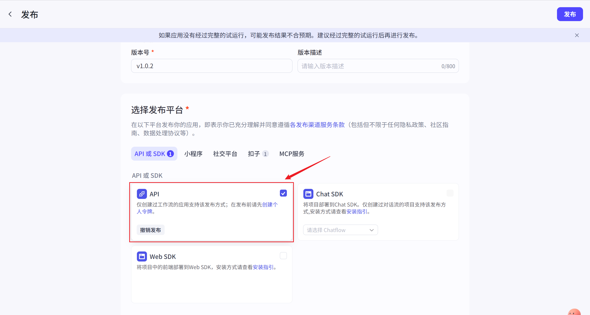

The significance of this step is very similar to Dify: only a published workflow is suitable as a stable entry point that external systems depend on.

---

## 2. First Gather All Key Information in the Platform

### 2.1 API Debugging Entry

After successful publishing, you can see the API debugging entry on the workflow canvas page.

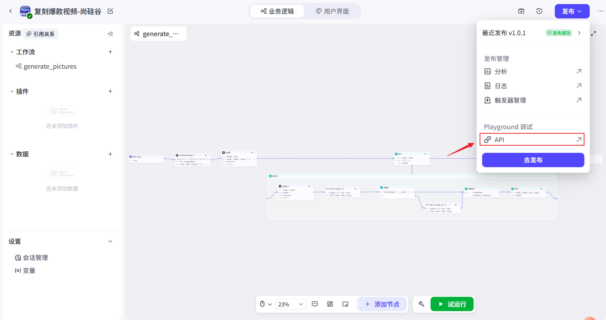

### 2.2 View workflow_id and app_id

In the API playground, select the Shell request method on the right.

The interface will display:

- **Workflow ID**: `workflow_id`
- **App ID**: `app_id`

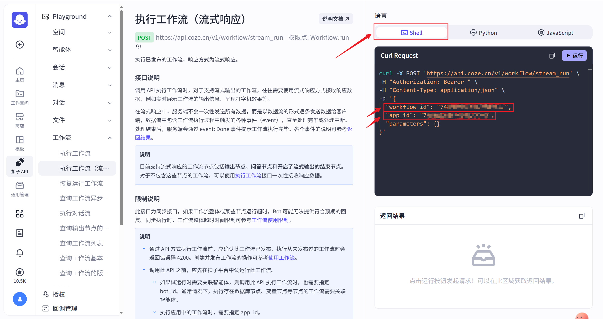

You can understand it this way:

- `workflow_id`: which workflow will be executed this time
- `app_id`: which app context this workflow belongs to

### 2.3 Generate and Authorize an API Key

Scroll down in the left window to see the token (that is, the API Key), and click the "Authorize" button.

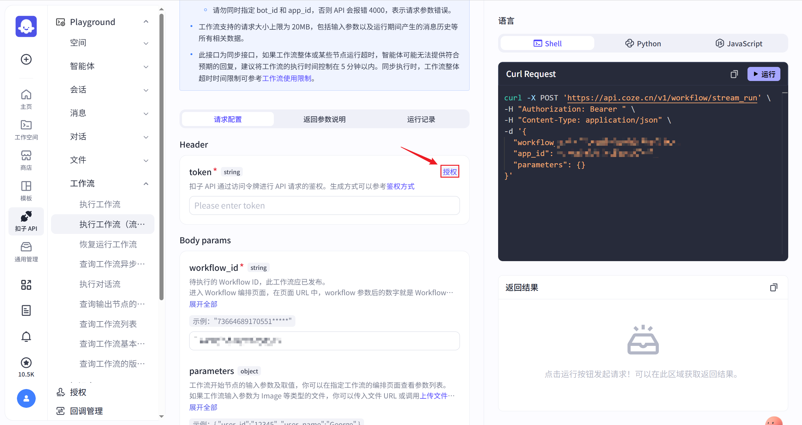

After clicking, an API Key will be automatically generated and filled in.

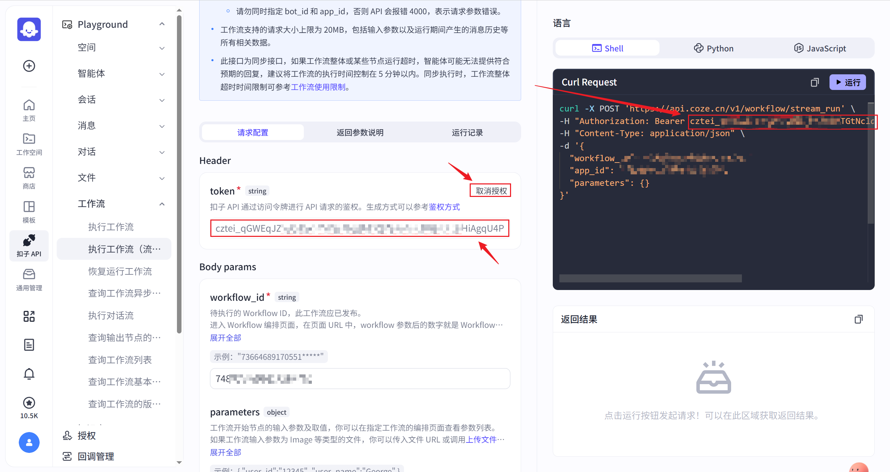

The Shell command window on the right will update accordingly.

### 2.4 Add Parameters

The `parameters` object in the request body is used to pass parameters to the workflow, and each property of this object corresponds to an input variable in the workflow.

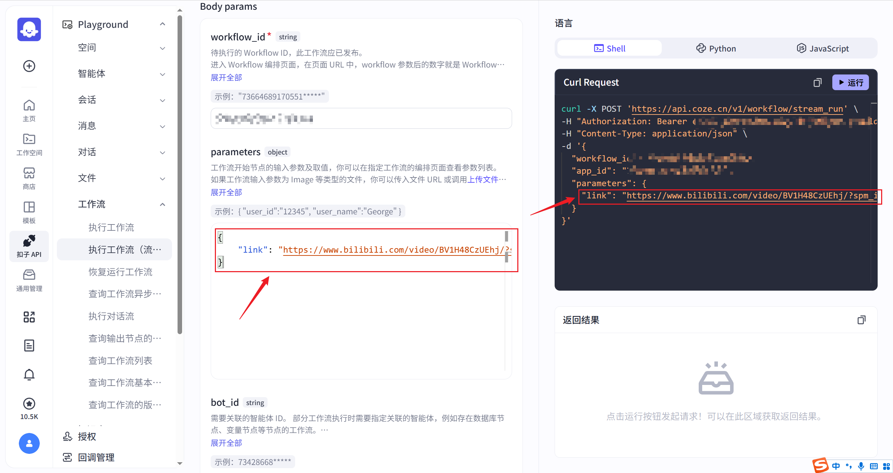

This is also the most error-prone part of Coze invocation. It is not a matter of "close enough": **field names, types, and structures must all align exactly with the definitions in the platform**.

### 2.5 Run

You can directly click the "Run" button in the upper-right corner of the Shell command window.

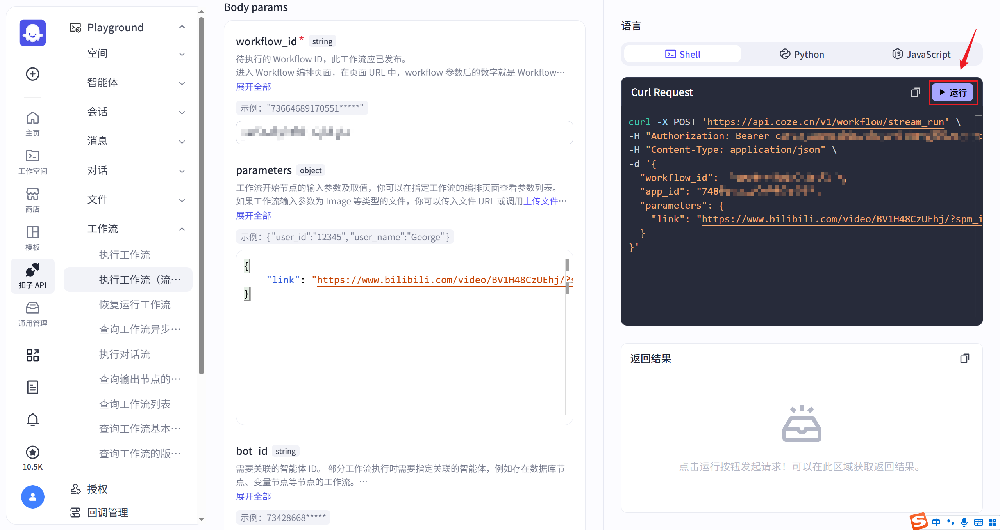

---

## 3. Understanding a Minimal Invocation Request

The curl command shown in the platform looks roughly like this:

```sh
curl -X POST 'https://api.coze.cn/v1/workflow/stream_run' \
-H "Authorization: Bearer {api_key}" \
-H "Content-Type: application/json" \
-d '{
  "workflow_id": "{workflow_id}",
  "app_id": "{app_id}",
  "parameters": {
    "link": "https://example.com/video"
  }
}'
```

The most critical fields here are only three:

- `workflow_id`: which workflow to execute
- `app_id`: which app it belongs to
- `parameters`: the actual business parameters passed to the workflow

> **Note:** The JSON standard does not support comments, so do not write content like `# 说明文字` in the request body.

---

## 4. How to Read Streaming Results

### 4.1 Run Result Interface

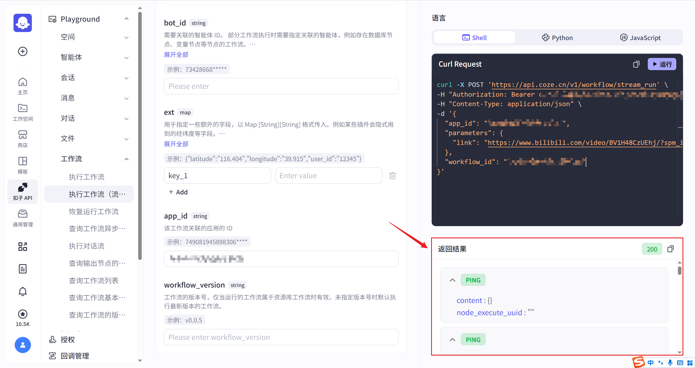

### 4.2 Message

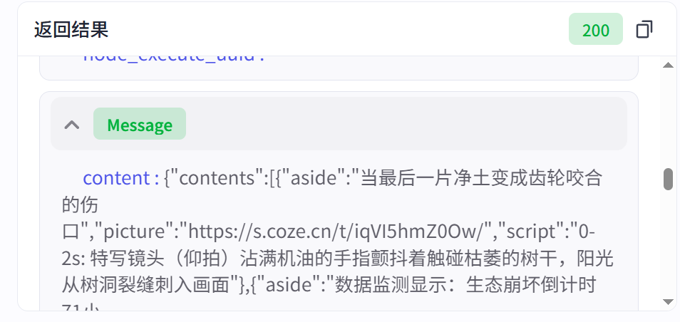

`Message` is the event type that carries the actual business content. Here, `content` is the output from a certain step of the workflow.

### 4.3 Done

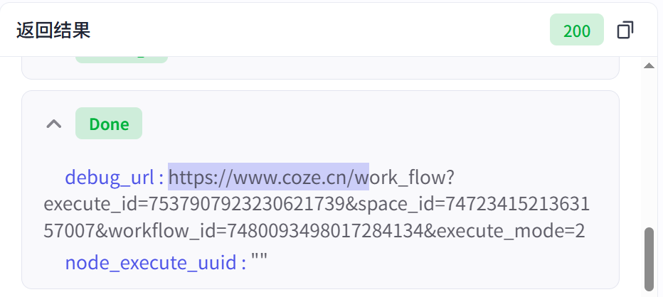

`Done` indicates that the streaming response has ended, and it usually appears after all `Message` events.

### 4.4 The Three Types of Signals You Really Need to Remember

- **PING**: heartbeat packet, only responsible for keeping the connection alive, usually can be ignored.
- **Message**: the event that actually carries content.
- **Done**: the entire streaming output has ended.

> **You can remember it this way:** When writing code, focus on `Message` and the end signal; `PING` is not the business result, it only indicates that the connection is still alive.

---

## 5. Calling Coze Workflows with Python

### 5.1 Official Python SDK Entry

Coze provides an official Python SDK: `cozepy`.

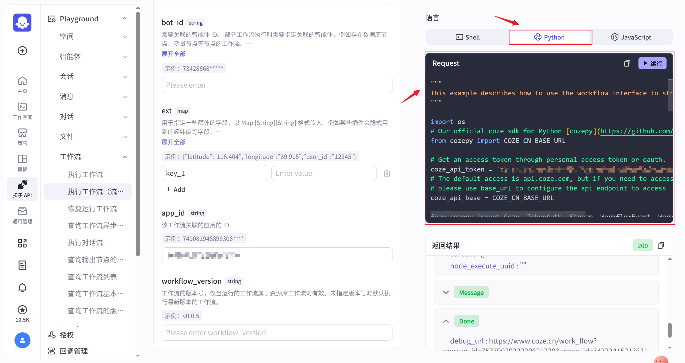

### 5.2 Install Dependencies

```sh
pip install cozepy
```

### 5.3 Example Source Code

````python
"""
This example describes how to use the workflow interface to stream chat.
"""

import os
# Our official coze sdk for Python [cozepy](https://github.com/coze-dev/coze-py)
from cozepy import COZE_CN_BASE_URL

# Get an access_token through personal access token or oauth.
coze_api_token = '{API_KEY}'
# The default access is api.coze.com, but if you need to access api.coze.cn,
# please use base_url to configure the api endpoint to access
coze_api_base = COZE_CN_BASE_URL

from cozepy import Coze, TokenAuth, Stream, WorkflowEvent, WorkflowEventType  # noqa

# Init the Coze client through the access_token.
coze = Coze(auth=TokenAuth(token=coze_api_token), base_url=coze_api_base)

# Create a workflow instance in Coze, copy the last number from the web link as the workflow's ID.
workflow_id = '{WORKFLOW_ID}'


# The stream interface will return an iterator of WorkflowEvent. Developers should iterate
# through this iterator to obtain WorkflowEvent and handle them separately according to
# the type of WorkflowEvent.
def handle_workflow_iterator(stream: Stream[WorkflowEvent]):
    for event in stream:
        if event.event == WorkflowEventType.MESSAGE:
            print("got message", event.message)
        elif event.event == WorkflowEventType.ERROR:
            print("got error", event.error)
        elif event.event == WorkflowEventType.INTERRUPT:
            handle_workflow_iterator(
                coze.workflows.runs.resume(
                    workflow_id=workflow_id,
                    event_id=event.interrupt.interrupt_data.event_id,
                    resume_data="hey",
                    interrupt_type=event.interrupt.interrupt_data.type,
                )
            )


handle_workflow_iterator(
    coze.workflows.runs.stream(
        workflow_id=workflow_id
    )
)

### 5.4 在本地 PyCharm 中运行

当你直接拷贝平台生成代码时，如果工作流定义了输入变量，但 `stream()` 调用里没有传 `parameters`，就会报错。


平台里的提示也已经很清楚：


**处理方式**：在从 Coze 平台拷贝的代码基础上，为 `stream()` 调用增加 **parameters** 参数：

```python
handle_workflow_iterator(
    coze.workflows.runs.stream(
        workflow_id=workflow_id,
        parameters={
            "link": "https://www.bilibili.com/video/BV1S2421P788/?share_source=copy_web&vd_source=8d04b2c1b7fd20888b03c20e99f26dc0"   # 替换成实际需要的链接
        }
    )
)
````

### 5.4 Final Code

```python
"""
This example describes how to use the workflow interface to stream chat.
"""

import os
# Our official coze sdk for Python [cozepy](https://github.com/coze-dev/coze-py)
from cozepy import COZE_CN_BASE_URL

# Get an access_token through personal access token or oauth.
coze_api_token = 'cztei_hXYOqnustyYyhrSuGFl4tgcxJ9E2KjYLPnHvcEcoWRwWvujWU0sPqka8xyQ1wsCyi'
# The default access is api.coze.com, but if you need to access api.coze.cn,
# please use base_url to configure the api endpoint to access
coze_api_base = COZE_CN_BASE_URL

from cozepy import Coze, TokenAuth, Stream, WorkflowEvent, WorkflowEventType  # noqa

# Init the Coze client through the access_token.
coze = Coze(auth=TokenAuth(token=coze_api_token), base_url=coze_api_base)

# Create a workflow instance in Coze, copy the last number from the web link as the workflow's ID.
workflow_id = '7537267958432858127'


# The stream interface will return an iterator of WorkflowEvent. Developers should iterate
# through this iterator to obtain WorkflowEvent and handle them separately according to
# the type of WorkflowEvent.
def handle_workflow_iterator(stream: Stream[WorkflowEvent]):
    for event in stream:
        if event.event == WorkflowEventType.MESSAGE:
            print("got message", event.message)
        elif event.event == WorkflowEventType.ERROR:
            print("got error", event.error)
        elif event.event == WorkflowEventType.INTERRUPT:
            handle_workflow_iterator(
                coze.workflows.runs.resume(
                    workflow_id=workflow_id,
                    event_id=event.interrupt.interrupt_data.event_id,
                    resume_data="hey",
                    interrupt_type=event.interrupt.interrupt_data.type,
                )
            )


handle_workflow_iterator(
    coze.workflows.runs.stream(
        workflow_id=workflow_id,
        parameters={
            "link": "https://www.bilibili.com/video/BV1S2421P788/?share_source=copy_web&vd_source=8d04b2c1b7fd20888b03c20e99f26dc0"   # 替换成实际需要的链接
        }
    )
)
```

### 5.5 Run Result

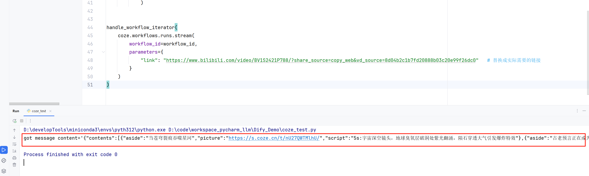

## 6. Besides the SDK, You Can Also Run on the Platform Side

If you just want to first confirm that the workflow itself can produce output normally, you can also test it directly in the platform.

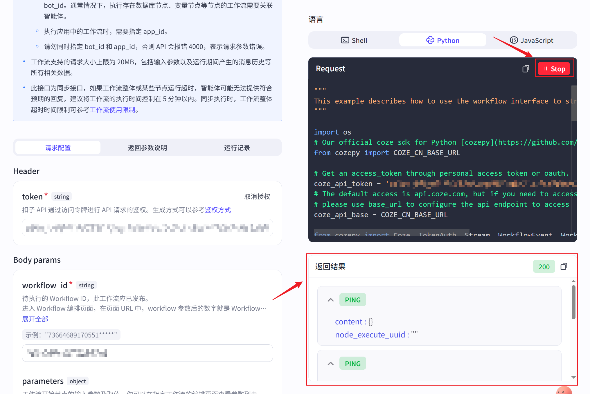

In real projects, the recommended order is usually:

1. First confirm on the platform that the workflow logic works correctly
2. Then use the API playground to verify the request structure
3. Finally, integrate it into Python code

This makes it easiest to isolate problems layer by layer, rather than debugging the platform and code at the same time and ending up unable to tell anything apart.

---

**Chapter review questions:**

1. Before calling a Coze workflow, how would you confirm that "the platform side is ready"?

   **Reference thinking:** First confirm the workflow publishing status, token or authentication method, `workflow_id`, necessary `app_id` / `bot_id`, input parameters, and platform-side test results. If the platform side has not been verified, no matter how complete the Python code is, it will only amplify the problem.

2. Coze and Dify have different API fields, but why is the main calling flow so similar?

   **Reference thinking:** Essentially, both expose platform workflows as APIs: publish, authenticate, pass business parameters, receive run results, and check logs for verification. Field names may change, but the troubleshooting order and engineering concerns are similar.

3. If the Python code does not produce the expected output, how would you troubleshoot layer by layer?

   **Reference thinking:** First debug the workflow in the platform, then confirm the interface using the API playground or a minimal request, and finally examine the Python parsing logic. This way you can distinguish whether the issue lies in platform configuration, interface parameters, authentication, or code handling.

**Chapter summary:**

- **Prerequisite for calling:** Coze workflows must first be published as an API, and you must confirm that `workflow_id`, `app_id`, and the API Key have all been obtained.
- **Core of invocation:** `cozepy` encapsulates the request and event stream for you, but the most critical part is still whether `parameters` aligns one-to-one with the workflow input variables.
- **Do not only look at the main content in the event stream:** In Coze streaming execution, in addition to normal output, events such as ERROR and INTERRUPT may also appear. When studying this chapter, the focus is not "being able to print a piece of text," but being able to correctly understand whether a workflow execution completed successfully, is waiting for intervention, or failed midway.
- **Debugging main flow:** As with Chapter 4, platform debugging and code invocation should corroborate each other. Once a result is abnormal, first check whether parameter mapping, the event stream, platform-side debugging output, and local logs can all be matched up against one another.

**Suggested next step:** If you want to continue along the Coze localization and privatization route, you can read [Chapter 6: Deploying Coze and Dify on Windows Platforms](6-Coze%E4%B8%8EDify%E7%9A%84Windows%E5%B9%B3%E5%8F%B0%E9%83%A8%E7%BD%B2.md); if you want to transition further from platform invocation to the code framework main line, you can also return to [Chapter 9: LangChain Overview and Architecture](9-LangChain%E6%A6%82%E8%BF%B0%E4%B8%8E%E6%9E%B6%E6%9E%84.md) to begin learning LangChain.
