# 7 - Enterprise-Level Large Model Deployment

This chapter focuses on **enterprise-level private deployment**: deploying **Dify** (application layer) and **Xinference** (model hosting and inference layer) on your own data center or cloud servers to achieve a complete chain where data stays within the domain, costs are controllable, and model versions are manageable. The content is practical, covering renting cloud servers, installing Docker, deploying Dify, renting GPU servers, deploying LLM/Embedding/Rerank, and connecting Dify to self-hosted models.

**Chapter learning objectives:**

- Understand why enterprise-level deployment usually separates the **application layer** from the **model inference layer**.
- Clearly distinguish the responsibilities of **inference engines** and **model hosting platforms**, and no longer confuse vLLM, Ollama, and Xinference as the same concept.
- Complete the private deployment of Dify on the server side.
- Complete the deployment of Xinference on a GPU server, and host LLM, Embedding, and Rerank models respectively.
- Understand why the chain of Dify connecting to Xinference is more suitable for unified model governance in enterprises.

**Study suggestions:** Enterprise deployment is most easily overwhelmed by environmental details. First clarify the layers: Dify belongs to the application layer, Xinference belongs to the inference layer, and GPU servers are just the infrastructure that hosts them. Section 1 first covers selection logic, Section 2 is only about getting Dify running, and Section 3 then connects model services. If you encounter Docker, network, database, or upgrade issues, refer directly back to [Chapter 8](8-Docker%E5%BF%AB%E9%80%9F%E5%85%A5%E9%97%A8%E4%B8%8EDify%E9%83%A8%E7%BD%B2%E6%8E%92%E9%9A%9C.md), and do not guess blindly in this chapter.

**Official documentation and resources**: See [Tool Navigation and Reference Materials Index - Deployment and Infrastructure](%E5%B7%A5%E5%85%B7%E5%AF%BC%E8%88%AA%E4%B8%8E%E5%8F%82%E8%80%83%E8%B5%84%E6%96%99%E7%B4%A2%E5%BC%95.md#deployment-and-infrastructure).

---

## 1. Overview of Enterprise-Level Large Model Deployment

### 1.1 Why Enterprise Deployment Is Different from Personal Deployment

When learning individually, we care more about: whether it can run, whether there is an interface, and whether we can first validate an application.
But enterprise deployment involves more concerns: data security and compliance, costs under high-frequency calls, model and platform replaceability, unified authentication, monitoring, auditing, version upgrades, and operational governance.

Therefore, the goal of enterprise deployment has never been just "installing Dify," but turning it into a set of sustainable infrastructure.

|              | Third-party APIs                     | Enterprise-level deployment                                  |
| ------------ | ------------------------------ | ------------------------------------------- |
| **Security and compliance** | Sensitive data leakage                   | Data is in the enterprise's hands                          |
| **Cost budget** | High-frequency call costs uncontrollable             | Costs are predictable (server purchase/rental and O&M<br>costs) |
| **Capability control** | Black box and version drift                 | Inference performance and model versions customizable                    |
| **Reliability**   | Latency and throughput uncontrollable               | Low-latency intranet, elastic scaling<br>throughput freely adjustable    |
| **O&M governance** | Model services opaque, not conducive to fault location | Model services observable, supporting fault location and governance          |

> Note: "Version drift" here refers to uncontrollable changes in interface behavior, model performance, or system output after third-party services upgrade.

### 1.2 Technical Architecture

The most error-prone point is mixing Dify, model services, and inference engines together as a "model platform." A better way to understand is to look at them in layers:

- `应用层`
  - Typical representative: Dify
  - Responsible for Agent, Workflow, RAG, knowledge base, prompts, frontend interaction, and platform management
- `模型托管层`
  - Typical representative: Xinference
  - Responsible for unified hosting of LLM, Embedding, and Rerank, and exposing services externally
- `推理引擎层`
  - Typical representatives: vLLM, SGLang, TEI, Ollama, llama.cpp
  - Responsible for actually loading models and executing inference on CPU / GPU
- `接入方式`
  - Upper layers usually connect through OpenAI-compatible APIs or platform plugins

Call path (from top to bottom):

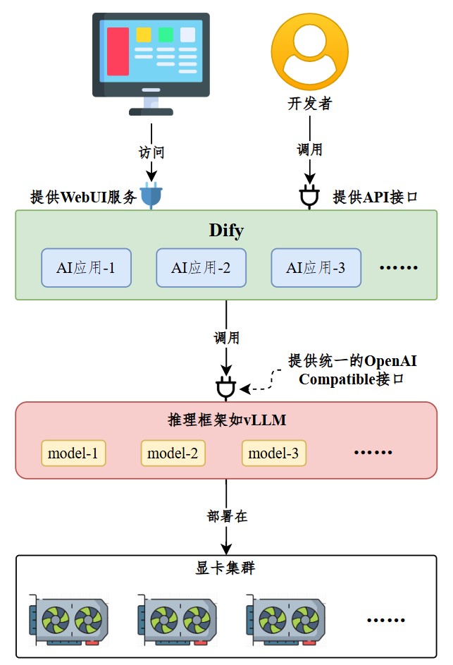

**The advantages of this layered architecture are**:

- `技术解耦`
  - Models can be independently upgraded and replaced
  - Application development does not depend on specific model implementations

- `有利于运维治理`
  - A unified entry point (standard OpenAI-compatible API calls) can implement unified authentication, rate limiting, auditing, etc.
  - The inference layer can be independently operated and maintained, with separate monitoring of QPS (Queries Per Second), TTFT (Time To First Token), TPS (Tokens Per Second), GPU utilization, and other metrics

### 1.3 Framework Selection

#### 1.3.1 Inference Engines

**① Local development / personal validation (fastest to get running)**

These tools are more suitable for "quick validation," but are usually **not good at multi-tenant / high-concurrency / multi-GPU cluster deployment in enterprises**.

- **Ollama**: Developed by Ollama Inc., it is the `最简单` way to deploy large models, but `推理效率低`, `不适合高并发场景`.
- **llama.cpp**: An open-source project developed by Georgi Gerganov, a pure C/C++ implementation of the LLaMA model inference library. Particularly suitable for CPU/edge devices/low-cost deployment.

> Conclusion: They are more suitable for personal learning or small-scale validation, and are not the main line of this chapter's enterprise architecture.

**② Enterprise high-concurrency inference engines**

These engines have a higher barrier to entry, but can more fully utilize GPU performance.

- **vLLM**: From the Sky Computing Lab at the University of California, Berkeley, it adopts multiple optimization strategies such as PagedAttention and separation of Prefill and Decode, `追求极致推理性能`, supports `多种硬件平台` such as NVIDIA GPUs, AMD GPUs, and Huawei Ascend, and supports `多卡并行` inference. It mainly `支持LLM部署`.
- **SGLang**: Also born in the Sky Computing Lab, it adopts similar optimization strategies. The difference is that SGLang is oriented toward `应用编排/结构化生成`, optimized for scenarios where the same application makes multiple calls. At the underlying level, it `减少模型实际进行的推理次数` through strategies such as merging, reuse, and scheduling optimization, further improving inference performance.

- **HuggingFace TEI (Text Embedding Inference)**: An official toolkit from Huggingface, specifically designed for efficient `部署嵌入模型`.

> Conclusion: Enterprise deployment cares more about throughput, latency, and resource utilization, so tools such as vLLM, SGLang, and TEI are more practically significant.

#### 1.3.2 Model Hosting Platforms

These platforms do not solve "how to make models run faster," but rather "how to uniformly manage multiple types of models as services."

- **Xinference (Xorbits Inference)**: A large model management and inference service platform from Hangzhou Future Velocity Technology Co., Ltd., committed to building an integrated solution. Supports hosting of multiple model types such as `LLM`, `Embedding`, and `Rerank`.

> **Clarification: Is Xinference an inference engine?**  
> **No**. Xinference is not at the same level as Ollama, vLLM, or SGLang:
>
> - **Inference engines** (vLLM, SGLang, Ollama, llama.cpp, TEI, etc.): Directly responsible for executing model computation on GPU/CPU, and are the underlying software that "actually runs the model."
> - **Model hosting platforms** (Xinference): Responsible for model downloading, management, lifecycle, and external APIs, and **can use** one or more inference engines at the underlying level. For example, when deploying an LLM, Xinference usually selects **vLLM** as the engine; when deploying Embedding, it uses the built-in embedding inference implementation.  
>   The most intuitive analogy is: inference engine = the "motor" that does the work; model hosting platform = the "dispatch center" that manages multiple motors and provides unified external services.

> **What is the relationship between inference engines and LLMs, embedding models, and reranking models?**
>
> - **Models** (LLM, Embedding, Reranker, etc.) are "weights + network structure." They cannot run by themselves and must be loaded and executed on GPU/CPU by some program, which is the **inference engine**.
> - **Inference engines** are responsible for: loading model files → performing forward computation on hardware → returning results. Different engines are optimized for different model types (for example, LLMs require token-by-token generation and need KV cache, while Embedding/Reranking usually only require a single forward pass).
> - **Correspondence**: The same type of model can be run by different engines (for example, LLMs can use vLLM or SGLang); one engine often only excels at a certain type of model (vLLM mainly targets LLMs, TEI mainly targets Embedding). Therefore, when deploying, you need to choose both "which model to use" and "which engine to run this model."

#### 1.3.3 Selection

**Large Language Model (LLM):** can be deployed using vLLM, SGLang, or Xinference+vLLM engine.

**Embedding Model:** can be deployed using Huggingface TEI and Xinference.

**Reranker / Re-ranking Model:** Among the products currently surveyed, apart from Ollama and llama.cpp, only Xinference supports deployment of this type of model.

**Final selection:**

This chapter selects the Xinference platform as the model hosting and inference service framework, to uniformly deploy large language models, embedding models, and reranking models. The reasons are as follows:

① Unified interface: It can provide a unified API interface externally, managing multiple models through one link just like large model vendors.

② For LLMs: Deploying LLMs with the vLLM engine provides `极高的推理性能`.

③ For embedding models and reranking models: Embedding models and reranking models only require a single forward pass. Compared with large language models that generate token by token, `资源开销要小得多`, so performance requirements are not high. Xinference also supports deployment of these two types of models, allowing us to manage all models with one platform, `运维成本低`.

#### 1.3.4 Overall Call Relationship

The overall diagram is as follows:

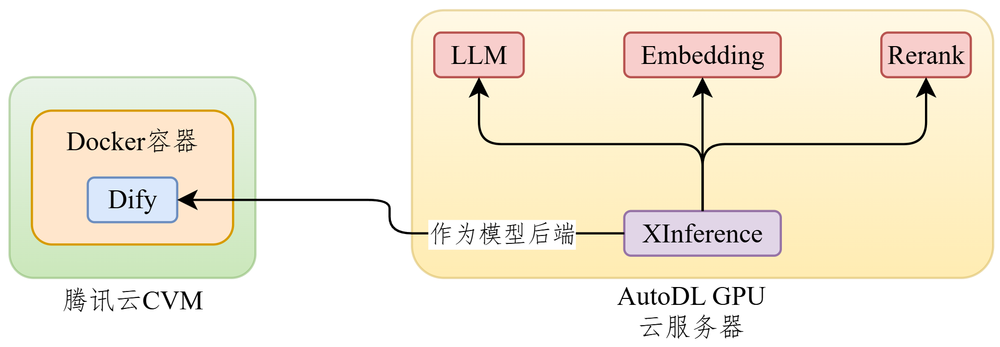

**Question: Why is Dify installed in Docker in this project, while Xinference is installed directly on the GPU server?**

First of all, Xinference can be deployed in Docker. However, model inference in Xinference consumes a large amount of GPU resources, and Docker containers cannot directly use the host GPU by default. Additional configuration (such as NVIDIA Container Toolkit) is required to use the GPU. Therefore:

Option 1: Do not install Xinference in Docker

Option 2: Install Xinference in Docker, but additionally install other software to support GPU access.

Option 1 is adopted here: only Dify is installed in Docker, and Xinference runs directly on the GPU server.

> **You can remember it this way:** The entire chain can be summarized as "**Dify (application) -> Xinference (hosting) -> inference engine (execution) -> model (capability source)**". Dify does not compute models; it is only responsible for upper-layer application orchestration. What actually computes models is the model service on the GPU server.

---

## 2. Private Deployment of the Dify Platform

### 2.1 The Role of the Dify Platform (Review)

In this chapter, Dify is not the "model itself," but the upper-layer application platform.

It is mainly responsible for:

- Building agent applications based on the Agent architecture
- Building private knowledge base applications based on RAG
- Building intelligent workflow applications based on Workflow

In other words, Dify is more like an enterprise's internal "AI application operating system" rather than a "place to run models."

> Note: Accessing the Dify official website requires special network tools (or a VPN, or circumventing network restrictions)

### 2.2 Renting a Dify Server: Tencent Cloud

Enterprise users can choose to rent a cloud server or deploy Dify on a local server. Because Dify requires very few resources, a lightweight server is sufficient to support its operation.

We need to rent a cloud server to run the Dify service: Tencent Cloud.

Official website: https://cloud.tencent.com/

#### 2.2.1 Basic Configuration

https://buy.cloud.tencent.com/cvm

If used within an enterprise, or if you have sufficient personal funds and stable business operations, you can choose a long-term rental. If you want a discount, you can choose spot instances. Spot instances are no different from pay-as-you-go billing in terms of performance and stability.

> Spot instances: as long as someone rents a long-term server, your server may be evicted. There are solutions for instances released due to bidding, which will be discussed later.

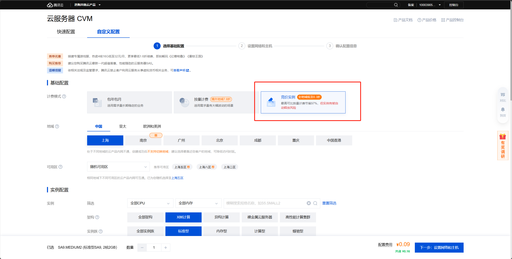

Region selection: no specific requirement, just choose according to your needs.

Instance configuration: choose according to your needs; there is no specific requirement. Here I chose 4 cores and 8GB.

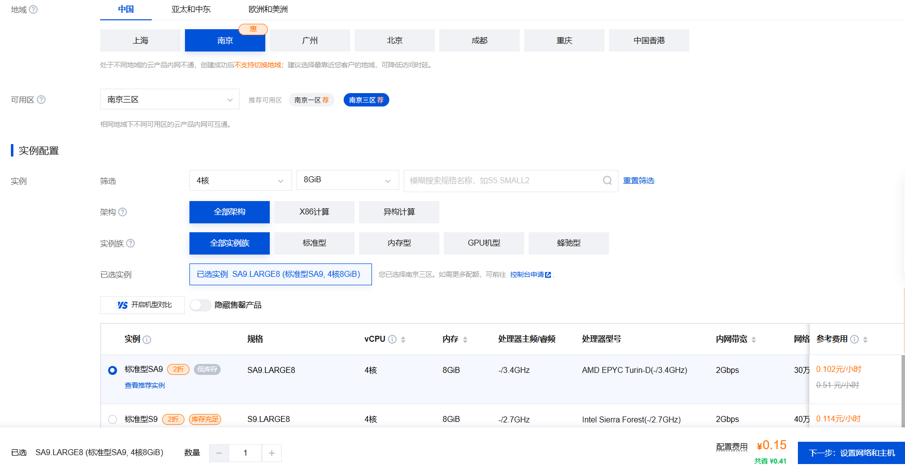

Image: you can choose CentOS or Ubuntu. Ubuntu is used here. After selection, click Next.

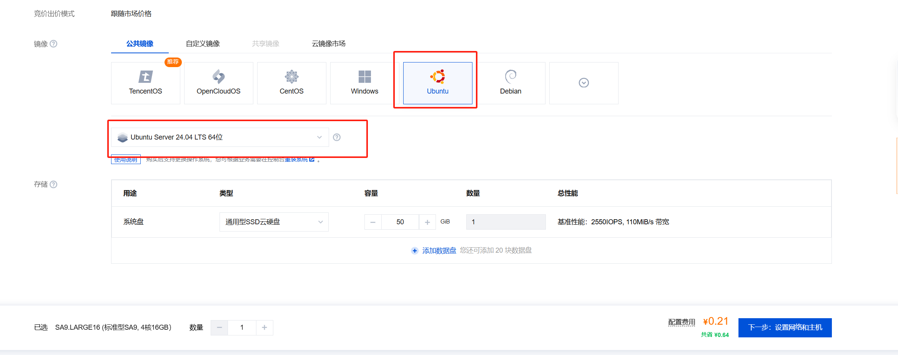


#### 2.2.2 Setting Up Network and Host

Set the bandwidth limit to the maximum, create a new security group, and enable all commonly used ports:

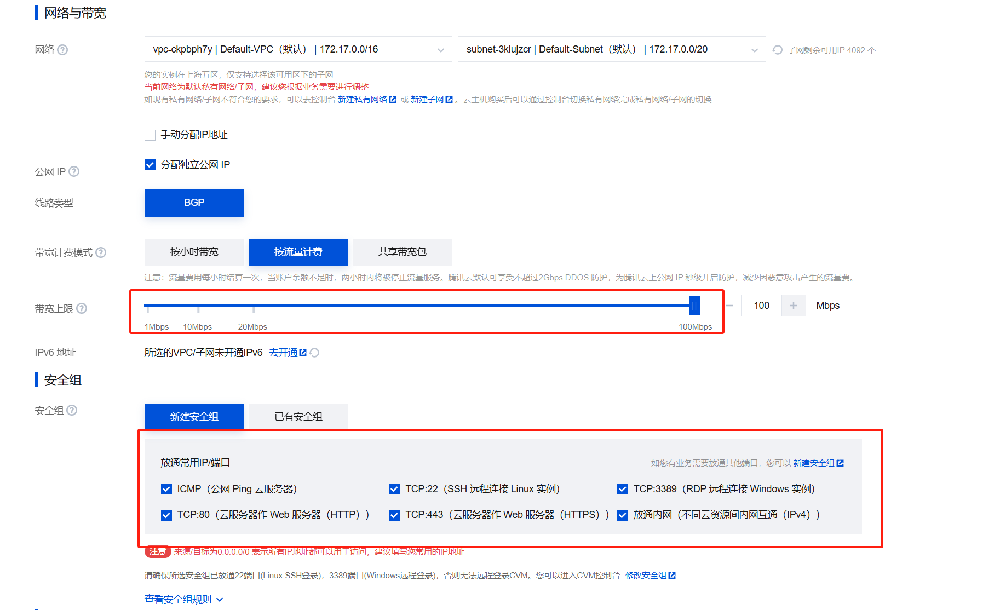

Name the instance, set a password, and proceed to the next step:

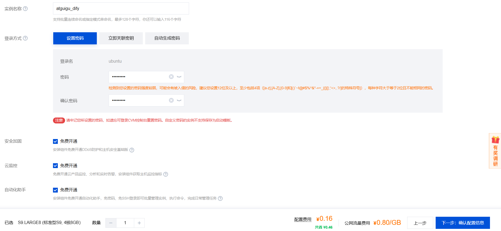

Activate:

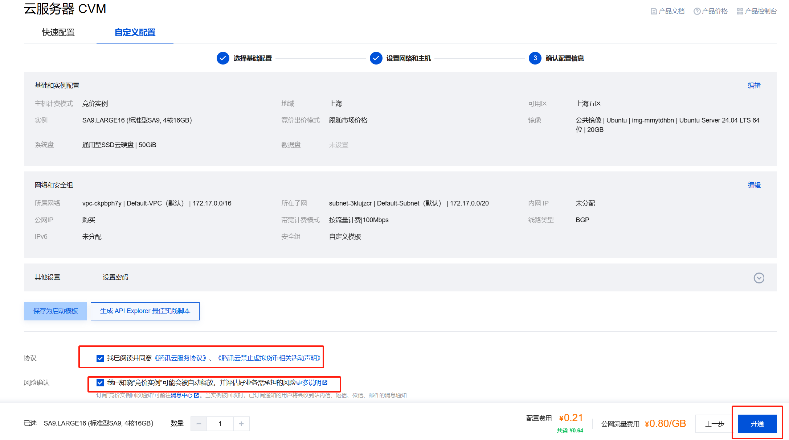

#### 2.2.3 Login (Using Xshell or FinalShell or WindTerm)

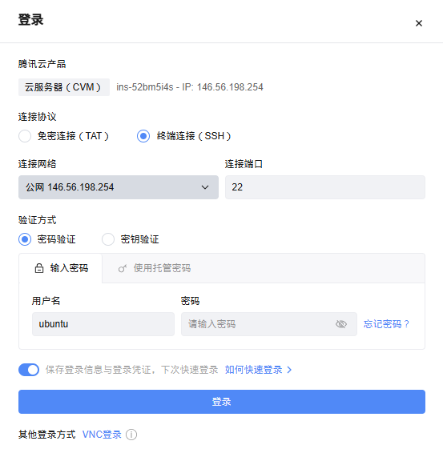

Once created, use this public IP, port 22, username ubuntu, and the password you set. Connect using your remote connection tool such as XShell or FinalShell.

The XShell interface looks like this:

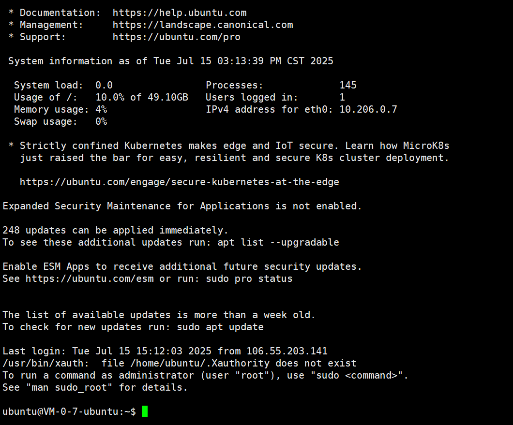

### 2.3 Deploying Docker

Deploying the Dify platform requires a Docker environment, but newly purchased Tencent Cloud servers do not come with Docker pre-installed. Next, you need to deploy Docker on the rented Tencent Cloud server.

**What is Docker?**

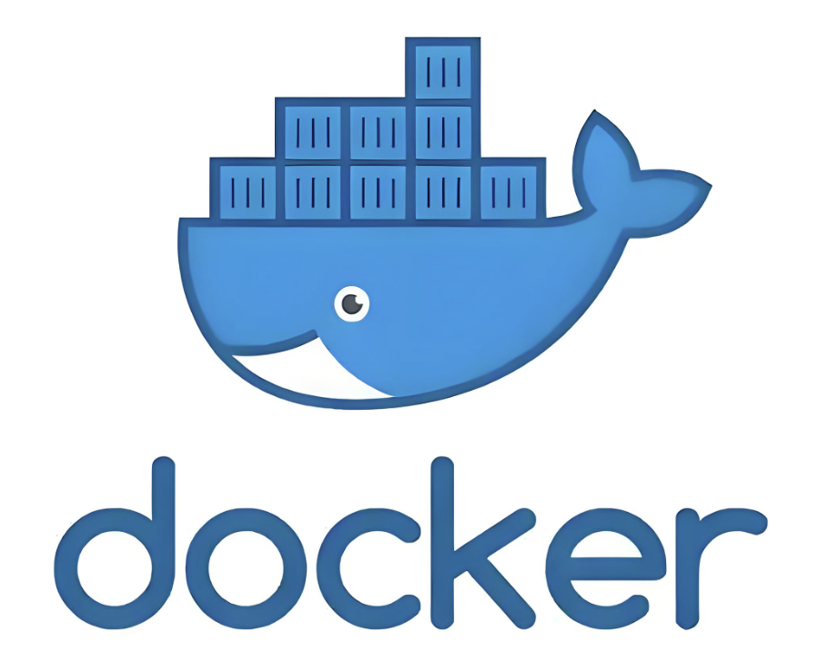

Docker is a containerization technology. Compared with traditional virtualization solutions implemented through virtual machine technology, Docker is a more lightweight virtualization solution.

**It can package an application and its dependencies into an independent container and run it in different environments.** Through Docker containers, developers can easily build, deploy, and run applications without worrying about environment configuration and dependency issues.

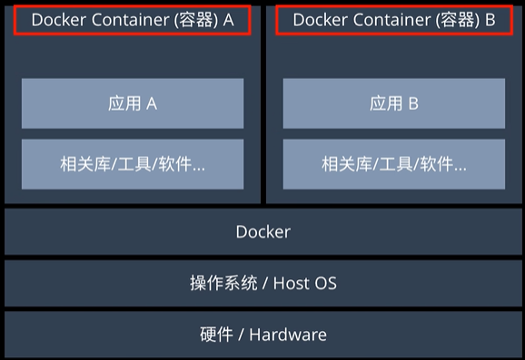

**Benefits of using Docker:**

- `一次构建，到处运行`: After you develop and test a program on your own computer and package it into a Docker image, you can guarantee that it will run exactly the same on the production server. You will never again encounter the problem of "It works fine on my machine!"
- `环境隔离`: You can run both the Python 2 and Python 3 versions of a project at the same time without them affecting each other.
- `快速部署与扩展`: Because containers are very lightweight, you can instantly launch hundreds or thousands of identical containers to handle high traffic (such as during Double Eleven shopping festivals).
- `简化配置`: The environment configuration is written into the "material package" (image). When new team members take over a project, they do not need to spend several days configuring the environment; a single command can get the program running.

**Scenario:**

Suppose you developed a website.

- **Traditional approach:** You need to give the operations staff a long "Environment Configuration Manual": "Please install CentOS 7 first, then install Python 3.8.2, then install Nginx 1.18.0, with the following configuration..." The steps are tedious and highly error-prone.
- **Docker approach:** You directly package the entire website and its environment into a Docker image. The operations staff only needs to execute one simple command: `docker run [你的镜像名]`, and a complete, runnable website environment starts within one second.

Follow the instructions below step by step.

```bash
# 更新软件包
sudo apt update

sudo apt upgrade

# 安装 Docker 官方仓库依赖
sudo apt install ca-certificates curl

# 添加 Docker 官方 GPG key
sudo install -m 0755 -d /etc/apt/keyrings
sudo curl -fsSL https://download.docker.com/linux/ubuntu/gpg -o /etc/apt/keyrings/docker.asc
sudo chmod a+r /etc/apt/keyrings/docker.asc

# 添加 Docker 官方 apt 软件源
sudo tee /etc/apt/sources.list.d/docker.sources <<EOF
Types: deb
URIs: https://download.docker.com/linux/ubuntu
Suites: $(. /etc/os-release && echo "${UBUNTU_CODENAME:-$VERSION_CODENAME}")
Components: stable
Architectures: $(dpkg --print-architecture)
Signed-By: /etc/apt/keyrings/docker.asc
EOF

# 更新软件源
sudo apt update

# 安装 Docker Engine、Buildx 和 Compose 插件
sudo apt install docker-ce docker-ce-cli containerd.io docker-buildx-plugin docker-compose-plugin
```

When executing `sudo apt upgrade`, the following interface will appear. Just press Enter.

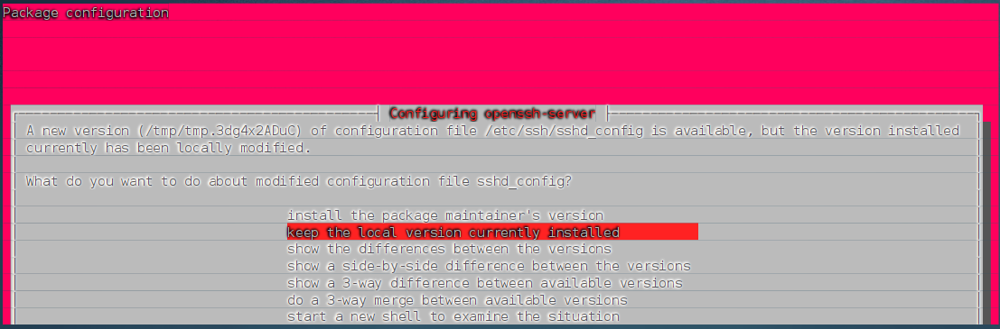

If it later gets stuck on this interface, press Enter a few times.

After installation is complete, start Docker and check its status.

```bash
sudo systemctl start docker

sudo systemctl status docker
```

As shown in the figure, this indicates a successful start.

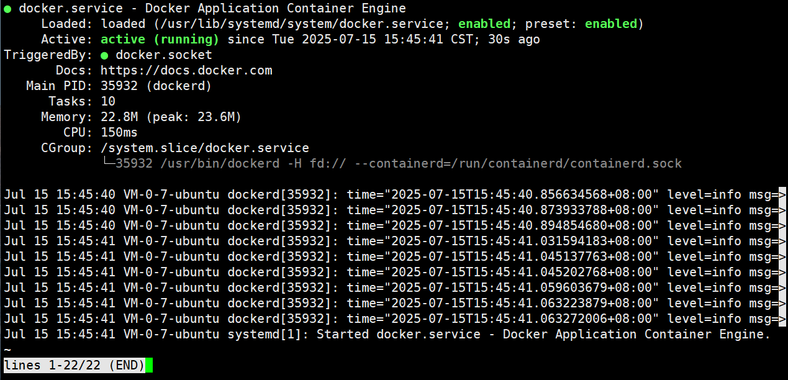

> Seeing the running status means Docker has started normally.

**Note: If you encounter the following error during installation:**

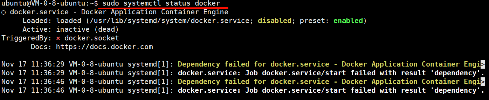

You can follow these steps:

| Step | Key Checkpoints/Operations | Expected Results/Notes |
| :----------------------------- | :------------------------------------------------------------------------------------------------------------------------ | :----------------------------------------------------------------------------- |
| 1. Verify Docker installation status | Run sudo systemctl status docker | Confirm the current status and error logs of the Docker service. |
| 2. Check and unmask the service | Run sudo systemctl unmask docker.service | Resolve the issue where the service cannot start because it was accidentally "masked." |
| 3. Check dependency service status | Run systemctl list-dependencies docker.service.<br>If the containerd service is abnormal, try starting it: sudo systemctl start containerd | Check whether services that Docker depends on (such as containerd) are normal.<br>If startup fails, go to step 4. |
| 4. Repair containerd (critical step) | Run: ① sudo apt-get update<br>② sudo apt-get install --reinstall containerd.io | Reinstall Docker's core runtime dependency. |

If none of the above steps work, you can consider completely removing Docker and its related components and then reinstalling. This is a reliable method for resolving file corruption or version conflicts.

Completely uninstall Docker:

```bash
sudo apt-get purge docker-ce docker-ce-cli containerd.io
sudo rm -rf /var/lib/docker
sudo rm -rf /var/lib/containerd
```

### 2.4 Deploying Dify

Before installing Dify, make sure your machine meets the minimum installation requirements:

- CPU >= 2 Core
- RAM >= 4 GiB

#### 2.4.1 Download

> Note: This chapter uses **0.15.5** as the course testing / historical example version, used to reproduce screenshots and the course workflow. For new deployments, you should prioritize referring to Dify's official latest self-hosted documentation; if you use a newer version, you must refer to the current release notes and local compatibility verification.

Create a dify directory under `/opt` to store the Dify source code:

```cmd
cd /opt
sudo mkdir dify #用于存储dify源码包
```

##### Method 1: Offline Download Package (Recommended)

**Offline source code package download** (requires special network tools)

Download link: https://github.com/langgenius/dify/releases/tag/0.15.5

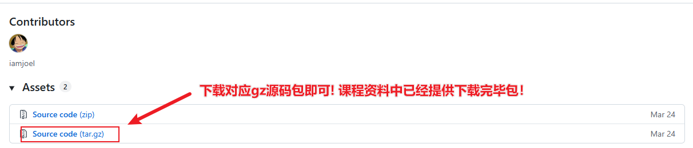

> Note: Students with poor network connections can refer to the course materials in the cloud drive.

Use a remote connection tool (such as XFTP) to transfer the Dify source code package to the server's /opt/dify folder and extract it:

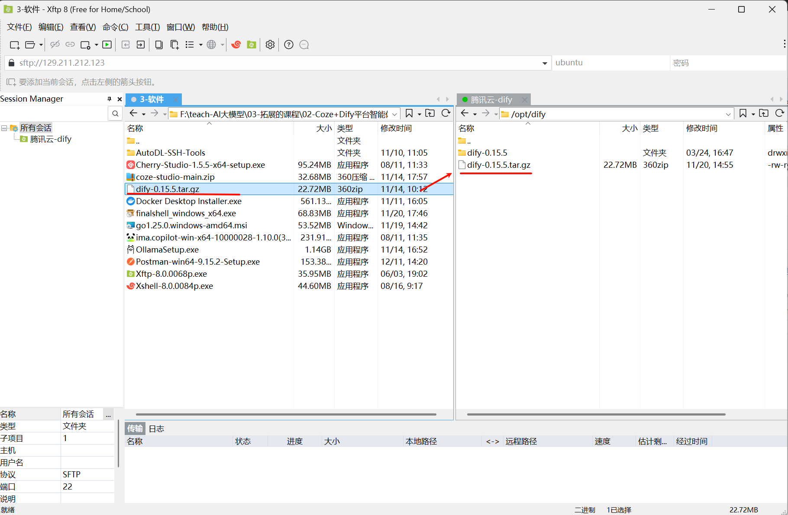

The upload may fail because the default ubuntu user does not have sufficient permissions. The solution is as follows:

```bash
# 方式1：赋予指定用户指定目录的完全权限（使用777）
# 在Ubuntu终端xshell执行：sudo chmod -R 777 /目标目录的完整路径
sudo chmod -R 777 /opt/dify

# 方式2：先将文件上传到您的用户主目录（如 /home/ubuntu），这个目录通常有写入权限
# 然后使用XShell或终端，通过命令移动文件：sudo mv /home/ubuntu/文件名 /目标/path/
```

Extract the package:

```cmd
#进入dify目录,在opt目录下执行：
cd ./dify
#解压
sudo tar -zxvf dify-0.15.5.tar.gz

cd /opt/dify/dify-0.15.5

pwd # 输出 /opt/dify/dify-0.15.5
```

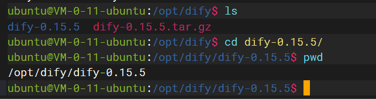

##### Method 2: Gitee Download

If downloading from GitHub is too slow, you can also use Gitee or a mirror site instead of GitHub for direct download, leveraging domestic servers for acceleration.

Steps:

1) Register a Gitee account ([https://gitee.com ](https://gitee.com/)).

2) Create a new repository on Gitee, select "Import GitHub repository," and paste the link for `https://github.com/langgenius/dify.git `.

3) After the import is complete, clone using the repository address generated by Gitee:

```bash
sudo git clone https://gitee.com/你的用户名/dify.git
```

You can also directly use my link here:

```bash
sudo git clone https://gitee.com/shkstart/dify.git
```

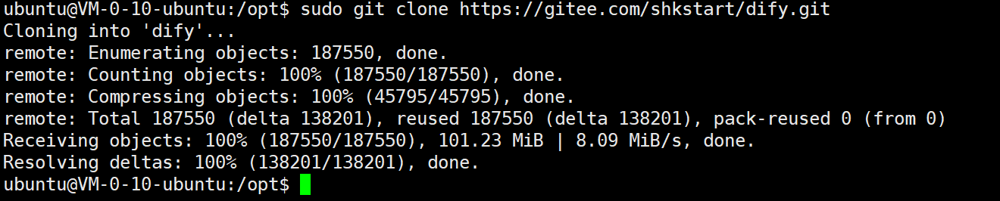

#### 2.4.2 Starting Dify with Docker

1. Enter the Docker directory of the Dify source code:

   ```cmd
   cd /opt/dify/dify-0.15.5/docker
   ```

2. Copy the environment configuration file

   ```bash
   sudo cp .env.example .env
   ```

3. Start the Docker container

   Depending on the Docker Compose version on your system, choose the appropriate command to start the container. You can check the version with the ` docker compose version` command. For detailed instructions, refer to the [official Docker documentation](https://docs.docker.com/compose/#compose-v2-and-the-new-docker-compose-command):
   - If the version is Docker Compose V2, use the following command (the version corresponding to this course):

     ```bash
     sudo docker compose up -d
     ```

   - If the version is Docker Compose V1, use the following command:

     ```bash
     sudo docker-compose up -d
     ```

   Note: Docker will automatically: pull the required images → create containers → start all services in order → run in the background.

4. After running the command, you should see output similar to the following, showing the status and port mappings of all containers:

   Note: The first image pull may take a long time, about nearly ten minutes in actual testing.

   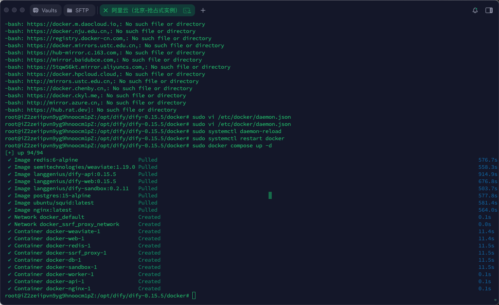

```cmd
[+] Running 11/11
 ✔ Network docker_ssrf_proxy_network  Created
 ✔ Network docker_default             Created
 ✔ Container docker-redis-1           Started
 ✔ Container docker-ssrf_proxy-1      Started
 ✔ Container docker-sandbox-1         Started
 ✔ Container docker-web-1             Started
 ✔ Container docker-weaviate-1        Started
 ✔ Container docker-db-1              Started
 ✔ Container docker-api-1             Started
 ✔ Container docker-worker-1          Started
 ✔ Container docker-nginx-1           Started
```

5. Finally, check whether all containers are running normally:

   ```cmd
   sudo docker compose ps
   ```

   In this output, you should see 3 business services `api / worker / web`, as well as 6 basic components `weaviate / db / redis / nginx / ssrf_proxy / sandbox`.

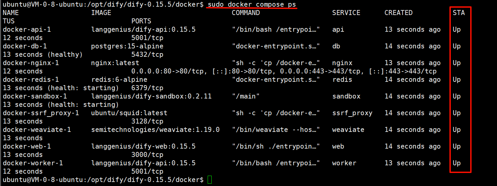

6. Stop Dify

```cmd
#一键关停所有相关容器，干净不残留
docker compose down
```

7. Sync environment variable configuration (important!)

- If the `.env.example` file is updated, be sure to synchronously modify your local `.env` file.

- Check all configuration items in the `.env` file to ensure they match your actual runtime environment. You may need to add new variables from `.env.example` to the `.env` file and update any values that have changed.

#### 2.4.3 Common Problems and Solutions

**Question 1: Common problems and solutions for installing Dify**

```cmd
sudo docker compose up -d
```

If execution fails, the error is most likely caused by network issues or missing images.

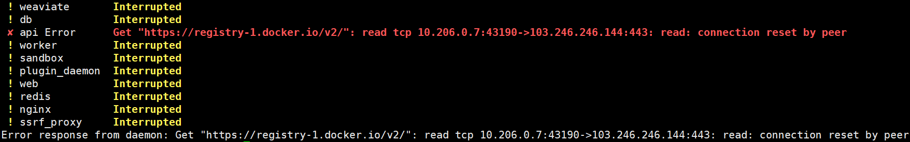


Configure the image source or proxy.

> **Note:** Mirror sources and proxies are common Docker network issues. The availability, security, and synchronization integrity of third-party mirror sources can change. In production environments, prioritize using the official Docker source, enterprise internal image registries, or image acceleration services explicitly provided and trusted by cloud vendors. For general troubleshooting approaches, see [Chapter 8 - Slow network or image pull failure](8-Docker%E5%BF%AB%E9%80%9F%E5%85%A5%E9%97%A8%E4%B8%8EDify%E9%83%A8%E7%BD%B2%E6%8E%92%E9%9A%9C.md#_44-slow-network-or-image-pull-failures).

```bash
sudo vi /etc/docker/daemon.json
```

Fill in `registry-mirrors` with the mirror source currently available to you. An example format is as follows:

```bash
{
  "registry-mirrors": [
    "https://your-trusted-mirror.example.com"
  ]
}
```

**Save and exit in vi**: press `Esc` to ensure you are in command mode, type `:wq` and press Enter (save and exit); if you want to discard changes, type `:q!` and press Enter.

After saving, restart Docker in the terminal:

```bash
# 重新加载配置并重启 Docker（修改了 /etc 下配置，通常需要 sudo）
sudo systemctl daemon-reload
sudo systemctl restart docker
```

Run again:

```bash
sudo docker compose up -d
```

It now starts downloading normally:

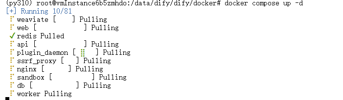


**Issue 2: An error may occur as follows**

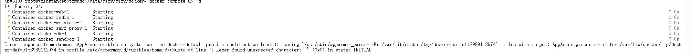

Therefore, check based on the error message

```bash
sudo vi /etc/apparmor.d/tunables/home.d/ubuntu
```

Delete the redundant character on the seventh line indicated in the error message


Run again, and it succeeds

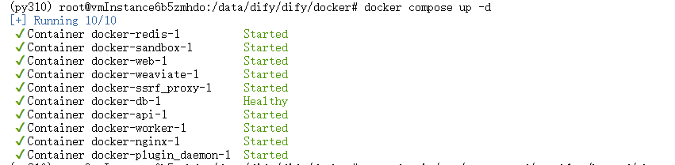

#### 2.4.4 Access

You can go to the administrator initialization page to set up the administrator account:

```bash
# 服务器环境
http://your_server_ip/install   #your_server_ip即为配置的腾讯云服务器地址
```

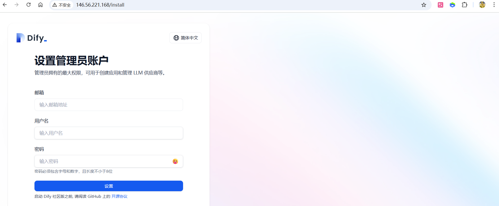

As shown in the figure, access is successful. Proceed with registration and login.

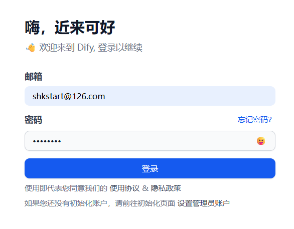

**Note: If the page keeps failing to load, restart Docker and try again**

#### 2.4.5 Set Snapshots

To prevent the spot instance in the case from being released, you can set a snapshot policy in the console's snapshot section. Even if it is released, the snapshot can be preserved, allowing for quick recovery.

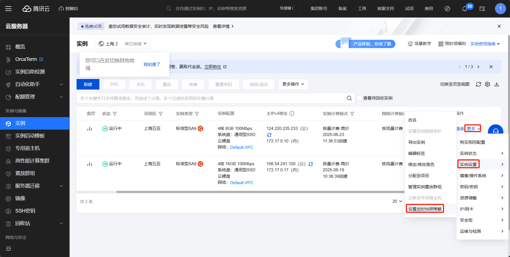

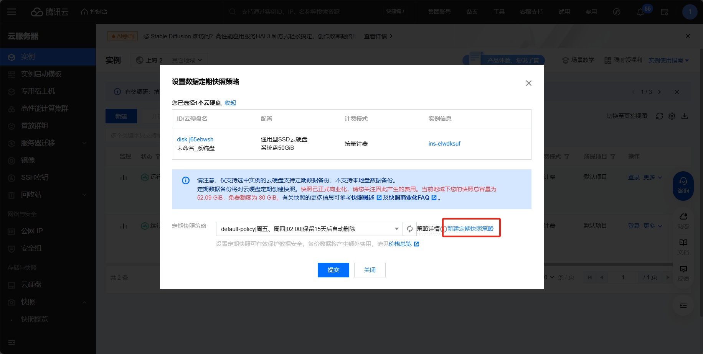

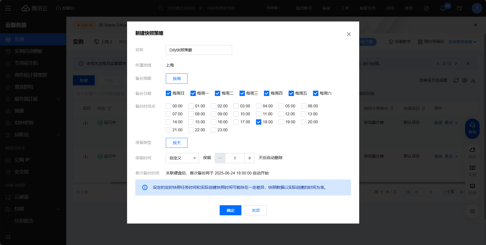

Enter the periodic snapshot policy again, and you can see that it has been set up successfully.

### 2.5 Configure Online LLM

If you want to call an online LLM, you can use Dify to select an online model provider. For example, you can select DeepSeek among the model providers.

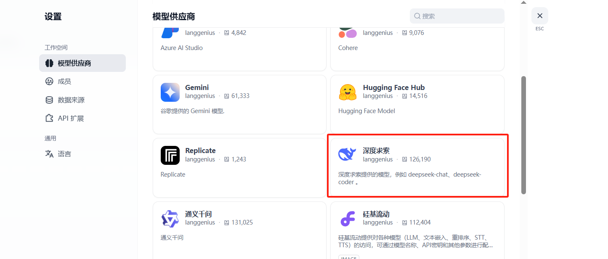

DeepSeek official website: https://www.deepseek.com/. Obtain your API Key from the official website, and then you can configure and use it.

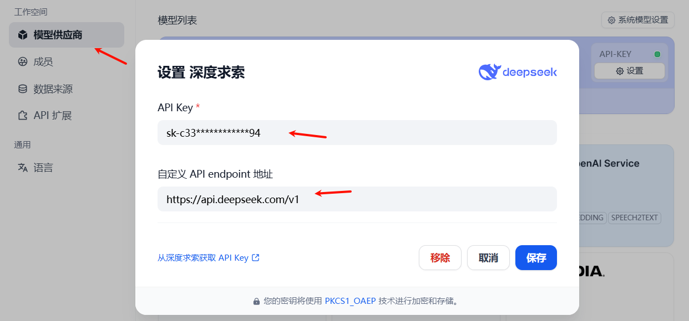

Here you can use the online LLM services (providers) offered by the platform. However, considering potential data security issues, we deploy Xinference ourselves and then deploy a private LLM.

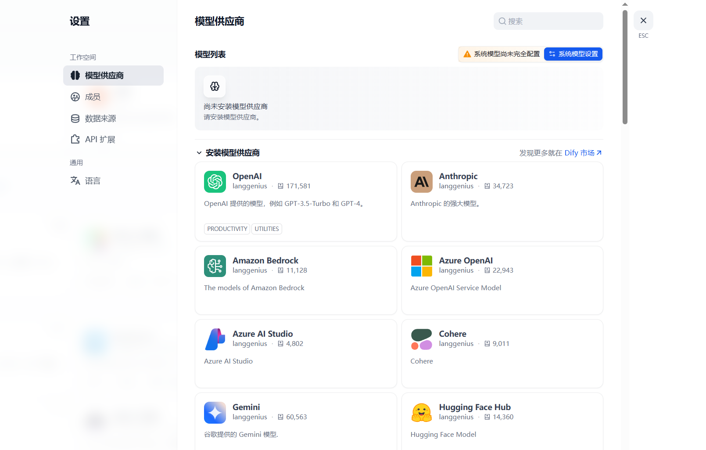

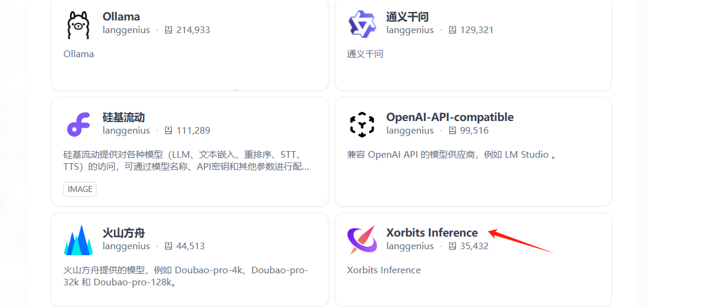

---

## 3. Model Deployment

### 3.1 Rent a GPU Server: AutoDL

**Introduction to AutoDL**

Here we choose the AutoDL platform to rent a server. This is a cloud computing platform for developers and enterprises, primarily providing cost-effective `GPU算力资源`, supporting applications such as AIGC, deep learning, cloud gaming, rendering and surveying, metaverse, and HPC.

**Platform address:** https://www.autodl.com/

> Resources on AutoDL servers are relatively scarce and expensive
>
> - On average, running a machine for one hour costs 2 yuan
> - `建议`: Generally, power on the machine when starting work in the morning and shut it down when ending work for the day.

#### 3.1.1 Configure Server + Image

Select a server:

Here you can choose a single-card 4090 in the Northwest B region as our server. We need to rent a server to deploy Xinference.

Note: According to the AutoDL official documentation, ports **6006** and **6008** of an instance are mapped as custom service entry points by default.

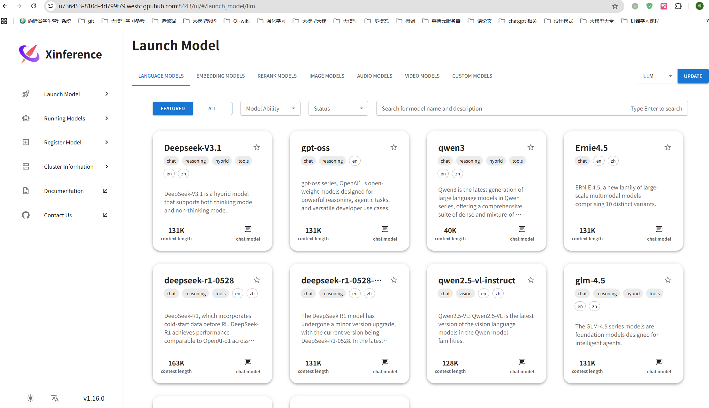

> Note:
>
> 1. The "Northwest" region is recommended here because it provides a public IP; other regions are not guaranteed.
>
> 2. Recommended GPUs include RTX 4090, 3090, 3080, etc. Other graphics cards may cause subsequent incompatibility issues.

Select an image version:

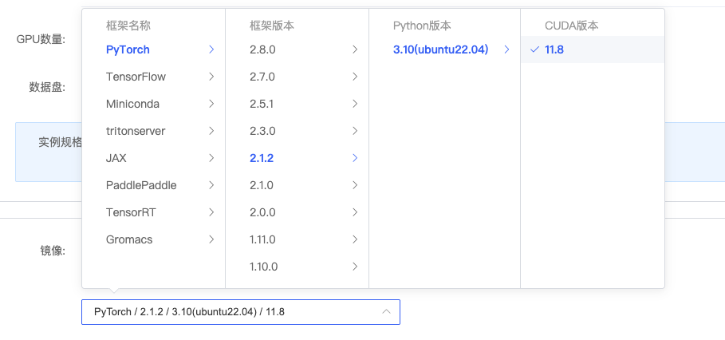

The "Framework" shown in the interface is the base environment pre-installed by AutoDL. Different frameworks serve different purposes and can be roughly distinguished as follows:

| Framework         | Brief Description                                                                                                 |
| ----------------- | ----------------------------------------------------------------------------------------------------------------- |
| **PyTorch**       | Mainstream deep learning framework for training and inference. Inference stacks such as vLLM and Xinference are mostly based on PyTorch. **This tutorial recommends selecting this option for deploying Xinference.** |
| **TensorFlow**    | Another major deep learning framework, with its ecosystem mostly used for training and deployment. Choose one between it and PyTorch. |
| **Miniconda**     | Lightweight version of conda that only provides Python and package management, without a pre-installed deep learning framework. Suitable for configuring environments from scratch. |
| **tritonserver**  | NVIDIA Triton inference service for high-performance model deployment, often used with TensorRT, etc.              |
| **JAX**           | A framework oriented toward numerical computing and research, emphasizing high performance and functional style, more suited for research/experimental scenarios. |
| **PaddlePaddle**  | Baidu's open-source deep learning platform, commonly used in the domestic ecosystem.                              |
| **TensorRT**      | NVIDIA's inference optimization library, focused on accelerating inference on NVIDIA GPUs, often used together with inference services. |
| **Gromacs**       | Molecular dynamics simulation software, not directly related to deep learning; belongs to scientific computing/biophysics. |

**Recommendation for this tutorial**: select the image corresponding to **PyTorch**, choose Python **3.10**, and CUDA **11.8** (or a version compatible with the current graphics card driver). This makes it convenient to install and run Xinference directly with conda in the instance.

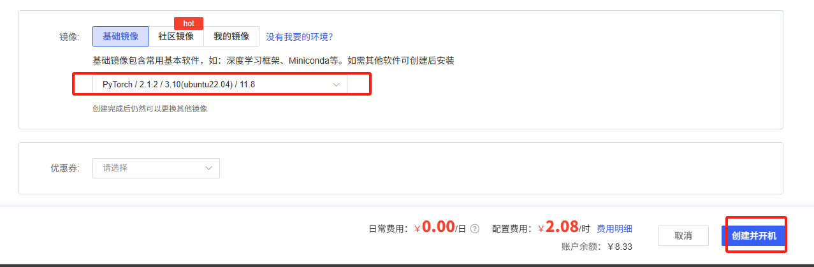

#### 3.1.2 Connect and Log In with XShell

Copy the login command for the server and log in using a remote connection tool.

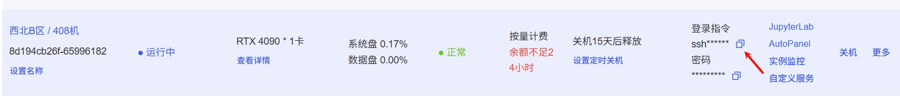

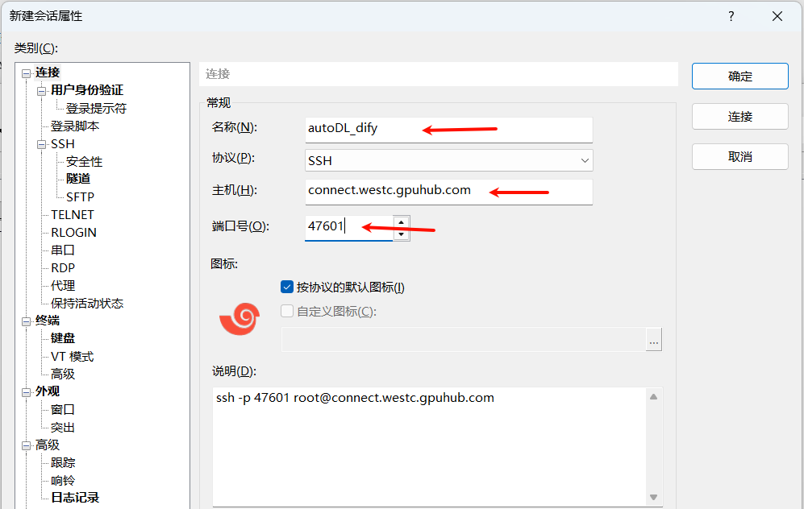

Test the connection:

> Default username: root

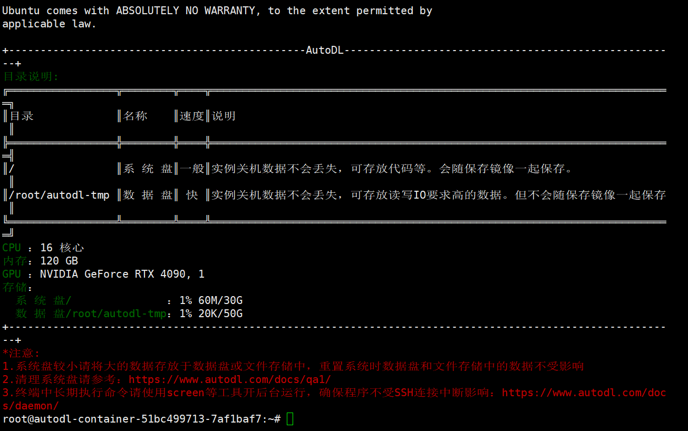

Connection successful

#### 3.1.3 Enable Academic Resource Acceleration

To download resources from external networks (such as GitHub, HuggingFace, etc.), you need to enable `学术资源加速` in the **current terminal**.

> Inevitably, we need to install some software on this system. These software packages may come from the locations indicated by the red box below. By default, they cannot be downloaded. Therefore, you need some "magic" or circumvention. Here we call this: academic acceleration.

https://www.autodl.com/docs/network_turbo/

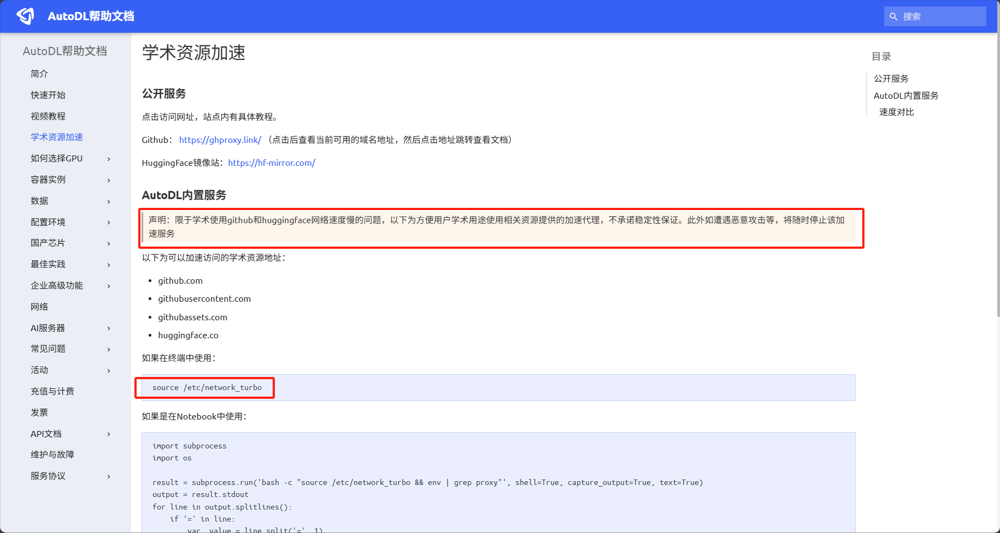

Copy the highlighted line from the figure into the terminal and press Enter.

```bash
source /etc/network_turbo
```

> **Acceleration note:** `source /etc/network_turbo` is mainly used for temporary acceleration when accessing academic resources such as GitHub and HuggingFace from the current terminal. The official source does not guarantee stability. When you are done or if it affects other network requests, run `unset http_proxy && unset https_proxy` to cancel the proxy for the current terminal.

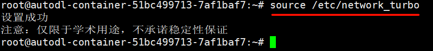

### 3.2 Deploy XInference

#### 3.2.1 Prepare the conda environment

##### ① Create a conda environment

The AutoDL system disk size is 30GB, and the data disk size is 50GB. The default working path for conda is on the system disk. The full Xinference suite requires a relatively large amount of space and may fill up the system disk. Therefore, create the conda environment on the data disk.

```shell
conda create -p /root/autodl-tmp/conda_envs/xinfer_env python=3.10
```

##### ② Initialize the conda environment

```shell
conda init bash

source ~/.bashrc
```

##### ③ Activate the conda environment

```shell
conda deactivate

conda activate /root/autodl-tmp/conda_envs/xinfer_env
```

##### ④ Verify that conda was created successfully

If the paths of both `python` and `pip` point to this conda environment directory, the creation was successful.

```shell
which python

which pip
```


#### 3.2.2 Deploy XInference

AutoDL academic acceleration uses Alibaba Cloud as the PyPI source by default. This image environment may lack dependencies required by XInference, such as num2words, causing errors. Therefore, add the Tsinghua source as a backup source.

```shell
pip install "xinference[vllm,embedding,rerank,transformers]==1.16.0" \
--extra-index-url https://pypi.tuna.tsinghua.edu.cn/simple
```

You can put the installation service in the background

```shell
nohup pip install "xinference[vllm,embedding,rerank,transformers]==1.16.0" --extra-index-url https://pypi.tuna.tsinghua.edu.cn/simple >xinfer_install.log 2>&1 &
```

Logs are recorded in xinfer_install.log. Run the following command to monitor the logs.

```shell
tail -F xinfer_install.log
```

#### 3.2.3 Start the XInference server

```shell
XINFERENCE_MODEL_SRC=modelscope xinference-local --host 0.0.0.0 --port 6006
```

The purpose of XINFERENCE_MODEL_SRC=modelscope is to change the default model repository from **Huggingface** to **ModelScope**.

--host: specifies the network interface to listen on. 0.0.0.0 means listening for requests on all network interfaces.

--port: specifies the service port. The default is 9997.

#### 3.2.4 Access the XInference WebUI

##### ① Check the AutoDL custom service address


AutoDL's cloud GPU servers map ports 6006 and 6008 as services by default. The Xinference server listens on port 6006, so accessing the corresponding link allows you to access the Xinference WebUI.

##### ② Access the Xinference WebUI


### 3.3 Deploy the LLM (Large Language Model)

#### 3.3.1 Deployment

##### ① Cloud Model

We can have the Xinference platform download and launch the model from the model repository for us, provided that the model is officially included and supported.

Taking Qwen3-0.6B as an example, refer to the official documentation.

> https://inference.readthedocs.io/zh-cn/latest/models/builtin/llm/qwen3.html

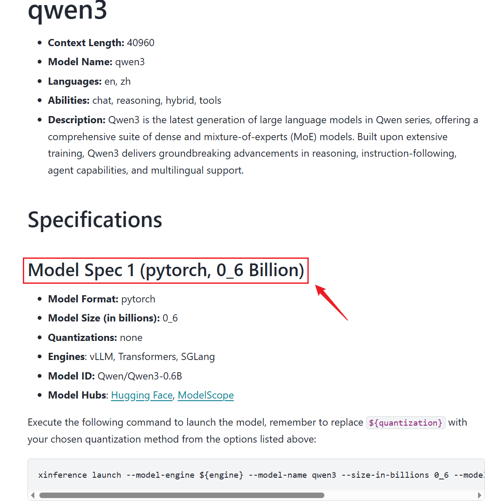

Xinference divides models into many model families. Each model family contains a series of models of different sizes, distinguished by different attribute configurations. The model family for Qwen3-0.6B is qwen3, with the configuration shown in the figure above.

Open a new connection window: activate the conda environment

```
conda activate /root/autodl-tmp/conda_envs/xinfer_env
```

Enable academic acceleration:

```
source /etc/network_turbo
```

The startup command is as follows:

```shell
xinference launch \
  --model-engine vllm \
  --model-name qwen3 \
  --size-in-billions 0_6 \
  --model-format pytorch \
  --quantization none \
  --model-uid Qwen3-0.6B \
  --gpu_memory_utilization 0.6 \
  --max_model_len 1024 \
  --endpoint http://localhost:6006
```

`--model-engine vllm`: underlying inference engine

`--model-name qwen3`: model family

`--size-in-billions 0_6`: model size, in units of 1 billion

`--model-format pytorch`: weight file format

`--quantization none`：Whether to quantize

`--model-uid Qwen3-0.6B`：Model uid, used to uniquely identify the model within Xinference. It can be omitted, in which case it will be generated by the system.

`--gpu_memory_utilization 0.6`：vLLM parameter. The percentage of GPU memory occupied by the model (0.6 in the example, adjust as needed).

`--max_model_len 1024`：vLLM parameter. The context length supported by the model.

`--endpoint`：Xinference server entry point.

At this point, you can see that the model is being downloaded on the server side.

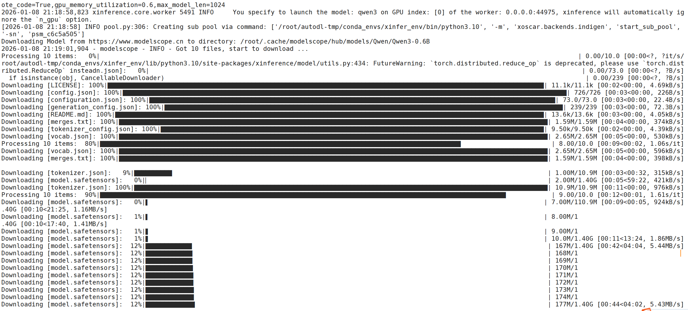

Model deployment completed.

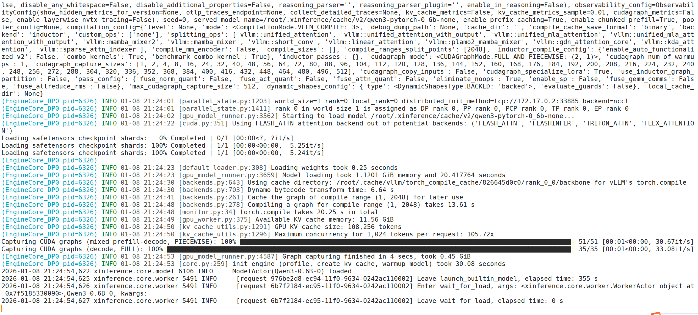

##### ② Local model files

If the model weights have already been downloaded locally, you can run the following command.

```shell
xinference launch \
  --model-engine vllm \
  --model-name qwen3 \
  --size-in-billions 0_6 \
  --model-format pytorch \
  --quantization none \
  --model-path "${your_model_path}" \
  --model-uid Qwen3-0.6B \
  --gpu_memory_utilization 0.6 \
  --max_model_len 1024 \
  --endpoint http://localhost:6006
```

`--model-path`：Local storage path for the model weights.

#### 3.3.2 Testing

##### ① Check model deployment status

```shell
xinference list \
  --endpoint http://localhost:6006
```

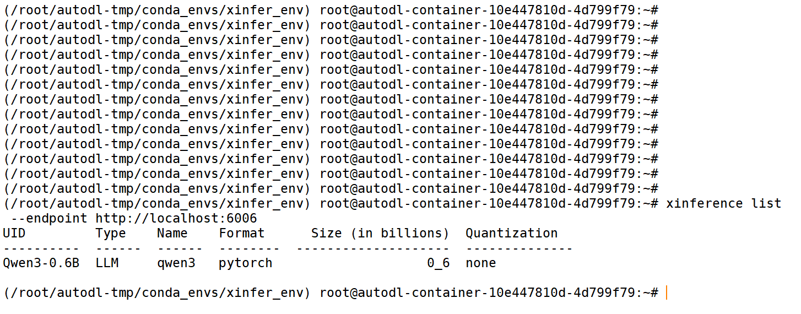

##### ② WebUI

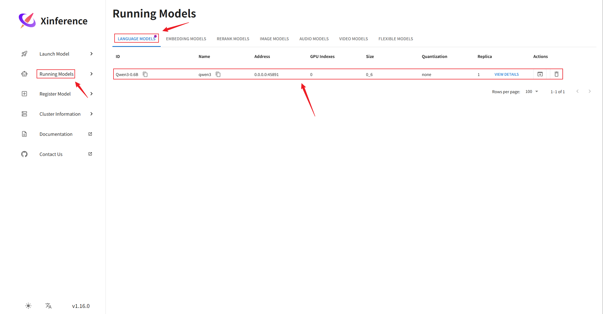

##### ③ Send a request

```shell
curl http://localhost:6006/v1/chat/completions -H "Content-Type: application/json" -d '{
        "model": "Qwen3-0.6B",
        "messages": [
                {"role": "system", "content": "你是个乐于助人的助理。"},
                {"role": "user", "content": "你好啊"}
        ]
}'
```

The response is as follows:

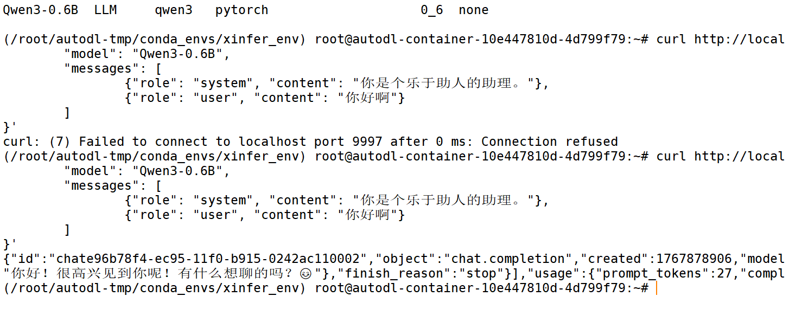

### 3.4 Deploying an Embedding Model

#### 3.4.1 Deployment

##### ① Cloud-hosted model

```shell
xinference launch \
  --model-name bge-small-zh-v1.5 \
  --model-type embedding \
  --endpoint http://localhost:6006
```

`--model-name`：Model name.

`--model-type`：Model type.

Downloading.

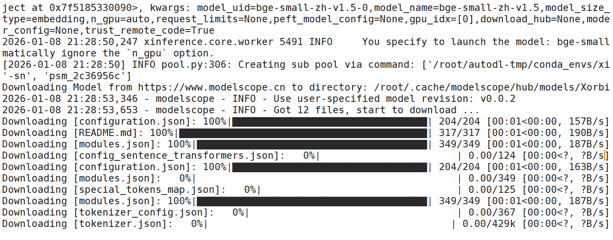

Deployment completed.

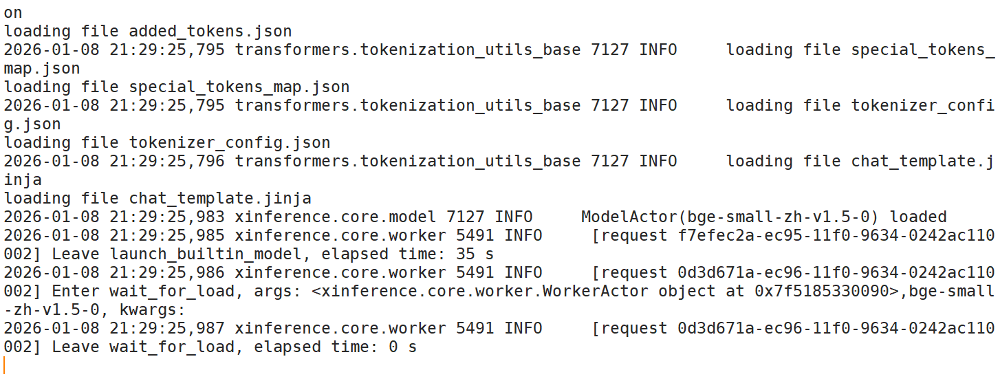

##### ② Local files

```shell
xinference launch \
  --model-name bge-small-zh-v1.5 \
  --model-type embedding \
  --model-path "${your_model_path}" \
  --endpoint http://localhost:6006
```

`--model-path`：Local model path (the directory containing the model weights).

#### 3.4.2 Testing

##### ① Check model deployment status

```shell
xinference list \
  --endpoint http://localhost:6006
```


##### ② WebUI


##### ③ Send a request

```shell
curl http://localhost:6006/v1/embeddings \
  -H "Content-Type: application/json" \
  -d '{
    "model": "bge-small-zh-v1.5",
    "input": "这是一个用于测试的中文句子"
  }'
```

The response is as follows:


### 3.5 Deploying a Rerank Model

#### 3.5.1 Deployment

```shell
xinference launch \
  --model-name bge-reranker-base \
  --model-type rerank \
  --endpoint http://localhost:6006
```

Downloading.


Deployment completed.


#### 3.5.2 Testing

##### ① Check model deployment status

```shell
xinference list \
  --endpoint http://localhost:6006
```


##### ② WebUI


##### ③ Send a request

```shell
curl http://localhost:6006/v1/rerank \
  -H 'Content-Type: application/json' \
  -d '
{
  "model": "bge-reranker-base",
  "query": "Apple",
  "documents": [
    "鸡蛋",
    "苹果",
    "good",
    "香蕉"
  ],
  "instruction": "基于查询结果重排序",
  "top_n": 4
}
'
```

The response is as follows:


### 3.6 Integrating Dify with Xinference

#### 3.6.1 Install the Xinference plugin


Search for Xinference.


Install the plugin.


Once installation is complete, you will be able to see Xinference.


#### 3.6.2 Add an LLM


If you can see the model under the Xinference plugin, the configuration was successful.


#### 3.6.3 Add an Embedding model


#### 3.6.4 Add a Rerank model


---

**Chapter reflection questions:**

1. In an enterprise deployment, which layer do Dify, Xinference, and GPU servers each occupy?

   **Reference thoughts:** The GPU server provides the computing foundation, Xinference turns models into services and provides unified management, and Dify uses these models at the application layer to build knowledge bases, workflows, and applications. Once these layers are clearly separated, you will no longer mix up application issues, model service issues, and hardware issues when troubleshooting.

2. Why might an enterprise not be satisfied with simply calling third-party model APIs directly?

   **Reference thoughts:** This may be due to considerations around data security, cost, internal network delivery, model controllability, compliance, latency, and operational autonomy. Direct APIs are quick to get started with, but enterprise scenarios often also require thinking about long-term operation and governance.

3. In a knowledge base Q&A pipeline, why is it better to plan LLM, Embedding, and Rerank in a unified way?

   **Reference thoughts:** They are responsible for generation, recall, and fine-grained ranking respectively, and their performance affects one another. If configured separately, model versions, authentication, monitoring, switching, and fault isolation all become more complex. Unified management is not about tidiness, but about stability and operability.

4. If after deployment you cannot see the Xinference models in Dify, which layers would you check?

   **Reference thoughts:** First check whether the Xinference service is running, whether the model is loaded, and whether the network and port are accessible. Then check the Dify plugin configuration, Base URL, model type, authentication, and container network. Finally, check the logs. Do not just repeatedly save the configuration on the page.

**Chapter summary:**

- **Enterprise deployment is not about “how to install a few services,” but about why the deployment architecture should be layered**: the application layer is responsible for product form and workflow orchestration, the inference layer is responsible for model execution and unified hosting, and capabilities are exposed externally through compatible APIs. Only by separating these layers can subsequent RAG, Agent, and workflow applications be mounted stably.
- **Inference engines and model hosting platforms must be distinguished**: vLLM, SGLang, Ollama, and TEI are more about “efficiently running a certain type of model,” while Xinference is more about “unified management and service-based exposure of multiple types of models such as LLM, Embedding, and Rerank.” This chapter chooses Xinference because it is more suitable as a unified model entry point within an enterprise.
- **The value of the Dify + Xinference chain lies in decoupling upper-layer applications from lower-layer model services**: Dify is responsible for workflows, knowledge bases, and application interaction; Xinference is responsible for model hosting; the two are connected through compatible interfaces. This makes it more convenient to change models, expand models, and implement permissions and observability later.
- **The real enterprise benefit is not only privatization**: it also includes data security, cost control, freedom in capability composition, version governance, monitoring and troubleshooting, and room for future expansion. For these reasons as well, enterprise deployment often needs to consider CPU-side application services and GPU-side model services simultaneously, rather than putting them all on one machine and thinking “just get it running first.”
- **When troubleshooting, also think in layers**: at the application layer, check Dify configuration and Docker; at the model layer, check Xinference, model downloads, and ports; at the access layer, check plugins, addresses, authentication, and API compatibility. Only by troubleshooting in layers can you avoid confusing “platform issues” with “model service issues.”
- In terms of mastered results, after completing this chapter, you should at least be able to: understand why enterprise private deployment is not only about “being able to run,” but also involves security, cost, versioning, observability, and operational governance; distinguish the different architectural responsibilities of inference engines and model hosting platforms, and understand why this chapter chooses Xinference; roughly describe the overall chain of “Dify application layer + Xinference model hosting layer + compatible API access,” and know how it connects to the subsequent RAG / Agent main line.

**Suggested next step:** First follow Section 2 to get Dify running on Tencent Cloud and verify it works in the browser; then follow Section 3 to deploy Xinference and the LLM/Embedding/Rerank models on AutoDL and test them successfully; finally, install the Xinference plugin in Dify and add your self-hosted models, then use a small RAG or Agent application to verify end-to-end invocation. If you encounter basic Docker issues or specific Dify errors, refer to [Chapter 8: Docker Quick Start and Dify Deployment Troubleshooting](8-Docker%E5%BF%AB%E9%80%9F%E5%85%A5%E9%97%A8%E4%B8%8EDify%E9%83%A8%E7%BD%B2%E6%8E%92%E9%9A%9C.md).
