# 8 - Docker Quick Start and Dify Deployment Troubleshooting

Chapter 6 has already walked you through running Coze Studio, Dify, and Coze Loop on Windows. Chapter 7 will continue with enterprise-level large language model deployment. This chapter goes back to fill in the Docker fundamentals. Later, when troubleshooting Dify, migrating services, or upgrading versions, you will often need to return to the Docker layer to check status, logs, and data mounts.

When starting with on-premises Dify deployment, issues are often simply attributed to "Dify won't install." Actual troubleshooting usually reveals that the sticking points are more fundamental: confusion between images and containers, confusion between host ports and container ports, uncertainty about whether a volume will be deleted, and difficulty understanding why a single startup brings up a group of containers. If an initialization page appears after an upgrade, the problem is usually not with the page itself, but rather that the database, mount directories, or `.env` do not match.

This chapter focuses only on the most commonly used path for deploying Dify and subsequent hands-on projects: how images deliver the environment, how containers run services, how Compose brings up multiple services, how volumes save data, and how logs and backups assist with troubleshooting.

**Official documentation and resources**: See [Tool Navigation and Reference Index - Deployment and Infrastructure](%E5%B7%A5%E5%85%B7%E5%AF%BC%E8%88%AA%E4%B8%8E%E5%8F%82%E8%80%83%E8%B5%84%E6%96%99%E7%B4%A2%E5%BC%95.md#deployment-and-infrastructure).

---

## Reading Path

| Current Problem                    | Suggested Reading                                     |
| --------------------------------- | ---------------------------------------------------- |
| Docker Desktop not installed yet  | Sections 2.2–2.5: Docker Desktop Installation and Verification |
| Want to install Docker on an Ubuntu server | Section 2.10: Installing and Uninstalling Docker on Ubuntu |
| Not sure what Docker actually is  | Section 1.2: What Is Docker                          |
| Can't tell Docker apart from a virtual machine | Section 1.3                                   |
| Can't distinguish images, containers, registries, and volumes | Section 1.5                                  |
| Want to run a minimal Docker example first | Part 2: Basic Docker Commands and Your First Container |
| Not sure of the difference between Dockerfile and Compose | Part 3: From Single Container to Compose Multi-Service Orchestration |
| Worried about where data is stored or accidentally deleting data | Part 4: Data Persistence, Networking, Migration, and Dangerous Boundaries |
| Want to migrate a Windows environment to Ubuntu | Section 4.5: Cross-Machine Migration and Offline Sync |
| Want to know exactly which containers Dify runs | Part 5: Applying Docker Knowledge to the Dify Deployment Structure |
| Page won't open, container status is abnormal | Part 6: Dify Troubleshooting: Status, Logs, Data, and Database Connections |
| Want to use Navicat to connect to the Dify database | Section 6.5                                         |
| Preparing to upgrade Dify         | Part 7: Dify Upgrade, Backup, and Source Code Modification |
| Modified Dify frontend source code but changes didn't take effect | Section 7.2                                    |
| Preparing to clean up Docker or reinstall the environment | Section 8.6: List of Dangerous Operations          |
| Just want to look up commands     | Part 8: Docker Common Commands Quick Reference      |

---

## 1. Why Learn Docker

### 1.1 The Problem of Inconsistent Environments

Before Docker existed, deploying a project was often not as simple as "putting the code on the server."

It might run on the developer's machine, but the test environment may report errors; the test environment runs fine, yet the production server is missing dependencies. Switching to another machine means reinstalling Python, Node.js, databases, system libraries, drivers, and configuration files. The more projects and the more versions, the harder it becomes to control environment differences.

Docker solves this old problem: **package the application and its runtime environment together, so that it runs in the same way as much as possible on a different machine**.

In Dify, RAG, or agent projects, this problem becomes more concrete. What you see in the browser is a page, but at runtime it also involves components such as **backend APIs, background tasks, databases, Redis, vector databases, Nginx, Sandbox, and plugin services**. If any one of their versions, ports, data directories, or startup order does not match, troubleshooting can easily go off track.

The value of Docker here is clear: put these components into a relatively fixed deployment process. First make the environment stable and reproducible, and only then talk about migration, upgrading, and troubleshooting.

### 1.2 What Is Docker

Docker is an open-source application container engine, with its underlying implementation primarily developed in Go. You can think of it as a tool for "packaging and running environments": it places the application, dependencies, configuration, and runtime environment into a lightweight, portable, relatively isolated container.

Docker's official description once summarized its goal in one sentence:

```text
Build, Ship and Run Any App, Anywhere
```

It emphasizes the entire chain of build, ship, and run. The phrase "build once, run anywhere" mentioned in some tutorials conveys this same idea.

Compared with manually installing environments, the value of Docker is not just installing a few fewer pieces of software, but turning application delivery from scattered installation steps into a reproducible process:

| Capability | Description                                   | Course Example                                      |
| -------- | -------------------------------------------- | ------------------------------------------------- |
| Portability | The same image can run locally, in test environments, and on servers | Locally working MySQL / Redis / vector database migrated to Ubuntu |
| Isolation | Different containers have their own processes, filesystems, and dependencies | Dify's `api`, `worker`, and `redis` do not directly pollute each other's environments |
| Low overhead | Containers share the host kernel and are usually lighter than full virtual machines | Running multiple basic services simultaneously on one machine |
| Scalability | Multi-instance services can be replicated and expanded more easily | Scaling workers to handle background tasks in later production deployments |
| Reproducibility | The environment is described by images, Compose, and environment variables | New team members bring up the same Dify environment with a consistent troubleshooting baseline |

Of course, Docker is not a cure-all. Database backups, GPU drivers, network proxies, data permissions, and cloud server security groups still need to be handled by you. But it can stabilize "how the application runs" first, which is crucial for later deployment of Dify, local models, and enterprise projects.

### 1.3 Differences Between Docker and Virtual Machines

When first learning Docker, you may temporarily understand it as "a runtime environment lighter than a virtual machine." This description is convenient for getting started, but it is not precise.

Virtual machines virtualize the entire operating system, and each VM has its own complete system. Docker containers share the host kernel and only package the files, dependencies, and isolated environment needed to run the application.

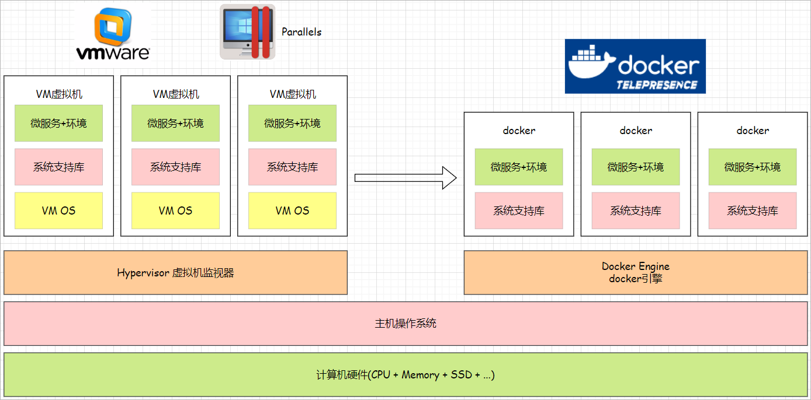

Focus on three differences:

| Comparison | Virtual Machine VM | Docker Container |
| -------- | -------------------------------- | ---------------------------------- |
| Isolation method | Virtualizes the entire operating system | Shares the host kernel, isolates processes and filesystems |
| Startup speed | Usually slower | Usually faster |
| Resource usage | Higher | Lower |
| Suitable scenarios | Strong isolation, multi-OS environments, traditional infrastructure | Application delivery, development and testing, microservice deployment |

Therefore, Docker is not a tool meant to replace all virtual machines. It is better suited to solving problems such as application delivery, environment consistency, and multi-service orchestration.

### 1.4 Docker Architecture

Docker is a typical client-server architecture.

The `docker` command you execute in the terminal is the Docker Client; the Docker Daemon is responsible for creating containers, pulling images, and managing networks and volumes. Images typically come from Docker Hub or other image registries.

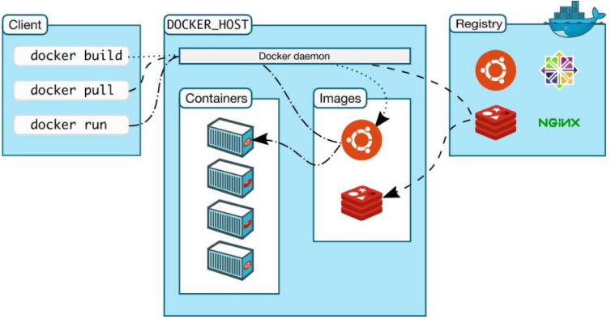

The diagram highlights four objects: client, Docker host, image registry, and container. To be able to read Dify's Compose file later, let's also add volume and Compose into the picture:

| Object | Related To | Relationship Description |
| ----------------------------------------- | ---------------------------------- | ------------------------------------------------------------ |
| Docker Client | Docker Daemon | The `docker` command in the terminal sends operation requests to the Docker Daemon |
| Docker Daemon | Registry, Image, Container, Volume | Responsible for pulling images, creating containers, and managing networks and volumes |
| Registry | Image | Stores and distributes images, such as Docker Hub or enterprise private registries |
| Image | Container | Containers are created and run based on images; one image can start multiple containers |
| Container | Image, Volume, Network | Runs application processes and writes data that needs to persist into volumes or mounted directories |
| Volume | Container | Stores data such as databases, uploaded files, and indexes, usually independent of the container lifecycle |
| Docker Compose | Image, Container, Volume, Network | Uses a single YAML file to describe images, containers, volumes, networks, and environment variables in a unified way |

Therefore, when executing a command, know what it operates on:

- `docker pull`: Pull an image from the registry.
- `docker run`: Create and start a container based on an image.
- `docker ps`: View containers.
- `docker images`: View images.
- `docker volume ls`: View volumes.
- `docker compose up -d`: Start a group of services according to the configuration.

### 1.5 Images, Containers, Registries, and Volumes

| Term | Can Be Understood As | Common Examples |
| --------------- | ---------------------------- | -------------------------------------------- |
| Docker Engine | The engine that runs containers | Docker Desktop, the Docker service on a server |
| Image | The runtime template of an application, like an installer | `mysql:8.0.45`, `postgres:15-alpine` |
| Container | A running instance of an image | `mysql-db`, `docker-api-1` |
| Repository | A platform for storing and downloading images | Docker Hub, enterprise private image registries |
| Volume | Data storage independent of the container lifecycle | `mysql_data`, `postgres_data` |
| Dockerfile | The build script for a custom image | `FROM python:3.12` |
| Docker Compose | Manages a group of containers with a single YAML file | `docker-compose.yaml` |
| bind mount | Mounts a host directory into a container | `./volumes/db/data:/var/lib/postgresql/data` |

It can be understood this way: **images provide the program, containers run the program, repositories distribute images, volumes save data, and Compose orchestrates a group of containers.**

### 1.6 Dockerfile and Compose

Dockerfile and Compose often appear together, but they solve different problems.

**Dockerfile** is responsible for building images. For example, if you want to create an environment containing Python 3.12, dependency packages, and business scripts, you write a Dockerfile and let Docker build it automatically.

**Docker Compose** is responsible for running a group of services. For example, if a project needs to start MySQL, a Python application, Redis, and Nginx simultaneously, use `docker-compose.yaml` to specify their images, ports, environment variables, networks, and volumes.

The later Dify deployment follows exactly this approach: the official team has already prepared the images and Compose file for us. We run `docker compose up -d`, and it brings up services such as web, api, worker, database, Redis, vector database, and nginx together.

---

## 2. Docker Installation: Local Windows and Server Ubuntu

### 2.1 First, Decide Where You Want to Install It

When learning Docker, you will typically encounter two types of environments:

| Environment | Recommended Installation Method | Suitable Scenarios |
| ---------------- | ---------------------------- | ---------------------------------------- |
| Windows local computer | Docker Desktop + WSL 2 | Learning, demos, running the local version of Dify / Coze Studio |
| Ubuntu cloud server | Docker Engine + Compose plugin | Enterprise deployment, remote services, upcoming project launches |

If you are just following along with this chapter to learn, installing Docker Desktop is sufficient; if you are already preparing for cloud server deployment, you can skip ahead to Section 2.10.

The common commands in the two environments are quite similar; the main differences lie in the installation method, file paths, permissions, and registry mirror configuration.

### 2.2 Windows Pre-Installation Preparation

When deploying platforms such as Coze Studio, Dify, and Coze Loop locally on Windows, the most common solution is **Docker Desktop + Docker Compose**.

Before installation, check the following:

- Windows 10 / Windows 11 operating system.
- Virtualization is enabled. Most new computers have it enabled by default. If Docker Desktop reports a virtualization error when starting, go into the BIOS to check.
- WSL 2 works properly. Docker Desktop on Windows typically relies on WSL 2 to run Linux containers.
- The local network can access the Docker official website and image registry; if image pulls are slow, handle that later in Section 4.4.

This chapter does not require you to install MySQL, Redis, or Nginx in advance. They will be started directly using Docker images later.

On Windows, you can check the following in order:

| Check Item | How to Check | Description |
| -------- | ---------------------------------------- | ------------------------------------------------------ |
| System version | Run `winver` in `Win + R` | Windows 10 2004 or later is recommended; Windows 11 is even easier |
| Virtualization | Task Manager -> Performance -> CPU -> Virtualization | If not enabled, enter the BIOS and enable Virtualization Technology |
| WSL feature | "Turn Windows features on or off" | Check "Windows Subsystem for Linux" and "Virtual Machine Platform" |
| WSL kernel | Docker Desktop startup prompt or `wsl --status` | Older environments may need to update the WSL kernel |

Virtualization can be checked in Task Manager; confirm that the status shows "Enabled":

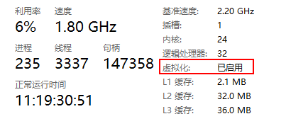

WSL 2-related features can be enabled in Windows Features. The displayed text may differ slightly depending on the Windows version; the key is to enable Virtual Machine Platform and WSL:

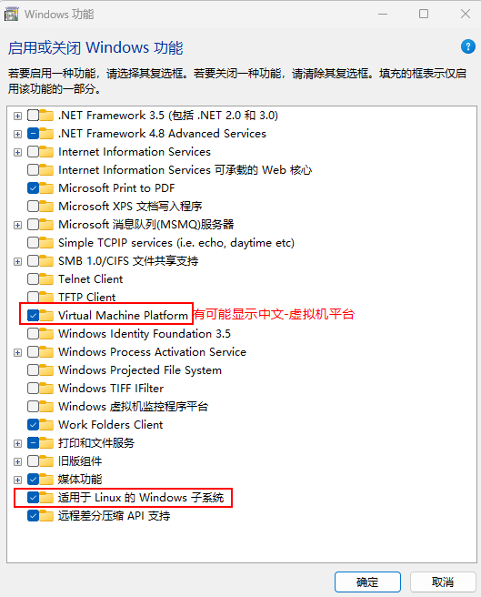

If you need to enable WSL and Virtual Machine Platform using commands, run the following in an administrator PowerShell:

```powershell
dism.exe /online /enable-feature /featurename:Microsoft-Windows-Subsystem-Linux /all /norestart
dism.exe /online /enable-feature /featurename:VirtualMachinePlatform /all /norestart
```

A restart is required after running the command. The WSL kernel can be updated by downloading the update package from the Microsoft WSL release page; if you are using an ARM architecture device, choose the corresponding installation package.

### 2.3 Download Docker Desktop

Go to the official Docker Desktop download page:

```text
https://www.docker.com/products/docker-desktop/
```

Select the Windows version to download the installer.

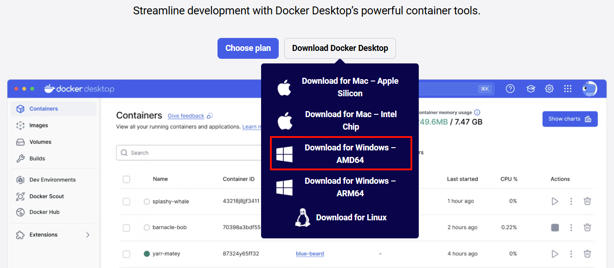

### 2.4 Install and Start Docker Desktop

Double-click the installer and follow the prompts to complete the installation. If you see options for WSL 2, desktop shortcuts, or similar during installation, keep the default settings.

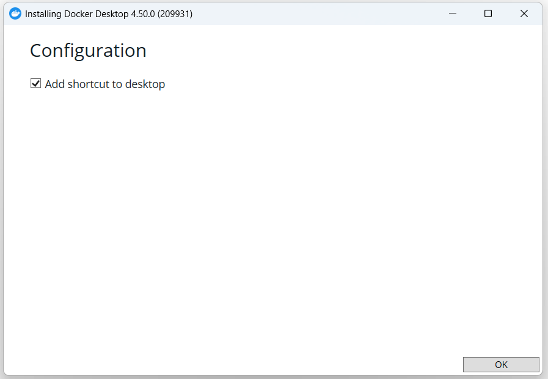

After installation, open Docker Desktop and confirm that the status bar shows **Running**.

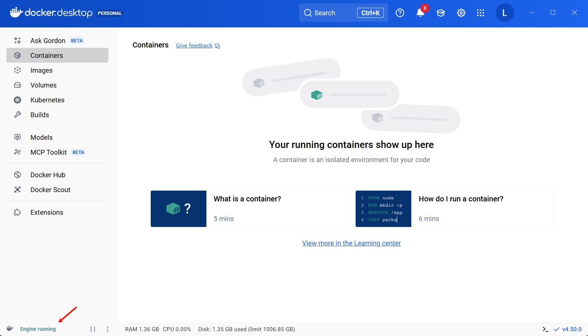

If Windows prompts you to install "Windows Subsystem for Linux", install it as directed and then reopen Docker Desktop.

### 2.5 Verify the Docker Environment

Open PowerShell, CMD, Windows Terminal, or the terminal built into Docker Desktop, and run these commands in sequence:

```bash
docker --version
docker compose version
docker run hello-world
```

If the version output is normal and `hello-world` can run, the basic Docker environment is ready.

In the Windows + Docker Desktop scenario, the official recommendation is also to place the source code and mounted data used by Linux containers in the WSL Linux filesystem rather than keeping them in Windows filesystem paths long-term. This often reduces file synchronization, permission, and performance issues.

If Docker Desktop fails to install, starts abnormally, or you want to completely reinstall it, you can clean up using the following approach. Note that this will delete images, containers, and data managed by Docker Desktop, so first confirm that there is no important data:

```powershell
# 1. 停止所有 WSL 实例
wsl --shutdown

# 2. 查看 WSL 发行版
wsl --list --verbose

# 3. 删除 Docker Desktop 相关发行版
wsl --unregister docker-desktop
wsl --unregister docker-desktop-data
```

You can also manually check these residual directories:

```text
C:\Users\你的用户名\.docker
C:\Users\你的用户名\AppData\Local\Docker
C:\Program Files\Docker
```

For a normal uninstall, simply uninstall Docker Desktop in Windows "Apps and Features"; the cleanup above is closer to a "complete reinstall", so do not treat it as the first step in everyday troubleshooting.

### 2.6 Start a MySQL Container

First pull the MySQL image:

```bash
docker pull mysql:8.0.45
```

View local images:

```bash
docker images
```

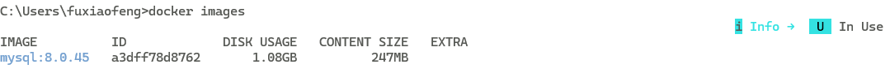

Start a MySQL container:

```bash
docker run -d --name mysql-db -p 9999:3306 -e MYSQL_ROOT_PASSWORD=123456 mysql:8.0.45
```

The most important parameters in this command are as follows:

| Parameter | Meaning |
| ------------------------------- | ----------------------------------------------- |
| `-d` | Run in the background without occupying the current terminal |
| `--name mysql-db` | Name the container so it can be used later with stop, logs, and exec |
| `-p 9999:3306` | Map host port 9999 to container port 3306 |
| `-e MYSQL_ROOT_PASSWORD=123456` | Inject an environment variable into the MySQL container to set the root password |
| `mysql:8.0.45` | The image name and version to run |

View containers:

```bash
docker ps
```

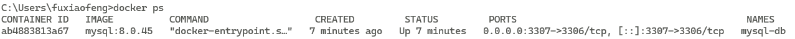

There are two addresses here that are easy to confuse:

- Local access to MySQL: `127.0.0.1:9999`
- Actual listening address of MySQL inside the container: `3306`

In other words, the left side of `-p 9999:3306` is for host access, and the right side is for the service inside the container.

### 2.7 Connect to MySQL with Python

If you already have a Python environment on your local machine, install the dependency:

```bash
pip install pymysql cryptography
```

Create `test_mysql.py`:

```python
import pymysql

conn = pymysql.connect(
    host="127.0.0.1",
    port=9999,
    user="root",
    password="123456",
    database="mysql",
    charset="utf8mb4",
    cursorclass=pymysql.cursors.DictCursor,
)

with conn:
    with conn.cursor() as cursor:
        cursor.execute("SELECT VERSION() AS version")
        row = cursor.fetchone()
        print(f"MySQL 版本：{row['version']}")

print("Python 已成功连接 Docker 中的 MySQL")
```

Run it:

```bash
python test_mysql.py
```

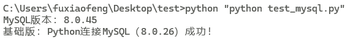

This small case is not intended to teach MySQL, but to first connect the basic Docker actions together:

1. The image is downloaded from the registry.
2. The container runs based on the image.
3. The host accesses the container service through port mapping.

Later, when accessing Dify's nginx, PostgreSQL, and Redis, the same logic applies.

### 2.8 Distinguishing Images and Containers from docker ps

Run:

```bash
docker ps
```

The container list you see in the command line looks roughly like this:

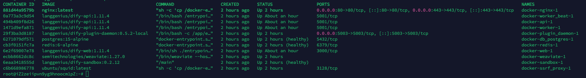

Two columns are common in the output:

| Column | Meaning | Example |
| ----- | ------ | ----------------------------------------------------- |
| IMAGE | Image name | `postgres:15-alpine`, `langgenius/dify-api:<version>` |
| NAMES | Container name | `docker-db_postgres-1`, `docker-api-1` |

When looking at the output, you can first identify two characteristics:

- Entries with `:tag` are usually images, such as `redis:6-alpine`.
- Running names such as `docker-api-1`, `mysql-db`, and `qdrant` are usually containers.

Docker Desktop also lets you distinguish them directly:

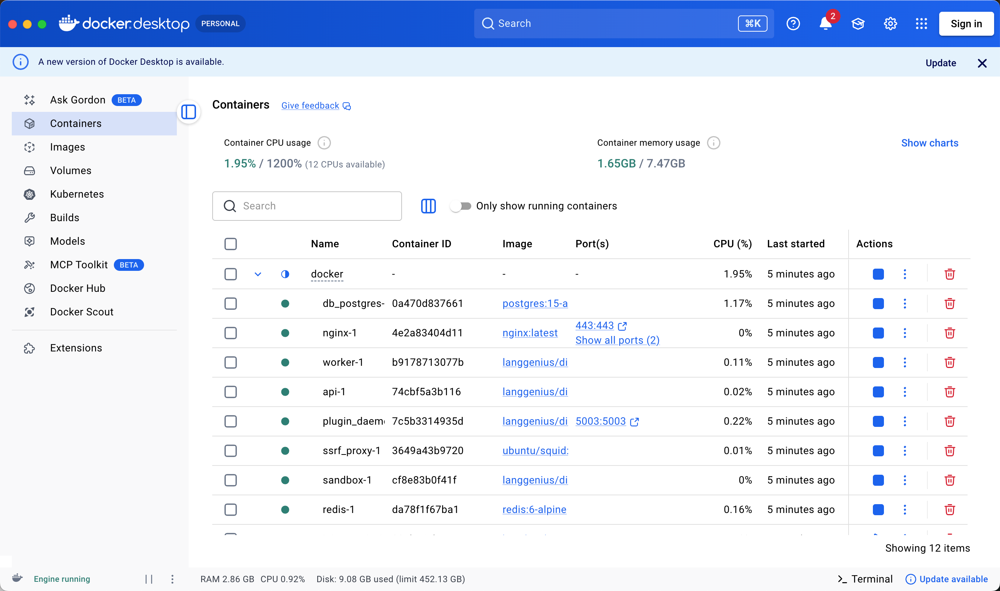

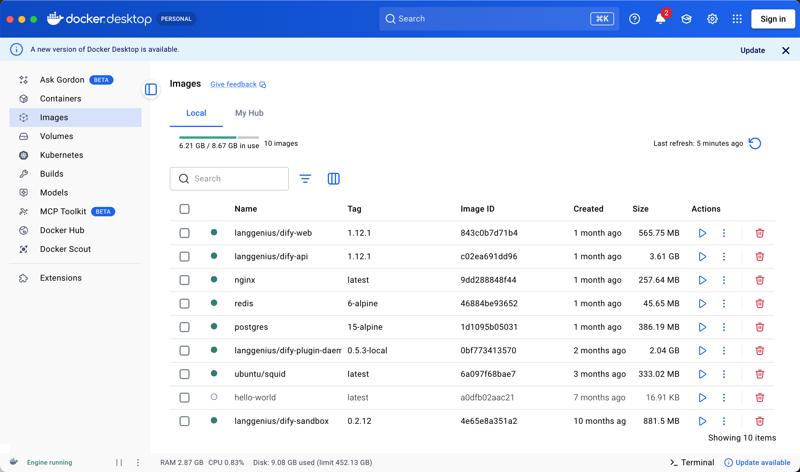

One image can start multiple containers. Dify's `api`, `worker`, and `worker_beat` may use the same backend image, just with different startup modes.

### 2.9 Quick Reference for Basic Commands

| Purpose | Command | Description |
| ----------------- | ----------------------------- | ------------------------ |
| Check Docker version | `docker --version` | Check whether the Docker CLI is available |
| Check Compose version | `docker compose version` | Check whether Compose v2 is available |
| Pull an image | `docker pull mysql:8.0.45` | Download an image from the registry |
| View images | `docker images` | View local images |
| Start a container | `docker run ...` | Create and start a container based on an image |
| View running containers | `docker ps` | View only running containers |
| View all containers | `docker ps -a` | Including stopped containers |
| View logs | `docker logs -f mysql-db` | Follow the logs of a specific container |
| Enter a container | `docker exec -it mysql-db sh` | Enter the container's internal environment |
| Stop a container | `docker stop mysql-db` | Stop a running container |
| Delete a container | `docker rm mysql-db` | Delete a stopped container |
| Delete an image | `docker rmi mysql:8.0.45` | Delete a local image |

During daily troubleshooting, first check `docker ps`, then check `docker logs`. Before confirming where the data is located, do not rush to delete containers or clean up volumes.

### 2.10 Docker Installation and Uninstallation on Ubuntu

During the local learning phase, Windows + Docker Desktop is usually used; when moving to production servers, Ubuntu + Docker Engine is more common. The cloud server deployment in Chapter 7 and the later Shopkeeper Data Q&A and Deep Research projects will all first encounter the same prerequisite: the server must have usable Docker and Compose.

For installing Docker on Ubuntu, it is recommended to refer to the official Docker documentation first. The following is the most commonly used path in this course, suitable for initializing a new server:

```bash
# 1. 卸载系统里可能存在的旧版本
sudo apt remove -y docker docker-engine docker.io containerd runc

# 2. 按 Docker 官方 Ubuntu 安装文档配置仓库并安装
# 官方文档：https://docs.docker.com/engine/install/ubuntu/

# 3. 验证 Docker 和 Compose
docker --version
docker compose version
```

If running the `docker` command results in a permission error, you can add the current user to the `docker` group:

```bash
sudo usermod -aG docker $USER
```

After running this command, you need to log out of the current SSH session and log back in for the permission to take effect. Do not run it repeatedly just because the command did not appear to take effect immediately.

When pulling images is slow on the server, you can configure a registry mirror for Docker Engine. On Ubuntu, the configuration file is usually:

```bash
sudo vim /etc/docker/daemon.json
```

Example configuration:

```json
{
  "registry-mirrors": [
    "https://docker.xuanyuan.me",
    "https://docker.1ms.run",
    "https://docker.m.daocloud.io"
  ]
}
```

After saving, restart Docker:

```bash
sudo systemctl daemon-reload
sudo systemctl restart docker
docker info
```

If you see `Registry Mirrors` in the `docker info` output, the configuration has been read by Docker Engine.

Registry mirrors are volatile resources; what works today may not work forever. A more stable approach in production environments is to use an enterprise private registry, a cloud provider's container image service, or prepare offline image packages in advance.

If Docker fails to install, has version conflicts, or you genuinely need to completely clean up Docker on the server, you can uninstall it as follows. Note that this will delete local containers, images, and volume data, so first confirm that no important services are running:

```bash
sudo systemctl stop docker
sudo apt remove -y docker-ce docker-ce-cli containerd.io docker-compose-plugin
sudo rm -rf /var/lib/docker
sudo rm -rf /var/lib/containerd
docker --version
```

If this is just a routine upgrade or troubleshooting, do not casually delete `/var/lib/docker`. This directory may contain database volumes, vector database data, and uploaded files.

---

## 3. From a Single Container to Compose Multi-Service Orchestration

The MySQL example in Part 2 only used `docker run`, which is suitable for a quick experience. In a real project, one container is usually not enough. Dify has services such as web, api, worker, database, Redis, vector database, nginx, sandbox, and plugin_daemon. In the Shopkeeper Data Q&A project, there are also dependencies on MySQL, Qdrant, Elasticsearch, and backend services.

In this part, we take a step further: instead of manually typing a long string of `docker run`, we use a file to describe a set of services.

| Stage | Problem Solved | Typical File or Command |
| ------------ | -------------------------- | -------------------------------- |
| `docker run` | Quickly start a ready-made image | `docker run -d ... mysql:8.0.45` |
| Dockerfile | Build your own code and dependencies into an image | `FROM python:3.12` |
| Compose | Start a multi-container project at once | `docker compose up -d` |

Dify's `docker/` directory can also be understood in this way: it is not an ordinary source code directory, but more like a multi-service deployment specification.

### 3.1 Dockerfile

The MySQL example just now used the official image directly. If we want to package our own Python script, dependencies, and runtime environment into an image, we need a Dockerfile.

Create `Dockerfile` in the project directory:

```dockerfile
FROM python:3.12

WORKDIR /app

COPY . /app

RUN pip install pymysql cryptography

CMD ["python", "test_mysql1.py"]
```

Understand it line by line:

| Instruction | Purpose |
| --------------------- | ----------------------------- |
| `FROM python:3.12` | Use the official Python 3.12 image as the base |
| `WORKDIR /app` | Set the working directory inside the container |
| `COPY . /app` | Copy the current project files into the image |
| `RUN pip install ...` | Install dependencies when building the image |
| `CMD [...]` | The default command to execute when the container starts |

A Dockerfile solves the problem of "how to build an image that meets my project's needs." It is not used to start a group of services; starting multiple services should be left to Compose.

### 3.2 Compose

Docker Compose uses a YAML file to describe a multi-container application. Docker's official documentation also defines Compose as a tool for managing multi-container applications, and it can uniformly manage services, networks, and volumes in a single configuration file.

Common deployment documentation will ask you to enter the `docker` directory and then run:

```bash
docker compose up -d
```

It performs several tasks according to the configuration in `docker-compose.yaml`:

1. Pull or build images.
2. Create containers.
3. Create networks.
4. Mount data directories or volumes.
5. Start services in the background.

Therefore, this command is not "starting a program," but "bringing up a group of interdependent services together."

### 3.3 A small Compose example with MySQL + Python

The project directory can be organized like this:

```text
docker-python-mysql/
├── docker-compose.yml
├── Dockerfile
└── test_mysql1.py
```

Example of `docker-compose.yml`:

```yaml
services:
  mysql-db:
    image: mysql:8.0.45
    restart: always
    environment:
      MYSQL_ROOT_PASSWORD: "123456"
      MYSQL_DATABASE: "test_db"
      MYSQL_INITDB_ARGS: "--character-set-server=utf8mb4 --collation-server=utf8mb4_unicode_ci"
    ports:
      - "9999:3306"
    volumes:
      - mysql_data:/var/lib/mysql
    networks:
      - app-network
    healthcheck:
      test:
        ["CMD", "mysqladmin", "ping", "-h", "localhost", "-uroot", "-p123456"]
      interval: 3s
      timeout: 3s
      retries: 10
      start_period: 5s

  python-app:
    build: .
    depends_on:
      mysql-db:
        condition: service_healthy
    environment:
      MYSQL_HOST: "mysql-db"
      MYSQL_PORT: "3306"
      MYSQL_USER: "root"
      MYSQL_PASSWORD: "123456"
      MYSQL_DB: "test_db"
    networks:
      - app-network

networks:
  app-network:
    driver: bridge

volumes:
  mysql_data:
```

There are several points in this Compose file worth a closer look:

- `python-app` uses `build: .` to build the image from the Dockerfile in the current directory.
- `mysql-db` uses the ready-made image `mysql:8.0.45`.
- When `python-app` connects to MySQL, the hostname should be written as `mysql-db`, not `localhost`.
- Containers communicate over the Docker network, and the internal container port `3306` is used.
- `healthcheck` is used to determine whether MySQL is ready.
- `depends_on.condition: service_healthy` makes the Python container wait until MySQL is healthy before starting.

A particularly easy point of confusion here is: **a container starting does not mean the service is ready.** After the MySQL container starts, it still needs to initialize the data directory, start the database process, and prepare accounts and databases. Without a health check, Python may try to connect first, resulting in `Connection refused`.

Next, create `test_mysql1.py` so that the Python container reads MySQL connection information through environment variables:

```python
import os
import sys
import time

import pymysql


def get_mysql_conn():
    max_retries = 10
    retry_delay = 2

    for i in range(max_retries):
        try:
            conn = pymysql.connect(
                host=os.getenv("MYSQL_HOST", "localhost"),
                port=int(os.getenv("MYSQL_PORT", 3306)),
                user=os.getenv("MYSQL_USER", "root"),
                password=os.getenv("MYSQL_PASSWORD", "123456"),
                database=os.getenv("MYSQL_DB", "test_db"),
                charset="utf8mb4",
                connect_timeout=3,
            )
            print(f"第 {i + 1} 次尝试：MySQL 连接成功")
            return conn
        except pymysql.err.OperationalError as e:
            print(f"第 {i + 1} 次尝试：MySQL 连接失败 - {e}")
            if i < max_retries - 1:
                time.sleep(retry_delay)
            else:
                raise RuntimeError("重试后仍无法连接 MySQL，请检查容器配置") from e


if __name__ == "__main__":
    conn = None
    cursor = None

    try:
        conn = get_mysql_conn()
        cursor = conn.cursor()
        cursor.execute("SELECT DATABASE()")
        print(f"当前连接的数据库：{cursor.fetchone()[0]}")

        cursor.execute(
            "CREATE TABLE IF NOT EXISTS test_table "
            "(id INT PRIMARY KEY AUTO_INCREMENT, name VARCHAR(50))"
        )
        cursor.execute("INSERT INTO test_table (name) VALUES ('Docker Compose test')")
        conn.commit()

        cursor.execute("SELECT * FROM test_table")
        print("test_table 中的测试数据：", cursor.fetchall())
        print(f"当前 Python 版本：{sys.version}")
    except Exception:
        if conn:
            conn.rollback()
        raise
    finally:
        if cursor:
            cursor.close()
        if conn:
            conn.close()
```

This script mainly shows two points:

- The connection information comes from Compose's `environment`, rather than being hardcoded in the code.
- Even if there is already `healthcheck`, keeping a short retry at the code level is more robust, because the database, network, and DNS can all experience brief fluctuations.

### 3.4 Running and verifying the small Compose example

If you already started a standalone `mysql-db` container in Part 2, you need to stop and remove it first, otherwise port `9999` may conflict:

```bash
docker ps
docker stop mysql-db
docker rm mysql-db
```

Then start in the directory containing `docker-compose.yml`, `Dockerfile`, and `test_mysql1.py`:

```bash
docker compose up -d
docker compose ps
docker compose logs python-app
```

If you modified the Dockerfile or Python dependencies, rebuild and start:

```bash
docker compose up -d --build
```

If you only want to rerun the Python script once, you can run it temporarily:

```bash
docker compose run --rm python-app
```

To enter the MySQL container and inspect the data, you can run:

```bash
docker compose exec mysql-db mysql -uroot -p123456 test_db
```

Once this example works, reading Dify's Compose file will be much easier. Dify deployment follows the same idea: bring up a set of services in the correct order.

### 3.5 Reading order for a Compose configuration

Do not read a compose file rigidly from the first line to the last. You can read it in this order:

1. Look at `services`: which services this project starts.
2. Look at `image` / `build`: whether a service uses an image directly or is built locally.
3. Look at `ports`: which services are exposed to the host or browser.
4. Look at `volumes`: which data, configuration, and model directories are persisted or mounted.
5. Look at `environment`: which environment variables services depend on for startup.
6. Look at `depends_on`: the approximate startup dependencies between services.
7. Look at `networks`: which services can access each other and which are isolated.

Quick reference for common fields:

| Field | Purpose |
| ---------------- | -------------------------- |
| `image` | Use a ready-made image |
| `build` | Build an image from a Dockerfile |
| `container_name` | Specify a container name |
| `restart` | Restart policy after a container stops abnormally |
| `environment` | Inject environment variables |
| `ports` | Map a host port to a container port |
| `volumes` | Data persistence or directory mounting |
| `depends_on` | Startup order dependencies |
| `networks` | Container network isolation and communication |

When reading Dify's compose file, you can first draw a line: `nginx -> web/api -> db/redis/vector store`. First understand roughly how requests and data flow, and then look at specific variables. This will be easier than staring directly at hundreds of lines of YAML.

### 3.6 Compose command quick reference

The commands below are by default executed in the directory where `docker-compose.yaml` is located.

| Purpose | Command | Description |
| ---------------------------- | ---------------------------------- | ---------------------- |
| Start the full set of services | `docker compose up -d` | Start in the background |
| View service status | `docker compose ps` | See Up, healthy, Exited |
| View service logs | `docker compose logs -f <服务名>` | Follow logs |
| Temporarily stop services | `docker compose stop` | Do not delete containers |
| Start stopped services | `docker compose start` | Do not rebuild containers |
| Stop and remove containers and networks | `docker compose down` | Volumes are not deleted by default |
| Stop and remove containers, networks, and volumes | `docker compose down -v` | Deletes volumes; use with caution |
| Pull images | `docker compose pull` | Update images |
| Rebuild images | `docker compose build <服务名>` | Used in local build scenarios |
| View the final configuration | `docker compose config` | Used to confirm the configuration after variable expansion |
| View the service list | `docker compose config --services` | Only list service names |

The easiest to confuse are `stop`, `down`, and `down -v`:

- `stop`: only pauses the container; the container still exists.
- `down`: deletes containers and networks, but volumes are retained by default.
- `down -v`: deletes volumes as well, so data such as databases, indexes, and vector databases may disappear with them.

For daily troubleshooting, prefer `ps`, `logs`, `restart`, and `up -d`. Unless you explicitly want to clear the test environment, do not treat `-v` as a habitual parameter.

---

## 4. Data persistence, networking, migration, and dangerous boundaries

When first learning Docker, the easiest thing to underestimate is the data issue. Containers can be deleted and rebuilt, but databases, vector indexes, uploaded files, plugin data, configuration files, and backups cannot.

This part first explains ports and networking, then volumes, bind mounts, migration, and cleanup. The order is arranged this way to avoid accidentally deleting data while trying to "reinstall and see."

### 4.1 Port mapping

A common configuration in Compose:

```yaml
ports:
  - "8080:80"
```

The left side is the host port, and the right side is the container port.

That is:

- Browser access: `http://localhost:8080`
- After the request enters the container: access the container's internal port `80`

Look at another Redis Stack example:

```bash
docker run -d --name redis-stack -p 26379:6379 -p 8001:8001 redis/redis-stack
```

The meaning is:

- Host `26379` -> Redis inside the container `6379`
- Host `8001` -> RedisInsight inside the container `8001`

For Dify, what the browser accesses is usually the host port exposed by nginx; while `api`'s access to dependencies such as `db_postgres` and `redis` goes through Docker's internal network. External access and container-to-container communication are not the same path, so they should be examined separately during troubleshooting.

### 4.2 Volumes and bind mounts

The two most common notations in Compose:

```yaml
volumes:
  - mysql_data:/var/lib/mysql
  - ./mysql:/docker-entrypoint-initdb.d
```

The first is a **named volume**.

```text
mysql_data:/var/lib/mysql
```

- The left side, `mysql_data`, is persistent storage managed by Docker.
- The right side, `/var/lib/mysql`, is the directory inside the container.
- It is suitable for preserving data produced after running, such as databases.

The second is a **bind mount**.

```text
./mysql:/docker-entrypoint-initdb.d
```

- The left side, `./mysql`, is a real folder under the current directory on the host.
- The right side, `/docker-entrypoint-initdb.d`, is the directory inside the container.
- It is suitable for providing configuration, scripts, and model files from the project to the container.

Windows path notation follows the same rule: to the left of the colon is the real directory on the host, and to the right is the directory inside the container. When the container writes to the directory on the right, the data lands in the directory on the left.

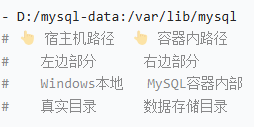

A rough judgment can be made like this:

- If the left side is `./xxx`, `../xxx`, or `/绝对路径/xxx`, it is usually a bind mount.
- If the left side is only a name such as `mysql_data` or `qdrant_data`, it is usually a named volume.

Docker's official documentation also defines a volume as persistent data storage managed by the container engine. Only after understanding this can you explain "why data can still be recovered after a container is deleted," and also explain "why it looks like a fresh environment after a new version starts."

### 4.3 Container lifecycle and data boundaries

Containers are meant to be rebuilt at any time, so important data should never live only in a container's own temporary filesystem.

When you have a volume or bind mount:

```text
宿主机目录或 Docker volume
        |
        | 挂载
        v
容器内目录
```

The program appears to write to a directory inside the container, such as `/var/lib/postgresql/data`, but the actual data lands on the external volume or host directory.

Therefore:

- Deleting a container: usually does not delete the volume or host-mounted directory.
- Deleting a volume: deletes the data managed by Docker.
- Manually deleting the host-mounted directory: also deletes the data.

This is why `docker compose down` usually does not lose data, while `docker compose down -v` requires extra caution.

However, "usually does not lose data" comes with a prerequisite: the critical directories must actually be mounted to a volume or host directory. If a service writes data into the container's own writable layer, deleting the container will lose that data. That is why you should use `docker inspect` to inspect Mounts during troubleshooting, rather than relying on guesswork.

### 4.4 Slow Network or Image Pull Failures

Image pull failures are usually not a code problem, but rather unstable access from Docker to the image registry. There are two common ways to handle this:

- Configure an image accelerator or proxy in Docker Desktop on Windows / macOS.
- Configure `/etc/docker/daemon.json` in the Docker Engine on an Ubuntu server.

A point that is easy to misjudge here: just because the browser can access the internet does not mean the Docker Engine can pull images. Docker has its own network configuration.

If the Dify installation in Chapter 6 gets stuck pulling images, come back to this section first; if the container is already running but the page reports an error, go to Part 6 to check application logs. This avoids misdiagnosing a network problem as a Dify configuration problem.

If you are using Docker Desktop, you can usually find the Docker Engine configuration area in the settings, and then add mirror addresses for `registry-mirrors`. For the configuration method on Ubuntu servers, see Section 2.10.

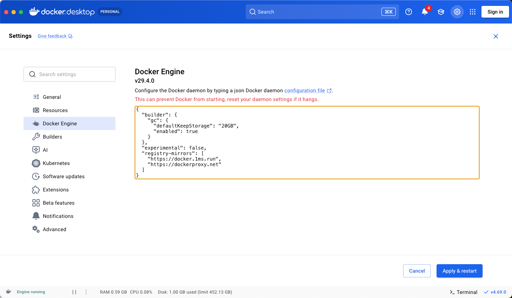

For mirror sources, you can refer to the GitHub aggregation project: [dongyubin/DockerHub mirror acceleration list for China](https://github.com/dongyubin/DockerHub).

Mirror source availability changes over time. When writing documentation, do not treat any single mirror source as a permanently available address; the actual environment should be based on what is accessible at the time.

### 4.5 Cross-Machine Migration and Offline Synchronization

As you learn more about Docker, you will likely encounter migration: the local Windows setup is running, and you need to move it to an Ubuntu server; an environment with internet access is running, and you need to move it to an internal machine that cannot access the internet.

Taking the `MySQL + Python` Compose mini case from this chapter as an example, when migrating, do not think about "copying over the container." First distinguish the three categories of things:

| Migration object | Purpose                        | Example                                                    |
| ---------------- | ------------------------------ | ---------------------------------------------------------- |
| Configuration file | Describes how services start   | `docker-compose.yml`, `.env`                            |
| Image            | Provides the runtime environment | `mysql:8.0.45`, `docker-python-mysql-python-app:latest` |
| Data             | Preserves business state        | MySQL data directory, Docker volume, backup SQL          |

#### 4.5.1 Online Migration: The Target Server Can Pull Images

If the Ubuntu server can access the image registry, this is the simplest approach.

First, stop the services in the local Windows project directory:

```bash
docker compose down
```

Confirm that the project directory contains at least these files:

```text
docker-compose.yml
Dockerfile
test_mysql1.py
```

Then upload the entire project directory to Ubuntu, for example:

```bash
/home/你的用户名/docker-python-mysql
```

After entering the server directory, focus on changing the data volume paths. A common Windows configuration might look like:

```yaml
volumes:
  - D:/mysql-data:/var/lib/mysql
```

On Ubuntu, you should change it to a Linux path, for example:

```yaml
volumes:
  - /home/你的用户名/mysql-data:/var/lib/mysql
```

Then start it up:

```bash
cd /home/你的用户名/docker-python-mysql
docker compose up -d
docker compose ps
docker compose logs python-app
```

If the logs show Python successfully connecting to MySQL, it means the service orchestration and container network have been migrated successfully.

The most common mistake here is the path. The Windows path `D:/mysql-data` has no meaning on Ubuntu and must be changed to a real directory on the Linux server. Dify migration follows the same logic: first look at `volumes`, then decide which directories or volumes need to be moved.

#### 4.5.2 Offline Migration: The Target Server Cannot Pull Images

When the server cannot access the internet, image pulls are very slow, or the internal environment does not allow online downloads, you can use `docker save` and `docker load` to migrate images.

First, confirm the images on the machine with internet access:

```bash
docker images
```

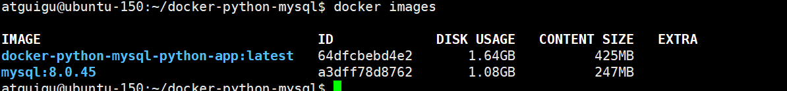

Package the MySQL image and the custom Python image:

```bash
docker save mysql:8.0.45 -o ./mysql-8.0.45.tar
docker save docker-python-mysql-python-app:latest -o ./python-app.tar
```

Upload these files to the target server:

| File                     | Required     | Description                           |
| ------------------------ | ------------ | ------------------------------------- |
| `mysql-8.0.45.tar`       | Required     | MySQL image package                   |
| `python-app.tar`       | Required     | Custom Python image package           |
| `docker-compose.yml`       | Required     | Service orchestration configuration   |
| `.env`       | Upload if available | Environment variable configuration |
| Data backup              | As needed    | Database SQL backup or mounted directory backup |

Import the images on the target server:

```bash
docker load -i ./mysql-8.0.45.tar
docker load -i ./python-app.tar
docker images
```

If the original Compose file contains:

```yaml
python-app:
  build: .
```

In an offline environment where there is no build context or conditions to download dependencies, you can change it to the already imported image:

```yaml
python-app:
  image: docker-python-mysql-python-app:latest
```

Also change the data volume paths to Ubuntu paths:

```yaml
mysql-db:
  volumes:
    - /home/你的用户名/mysql-data:/var/lib/mysql
```

Finally, start it up and verify:

```bash
docker compose up -d
docker compose ps
docker compose logs python-app
```

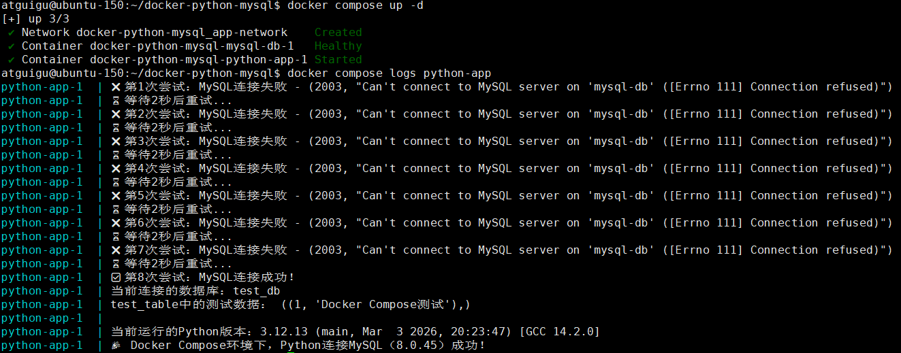

The same approach applies to migrating Dify: prepare the required images, `.env`, `docker-compose.yaml`, `envs/` directories, volumes / mounted directories, and database backups in advance, then import and start them on the target server.

For systems like Dify, two additional points deserve attention:

- Migrating only the images does not mean migrating the data. Accounts, applications, workflows, knowledge bases, and uploaded files all live in the database, vector store, and mounted directories.
- Copying only the `docker-compose.yaml` file does not mean the configuration is identical. New versions of `.env.example` and `envs/*.env.example` may add variables, so compare item by item when upgrading or migrating.

### 4.6 Dangerous Operation Checklist

Some Docker commands look like "cleaning up the environment" but actually delete data. Dify, RAG, and data Q&A projects require extra care: once the database or vector store is gone, the page may still be re-initialized, but the old accounts, applications, workflows, and knowledge bases are already gone.

Before running these commands, pause for a few seconds and confirm:

| Operation                        | Impact                                                 | Risk level |
| -------------------------------- | ------------------------------------------------------ | ---------- |
| `docker compose stop`              | Stops services, containers are retained                 | Low        |
| `docker compose down`              | Deletes containers and network for the current project, volumes are kept by default | Medium     |
| `docker compose down -v`              | Deletes containers, network, and volumes for the current project | High       |
| `docker volume rm <volume>`              | Deletes the specified volume                            | High       |
| `docker volume prune`              | Deletes all unused volumes                              | High       |
| `rm -rf ./volumes`              | Deletes the mounted data under the current directory    | High       |
| `sudo rm -rf /var/lib/docker`              | Deletes all data managed by Docker                      | Extremely high |

During local practice, clearing data sometimes just means starting over; on a server, you cannot be that casual. Before taking action, ask three questions:

1. Has the current service stopped writing?
2. Have the database, uploaded files, vector store, and plugin directories been backed up?
3. Am I deleting a test environment, or a real environment that someone is actively using?

If the answer is uncertain, run inspection commands first, not deletion commands:

```bash
docker compose ps
docker volume ls
docker inspect <容器名> --format '{{json .Mounts}}'
ls -lah ./volumes
```

### 4.7 Common Docker Basics Errors

Before diving into Dify troubleshooting, first eliminate Docker's own problems. Some "platform startup failures" have not actually reached the platform layer yet.

| Error or symptom                             | Common cause                                             | Handling approach                                                      |
| -------------------------------------------- | -------------------------------------------------------- | ---------------------------------------------------------------------- |
| Docker Desktop reports WSL 2 not configured  | Missing WSL, virtual machine platform, or WSL kernel     | Go back to Section 2.2 to check virtualization, WSL features, and kernel |
| `Connection refused`                            | Target service not started, wrong port, or service not ready yet | First check `docker ps`, then `docker logs` or `docker compose logs` |
| Compose reports a YAML format error          | Indentation, colon, quote, or Tab issues                 | YAML uses space indentation, keep a space after colons, avoid Chinese quotes |
| Running `docker` on Ubuntu reports insufficient permissions | The current user is not in the `docker` group              | Run `sudo usermod -aG docker $USER` and then log in again               |
| `port is already allocated`                             | Host port is occupied by another process or container    | Change the host port, or stop the container occupying the port          |
| Image pull timeout                            | Docker Engine network or mirror source unavailable       | Configure a mirror source, proxy, or use offline `docker save/load`                 |

When troubleshooting, follow this order:

```text
Docker 是否正常 -> 容器是否启动 -> 应用日志
```

---

## 5. Applying Docker Knowledge to the Dify Deployment Structure

Dify is not a single-process application. After starting it with Compose, what you see is a group of containers working together.

When Dify starts with Docker Compose, it usually includes services such as `api`, `worker`, `worker_beat`, `web`, and `plugin_daemon`, and also starts dependency components such as `weaviate`, `db_postgres`, `redis`, `nginx`, `ssrf_proxy`, and `sandbox`. Service names, image tags, and optional components may vary across versions; during actual troubleshooting, rely on the output of `docker-compose.yaml`, `.env`, and `docker compose ps` on your local machine.

The Docker concepts covered earlier map to Dify roughly like this:

| Docker concept      | Counterpart in Dify                                                   | What to check during troubleshooting            |
| ------------------- | --------------------------------------------------------------------- | ---------------------------------------------- |
| Image               | `langgenius/dify-api`, `langgenius/dify-web`, `postgres`, `redis`, etc. | `docker images`, `docker compose pull` |
| Container / Service | `api`, `worker`, `web`, `nginx`, `db_postgres`, etc.              | `docker compose ps`, `docker ps`       |
| Port mapping        | `EXPOSE_NGINX_PORT`, `EXPOSE_NGINX_SSL_PORT`                         | `docker compose ps`, `.env`            |
| volume / bind mount | `./volumes/db/data`, `./volumes/app/storage`, etc.                    | `docker inspect ... Mounts`            |
| Network             | Project network automatically created by Compose, `ssrf_proxy_network`, etc. | Service-name intercommunication, connection failures in logs |
| Environment variables | `.env`, `envs/*.env`                                                 | Database, Redis, URL, vector store, and secret configuration |

When reading Dify's compose file, you do not need to force yourself to read from the first line to the last. First identify four categories of information:

1. **Services**: which containers this deployment starts.
2. **Images**: which services use official images, and which services may require local builds.
3. **Mounts**: where the database, Redis, uploaded files, plugins, and vector database data are stored.
4. **Entry point**: the service and port through which browser requests enter.

### 5.1 Access Chain

Use a diagram to build an overall impression first:

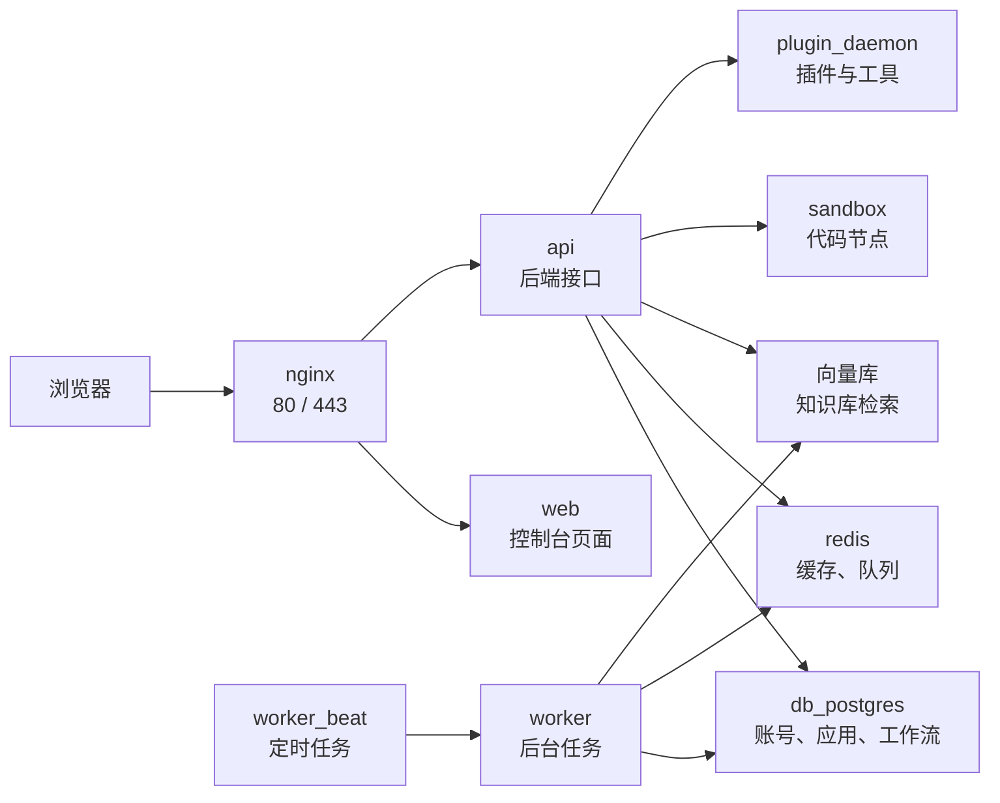

The browser first accesses `nginx`, which is then forwarded by `nginx` to `web` or `api`. `api` and `worker` then access PostgreSQL, Redis, the vector database, the sandbox, and plugin_daemon.

When troubleshooting, also follow this chain:

- Page does not open at all: first check `nginx` and port mapping.
- Page opens but API calls fail: check `api`.
- Knowledge base indexing or asynchronous tasks stall: check `worker`.
- Abnormal login, app, or workflow data: check `db_postgres`.
- Abnormal queue, cache, or task status: check `redis`.
- Abnormal knowledge base retrieval: check the currently enabled vector database.

### 5.2 Typical Container Responsibilities

| Layer | Common Services | Main Responsibilities |
| ------ | --------------------------------------- | ------------------------------------ |
| Entry | `nginx` | Exposes ports 80/443 externally and forwards to web/api |
| Application | `web` | Dify console and application pages |
| Application | `api` | Backend APIs, authentication, workflows, app configuration, etc. |
| Application | `api_websocket` | Optional collaboration, real-time communication, etc. |
| Task | `worker` | Asynchronous tasks, knowledge base indexing, queue consumption |
| Task | `worker_beat` | Scheduled job scheduling |
| Data | `db_postgres` or other database services | Main business database |
| Data | `redis` | Cache, queue, task intermediate state |
| Vector | `weaviate` / `milvus` / `opensearch`, etc. | Knowledge base vector retrieval, depending on configuration |
| Security | `sandbox` | Safely executes code nodes |
| Security | `ssrf_proxy` | Proxies external access and reduces SSRF risk |
| Plugin | `plugin_daemon` | Support for plugins, tools, model providers, and other extensions |
| Initialization | `init_permissions` | Initializes mounted directory permissions and usually exits after execution |

In a real environment, you can use:

```bash
docker compose config --services
docker compose ps
docker ps
```

to confirm which services are actually started in the current version.

When reading the official compose file, you can start by understanding these types of services:

| Service | Image or Source | Main Purpose | Key Mounts / Ports |
| -------------------------------------- | ----------------------------------------- | ------------------------------ | ----------------------------------------------------------- |
| `nginx` | `nginx:latest` | External entry point, forwards to web / api | `${EXPOSE_NGINX_PORT:-80}`, `${EXPOSE_NGINX_SSL_PORT:-443}` |
| `web` | `langgenius/dify-web:<version>` | Frontend pages | Mainly depends on environment variables |
| `api` | `langgenius/dify-api:<version>` | Backend APIs | `./volumes/app/storage:/app/api/storage` |
| `api_websocket` | `langgenius/dify-api:<version>` | WebSocket / collaboration, optional | Depends on `COMPOSE_PROFILES` and the current version |
| `worker` | `langgenius/dify-api:<version>` | Background tasks, knowledge base indexing, queue consumption | `./volumes/app/storage:/app/api/storage` |
| `worker_beat` | `langgenius/dify-api:<version>` | Scheduled job scheduling | Mainly depends on the database and Redis |
| `db_postgres` | `postgres:15-alpine` | Main business database | `./volumes/db/data:/var/lib/postgresql/data` |
| `db_mysql` / `oceanbase` / `seekdb`, etc. | Database images or external database configuration | Optional database backends | Depends on the current version and `.env` / `envs/` configuration |
| `redis` | `redis:6-alpine` | Cache, queue, intermediate state | `./volumes/redis/data:/data` |
| `sandbox` | `langgenius/dify-sandbox:<version>` | Isolated execution of code nodes | `./volumes/sandbox/...` |
| `plugin_daemon` | `langgenius/dify-plugin-daemon:<version>` | Plugin service | `./volumes/plugin_daemon:/app/storage` |
| `ssrf_proxy` | `ubuntu/squid:latest` | External access proxy and SSRF protection | `ssrf_proxy_network` |
| `weaviate` / `qdrant` / `pgvector`, etc. | Vector database images | Knowledge base vector retrieval | Corresponding `./volumes/<向量库>` directories |

Reading the compose file is not about memorizing every line, but about answering three questions: which services are started, where data is mounted, and which port external requests enter through.

### 5.3 Why the Same Image Starts Multiple Containers

In the Dify backend, `api`, `worker`, and `worker_beat` often use the same backend image but with different startup modes:

- `api`: exposes backend APIs externally.
- `worker`: consumes queues and executes background tasks.
- `worker_beat`: responsible for scheduled dispatching.

In the official compose file, these services may all use `langgenius/dify-api:<version>`, but their roles are distinguished by different startup commands or environment variables.

Example configuration:

```yaml
api:
  image: langgenius/dify-api:<version>
  environment:
    MODE: api

worker:
  image: langgenius/dify-api:<version>
  environment:
    MODE: worker

worker_beat:
  image: langgenius/dify-api:<version>
  environment:
    MODE: beat
```

So seeing multiple containers corresponding to the same image does not mean something is misconfigured. When determining responsibilities, look at the service name, container name, logs, and environment variables, rather than only the image name.

### 5.4 docker Directory

The `docker/` directory in the Dify repository mainly contains deployment configuration, not the business source code itself. Common contents include:

- `docker-compose.yaml`: service manifest.
- `.env`: deployment parameters, ports, secrets, database connections, etc.
- `envs/`: environment variable files split by core services, database, vector database, security configuration, etc.
- `nginx/`: entry proxy configuration template.
- `volumes/`: runtime data and mounted directories under certain deployment methods.

The official `docker-compose.yaml` also states explicitly at the beginning: this file is generated by a generation script, and it is not recommended to make large manual modifications directly. For routine deployment, prioritize adjusting `.env`; when you really need to change compose behavior, then consider override files or template-level modifications.

If Compose uses `image: langgenius/dify-web:<version>` or `image: langgenius/dify-api:<version>`, what actually runs is the image already built by the official team, and it will not automatically read your local `web/` or `api/` source code directories.

Only when a service is configured with `build:`, for example:

```yaml
services:
  web:
    build:
      context: ../web
```

does it mean that Compose will build the image from the local source code.

Therefore, the `docker/` directory is more like a deployment guide than a source code directory. The reason mentioned later in Section 7.2 about "changing the frontend does not take effect" is also here: you modified the local source code, but the container may still be running the official image.

### 5.5 Data Storage Location

At this point, the focus has shifted from "how containers start" to "where the data is." Dify containers can be recreated, but the database, vector database, and uploaded files must not be discarded casually.

When determining the data location in Dify, prioritize checking the mount configuration in Compose rather than directly entering the container to browse files.

Dify's critical data typically includes:

| Data Type                   | Common Service                     | Common Location                                              |
| -------------------------- | --------------------------------- | ------------------------------------------------------------ |
| Account, application, workflow, configuration | PostgreSQL | `./volumes/db/data` or named volume |
| Cache, queue state | Redis | `./volumes/redis/data` or named volume |
| Knowledge base vector data | Weaviate / Milvus / OpenSearch, etc. | `./volumes/weaviate` or corresponding volume |
| User-uploaded files, application runtime files | API / Worker | `./volumes/app/storage` |
| Plugin data | plugin_daemon | `./volumes/plugin_daemon` |
| Code node dependencies and configuration | sandbox | `./volumes/sandbox/dependencies`、`./volumes/sandbox/conf` |
| Nginx runtime configuration or certificates | nginx | `./nginx`、`./volumes/nginx` |
| HTTPS certificate request data | certbot | `./volumes/certbot/...` |

The specific paths are subject to the current version's `docker-compose.yaml`. To confirm what directories a container actually mounted, you can run:

```bash
docker inspect <容器名> --format '{{json .Mounts}}'
```

For example, to check PostgreSQL:

```bash
docker inspect docker-db_postgres-1 --format '{{json .Mounts}}'
```

If the container name is different, first use `docker ps` to check the NAMES column, then replace the container name in the command.

When determining the data location, prioritize trusting `docker-compose.yaml` and `docker inspect`, rather than just looking at folder names. Some versions use `./volumes/...`, while some environments use Docker named volumes, and the path representation will differ.

### 5.6 Will Deleting Containers Lose Data

Usually not. The premise is that the data has already been mounted out through volumes or host directories.

The dangerous operations are mainly these:

```bash
docker compose down -v
docker volume rm <volume名>
docker volume prune
rm -rf ./volumes
```

These operations may delete real data. Before upgrading, migrating, and cleaning up the environment, first confirm the volumes and mount directories, then back them up.

In a local test environment, clearing volumes is sometimes done to start over; on a server or production environment, it is usually a high-risk operation. When you see `-v`, `volume rm`, `prune`, `rm -rf`, you should pause and confirm first.

`docker compose down` does not delete data by default, but the upgrade process may run database migrations, changing table structures or writing new data. If the upgrade fails midway, the volume may still exist, but the data inside is already in a half-upgraded state.

Therefore, a logical backup must be made before upgrading, for example using `pg_dump` to export PostgreSQL data. Backup files and volumes are not the same thing:

- Volume: the raw data directory of the database.
- `pg_dump`: a restorable, migratable SQL backup.

It is recommended to keep the volume, but do not rely on the volume alone; first export an SQL backup, then start the new version. This way, even if the migration fails, there is still a recovery path.

---

## 6. Dify Troubleshooting: Status, Logs, Data, and Database Connections

When troubleshooting Dify, do not immediately start modifying `.env`, and do not immediately reinstall. First determine which layer the problem occurs at, then check the corresponding logs.

| Symptom | Priority Check | Common Commands |
| -------------------- | ----------------------------------------------- | --------------------------------------------------- |
| Browser cannot open at all | Whether Docker is running, whether `nginx` is started, whether ports are mapped | `docker compose ps`、`docker compose logs -f nginx` |
| Page opens but API reports errors | `api` logs, database and Redis connections | `docker compose logs -f api` |
| Knowledge base indexing stuck | `worker`, vector database, Redis | `docker compose logs -f worker` |
| Entering initialization page after upgrade | Whether PostgreSQL reads old data, whether volumes changed | `psql` query, `docker inspect ... Mounts` |
| Database tools cannot connect | Port mapping, SSH tunnel, database account and password | `docker ps`、`ssh -L ...` |

### 6.1 Common Troubleshooting Paths

When Dify cannot be accessed, it is recommended to troubleshoot by following the chain below:

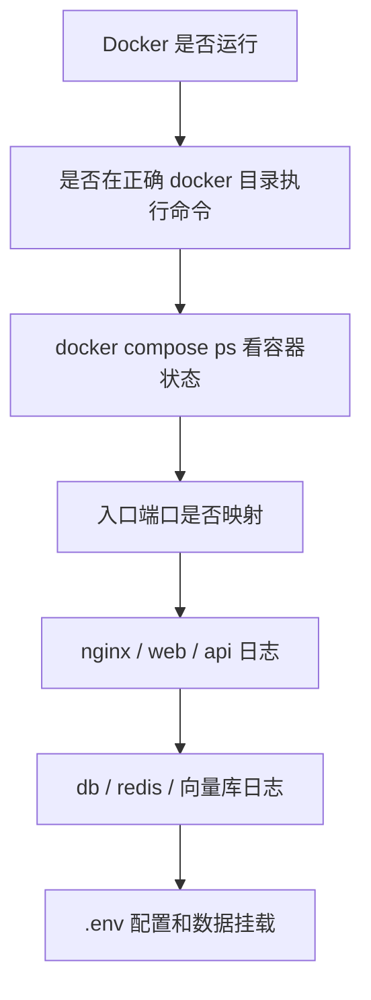

This order is intended to locate problems layer by layer: first rule out Docker and directory issues, then inspect containers, networking, and logs, and finally move into Dify configuration and data.

### 6.2 Page Cannot Be Accessed

Run this first:

```bash
docker compose ps
docker ps
docker compose logs -f nginx
docker compose logs -f web
docker compose logs -f api
```

Focus on:

- Whether `nginx` is running.
- Whether `web` and `api` are running.
- Whether `nginx` maps the port you are accessing, for example `80:80`, `8080:80`.
- Whether the port, domain, and URL configuration in `.env` matches the access address.
- Whether the local firewall, proxy, or port usage is affecting access.

If `nginx` is not up, check the entry layer first; if `nginx` is normal but the API reports errors, continue checking `api`; if `api` cannot connect to dependencies, then check the database, Redis, and vector store. `.env` is recommended only when the logs already point to a configuration problem.

### 6.3 Container Startup Failure or Restart Loop

First identify the specific failed service:

```bash
docker compose ps
```

Then check the logs:

```bash
docker compose logs -f <服务名>
```

For example:

```bash
docker compose logs -f api
docker compose logs -f worker
docker compose logs -f db_postgres
docker compose logs -f redis
```

Common causes:

- `.env` is missing variables or has variables incompatible with the current version.
- The database, Redis, or vector store has not finished starting.
- The port is already in use.
- The image was not pulled completely.
- Old-version data is incompatible with the new-version migration.

In the logs, look for the first critical error first; do not only read the last line. Some containers repeatedly restart because of earlier configuration or connection errors, and the last line is only “process exited.”

### 6.4 Initialization Page Appears After Upgrade

If the page enters the initialization setup page after an upgrade, it usually means the new environment did not read the old database.

This kind of page is not a sign of a “successful upgrade”; it means the new environment has re-entered the initialization flow as if it were a first-time installation:

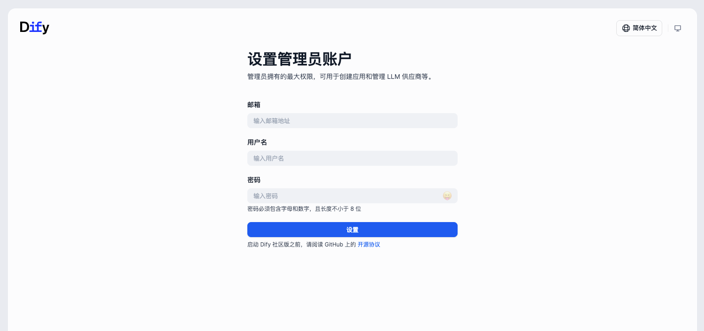

You may also see an installation/initialization entry in the browser. If this happens, do not rush to re-initialize. First check whether the old database still exists:

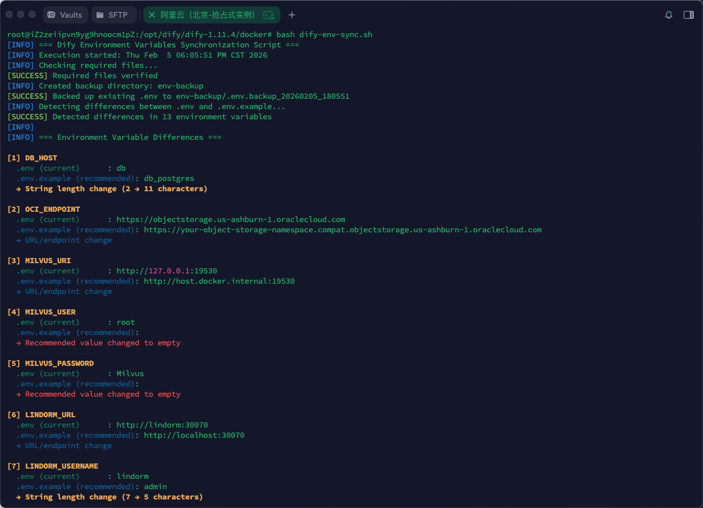

First check whether the user table data exists in PostgreSQL:

```bash
docker exec -it docker-db_postgres-1 psql -U postgres -d dify -c "select count(*) as users_count from account;"
```

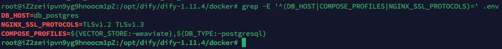

If the user table has records, the database still contains old data; if it is 0 or the table does not exist, continue checking the database name and mounts.

If the container name or database name is different, use the output from your `docker ps` and `\l` as the basis.

Continue by checking which volume the current database container is mounting:

```bash
docker inspect docker-db_postgres-1 --format '{{json .Mounts}}'
docker volume ls
```

`docker volume ls` can help confirm which Docker managed data volumes exist in the current environment:

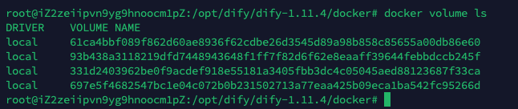

The Mounts field of `docker inspect` shows where the database container is actually mounted:

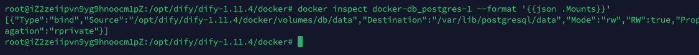

Common causes:

- The new-version Compose created a new volume.
- The database service name or profile in `.env` was not synchronized.
- The old data is still in the old directory or old volume, but the new container is not mounted there.
- The data needs to be imported from a SQL file backed up before the upgrade.

This type of problem is usually not in the pages, but in the fact that “the new container did not read the old database.” When troubleshooting, focus on the database name, volume name, mount path, and the database configuration in `.env`.

### 6.5 Connecting to the Dify Database with Navicat

Do not directly modify the database file directory. Directories like `docker/volumes/db/data` are low-level PostgreSQL data files and are not meant to be opened directly by Navicat.

To manage the database, you should connect through the PostgreSQL protocol.

This section only discusses how to connect to the database securely through the PostgreSQL protocol. In production environments, always back up before modifying tables, deleting data, or performing batch updates, and confirm the scope of impact.

**Local development environment: exposing the port**

If this is only for local learning, you can expose the PostgreSQL port in Compose, for example:

```yaml
services:
  db_postgres:
    ports:
      - "5432:5432"
```

Then restart the database service:

```bash
docker compose up -d db_postgres
```

Navicat connection parameters are usually similar to:

| Parameter | Example |
| -------- | --------------------- |
| Host | `127.0.0.1` |
| Port | `5432` |
| User | Database user from `.env` |
| Password | Database password from `.env` |
| Database | `dify` |

Note: in production, do not expose 5432 directly to the public internet.

Exposing `5432:5432` is fine for local learning, because access is usually limited to your own computer. In a server environment, pay more attention to security groups, firewalls, weak database passwords, and public scanning.

**Server environment: prefer SSH tunneling**

In a server environment, it is more recommended to keep the database accessible only within the server, and then use an SSH tunnel to forward a local port to it.

The idea is:

```text
Navicat 本机端口
  -> SSH 隧道
  -> 服务器
  -> PostgreSQL 容器或宿主机映射端口
```

Example:

```bash
ssh -L 15432:127.0.0.1:5432 user@your-server
```

Then connect with Navicat:

| Parameter | Example |
| -------- | --------------------- |
| Host | `127.0.0.1` |
| Port | `15432` |
| User | Database user from `.env` |
| Password | Database password from `.env` |
| Database | `dify` |

If the database port is not mapped to the host and is only visible within the container network, first confirm the container IP or temporarily use a jump host approach. In production, it is recommended that the operations team configure a secure access method uniformly.

Some teams use bastion hosts, VPNs, internal jump hosts, or cloud-provider database access policies for this. The course provides a general approach; in an actual production environment, follow your team’s security standards.

**Mac + SSH tunnel to connect to server PostgreSQL**

The following is a more hands-on path: use Navicat on the local machine while the database stays inside the server’s internal Docker network, without exposing 5432 to the public internet.

First confirm the Postgres container IP on the server:

```bash
docker inspect -f '{{range .NetworkSettings.Networks}}{{.IPAddress}}{{end}}' docker-db_postgres-1
```

Suppose the output is `172.20.0.4`; the SSH tunnel will later forward to this container IP.

Save the server private key locally on the Mac, for example:

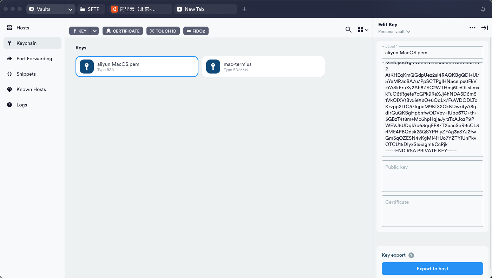

```bash
nano ~/.ssh/aliyun_navicat.pem
chmod 600 ~/.ssh/aliyun_navicat.pem
```

Then establish the tunnel:

```bash
ssh -i ~/.ssh/aliyun_navicat.pem \
  -N \
  -L 15432:172.20.0.4:5432 \
  root@your-server-ip
```

This terminal window must remain open. Closing the window disconnects the tunnel.

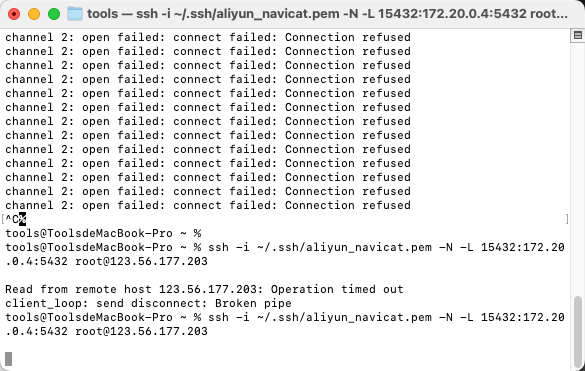

In Navicat, do not enable the SSH option again, because the tunnel has already been established through the command line. It only needs to connect to the local port:

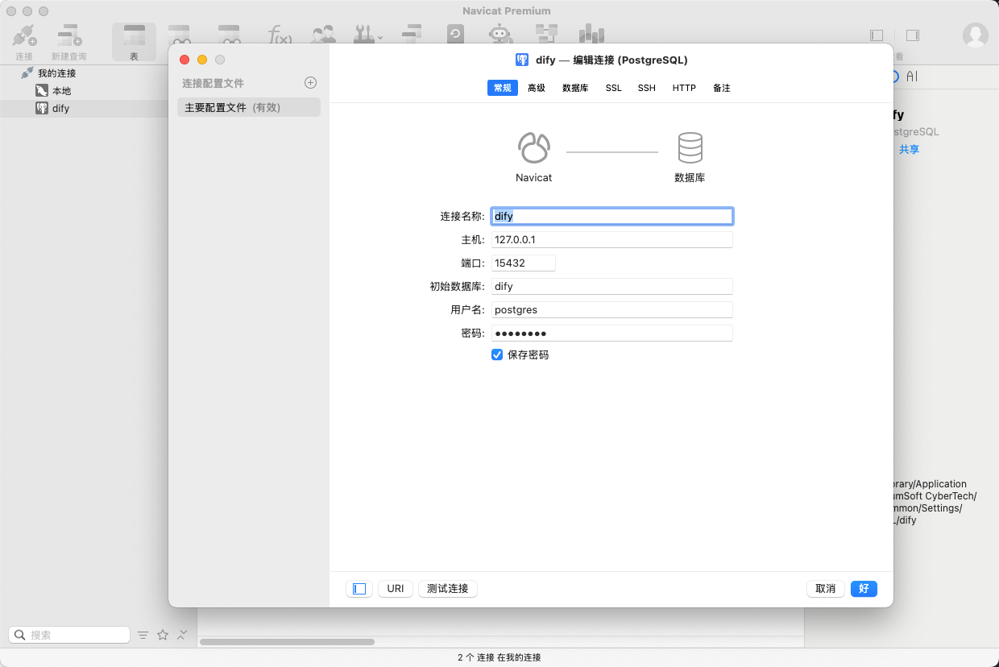

Common values:

| Parameter | Example |
| -------- | --------------------- |
| Host | `127.0.0.1` |
| Port | `15432` |
| User | Database user from `.env` |
| Password | Database password from `.env` |
| Database | `dify` |

After a successful connection, you can inspect the Dify table structure and data just like a normal PostgreSQL database:

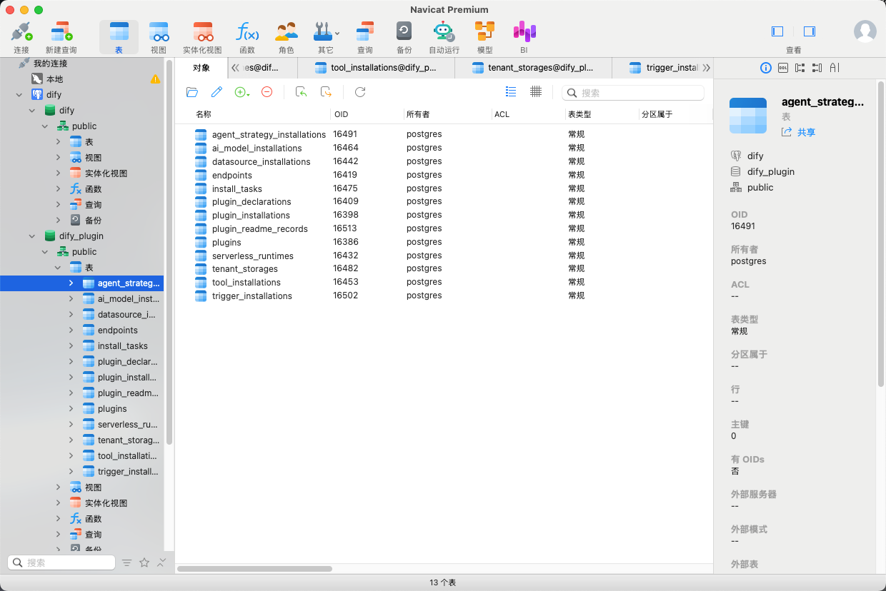

In production, viewing the table structure is usually fine; if you need to change data, delete data, or perform batch updates, back up first and then confirm the scope of impact.

---

## 7. Dify Upgrade, Backup, and Source Code Modification

Upgrading Dify is not simply running `docker compose pull && docker compose up -d`. It also involves images, `.env`, database migrations, volume mounts, plugin directories, vector stores, and frontend-backend version compatibility.

Before upgrading, go through this checklist:

| Check item | Why it matters | Recommended action |
| ------------------------- | ---------------------------- | ------------------------------------------- |
| Whether the old environment is healthy | Upgrading with existing problems makes troubleshooting more confusing | First check `docker compose ps` and `api` logs |
| Whether the database has been backed up | Migration may change table structure | Export SQL with `pg_dump` |
| Whether volumes / mount directories are confirmed | The new version may mount to a new directory | Check Mounts with `docker inspect` |
| Whether `.env` has been checked against the new version | The new version may add or deprecate variables | Compare `.env.example` and `envs/*.env.example` |
| Whether rollback is needed | You must be able to revert if the upgrade fails | Keep the old directory, old `.env`, and backup files |

### 7.1 Upgrade Process

The principle before upgrading: **Back up first, then stop the services; confirm the data location first, then start the new version.**

The following uses a general “old version -> new version” process. Container names, paths, and version numbers in the commands must be replaced according to your environment.

A Dify upgrade is not only about pulling a new image; it also involves image versions, `.env` configuration, database migrations, volume mounts, and frontend-backend compatibility. If any link is misaligned, it may show up as an inaccessible page, entering `/install`, or abnormal background tasks.

**Step 1: Pre-upgrade check**

Run this in the old-version `docker` directory:

```bash
docker compose ps
docker ps
docker compose logs --tail=100 api
```

First confirm that the old environment itself is usable. Do not upgrade directly when the old environment is already abnormal and the data state is unclear.

If the old environment already has errors, record the current state and logs first. Otherwise, after an upgrade failure, it will be difficult to determine whether the problem was introduced by the upgrade or whether the old environment was already broken.

**Step 2: Confirm the database name**

```bash
docker exec -it docker-db_postgres-1 psql -U postgres -c "\l"
```

A common business database name is `dify`. If your database container is called `docker-db-1` or another name, replace it according to the results of `docker ps`.

**Step 3: Back up the database**

```bash
docker exec -t docker-db_postgres-1 pg_dump -U postgres dify > dify_backup.sql
```

It is recommended to copy the backup file to a safe location, not only keep it in the deployment directory that is about to be changed.

After the backup is complete, at least confirm that the file is not 0 bytes; for important environments, you can also try importing it once into a test database. A backup that has not been verified can only be considered “possibly useful.”

**Step 4: Stop the old version**

```bash
docker compose down
```

This step removes the containers and networks created by the current Compose project, but by default it does not remove volumes. Unless you explicitly want to clear the data, do not use `docker compose down -v`.

The purpose of using `down` here is to make the old containers exit and avoid having the old and new versions occupy ports or write to the same data at the same time. It is not a database-clearing operation, and you should not casually add `-v`.

After running it, the terminal usually shows the containers and networks being removed:

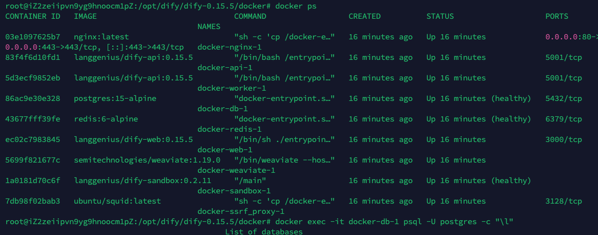

You can also check whether the volumes still exist:

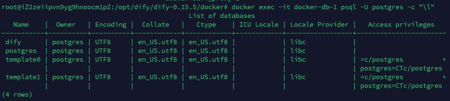

**Step 5: Prepare the new version**

A common approach is to pull or extract the new version of Dify, then enter the new version’s `docker` directory:

```bash
cd /opt/dify/dify-<new-version>/docker
```

If you use `git clone` to pull the new version, an unstable network may interrupt it. After a failure, you can retry or first resolve proxy/mirror source issues:

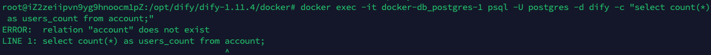

Copy over the old version of `.env`, then fill in any newly added variables according to the new version of `.env.example`. If the project provides a sync script, you can use the officially recommended script; if not, compare the old and new `.env` item by item.

A sync script or configuration comparison tool usually prompts you about which variables need to be kept, filled in, or adjusted:

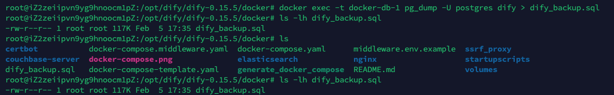

When actually changing the configuration, it is recommended to confirm each item one by one rather than blindly pasting an entire block:

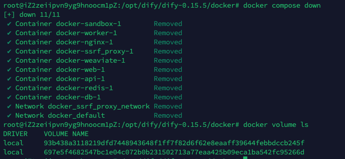

Key points to check:

- Database service name, for example `DB_HOST`.
- `COMPOSE_PROFILES`.
- Ports and domain names.
- Secret-related configuration.
- Vector database type and its corresponding connection configuration.

`.env` is the most easily overlooked file during an upgrade. The fact that the old version was able to run does not mean the old `.env` can fully satisfy the new version. Newly added variables can start with default values, but the database, secrets, URLs, and vector database type must not be changed casually.

After making changes, use a command such as `grep` to confirm that the key variables have taken effect:

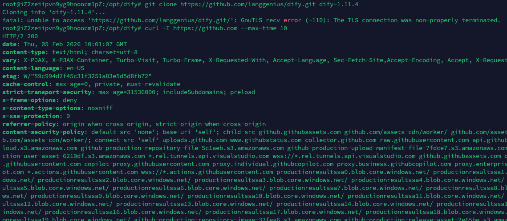

**Step 6: Pull and start the new version**

```bash
docker compose pull
docker compose up -d
```

During the image pulling phase, each service image is downloaded one by one:

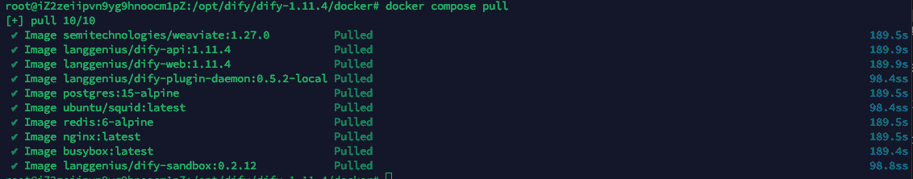

After starting, you can use `docker ps` or `docker compose ps` to check the container status:

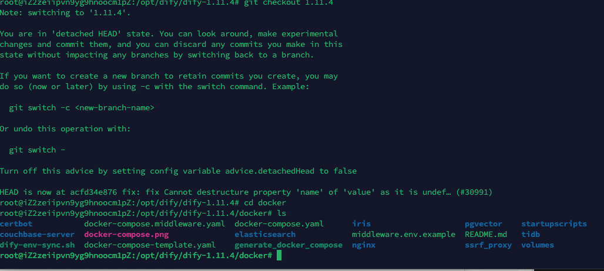

After starting, check the following:

```bash
docker compose ps
docker compose logs -f api
docker compose logs -f worker
```

If the system enters `/install` or no old data is present, go back to Section 6.4 to check the volumes and database data.

After startup, do not rush to clean up the old directory and old backups. Wait until login, the application list, knowledge bases, workflows, file uploads, and background tasks are all confirmed to be working normally before considering archiving the old version.

**Step 7: Import old backups if necessary**

If you have confirmed that the new environment has an empty database, and you have decided to restore from a backup, you can import it:

```bash
cat /path/to/dify_backup.sql | docker exec -i docker-db_postgres-1 psql -U postgres -d dify
```

If the new database has already been initialized, importing directly may cause errors such as duplicate indexes and duplicate constraints. A safer approach is to confirm that there is no new business data, then recreate an empty database and import again.

The phrase "confirm that there is no new business data" is very important here. If people have already registered, created applications, or uploaded files in the new environment, recreating the database directly will overwrite that new data. Before restoring in a production environment, stop the services and keep a backup of the current state.

If you see a large number of errors such as `already exists`, it usually means the target database is not a clean empty database:

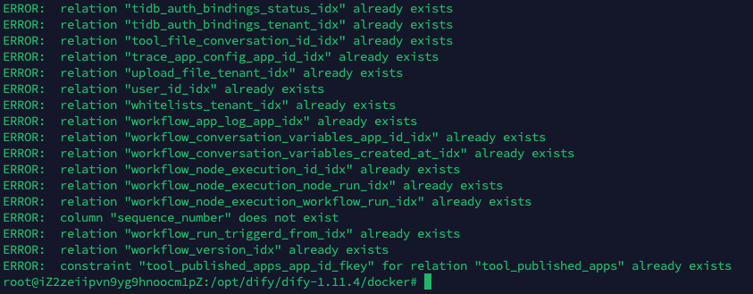

After confirming that the target database can be emptied, execute:

```bash
docker exec -it docker-db_postgres-1 psql -U postgres -c "SELECT pg_terminate_backend(pid) FROM pg_stat_activity WHERE datname='dify' AND pid <> pg_backend_pid();"
docker exec -it docker-db_postgres-1 psql -U postgres -c "DROP DATABASE IF EXISTS dify;"
docker exec -it docker-db_postgres-1 psql -U postgres -c "CREATE DATABASE dify OWNER postgres;"
cat /path/to/dify_backup.sql | docker exec -i docker-db_postgres-1 psql -U postgres -d dify
```

When recreating an empty database and re-importing, first confirm that you already have a usable backup:

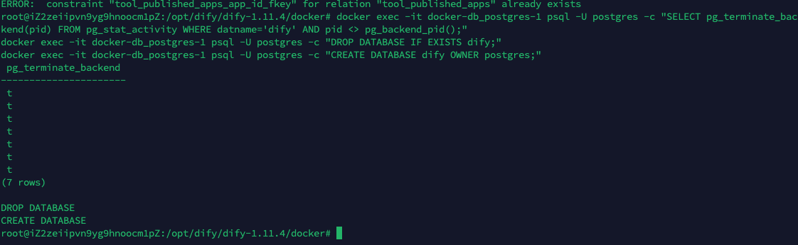

Restart the key services after completion:

```bash
docker restart docker-api-1 docker-worker-1 docker-worker_beat-1 docker-web-1
```

### 7.2 Modifying the Dify frontend source code and making changes take effect

If Compose uses the official images:

```yaml
services:
  web:
    image: langgenius/dify-web:<version>
```

Then modifying the local `web/` directory will not take effect automatically, because what actually runs is the already-built frontend artifact inside the image.

To make local source code take effect, you need to change the setup to build your own web image.

This section addresses development and modification work, not ordinary deployment. If you are only installing or upgrading Dify, you do not need to change anything here; only when you actually want to modify the frontend code, change interactions, or add pages do you need to perform a local build.

**Recommended approach: use an override**

Create a new `docker-compose.override.yaml` in the `docker` directory:

```yaml
services:
  web:
    build:
      context: ../web
      dockerfile: Dockerfile
    image: my-dify-web:local
```

This makes it easier to compare with the official files during upgrades and prevents local changes from being mixed into the official `docker-compose.yaml`.

The official compose file itself is a generated file and is also the part most likely to change during upgrades. The advantage of an override is that it separates the "official deployment files" from "local modifications." When upgrading Dify later, you can first update the official compose file and then separately check whether your override is still compatible.

**Build and restart web**

Execute in the `docker` directory:

```bash
docker compose build web
docker compose up -d web
```

If the frontend depends on environment variables or build arguments, you also need to complete them according to the current Dify version's `web/Dockerfile` and official instructions.

**Whether pull is needed in a source build scenario**

- When modifying frontend source code: `web` uses a local build and does not rely on `docker compose pull` to obtain the official web image.
- Other services: `api`, `postgres`, `redis`, `weaviate`, and others can still pull official images according to the upgrade process.

If you also modified the backend `api/`, you must configure the corresponding build and image for the api service as well; changing only web will not make backend code changes take effect.

---

## 8. Docker Common Command Quick Reference

### 8.1 Image management

| Purpose             | Command                                    |
| ---------------- | --------------------------------------- |
| View local images     | `docker images`                         |
| Pull an image         | `docker pull mysql:8.0.45`              |
| Search for images         | `docker search mysql`                   |
| Delete an image         | `docker rmi mysql:8.0.45`               |
| View detailed image information | `docker inspect mysql:8.0.45`           |
| Build a custom image   | `docker build -t my-app:1.0 .`          |
| Package an image         | `docker save mysql:8.0.45 -o mysql.tar` |
| Import an image         | `docker load -i mysql.tar`              |

### 8.2 Container management

| Purpose           | Command                                                  |
| -------------- | ----------------------------------------------------- |
| View running containers | `docker ps`                                           |
| View all containers   | `docker ps -a`                                        |
| View container logs   | `docker logs -f <容器名>`                             |
| Enter a container       | `docker exec -it <容器名> sh`                         |
| Stop a container       | `docker stop <容器名>`                                |
| Start a container       | `docker start <容器名>`                               |
| Restart a container       | `docker restart <容器名>`                             |
| Delete stopped containers | `docker rm <容器名>`                                  |
| View container mounts   | `docker inspect <容器名> --format '{{json .Mounts}}'` |

### 8.3 Compose project management

| Purpose                         | Command                               |
| ---------------------------- | ---------------------------------- |
| Start the entire set of services                 | `docker compose up -d`             |
| Start and rebuild               | `docker compose up -d --build`     |
| View service status                 | `docker compose ps`                |
| View all service containers             | `docker compose ps -a`             |
| View the service list                 | `docker compose config --services` |
| View logs for a service             | `docker compose logs -f <服务名>`  |
| Run a service temporarily             | `docker compose run --rm <服务名>` |
| Enter a service container to run a command         | `docker compose exec <服务名> sh`  |
| Pull images                     | `docker compose pull`              |
| Build service images                 | `docker compose build <服务名>`    |
| Stop services                     | `docker compose stop`              |
| Stop and remove containers and networks         | `docker compose down`              |
| Stop and remove containers, networks, and volumes | `docker compose down -v`           |
| Stop and remove images associated with the project       | `docker compose down --rmi all`    |
| View the final configuration                 | `docker compose config`            |

### 8.4 Common Dify commands

The following commands are executed by default in Dify's `docker` directory.

| Purpose             | Command                                                                             |
| ---------------- | -------------------------------------------------------------------------------- |
| View the service list     | `docker compose config --services`                                               |
| View all containers     | `docker ps -a`                                                                   |
| View API logs    | `docker compose logs -f api`                                                     |
| View worker logs | `docker compose logs -f worker`                                                  |
| View nginx logs  | `docker compose logs -f nginx`                                                   |
| View database logs   | `docker compose logs -f db_postgres`                                             |
| Enter the database container   | `docker exec -it docker-db_postgres-1 sh`                                        |
| Connect to PostgreSQL  | `docker exec -it docker-db_postgres-1 psql -U postgres -d dify`                  |
| View container mounts     | `docker inspect <容器名> --format '{{json .Mounts}}'`                            |
| View volumes      | `docker volume ls`                                                               |
| Back up the database       | `docker exec -t docker-db_postgres-1 pg_dump -U postgres dify > dify_backup.sql` |

Container names and service names may vary depending on the Dify version or Compose project name. If a command fails, first use `docker compose ps` or `docker ps` to confirm the actual names in the current environment.

### 8.5 Common Ubuntu server commands

| Purpose                     | Command                                                                             |
| ------------------------ | -------------------------------------------------------------------------------- |
| View Docker service status     | `sudo systemctl status docker`                                                   |
| Restart the Docker service         | `sudo systemctl restart docker`                                                  |
| Configure the current user to use it without sudo | `sudo usermod -aG docker $USER`                                                  |
| View Docker Engine configuration  | `docker info`                                                                    |
| Edit the image registry configuration           | `sudo vim /etc/docker/daemon.json`                                               |
| Reload systemd configuration    | `sudo systemctl daemon-reload`                                                   |
| Stop the Docker service         | `sudo systemctl stop docker`                                                     |
| Uninstall Docker packages       | `sudo apt remove -y docker-ce docker-ce-cli containerd.io docker-compose-plugin` |
| Delete the Docker data directory     | `sudo rm -rf /var/lib/docker /var/lib/containerd`                                |

The last command is a high-risk cleanup command that deletes data managed by Docker on the local machine. Use it only after confirming that there are no important containers, images, or volumes.

### 8.6 Dangerous operations checklist

These commands are not unusable, but they must not be used casually without a backup and without confirming the environment:

| Command                          | Possible consequences                              | What must be confirmed before use                         |
| ----------------------------- | ------------------------------------- | -------------------------------------- |
| `docker compose down -v`      | Deletes the volumes of the current Compose project        | Whether the database, vector database, and uploaded files have been backed up     |
| `docker volume rm <volume名>` | Deletes the specified volume                       | Whether this volume is really obsolete data         |
| `docker volume prune`         | Deletes all volumes not used by any container         | Whether there are projects that are stopped but whose data still needs to be kept         |
| `docker system prune -af`     | Cleans up unused containers, networks, images, and build caches  | Whether you can accept pulling images again and rebuilding caches         |
| `rm -rf ./volumes`            | Deletes the mount data under the current deployment directory          | Whether it has been confirmed to be a test environment or whether a backup exists         |
| `sudo rm -rf /var/lib/docker` | Deletes all local data managed by Docker Engine | Whether the machine is being reinstalled and all data has already been migrated out     |
| `DROP DATABASE dify;`         | Deletes the Dify business database                  | Whether services have been stopped, a backup has been made, and the target database is confirmed to be clearable |

When you really need to clear a test environment, it is recommended to first run "view commands" and "delete commands" separately:

```bash
docker compose ps
docker volume ls
docker inspect <容器名> --format '{{json .Mounts}}'
```

Only after confirmation should you run the cleanup command. This habit may seem a little slower locally, but it can save a lot of trouble on the server.

**Chapter summary:**

- Images are templates, and containers are running instances.
- Dockerfile is responsible for building images, and Compose is responsible for orchestrating multiple services.
- In `ports`, the left side is the host port and the right side is the container port.
- `volumes` determines where data and files come from and where they are placed.
- How Docker is used on a local Windows machine and an Ubuntu server is largely the same, but paths, permissions, and image registry configurations differ.
- Dify's Docker deployment is a coordinated set of services, not a single container.
- When troubleshooting, first check container status and logs, then ports, `.env`, the database, and the vector database.
- Back up the database before upgrading to avoid irreversible loss caused by migrations or accidental operations.
