# 9 - LangChain Overview and Architecture

---

**Chapter Learning Objectives:**

- Build an overall understanding of **LangChain**: know what it is, what problems it solves, and where it sits in AI application development.
- Understand LangChain's product boundaries, package structure, and version evolution in the **1.x era**, as well as its relationship with **LangGraph, LangSmith, and Deep Agents**.
- Build an overall understanding of the six teaching perspectives: **Model I/O, Chains, Memory, Retrieval, Tools/Agents, and Callbacks**.

**Study Tips:** Treat this chapter as a map of LangChain for now; don't rush to memorize APIs. After reading it, you should be able to clearly explain three things: what capabilities LangChain helps you organize, what low-level capabilities it does not handle, and why 1.x code differs from the 0.x code in older materials. Once you finish, go directly to [Chapter 10](10-LangChain%E5%BF%AB%E9%80%9F%E4%B8%8A%E6%89%8B%E4%B8%8EHelloWorld.md) and run through a minimal invocation once; the abstract concepts will then settle much more solidly.

**Official documentation and resources:** See [Tool Navigation and Reference Index - LangChain](%E5%B7%A5%E5%85%B7%E5%AF%BC%E8%88%AA%E4%B8%8E%E5%8F%82%E8%80%83%E8%B5%84%E6%96%99%E7%B4%A2%E5%BC%95.md#LangChain).

---

## 1. Introduction to LangChain

### 1.1 Definition

**LangChain** is an open-source framework for **LLM application development**. It is **not a large language model**, **not a database**, and certainly **not a knowledge base platform**; rather, it acts as an "**application orchestration layer**" that organizes models, prompts, external knowledge, tools, memory, output parsing, debugging, tracing, and other capabilities into a complete, maintainable, and extensible AI application.

For example, in an "enterprise knowledge base Q&A assistant," after a user asks a question, the system first needs to retrieve relevant materials from a vector store, then assemble those retrieval results together with the question into a Prompt, then call the model to generate an answer, and finally organize the result and return it to the frontend. The component that truly plays the role of "connector" and "organizer" here is LangChain.

In one sentence, **LangChain = an application development framework that uses code to connect large language models with the external world.**

Here, **Lang** refers to Language Model, and **Chain** refers to stringing multiple steps together into a workflow. The earliest LangChain was indeed known for "chained invocation," but as it has evolved to today, it is no longer just about "chains"; it has formed an entire ecosystem around **Agents, RAG, tool invocation, state management, and observability**. The official development history mentions that LangChain was publicly released as a Python package in **2022**, about a month earlier than the official release of ChatGPT, so it has accompanied almost the entire explosive growth period of generative AI application development.

The change in LangChain's popularity on GitHub is shown in the following figure:

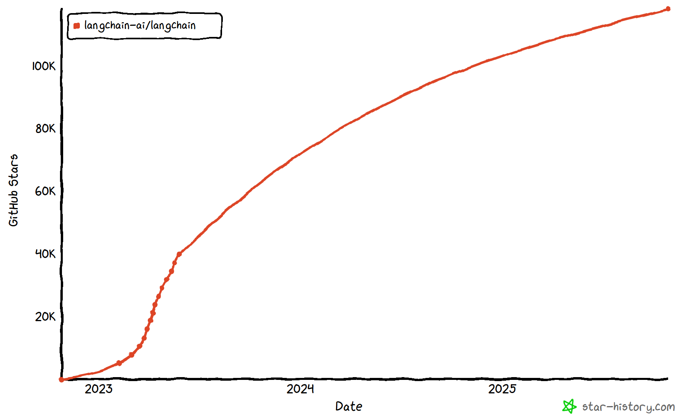

From an engineering perspective, the value of LangChain is not "making a request for you," but helping you organize the following originally scattered pieces:

- Invocation methods for models from different providers
- Prompts and multi-role messages
- Structured output and parsing
- Retrieval-Augmented Generation (RAG)
- Tool invocation, Agents, multi-step tasks
- Memory, conversation state, persistence
- Logging, tracing, debugging, evaluation

This is also why many people regard it as the "foundational framework" in AI application development.

### 1.2 Why LangChain Is Needed

If you only occasionally call a model API, using the SDKs from OpenAI, Alibaba Bailian, DeepSeek, Zhipu, and other providers directly is perfectly fine; but once you enter a real project, the naive approach of simply "sending a string to the model and getting back a piece of text" quickly exposes a host of engineering problems.

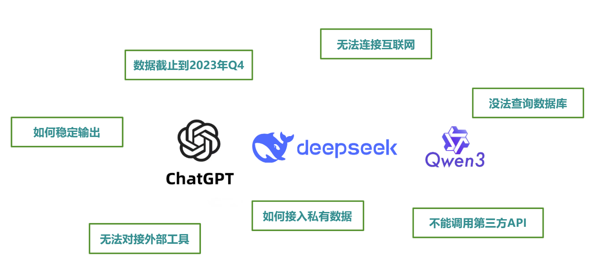

Common problems include:

- **Inconsistent model interfaces**: Different providers have different SDKs, parameter names, and return structures, making model switching costly.
- **Unstable input and output**: It succeeds in outputting JSON today, but a slightly different question tomorrow may lead it astray.
- **Difficulty connecting external knowledge**: Enterprise documents, databases, vector stores, and internal APIs all require manual integration.
- **Multi-step tasks are hard to maintain**: For example, "retrieve first, then summarize, then call a tool, then organize the reply" is prone to becoming messy when written by hand.
- **Multi-turn conversations are hard to manage**: You need to decide which historical messages to keep, when to trim them, and when to persist them.
- **Online troubleshooting is difficult**: Why did the model answer incorrectly, why was the tool not invoked, which step was slow, and where did context get lost? These are hard to pinpoint by looking at logs alone.

LangChain does not magically eliminate this complexity, but it provides you with a unified set of abstractions so that you can solve these problems in a more standardized way.

### 1.3 If You Can Already Call Models Directly, Why Learn LangChain

The answer is simple: **Calling APIs directly works, and for simple tasks it may even be more straightforward; but as soon as you start building "applications," the framework becomes more and more valuable.**

The most typical analogy is **JDBC** or **Spring** in Java. Your business code should not be tightly coupled to a specific database or middleware, so you want an intermediate layer of unified interfaces to isolate the differences. In LLM applications, LangChain largely plays this role of unified abstraction, unified orchestration, and unified integration.


In project development, the boundary between these two approaches is roughly as follows:

- **Calling APIs only**: suitable for one-off text generation, simple scripts, and quick validation.
- **Using LangChain**: suitable for building real applications, such as customer service assistants, knowledge base Q&A, data analysis assistants, tool-invoking Agents, and multi-turn dialogue systems.

Therefore, LangChain is not something you "must learn," but if your goal is to build **RAG, Agents, enterprise-grade AI applications, or integrate AI services into existing business systems**, it will significantly reduce your subsequent organizational costs.

### 1.4 Differences Between LangChain and Coze / Dify

Many people ask when they first encounter LangChain: **"I already know how to use Coze or Dify, so why should I learn this?"**

Essentially, they are not the same kind of thing:

| Dimension | Coze / Dify and similar platforms | LangChain |
| ------------ | ----------------------------------------------------------------------------- | ------------------------------------------------------------------------- |
| **What it is** | **Product / platform**: Build AI applications through visual web interfaces, workflow nodes, and knowledge base management | **Code framework / library**: Orchestrate models, tools, RAG, and Agents through code in Python or JS |
| **How to use it** | Open a browser, drag and drop nodes, configure models, fill in prompts, connect knowledge bases, and finally publish the application or API | Write code locally or on a server, install dependencies, and call LangChain APIs to build your own AI application |
| **Who it suits** | Product managers, operations staff, low-code developers, or people who want to validate business ideas quickly | Developers, backend engineers, and algorithm engineers who need to deeply integrate AI capabilities into existing systems |
| **Flexibility** | Limited by the platform's existing nodes, plugins, deployment methods, and permission design | Fully controlled by code; can connect to internal APIs, self-built databases, private models, and custom tool chains |
| **Typical scenarios** | Quickly building a customer service bot, knowledge base Q&A, or process automation demo | Building an enterprise internal AI platform, complex RAG services, customizable Agents, and services deeply coupled with business systems |

In real projects, these two types of tools are often not an "either-or" choice, but rather **platform first, framework second; low-code validation first, then code-based implementation**:

- During the business exploration phase, use **Coze / Dify** to quickly validate requirements.
- When deep customization, integration with internal company systems, or complex orchestration is needed, refactor into a code-based service using **LangChain / LangGraph**.

This line of thinking is exactly consistent with the structure of this tutorial series: first learn Coze / Dify in the earlier part, then move into LangChain / LangGraph in the later part.

### 1.5 Why Now Is a Better Time to Learn

Learning LangChain now is actually more suitable than it was in the previous two years. The reason is not that "it has become simpler," but that **its boundaries have become clearer**.

- **The official mainline has entered the 1.x era**: Compared with the early 0.x phase of rapid iteration and frequent naming changes, the learning entry point of 1.x is clearer, with the focus on `create_agent`, unified model initialization, messages, tools, memory, retrieval, and observability.
- **The division of labor among LangChain, LangGraph, and LangSmith is clearer**: It is easier to understand "when to use the high-level framework, when to use the low-level graph orchestration, and when to do debugging and evaluation."
- **The ecosystem is mature**: Official documentation, Reference, Learn tutorials, and Academy courses now form a closed loop, rather than just scattered blog posts and community notes.
- **Application scenarios are more realistic**: In the past, many tutorials remained at the demo level; now both official content and community practice place more emphasis on production readiness, such as human review, persistence, tracing, evaluation, and deployment.

Simply put, **learning LangChain now is no longer just learning a library for "whether you can call a model," but learning a set of AI application engineering methodologies.**

### 1.6 Advantages, Boundaries, and Shortcomings

LangChain's advantages are obvious, but it is not a silver bullet. When learning, you should see both what it "can do" and what it "cannot do for you."

**Advantages:**

- Unified model interfaces, reducing the cost of model switching and multi-model coexistence.
- Provides common abstractions such as Prompt, Message, Parser, Retriever, Tool, and Agent.
- Can elevate "single invocations" into "maintainable workflows."
- Closely connected with the LangGraph, LangSmith, MCP, and other ecosystems, facilitating progression toward complex applications.
- Abundant resources, many examples, and an active community, making it suitable for building systematic understanding.

**Boundaries:**

- It **will not design your business logic for you**; it only helps you implement it better.
- It **will not train models for you**; model capability still depends on the underlying model.
- It **will not store your business data for you**; you still need to choose vector stores, databases, and object storage yourself.
- It **will not naturally make results better**; Prompt quality, knowledge quality, tool design, and evaluation workflows remain critical.

**Shortcomings and common complaints:**

1. **Rapid version changes**: Class names, import paths, and patterns in older tutorials may well have already been migrated in newer versions.
2. **Many abstractions, and not a low learning curve**: Beginners can easily feel that "I just wanted to call a model, so why are there so many extra concepts."
3. **Legacy baggage really exists**: Many articles still discuss `LLMChain`, `ConversationChain`, and the old AgentExecutor, but new projects should not necessarily copy them verbatim.
4. **Old and new documentation coexist**: The official documentation is already much more stable than in the early days, but the ecosystem is broad, and you will still encounter inconsistencies in version context.

So the conclusion is clear: **LangChain is suitable for building AI applications, but you should learn it with the mindset of an "engineering framework," not treat it as a simple utility function library.**

### 1.7 Extension: Introduction to LangChain4J

If your main technology stack is Java, you may want to learn about **LangChain4J**. It is essentially a "LangChain-style framework in the Java ecosystem," often used together with Spring Boot, Spring AI, and enterprise middle-platform scenarios, and is suitable for Java teams that want to integrate LLM, RAG, Tools, Agents, and other capabilities into existing systems.

- **Equivalent understanding**: LangChain for Java
- **Official website**: https://github.com/langchain4j/langchain4j
- **Supplementary learning**: If you plan to integrate large language models into enterprise Java projects in the future, LangChain4J will be a very common keyword
- **Video tutorial**: https://www.bilibili.com/video/BV1mX3NzrEu6/ (Shangguigu - Zhou Yang)

---

## 2. Positioning of LangChain

### 2.1 Classification of the LLM Development Ecosystem

If we roughly layer LLM-related work from bottom to top, it can be divided into three categories:

- **Foundation model layer**: Pre-training, alignment, inference optimization, and model architecture design, such as the model research behind GPT, Qwen, DeepSeek, GLM, and others. The barrier to entry is high and the investment is substantial, usually requiring strong backgrounds in mathematics, deep learning, and large-scale engineering.
- **Model customization layer**: Domain-specific fine-tuning or specialized optimization (finance, healthcare, law, etc.) built on top of the foundation model layer, leaning toward model training/fine-tuning and industry implementation.
- **Application development layer**: Integrating models into business processes to build applications such as chatbots, knowledge base Q&A, agents, workflow systems, and data assistants.

**LangChain primarily serves the third layer: the application development layer.**

It does not train models, nor does it directly replace inference service platforms; what it is responsible for is: **how to turn model capabilities into a working application system.** Here we must first clarify the boundary: LangChain is closer to an **AI application development framework**, not a model research tool.

### 2.2 Application Technical Architecture

The following diagram can help you understand where LangChain sits in the system architecture:

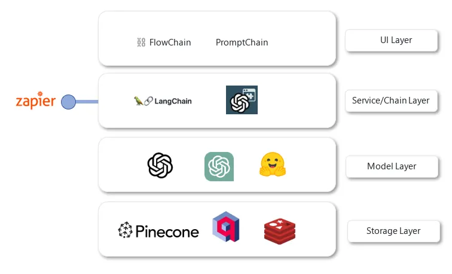

| Layer | What this layer is responsible for | Common objects / products | Where LangChain fits |
| ----------------- | ---------------------------------------------------------------------------- | --------------------------------------------------- | -------------------------------------- |
| **UI interaction layer** | User interaction entry points, such as web pages, apps, admin consoles, chat interfaces, form pages, and visual workflow interfaces | Web frontends, admin consoles, Langflow, chat windows | Not in this layer |
| **Service / orchestration layer** | Responsible for organizing models, prompts, retrieval, tools, memory, output parsing, and state transitions into business processes | **LangChain**, LangGraph, self-built AI service layers | **LangChain is primarily in this layer** |
| **Model layer** | Provides foundational capabilities such as LLMs, embeddings, rerankers, and multimodal models | OpenAI, Alibaba Bailian, DeepSeek, Ollama, Hugging Face, etc. | LangChain invokes this layer through unified interfaces |
| **Storage layer** | Stores raw documents, vectors, sessions, user state, and business data | MySQL, Redis, Pinecone, Chroma, Milvus, object storage, etc. | LangChain accesses this layer but does not replace it |

**Data flow**: Requests go **top-down** (user → service/chain → model → storage), and results return **bottom-up** to the user; LangChain sits in the **service/orchestration layer**, connecting the UI, model, and storage rather than replacing any of them.

> **Why is it said that LangChain is equivalent to Spring Boot in Java?**
> Because **what they do is very similar**: both are about "**integrating multiple heterogeneous components into one application, using unified abstractions so you can write business logic while the framework manages connections and orchestration**".
>
> - **Spring Boot**: In Java, it integrates databases (MySQL), caches (Redis), message queues (Kafka), HTTP interfaces, etc. — you write business code, and Spring manages configuration, dependency injection, and lifecycle; when you change a data source or add middleware, you just modify the configuration rather than hand-writing a pile of connection code.
> - **LangChain**: In LLM applications, it integrates various models (GPT, Qwen), vector stores (Pinecone), tools, memory, etc. — you define "how chains connect and which tools an Agent uses", and LangChain manages when to call the model, when to query the store, and how to assemble prompts; when you change a model or add RAG, you just modify the configuration and chains rather than hand-writing every request and assembly.
>   Therefore, it is often said: **LangChain is the "Spring" of AI application development** — standing at the "service/chain layer", it connects the lower-level models and storage with the upper-level interaction, allowing you to focus on business orchestration while the framework handles component integration.

### 2.3 Usage Scenarios

Once you understand its "position", the "responsibilities" become much clearer. In real projects, LangChain typically handles the following tasks:

1. **Unified model integration**: Accessing Qwen, DeepSeek, OpenAI, and Ollama in the same project is essentially multi-model orchestration.
2. **Unified input/output handling**: Using PromptTemplate, message objects, and output parsers to standardize requests and results.
3. **Organizing fixed workflows**: Building stable pipelines such as "question → retrieval → generation → parsing".
4. **Integrating tools and external systems**: For example, weather queries, database queries, internal APIs, ticketing systems, and email systems.
5. **Managing state and memory**: Multi-turn conversations, session context, user preferences, and long-term memory.
6. **Debugging and evaluation**: Tracing the invocation process to identify where problems occur.

This becomes very easy to understand when viewed through the project scenarios in this tutorial series:

- In the **Coze / Dify** stage, we built platform-based applications such as product review analysis, customer complaint classification, and customer service conversation log analysis.
- After entering the **LangChain** stage, we began moving these "AI capabilities" into code services, such as multi-model integration, output parsing, memory management, Tools, RAG, MCP, and Agents.
- Later, in the **LangGraph** stage, we essentially address the problems of "more complex processes, more states, and finer-grained control".

This path is fundamentally about moving from "knowing how to use AI platforms" to "knowing how to build AI systems".

### 2.4 Job Roles and Recruitment Benchmarks

Nowadays, more and more job postings on recruitment platforms explicitly list:

- Familiarity with LangChain / LangGraph / RAG / Agent
- Experience in LLM application development
- Ability to integrate vector stores, knowledge bases, and tool calling
- Familiarity with prompts, model invocation, observability, and evaluation

In other words, **LangChain is no longer an "optional topic to know about", but a high-frequency keyword in many AI application engineering roles**. Of course, different companies may not only use LangChain, but once you master this way of thinking, migrating to other frameworks will be much faster.

> Appendix: A sample resume of a "foundation general-purpose LLM" developer (for illustration)

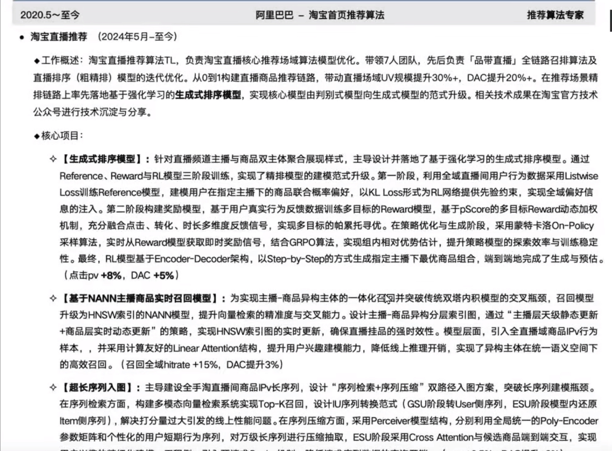

---

## 3. LangChain Packages and Version Comparison

### 3.1 Version Evolution: From "Chains" to "Agent + Graph + Ecosystem"

The evolution of LangChain can be roughly understood in three stages:

**Stage 1: The 0.0.x / 0.1 early period, characterized by a "chain-first" approach.**
During this period, LangChain was mostly understood as a combination tool of "Prompt + LLM + Chain", and many classic patterns such as `LLMChain`, `ConversationChain`, and various legacy AgentExecutor implementations originated from here.

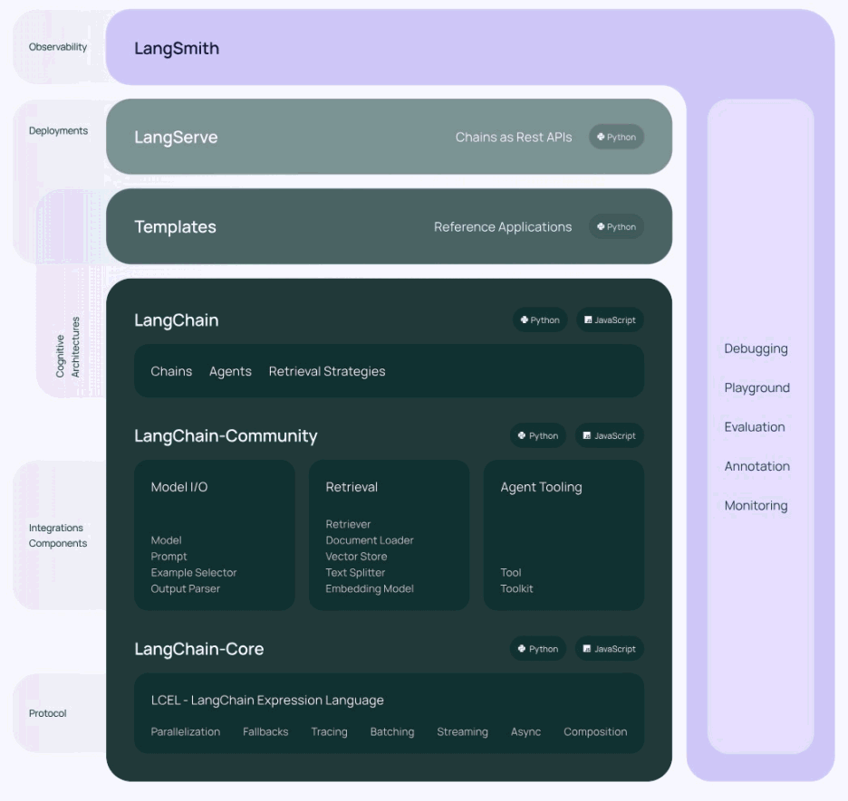

**Stage 2: The 0.2 / 0.3 period, which began to emphasize ecosystem separation and engineering boundaries.**
During this period, the official team gradually split LangChain, integration packages, and deployment/debugging capabilities into distinct layers, forming a clearer product hierarchy. You will also see this structural diagram in many tutorials from around 2024.

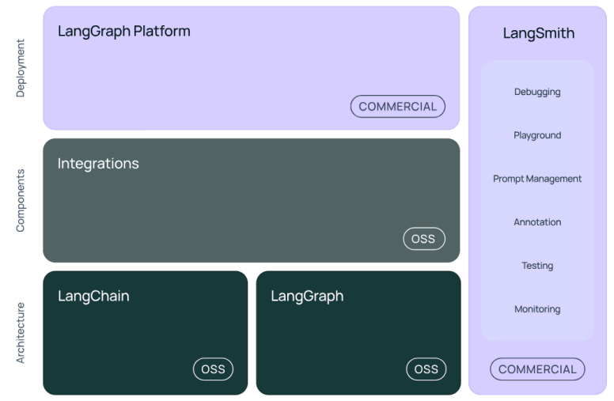

> **Note**: The above diagram divides the LangChain ecosystem into three layers — **Architecture**, **Components**, and **Deployment**.
>
> - **Bottom layer (Architecture)**: LangChain + LangGraph, both open source. LangChain is responsible for chain orchestration and foundational abstractions, while LangGraph provides graph structures, loops, and multi-step reasoning.
> - **Middle layer (Components)**: Integrations and other connections to external APIs, databases, and third-party models.
> - **Top layer (Deployment)**: LangGraph Cloud (cloud deployment) and LangSmith (commercial capabilities such as debugging, testing, monitoring, and prompt management).

**Stage 3: The 1.x period, with a focus on "slimming down the core package, strengthening Agents, and deep integration with LangGraph".**
The official documentation in 1.x emphasizes that the `langchain` core package retains only core high-level capabilities, integrations are split into separate provider packages, legacy capabilities are migrated to `langchain-classic`, and Agents are built on top of the LangGraph runtime.

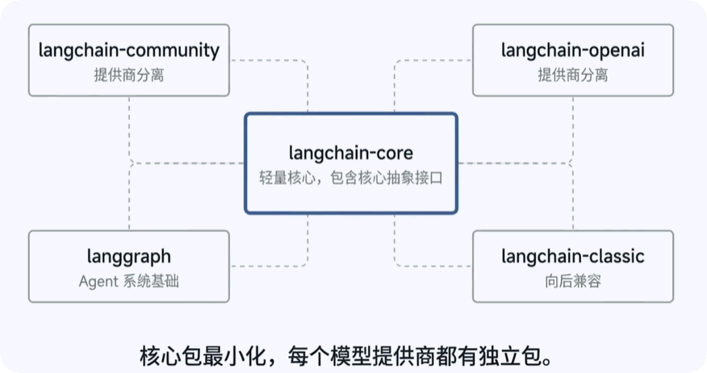

If you only need to remember one timeline:

- **February 2024**: LangGraph was open-sourced
- **October 20, 2025**: LangChain officially released **v1.0.0**
- **Now**: Learning LangChain should be centered on the **1.x documentation context**

### 3.2 Understanding the Current Official Product Line

The official team is no longer just talking about a single `langchain` package, but rather a full product line. For beginners, the most important thing is to distinguish these names:

| Name | Role positioning | How you can understand it |
| --------------- | ------------------------------ | -------------------------------------------------------------------- |
| **LangChain** | High-level application framework | The main entry point for quickly building Agents and AI applications, hiding a lot of low-level details |
| **LangGraph** | Low-level graph orchestration and runtime | Use when your workflow is more complex and requires strong state control, loops, persistence, or human review |
| **LangSmith** | Observability, evaluation, debugging, and deployment platform | Used to trace, debug, evaluate, and release applications |
| **Deep Agents** | "Out-of-the-box" complex Agent solution | The officially recommended starting point for complex Agents, built on top of LangChain / LangGraph |

This is already different from the early impression that "LangChain = everything". The distinction can now be made as follows:

- To quickly build an Agent: start with **LangChain**
- To build more complex, more controllable Agentic Workflows: use **LangGraph**
- For tracing, evaluation, and deployment: use **LangSmith**
- To quickly build more "heavyweight" complex Agents: keep an eye on **Deep Agents**

**The main thread of this tutorial series remains: LangChain → LangGraph → MCP / Multi-Agent Systems.** This path is more beginner-friendly because you first master the foundational abstractions and then move into graph orchestration, keeping the knowledge coherent.

### 3.3 Core Differences Between 0.x and 1.x

The following diagram corresponds to the most noticeable change for everyone: **the syntax has changed, and so has the focus.**

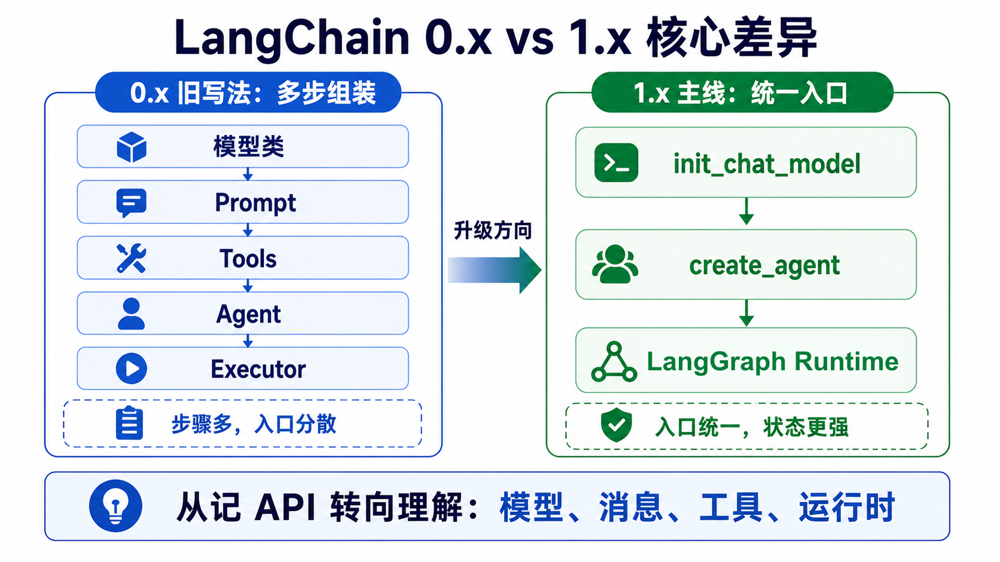

To summarize in one sentence:

> **0.x is more like "many high-level classes + composable building blocks", while 1.x is more like "a slimmed-down core package + a unified entry point + Agents built on top of LangGraph".**

Taking Agents as an example, the changes are especially obvious:

```text
# 约 0.x：常见需要分多步组装
[Model] → [Tools] → [Prompt] → [Agent] → [Executor]

# 约 1.x：常见收敛为高层入口
create_agent(模型、工具、提示等) → [Agent]
```

The core changes can be summarized as:

| Comparison | 0.x / old syntax | 1.x / new syntax |
| --------------- | ------------------------------------- | ---------------------------------------- |
| **Agent Creation** | Commonly requires manually assembling Agent + Executor | Uses `create_agent` as the main entry point |
| **Model Initialization** | Commonly hard-codes specific classes or old import paths | Emphasizes unified entry points, such as `init_chat_model` |
| **Main Package Contents** | The `langchain` package contains a lot of legacy baggage | The `langchain` main package has been streamlined to focus only on core capabilities |
| **Where Old Capabilities Went** | `LLMChain`, old Retrievers, etc. are mixed into the main package | Moved to `langchain-classic` |
| **Underlying Runtime** | Previously, many people only perceived "chains" | Now Agents are explicitly built on top of **LangGraph** |
| **Python Version** | Older materials commonly mention 3.8 / 3.9 | Official 1.x requires **Python 3.10+** |

There is one point of confusion here:
**It is not that "chains" are useless after 1.x, but rather that many legacy high-level Chain classes are no longer the officially recommended approach.** The later [Chapter 15: LCEL and Chain Invocation](15-LCEL%E4%B8%8E%E9%93%BE%E5%BC%8F%E8%B0%83%E7%94%A8.md) in the course remains a core topic, because the idea of "combining multiple steps" has never gone out of date; what has changed is the implementation approach, gradually shifting from "some ready-made Chain class" to **Runnable / LCEL / Graph**.

### 3.4 Common LangChain Package Categories

This part used to be the easiest to get wrong, because **the package division in 1.x is no longer the same as in earlier versions**. Let me reorganize it according to the current official approach.

| Package / Module | Purpose | Notes |
| ---------------------------------------------------------------- | ----------------------- | ------------------------------------------------------------------------ |
| **langchain-core** | Core abstraction layer | Contains messages, Runnables, tool foundations, prompt foundations, model interfaces, etc. It is the foundation of the entire ecosystem |
| **langchain** | Main high-level application framework package | In 1.x, focuses on core high-level capabilities such as Agents, unified model initialization, messages, and tools |
| **langchain-openai / langchain-anthropic / langchain-ollama**, etc. | Vendor / provider integration packages | Each model vendor or platform typically has its own independent integration package for easier version management |
| **langchain-community** | Community integration package | Contains a large number of community-maintained integrations, such as certain tools, loaders, vector stores, and third-party connectors |
| **langchain-classic** | Legacy / compatibility package | Houses many classic capabilities migrated out of the main package, such as old Chains, old Retrievers, old Indexing, etc. |
| **langgraph** | Graph orchestration and runtime | Used for building more complex, controllable, and persistent Agentic Workflows |
| **langsmith** | Debugging, evaluation, tracing SDK | Connects to the LangSmith platform and is commonly used for observability and experimental evaluation |
| **langchain-text-splitters** | Text splitting components | Commonly used in RAG to split long text into suitable chunks |
| **langchain-mcp-adapters** | MCP adapter package | Used to integrate MCP tools into LangChain / LangGraph applications |

A common misconception deserves special correction here:

> **Packages like `langchain-openai` and `langchain-anthropic` are not aliases inside `langchain-community`; they are now independent provider packages.**

This is also why the official guidance currently emphasizes "independent integration packages": model vendors change too quickly, and separating them makes maintenance easier.

### 3.5 How to Handle Version Differences While Learning

Because much of the material on the internet still reflects the 0.x context, you will almost certainly encounter situations where "the video does it this way, but why is it different for me?" The following principles are recommended:

1. **For new projects and new code, prioritize learning 1.x.**
2. **When you see `LLMChain`, `ConversationChain`, or the old AgentExecutor, first understand them as legacy patterns.**
3. **When reading old tutorials, focus on the "ideas" rather than memorizing "class names."**
4. **Follow the current import paths and current APIs in the official documentation.**
5. **If course examples remain compatible with legacy patterns, the goal is to help you understand the old ecosystem, not to imply that new projects should be written that way.**

---

## 4. LangChain Core Modules

### 4.1 First Build a "Big Picture"

When learning LangChain, the easiest place to get confused is this: at one moment you see **Model I/O**, then you see **Chains**, and then you see **Messages, Tools, Memory, Retrieval, Callbacks**, and it feels like a pile of terms thrown together. In fact, they can all be understood within a single main thread.

Let's first lay out the knowledge blocks with the diagram below. It does not require you to master everything right now; it only shows the route along which later chapters will unfold:

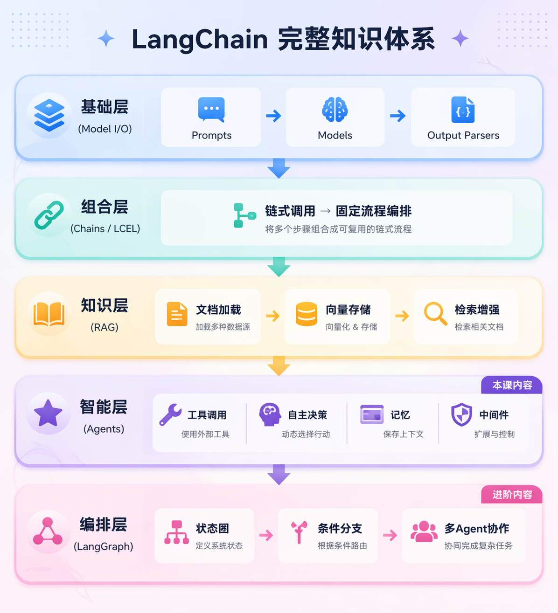

You can visualize a typical AI application as the following chain:

1. The user sends a question.
2. The system decides whether to include prompts, history, and external knowledge.
3. If needed, first retrieve documents or call tools.
4. Pass the organized context to the model.
5. After obtaining the output, parse, format, or post-process it.
6. Throughout the entire process, record logs and trace the execution chain.

From this perspective, LangChain's core modules essentially answer six questions:

- **How to connect to models**: Model / Model I/O
- **How to organize fixed workflows**: Chains / LCEL
- **How to remember context**: Memory
- **How to incorporate external knowledge**: Retrieval / RAG
- **How to make the model capable of doing things**: Tools / Agents
- **How to observe and debug**: Callbacks / LangSmith

Let's understand them in this order below.

### 4.2 Model I/O

Model I/O refers to "**the set of capabilities surrounding model invocation itself**." It addresses: **how to organize input, how to call the model, and how to reliably obtain output.**

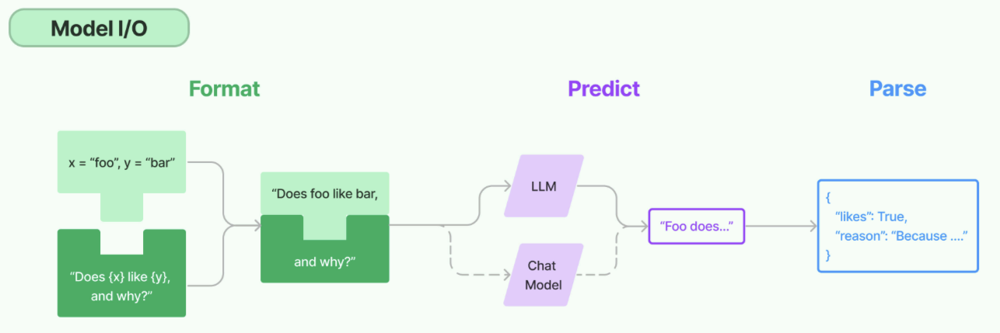

From a learning path perspective, it mainly includes three things:

- **Format**: organizing raw input into Prompts or multi-role messages
- **Predict**: calling models from different vendors through a unified interface
- **Parse**: converting natural language output into more stable structured results

Corresponding chapters:

- [Chapter 10: HelloWorld](10-LangChain%E5%BF%AB%E9%80%9F%E4%B8%8A%E6%89%8B%E4%B8%8EHelloWorld.md): first learn how to get the model running
- [Chapter 11: Model I/O](11-Model-I-O%E4%B8%8E%E6%A8%A1%E5%9E%8B%E6%8E%A5%E5%85%A5.md): understand model integration and parameters
- [Chapter 13: Prompts and Message Templates](13-%E6%8F%90%E7%A4%BA%E8%AF%8D%E4%B8%8E%E6%B6%88%E6%81%AF%E6%A8%A1%E6%9D%BF.md): understand Prompt and Message
- [Chapter 14: Output Parsers](14-%E8%BE%93%E5%87%BA%E8%A7%A3%E6%9E%90%E5%99%A8.md): understand structured output

From a real-world development perspective, **Model I/O is the foundational layer for all LangChain learning**. The chains, memory, RAG, and Agents covered later all essentially revolve around "how to better call the model."

### 4.3 Chains: Fixed Workflow Orchestration

The core idea of a **Chain** is simple: string together multiple steps in a fixed order. For example, "user question → prompt template → model invocation → output parsing" is the most basic chain; "retrieve first, then generate" is also a chain; "classify first, then branch to different paths" is still a chain.

The reason LangChain was originally named LangChain is that its most famous capability was precisely "stringing these steps together." Today, although many legacy high-level Chain classes are no longer the protagonists, **chained thinking remains a foundational capability of LangChain**.

You need to focus on distinguishing two concepts:

- **Fixed workflow**: better suited for Chain / LCEL
- **Dynamic decision-making workflow**: better suited for Agent / Graph

In other words, if your business process is deterministic, for example:

- First extract keywords, then query a database, then summarize
- First clean the input, then classify, then produce structured output
- First recognize intent, then invoke a specific processing chain

Such workflows should generally prioritize **Chain / LCEL**, because it is more stable, controllable, and easier to debug.

Corresponding chapter:

- [Chapter 15: LCEL and Chain Invocation](15-LCEL%E4%B8%8E%E9%93%BE%E5%BC%8F%E8%B0%83%E7%94%A8.md)

### 4.4 Memory: Memory and Contextual State

**Memory** refers to how an application "remembers" what has happened in the past. Note that "memory" here does not mean making the model smarter, but rather enabling the system to retain necessary context across multiple rounds of interaction, such as conversation history, user preferences, session state, and intermediate results.

A common beginner mistake is to conflate **Memory** with **RAG**, but in fact they focus on different things:

- **Memory**: more about "what happened in this session and what this user has said before"
- **RAG**: more about "what the system retrieved from external knowledge bases"

Here is an example from a real project:

- In the previous turn, the user said, "I run a Taobao store."
- In the current turn, the user asks, "So is my refund rate high?"

If the system has no memory, it will not know which store or context "that" refers to.  
In this case, Memory is needed to save conversation history or user state, rather than performing document retrieval from a knowledge base.

In the official current context, memory is usually divided into **Short-term Memory** and **Long-term Memory**. In this tutorial, you will first learn the most common conversation history management, and then move on to more practical approaches such as Redis persistence.

Corresponding chapter:

- [Chapter 16: Memory and Conversation History (including Redis Basics)](16-%E8%AE%B0%E5%BF%86%E4%B8%8E%E5%AF%B9%E8%AF%9D%E5%8E%86%E5%8F%B2%EF%BC%88%E5%90%ABRedis%E5%9F%BA%E7%A1%80%EF%BC%89.md)

### 4.5 Retrieval: Retrieval and RAG

The **Retrieval** module addresses the question of "where does knowledge that the model does not have come from." It is a core component of RAG, responsible for retrieving information relevant to the current question from external knowledge sources, then handing the retrieval results to the model to assist in generating an answer.


You can first break this area down into two stages:

1. **Indexing stage**: load documents, split them, vectorize them, and store them in a vector store.
2. **Query stage**: when the user asks a question, first retrieve relevant chunks, then hand them to the model to generate an answer.

This is also why learning RAG usually does not stop at a single Retriever, but instead connects the entire pipeline:

- Document Loaders
- Text Splitters
- Embeddings
- Vector Stores
- Retrievers
- Final generation

Corresponding chapters:

- [Chapter 18: Vector Databases and Embeddings in Practice](18-%E5%90%91%E9%87%8F%E6%95%B0%E6%8D%AE%E5%BA%93%E4%B8%8EEmbedding%E5%AE%9E%E6%88%98.md)
- [Chapter 19: RAG Retrieval-Augmented Generation](19-RAG%E6%A3%80%E7%B4%A2%E5%A2%9E%E5%BC%BA%E7%94%9F%E6%88%90.md)

And you can already see many concrete examples in the source code directory, such as:

- TXT / Markdown / JSON / CSV / PDF / Word document loading
- Text splitting
- Redis vector storage
- RAG question-answering pipeline

This also illustrates one point: **RAG is not a single-point API, but a complete engineering pipeline.**

### 4.6 Tools/Agents: Making the Model Not Just "Articulate" but Also "Capable"

If RAG enables the model to "look things up," then **Tools and Agents** further enable the model to "do things."

#### 4.6.1 What Is a Tool

A **Tool** is essentially an external capability that can be invoked by the model. It can be: querying the weather, accessing a database, calling an internal company API, sending an email, looking up orders, performing numerical calculations, or querying a search engine. In other words, a Tool is responsible for connecting the "language world" to the "action world."

#### 4.6.2 What Is an Agent

An **Agent** adds another layer on top of Tools: it does not simply execute fixed steps, but instead lets the model autonomously decide "what to do next" based on the current task. For example: first decide whether the weather needs to be checked; if so, call the weather tool; after seeing the result, decide whether it needs to ask the user further; and finally compose the final reply.

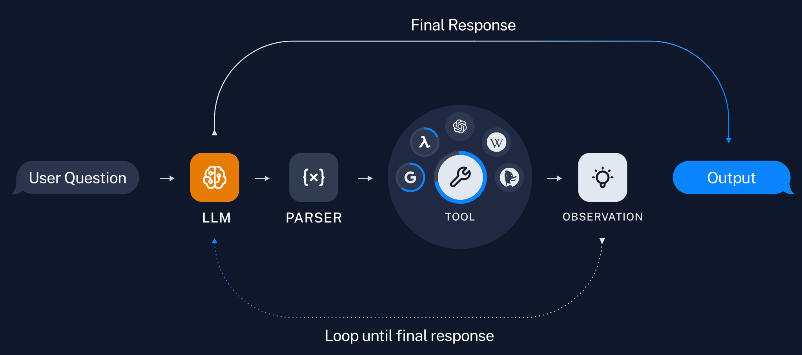

In the official 1.x context, **LangChain Agents are explicitly built on top of the LangGraph runtime**. This means that even if you only call `create_agent`, the underlying logic is no longer just a loose "tool loop," but graph-based runtime logic with state, nodes, transitions, and persistence capabilities.

Therefore, the distinction can be made as follows:

| Scenario                               | More suitable for |
| ---------------------------------- | ------------ |
| Fixed steps with a clear sequence   | Chain / LCEL |
| Model needs to make dynamic decisions | Agent        |
| Needs stronger state control, loops, branching, or human review | LangGraph    |

Corresponding chapters and examples:

- [Chapter 17 Tools: Tool Invocation](17-Tools%E5%B7%A5%E5%85%B7%E8%B0%83%E7%94%A8.md)
- [Chapter 21 Agents: Intelligent Agents](21-Agent%E6%99%BA%E8%83%BD%E4%BD%93.md)

### 4.7 Callbacks: Logging, Debugging, and Observability

In many older materials, you will see **Callback** listed as one of the six core LangChain modules. This framing still has pedagogical value, because it reminds you that **a usable AI application must not only "run," but also "let you see how it runs."**

In the older context, Callback was more like a "runtime hook":

- Record model inputs and outputs
- Track latency and token usage
- Print intermediate steps
- Trace tool invocations
- Report logs and monitoring data

Today, the official emphasis is more on the complete observability stack of **LangSmith + Tracing + Evaluation**. In other words, the idea behind Callback still exists, but in engineering practice it is often further embodied in: Tracing; Runtime events; Middleware hooks; LangSmith visual debugging.

This area is critical in real projects. The hardest problems to troubleshoot in AI applications are usually not "program errors," but rather: why did this retrieval miss? Why was the wrong tool invoked? Why did the model misunderstand? Why did this round suddenly cost more? Why do online results differ from local results?

Without observability, many of these problems can only be addressed through guesswork. Therefore, for enterprise projects, **Callbacks / Tracing / LangSmith are not optional add-ons, but a key part of system maintainability.**

### 4.8 Overview of the Six Core Modules

Although the current official documentation navigation no longer strictly uses the old "six core modules overview diagram" to organize content, this diagram is still helpful for building an overall mental model at the introductory stage, so this tutorial continues to keep that view.

The four major areas emphasize the main line of "**Model I/O → Chains → Retrieval → Agents**"; the six core modules add **Memory** and **Callbacks**, giving you a more complete system perspective.

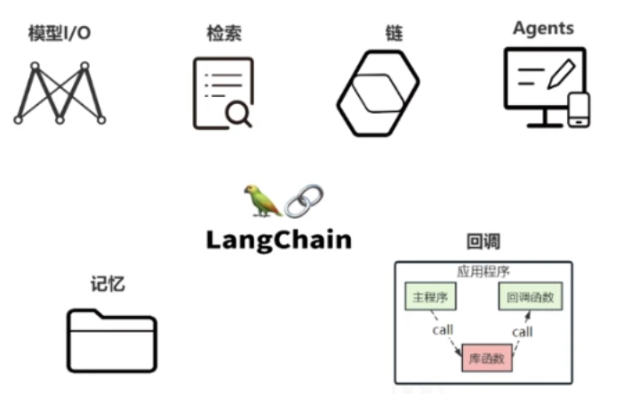

> **Note**: This diagram is a "teaching view," suitable for building a global sense at the entry stage. In the official 1.x documentation, you will see these capabilities split into more granular sections such as Agents, Models, Messages, Tools, Memory, Retrieval, Streaming, Structured Output, Middleware, Runtime, and LangSmith. The two are not in conflict; rather, the difference is between a "coarse-grained overview diagram" and a "fine-grained productized view."

These six modules can be re-mapped as follows:

- **Models**: model and model invocation, corresponding to this tutorial's Model I/O and model integration
- **Memory**: conversation history, session state, long-term memory
- **Retrieval**: document loading, splitting, vectorization, retrieval, RAG
- **Chains**: fixed process composition, LCEL, Runnable
- **Agents**: tool invocation, autonomous decision-making, multi-step tasks
- **Callbacks**: logging, Tracing, debugging, monitoring, evaluation

The following diagram expands these modules further:

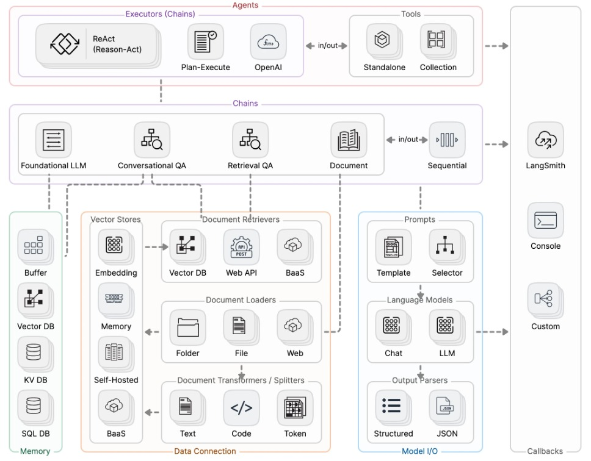

**What the dashed lines represent**: In the diagram, dashed lines represent **data flow or dependency relationships** - for example, chains use Memory and Data Connection, and invoke models through Model I/O; Document Loaders produce output for Transformers/Splitters, which then feeds into Vector Stores; Document Retrievers query from Vector Stores. By reading the dashed lines you can see "who uses whom and how data flows."

| Area in the diagram             | Corresponding capability                   | How to understand it                                     | What the diagram is saying                                                                                                                                                                                                                                                                                                                                                                           |
| -------------------- | ---------------------------- | ------------------------------------------------ | -------------------------------------------------------------------------------------------------------------------------------------------------------------------------------------------------------------------------------------------------------------------------------------------------------------------------------------------------------------------------------------------- |
| **Top (purple)**   | **Agents**                       | Responsible for decision-making, planning, and tool selection; the most "agent-like" part | The top layer is the agent that "makes decisions and selects actions." Below it hang two categories: **Executors** - such as ReAct (reason then act), Plan-Execute (plan then execute), OpenAI, etc.; **Tools** - Standalone single tools, Collection tool sets. The in/out arrows indicate that tools can receive input and return output.                              |
| **Upper middle (pink)** | **Chains**               | Responsible for stringing fixed steps together; the stable process orchestration layer   | Chains are the orchestration that strings together "model invocation, document querying, and multi-step processes." The diagram includes: Foundational LLM (directly calling the base model), Conversational QA (Q&A with conversational memory), Retrieval QA (retrieve first, then answer, i.e., RAG), Document (document processing), and Sequential (multi-step chains executed in order). Dashed lines connect to LangSmith on the right, indicating that chain execution can be monitored and traced. |
| **Left (green)**     | **Memory**              | Responsible for storing conversation history, user state, and stage-specific context     | Stores "conversation history, session state," etc. The diagram lists: Buffer (simple buffering), Vector DB (stores conversations/context as vectors, enabling semantic retrieval), KV DB, and SQL DB. Chains and agents read from and write to these memories as needed.                                                                                                                     |
| **Middle (orange)**     | **Data Connection** | Responsible for document loading, splitting, vectorization, and retrieval; the foundation of RAG | Responsible for "where data comes from, how it is processed, and where it is stored." Includes: **Vector Stores** (Embedding converts text to vectors → stored in Vector DB / Memory / Self-Hosted / BaaS); **Document Retrievers** (retrieve documents by query from Vector DB, Web API, or BaaS); **Document Loaders** (load raw data from Folder, File, or Web); **Document Transformers/Splitters** (split and transform documents, e.g., by Text/Code/Token chunks). Both "database building" and "retrieval" in RAG happen here. |
| **Lower right (blue)** | **Model I/O**   | Responsible for Prompt, model invocation, and output parsing                | Related to "how to invoke the large language model": **Prompts** (Template templates, Selector dynamic prompt selection); **Language Models** (Chat conversation models, LLM general models); **Output Parsers** (convert model output into structured formats such as Structured, JSON). Chains and agents connect "prompt → model → parsed result" through here.                              |
| **Far right (gray)**   | **Callbacks**           | Responsible for logging, tracing, debugging, and monitoring              | "Steps in" during chain/agent execution to perform logging, monitoring, and debugging. The diagram shows: LangSmith (official debugging and monitoring platform), Console (console output), Custom (custom callbacks). Dashed lines indicate that these callbacks can be attached to chains, models, and other stages.                                                    |

The purpose of this diagram is not to have you memorize every box, but to help you build an intuition:

> **LangChain does not do just one thing; it strings together originally separate stages such as "model invocation, knowledge integration, process orchestration, state management, tool execution, and debugging/tracing" into an engineering system.**

### 4.9 How to Remember This Framework

If after reading this you still feel there are too many concepts, you can simply remember this set of mnemonics:

- **If you want to invoke the model**: first learn **Model I/O**
- **If you want to string fixed steps together**: learn **Chain / LCEL**
- **If you want the system to remember context**: learn **Memory**
- **If you want the model to access external knowledge**: learn **Retrieval / RAG**
- **If you want the model to invoke tools and perform multi-step tasks**: learn **Tools / Agents**
- **If you want to know why the system answered the way it did**: learn **Callbacks / Tracing / LangSmith**

---

**Chapter reflection questions:**

1. If you were not allowed to use the word "framework," how would you explain to a newcomer what LangChain does in an application?

   **Suggested approach:** You could say it is a layer of code tooling that organizes models, prompts, output parsing, knowledge retrieval, tools, memory, and tracing. It does not provide model parameters; instead, it helps you connect the model into business processes.

2. Why is it necessary to understand 1.x, provider packages, and LangGraph at the same time when learning LangChain?

   **Suggested approach:** 1.x is the current main line, provider packages handle specific model integration, and LangGraph handles the underlying orchestration of complex processes and Agents. If you only look at the old chain-style API, you will not be able to understand current project structures and official recommended paths.

3. Among the six core modules, which minimal closed loop would you start with first? Why?

   **Suggested approach:** Usually you would start with Model I/O, Prompt, and Parser to form the minimal closed loop of `prompt | model | parser`. Once you can reliably handle input, invocation, and parsing, you can then expand to RAG, Tools, Memory, Agents, and observability.

4. When is it unnecessary to introduce LangChain, and using the model SDK directly would actually be more appropriate?

   **Suggested approach:** If it is only a simple model call, with no complex orchestration, no multi-model switching, and no retrieval or tool chains, the native SDK may be lighter. The value of a framework only becomes evident once complexity increases.

**Chapter summary:**

- **LangChain** is not the large language model itself, but an open-source framework that sits in the "**service / orchestration layer**" of AI application architecture. Its core role is to organize models, Prompts, knowledge, tools, memory, output parsing, and debugging capabilities into a maintainable application system. Its relationship with **Coze / Dify** is not one of replacement, but of different divisions of labor: the former leans toward a code framework, while the latter leans toward a low-code platform. In real projects, it is common to first validate with a platform and then implement with a framework.
- At this stage, learning LangChain should center on the **1.x official documentation**. It is important to understand that: the `langchain` main package has been streamlined, and many older capabilities have been migrated to `langchain-classic`; Agent uses `create_agent` as the high-level entry point, with the underlying layer built on **LangGraph**; integration capabilities are extended through separate provider packages such as `langchain-openai` and `langchain-ollama`.
- In the introductory phase, the most important thing is not to memorize all the APIs at the beginning, but to first establish the **six cognitive maps**: **Model I/O, Chains, Memory, Retrieval, Tools / Agents, Callbacks**. The subsequent chapters will unfold piece by piece according to this map, and corresponding case source code has already been prepared in the project directory.

**Suggested next step:** Go directly to [Chapter 10 LangChain Quick Start and HelloWorld](10-LangChain%E5%BF%AB%E9%80%9F%E4%B8%8A%E6%89%8B%E4%B8%8EHelloWorld.md), and first get **API Key, model name, Base URL, HelloWorld invocation, multi-model coexistence, enterprise-level encapsulation, and streaming output** working. Once you have truly written your first LangChain invocation, come back and review the "positioning, architecture, and modules" in this chapter, and your understanding will be noticeably more solid.
