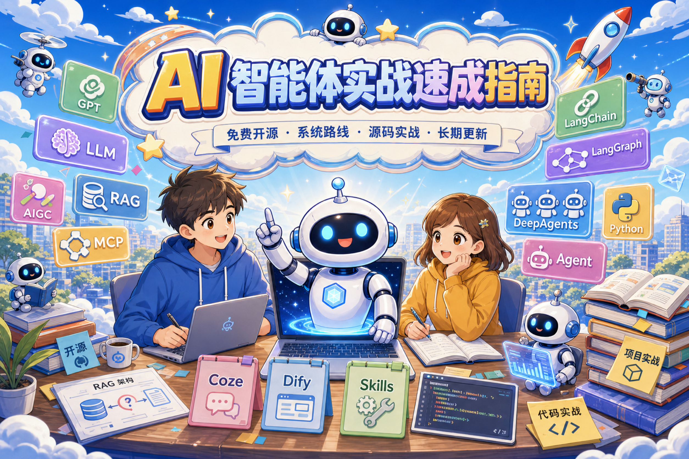
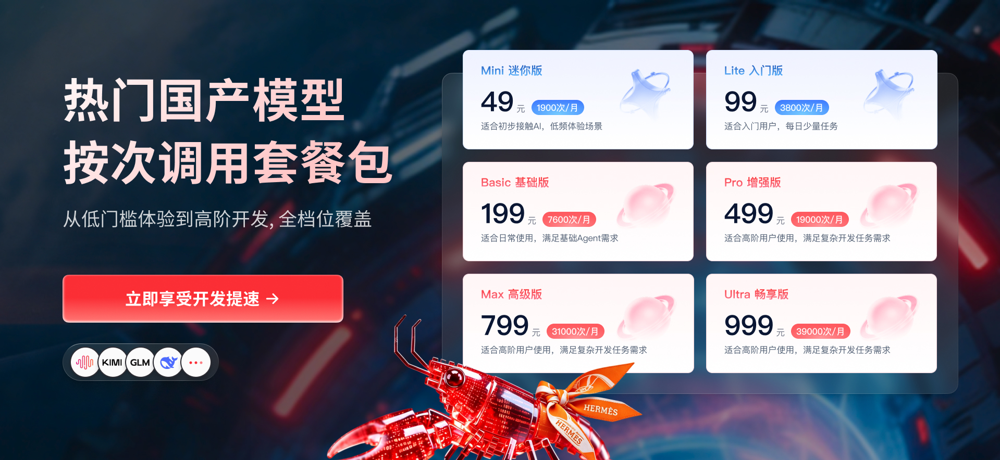

<div align='center'>
  
  <h1 style="margin-top: 15px;">🚀 The Most Systematic AI Agent Hands-on Crash Course on the Internet (From Zero to Enterprise Deployment)</h1>
  <h4><b>ai-agents-from-zero</b></h4>
  <p><em>Continuously updated through 2026 · Aiming to build the <b>"strongest on Earth"</b> AI Agent tutorial —— <b>systematic tutorials + runnable source code + interview question bank + enterprise-level hands-on projects + long-term tech stack updates</b>, a one-stop learning path fully aligned with the <b>training curriculum</b> and <b>job descriptions</b> for "AI Agent / LLM Application Development Engineer"</em></p>
</div>

<div align="center">

<!-- language-switch:start -->

[简体中文](../../README.md) · **English**

<!-- language-switch:end -->


[](https://github.com/didilili/ai-agents-from-zero/)
[](https://didilili.github.io/ai-agents-from-zero/#/)

[Quick Start](#quick-start) • [Tutorial Outline](%E6%95%99%E7%A8%8B%E7%9B%AE%E5%BD%95%E5%A4%A7%E7%BA%B2.md) • [Changelog](%E6%95%99%E7%A8%8B%E6%9B%B4%E6%96%B0%E6%97%A5%E5%BF%97.md) • [Interview Question Bank](AI%E6%99%BA%E8%83%BD%E4%BD%93%E4%B8%8E%E5%A4%A7%E6%A8%A1%E5%9E%8B%E5%BA%94%E7%94%A8%E5%BC%80%E5%8F%91%E9%9D%A2%E8%AF%95%E9%A2%98%E5%BA%93.md) • [Join the Community](#community)

  <p>
    <a href="https://didilili.github.io/ai-agents-from-zero/#/">📚 Read Online</a>
  </p>

</div>

**📢 Update Notes**: **AI never stops, and updates never stop**. This repository will continue to evolve alongside the **AI LLM tech stack**, committed to **open source, systematic, and long-term updates**. Models, frameworks, Agents, and hands-on projects will all be continuously refined and upgraded as the ecosystem changes. It's not just about getting you started — it's about growing with you, from zero foundation to real deployment.

Currently, the **Concepts** section has been fully updated, and two complete hands-on projects have also been updated: `NL2SQL + LangGraph` hands-on project [Shopkeeper Data Q&A](%E5%AE%9E%E6%88%98%E9%A1%B9%E7%9B%AE-%E7%94%B5%E5%95%86%E9%97%AE%E6%95%B0/0-%E5%89%8D%E8%A8%80.md) ([source code repository](https://github.com/didilili/shopkeeper-agent)) was completed on May 3. `DeepAgents` multi-agent hands-on project [Deep Research](%E5%AE%9E%E6%88%98%E9%A1%B9%E7%9B%AE-%E6%B7%B1%E5%BA%A6%E7%A0%94%E6%90%9C/0-%E5%89%8D%E8%A8%80.md) ([source code repository](https://github.com/didilili/deepsearch-agents)) was completed on May 17. You can check the [Changelog](%E6%95%99%E7%A8%8B%E6%9B%B4%E6%96%B0%E6%97%A5%E5%BF%97.md) for the latest repository updates.

There is a lot of AI LLM application content on the market, but most of it consists of fragmented posts and paid bootcamps. This repository is designed so you can systematically enter LLM application development without spending thousands or even tens of thousands upfront. If it helps you, please **Star** ⭐~

---

## 🤝 Project Sponsorship

<table>
<tr>
<td width="220" align="center" valign="middle">
  <a href="https://passport.compshare.cn/register?referral_code=KyLCDhVe3j5E9o1XBWmIku&ytag=GPU_YY_YX_git_ai-agents-from-zero">
    
  </a>
  <br>
  <sub>Top Choice for Cost-Effective Agent Plans</sub>
</td>
<td valign="middle">

Thanks to <a href="https://www.compshare.cn/coding-plan"><strong>Compshare</strong></a> for sponsoring this project! Compshare is an AI cloud platform under UCloud. It offers cost-effective domestic model Agent Plan packages on a monthly or per-use basis, starting from as low as 49 yuan/month; it also provides officially relayed stable overseas models, supports integration with Claude Code, Codex, and API calls, and offers high-concurrency, 7\*24 technical support and self-service invoicing for enterprises.

🎁 Users who register through <a href="https://passport.compshare.cn/register?referral_code=KyLCDhVe3j5E9o1XBWmIku&ytag=GPU_YY_YX_git_ai-agents-from-zero"><strong>this link</strong></a> will receive a free 5 yuan platform trial credit.

</td>
</tr>
</table>

---

## ✨ Tutorial Highlights

- **🌱 The first systematic open-source AI Agent tutorial on the internet**: This is a long-term maintained roadmap for AI LLM application development. The market is not short of scattered posts or paid bootcamps, but truly systematic, continuously updated AI LLM application tutorials that cover **tutorials + source code + hands-on projects + interview question banks** are extremely rare. What this repository aims to do is make this path public, deep, and complete, accompanying you from beginner, to advanced, to project practice.
- **🧭 One line that connects the full stack of LLM applications**: From LLMs and prompts, to low-code (Coze/Dify) and code frameworks (LangChain/LangGraph), to enterprise-level RAG/Agent, fine-tuning, and engineering standards — organized uniformly by knowledge system, forming a **complete chain** closed loop, suitable for systematic mastery rather than fragmented bookmarking.
- **🐍 Focused on the Python ecosystem, hitting Agent engineering directly**: Many courses revolve around **Spring AI** and **langchain4j**, which lean more toward the Java tech stack. This tutorial's main line focuses on **Python + LangChain + LangGraph**, directly aligned with the most commonly used engineering path for AI Agent / LLM application development today.
- **📘 Accessible for beginners, deep enough for engineers**: The entire tutorial is organized in a **progressive** manner, first thoroughly explaining core concepts like LLMs, Agents, RAG, MCP, and Tool Calling, then moving into source code, frameworks, deployment, and project design. Less mysticism and jargon, more "why it's designed this way, how the code runs, how the project is deployed".
- **💼 Enterprise-level practice, benchmarked for "getting work done"**: Centered on Shopkeeper Data Q&A, Deep Research, Shopkeeper Knowledge Base, E-commerce Assistant, and more, connecting intent parsing, multi-source knowledge, human handoff, review, and monitoring; putting **multi-route retrieval, evaluation, observability, cost, and guardrails** into real-world contexts for practice. Writing resumes and discussing projects will have substance rather than being vague.
- **✅ Every case is benchmarked on "it actually runs"**: Not just explaining concepts or pasting pseudo-code, but providing **runnable cases, source code, environment instructions, and common troubleshooting** as much as possible. Case content is organized based on manually verified workflows, helping you avoid pitfalls and get up to speed quickly.
- **📚 Tutorials, source code, and interviews — a trinity that actually works**: Not just "read it", but also "run it" and "answer it" — **runnable cases and source code**, **prompt templates**, and deployment approaches, rejecting "concepts only". The interview question bank breaks down questions by common competency domains from **training classes and JDs**, with a considerable portion of questions compiled from **real interview questions at major companies**, public interview experiences, and high-frequency follow-up scenarios, suitable for career changers and new graduates to review intensively.
- **🚀 Geared toward 2026, continuously evolving and hardcore**: The tech stack and high-frequency question styles will iterate with the ecosystem, aligned with the dimensional structure of ten-thousand-yuan-level training curricula for "AI Application Development Engineer"; it tells you not only "what to learn" but also "how to do projects, how to present projects, how to answer interviews". If useful, **Star is a tip ⭐**.

---

## 🛠 Tech Stack Overview

| Category             | Technology/Platform                                   | Description                                                                             |
| ---------------- | ------------------------------------------- | -------------------------------------------------------------------------------- |
| **LLMs and Foundations** | LLM, Transformer, MoE, Self-Attention             | LLaMA/Qwen/GPT, multimodal, pre-training/fine-tuning/inference                                         |
| **Prompting and Orchestration**   | Prompt Engineering, Tool Calling, Skills            | Multi-turn dialogue, message templates, structured output, tool invocation, skill-based capability accumulation                         |
| **Low-code Platforms**   | Coze, Dify                          | Workflows, Agents, knowledge bases, plugins, Python invocation and localized deployment                             |
| **Development Frameworks**     | LangChain, LangGraph, DeepAgents            | Model I/O, Runnable / LCEL, Memory, Tools, Agents, graph-based workflows, multi-agent          |
| **Protocols and Communication**   | MCP (Model Context Protocol), A2A          | Function Calling, service decoupling, external tool integration, cross-Agent collaboration                          |
| **RAG and Retrieval**   | Vector databases, sparse retrieval, hybrid retrieval, BGE-Rerank  | Multi-route retrieval, reranking, knowledge graphs, RAGAS evaluation, advanced RAG optimization                            |
| **Documents and Multimodal** | MinerU, OCR                                 | Mixed text-image PDF parsing, device manuals and after-sales guides                                            |
| **Deployment and Operations**   | Docker, Ollama, Xinference, vLLM            | Tencent Cloud/Alibaba Cloud, AutoDL, Coze local deployment                                             |
| **Fine-tuning and Training**   | PEFT, LoRA, QLoRA, DeepSpeed, Llama-Factory | Alpaca/ShareGPT data formats, Safetensors, keyword evaluation                                |
| **Programming and Tools**   | Python; Codex, Cursor                       | Main language is Python; covers AI programming tools, Agent Skills, multi-model APIs, MCP integration and debugging      |
| **Job Search and Interviews**   | Interview Question Bank                                    | Organized by role competency domains **questions + answers**; aligned with similar **online training completion capabilities** and **high-frequency JD exam points** |

---

## 🎯 What Will You Gain After Completing It?

- **Deployable project capabilities**, able to independently deliver AI Agent applications (from environment to deployment), advancing from "only calling APIs" to practical engineering implementation.
- **Systematic architecture expression**, able to clearly explain the design and trade-offs of RAG, Agents, MCP, etc., and withstand follow-up questions in interviews and on resumes.
- **Aligned with interviews and JDs**, standalone [Interview Question Bank](AI%E6%99%BA%E8%83%BD%E4%BD%93%E4%B8%8E%E5%A4%A7%E6%A8%A1%E5%9E%8B%E5%BA%94%E7%94%A8%E5%BC%80%E5%8F%91%E9%9D%A2%E8%AF%95%E9%A2%98%E5%BA%93.md), cross-linked with question numbers in the main text, organized by role competency domains in question-and-answer format, suitable for new graduates and career changers to organize their talking points.
- **Engineering and resume material**, enterprise-oriented cases and expressions around multi-route retrieval, observability, cost, etc., with projects that are demonstrable and can be written into resumes.
- **Searchable knowledge map**, systematic table of contents + case source code, aligned with common "Agent / Application Development" curriculum dimensions, convenient for cross-referencing gaps and avoiding the pitfall of "only read articles but never ran anything".
- **Clear role benchmarking**, qualified for AI Application Development Engineer, AI Agent Engineer, AI Automation Process Development, and AI Product Technical Lead roles; especially suitable for frontend / backend / product backgrounds transitioning into AI and Agent development.

---

## 📚 Tutorial Outline (Excerpt)

For the complete navigation, see **[Tutorial Table of Contents](%E6%95%99%E7%A8%8B%E7%9B%AE%E5%BD%95%E5%A4%A7%E7%BA%B2.md)** and the [Online Documentation](https://didilili.github.io/ai-agents-from-zero/#/).

> This outline is not a fixed table of contents. It will continue to evolve with the AI tech stack, and new core knowledge points, new frameworks, and new project practices will continue to be incorporated into this path.

### 01 LLM Foundation Capability Building

| Chapter Name                    | Content Summary                                                                         |
| --------------------------- | -------------------------------------------------------------------------------- |
| Understanding LLMs and Environment Setup | Origins and development, AGI relationship, mainstream model characteristics and applicable scenarios, pre-training/fine-tuning/inference                   |
| LLM Architecture Principles              | Transformer, MoE, Self-Attention, LLaMA/Qwen/GPT, multimodal                               |
| LLM Scheduling Platforms              | Ollama, private LLM invocation, cloud/local deployment (AWS, Alibaba Cloud, etc.)                           |
| Prompt Engineering                  | Core principles and structure, Chain-of-Thought and Few-shot, multi-turn dialogue and memory, applications in Agent and tool invocation |

### 02 Enterprise Low-code Platform Development and Project Practice

| Chapter Name                  | Content Summary                                                                           |
| ------------------------- | ---------------------------------------------------------------------------------- |
| Coze Platform          | Interface and features, plugins/knowledge base/workflows/agents, calling workflows from Python                           |
| Project 1: Merchant Operations Assistant      | Industry research PPT, viral video replication, marketing posters, selling point extraction, review analysis                           |
| Dify AI Platform              | Workflows/Agents/knowledge base, multiple cases (complaint classification, research reports, customer service analysis, review analysis), calling from Python |
| Containerization Technology                | Docker core concepts, installation and common commands                                                    |
| Enterprise LLM Deployment          | Tencent Cloud/Alibaba Cloud, Docker, Dify, AutoDL, Ollama, Xinference, local Coze deployment             |
| AI Code Programming Tool - Trae AI | Installation and usage, multi-model APIs, MCP integration                                                     |
| AI Code Programming Tool - Qoder   | Usage and debugging, project development                                                               |

### 03 Core LLM Development Frameworks

| Chapter Name                 | Content Summary                                                                    |
| ------------------------ | --------------------------------------------------------------------------- |
| LangChain Framework Principles and Applications | Model I/O, Prompt, Parser, Runnable / LCEL, Memory, Tools, Retrieval, Agent |
| LangGraph Framework Principles and Applications | Graph-based thinking, State/Node/Edge, persistent memory, streaming output, multi-agent and A2A             |
| MCP from Principles to Practice         | Comparison with Function Calling, communication mechanism, workflow, Server deployment and custom development       |
| Cross-Agent Communication: A2A Protocol  | Relationship with MCP, messages and authentication, typical scenarios                                           |

### 04 Enterprise RAG / Agent Project Practice

| Chapter Name                                | Content Summary                                                                                                                                                                               |
| --------------------------------------- | -------------------------------------------------------------------------------------------------------------------------------------------------------------------------------------- |
| Shopkeeper Knowledge Base                                | LangGraph RAG workflow, MinerU/OCR, vector + sparse + Neo4j multi-route retrieval, HyDE/BGE-Rerank, RAGAS evaluation                                                                                                |
| E-commerce Assistant                                | Intent parsing, multi-source knowledge bases, streaming replies, human handoff mechanism, conversation review, multi-channel and monitoring                                                                                                                     |
| [Shopkeeper Data Q&A](%E5%AE%9E%E6%88%98%E9%A1%B9%E7%9B%AE-%E7%94%B5%E5%95%86%E9%97%AE%E6%95%B0/0-%E5%89%8D%E8%A8%80.md) | Around natural language data Q&A, fully connects MySQL data warehouse, metadata knowledge base, Qdrant vector retrieval, Elasticsearch field value retrieval, LangGraph workflow, SQL generation/validation/execution, FastAPI SSE, and frontend-backend integration                           |
| [Deep Research](%E5%AE%9E%E6%88%98%E9%A1%B9%E7%9B%AE-%E6%B7%B1%E5%BA%A6%E7%A0%94%E6%90%9C/0-%E5%89%8D%E8%A8%80.md) | Multi-agent research system built on [DeepAgents](%E5%AE%9E%E6%88%98%E9%A1%B9%E7%9B%AE-%E6%B7%B1%E5%BA%A6%E7%A0%94%E6%90%9C/1-DeepAgents%E5%9F%BA%E7%A1%80%E4%B8%8E%E6%A0%B8%E5%BF%83%E6%A6%82%E5%BF%B5.md), connecting web search, MySQL queries, RAGFlow knowledge base, file reading and generation, FastAPI APIs, and WebSocket real-time progress reporting |
| Market Compass                                | Scenario-based task breakdown, design and development from 0 to 1, phase goals and progress control, code review and result showcase                                                                                                           |

> **Recommended Completed Projects:**
>
> - [Shopkeeper Data Q&A](%E5%AE%9E%E6%88%98%E9%A1%B9%E7%9B%AE-%E7%94%B5%E5%95%86%E9%97%AE%E6%95%B0/0-%E5%89%8D%E8%A8%80.md)（[Source Repository](https://github.com/didilili/shopkeeper-agent)）: Not a simple SQL generation demo, but integrates `MySQL`, `LangGraph`, `Qdrant`, `Elasticsearch`, `FastAPI` and other knowledge points into a single runnable intelligent data Q&A pipeline.
> - [Deep Research](%E5%AE%9E%E6%88%98%E9%A1%B9%E7%9B%AE-%E6%B7%B1%E5%BA%A6%E7%A0%94%E6%90%9C/0-%E5%89%8D%E8%A8%80.md)（[Source Repository](https://github.com/didilili/deepsearch-agents)）: Not an ordinary chatbox, but builds a complete closed loop around open research tasks, including main agent orchestration, sub-agent division of labor, multi-source data retrieval, file generation and delivery, and real-time frontend-backend interaction.

### 05 LLM Fine-Tuning Practice

| Chapter                                                               | Content Summary                                                  |
| ------------------------------------------------------------------ | --------------------------------------------------------- |
| [28 Fine-Tuning Overview](28-%E5%A4%A7%E6%A8%A1%E5%9E%8B%E5%BE%AE%E8%B0%83%E6%A6%82%E8%BF%B0%E4%B8%8E%E6%95%B4%E4%BD%93%E6%B5%81%E7%A8%8B.md)                      | Problem diagnosis, model types, baseline and keyword project workflow                  |
| [29 Data and Templates](29-%E5%BE%AE%E8%B0%83%E6%95%B0%E6%8D%AE%E5%87%86%E5%A4%87%E4%B8%8E%E5%AF%B9%E8%AF%9D%E6%A8%A1%E6%9D%BF.md)                      | Real JSONL, sample quality, cleaning/splitting, and conversation templates                  |
| [30 Training and Efficient Fine-Tuning](30-%E6%A8%A1%E5%9E%8B%E8%AE%AD%E7%BB%83%E5%8E%9F%E7%90%86%E4%B8%8E%E9%AB%98%E6%95%88%E5%BE%AE%E8%B0%83.md)                  | Training parameters, VRAM calculation examples, LoRA and QLoRA                         |
| [31 LLaMA-Factory Fine-Tuning Practice](31-LLaMA-Factory%E7%8E%AF%E5%A2%83%E6%90%AD%E5%BB%BA%E4%B8%8E%E5%BE%AE%E8%B0%83%E5%AE%9E%E6%88%98.md) | AutoDL single GPU / FP16, cleaned data training, logs and backups                |
| [32 Fine-Tuning Evaluation and Model Deployment](32-%E5%BE%AE%E8%B0%83%E6%95%88%E6%9E%9C%E8%AF%84%E4%BC%B0%E4%B8%8E%E6%A8%A1%E5%9E%8B%E9%83%A8%E7%BD%B2.md)          | Single-example validation, 200-example two-group prediction and scoring, export and independent loading; vLLM optional |
| [33 Fine-Tuning VRAM Optimization and Multi-GPU Training](33-%E5%BE%AE%E8%B0%83%E6%98%BE%E5%AD%98%E4%BC%98%E5%8C%96%E4%B8%8E%E5%A4%9A%E5%8D%A1%E8%AE%AD%E7%BB%83.md)          | Single-GPU VRAM troubleshooting, parallel task division, ZeRO and sprint log analysis               |

### 06 Enterprise Development Standards

| Chapter Name           | Content Summary                                                              |
| ------------------ | --------------------------------------------------------------------- |
| Enterprise LLM R&D Process | Technical research, solution and framework design, RAG and pipeline, evaluation and roles, project initiation and requirements documents |
| Current LLM Hot Topics     | Mainstream Agent/RAG technologies, frontier and hot topic tracking                                    |

---

## 🏗️ Agent Project Architecture and Technical Architecture


---

<a id="quick-start"></a>

## 🚀 Quick Start

Study together with the [online documentation](https://didilili.github.io/ai-agents-from-zero/#/). Want to run a case right away? Follow these steps. For more detailed environment setup, API applications, and common error handling, see [Getting Started and FAQ](%E6%96%B0%E6%89%8B%E5%85%A5%E9%97%A8%E4%B8%8E%E5%B8%B8%E8%A7%81%E9%97%AE%E9%A2%98.md).

1. **Clone the repository and enter the project directory**

   ```bash
   git clone https://github.com/didilili/ai-agents-from-zero.git
   cd ai-agents-from-zero
   ```

2. **Prepare the environment** (Python 3.10 recommended, supports 3.10–3.13)

   ```bash
   python3.10 -m venv .venv
   source .venv/bin/activate          # macOS/Linux
   # .venv\Scripts\activate           # Windows CMD
   pip install -r requirements.txt
   ```

3. **Configure API Keys**
   - Copy `.env-example` from the root directory to `.env`
   - Fill in your API keys in `.env` (such as Qwen/Alibaba Bailian, DeepSeek, etc.), and the variable names must match the code (e.g., `aliQwen-api`, `QWEN_API_KEY`, `deepseek-api`)
   - For details on applying for keys from each platform, see [Getting Started and FAQ - How to Apply for API Keys](%E6%96%B0%E6%89%8B%E5%85%A5%E9%97%A8%E4%B8%8E%E5%B8%B8%E8%A7%81%E9%97%AE%E9%A2%98.md#_5、各-api-平台如何申请-key？)

4. **Run your first case in the project root directory**

   ```bash
   python 案例与源码-2-LangChain框架/01-helloworld/StandardDesc.py
   ```

   **Recommendation**: Run `python` in the **project root directory** for unified management of virtual environments, dependencies, and output files. `load_dotenv()` in regular scripts usually automatically searches upward for `.env`; if you are using an IDE, REPL, or debugger and cannot read the keys, check its working directory configuration. If you don't want to use cloud APIs, you can use [Ollama local models](%E6%96%B0%E6%89%8B%E5%85%A5%E9%97%A8%E4%B8%8E%E5%B8%B8%E8%A7%81%E9%97%AE%E9%A2%98.md#_54-不想用云-api：用本地-ollama（无需-key）) (no key required).

If you encounter `ModuleNotFoundError`, API key errors, missing `.env`, etc., see [Getting Started and FAQ - Common Issues and Solutions](%E6%96%B0%E6%89%8B%E5%85%A5%E9%97%A8%E4%B8%8E%E5%B8%B8%E8%A7%81%E9%97%AE%E9%A2%98.md#_6、常见问题与解决).

---

<a id="community"></a>

## 💬 Join the Community

Want to chat with more friends about **AI programming, Vibe Coding, interview experience, or just hang out, shoot the breeze, and complain about your boss**? Welcome to the "**Most Loving AI Agent Community in the Universe — Whimsical Ideas Research Institute**"! 🎉

👉 [Click here! Apply to join](https://github.com/didilili/ai-agents-from-zero/issues/46): Leave a message on the application post and add WeChat as instructed in the post.

May we have a little less anxiety and a little more inspiration here; a little less going it alone and a little more brainstorming together～

---

## 📖 About This Repository

- **Goal**: To create a **truly beginner-friendly, systematic, and continuously updated AI agent practical crash course** that not only explains concepts clearly but also runs cases, taking you from zero to independently building **RAG / Agent / multi-agent** projects and being able to articulate your solutions and projects in engineering terms.
- **Technical Positioning**: Focused on the **Python agent development path**, with emphasis on **LangChain / LangGraph** and related engineering practices, **not following the Java path of Spring AI / langchain4j**, making it more suitable for those who want to directly enter Python LLM application development.
- **Course Source**: References course materials such as the **Shangguigu "LLM Agent Crash Course"**, and on that basis, combined with public documentation, community practices, and project experience, it is continuously **restructured, supplemented, and maintained**, gradually organized into a systematic learning resource for **Python agent application development**.
- **Interview Question Source**: A considerable portion of the question bank is compiled from **real interview questions from major companies**, public interview experiences, and high-frequency follow-up scenarios, and has been restructured in an engineering-oriented way along the main chapters of this repository, making it more suitable for review from a project and system design perspective.
- **Content Structure**: **Systematic chapter notes** + **runnable case source code** + **[Interview Question Bank](AI%E6%99%BA%E8%83%BD%E4%BD%93%E4%B8%8E%E5%A4%A7%E6%A8%A1%E5%9E%8B%E5%BA%94%E7%94%A8%E5%BC%80%E5%8F%91%E9%9D%A2%E8%AF%95%E9%A2%98%E5%BA%93.md)** (benchmarked against **similar online training** and **social/campus recruitment JDs**).

---

## ⭐ Star History


---

**Repository English Name**: `ai-agents-from-zero` · **Repository Chinese Name**: 《AI Agent Practical Crash Guide: From Zero to Enterprise-Level Deployment》
