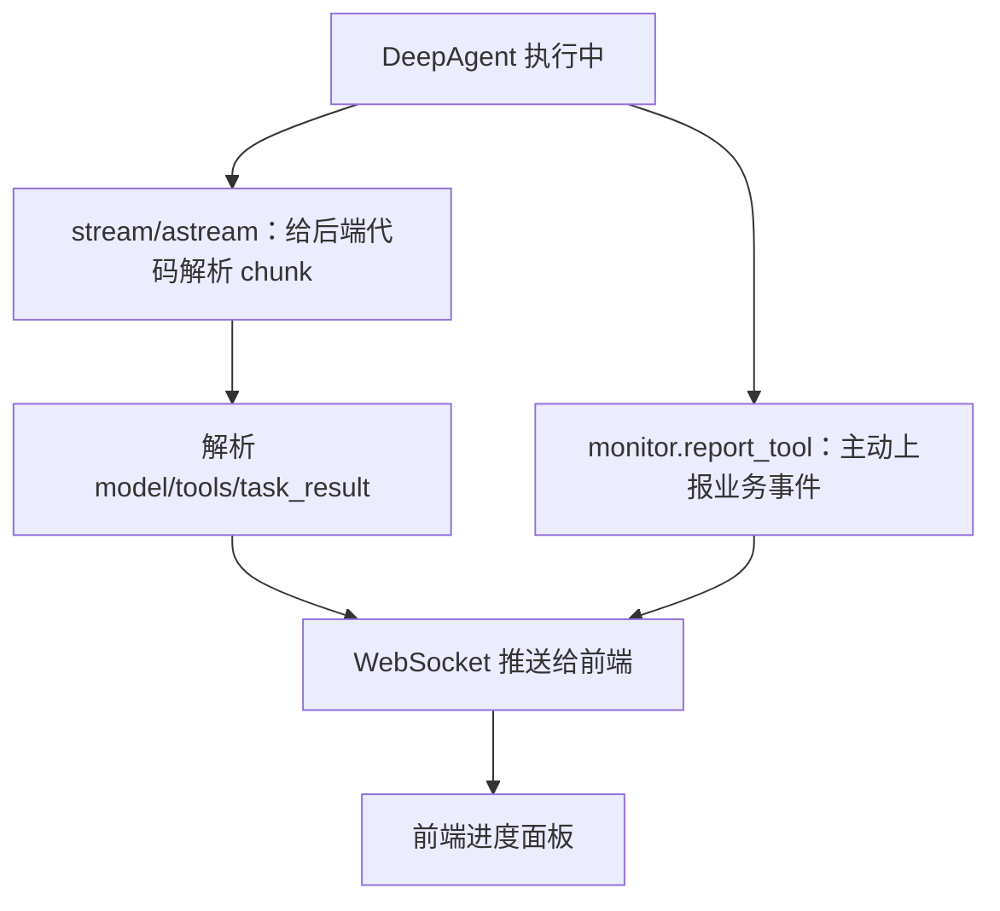
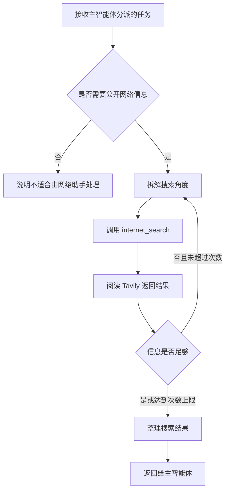

# 10 - Deep Research: Web Search Subagent and the Tavily Tool

---

**Chapter objectives:**

- Understand the three core components of a DeepAgents subagent: description, prompt, and tools.
- Complete the `internet_search` tool wrapper and integrate Tavily search capabilities.
- Understand the two ways to push progress to the frontend: streaming parsing and instrumentation inside the tool.
- Assemble `network_search_agent` so that it becomes an expert assistant that the main agent can dispatch later.

**Study suggestions:** The web search assistant is the best subagent for getting started because it does not involve database schemas or RAGFlow platform hierarchies. When reading this chapter, focus on what actually goes into a subagent dictionary: the name, responsibility description, prompt, and tools. If you can swap Tavily for another search tool and clearly explain what needs to change, then you have fully grasped this chapter.

**Corresponding code branch:** `10-deepsearch-network-subagent`

---

Starting from this chapter, we officially enter the subagent implementation stage. The entire "Deep Research" project will implement three expert assistants in sequence:

| Subagent       | Responsibility                                       | Implemented in this chapter |
| -------------- | ---------------------------------------------------- | --------------------------- |
| Web search assistant | Queries public information and the latest news from the internet | Yes            |
| Database query assistant | Queries structured business data within the enterprise | No, next chapter |
| RAGFlow assistant   | Queries unstructured knowledge base documents within the enterprise | No, later chapters |

The web search assistant is the first subagent to implement. Its underlying tool is simple: it calls Tavily to search public web pages based on keywords.

The focus of this chapter is to master the standard pattern for writing a subagent:

```text
子智能体 = 描述 description + 系统提示词 system_prompt + 工具 tools
```

Once you learn this pattern, writing the database assistant and RAGFlow assistant later will become straightforward: first define the responsibility boundaries clearly, then give it the tools it can use, and finally assemble it into a configuration that the main agent can dispatch.

---

## 1. The three things to write for the web search subagent

Chapter 9 already explained the differences between `name`, `description`, and `system_prompt`. This chapter will not repeat the definitions of these concepts; instead, we will directly look at how they should be written for the web search assistant.

### 1.1 description: Clarify "when to call me"

The `description` of the web search assistant solves the routing problem: after seeing a user task, can the main agent determine whether to delegate the task to it.

For example, if the user asks:

```text
查询 2025 年某医药政策的最新公开信息。
```

This type of question requires external public information and should be delegated to the web search assistant.

But if the user asks:

```text
查询公司数据库里布洛芬的库存。
```

This type of question involves internal business data and should not be delegated to the web search assistant; instead, it should go to the database query assistant.

Therefore, the key point of the description here is not "I can search," but clearly writing the boundaries: **only handle public internet information; do not handle database data or RAGFlow private knowledge base content.**

### 1.2 system_prompt: Clarify "how to search"

`system_prompt` should constrain how the web search assistant executes its own tasks. For this assistant, the two most important things are: the search must have sufficient coverage, and the number of searches must have an upper limit.

| Constraint                | Purpose                                       |
| ------------------------- | --------------------------------------------- |
| Search from at least 3 angles | Avoid ending after searching only one keyword |
| Search at most 5 times       | Avoid infinite tool calls that cause a dead loop |

Putting these two constraints in the prompt is more reliable than just writing "please search carefully." The former can remind the model to change keywords and search from different angles, while the latter can prevent it from repeatedly calling the tool when the results are unsatisfactory.

### 1.3 tools: Integrate real search capability

`description` and `system_prompt` only tell the model "whether to do it" and "how to do it." Actually accessing the internet still requires tools.

This chapter configures one tool for the web search assistant:

| Tool name            | Purpose                                                       |
| -------------------- | ------------------------------------------------------------- |
| `internet_search` | Uses Tavily to query public internet information and returns structured search results |

Later, when the main agent calls the web search assistant, the web search assistant will in turn call `internet_search`, and Tavily will perform the actual web retrieval.

---

## 2. Complete the web assistant configuration in prompts.yml

Corresponding project file path: `deepsearch-agents/app/prompt/prompts.yml`

In Chapter 9, we already moved the prompts into a YAML file for unified management. Now we need to complete the configuration for the web search assistant.

```yaml
# DeepAgents 提示词配置：集中管理主智能体和各子智能体的名称、路由描述与系统提示词
# 主智能体读取 description 做任务分派，子智能体读取 system_prompt 约束自己的执行方式

# 子智能体配置：description 给主智能体判断是否调用，system_prompt 给子智能体约束执行方式
sub_agents:
  # 网络搜索助手只处理互联网公开信息；数据库和 RAGFlow 私有知识库由其他助手负责
  tavily:
    name: "网络搜索助手"
    description: |
      负责进行网络知识搜索的智能体助手，当需要从网络中查询数据的时候，可以执行数据检索，在检索后会返回一段检索结果。
      注意：在需要进行非内部信息，不是数据库数据和 RAGFlow 知识库数据的公开信息查询时，务必使用此助手进行查询。
    system_prompt: |
      你是一个专业的网络信息查询助手，你可以根据用户的问题，从互联网中检索相关信息。
      你掌握的工具包括 internet_search 工具，此工具可以根据用户的问题，从互联网中检索非内部的公开信息。
      在检索网络知识的时候，至少检索 3 个角度的该问题，一共最多进行 5 次检索，如果超过 5 次，则不允许继续检索。
```

When reading this configuration, first grasp one boundary: **the web search assistant is only responsible for external public information.** If a user asks about drug sales in the database, it should be delegated to the database assistant; if a user asks about internal manuals, policies, or documents, it should be delegated to the RAGFlow assistant. Clearly defining the boundaries will make the main agent's dispatch more stable later.

---

## 3. Prepare the Tavily configuration

### 3.1 Add the Tavily Key to .env

Corresponding project file path: `deepsearch-agents/.env`

Add the Tavily configuration:

```dotenv
TAVILY_API_KEY=your-tavily-api-key
```

The Key here must first be registered and created in the Tavily console. Open in the browser: https://app.tavily.com/home

After registering or logging in, create an API Key in the console, then fill the generated Key after `TAVILY_API_KEY` in the `.env` file.

### 3.2 Why use Tavily

Tavily is a search API designed for large language models. The results it returns are usually already organized into structured fields, making them more suitable for the agent to continue reading and summarizing.

In this project, the web search assistant mainly uses it for the following tasks:

- Querying public information;
- Querying the latest news or policies;
- Querying external background information;
- Supplementing context beyond internal enterprise materials for the main agent.

---

## 4. Implement and verify the internet_search tool

Corresponding project file path: `deepsearch-agents/app/tools/tavily_tool.py`

The complete tool can be understood in five parts:

1. Import dependencies and load `.env`.
2. Create `TavilyClient`.
3. Use `@tool` to register an ordinary function as a tool that the Agent can call.
4. Call `monitor.report_tool(...)` inside the tool to push the search parameters to the frontend.
5. Provide a local debugging entry point `__main__` so that the Key and Tavily API can be verified first.

The core code is as follows:

```python
import os
from typing import Literal

from dotenv import load_dotenv
from langchain_core.tools import tool
from tavily import TavilyClient

from app.api.monitor import monitor

load_dotenv()


# TavilyClient 是实际访问搜索服务的客户端；模块级复用可避免每次工具调用重复初始化
tavily_client = TavilyClient(api_key=os.getenv("TAVILY_API_KEY"))


# @tool 会把函数签名和 docstring 暴露给 DeepAgents，模型据此决定是否调用以及如何填参
@tool
def internet_search(
    query: str,
    topic: Literal["news", "finance", "general"] = "general",
    max_results: int = 5,
    include_raw_content: bool = False,
):
    """
    根据用户问题检索互联网公开信息

    注意：本工具只用于外部公开网页、新闻、政策等信息，不用于查询业务数据库或 RAGFlow 私有知识库
    :param query: 搜索关键词或自然语言问题
    :param topic: 搜索主题，可选 news、finance、general
    :param max_results: 返回的最大结果数
    :param include_raw_content: 是否返回网页原文内容；False 返回摘要，True 尝试返回更完整正文
    :return: Tavily 返回的结构化搜索结果
    """
    # 工具内部埋点比外层 stream 解析更直接：只要工具被调用，前端就能看到本次搜索参数
    # 这里只上报查询参数，不上报搜索结果正文，避免监控事件体过大
    monitor.report_tool(
        tool_name="网络搜索工具",
        args={
            "query": query,
            "topic": topic,
            "max_results": max_results,
            "include_raw_content": include_raw_content,
        },
    )

    # Tavily 返回 query、results、title、url、content 等结构化字段，后续由子智能体阅读并汇总
    return tavily_client.search(
        query=query,
        topic=topic,
        max_results=max_results,
        include_raw_content=include_raw_content,
    )


if __name__ == "__main__":
    from pprint import pprint

    # 本地调试入口：直接运行本文件可验证 TAVILY_API_KEY 和 Tavily API 是否可用
    pprint(
        internet_search.invoke(
            {"query": "2026中国法定节假日放假安排表，我天天都想要放假"}
        )
    )
```

### 4.1 Parameter descriptions

| Parameter                  | Description                                                                 |
| -------------------------- | --------------------------------------------------------------------------- |
| `query`                | Search keyword or search question                                           |
| `topic`                | Search topic, options include `general`, `news`, `finance` |
| `max_results`         | Maximum number of results to return; this project defaults to 5             |
| `include_raw_content` | Whether to return more complete original content; defaults to returning only concise content |

For an Agent, both the function parameters and the function description are important. `@tool` exposes this information to the model, and the model decides how to fill the parameters based on the description.

### 4.2 What Tavily's return result looks like

What `internet_search` returns is not a natural-language sentence, but the structured result from the Tavily API.

You can first understand it as the following structure:

```json
{
  "query": "2026 年 AI 行业政策",
  "results": [
    {
      "title": "网页标题",
      "url": "https://example.com/article",
      "content": "搜索结果摘要或正文片段",
      "score": 0.91,
      "raw_content": "更完整的网页原文内容"
    }
  ]
}
```

The most commonly used fields are:

| Field          | Purpose                                                                 |
| -------------- | ----------------------------------------------------------------------- |
| `query`       | The actual search question submitted to Tavily this time                |
| `results`     | List of search results                                                  |
| `title`       | Web page title, helping the model quickly judge the source topic        |
| `url`         | Original web page URL, useful for later source tracing                  |
| `content`     | Summary content extracted by Tavily, which is the main information the model reads |
| `score`       | Relevance score of the search result, useful for judging whether it is close to the question |
| `raw_content` | Original body content; only more complete when `include_raw_content` is enabled |

This is why this project uses Tavily rather than letting the model directly "imagine web page content." The tool returns traceable data: the model can read `content`, retain `url` when necessary, and later the main agent can know where the information came from when compiling the report.

During the learning stage, it is recommended to keep `max_results` at 5 and keep `include_raw_content` at `False`. Only enable original content when you find the summary information insufficient; otherwise, the returned text will be too long and increase the reading cost for the subagent.

### 4.3 How to read the actual runtime output

Run in the project root directory: `uv run python -m app.tools.tavily_tool`

In a real output, you will first see the tool monitoring event:

```text
[Monitor:tool_start] 开始执行工具: 网络搜索工具
```

This shows that the `monitor.report_tool(...)` in `internet_search` has taken effect: before the tool actually requests Tavily, it first reports to the monitoring module that "the web search tool has started executing." What follows is the search result returned by Tavily.

Below is the compressed structure of the actual output. Focus on the fields; there is no need to put very long web page bodies into the tutorial or report:

```python
{
    "answer": None,
    "follow_up_questions": None,
    "images": [],
    "query": "2026中国法定节假日放假安排表，我天天都想要放假",
    "request_id": "6005dc62-...",
    "response_time": 0.75,
    "results": [
        {
            "title": "国务院办公厅关于2026年部分节假日安排的通知",
            "url": "http://www.scio.gov.cn/zdgz/jj/202511/t20251110_938367.html",
            "content": "经国务院批准，现将2026年元旦、春节、清明节、劳动节、端午节、中秋节和国庆节放假调休日期的具体安排通知如下...",
            "score": 0.86981434,
            "raw_content": None,
        },
        {
            "title": "國務院辦公廳關於2026年部分節假日安排的通知 - 中國政府網",
            "url": "http://big5.www.gov.cn/gate/big5/www.gov.cn/gongbao/2025/issue_12406/202511/content_7048922.html",
            "content": "經國務院批准，現將2026年元旦、春節、清明節、勞動節、端午節、中秋節和國慶節放假調休日期的具體安排通知如下...",
            "score": 0.8215175,
            "raw_content": None,
        },
        "... 其余结果省略 ..."
    ],
}
```

There are several points in this output that are worth noting:

| Phenomenon                                                       | Explanation                                                                |
| ---------------------------------------------------------------- | --------------------------------------------------------------------------- |
| `answer` is `None`                                | The current call mainly obtains the search result list and does not rely on Tavily to directly generate the final answer |
| `follow_up_questions` is `None` and `images` is an empty list | This search did not return follow-up suggestions or images; this is not an error |
| `request_id` has a value                                  | The tracking ID for each Tavily request, useful for troubleshooting API issues |
| `response_time` is `0.75`                          | This request returned in about 0.75 seconds, which can be used to roughly observe search latency |
| `results` returns 5 items                                | Corresponds to the tool's default `max_results=5`                                  |
| `raw_content` is `None`                            | Because `include_raw_content=False` is the default, mainly read the `content` summaries |
| `score` changes from high to low                                | Can help judge relevance but cannot replace source judgment                           |

One more thing to pay special attention to: search results are not the final answer. In the search above, the first two results come from government-related sources, while the later ones also include travel websites, convenience lookup sites, and other pages. When summarizing, the web search assistant should prioritize results with more reliable titles, URLs, and relevance scores; for results that are clearly advertising, aggregator sites, or off-topic, it should reduce their weight and, if necessary, change keywords and continue searching.

---

## 5. Progress reporting: monitor and stream

### 5.1 Why call monitor inside the tool

Chapter 9 already covered `monitor.py`. Its role is to push tool calls, subagent calls, and task results to the frontend.

Here, the instrumentation is written inside the tool:

```python
monitor.report_tool(
    tool_name="网络搜索工具",
    args={
        "query": query,
        "topic": topic,
        "max_results": max_results,
        "include_raw_content": include_raw_content,
    },
)
```

As long as the Agent calls `internet_search`, the frontend can see "calling web search tool" and the parameters of this search.

This one line of code first solves the tool-level progress. The web search assistant is the first subagent and has not yet entered the full main-agent interface and frontend integration stage, so having the tool report its own progress is the shortest path and the easiest to verify.

### 5.2 Two ways to push progress to the frontend

There is an engineering problem to solve here: Agent execution can take a relatively long time, and the frontend cannot keep waiting for the final answer. The backend needs to continuously push messages during intermediate steps, for example:

```text
正在调用网络搜索助手
正在执行网络搜索工具
搜索参数是什么
任务执行完成
```

In this project, two types of "streams" will be encountered:



`stream/astream` focuses more on framework runtime state, suitable for backend judgment of model, tool, and sub-agent invocations; `monitor` focuses more on business presentation events, suitable for pushing human-readable messages such as "what is being searched" to the frontend. When used together, the page can display both the Agent's actual execution process and friendlier business descriptions.

In this project, there are roughly two approaches to pushing progress to the frontend.

**Approach 1: Unified parsing in stream output**

DeepAgents is based on graph execution logic under the hood, so the main agent can use `stream` / `astream` for streaming execution. During streaming execution, the backend does not wait for the entire task to finish, but continuously receives individual `chunk`:

```text
主智能体开始执行
  -> stream 产出 chunk
  -> 后端判断这个 chunk 代表什么事件
  -> 如果是调用工具，就推送 tool 事件
  -> 如果是调用子智能体，就推送 assistant 事件
  -> 前端实时展示进度
```

Let's first look at a simplified pseudocode example. Here, `is_tool_call_chunk` and `is_sub_agent_chunk` are only used to illustrate the judgment logic and are not real functions to be copied directly in this chapter:

```python
async for chunk in main_agent.astream(
    {"messages": [{"role": "user", "content": task_query}]},
    config=config,
    subgraphs=True,
):
    # 统一处理主智能体和子智能体执行过程中吐出来的片段
    if is_tool_call_chunk(chunk):
        monitor.report_tool(
            tool_name=get_tool_name(chunk),
            args=get_tool_args(chunk),
        )

    elif is_sub_agent_chunk(chunk):
        monitor.report_assistant(
            assistant_name=get_assistant_name(chunk),
            args=get_assistant_args(chunk),
        )
```

The advantage of this approach is: **all progress is handled uniformly in the main execution loop**. Later, if the frontend needs a more complete execution timeline, such as "main agent -> sub-agent -> tool -> returned result", stream parsing will be more centralized. However, it has one pitfall: if only ordinary streaming output is applied to the main agent, by default you are more likely to see events at the main agent level; which tools are called internally within a sub-agent may not all appear in the main agent's streaming results.

Therefore, if you want to expose the internal execution process of sub-agents, you need to enable subgraph streaming output:

```python
subgraphs=True
```

This can be understood in one sentence: **A sub-agent is also a subgraph; only by including the subgraph in streaming output can the backend more easily observe the internal tool invocation process of the sub-agent from chunks.**

**Approach 2: Direct instrumentation inside tools**

The second approach is more direct: instead of waiting for the outer stream to parse, the tool actively reports as soon as it is invoked, from within the tool function.

This chapter adopts this approach. Its logic is simple:

```text
Agent 调用 internet_search
  -> internet_search 内部先调用 monitor.report_tool
  -> monitor 根据当前 thread_id 找到对应前端连接
  -> WebSocket 把“正在执行网络搜索工具”推给前端
  -> 工具继续调用 Tavily，返回搜索结果
```

Its advantage is that it is stable, intuitive, and decoupled from the chunk structure. As long as this tool is actually invoked, it will push a piece of progress by itself.

Its cost is that every tool must proactively write a similar line of instrumentation code. If there are many tools, a consistent convention must be maintained, such as how tool names are written, whether parameters should be desensitized, and which fields the frontend should display.

The two approaches can be compared as follows:

| Approach            | Core practice                                         | Advantages                             | Considerations                                                       |
| --------------- | ------------------------------------------------ | -------------------------------- | -------------------------------------------------------------- |
| stream parsing | Parse chunks in the main agent `stream` / `astream` loop | Unified entry point, suitable for building a complete execution timeline | Sub-agent internal processes require attention to `subgraphs=True`, and chunk structures must also be parsed |
| tool instrumentation    | Call `monitor.report_tool(...)` in each tool function  | Simple and direct; progress is pushed whenever the tool is invoked     | Every tool needs instrumentation, and the event format must remain consistent                         |

This project will use both approaches later: "scheduling-layer events" such as sub-agent invocations are better identified during the main agent's streaming execution; "tool-layer events" such as specific tool invocations can be instrumented directly inside the tools. This chapter starts with tool instrumentation using `internet_search`, in order to get the first frontend progress link working end to end.

---

## 6. Assembling network_search_agent

After the tool is written, it can be assembled with the prompt configuration into a sub-agent.

Corresponding project file path: `deepsearch-agents/app/agent/subagents/network_search_agent.py`

This file does only one thing: assemble the network assistant configuration from the YAML and the `internet_search` tool into a dictionary that DeepAgents understands.

```python
"""
网络搜索子智能体配置模块

将 app/prompt/prompts.yml 中的 tavily 配置与 internet_search 工具组装成
DeepAgents 可识别的字典式子智能体。主智能体后续会根据 description
决定是否把公开网络信息查询任务分派给它。
"""

from app.agent.prompts import sub_agents_content
from app.tools.tavily_tool import internet_search


# 字典式子智能体的核心字段来自 YAML，便于后续只改配置就能调整路由描述和行为约束
# tools 列表声明该子智能体可以调用的真实外部能力
network_search_agent = {
    "name": sub_agents_content["tavily"]["name"],
    "description": sub_agents_content["tavily"]["description"],
    "system_prompt": sub_agents_content["tavily"]["system_prompt"],
    "tools": [internet_search],
}
```

This uses the most common dictionary-style sub-agent approach in DeepAgents. Note that `network_search_agent.py` does not hardcode the prompt in the Python file, but reads `sub_agents_content` from `app.agent.prompts`. In `app/agent/prompts.py`, `sub_agents_content` comes from `prompt_yaml_content["sub_agents"]`, which is the previously configured `prompts.yml`. This way, if you later only want to adjust the assistant description or retrieval strategy, you can preferentially modify the YAML without repeatedly changing Python code.

| Field            | Source                       | Purpose                         |
| --------------- | -------------------------- | ---------------------------- |
| `name`          | `prompts.yml`              | Sub-agent name                 |
| `description`   | `prompts.yml`              | Tells the main agent when to call it       |
| `system_prompt` | `prompts.yml`              | Behavioral constraints for the network search assistant itself |
| `tools`         | `app/tools/tavily_tool.py` | Real tools that the sub-agent can call   |

---

## 7. Execution process of the network search assistant

When the network search assistant executes, it roughly goes through the following process:



It is important to note that the network search assistant is not the role that ultimately answers the user. It is only responsible for retrieving external materials and then handing the results to the main agent. How the final answer is organized, and whether Markdown or PDF is generated, is the main agent's subsequent work.

---

**Chapter summary:**

This chapter completed the first sub-agent of the "Deep Research" project: the network search assistant. The next chapter will continue by implementing the database query assistant. The database assistant has one additional difficulty compared with the network search assistant: it does not simply query a sentence; instead, it must first look at which tables exist, then examine table structures and sample data, and only finally allow the model to generate and execute SQL.
