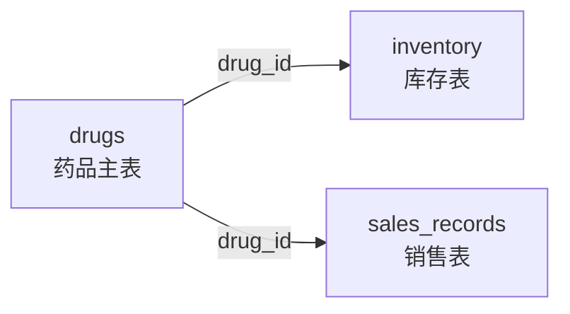
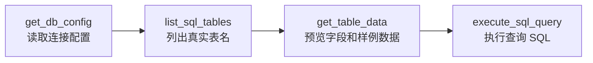
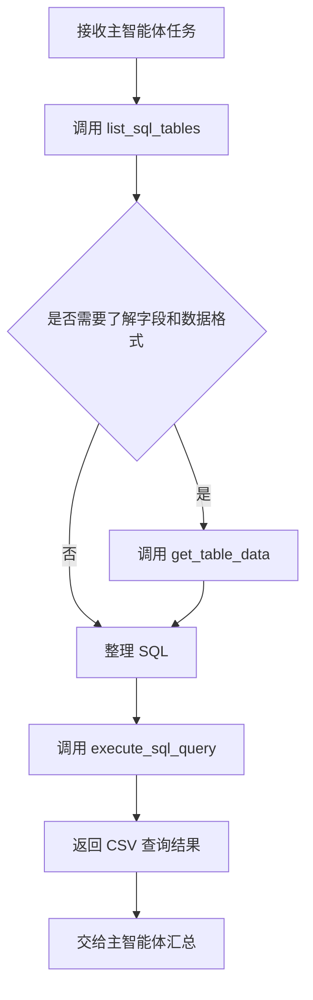

# 11 - Deep Research: Database Query Sub-Agent and MySQL Tools

---

**Chapter Goals:**

- Understand the responsibilities of the database query assistant within the "Deep Research" project.
- Clarify why the database assistant cannot directly let the model generate SQL and must follow a three-step query process.
- Prepare the MySQL connection configuration and understand the role of `get_db_config`.
- Implement the three database tools: `list_sql_tables`, `get_table_data`, and `execute_sql_query`.
- Assemble `database_query_agent` in preparation for subsequent main agent orchestration.

**Study Suggestion:** When working with the database assistant, do not immediately jump into how SQL is written. First, look at how it determines which tables exist, then how table structures and sample data are exposed to the model, and finally how queries are executed. This sequence is important: the biggest risk in such systems is not slow SQL generation, but that the model initially guesses table names, field names, or field meanings incorrectly.

**Corresponding Code Branch:** `11-deepsearch-database-subagent`

---

The previous chapter completed the web search assistant. The web search assistant is responsible for publicly available internet information; it deals with web pages, news, and external materials.

This chapter will implement the second sub-agent: the database query assistant.

It deals with enterprise internal structured data, such as:

- Basic drug information;
- Drug inventory;
- Drug sales records;
- Business details across different regions, customers, batches, and dates.

This data is not suitable for the web search assistant, nor for RAGFlow. It is stored in MySQL and requires precise SQL queries.

---

## 1. What Problems Does the Database Assistant Solve

### 1.1 It Is Responsible for Querying "What the Exact Number Is"

Web search is suitable for answering "what happened externally," RAGFlow is suitable for answering "what the internal documents specify," and the database is suitable for answering "what the exact data is."

For example: `查询数据库中的药品信息，并生成 PDF 文件。`

What the database assistant should do is not directly answer "I guess there are these drugs," but actually query the real database.

Another example: `查询 2025 年华北区销售额最高的药品。`

This kind of question must query real tables such as `sales_records` and `drugs` to obtain accurate results.

### 1.2 It Is Not Responsible for Answering General Knowledge Questions

The database stores structured business data, not general knowledge.

| User Question                         | Should Be Handled By     |
| -------------------------------- | -------------- |
| What is the current inventory of a certain drug           | Database Query Assistant |
| What are the recent public policy changes for a certain drug   | Web Search Assistant   |
| How does company internal policy regulate reimbursement     | RAGFlow Assistant   |
| Organize query results into Markdown or PDF | Main Agent       |

Therefore, the database assistant's `description` should clearly state that it is only responsible for enterprise internal structured data.

---

## 2. Why the Database Assistant Needs a Three-Step Approach

### 2.1 You Cannot Directly Generate SQL

The most straightforward idea is: `用户问题 -> 大模型生成 SQL -> 执行 SQL`

This seems simple, but it is very prone to errors.

The model may not know the real table names, so it invents a `medicine` table; it may not know the field names, so it invents a `stock_count` field; it may not know the date format, so it writes `2025-01-01` as `2025/01/01`. Therefore, the database assistant needs to let the model first acquire the real context.

### 2.2 Relationship Among the Three Tools

The database assistant has three tools:

| Tool Name              | Purpose                                            |
| ------------------- | ----------------------------------------------- |
| `list_sql_tables`   | First check which tables exist in the database                            |
| `get_table_data`    | View the column names and first 100 rows of a table to understand fields and formats |
| `execute_sql_query` | After confirming table names, fields, and formats, execute a custom SQL query   |

These three tools are not meant to be used arbitrarily at the same level; they have a sequence:

```text
list_sql_tables
  -> get_table_data
  -> execute_sql_query
```

The first two tools actually pave the way for the third tool. Only after the model knows the real table names and what the data looks like will the final SQL generation be more reliable.

### 2.3 Why get_table_data Should Return Sample Data

At this point, you might wonder: if we only need the table structure, why not just query the field names?

Because field names only tell the model "which columns exist," not "what the data looks like."

For example, a date field might be:

```text
2025-01-01
2025/01/01
20250101
```

A region field might be:

```text
华北区
华北
North China
```

If the model does not know the real format, the `WHERE` condition can easily be written incorrectly. Returning the first 100 rows of sample data allows the model to see both the column names and the data formats simultaneously.

---

## 3. Configure the Database Assistant in prompts.yml

Corresponding project file path: `deepsearch-agents/app/prompt/prompts.yml`

The database assistant configuration can be written like this:

```yaml
# DeepAgents 提示词配置：集中管理主智能体和各子智能体的名称、路由描述与系统提示词
# 主智能体读取 description 做任务分派，子智能体读取 system_prompt 约束自己的执行方式

# 子智能体配置：description 给主智能体判断是否调用，system_prompt 给子智能体约束执行方式
sub_agents:
  db:
    name: "数据库查询助手"
    description: |
      负责进行数据库查询的智能体助手。它可以查看数据库中有哪些表，
      读取表数据和查看表结构，并执行自定义 SQL 查询以获取精确的业务数据。
      数据库中包含了企业的药品信息、药品库存信息、以及药品销售具体数据，
      可以看到所有特定商品的一切详细信息。
      但是数据库中不包含概括性的知识，只包含具体商品的信息。
    system_prompt: |
      你是一个专业的数据库查询助手。你可以直接与 MySQL 数据库交互来检索信息。
      你掌握的工具包括：
      1. list_sql_tables: 列出数据库中所有可用的表，这是了解数据库结构的第一步。
      2. get_table_data: 读取指定表的前 100 行数据，用于快速预览数据内容和表列的信息。
      3. execute_sql_query: 执行自定义 SQL 查询。当需要复杂的筛选、联接或聚合时使用此工具。

      通常的工作流程是：先列出可用表，确认表名；
      如果需要，预览表数据了解字段；
      最后编写并执行 SQL 查询以回答用户问题。
```

There are two key points here:

- The description tells the main agent that the database assistant queries enterprise internal structured data.
- The prompt tells the database assistant to first understand the database structure, then execute the SQL query.

---

## 4. Prepare the Database and Local MySQL Environment

### 4.1 Three Business Tables in This Project

The course materials prepare pharmaceutical business data, with three core tables:

| Table Name            | Purpose                   |
| --------------- | ---------------------- |
| `drugs`         | Basic drug information           |
| `inventory`     | Drug inventory and batch information     |
| `sales_records` | Drug sales records and regional information |

The corresponding initialization SQL is located at: `deepsearch-agents/docker/mysql/mysql.sql`

This script will create `deepsearch_db` and write a batch of teaching simulation data:

| Table Name            | Data Volume | Primary Use                            |
| --------------- | -------- | ----------------------------------- |
| `drugs`         | 50 rows    | Drug master data                          |
| `inventory`     | 150 rows   | 3 inventory batches per drug               |
| `sales_records` | 100 rows   | 2 sales records per drug, covering regional analysis |

The relationship among the three tables can be simply understood as shown in the following diagram.



That is to say, `drugs` is the primary table, and both inventory and sales are linked to specific drugs through `drug_id`.

Now let's expand and look at the core fields of these three tables:

| Table Name            | Key Fields                                                                                           | Suitable Questions                         |
| --------------- | -------------------------------------------------------------------------------------------------- | -------------------------------------- |
| `drugs`         | `drug_id`, `generic_name`, `brand_name`, `approval_number`, `dosage_form`, `therapeutic_area`      | What a certain drug is and what therapeutic area it belongs to       |
| `inventory`     | `inventory_id`, `drug_id`, `batch_number`, `quantity_on_hand`, `warehouse_location`, `expiry_date` | How much inventory a certain drug has, which warehouse it is in, and when it expires |
| `sales_records` | `sale_id`, `drug_id`, `sale_date`, `quantity_sold`, `unit_price`, `total_amount`, `region`         | How much of a certain drug was sold, total sales amount, regional performance |

In this way, when previewing the data, the model can map user questions to specific fields. For example, "which region has the highest sales amount" is more likely to query `sales_records.region` and `sales_records.total_amount`; "how much inventory does a certain drug still have" is more likely to query `inventory.quantity_on_hand`.

### 4.2 Add MySQL Configuration to .env

Corresponding project file path: `deepsearch-agents/.env`

Add the database configuration:

```dotenv
MYSQL_USER=root
MYSQL_PASSWORD=root
MYSQL_DATABASE=deepsearch_db
MYSQL_HOST=localhost
MYSQL_PORT=3307
MYSQL_CHARSET=utf8mb4
MYSQL_COLLATION=utf8mb4_unicode_ci
MYSQL_SQL_MODE=TRADITIONAL
```

The username, password, and database name here can be adjusted according to your own local environment. The values in the tutorial are course demonstration values; in real projects, do not write production database passwords into documentation or repositories.

The port is set to `3307` here because when the course project starts MySQL with Docker, it maps the container's `3306` to the host's `3307` to avoid conflicts with any existing MySQL `3306` on your computer. The Python tools connect to the host address later, so `MYSQL_HOST=localhost`, `MYSQL_PORT=3307`.

### 4.3 Start MySQL with Docker

If you are not familiar with Docker, Compose, port mapping, or data volumes, you can first review [Chapter 8: Docker Quick Start and Dify Deployment Troubleshooting](../8-Docker%E5%BF%AB%E9%80%9F%E5%85%A5%E9%97%A8%E4%B8%8EDify%E9%83%A8%E7%BD%B2%E6%8E%92%E9%9A%9C.md), then continue with the startup commands below.

The project has already prepared a Docker Compose file: `deepsearch-agents/docker/docker-compose.yaml`

The core content is as follows:

```yaml
# DeepSearch Agents 本地 MySQL 教学环境
# 首次启动时，mysql/mysql.sql 会被官方镜像自动导入到 deepsearch_db。
# 如果数据卷已存在，MySQL 不会重复执行初始化脚本，需要重建 volume 才会重新导入。

name: deepsearch-agents

services:
  mysql:
    image: mysql:8.4
    container_name: deepsearch-mysql
    restart: unless-stopped
    environment:
      MYSQL_ROOT_PASSWORD: ${MYSQL_PASSWORD:-root}
      MYSQL_ROOT_HOST: "%"
      MYSQL_DATABASE: ${MYSQL_DATABASE:-deepsearch_db}
      TZ: Asia/Shanghai
    command:
      - --character-set-server=utf8mb4
      - --collation-server=utf8mb4_unicode_ci
      - --default-time-zone=+08:00
      - --sql-mode=TRADITIONAL
    ports:
      # .env 默认使用 3307，避免和本机已有 MySQL 3306 冲突
      - "${MYSQL_PORT:-3306}:3306"
    volumes:
      - deepsearch_mysql_data:/var/lib/mysql
      # 容器首次创建数据目录时，MySQL 官方镜像会自动执行这个初始化脚本
      - ./mysql/mysql.sql:/docker-entrypoint-initdb.d/01-init-pharma.sql:ro
    healthcheck:
      test:
        [
          "CMD-SHELL",
          "mysqladmin ping -h 127.0.0.1 -uroot -p$${MYSQL_ROOT_PASSWORD} --silent",
        ]
      interval: 10s
      timeout: 5s
      retries: 10
      start_period: 30s

volumes:
  deepsearch_mysql_data:
```

Execute the following in the `deepsearch-agents` project root directory:

```bash
docker compose --env-file .env -f docker/docker-compose.yaml up -d
```

This command does several things:

| Action                         | Description                                           |
| ---------------------------- | ---------------------------------------------- |
| Pull `mysql:8.4`             | Automatically downloads if the image is not available locally                       |
| Create `deepsearch-mysql` container | You can later view logs or enter the container by container name           |
| Create `deepsearch_db`         | Controlled by `MYSQL_DATABASE`                       |
| Import `mysql.sql`             | Automatically executes only when the data volume is first created and the database directory is empty |
| Expose local port `3307`          | Python code connects to MySQL through `localhost:3307`    |

Check container status:

```bash
docker compose --env-file .env -f docker/docker-compose.yaml ps
```

View startup logs:

```bash
docker compose --env-file .env -f docker/docker-compose.yaml logs -f mysql
```

If you modified `docker/mysql/mysql.sql` but find that the data has not changed, it is usually because the existing data volume will not re-execute the initialization script. In a teaching environment, you can rebuild the data volume:

```bash
docker compose --env-file .env -f docker/docker-compose.yaml down -v
docker compose --env-file .env -f docker/docker-compose.yaml up -d
```

`down -v` will delete the data volume created by this Compose project, which is equivalent to reinitializing the database. Only do this with local teaching data; never casually delete volumes for real business databases.

---

## 5. Implement the Database Tools

Corresponding project file path: `deepsearch-agents/app/tools/db_tools.py`

This section focuses on completing four things:

```text
读取数据库配置
  -> 查询真实表名
  -> 预览表结构和样例数据
  -> 执行查询 SQL
```



### 5.1 get_db_config: Centralize Reading Connection Configuration

First, write a `get_db_config` to uniformly read database configuration from environment variables:

```python
"""
MySQL 数据库查询工具模块

封装数据库查询助手使用的三个 LangChain 工具：
list_sql_tables 用于发现真实表名，get_table_data 用于预览字段和样例数据，
execute_sql_query 用于在确认结构后执行自定义查询。
"""

import os

from dotenv import load_dotenv
from langchain_core.tools import tool
from mysql.connector import Error, connect

from app.api.monitor import monitor

load_dotenv()


# 集中读取数据库配置，后续三个工具都复用这份连接参数
def get_db_config():
    """
    从环境变量读取 MySQL 连接配置

    所有数据库工具都通过此函数拿到同一份连接参数，避免每个工具重复读取环境变量
    :return: mysql.connector.connect 可直接使用的连接参数
    """
    config = {
        "host": os.getenv("MYSQL_HOST", "localhost"),
        "port": int(os.getenv("MYSQL_PORT", "3306")),
        "user": os.getenv("MYSQL_USER"),
        "password": os.getenv("MYSQL_PASSWORD"),
        "database": os.getenv("MYSQL_DATABASE"),
        "charset": os.getenv("MYSQL_CHARSET", "utf8mb4"),
        "collation": os.getenv("MYSQL_COLLATION", "utf8mb4_unicode_ci"),
        "autocommit": True,
        "sql_mode": os.getenv("MYSQL_SQL_MODE", "TRADITIONAL"),
    }

    # 去掉未配置的可选项，避免把 None 传给 mysql.connector 造成连接参数异常
    config = {k: v for k, v in config.items() if v is not None}

    # user/password/database 是本教程工具能正常查询业务库的最小必要配置
    required_keys = ["user", "password", "database"]
    missing_keys = [k for k in required_keys if k not in config]
    if missing_keys:
        raise ValueError(f"缺失数据库核心配置：{', '.join(missing_keys)}")

    return config
```

Two small things are done here:

1. Provide default values for `host`, `port`, character set, collation, and SQL mode configurations.
2. Check whether `user`, `password`, and `database` exist.

The database tools will all call this function first, avoiding repeated reading of environment variables in each tool.

### 5.2 list_sql_tables: List Real Table Names

`list_sql_tables` is used to see which tables exist in the current database.

This is the first step of database querying. The model must first know the real table names before it can proceed to inspect table structures or write SQL.

The core code is as follows:

```python
@tool
def list_sql_tables() -> str:
    """
    查询当前数据库中所有可用表

    作用：让模型先识别真实可用的表名，方便后续预览表结构和编写自定义 SQL。
    :return: 有表：可用的表有：表1,表2,表3...
             没有表：没有可用的表
             出现异常：查询出现异常：异常信息
    """

    # 埋点：工具一被调用，前端可以展示当前正在查询数据库表名
    monitor.report_tool(tool_name="数据库表名查询工具：list_sql_tables", args={})

    # 加载数据库连接信息
    config = get_db_config()

    # MySQL 查询的固定步骤：
    # 1. 创建连接
    # 2. 创建 cursor
    # 3. 执行 SQL
    # 4. 获取返回结果
    # 5. 释放连接和 cursor 资源
    # 这里捕获异常并返回中文提示，避免工具报错直接中断 Agent 执行链路
    try:
        # 使用 with 管理连接和游标，查询结束后自动释放数据库资源
        with connect(**config) as conn:
            with conn.cursor() as cursor:
                sql = "SHOW TABLES"
                cursor.execute(sql)

                # SHOW TABLES 返回形如：[("drugs",), ("inventory",), ("sales_records",)]
                tables = cursor.fetchall()

                if not tables:
                    return "没有可用的表"

                # 取每个元组的第一个元素，拼成模型容易阅读的表名列表
                table_names = [table[0] for table in tables]
                return f"可用的表有：{', '.join(table_names)}"
    except Error as e:
        return f"查询出现异常：{str(e)}"
```

This code essentially follows the standard MySQL query process:

```text
读取连接配置
  -> connect 建立连接
  -> cursor 创建游标
  -> execute 执行 SHOW TABLES
  -> fetchall 获取结果
  -> 格式化返回
```

`with connect(...)` and `with conn.cursor()` can automatically release connections and cursors after the code block ends, avoiding resource leaks.

### 5.3 get_table_data: Preview Fields and Sample Data

`get_table_data` is used to read the first 100 rows of a specified table.

It serves two purposes:

1. Query single-table data.
2. Let the model see the table structure, field names, and data formats.

The core code is as follows:

```python
@tool
def get_table_data(table_name) -> str:
    """
    查询指定表的前 100 行数据

    当前工具调用之前，应先调用 list_sql_tables 完成表名校验。
    此工具的作用：
    1. 完成单表样例数据查询
    2. 为多表查询提供表结构信息和数据格式参考
    :param table_name: 表名
    :return: CSV 格式数据
             1. 第一行是列信息，列之间使用英文逗号分隔
             2. 第二行开始是表数据，值之间也使用英文逗号分隔
             3. 行和行之间使用 \n 分隔
             4. 至多查询 100 条表数据
             例如：
                id,name,age\n -> 列头
                1,张三,18\n
                1,张三,18\n
                1,张三,18\n -> 至多查询 100 条
    """
    # 埋点：工具二被调用，前端可以展示当前正在预览哪张表
    monitor.report_tool(
        tool_name="数据库表数据查询工具：get_table_data",
        args={"table_name": table_name},
    )

    # 获取数据库参数
    config = get_db_config()

    # 查询流程同样是：连接 -> cursor -> 执行 SQL -> 获取列信息和数据 -> 自动释放资源
    try:
        with connect(**config) as conn:
            with conn.cursor() as cursor:
                # 教程代码直接拼接表名，重点演示 Agent 查询链路；生产环境应改为白名单校验
                sql = f"SELECT * FROM {table_name} LIMIT 100"
                cursor.execute(sql)

                # cursor.description 保存查询结果的列元信息
                # 例如：[("id", ...), ("name", ...), ("age", ...)]
                # 如果 SQL 没有结果集，description 可能为 None
                description = cursor.description
                if not description:
                    return f"数据表 {table_name} 暂无数据。"

                # 只取每个列信息元组的第一个元素，也就是列名
                # 例如：["id", "name", "age"]
                columns = [desc[0] for desc in description]

                # fetchall 返回表数据，形如：[(1, "张三", 18), (2, "李四", 20)]
                rows = cursor.fetchall()

                # 把每一行数据从元组转成 CSV 行文本
                # 例如：(1, "张三", 18) -> "1,张三,18"
                results = [",".join(map(str, row)) for row in rows]

                # columns 组成 CSV 头部，rows 组成 CSV 数据体
                # 最终返回：
                # id,name,age
                # 1,张三,18
                header_str = ",".join(columns)
                data_str = "\n".join(results)
                return f"{header_str}\n{data_str}"
    except Error as e:
        return f"查询出现异常：{str(e)}"
```

### 5.4 cursor.description and CSV Return Format

After executing a query, `cursor.description` stores the column information of the result set.

You can think of it as:

```text
[
  ("drug_id", ...),
  ("generic_name", ...),
  ("brand_name", ...),
  ...
]
```

We only need the first element in each tuple, which is the column name:

```python
columns = [desc[0] for desc in description]
```

After obtaining the column names, convert the query results to CSV format:

```text
drug_id,generic_name,brand_name
1,阿莫西林胶囊,阿莫仙
2,布洛芬缓释胶囊,芬必得
```

CSV is relatively easy for the model to read; it can see both the field names and what the data looks like in each column.

### 5.5 Table Name Safety and Read-Only Boundaries

The focus of the current course code is to demonstrate the Agent query flow. In the simplest approach, `table_name` is directly concatenated into SQL:

```python
sql = f"SELECT * FROM {table_name} LIMIT 100"
```

This helps beginners see the tool chain clearly, but in real projects, you need to be careful about SQL injection risks.

If you first perform a basic layer of sanitization, you can start from the following approach:

```python
safe_table_name = table_name.replace("`", "").replace(";", "").split()[0]
cursor.execute(f"SELECT * FROM {safe_table_name} LIMIT 100")
```

This code does three things:

| Processing Action                | Purpose                                          |
| -------------------------------- | ------------------------------------------------ |
| Remove backtick characters       | Avoid constructing abnormal table names via backticks |
| Remove semicolons `;`           | Reduce the risk of concatenating multiple SQL statements in a single input |
| Take the first segment with `split()[0]` | Avoid extra SQL snippets being appended after the table name |

In a production environment, it is recommended to add table name allowlist validation. For example, first call `list_sql_tables` to obtain the actual table name, and then only allow querying tables in the allowlist. For custom SQL, it is also recommended to restrict it to read-only queries to avoid executing high-risk statements such as `UPDATE`, `DELETE`, or `DROP`.

### 5.6 execute_sql_query: Execute Query SQL

`execute_sql_query` is the tool that actually executes queries.

It is suitable for handling:

- Multi-table joins;
- Conditional filtering;
- Aggregation statistics;
- Sorting and grouping.

For example, querying drugs and sales records:

```sql
SELECT *
FROM drugs d
JOIN sales_records s ON d.drug_id = s.drug_id;
```

The core code is as follows:

```python
@tool
def execute_sql_query(query) -> str:
    """
    执行自定义 SQL 查询

    切记：执行之前，需要通过 list_sql_tables 明确表名，
    再通过 get_table_data 明确表结构和数据格式。
    适合多表关联、筛选、聚合、排序等复杂查询。
    :param query: 要执行的自定义 SQL 语句
    :return: CSV 格式数据
             1. 第一行是列信息，列之间使用英文逗号分隔
             2. 第二行开始是表数据，值之间也使用英文逗号分隔
             3. 行和行之间使用 \n 分隔
             例如：
                id,name,age\n -> 列头
                1,张三,18\n
                1,张三,18\n
    """
    # 埋点：记录模型最终生成的 SQL，便于教学时观察是否真的落到了正确表字段上
    monitor.report_tool(
        tool_name="数据库表数据查询工具：execute_sql_query", args={"query": query}
    )

    # 获取数据库参数
    config = get_db_config()

    # 自定义查询和 get_table_data 的结果处理逻辑一致：
    # 执行 SQL -> 读取 description 得到列名 -> fetchall 得到数据 -> 拼成 CSV 返回
    try:
        with connect(**config) as conn:
            with conn.cursor() as cursor:
                # 当前章节依赖提示词约束模型生成只读查询；生产环境建议在工具层限制 SELECT/SHOW
                cursor.execute(query)

                # 非查询类 SQL 没有结果集描述，这里统一返回提示，避免工具调用直接抛错给模型
                description = cursor.description
                if not description:
                    return f"执行自定义 SQL 语句没有查询结果，SQL 为：{query}"

                # description => [("列1", ...), ("列2", ...)]
                columns = [desc[0] for desc in description]

                # rows => [(值1, 值2), (值1, 值2)]
                rows = cursor.fetchall()

                # 每行元组统一转为逗号分隔文本，便于模型读取和后续整理
                results = [",".join(map(str, row)) for row in rows]

                # 第一行是列名，后续是查询数据
                header_str = ",".join(columns)
                data_str = "\n".join(results)
                return f"{header_str}\n{data_str}"
    except Error as e:
        return f"查询出现异常：{str(e)}"
```

This code is very similar to `get_table_data`. The difference is:

| Tool                | SQL Source                               |
| ------------------- | ---------------------------------------- |
| `get_table_data`    | System-generated fixed `SELECT * ...`    |
| `execute_sql_query` | Generated or organized by the model based on the user's question |

The current project mainly relies on prompt constraints to ensure it executes query-type SQL. In real enterprise projects, it is recommended to add another layer of read-only validation at the tool layer, for example, only allowing statements that start with `SELECT` or `SHOW`.

### 5.7 Local Debugging Entry Point

Run from the project root directory: `uv run python -m app.tools.db_tools`

A real output will first show tool monitoring events:

```text
[Monitor:tool_start] 开始执行工具: 数据库表数据查询工具：execute_sql_query
```

This indicates that the `monitor.report_tool(...)` in `execute_sql_query` has taken effect: before the tool actually executes SQL, it first reports the event "database query tool started execution" to the monitoring module. After that comes the query result returned by MySQL.

Below is a compressed version of the actual output structure. Focus on the fields and data shape; there is no need to put all 100 lines of results into the tutorial:

```text
drug_id,generic_name,brand_name,approval_number,specifications,dosage_form,manufacturer,therapeutic_area,description,created_at,sale_id,drug_id,sale_date,quantity_sold,unit_price,total_amount,customer_name,region,sales_rep
1,阿莫西林胶囊,阿莫仙,国药准字H20051234,0.25g*24粒,胶囊剂,本公司制药,抗生素,...,2026-05-15 13:45:13,1,1,2025-02-15,200,25.00,5000.00,北京朝阳医院,华北区,北京朝阳销售部
1,阿莫西林胶囊,阿莫仙,国药准字H20051234,0.25g*24粒,胶囊剂,本公司制药,抗生素,...,2026-05-15 13:45:13,2,1,2025-08-10,500,24.50,12250.00,天津大药房,华北区,天津南开销售分部
2,布洛芬缓释胶囊,芬必得,国药准字H10900089,0.3g*20粒,胶囊剂,本公司制药,解热镇痛,...,2026-05-15 13:45:13,3,2,2025-01-20,1000,15.00,15000.00,海王星辰连锁,华东区,杭州滨江销售部
... 其余查询结果省略 ...
```

There are several noteworthy points in this output:

| Observation                                                       | Explanation                                                                       |
| ----------------------------------------------------------------- | --------------------------------------------------------------------------------- |
| `[Monitor:tool_start]` appears first                          | Indicates that tool-level instrumentation is working, and database query progress can be shown when integrating with the frontend later |
| The first line of output is a CSV header                      | The tool returns structured text rather than natural language, which the model can easily continue reading and organizing |
| `drug_id` appears twice in the header                    | This is because the debug SQL queried both `drugs` and `sales_records` tables at the same time, and both tables have the `drug_id` field |
| `generic_name`, `brand_name`, `therapeutic_area` appear       | Indicates that the drug master table `drugs` has been successfully imported                                     |
| `sale_date`, `quantity_sold`, `total_amount`, `region` appear | Indicates that the sales record table `sales_records` has been successfully imported, and join queries are available |
| `created_at` is the initialization time                                   | This is the time written when Docker MySQL first imported the data, not a drug sales date               |
| Sales dates are concentrated in `2025`                                   | These are the simulated sales records prepared in the teaching SQL, suitable for later practice of statistics by date, region, and drug |

If you can see CSV text with column names like this, it means the database container, initialization data, `.env` connection configuration, and the tool chain are all ready to use.

---

## 6. Why SQLAlchemy Is Not Used Here

This chapter uses `mysql.connector` instead of SQLAlchemy. This is explained separately to avoid mixing up the "Deep Research" and "Shopkeeper Data Q&A" projects.

### 6.1 What Is ORM Mapping

ORM stands for Object Relational Mapping, which can be understood as "mapping database tables to objects in the program." If you use SQLAlchemy ORM, you usually first write a batch of Python classes:

```python
class Drug(Base):
    __tablename__ = "drugs"

    drug_id = mapped_column(primary_key=True)
    generic_name = mapped_column(String(100))
    brand_name = mapped_column(String(100))
```

In this way, the `drugs` table corresponds to the `Drug` class in Python, and fields such as `generic_name` and `brand_name` also become class attributes. When querying later, you can operate on objects or construct ORM queries through `Session` instead of writing low-level connection code manually each time.

In the "Shopkeeper Data Q&A" project, we used SQLAlchemy. That project is more like a complete backend system: it has a metadata database, data warehouse, Repository, Service, FastAPI dependency injection, and request-scoped Session, so SQLAlchemy is needed to manage connections, transactions, Session factories, and some ORM model mappings.

### 6.2 Why the Current Project Only Uses Small Tools

The database assistant in the current "Deep Research" project has a lighter goal. It is not meant to build a complete data access layer, but to expose three small tools that the Agent can call:

```text
list_sql_tables
  -> 让模型知道真实表名

get_table_data
  -> 让模型看到字段和样例数据

execute_sql_query
  -> 在确认表结构后执行查询 SQL
```

Therefore, it directly uses `mysql.connector.connect` to create connections and then wraps the query capability into LangChain Tools. This keeps the chain short and the code intuitive, which is suitable for the teaching stage to see clearly "how the model queries the database through tools."

The comparison can be made as follows:

| Project            | Database Access Method                                | Suitable Scenario                                            |
| ------------------ | ----------------------------------------------------- | ------------------------------------------------------------ |
| Shopkeeper Data Q&A | SQLAlchemy + asyncmy + Session + mixed ORM / raw SQL | Complete backend engineering, metadata management, Repository layering, request-scoped database sessions |
| Deep Research      | `mysql.connector` + 3 small LangChain tools           | Sub-agent directly queries three teaching tables, focusing on the tool invocation chain |

It is not that SQLAlchemy is bad, but this chapter does not yet need such a heavy access layer. SQLAlchemy will be more appropriate when the project needs to maintain a large number of tables, complex transactions, a unified Repository, or request-scoped Session.

### 6.3 Positioning Differences from Shopkeeper Data Q&A

A question easily arises here: since both projects involve "natural language question -> generate SQL -> query database," why does "Shopkeeper Data Q&A" need a metadata knowledge base, data warehouse modeling, Qdrant, Elasticsearch, SQLAlchemy, Repository, and LangGraph orchestration, while three small tools are enough to get things running here?

The key is not "whether SQL can be generated," but that the two projects solve problems at different levels.

The database assistant in this chapter is essentially a **tool-based sub-agent**. It is only responsible for temporarily taking over the task when the main agent needs to query internal structured data, and then completes it in a fixed order:

```text
先列出真实表名
  -> 再查看表结构和样例数据
  -> 最后生成并执行查询 SQL
```

This approach works because the database prerequisites of this project are very simple:

- The number of tables is small; currently there are only three tables: `drugs`, `inventory`, and `sales_records`.
- Field semantics are intuitive; for example, `region`, `total_amount`, and `quantity_on_hand` are all easy to understand.
- Business questions lean toward querying and summarization, without involving complex metric definition management.
- The model can directly call `get_table_data` at runtime to view fields and sample data.
- The database assistant is only one sub-capability under the DeepAgents main agent and does not bear the entire lifecycle of a complete data Q&A system.

"Shopkeeper Data Q&A" solves a different kind of problem. It is not about attaching a temporary database query tool to the main agent, but about building a relatively complete `NL2SQL` data Q&A system. It has to deal with more tables, more fields, more metric definitions, and also needs to consider retrieval, filtering, SQL validation, SQL correction, frontend streaming display, and long-term engineering layering.

| Dimension          | Deep Research Database Assistant        | Shopkeeper Data Q&A                                                          |
| ------------------ | ---------------------------------------- | ---------------------------------------------------------------------------- |
| Project positioning | A database tool capability of the Deep Research Agent | A data Q&A system specifically for enterprise data analysis                  |
| Data scale         | Three teaching business tables          | Data warehouse tables, metadata tables, fields, metrics, field values        |
| Context acquisition | Directly view table names and sample data at runtime | First build a metadata knowledge base, then retrieve relevant context based on the question |
| Retrieval capability | Mainly relies on table structure and samples returned by MySQL tools | Qdrant retrieves fields/metrics, Elasticsearch searches field values          |
| Orchestration      | DeepAgents sub-agent decides tool invocation on its own | LangGraph splits into nodes for keyword extraction, retrieval, filtering, completion, generation, validation, correction, execution, etc. |
| Data access layer  | `mysql.connector` direct connection and query | SQLAlchemy + asyncmy + Session + Repository layering                         |
| Suitable scenario  | Small database queries, teaching demos, Agent tool integration | Scalable enterprise data Q&A, complex metrics and data warehouse semantic understanding |

If you have studied "Shopkeeper Data Q&A" before, you can understand it this way: **when querying only three fixed tables, the Shopkeeper Data Q&A engineering approach can feel too heavy; but when building a complete data Q&A system, the small-tool approach in Deep Research here can feel too light.**

This chapter chooses a lightweight implementation not to deny SQLAlchemy, metadata knowledge bases, or LangGraph data Q&A flows, but to focus attention on the local capability of the "database query sub-agent."

---

## 7. Assembling database_query_agent

Corresponding project file path: `deepsearch-agents/app/agent/subagents/database_query_agent.py`

The code is as follows:

```python
"""
数据库查询子智能体配置模块

将 app/prompt/prompts.yml 中的 db 配置与 MySQL 查询工具组装成
DeepAgents 可识别的字典式子智能体。主智能体后续会根据 description
决定是否把企业内部结构化数据查询任务分派给它。
"""

from app.agent.prompts import sub_agents_content
from app.tools.db_tools import execute_sql_query, get_table_data, list_sql_tables

# 数据库助手必须按“列出表 -> 预览表数据 -> 执行 SQL”的顺序获取真实上下文
# tools 列表中的三个工具共同约束了这个查询链路
database_query_agent = {
    "name": sub_agents_content["db"]["name"],
    "description": sub_agents_content["db"]["description"],
    "system_prompt": sub_agents_content["db"]["system_prompt"],
    "tools": [list_sql_tables, get_table_data, execute_sql_query],
}
```

This is exactly the same structure as the web search assistant from the previous chapter, except that the number of tools has changed from 1 to 3.

---

## 8. Execution Process of the Database Assistant



Note that the database assistant returns query results and is not responsible for final report formatting. Generating Markdown, Word, or PDF later is the main agent's job.

---

**Chapter Summary:**

This chapter completes the database query assistant. It follows the same pattern as the web search assistant: `提示词配置 -> 工具封装 -> 子智能体字典组装`

The difference is that the database assistant places more emphasis on execution order:

```text
先查表名
  -> 再看表结构和样例数据
  -> 最后执行 SQL
```

By now, we have completed two sub-agents: the web search assistant and the database query assistant. The next chapter begins with RAGFlow. It adds one more layer of complexity than the previous two assistants, because RAGFlow is not a simple tool but an independent knowledge base service, which also includes concepts such as knowledge bases, chat assistants, and sessions.
