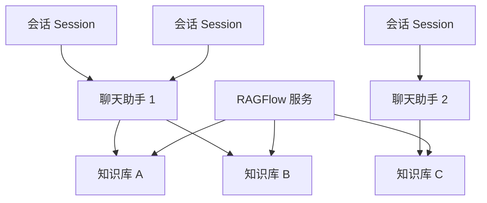
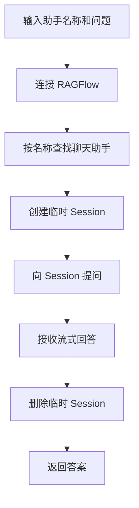
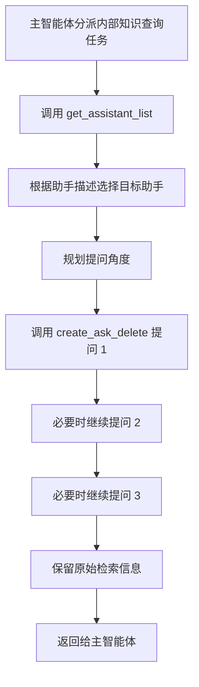

# 12 - Deep Research: RAGFlow Sub-Agent and Knowledge Base Preparation

---

**Chapter Learning Objectives:**

- Understand RAGFlow's four-layer structure: service, knowledge base, chat assistant, and session.
- Master the deployment approach and page preparation workflow for RAGFlow in the course environment.
- Complete model provider configuration, knowledge base creation, file upload, and parsing.
- Create a RAGFlow chat assistant and test the knowledge base Q&A through the page.
- Understand why the RAGFlow sub-agent needs two tools: first, query the assistant list, then ask a specific assistant questions.

**Study Suggestion:** For this RAGFlow chapter, don't rush to wrap the API. It has its own pages, model configuration, knowledge bases, assistants, and sessions. The first time through, make sure you understand the relationships between these objects. Once you can clearly explain that "files go into the knowledge base, assistants are bound to knowledge bases, and sessions use assistants to answer questions," then looking at tool wrapping and sub-agent configuration will go much more smoothly.

**Corresponding code branch:** `12-deepsearch-ragflow-subagent`

---

## 1. What Problems Does RAGFlow Solve

The previous two chapters already completed two sub-agents. This chapter adds the third sub-agent:

| Sub-Agent           | Underlying Capability | Characteristics                             |
| ------------------- | --------------------- | ------------------------------------------- |
| Web Search Assistant | Tavily API            | Directly calls the search API               |
| Database Query Assistant | MySQL Connector   | Directly connects to the database for queries |
| RAGFlow Assistant   | RAGFlow Knowledge Base Service | Requires deploying and configuring external services first |

This chapter follows four steps:

```text
先理解 RAGFlow 适合查什么
  -> 再部署服务、准备知识库和聊天助手
  -> 然后封装两个 RAGFlow 工具
  -> 最后组装成 knowledge_base_agent
```

The RAGFlow assistant is a bit different from the first two. Tavily only needs an API key to search the web, and MySQL only needs credentials to query tables; RAGFlow is more like a complete RAG service, responsible for document parsing, chunking, vectorization, retrieval, source citation, and answer generation.

---

### 1.1 It Queries Internal Unstructured Documents

In enterprise projects, much of the knowledge is neither structured tables nor public web pages, but internal documents:

- Company policies;
- Product manuals;
- Operating manuals;
- Industry white papers;
- Financial research reports, PDFs, Word documents, Excel files;
- Business training materials.

These materials are suitable for placing into RAGFlow.

The user asks: `根据 2026 数字人电商直播白皮书，数字人在电商直播里主要解决什么问题？`

This kind of question should not be answered by searching the internet, nor by querying MySQL tables; it should be handed to the RAGFlow assistant.

### 1.2 Why Not Build Your Own RAG from Scratch

If you were to build RAG entirely yourself, you would need to handle many components:

```text
文档读取
  -> 文本清洗
  -> 文档切片
  -> 向量化
  -> 存入向量数据库
  -> 查询时向量检索
  -> 重排序
  -> 拼上下文
  -> 调模型回答
```

This is certainly doable, and as you go deeper into RAG projects, you will continue to unpack these details. But in the Deep Research project, we first use RAGFlow to provide a ready-made enterprise knowledge base capability.

You can initially think of RAGFlow as: `一个已经集成好文档解析、向量库、检索和问答能力的 RAG 服务。`

### 1.3 It Turns Multi-Format Materials into a Unified Knowledge Entry Point

The most troublesome part of an enterprise knowledge base is not just "whether there is a vector database," but that the sources of materials are very diverse.

Within the same enterprise, there may simultaneously be:

- PDF policy documents;
- Word operating instructions;
- Excel business lists;
- PPT training materials;
- Product manuals with many images;
- Scanned or complexly formatted historical documents.

If you had to handle everything yourself, you would need to write separate reading, cleaning, chunking, and parsing logic for different file types. The more documents you have, the higher the maintenance cost.

The value of RAGFlow lies right here: **it puts "uploading files, parsing files, building knowledge bases, binding assistants, page testing, and API queries" into the same service.** For the DeepAgents project, we don't need to reimplement document parsing and vector retrieval inside the sub-agent; we just need to treat RAGFlow as an external knowledge base service and ask the appropriate chat assistant questions through the API.

---

## 2. Understanding RAGFlow's Four-Layer Structure

| Layer              | How to Understand It                           | Role in the Project                                 |
| ------------------ | ---------------------------------------------- | --------------------------------------------------- |
| RAGFlow Service    | A complete running knowledge base system        | Provides pages, API, document parsing, and Q&A capabilities |
| Knowledge Base Dataset | A space for storing one category of documents | For example, an e-commerce industry knowledge base, a financial industry knowledge base |
| Chat Assistant     | A Q&A entry point bound to one or more knowledge bases | Presented externally as an "e-commerce industry assistant" or "financial industry assistant" |
| Session            | One specific question or conversation           | Temporarily created in code and deleted after use   |

Their relationship can be viewed as follows:



In real-world usage, it is usually:

```text
先创建知识库
  -> 上传内部文档
  -> 等待文档解析完成
  -> 创建聊天助手
  -> 给聊天助手绑定知识库
  -> 用户提问时创建临时会话
  -> 向会话提问
  -> 拿到答案后删除会话
```

Remember this sentence: **the code ultimately does not directly ask the knowledge base; it asks a session under a specific chat assistant.**

---

## 3. Deploying the RAGFlow Service

### 3.1 Recommended Machine Configuration

The RAGFlow service is relatively heavy, and it is recommended to deploy it on a cloud server. It is not a small tool that only starts a Python process; underneath, it also launches components such as Elasticsearch, MinIO, MySQL, and Valkey.

Recommended course environment:

| Configuration Item | Recommended Value     |
| ------------------ | --------------------- |
| CPU                | At least 4 cores; 8 cores is more stable |
| Memory             | At least 16 GB        |
| OS                 | Ubuntu 24.04          |
| Disk               | At least 50 GB        |
| Public IP          | Required              |

If the local virtual machine has insufficient memory, later steps such as parsing PDFs and starting Elasticsearch, MinIO, MySQL, and other components will be a struggle.

### 3.2 Purchasing a Tencent Cloud Server

Tencent Cloud spot instance purchase: [Purchase Link](https://buy.cloud.tencent.com/cvm?tab=custom&step=1&devPayMode=spotpaid&regionId=4&zoneId=0&supportConfidentiality=false&isBackup=false&backupDiskType=ALL&backupDiskCustomizeValue=&backupQuotaSegment=1&backupQuota=1&wanIp=0&tags=null&templateCreateMode=createLt)

After entering the Tencent Cloud CVM purchase page, you can choose a spot instance or a pay-as-you-go instance. Spot instances are cheaper but carry the risk of being released, making them suitable for short-term classroom practice; if you need continuous use, it is recommended to choose a more stable billing method.


Here, first confirm the billing method, server specifications, and system image. For course practice, you can prioritize a cheap short-term instance; if you want to preserve the knowledge base long-term, it is recommended to use a more stable billing method.

In a test environment, you can open all security group rules. But do not do this in real projects; expose only the necessary ports to the public internet, and for the management backend, try to use an intranet, VPN, or reverse proxy.


The security group configuration in the screenshot is only suitable for temporary classroom testing. In real projects, the RAGFlow pages, database, object storage, and vector retrieval services should not be directly exposed to the public internet.


After the instance is created, first record the public IP, login method, and security group information. Later, browser access, SSH login, and the API address will all use this public IP.

After the instance is created, find the public IP and password in the console and prepare to connect to the server remotely.

### 3.3 Installing Docker and Docker Compose

The following commands apply to Ubuntu 22.04/24.04.

```bash
# 更新系统软件包索引
sudo apt-get update

# 安装 Docker 仓库所需的基础工具
sudo apt-get install -y ca-certificates curl git openssl

# 创建 apt keyrings 目录，用于存放 Docker 源的 GPG key
sudo install -m 0755 -d /etc/apt/keyrings

# 使用腾讯云 Docker CE 镜像源的 GPG key，国内服务器下载更稳定
sudo curl -fsSL https://mirrors.cloud.tencent.com/docker-ce/linux/ubuntu/gpg -o /etc/apt/keyrings/docker.asc

# 允许 apt 读取该 GPG key
sudo chmod a+r /etc/apt/keyrings/docker.asc

# 添加 Docker CE 的 apt 软件源
echo "deb [arch=$(dpkg --print-architecture) signed-by=/etc/apt/keyrings/docker.asc] https://mirrors.cloud.tencent.com/docker-ce/linux/ubuntu/ $(. /etc/os-release && echo "$VERSION_CODENAME") stable" | sudo tee /etc/apt/sources.list.d/docker.list >/dev/null

# 重新更新软件包索引，让 apt 识别 Docker 软件源
sudo apt-get update

# 安装 Docker Engine、Docker CLI、Buildx 和 Compose 插件
sudo apt-get install -y docker-ce docker-ce-cli containerd.io docker-buildx-plugin docker-compose-plugin

# 设置 Docker 开机自启动，并立即启动 Docker
sudo systemctl enable --now docker

# 查看 Docker 版本
sudo docker --version

# 查看 Docker Compose 版本，注意这里是 docker compose，中间有空格
sudo docker compose version
```

### 3.4 Adjusting System Parameters

RAGFlow uses Elasticsearch as the document retrieval and vector storage engine by default. Elasticsearch requires `vm.max_map_count` to be at least `262144`.

```bash
# 查看当前 vm.max_map_count
sysctl vm.max_map_count

# 写入持久化配置，重启后仍然生效
echo 'vm.max_map_count=262144' | sudo tee /etc/sysctl.d/99-ragflow.conf

# 立即加载 sysctl 配置
sudo sysctl --system

# 再次确认结果应为 262144 或更大
sysctl vm.max_map_count
```

### 3.5 Downloading the RAGFlow Source Code

The course uses RAGFlow's `v0.25.4` version. It is recommended to keep the same version as the course.

#### 3.5.1 Method One: Shallow Clone from GitHub

If GitHub is accessible but slow, prioritize using a shallow clone. A shallow clone only downloads what is needed for the specified version and does not download the complete commit history, which is usually much faster.

```bash
# 进入 /opt，常用于放置服务器应用
cd /opt

# 只克隆 v0.25.4 这个版本，减少下载体积
sudo git clone --depth 1 --branch v0.25.4 https://github.com/infiniflow/ragflow.git

# 将目录归属给当前用户，避免后续每一步都需要 sudo 编辑文件
sudo chown -R "$USER":"$USER" /opt/ragflow

# 进入 RAGFlow 目录
cd /opt/ragflow

# 进入 Docker Compose 配置目录
cd /opt/ragflow/docker
```

#### 3.5.2 Method Two: Using the Gitee Mirror

If cloning from GitHub is still very slow, you can use InfiniFlow's mirror repository on Gitee.

```bash
# 进入 /opt，常用于放置服务器应用
cd /opt

# 从 Gitee 镜像克隆指定版本，适合国内服务器
sudo git clone --depth 1 --branch v0.25.4 https://gitee.com/infiniflow/ragflow.git

# 将目录归属给当前用户
sudo chown -R "$USER":"$USER" /opt/ragflow

# 进入 Docker Compose 配置目录
cd /opt/ragflow/docker
```

### 3.6 Modifying the RAGFlow Environment Configuration

If you are only doing short-term testing and do not require password security, you can skip this section and go directly to "3.7 Starting RAGFlow."

First, back up `.env`:

```bash
# 备份原始配置，后续改错可以对照恢复
cp .env .env.bak
```

Generate strong passwords:

```bash
# 分别生成几个强随机密码，用于替换 .env 里的默认密码
openssl rand -hex 24
openssl rand -hex 24
openssl rand -hex 24
openssl rand -hex 24
```

Edit `.env`:

```bash
# 打开 RAGFlow Docker 环境变量配置
nano .env
```

At least modify the following fields; do not use the default passwords:

```env
# Elasticsearch 密码
ELASTIC_PASSWORD=换成强密码

# MySQL 密码
MYSQL_PASSWORD=换成强密码

# MinIO 密码
MINIO_PASSWORD=换成强密码

# Redis 密码
REDIS_PASSWORD=换成强密码

# 时区，上海服务器建议保持 Asia/Shanghai
TZ=Asia/Shanghai

# 首次部署建议先允许注册，创建完管理员账号后再改成 0
REGISTER_ENABLED=1
```

Save the `nano` file:

```text
Ctrl + O
Enter
Ctrl + X
```

### 3.7 Starting RAGFlow

In the `/opt/ragflow/docker` directory, run:

```bash
# 确认当前目录正确
pwd

# 预先拉取所有镜像。第一次会比较慢
sudo docker compose -f docker-compose.yml pull

# 后台启动 RAGFlow 及其依赖服务
sudo docker compose -f docker-compose.yml up -d

# 查看所有容器状态
sudo docker compose -f docker-compose.yml ps
```

If pulling images at this step is too slow, you can first configure a Tencent Cloud mirror acceleration source for Docker. This configuration affects all base images pulled from Docker Hub, including `mysql`, `elasticsearch`, `minio`, `valkey`, and so on.

```bash
# 打开 Docker daemon 配置文件
sudo nano /etc/docker/daemon.json
```

Write the following content:

```json
{
  "registry-mirrors": ["https://mirror.ccs.tencentyun.com"]
}
```

Save the `nano` file:

```text
Ctrl + O
Enter
Ctrl + X
```

Restart Docker for the mirror acceleration configuration to take effect:

```bash
# 重新加载 systemd 配置
sudo systemctl daemon-reload

# 重启 Docker
sudo systemctl restart docker

# 查看 Docker 是否正常运行
sudo systemctl status docker
```

Confirm whether the mirror acceleration source has taken effect:

```bash
# 输出中应能看到 Registry Mirrors
sudo docker info
```


If the output shows `Registry Mirrors`, and subsequently `docker compose pull` begins pulling images such as Elasticsearch, MySQL, Valkey, and RAGFlow, it means the mirror acceleration configuration has taken effect. The first image pull is relatively large, so just be patient and wait for it to finish.

Check the RAGFlow main service logs:

```bash
# 持续查看 RAGFlow 日志
sudo docker compose -f docker-compose.yml logs -f ragflow-cpu
```


It is more reliable to see in the logs that the service is already listening on an address before going to the browser. On first startup, there are many dependent services, so the page not opening immediately is not necessarily a failure; checking the logs first is more accurate.

When content similar to the following appears in the logs, the service has started successfully:

```text
Running on all addresses (0.0.0.0)
```

Exit log viewing:

```text
Ctrl + C
```

### 3.8 Browser Access

Open a browser and visit:

```text
http://你的服务器公网IP
```


Being able to open the login or registration page indicates that public access, port mapping, and the main service startup are basically normal. After creating an account for the first time, remember to go back to `.env` and disable public registration.

If the security group and services are all normal, you will see the RAGFlow login or registration page.

After the first registration, it is recommended to disable public registration:

```bash
# 回到 Docker 配置目录
cd /opt/ragflow/docker

# 编辑 .env
nano .env
```

Modify:

```env
REGISTER_ENABLED=0
```

Then restart the service for the configuration to take effect:

```bash
# 重新创建受影响容器，使 .env 配置生效
sudo docker compose -f docker-compose.yml up -d
```

If the page cannot be opened, prioritize checking the server firewall, security group, RAGFlow container status, and port mapping.

### 3.9 Security Reminders

In the course demonstration, for the sake of quick learning, relatively permissive security group rules may be opened temporarily. Do not do this in real projects.

In a production environment, at least pay attention to the following:

- Only open necessary ports;
- Do not expose the admin page directly to the public internet;
- Do not write API keys into public documents;
- Do not expose database, object storage, or vector library services;
- Whenever possible, access through an intranet, VPN, or reverse proxy.

---

## 4. Preparing Models, Knowledge Base, and Chat Assistant on the Page

After the RAGFlow service is started, no code has been written yet. Only after the models, knowledge base, document parsing, and chat assistant on the page are all ready will there be anything to query through the subsequent API calls.

### 4.1 Add the Qwen Model Provider

At least several types of models are involved:

| Model Type   | Purpose                             |
| ---------- | -------------------------------- |
| Large language model | Generates answers based on retrieved content         |
| Embedding model | Converts document chunks and user questions into vectors     |
| Rerank model | Performs second-stage ranking on retrieved chunks to improve relevance |
| Multimodal model | Parses complex visual content in images or PDFs  |

The course chooses the Qwen series because it covers models relatively completely. After entering RAGFlow, you can add `Tongyi-Qianwen` in the model provider section and fill in your own Bailian API Key.


This step configures the model provider in RAGFlow, not in the project's `.env`. RAGFlow itself needs to know which LLM, Embedding, or Rerank model to use.

After the model provider is configured, go to the default model settings. Do not configure all models at once here; first ensure that `LLM` and `Embedding` are available.

### 4.2 How to Choose Default Models

In RAGFlow's default model configuration page, options such as `LLM`, `Embedding`, `VLM`, `ASR`, `Rerank`, and `TTS` will appear. Not all of them must be configured; they correspond to different capabilities.

| Configuration Item      | Purpose                                                         | Required in this course? |
| ----------- | ------------------------------------------------------------ | -------------- |
| `LLM`       | Large language model, responsible for dialogue, summarization, Q&A generation, and agent reasoning             | Required           |
| `Embedding` | Embedding model, converts document chunks and user questions into vectors for knowledge base retrieval       | Required           |
| `Rerank`    | Rerank model, performs second-stage ranking on retrieved chunks to increase the probability that relevant content appears first | Optional           |
| `VLM`       | Vision-language model, used to understand visual content such as images, screenshots, and mixed text-and-image pages     | Not needed for now     |
| `ASR`       | Speech-to-text model, used to process inputs such as recordings and audio files                 | Not needed for now     |
| `TTS`       | Text-to-speech model, used to convert answers into speech for playback                     | Not needed for now     |

Therefore, at this stage of the course, only two items need to be configured:

```text
LLM: qwen-flash
Embedding: text-embedding-v3
```

These two items correspond exactly to the core RAG process: after document parsing, `Embedding` is used to write to the vector store, and the same embedding model is also used for retrieval when users ask questions; after relevant chunks are retrieved, they are handed to `LLM` to generate the final answer.

`Rerank` can be left unconfigured for now. Later, when you find that "content can be retrieved but the ranking is not accurate enough," add a rerank model. `VLM`, `ASR`, and `TTS` are related to image and speech capabilities. This chapter mainly deals with document knowledge base Q&A, so they do not need to be configured first.

---

### 4.3 Create a Knowledge Base

After the model configuration is complete, you can create a knowledge base. Write the knowledge base name and description carefully, because later when creating chat assistants and letting the Agent choose an assistant, these descriptions help the model determine "what materials are available here."

The key point in the screenshot is not the button positions, but the names and descriptions. Later, the Agent will use this text to determine "what questions this knowledge base is suitable for answering."

This chapter demonstrates creating two knowledge bases:

| Knowledge Base Name | Suggested Description                                                 |
| ---------- | -------------------------------------------------------- |
| E-commerce Industry   | Stores research materials related to the e-commerce industry, AI applications, digital human live streaming, and live commerce  |
| Finance Industry   | Stores research reports on monetary policy, global investment outlook, investor sentiment, and other finance industry topics |

Do not use uninformative names such as "Test Base" or "Knowledge Base 1"; otherwise, it will be difficult for the model to determine which assistant should be used later.


### 4.4 Upload Files and Parse Them

After the knowledge base is created, you can upload files such as PDF, Word, TXT, and Excel.

You can upload the PDF files provided by the project to the corresponding knowledge bases. The file path is `deepsearch-agents/docs/knowledge_base/`. Upload e-commerce-related PDFs to the `电商行业` knowledge base, and finance-related PDFs to the `金融行业` knowledge base. Do not mix them in the same base.


Uploading files does not mean the knowledge base is ready to use. Only after parsing is complete will the documents be chunked, vectorized, and written to the retrieval engine, so that the chat assistant can later find the content.

After uploading, be sure to click parse. The parsing process roughly does the following:

```text
读取文件
  -> 提取文本或多模态内容
  -> 文档切片
  -> 向量化
  -> 写入底层向量数据库
```

---

### 4.5 Create a Chat Assistant and Bind It to a Knowledge Base

A knowledge base is only a place to store materials; the chat assistant is what actually handles questions from outside. A chat assistant can bind one or more knowledge bases.

For this chapter, it is recommended to first use the "one type of knowledge base corresponds to one assistant" approach:

| Chat Assistant     | Bound Knowledge Base |
| ------------ | ---------- |
| E-commerce Industry Assistant | E-commerce Industry   |
| Finance Industry Assistant | Finance Industry   |

You can also create a comprehensive industry research assistant that binds both `电商行业` and `金融行业`. However, during the course demonstration stage, splitting it into two assistants is clearer, and later it will also be easier for the Agent to choose the correct assistant based on the question.


The chat assistant is the API Q&A entry point. The knowledge base stores materials, and the chat assistant is responsible for binding the knowledge base and answering questions externally.

### 4.6 Assistant Descriptions Must Be Written Clearly

When creating an assistant, the assistant description is very important.

It is recommended to write the assistant name like a "business entry point" from the start, for example `电商行业助手` or `金融行业助手`. Do not just write "Assistant A." Although the code can still retrieve it later, the model will not know what it is responsible for.

Later in the code, all assistants will be obtained through the API, and the following information will be passed to the model:

```text
助手名称：电商行业助手；功能介绍：提供电商行业、AI 应用、数字人直播、直播带货相关资料查询；关联知识库：电商行业
助手名称：金融行业助手；功能介绍：提供货币政策、全球投资展望、投资者情绪等金融行业资料查询；关联知识库：金融行业
```

If the assistant description is too vague, such as "This is an assistant," the model will not be able to determine who to ask.

Therefore, it is recommended to write it as:

```text
提供电商行业、AI 应用、数字人直播、直播带货相关资料查询，
适合回答电商行业趋势、数字人直播应用、AI 电商场景等问题。
```

The finance industry assistant can be written as:

```text
提供货币政策、全球投资展望、投资者情绪等金融行业资料查询，
适合回答宏观金融、投资展望、政策报告和市场情绪相关问题。
```

Instead of:

```text
知识助手
```

### 4.7 Run a Q&A Test in the Page First

If citation sources are visible in the answer, it means the answer is not based purely on the model's general knowledge, but on content retrieved from the knowledge base.

You can first test with questions like:

```text
全球电商行业 2024-2025 年的市场规模、主要国家排名和增长趋势是什么？
2026 年全球投资展望里提到了哪些主要趋势？
```

This step is important. If the page cannot answer the question, it will also be difficult to succeed later when calling the API from code.


Page testing is the first acceptance checkpoint before code integration. If the page can already return answers and citation sources, then when troubleshooting code issues later, you can focus on the API Key, address, and assistant name.

### 4.8 Generate an API Key

Click the avatar in the upper right corner, enter the personal center, click `API`, generate an API Key, and then fill it into the project environment variables.


What is generated here is the access key for the backend to call the RAGFlow API. Do not write the real API Key into public documentation or commit it to a repository.

Corresponding project file path: `deepsearch-agents/.env`

For the backend code to access RAGFlow, two configurations are needed:

| Configuration              | Description                         |
| ----------------- | ---------------------------- |
| `RAGFLOW_API_URL` | RAGFlow service address             |
| `RAGFLOW_API_KEY` | API Key generated in the RAGFlow page |

---

## 5. Division of Work Between Page Configuration and Code Calls

Using RAGFlow can be divided into two parts:

| Task               | Where it is more recommended to do it    | Reason                             |
| ------------------ | ----------------- | -------------------------------- |
| Configure models             | Page              | Many configuration items; the page is more intuitive             |
| Create knowledge base           | Page or API both work | The page is clearer during the learning stage               |
| Upload files and parse     | Page is more common        | Easy to observe parsing status and failure reasons       |
| Create chat assistant       | Page is more common        | Need to write descriptions, bind knowledge bases, and test results |
| Get assistant list       | Code              | The Agent needs to dynamically know which assistants exist     |
| Create temporary sessions and ask questions | Code              | Each user question needs to be handled automatically       |
| Delete temporary sessions       | Code              | Prevent session accumulation                     |

The approach used in this project is:

```text
服务部署、模型、知识库、助手：主要在 RAGFlow 页面准备好
Agent 查询知识库：通过 Python API 创建会话、提问、删除会话
```

Next, this "code calls RAGFlow" workflow will be encapsulated into two tools.

---

## 6. Integration Approach for the RAGFlow Sub-Agent

The RAGFlow service-side preparation has been completed above:

```text
部署 RAGFlow
  -> 配置模型
  -> 创建知识库
  -> 上传并解析文件
  -> 创建聊天助手并绑定知识库
  -> 页面测试问答
  -> 生成 API Key
```

The next step is to integrate these capabilities into the DeepAgents project.

Ultimately, we will obtain the third sub-agent:

| Sub-Agent     | Responsible for                                                   |
| ------------ | ---------------------------------------------------------- |
| RAGFlow Assistant | Queries unstructured industry materials, such as white papers, research reports, policy reports, and industry reports |

Under the hood, it will use two tools:

| Tool Name               | Purpose                                       |
| -------------------- | ------------------------------------------ |
| `get_assistant_list` | Gets the chat assistants and associated knowledge bases available in RAGFlow  |
| `create_ask_delete`  | Creates a temporary session, asks the specified assistant a question, and deletes the session after use |

The core point to grasp here is: **the RAGFlow sub-agent does not simply throw questions at a fixed knowledge base. Instead, it first dynamically discovers which assistants are available, then selects the appropriate assistant to create a temporary session and ask.** In this way, when knowledge bases and assistants are added later, the Agent can first check what is currently in RAGFlow without changing code.

---

### 6.1 Why Check the Assistant List First

RAGFlow is an independent service. Today there may be only an "E-commerce Industry Assistant" and a "Finance Industry Assistant"; tomorrow there may be new "Pharmaceutical Industry Assistant" and "Enterprise Policy Assistant."

If we hardcode in the code:

```python
chat_name = "电商行业助手"
```

Then the system can only ask one fixed assistant, and scalability is poor.

A more reasonable approach is:

```text
先查询当前有哪些助手
  -> 看每个助手的名称、描述、关联知识库
  -> 再决定向哪个助手提问
```

### 6.2 Accurate Descriptions Lead to Accurate Model Selection

The information returned by `get_assistant_list` looks roughly like this:

```text
助手名称：电商行业助手；功能介绍：提供电商行业、AI 应用、数字人直播、直播带货相关资料查询；关联知识库：电商行业
助手名称：金融行业助手；功能介绍：提供货币政策、全球投资展望、投资者情绪等金融行业资料查询；关联知识库：金融行业
```

The model will determine which assistant to use based on this information.

Therefore, as repeatedly emphasized earlier: knowledge base names, knowledge base descriptions, and chat assistant descriptions must all be written carefully.

```text
用户问数字人直播应用场景 -> 应该找电商行业助手
用户问全球投资展望或货币政策 -> 应该找金融行业助手
```

---

## 7. Prepare the RAGFlow Tool Code

### 7.1 Read RAGFlow Environment Variables

Corresponding project file path: `deepsearch-agents/app/ragflow/rag_config.py`.

```python
"""
RAGFlow 连接配置加载模块

集中读取 RAGFlow SDK 需要的 API Key 和服务地址，供原始调用示例与
LangChain 工具共用。这样后续如果 .env 字段或读取规则调整，只需要改这一处。
"""

import os
from typing import Optional, Tuple

from dotenv import find_dotenv, load_dotenv


def _load_ragflow_env() -> Tuple[Optional[str], Optional[str]]:
    """
    加载 RAGFlow 环境变量

    使用 python-dotenv 自动向上查找 .env，保持和项目其他配置加载方式一致。
    :return: (api_key, base_url)，缺失配置时对应位置返回 None
    """
    load_dotenv(find_dotenv())

    # RAGFlow SDK 初始化只需要这两个核心字段：认证 API Key 和服务基础地址
    api_key = os.getenv("RAGFLOW_API_KEY")
    base_url = os.getenv("RAGFLOW_API_URL")
    return api_key, base_url
```

### 7.2 Optional Extension: Create a Knowledge Base with Code

Corresponding project file path: `deepsearch-agents/app/ragflow/knowledge_demo.py`

Previously, knowledge bases were mainly created through the RAGFlow page, which is the most intuitive method during the learning stage. However, the RAGFlow SDK also supports creating knowledge bases through code.

This capability is suitable for future automated backends, such as "after a user uploads a batch of enterprise materials, the system automatically creates a knowledge base and imports the files." In the current DeepAgents sub-agent main flow, it is temporarily not registered as an Agent tool, to prevent the model from randomly creating knowledge bases when unnecessary.

The core code can be understood as follows:

```python
from app.ragflow.rag_config import _load_ragflow_env
from ragflow_sdk import RAGFlow


# RAGFlow SDK 的入口客户端，后续 Dataset、Chat、Session 操作都从这里发起
api_key, base_url = _load_ragflow_env()
ragflow_client = RAGFlow(api_key=api_key, base_url=base_url)


def create_knowledge_base(knowledge_base_name, description):
    """
    通过代码创建 RAGFlow 知识库

    知识库名称和描述要写准确：后续聊天助手会绑定知识库，
    Agent 又会根据助手描述和关联知识库来判断该问哪个助手。
    :param knowledge_base_name: 知识库名称
    :param description: 知识库描述
    """
    # RAGFlow SDK 中知识库通常对应 Dataset；Chat 会再绑定一个或多个 Dataset 对外提供问答
    # embedding_model 需要和 RAGFlow 页面中可用的模型供应商配置保持一致
    ds = ragflow_client.create_dataset(
        name=knowledge_base_name,
        description=description,
        embedding_model="text-embedding-v3@Tongyi-Qianwen",
    )
    print(f"创建知识库成功：{ds},{ds.id}")
```

### 7.3 Optional Extension: Upload Documents with Code

After creating a knowledge base, you can also use code to upload documents in batches.

The simplified process is as follows:

```python
import os.path


def upload_file_to_knowledge_base(kb_id, file_paths):
    """
    向指定知识库上传一个或多个本地文件

    注意：此函数只负责把文件送进 Dataset。上传后仍需要在 RAGFlow 页面或任务中完成解析，
    否则文档还没有切片、向量化，后续聊天助手可能检索不到内容。
    :param kb_id: RAGFlow 知识库 ID，也就是 Dataset ID
    :param file_paths: 本地文件路径列表
    """
    # 先根据知识库 ID 查询 Dataset 对象，确认文件会上传到目标知识库
    datasets = ragflow_client.list_datasets(id=kb_id, page=1, page_size=10)
    dataset = datasets[0]

    # RAGFlow upload_documents 接收的是文档字典列表：
    # display_name/name 用于页面展示，blob 存放文件二进制内容
    document_list = []
    for file_path in file_paths:
        file_name = os.path.basename(file_path)
        with open(file_path, "rb") as f:
            blob = f.read()
            document_list.append(
                {"display_name": file_name, "name": file_name, "blob": blob}
            )

    # 上传完成后，RAGFlow 侧还要执行解析流程，解析成功后才能被 Chat 检索
    dataset.upload_documents(document_list)
```

This function is only responsible for "sending files into RAGFlow". After uploading, you still need to monitor the parsing status: if a document has not finished parsing, the subsequent `create_ask_delete` may fail to retrieve valid content even if it can connect to the assistant.

During the learning phase, it is recommended to upload and parse through the web UI first, because the UI clearly shows the status of each file. Once the workflow is working end to end, you can consider turning knowledge base creation and file upload into backend management features.

---

## 8. Tool 1: get_assistant_list

Corresponding project file path: `deepsearch-agents/app/tools/ragflow_tools.py`

### 8.1 Purpose of the Tool

`get_assistant_list` is used to get all current chat assistants in RAGFlow, along with the knowledge bases associated with each assistant.

It solves the problem of "who should I ask".

The flow is as follows:

```text
连接 RAGFlow
  -> ragflow_client.list_chats() 查询所有聊天助手
  -> 遍历每个 Chat 对象
  -> 读取 chat.kb_names
  -> 拼接成模型容易理解的字符串
```

### 8.2 Core Code

```python
from langchain_core.tools import tool
from ragflow_sdk import RAGFlow

from app.api.monitor import monitor
from app.ragflow.rag_config import _load_ragflow_env

# 模块级复用 RAGFlow 客户端，避免每次工具调用都重新初始化 SDK 对象
api_key, base_url = _load_ragflow_env()
ragflow_client = RAGFlow(api_key=api_key, base_url=base_url)


# @tool 会把函数签名和 docstring 暴露给 DeepAgents，模型据此决定是否调用以及如何填参
@tool
def get_assistant_list() -> str:
    """
    查询 RAGFlow 中有哪些聊天助手，以及每个助手关联了哪些知识库

    作用：让模型先了解“哪个助手能回答哪类内部文档问题”，再决定后续要向哪个助手提问。
    调用 create_ask_delete 之前，应先调用本工具确认助手名称。
    :return: 有助手时返回助手名称、功能介绍、关联知识库；无助手或异常时返回中文提示
    """
    # 埋点：工具被调用后，前端可以展示当前正在查询 RAGFlow 助手列表
    monitor.report_tool(tool_name="ragflow聊天助手列表查询工具：get_assistant_list")

    try:
        # list_chats 查询的是 RAGFlow 的 Chat 层，不是 Dataset 层
        # Chat 负责对外问答，Dataset 只负责承载文档
        chat_list = ragflow_client.list_chats()
        if not chat_list:
            return "没有任何可用助手"

        # 把每个助手的名称、描述和绑定知识库拼成模型容易阅读的路由信息
        count_chat_info = ""
        for chat in chat_list:
            # 不同版本 SDK 字段可能为空，这里用 getattr 兼容没有绑定知识库的助手
            dataset_names = getattr(chat, "kb_names", []) or []

            count_chat_info += f"助手名称:{chat.name};功能介绍：{chat.description}; 关联的知识库：{'、'.join(dataset_names)} \n"
        return count_chat_info
    except Exception as e:
        return f"查询助手信息异常，无可用助手,异常信息:{str(e)}"
```

### 8.3 Why Return a String

The clearer the content a tool returns to the Agent, the better.

A string is returned here rather than a complex object because the model can most easily read this format directly:

```text
助手名称:电商行业助手;功能介绍：提供电商行业、AI 应用、数字人直播、直播带货相关资料查询; 关联的知识库：电商行业
```

This way, the model can directly determine:

```text
用户问数字人直播应用场景 -> 应该找电商行业助手
用户问全球投资展望或货币政策 -> 应该找金融行业助手
```

---

## 9. Tool 2: create_ask_delete

Corresponding project file path: `deepsearch-agents/app/tools/ragflow_tools.py`

### 9.1 Purpose of the Tool

`create_ask_delete` performs a one-time temporary Q&A session.

Its name can be broken down as follows:

```text
create  创建会话
ask     提问
delete  删除会话
```

Why delete the conversation?

Because code invocations usually only need to complete one knowledge base query for the current user; there is no need to pile up large numbers of temporary conversations in the RAGFlow UI. Asking and then deleting keeps the service cleaner.

### 9.2 Execution Flow



### 9.3 Core Code

The code below follows the previously defined `ragflow_client`, `monitor`, and `@tool`.

```python
import json


@tool
def create_ask_delete(chat_name, question) -> str:
    """
    向某个 RAGFlow 聊天助手创建临时会话并完成一次提问

    注意：调用此工具之前，必须先调用 get_assistant_list，明确可用助手名称和助手能力边界。
    :param chat_name: 助手名称，必须来自 get_assistant_list 返回结果
    :param question: 本次提问的问题
    :return: RAGFlow 返回的回答文本；异常时返回中文错误提示
    """
    # 埋点：记录目标助手和问题，便于前端展示当前知识库检索动作
    monitor.report_tool(
        tool_name="ragflow提问助手工具：create_ask_delete",
        args={"chat_name": chat_name, "question": question},
    )

    try:
        # 先按名称找到 Chat 对象；真正提问时还需要在 Chat 下创建 Session
        chats = ragflow_client.list_chats(name=chat_name)
        use_chat = chats[0]

        # 每次工具调用只创建一个临时会话，避免多轮上下文污染当前问题
        session = use_chat.create_session(name="temp_session_ask")

        # SDK 暂未直接封装当前流式接口，这里通过底层 post 调用 Chat completions API
        response = ragflow_client.post(
            f"/chats/{use_chat.id}/completions",
            {
                "messages": [{"role": "user", "content": question}],
                "stream": True,
                "session_id": session.id,
            },
            stream=True,
        )
        result = ""
        for line in response.iter_lines(decode_unicode=True):
            if not line:
                continue

            # RAGFlow 流式返回遵循 SSE 风格：每行以 data: 开头，[DONE] 表示结束
            line = line.removeprefix("data:").strip()
            if line == "[DONE]":
                break
            data = json.loads(line)
            chunk_data = data.get("data")
            if not isinstance(chunk_data, dict):
                continue
            answer = chunk_data.get("answer")
            if answer:
                # 部分流式片段会返回“截至当前的完整答案”，部分会返回增量内容
                # 这里兼容两种情况，尽量避免重复拼接
                if answer.startswith(result):
                    result = answer
                elif not result.startswith(answer):
                    result += answer

        # 临时会话只用于本次工具调用，查询结束后删除，避免 RAGFlow 页面堆积无用会话
        use_chat.delete_sessions(ids=[session.id])
        return result
    except Exception as e:
        return f"提问失败，错误原因：{str(e)}"
```

### 9.4 Why Streaming Results Need Deduplication Compatibility

A normal streaming output often looks like this:

```text
第 1 段：你
第 2 段：好
第 3 段：啊
```

In this case, you need to accumulate using `+=`.

However, RAGFlow's streaming chunks can have two forms depending on the API or version. One is the "overwrite-style complete content":

```text
第 1 段：根据
第 2 段：根据文档
第 3 段：根据文档内容
```

The other is the "incremental-style fragment":

```text
第 1 段：根据
第 2 段：文档
第 3 段：内容
```

Therefore, the actual code uses a compatibility approach:

```python
if answer.startswith(result):
    result = answer
elif not result.startswith(answer):
    result += answer
```

If the new fragment already contains the old result, use the new fragment to overwrite; if the new fragment is incremental content, continue concatenating. This helps avoid repeatedly stitching together "according to", "according to the document", "according to the document content" into a long string.

### 9.5 Where Is the Safest Place to Delete the Conversation

The code above deletes the conversation after obtaining the answer.

If you later add production-level enhancements, you can move the deletion logic into `finally` so that even if an exception occurs during the questioning process, temporary conversations are cleaned up as much as possible.

For the course stage, keep the current implementation for now. The key is to understand this chain:

```text
查助手 -> 建会话 -> 问问题 -> 收回答 -> 删会话
```

---

## 10. Improving the RAGFlow Assistant Prompt

Corresponding project file path: `deepsearch-agents/app/prompt/prompts.yml`

The RAGFlow assistant configuration can be written like this:

```yaml
sub_agents:
  ragflow:
    # RAGFlow 负责企业内部非结构化文档：PDF、白皮书、研报、制度文件等
    # description 主要给主智能体做路由判断，system_prompt 约束子智能体先查助手再提问
    name: "RAGFlow助手"
    description: |
      负责查询 RAGFlow 内部知识库中的非结构化文档信息，例如 PDF、白皮书、研报、制度文件、产品资料等。
      当任务需要查询企业内部私有文档，而不是互联网公开信息或 MySQL 结构化数据时，使用此助手。
    system_prompt: |
      你是一个专业的 RAGFlow 知识库助手，负责从企业内部非结构化文档中检索信息。

      你掌握的工具包括：
       1. get_assistant_list: 查询当前可用的 RAGFlow 聊天助手，以及每个助手关联的知识库信息。
       2. create_ask_delete: 向指定 RAGFlow 聊天助手创建临时会话并提问。

      工作流程：
       1. 必须先调用 get_assistant_list，确认有哪些可用助手、助手描述和关联知识库。
       2. 根据用户问题选择最匹配的助手；如果没有合适助手，不要强行提问，应说明 RAGFlow 当前没有可用知识库能回答该问题。
       3. 向助手提问时，问题必须围绕用户原始需求，不要发散到无关主题。
       4. 对复杂、开放性问题，应采用“先宽后窄”的方式提问：先询问总体结论，再追问关键依据、细节、出处或适用场景。
       5. 复杂问题至少提问 3 个不同角度的问题；简单事实型问题可以只提问 1 次。
       6. 返回时不要做最终综合结论，但需要按提问轮次保留原始回答、使用的助手名称、问题和重要来源信息，交给后续主智能体汇总。
```

This prompt has three key points.

### 10.1 List First, Then Ask

The RAGFlow assistant must first know which chat assistants exist.

Therefore, the prompt explicitly requires:

```text
必须先调用 get_assistant_list
```

### 10.2 Do Not Ask Inappropriate Questions

If the assistant description says "e-commerce industry assistant", do not use it to ask about monetary policy. If the assistant description says "financial industry assistant", do not use it to ask about digital human livestreaming.

The prompt emphasizes:

```text
如果没有合适助手，不要强行提问
```

This can reduce ineffective retrieval.

### 10.3 Do Not Summarize Too Early

What the RAGFlow sub-agent retrieves is internal material. It should preserve the original answers, the assistant names used, the questions, and important source information according to the questioning rounds, rather than over-summarizing on its own first.

Otherwise, a "telephone effect" may occur: the sub-agent loses details when summarizing, and the main agent later cannot obtain the complete supporting evidence.

---

## 11. Assembling knowledge_base_agent

Corresponding project file path: `deepsearch-agents/app/agent/subagents/knowledge_base_agent.py`

The code is as follows:

```python
"""
RAGFlow 知识库子智能体配置模块

将 app/prompt/prompts.yml 中的 ragflow 配置与 RAGFlow 工具组装成
DeepAgents 可识别的字典式子智能体。主智能体后续会根据 description
决定是否把企业内部非结构化文档查询任务分派给它。
"""

from app.agent.prompts import sub_agents_content
from app.tools.ragflow_tools import create_ask_delete, get_assistant_list


# RAGFlow 子智能体处理内部非结构化文档，与网络搜索助手、数据库查询助手形成互补
# 它遵循“先查助手列表 -> 再向指定助手提问”的工作顺序
# tools 列表声明该子智能体可以发现知识库助手，并发起一次性临时会话查询
knowledge_base_agent = {
    "name": sub_agents_content["ragflow"]["name"],
    "description": sub_agents_content["ragflow"]["description"],
    "system_prompt": sub_agents_content["ragflow"]["system_prompt"],
    "tools": [get_assistant_list, create_ask_delete],
}
```

At this point, all three sub-agents are ready:

| Sub-agent variable name | Corresponding assistant | Number of tools |
| ---------------------- | -------------- | -------- |
| `network_search_agent` | Web search assistant | 1 |
| `database_query_agent` | Database query assistant | 3 |
| `knowledge_base_agent` | RAGFlow assistant | 2 |

---

### 11.1 Code File Relationships in This Chapter

The code relationships involved in this chapter can be viewed as follows:

```text
app/prompt/prompts.yml
  -> app/agent/prompts.py
      -> sub_agents_content

app/ragflow/rag_config.py
  -> _load_ragflow_env

app/ragflow/knowledge_demo.py
  -> create_knowledge_base
  -> upload_file_to_knowledge_base

app/tools/ragflow_tools.py
  -> get_assistant_list
  -> create_ask_delete

app/agent/subagents/knowledge_base_agent.py
  -> name / description / system_prompt
  -> tools=[get_assistant_list, create_ask_delete]
```

`prompts.yml` manages prompts and descriptions, `rag_config.py` manages connection configuration, `knowledge_demo.py` demonstrates knowledge base and file operations, `ragflow_tools.py` manages the tools actually registered with the Agent, and `knowledge_base_agent.py` is only responsible for assembling the configuration and tools together.

This is also the style this project has maintained throughout:

```text
配置归配置
工具归工具
智能体组装归智能体组装
```

---

## 12. Testing and Troubleshooting

Before integrating with the main agent, you can first test the two tools separately.

### 12.1 Testing the Assistant List

```python
if __name__ == "__main__":
    print(get_assistant_list.invoke({}))
```

You should expect to see a result similar to:

```text
助手名称:电商行业助手;功能介绍：提供电商行业、AI 应用、数字人直播、直播带货相关资料查询; 关联的知识库：电商行业
助手名称:金融行业助手;功能介绍：提供货币政策、全球投资展望、投资者情绪等金融行业资料查询; 关联的知识库：金融行业
```

If it returns "no available assistants", go back to the RAGFlow UI first and check:

- whether a chat assistant was actually created;
- whether the chat assistant is bound to a knowledge base;
- whether `RAGFLOW_API_URL` and `RAGFLOW_API_KEY` in `.env` are correct.

### 12.2 Testing a Temporary Conversation Question

```python
if __name__ == "__main__":
    result = create_ask_delete.invoke(
        {
            "chat_name": "电商行业助手",
            "question": "如果我是一个电商平台运营负责人，应该怎样制定 2026 年 AI 应用路线图？",
        }
    )
    print(result)
```

If the UI can answer but the code fails, focus on checking:

- whether the API Key belongs to the current RAGFlow service;
- whether `chat_name` exactly matches the assistant name in the UI;
- whether the RAGFlow service address is accessible from the machine running the code;
- whether the document has finished parsing.

### 12.3 How to Read the Actual Runtime Output

Run the knowledge base example:

```bash
uv run -m app.ragflow.knowledge_demo
```

If creation succeeds, the terminal will print content similar to the following. There are many actual fields, and you do not need to memorize them one by one; just look at a few key fields first:

```text
创建知识库成功：{
  'document_count': 0,
  'chunk_count': 0,
  'embedding_model': 'text-embedding-v3@Tongyi-Qianwen',
  'llm_id': 'qwen-flash@Tongyi-Qianwen',
  'id': 'ab8e7870510c11f18369b59a2b1324d3',
  'name': '乌萨奇的知识库',
  ...
},ab8e7870510c11f18369b59a2b1324d3
```

Focus on four things in this output:

| Output field | Description |
| -------------------------------------- | ------------------------------------------------------------------ |
| `创建知识库成功` | Indicates that the API Key, service address, and RAGFlow SDK initialization have all worked |
| `id` | This is the Dataset ID of the RAGFlow knowledge base, which will be used later when uploading files and querying the knowledge base |
| `embedding_model` / `llm_id` | Indicates which Embedding and LLM this knowledge base uses, and should match the model configuration in the UI |
| `document_count: 0` / `chunk_count: 0` | Indicates that the knowledge base was just created and no documents have been uploaded or parsed yet; this is not an error |

Then run the RAGFlow tool test:

```bash
uv run -m app.tools.ragflow_tools
```

If the terminal first prints the following line, it means the tool instrumentation has been triggered:

```text
[Monitor:tool_start] 开始执行工具: ragflow提问助手工具：create_ask_delete
```

Then, if it can return an answer with numbering and citation markers, for example:

```text
作为电商平台运营负责人，制定 2026 年 AI 应用路线图需结合平台战略定位、技术成熟度、合规要求及商家生态需求。

1. 明确平台战略定位与开放模式 ... [ID:0]
2. 构建技术驱动的 AI 能力矩阵 ... [ID:3][ID:4]
3. 强化合规管理与风险控制机制 ... [ID:6]
...
```

It means this chain has been successfully connected:

```text
读取 .env
  -> 连接 RAGFlow
  -> 找到指定聊天助手
  -> 创建临时会话
  -> 基于知识库生成回答
  -> 返回引用来源
```

The most important thing here is not how well-written the answer is, but seeing three signals:

| Signal | What it means |
| -------------------------------------- | ---------------------------------------------------------- |
| `[Monitor:tool_start]` appears | `monitor.report_tool()` executed normally, and the frontend can later display tool progress |
| The answer includes citations such as `[ID:0]` and `[ID:3]` | RAGFlow retrieved knowledge base fragments, not just the model answering from general knowledge |
| The answer can revolve around the "e-commerce platform AI application roadmap" | `chat_name` was selected correctly, and the e-commerce industry assistant and knowledge base binding are basically normal |

If this step succeeds, it means the RAGFlow service, API Key, assistant name, document parsing, and streaming reading are all generally fine. When integrating with the main agent later, the main focus will be on whether the main agent can correctly dispatch internal document query tasks to `knowledge_base_agent`.

---

## 13. Execution Process and Division of Labor Review

### 13.1 Execution Process of the RAGFlow Sub-agent

Putting the content of this chapter together, the complete execution process of the RAGFlow sub-agent is:



The "at least three questions" here is not hardcoded in the tool, but written in the sub-agent prompt so that the model proactively queries from multiple angles based on the task.

---

### 13.2 Review of the Division of Labor Among the Three Sub-agents

Up to this chapter, the project's three expert assistants are complete.

| User need type | Assistant to call | Reason |
| -------------------------- | -------------- | -------------------- |
| Latest public information, external materials | Web search assistant | Needs to query the internet |
| Drug inventory, sales, structured data | Database query assistant | Needs to query MySQL |
| Internal policies, manuals, annual report documents | RAGFlow assistant | Needs to query the enterprise private knowledge base |

What the main agent needs to do next is to schedule among these three assistants based on the user's task and organize the returned information into a final answer or file.

---

**Chapter Summary:**

This chapter combines RAGFlow server-side preparation with DeepAgents integration.

Please remember the four-layer structure in particular:

```text
RAGFlow 服务
  -> 知识库 Dataset
  -> 聊天助手 Chat
  -> 会话 Session
```

And also a complete usage chain:

```text
配模型
  -> 建知识库
  -> 上传并解析文件
  -> 创建聊天助手并绑定知识库
  -> 页面测试
  -> 生成 API Key
  -> 后端代码调用
```

On the code side, focus on remembering two tools:

```text
get_assistant_list
  -> 让模型知道当前 RAGFlow 有哪些助手

create_ask_delete
  -> 让模型向指定助手创建临时会话、提问、删除会话
```

At this point, the three sub-agents of the "Deep Research" project are all in place. Later, the main agent will register them uniformly and automatically choose web search, database query, or RAGFlow knowledge base query based on the task.
