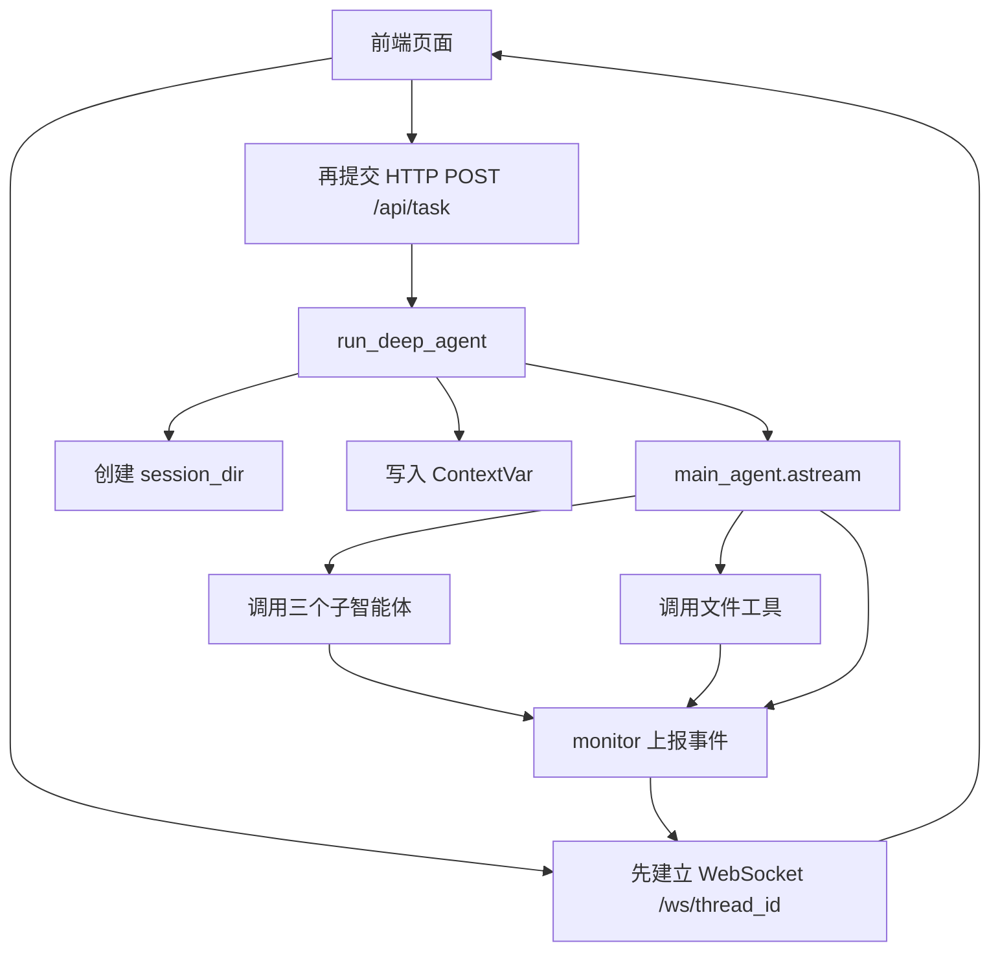
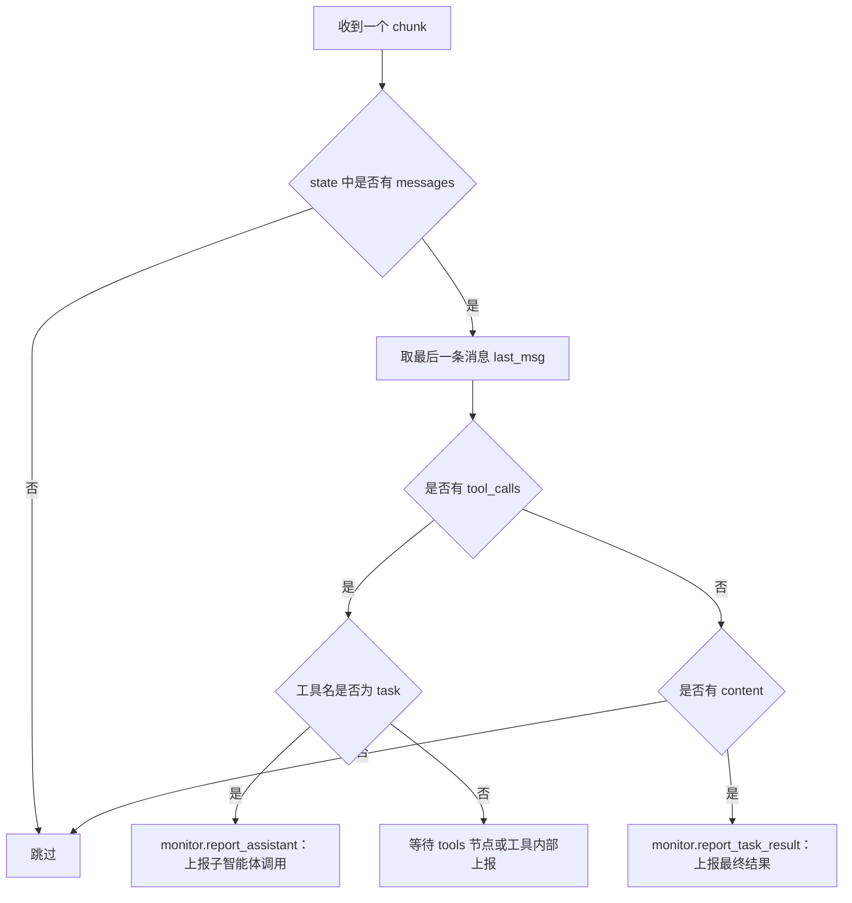

# 13 - Deep Research: Main Agent Construction and Asynchronous Execution

---

**Learning objectives for this chapter:**

- Understand the division of labor between the main agent and the three sub-agents.
- Clarify why the main agent needs file tools: reading uploaded files, generating Markdown, and converting to PDF.
- Complete the core assembly of `main_agent.py`: model, prompt, tools, sub-agents, and checkpoints.
- Understand the task boundaries and execution order requirements in the main agent system prompt.
- Understand why the main agent execution should use the `astream()` asynchronous streaming approach.
- Break down `run_deep_agent()`: session directory, uploaded files, `ContextVar`, streaming execution, event push, and context cleanup.
- See the collaboration among the frontend, FastAPI, main agent, WebSocket, and `monitor` to prepare for interface-layer development.

**Learning suggestion:** This chapter should be viewed in two halves. In the first half, look at the "creation state" of the main agent: it is the dispatch center, responsible for understanding tasks, assigning tasks, summarizing results, and generating files; the ones that actually search the web, query the database, and query the knowledge base are the sub-agents and tools. In the second half, look at the "runtime state" of the main agent: how the frontend request triggers it, how it uses `astream()` for streaming execution, and how the execution process returns to the frontend through `monitor` and WebSocket. By connecting these two halves, you will not be confused when looking at the FastAPI interface layer in the next chapter.

**Corresponding code branch:** `13-deepsearch-main-agent`

---

The previous three chapters have completed three expert assistants:

| Sub-agent                     | Responsibility                              | Underlying tool |
| ----------------------------- | ------------------------------------------- | --------------- |
| Web Search Assistant          | Query public information on the Internet    | Tavily          |
| Database Query Assistant      | Query structured enterprise data            | MySQL           |
| RAGFlow Assistant             | Query unstructured enterprise knowledge base | RAGFlow API     |

Now we need to hand them over to a "general manager" for unified scheduling, and this general manager is the main agent.

You can first understand this chapter in one sentence: `主智能体 = 模型 + 主提示词 + 文件工具 + 三个子智能体 + 会话检查点 + 异步运行入口`

This chapter unfolds along this route:

```text
先区分主智能体和子智能体
  -> 再接入主智能体自己的文件工具
  -> 组装 main_agent
  -> 理解 run_deep_agent 的异步执行链路
  -> 最后做本地验证
```

After receiving a user question, the main agent first determines which information sources the task requires, and then calls the appropriate sub-agents. After the information is returned, if the user requires file generation, the main agent then calls its own file tools to write the final result as Markdown or PDF.

---

## 1. What Is the Difference Between the Main Agent and Sub-agents

### 1.1 Sub-agents Are Only Responsible for a Specific Type of Professional Task

When writing the sub-agents earlier, the structure of each sub-agent was relatively fixed: `子智能体 = name + description + system_prompt + tools`

For example, the web search assistant only needs to know:

- When it should be called;
- How it should search;
- That it can use the `internet_search` tool.

The database assistant is similar. It is only responsible for following the database query workflow: first look at the tables, then look at the table structures and sample data, and finally execute SQL.

These sub-agents are all "experts," but they are not the final deliverers.

### 1.2 The Main Agent Is Responsible for Overall Coordination and Delivery

The main agent is not just a dictionary configuration. It must be created through `create_deep_agent()`, and it also needs to register sub-agents additionally.

The main agent is responsible for several things:

| Main agent responsibility | Description                                                          |
| ------------------------- | -------------------------------------------------------------------- |
| Understand user task      | Determine whether the user wants to look up materials, query data, read documents, or generate files |
| Dispatch sub-agents       | Call the web, database, and RAGFlow assistants according to task boundaries |
| Summarize information     | Organize the information returned by different assistants into a final answer |
| File delivery             | Generate Markdown or PDF according to user requirements              |
| Maintain session context  | Support continuous execution within the same session through `thread_id` and checkpointer |

Therefore, the main agent has one key capability that sub-agents do not: **it can hold multiple sub-agents and dispatch tasks to them.**

---

## 2. Why the Main Agent Needs Three File Tools

### 2.1 What Problems the Three Tools Solve

The ultimate goal of this project is not just to answer with a single sentence, but to complete the "Deep Research" task. Users may make requests like this: `从网络查询机器人相关信息，并生成 Markdown 和 PDF 文件。`

Or: `读取我上传的文档，结合数据库中的药品信息，整理成一份分析报告。`

At this point, the main agent needs three of its own tools:

| Tool                | File                                   | Purpose                              |
| ------------------- | -------------------------------------- | ------------------------------------ |
| `read_file_content` | `app/tools/upload_file_read_tool.py` | Read the content of user-uploaded attachments |
| `generate_markdown` | `app/tools/markdown_tools.py`        | Write the final content into a `.md` file |
| `convert_md_to_pdf` | `app/tools/pdf_tools.py`             | Convert Markdown to PDF              |

These three tools are not web search, database query, or knowledge base Q&A, so they should not be placed in any sub-agent. They belong to the final delivery stage, so they are directly controlled by the main agent.

### 2.2 Why Reading Uploaded Files Also Belongs to the Main Agent

Uploaded files are supplementary context for the user's current task. For example, if the user uploads an error log, a product description, or a report draft, the main agent must first read and understand this file before it can decide whether the next step is to search the web, query the database, or generate a document.

It does not belong to RAGFlow, because these are session files temporarily uploaded by the user, not the enterprise's long-term knowledge base.

It also does not belong to the database assistant, because uploaded files are not structured business tables.

Therefore, the tool for reading uploaded files should be given to the main agent.

### 2.3 File Tools All Depend on the Current Session Directory

File tools share one thing in common: they cannot read from or write to arbitrary locations on the system; instead, they must read from and write to the working directory of the current session.

This directory will be created in `run_deep_agent()` in the second half of this chapter: `output/session_{session_id}`

Inside the tool, it gets the current session directory through `get_session_context()`, and then resolves the relative path passed by the model into a real path through `resolve_path()`.

Behind this is an important design decision:

```text
模型只负责说“我要生成 report.md”
系统负责把它解析成当前会话目录下的真实文件路径
```

This can reduce errors when the model handles long paths, and can also prevent files from different users from getting mixed together.

---

## 3. Tool One: Read Uploaded Files with read_file_content

Corresponding project file path: `deepsearch-agents/app/tools/upload_file_read_tool.py`

`read_file_content` is responsible for reading the attachments uploaded by the user in this session and passing them to the main agent for further analysis. It supports common formats:

| File type               | Handling method                                                              |
| ----------------------- | ---------------------------------------------------------------------------- |
| `.md` / `.txt` | Read directly as UTF-8 text                                                  |
| `.docx`                | Use `python-docx` to read paragraphs                                    |
| `.pdf`                 | Use `pypdf` to extract page text                                  |
| `.xlsx` / `.xls` | Use `pandas` to read, and output row count, column names, first 5 rows, and statistical description |
| Other text files        | Try reading as UTF-8 text                                                    |

The core code can be viewed like this:

```python
@tool
def read_file_content(
    filename: Annotated[
        str, "要读取的文件名或路径（支持 .md, .docx, .pdf, .xlsx, .xls）"
    ],
    instruction: Annotated[
        str, "对提取内容的具体指令（例如：'提取摘要', '统计数据'）"
    ] = "提取全部内容",
) -> str:
    """
    读取当前会话目录中的指定文件内容

    对于 Excel 文件，会自动提供数据统计信息（head 和 describe）。
    :param filename: 文件名或相对路径，通常由主智能体从上传文件列表中选择
    :param instruction: 模型传入的读取意图，用于监控展示，不改变底层解析逻辑
    :return: 文件文本内容、表格摘要，或中文错误提示
    """
    monitor.report_tool(
        "文件内容读取工具", {"filename": filename, "instruction": instruction}
    )

    # 解析路径时优先约束在当前 session_dir 内，避免模型传入绝对路径导致越界读取
    session_dir = get_session_context()
    file_path = Path(resolve_path(filename, session_dir))

    if not file_path.exists():
        return f"错误：文件 '{filename}' 不存在 (解析路径: {file_path})。"

    # 根据文件后缀选择解析方式；未知后缀会先按 UTF-8 文本兜底读取
    ext = file_path.suffix.lower()
```

When reading this code, focus on three points:

1. `@tool` registers the function as a tool that the main agent can call.
2. `monitor.report_tool(...)` pushes progress such as "reading file" to the frontend.
3. `resolve_path(filename, session_dir)` restricts the filename provided by the model to the current session directory.

If the user uploads `开篇.txt`, the prompt tells the model to pass the filename directly: `read_file_content(filename="开篇.txt")`

The tool automatically joins it to the current session directory for reading, so the model does not need to construct an absolute path by itself.

In the project root directory, run: `uv run python -m app.tools.upload_file_read_tool`

The test entry in the script temporarily fixes `get_session_context()` to `examples/test_docs` under the project root directory, and then reads the test file.


---

## 4. Tool Two: Generate Markdown Files with generate_markdown

Corresponding project file path: `deepsearch-agents/app/tools/markdown_tools.py`

`generate_markdown` is responsible for writing the content organized by the model into a Markdown file.

There are three core parameters:

| Parameter       | Description                                                          |
| --------------- | -------------------------------------------------------------------- |
| `content`  | The body content to be written into Markdown                         |
| `filename` | Filename, which may or may not include the `.md` extension |
| `path`     | Save path, usually constrained by the prompt to the current working directory |

The core code is as follows:

```python
@tool
def generate_markdown(
    content: Annotated[str, "要写入Markdown文档的文本内容"],
    filename: Annotated[str, "Markdown文档的文件名（不包含扩展名或包含.md）"],
    path: Annotated[str, "文件保存的绝对路径"] = "",
):
    """
    根据提供的文本内容生成 Markdown 文件

    :param content: 要写入 Markdown 文档的完整文本
    :param filename: 输出文件名，缺少 .md 后缀时会自动补全
    :param path: 可选保存路径；通常由运行时工作目录指令约束为相对路径
    :return: 文件生成结果说明
    """
    print(f"[MarkdownTool] 输入保存路径: {path or '当前会话目录'}")
    monitor.report_tool("Markdown文档生成工具", {"写入的文本内容": content})

    if not filename.endswith(".md"):
        filename += ".md"

    # session_dir 由 run_deep_agent 写入 ContextVar，保证文件写入当前会话工作目录
    session_dir = get_session_context()

    # 先把模型传入的 path/filename 合成一个逻辑路径，再交给 resolve_path 做统一清洗
    if path and path != ".":
        full_input_path = str(Path(path) / filename)
    else:
        full_input_path = filename

    full_path_str = resolve_path(full_input_path, session_dir)
    file_path = Path(full_path_str)
    parent_dir = file_path.parent

    # 允许模型指定 session_dir 下的子目录；不存在时自动创建
    if not parent_dir.exists():
        parent_dir.mkdir(parents=True, exist_ok=True)

    file_path.write_text(content, encoding="utf-8")
    return f"Markdown文件 '{file_path}' 已成功生成并保存。"
```

The key point of this code is not the file writing itself, but the path handling:

```text
模型给出 path + filename
  -> 工具用 resolve_path 解析
  -> 最终写入当前会话 output/session_xxx 下
```

In this way, when the frontend later queries the file list, it only needs to look at the current session directory to see the generated `.md` file.

In the project root directory, run: `uv run python -m app.tools.markdown_tools`

The test entry will create a file similar to `examples/test_docs/sub_dir/测试文件.md`.

If you see "successfully generated," it means the Markdown file writing chain has no issues.

---

## 5. Tool Three: Convert Markdown to PDF with convert_md_to_pdf

Corresponding project file path: `deepsearch-agents/app/tools/pdf_tools.py`

`convert_md_to_pdf` is responsible for converting Markdown files to PDF. It does not regenerate content; it only performs format conversion based on the already-written `.md` file.

The core code is as follows:

```python
@tool
def convert_md_to_pdf(
    md_filename: Annotated[str, "要转换的Markdown文档路径（包含.md后缀）"],
    pdf_filename: Annotated[
        Optional[str], "输出的PDF文件路径（可选，默认与源文件同名）"
    ] = None,
) -> str:
    """
    将当前会话目录中的 Markdown 文档转换为 PDF

    :param md_filename: Markdown 文件名或相对路径，缺少后缀时会自动补为 .md
    :param pdf_filename: 可选 PDF 输出文件名；不传时与 Markdown 同名
    :return: 转换结果说明
    """
    monitor.report_tool("Markdown转PDF工具")

    try:
        # 输入路径必须先落到当前会话目录，避免模型传入任意系统路径
        session_dir = get_session_context()
        md_path = Path(md_filename).with_suffix(".md")
        md_abs_path = Path(resolve_path(str(md_path), session_dir))

        if not md_abs_path.exists():
            return f"错误：文件不存在 {md_abs_path}"

        # 未指定 PDF 文件名时，默认与源 Markdown 同目录同名
        if pdf_filename:
            pdf_path = Path(pdf_filename).with_suffix(".pdf")
            pdf_abs_path = Path(resolve_path(str(pdf_path), session_dir))
        else:
            pdf_abs_path = md_abs_path.with_suffix(".pdf")

        # PDF 版式、中文字体和 Markdown 解析细节都封装在底层转换模块中
        return convert_md_to_pdf_via_word(md_abs_path, pdf_abs_path)

    except Exception as e:
        logging.error(f"转换失败: {e}", exc_info=True)
        return f"转换失败: {str(e)}"
```

Its workflow is:

```text
确认 Markdown 文件存在
  -> 确定 PDF 输出路径
  -> 调用 convert_md_to_pdf_via_word
  -> 返回转换结果
```

In `app/utils/word_converter.py`, ReportLab is used under the hood to generate the PDF:

```python
doc = SimpleDocTemplate(
    str(pdf_abs_path),
    pagesize=A4,
    leftMargin=2 * cm,
    rightMargin=2 * cm,
    topMargin=2 * cm,
    bottomMargin=2 * cm,
    title=md_abs_path.stem,
)
styles = _build_styles()
story = _markdown_to_story(md_content, styles)
doc.build(story)
```

In the project root directory, run: `uv run python -m app.tools.pdf_tools`

The test entry first creates a sample Markdown file, then calls `convert_md_to_pdf` to generate a PDF with the same name. This mainly verifies two things: that the Markdown path can be resolved to the current session directory, and that the ReportLab conversion chain can correctly generate a Chinese PDF.

---

## 6. Create main_agent.py

Corresponding project file path: `deepsearch-agents/app/agent/main_agent.py`

The main agent file first performs imports:

```python
import shutil
from pathlib import Path

from deepagents import create_deep_agent
from langgraph.checkpoint.memory import InMemorySaver

from app.agent.llm import model
from app.agent.prompts import main_agent_content
from app.agent.subagents.database_query_agent import database_query_agent
from app.agent.subagents.knowledge_base_agent import knowledge_base_agent
from app.agent.subagents.network_search_agent import network_search_agent
from app.api.context import (
    reset_session_context,
    set_session_context,
    set_thread_context,
)
from app.api.monitor import monitor

# 文件类工具由主智能体直接掌握，负责读取上传附件和生成最终交付文档
from app.tools.markdown_tools import generate_markdown
from app.tools.pdf_tools import convert_md_to_pdf
from app.tools.upload_file_read_tool import read_file_content
```

These imports can be divided into five categories:

| Imported content                                | Purpose                                                          |
| ----------------------------------------------- | ---------------------------------------------------------------- |
| `shutil` / `Path`                       | Create session directory and copy uploaded files                 |
| Three sub-agents                                | Allow the main agent to delegate professional tasks              |
| Three file tools                                | Allow the main agent to read uploaded files, generate Markdown, and convert PDF |
| `create_deep_agent` / `InMemorySaver`   | Create the DeepAgents main agent and enable session checkpoints  |
| `model` / `main_agent_content` / context | Inject the model, system prompt, runtime session context, and monitoring reporting |

Then create the main agent:

```python
# 主智能体是调度中心：
# 1. tools 只放最终交付相关的文件工具
# 2. subagents 放网络、数据库、RAGFlow 三类信息获取助手
# 3. checkpointer 通过 thread_id 保存同一会话中的执行上下文
main_agent = create_deep_agent(
    model=model,
    system_prompt=main_agent_content["system_prompt"],
    tools=[generate_markdown, convert_md_to_pdf, read_file_content],
    checkpointer=InMemorySaver(),
    subagents=[database_query_agent, network_search_agent, knowledge_base_agent],
)
```

This is the key code of this chapter.

### 6.1 Explanation of create_deep_agent Parameters

| Parameter        | Purpose                          | Configuration in this project              |
| ---------------- | -------------------------------- | ------------------------------------------ |
| `model`         | Large language model used by the main agent | The `model` configured in Chapter 9 |
| `system_prompt` | Main agent behavior constraints  | `main_agent.system_prompt` in `prompts.yml` |
| `tools`         | The main agent's own tools       | File reading, Markdown, PDF                |
| `checkpointer`  | Session state checkpoint         | `InMemorySaver()`                             |
| `subagents`     | Sub-agents that can be dispatched | Database, web search, RAGFlow              |

The `checkpointer=InMemorySaver()` here is to support the subsequent `thread_id`. The same frontend session will call with the same `thread_id`, allowing the main agent to maintain state at the session level.

### 6.2 Sub-agent Registration Order

The registration order in the current code is:

```python
subagents=[
    database_query_agent,
    network_search_agent,
    knowledge_base_agent,
]
```

Order is not the core issue; the key is that each sub-agent's `description` is written clearly enough. The main agent decides whom to call based on the user's question and the sub-agent descriptions.

For example:

| User Requirement                                 | More Likely to Invoke                               |
| ------------------------------------------------ | --------------------------------------------------- |
| Query the stock of a product                     | Database Query Assistant                            |
| Query public information about the robotics industry | Web Search Assistant                             |
| Query internal enterprise policies or knowledge base documents | RAGFlow Assistant                         |
| Query materials and generate a PDF               | First invoke related sub-agents, then the main agent generates Markdown and PDF |

---

## 7. What Should the Main Agent Prompt Constrain

Project file path: `deepsearch-agents/app/prompt/prompts.yml`

The main agent's prompt is relatively long, but the core is not about "writing length" but about clearly constraining several key points.

### 7.1 Role Positioning

At the beginning of the prompt, the main agent is positioned as the team leader:

```yaml
main_agent:
  system_prompt: |
    你是金融与电商研究团队负责人，负责协调三个专家助手完成复杂任务
    你的团队成员如下：
      1. **网络搜索助手**
      2. **数据库查询助手**
      3. **RAGFlow助手**
```

This should remain consistent with the course project background. The current main prompt sets it as the "head of the finance and e-commerce research team," and the examples later in the article also follow this setting. Do not be misled by the industry name; what this chapter really needs to capture is: **the main agent is the team leader, not a specific tool.**

Also, be aware of whether the prompt is consistent with the code capabilities. Currently, the file tools registered by `main_agent` only include `generate_markdown`, `convert_md_to_pdf`, and `read_file_content`. If the prompt still contains phrasing such as "Word file generation" or "hand it over to the file generation assistant," readers may mistakenly think that the project has a separate file generation sub-agent. A safer expression is: Markdown is generated by the main agent calling `generate_markdown`; for PDF, first generate Markdown, then call `convert_md_to_pdf` to convert.

### 7.2 Division of Information Sources

The prompt should tell the main agent whom to find for the three types of information:

| Information Type                                    | Target to Call   |
| --------------------------------------------------- | ---------------- |
| Background knowledge, external knowledge, latest public materials | Web Search Assistant  |
| Internal enterprise non-public document knowledge   | RAGFlow Assistant |
| Structured data such as internal enterprise products, inventory, and sales | Database Query Assistant |

If the problem boundary is unclear, the main agent can try multiple ways to obtain information.

This is important. Because real users will not ask questions according to your system boundaries; users will only say: `帮我整理一下某个产品的市场信息和内部库存情况，生成 PDF。`

This task involves external materials, internal databases, and file generation at the same time. The main agent must first break down the task instead of directly generating files.

### 7.3 File Generation Order

The key part of the prompt is the execution order:

```text
1. 必须先调用子智能体获取信息。
2. 绝不允许在获取信息之前调用 generate_markdown。
3. 严禁使用“等待子任务完成”之类的占位符内容生成文件。
4. 如果需要先搜索再生成，请分两步进行。
```

Why should the order be written clearly?

Because in complex tasks, the model may call `generate_markdown` in advance and write placeholder content such as "waiting for search results to supplement." This makes the generated file look as if it exists, but it has no value.

Therefore, the main agent must follow:

```text
先拿信息
  -> 再组织内容
  -> 再生成 Markdown
  -> 如用户要求 PDF，再转换 PDF
```

---

Up to this point, the `main_agent` object has been created. However, just because the object has been created does not mean the user can already use it. Next, three runtime issues still need to be solved:

```text
前端用户点发送后，怎么触发 main_agent？
main_agent 执行过程中，怎么把工具调用、子智能体调用、最终结果推给前端？
多个用户同时请求时，怎么保证消息不串台？
```

This is what `run_deep_agent()` is responsible for.

---

## 8. Look at the Full Chain First at Runtime

The first half addressed "how to create the main agent." From here on, let's look at how it runs in a web service.

This section first puts `astream()`, HTTP, WebSocket, `session_id`, and `ContextVar` into one diagram. Chapter 15 will formally write the FastAPI interface; this chapter only covers several things that must be understood in advance for the main agent runtime.



Read it as one line: HTTP is only responsible for starting the task, `run_deep_agent()` is responsible for preparing the session environment, `main_agent.astream()` is responsible for asynchronous execution, and the progress during execution and the final result go back to the frontend through `monitor -> WebSocket`.

### 8.1 Why the Main Agent Should Choose astream

DeepAgents has three common execution methods:

| Execution Method     | Characteristics                 | Used in This Project       |
| -------------------- | ------------------------------- | -------------------------- |
| `invoke()`   | Synchronous one-time return    | Not suitable for long multi-client tasks |
| `stream()`   | Synchronous streaming return   | Still blocks the current synchronous call chain |
| `astream()`   | Asynchronous streaming return  | Used in this project       |

This project is a backend service, not a local script. The frontend may have multiple sessions asking questions at the same time:

```text
用户 A 正在查网络并生成 PDF
用户 B 正在查数据库
用户 C 正在读取上传文件
```

If a synchronous method is used, other requests are likely to queue up when one task takes a long time. Using `astream()` can turn the main agent execution into an asynchronous streaming task, making the FastAPI service more suitable for multi-client concurrency.

---

### 8.2 Complete Frontend-Backend Communication Flow

First look at the overall chain:

```text
前端页面打开
  -> 建立 WebSocket: /ws/{thread_id}
  -> 后端缓存 thread_id -> WebSocket

用户点击发送
  -> HTTP POST /api/task
  -> FastAPI 创建后台任务
  -> run_deep_agent(query, thread_id)
  -> main_agent.astream(...)
  -> 执行过程中调用 monitor
  -> monitor 根据 thread_id 找到 WebSocket
  -> WebSocket 推送进度和结果给前端
```

There are two entry points in this chain:

| Entry Point        | Role                                  | Called When                 |
| ------------------ | ------------------------------------- | --------------------------- |
| `/ws/{thread_id}` | Establish a long connection and cache the current session's WebSocket | Called first when the page opens |
| `/api/task` | Start an agent task                  | Called when the user clicks send |

Note the order: **usually establish the WebSocket first, then start the task.**

If the WebSocket is not established first, the backend will not know which frontend to push progress to during execution.

---

### 8.3 Why the HTTP Interface Cannot Directly Return the Final Answer

When a user starts a task, an HTTP interface is called, for example: `POST /api/task`

Intuitively, it seems possible to directly return the final answer in the HTTP response. However, this project does not do that.

The reason is that the main agent task may be very long:

- First call the web search assistant;
- Then call the database assistant;
- Then call the RAGFlow assistant;
- Then generate Markdown;
- Then convert to PDF;
- In between, continuously display the status to the frontend.

If the HTTP request keeps waiting for the final result, the frontend will be stuck for a long time, and the backend connection will also become fragile.

Therefore, `/api/task` only does one thing: `告诉前端：任务已经开始`

The actual execution progress and final result are pushed through WebSocket.

This is also why the interface response is usually:

```json
{
  "status": "started",
  "thread_id": "custom-session-id-123"
}
```

Instead of directly returning the agent's final answer.

---

### 8.4 What WebSocket Is Responsible For Here

WebSocket is responsible for pushing events during the main agent execution in real time.

These events roughly fall into five categories:

| Event             | Triggered When                           | Frontend Display                       |
| ----------------- | ---------------------------------------- | -------------------------------------- |
| `session_created` | The current session working directory is created | The frontend records the file directory and can later query the file list |
| `assistant_call` | The main agent is about to call a sub-agent | Display "Calling web search assistant," etc. |
| `tool_start` | A tool begins execution                  | Display tool name and parameters       |
| `task_result` | The main agent returns the final answer  | Display the AI reply                   |
| `error` | An exception occurs during execution     | Display error message                  |

In the code, the business layer does not directly operate the WebSocket. The business layer only calls:

```python
monitor.report_tool(...)
monitor.report_assistant(...)
monitor.report_task_result(...)
monitor.report_session_dir(...)
```

Then `monitor` finds the corresponding WebSocket through `ConnectionManager` and pushes messages to the frontend.

In this way, the business code does not need to care about WebSocket connection details:

```text
工具 / 主智能体
  -> monitor
  -> ConnectionManager
  -> WebSocket
  -> 前端
```

---

### 8.5 How session_id Prevents Cross-Talk Between Multiple Clients

Suppose there are three frontend sessions now:

```text
session_A -> websocket_A
session_B -> websocket_B
session_C -> websocket_C
```

The backend will store them in a dictionary:

```python
active_connections = {
    "session_A": websocket_A,
    "session_B": websocket_B,
    "session_C": websocket_C,
}
```

When the task of `session_A` reaches a tool call during execution, the backend must send the message to `websocket_A`, not to `websocket_B`.

Therefore, each task request must carry the current session's `session_id` or `thread_id`.

This ID has three purposes in the project:

| Purpose      | Description                                                      |
| ------------ | ---------------------------------------------------------------- |
| Find WebSocket | `monitor` finds the current frontend connection based on `thread_id`          |
| Create working directory | Each session creates `output/session_{thread_id}`, so files do not get mixed up |
| Retrieve checkpoint | `InMemorySaver()` maintains the same session state according to `thread_id`    |

This is the basic design of a multi-client system: **each frontend request carries the same session identifier, and the backend finds the resources corresponding to that session based on the identifier.**

---

### 8.6 ContextVar: Passing Session Information to Deep Tools

Project file path: `deepsearch-agents/app/api/context.py`

Two context variables are defined here:

```python
from contextvars import ContextVar, Token
from typing import Optional

# ContextVar 是协程级上下文变量，适合 FastAPI 这类异步 Web 服务
# 它可以避免多个并发请求共用全局变量时出现 thread_id 或 session_dir 串台
_session_dir_ctx: ContextVar[Optional[str]] = ContextVar(
    "session_dir",
    default=None,
)
_thread_id_ctx: ContextVar[Optional[str]] = ContextVar(
    "thread_id",
    default=None,
)
```

They each store:

| ContextVar        | Stores                           | Who Uses It                           |
| ----------------- | -------------------------------- | ------------------------------------- |
| `_session_dir_ctx` | Current session working directory | File reading, Markdown, and PDF tools |
| `_thread_id_ctx` | Current session ID               | `monitor` pushes WebSocket messages |

The setting and reading methods are as follows:

```python
def set_session_context(path: str) -> Token[Optional[str]]:
    """设置当前请求链路的会话目录，返回 reset 时需要使用的 token"""
    return _session_dir_ctx.set(path)

def get_session_context() -> Optional[str]:
    """获取当前请求链路的会话目录"""
    return _session_dir_ctx.get()

def set_thread_context(thread_id: str) -> Token[Optional[str]]:
    """设置当前请求链路的线程 ID"""
    return _thread_id_ctx.set(thread_id)

def get_thread_context() -> Optional[str]:
    """获取当前请求链路的线程 ID"""
    return _thread_id_ctx.get()

def reset_session_context(
    session_token: Token[Optional[str]],
    thread_token: Optional[Token[Optional[str]]] = None,
) -> None:
    """恢复请求上下文，避免本次任务信息残留到后续请求"""
    _session_dir_ctx.reset(session_token)
    if thread_token is not None:
        _thread_id_ctx.reset(thread_token)
```

Why not use ordinary global variables?

Because FastAPI is an asynchronous concurrent service. Requests from multiple users may execute alternately in the same thread. If global variables are used, user A's `session_id` may be overwritten by user B, causing messages or files to be mixed up.

`ContextVar` is a coroutine-level context variable, which is more suitable for asyncio scenarios. As long as it is within the same task call chain, deep tools can also access the current session's own values.

---

## 9. Seven-Step Breakdown of run_deep_agent

Project file path: `deepsearch-agents/app/agent/main_agent.py`

The main agent's execution method is:

```python
async def run_deep_agent(task_query, session_id):
    """
    异步流式执行主智能体

    API 层会为每次任务传入用户问题和 session_id。本函数负责准备会话目录、
    复制上传文件、写入 ContextVar，并在流式执行过程中把关键事件上报给前端。
    :param task_query: 前端提交的原始任务问题
    :param session_id: 当前任务 ID，同时用于 thread_id、输出目录和 WebSocket 定向推送
    """
```

What it does can be broken down into seven steps:

```text
1. 创建当前会话的 output/session_{session_id} 目录
2. 检查 updated/session_{session_id} 下是否有上传文件
3. 如果有上传文件，复制到 output/session_{session_id}
4. 把 session_dir 和 session_id 写入 ContextVar
5. 拼接工作目录提示词，调用 main_agent.astream(...)
6. 解析流式 chunk，向前端推送子智能体调用和最终结果
7. finally 中重置 ContextVar
```

---

### 9.1 Step 1: Create the Current Session Output Directory

The code is as follows:

```python
# 当前文件位于 app/agent/main_agent.py，parents[1] 即 app 目录
project_root_path = Path(__file__).parents[1].resolve()

# 每个会话独立使用 output/session_{session_id}，避免不同用户的产物互相覆盖
session_dir = project_root_path / "output" / f"session_{session_id}"
session_dir.mkdir(parents=True, exist_ok=True)

# 前端和工具使用绝对路径；提示词里只给模型相对路径
session_dir_str = str(session_dir).replace("\\", "/")
relative_session_dir_str = str(session_dir.relative_to(project_root_path)).replace(
    "\\", "/"
)
```

Two paths are generated here:

| Path                       | Example                          | Used By                   |
| -------------------------- | -------------------------------- | ------------------------- |
| `session_dir_str`        | `/.../app/output/session_xxx`              | For the frontend and tools |
| `relative_session_dir_str`       | `output/session_xxx`              | For the model prompt     |

Why is a relative path needed?

Because large language models are not good at handling very long local absolute paths. We tell it: `工作目录: output/session_xxx`

Then we use the tool's internal `resolve_path()` to construct the real absolute path, which is more stable.

---

### 9.2 Step 2: Process Uploaded Files

Uploaded files first go to: `updated/session_{session_id}`

When executing the task, the code copies them to: `output/session_{session_id}`

The core code is as follows:

```python
# 上传文件先落在 updated/session_{session_id}，执行前复制到本次 output 工作目录
# 这样读文件工具和生成文件工具都只需要围绕同一个 session_dir 工作
updated_dir_path = project_root_path / "updated" / f"session_{session_id}"
updated_info_prompt = ""

if updated_dir_path.exists():
    files = [f.name for f in updated_dir_path.iterdir() if f.is_file()]

    if files:
        for filename in files:
            # copy2 会保留上传文件的修改时间、权限等元数据，便于后续排查文件来源
            shutil.copy2(updated_dir_path / filename, session_dir / filename)

        # 把上传文件列表注入用户消息，提醒模型先调用 read_file_content 获取附件内容
        updated_info_prompt = (
            "\n    [已上传文件] 已加载到工作目录:\n"
            + "\n".join([f"    - {f}" for f in files])
            + "\n    请优先使用工具（read_file_content）读取并参考这些文件。"
        )
```

Why make a copy?

Because when the frontend later displays the file list, it only needs to read one directory: `output/session_{session_id}`

This directory contains both user-uploaded files and model-generated files. The frontend does not need to query `updated` and `output` separately.

At the same time, the prompt tells the model:

```text
[已上传文件] 已加载到工作目录:
- 开篇.txt
请优先使用 read_file_content 读取并参考这些文件。
```

In this way, the user-uploaded files become supplementary context for the current task.

---

### 9.3 Step 3: Bind ContextVar and Push the Session Directory

After preparing the session directory, save the current task's context:

```python
session_dir_token = set_session_context(session_dir_str)
session_id_token = set_thread_context(session_id)

# 前端拿到工作目录后，可以展示本次任务生成的 Markdown/PDF 等产物
monitor.report_session_dir(session_dir_str)
```

These three lines do three things respectively:

| Code                                          | Purpose                                         |
| --------------------------------------------- | ---------------------------------------------- |
| `set_session_context(session_dir_str)`        | Let file tools know the current session directory |
| `set_thread_context(session_id)`              | Let `monitor` know which WebSocket to send to |
| `monitor.report_session_dir(session_dir_str)` | Push the current session file directory to the frontend |

After the frontend receives the `session_created` event, it can record this directory. When querying the file list later, it will pass this directory to `/api/files`.

---

### 9.4 Step 4: Building the Working Directory Prompt

Before the main agent actually executes, it appends the working directory constraint to the user's question:

```python
path_instruction = f"""
【工作环境指令】
工作目录: {relative_session_dir_str}
{updated_info_prompt}

规则：
1. 新生成文件必须保存到工作目录：'{relative_session_dir_str}/filename'
2. 读取已上传的文件时，请直接将文件名（例如：'开篇.txt'）作为 filename 参数传入（read_file_content）读取工具，不要带上任何目录前缀。
3. 使用相对路径，禁止使用绝对路径
4. 若存在上传文件，请先分析内容
"""
```

This prompt solves two problems:

1. Where generated files should be created;
2. How to pass parameters when reading uploaded files.

Point 2 is especially critical. Do not let the model write the uploaded file path as `output/session_xxx/开篇.txt`; instead, let it pass only `开篇.txt`.

Because path concatenation should be handled by the tool, not guessed by the model.

---

### 9.5 Step 5: Executing with main_agent.astream

The main agent execution code is as follows:

```python
# checkpointer 依赖 thread_id 区分会话记忆；同一 session_id 会复用同一条执行上下文
config = {
    "configurable": {
        "thread_id": session_id
    }
}

# 工作环境指令是运行时动态补充的，约束模型只在当前会话目录读写文件
async for chunk in main_agent.astream(
    {"messages": [{"role": "user", "content": task_query + path_instruction}]},
    config=config,
):
    ...
```

There are two key points here.

First, `thread_id` must be placed in `configurable`:

```python
config = {"configurable": {"thread_id": session_id}}
```

It works with the previously configured `InMemorySaver()` to give the same conversation its own checkpoint.

Second, the user content passed to the model is not simply `task_query`, but rather:

```python
task_query + path_instruction
```

In other words, the working directory and file rules are appended after the user's question. Only after the model sees the complete instruction does it know which directory to generate files into and how to read uploaded files.

---

### 9.6 Step 6: Parsing Streaming Chunks

`main_agent.astream(...)` continuously emits chunks. Each chunk looks roughly like this:

```python
{
    "model": {
        "messages": [...]
    }
}
```

The code iterates over the state of each node in the chunk:

```python
async for chunk in main_agent.astream(...):
    # chunk 形如 {"model": {"messages": [...]}}，这里主要关心模型最新消息
    for node_name, state in chunk.items():
        if not state or "messages" not in state:
            continue

        messages = state["messages"]
        if messages and isinstance(messages, list):
            last_msg = messages[-1]
```

Then it determines what is currently happening based on `last_msg`.



This diagram is consistent with the `chunk` state identification in Chapter 2, except that here there is additional frontend event reporting: when a subagent is identified, it pushes `assistant_call`; when final content is identified, it pushes `task_result`.

#### 9.6.1 Case 1: Calling a Subagent

If the last message contains `tool_calls` and the tool name is `task`, it means the main agent is calling a subagent:

```python
if node_name == "model":
    if last_msg.tool_calls:
        # DeepAgents 调用子智能体时，本质上会产生名为 task 的工具调用
        for tool_call in last_msg.tool_calls:
            if tool_call["name"] == "task":
                # 子智能体调用单独上报，前端可以展示“正在调用哪个专家助手”
                monitor.report_assistant(
                    tool_call["args"]["subagent_type"],
                    {"description": tool_call["args"]["description"]},
                )
```

DeepAgents internally uses a special `task` tool to delegate to subagents. Its parameters typically include:

| Field            | Description                   |
| --------------- | ---------------------- |
| `subagent_type` | Which subagent to call     |
| `description`   | Task description for the subagent |

After the frontend receives the `assistant_call` event, it can display: `正在调用助手：网络搜索助手`

#### 9.6.2 Case 2: Main Agent Returns Final Result

If there is no tool call, but the last message has `content`, it means the main agent has provided the final answer:

```python
elif last_msg.content:
    # 模型没有继续调用工具时，最新文本内容就是本轮可反馈给前端的结果
    print(f"主智能体执行结果，最终结果：{last_msg.content[:100]}")
    monitor.report_task_result(last_msg.content)
```

At this point, push it to the frontend via `monitor.report_task_result(...)`.

After the frontend receives `task_result`, it can display the final reply in the dialog box.

#### 9.6.3 Where Tool Call Progress Is Pushed

There is one more point that is easy to confuse: not all ordinary tool calls are pushed in `run_deep_agent()`.

For example, tools such as `generate_markdown`, `internet_search`, and `execute_sql_query` already have this written inside their tool functions:

```python
monitor.report_tool(...)
```

So tool-level progress is reported within the tool itself. `run_deep_agent()` mainly supplements four types of events:

| Event         | Who is responsible for reporting                                    |
| ------------ | --------------------------------------------- |
| Tool starts executing | Inside the tool via `monitor.report_tool(...)`         |
| Calling a subagent | `run_deep_agent()` parses the `task` tool call and then reports |
| Final result     | `run_deep_agent()` parses the final `content` and then reports  |
| Session directory     | Reported during the `run_deep_agent()` preparation phase               |

---

### 9.7 Step 7: Exception Handling and Context Cleanup

The execution process is wrapped in `try / except / finally`:

```python
try:
    async for chunk in main_agent.astream(...):
        ...
except Exception as e:
    # 异步执行异常也走 monitor，保证前端能收到明确错误事件
    monitor._emit("error", f"执行主智能体发生异常信息：{str(e)}")
finally:
    # 任务结束后恢复 ContextVar，避免后续请求复用到本次会话目录或 thread_id
    reset_session_context(session_dir_token, session_id_token)
```

On exception, the frontend is notified via `monitor._emit("error", ...)`.

`finally` must reset the context:

```python
reset_session_context(session_dir_token, session_id_token)
```

Otherwise, when the web service runs for a long time, `session_id` or `session_dir` from the previous task may remain and affect subsequent requests.

---

## 10. Complete Skeleton of run_deep_agent

Putting the above parts together, the skeleton of `run_deep_agent()` is as follows:

```python
async def run_deep_agent(task_query, session_id):
    """
    异步流式执行主智能体

    API 层会为每次任务传入用户问题和 session_id。本函数负责准备会话目录、
    复制上传文件、写入 ContextVar，并在流式执行过程中把关键事件上报给前端。
    :param task_query: 前端提交的原始任务问题
    :param session_id: 当前任务 ID，同时用于 thread_id、输出目录和 WebSocket 定向推送
    """
    print(f"[MainAgent] 开始执行会话，session_id={session_id}")

    # 每个会话独立使用 output/session_{session_id}，避免不同用户的产物互相覆盖
    session_dir = project_root_path / "output" / f"session_{session_id}"
    session_dir.mkdir(parents=True, exist_ok=True)

    # 前端和工具使用绝对路径；提示词里只给模型相对路径，降低模型误用系统绝对路径的概率
    session_dir_str = str(session_dir).replace("\\", "/")
    relative_session_dir_str = str(session_dir.relative_to(project_root_path)).replace(
        "\\", "/"
    )

    # 上传文件先落在 updated/session_{session_id}，执行前复制到本次 output 工作目录
    # 这样读文件工具和生成文件工具都只需要围绕同一个 session_dir 工作
    updated_dir_path = project_root_path / "updated" / f"session_{session_id}"
    updated_info_prompt = ""
    if updated_dir_path.exists():
        files = [f.name for f in updated_dir_path.iterdir() if f.is_file()]
        if files:
            for filename in files:
                # copy2 会保留上传文件的修改时间、权限等元数据，便于后续排查文件来源
                shutil.copy2(updated_dir_path / filename, session_dir / filename)

            # 把上传文件列表注入用户消息，提醒模型先调用 read_file_content 获取附件内容
            updated_info_prompt = (
                "\n    [已上传文件] 已加载到工作目录:\n"
                + "\n".join([f"    - {f}" for f in files])
                + "\n    请优先使用工具（read_file_content）读取并参考这些文件。"
            )

    # ContextVar 让深层工具无需显式传参，也能拿到当前会话目录和 WebSocket thread_id
    session_dir_token = set_session_context(session_dir_str)
    session_id_token = set_thread_context(session_id)

    # 前端拿到工作目录后，可以展示本次任务生成的 Markdown/PDF 等产物
    monitor.report_session_dir(session_dir_str)

    # checkpointer 依赖 thread_id 区分会话记忆；同一 session_id 会复用同一条执行上下文
    config = {"configurable": {"thread_id": session_id}}

    # 工作环境指令是运行时动态补充的，约束模型只在当前会话目录读写文件
    path_instruction = f"""
    【工作环境指令】
    工作目录: {relative_session_dir_str}
    {updated_info_prompt}

    规则：
    1. 新生成文件必须保存到工作目录：'{relative_session_dir_str}/filename'
    2. 读取已上传的文件时，请直接将文件名作为 filename 参数传入，不要带目录前缀。
    3. 使用相对路径，禁止使用绝对路径
    4. 若存在上传文件，请先分析内容
    """

    try:
        # astream 会持续产出模型节点、工具节点和子智能体节点的状态片段
        async for chunk in main_agent.astream(
            {"messages": [{"role": "user", "content": task_query + path_instruction}]},
            config=config,
        ):
            # chunk 形如 {"model": {"messages": [...]}}，这里主要关心模型最新消息
            for node_name, state in chunk.items():
                if not state or "messages" not in state:
                    continue

                messages = state["messages"]
                if messages and isinstance(messages, list):
                    last_msg = messages[-1]
                    if node_name == "model":
                        if last_msg.tool_calls:
                            # DeepAgents 调用子智能体时，本质上会产生名为 task 的工具调用
                            for tool_call in last_msg.tool_calls:
                                if tool_call["name"] == "task":
                                    # 子智能体调用单独上报，前端可以展示“正在调用哪个专家助手”
                                    monitor.report_assistant(
                                        tool_call["args"]["subagent_type"],
                                        {
                                            "description": tool_call["args"][
                                                "description"
                                            ]
                                        },
                                    )
                        elif last_msg.content:
                            # 模型没有继续调用工具时，最新文本内容就是本轮可反馈给前端的结果
                            print(
                                f"主智能体执行结果，最终结果：{last_msg.content[:100]}"
                            )
                            monitor.report_task_result(last_msg.content)

    except Exception as e:
        # 异步执行异常也走 monitor，保证前端能收到明确错误事件
        monitor._emit("error", f"执行主智能体发生异常信息：{str(e)}")
    finally:
        # 任务结束后恢复 ContextVar，避免后续请求复用到本次会话目录或 thread_id
        reset_session_context(session_dir_token, session_id_token)
```

The first three file tools have already been individually verified locally. Here, verification is performed at the main agent level to confirm that `run_deep_agent()` can connect the model, subagents, file tools, and session directory end to end.

```python
if __name__ == "__main__":
    import asyncio

    asyncio.run(
        run_deep_agent(
            "从网络查询机器人信息，并生成Markdown文件",
            "test_session_001"
        )
    )
```

But note: this test entry point is only suitable for local script verification. When integrating with FastAPI in the next chapter, do not use `asyncio.run()` in the interface; instead, use `asyncio.create_task(...)` to hand the task off to FastAPI's existing event loop.

Execute from the project root directory: `uv run python -m app.agent.main_agent`


---

**Chapter Summary:**

This chapter advances the main agent from "being created" to "being executable asynchronously." You need to remember two main threads.

The first is the main agent assembly chain:

```text
模型 + 主提示词 + 文件工具 + 三个子智能体 + InMemorySaver
  -> create_deep_agent
  -> main_agent
```

The second is the main agent execution chain:

```text
HTTP 启动任务
  -> run_deep_agent 异步执行
  -> main_agent.astream 流式输出
  -> monitor 上报关键事件
  -> WebSocket 推送给前端
```

Finally, remember two isolation points:

1. `thread_id` isolates WebSocket messages and checkpoints to prevent messages from being sent to the wrong frontend.
2. `session_dir` isolates file directories to prevent uploaded files and generated files from being written to the wrong session.

The next chapter will formally write the FastAPI interface, connect the `run_deep_agent()` from this chapter to frontend requests, and explain what `/api/task`, `/api/upload`, `/api/files`, `/api/download`, and `/ws/{thread_id}` are each responsible for.
