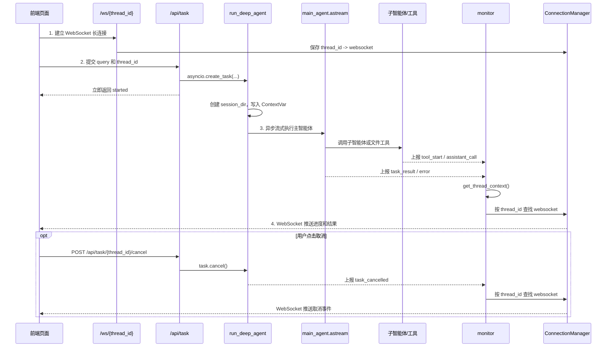
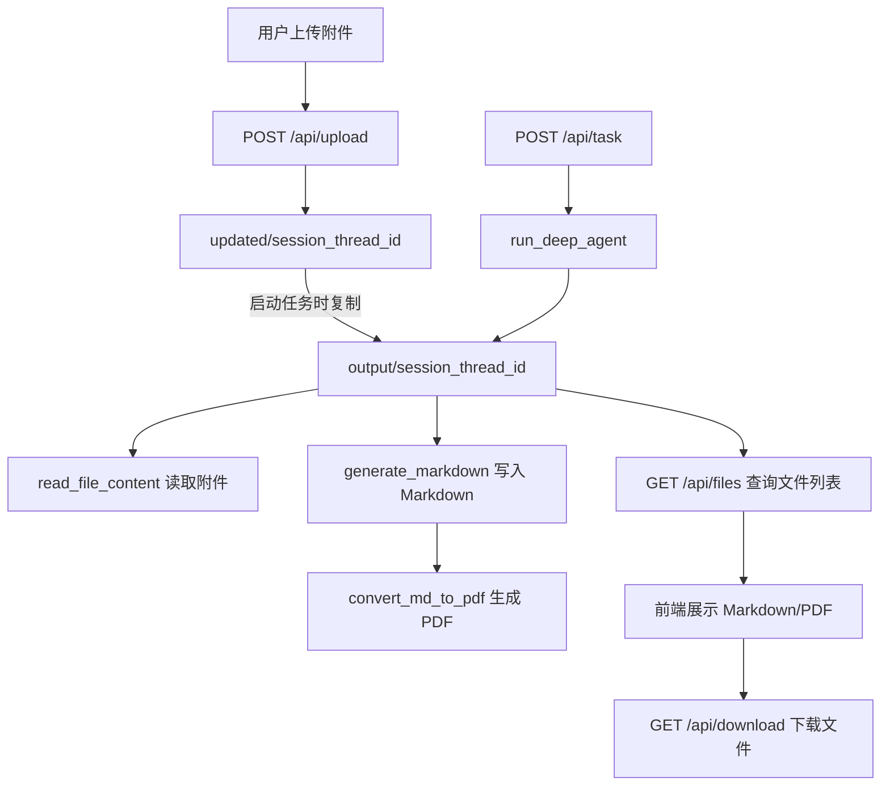

# 14 - Deep Research: FastAPI Interface and Project Closure

---

**Chapter Objectives:**

- Complete the FastAPI interface layer for the DeepAgents multi-agent system.
- Understand how the six entry points `/api/task`, `/api/task/{thread_id}/cancel`, `/api/upload`, `/api/files`, `/api/download`, and `/ws/{thread_id}` each correspond to a specific frontend action.
- Understand why `/api/task` only starts a background task and does not directly wait for the main agent to return the final result.
- Grasp the relationship between `asyncio.create_task()`, `active_tasks`, and task cancellation.
- Understand why WebSocket needs to bind to FastAPI's event loop, and what problem `run_coroutine_threadsafe()` solves.
- Complete the end-to-end validation following the class path: frontend connection, file upload, task initiation, progress viewing, Markdown/PDF generation, and file download.

**Study Suggestion:** This chapter does not open a new knowledge track; instead, it ties together the previous chapters. When reading, imagine yourself sitting next to the browser: first see what request the page sends, then see to whom FastAPI delegates the task, and finally see how `monitor` pushes progress back to the page. If you can trace a task from the page to the logs, and then from the logs back to the page, the project is truly up and running.

**Corresponding Code Branch:** `14-deepsearch-api-websocket`

---

The previous chapter completed the main agent: `main_agent` is responsible for orchestrating the three sub-agents, and `run_deep_agent()` is responsible for creating the session directory, copying uploaded files, executing `main_agent.astream()`, and reporting progress through `monitor`.

However, the main agent itself is not yet a web service that the frontend can call directly. The frontend still needs the following capabilities:

```text
建立实时连接
  -> 上传资料
  -> 提交任务
  -> 必要时取消任务
  -> 查看生成文件
  -> 下载 Markdown / PDF
```

These entry points are all consolidated in `deepsearch-agents/app/api/server.py`.

This chapter unfolds along the following route:

```text
先把接口放到完整闭环里看
  -> 再看 server.py 的基础准备
  -> 拆解任务启动和任务取消
  -> 拆解上传、文件列表和下载
  -> 理解 WebSocket 与 monitor 的实时推送
  -> 最后用前端页面完成闭环验证
```

---

## 1. First, View the Interface Within the Complete Loop

Project file path: `deepsearch-agents/app/api/server.py`

`server.py` is the "interface layer" of the entire project. It is not responsible for writing search tools or designing the main agent's prompt; it is responsible for translating actions in the browser into tasks the backend can execute, and then sending the backend execution process back to the browser.

You can first think of it as two channels:

| Channel   | Responsible For                          | Corresponding Interfaces in This Chapter                                 |
| --------- | ---------------------------------------- | ------------------------------------------------------------------------ |
| HTTP      | Send commands, transfer files, query files, download files | `/api/task`, `/api/upload`, `/api/files`, `/api/download`, cancel interface |
| WebSocket | Send back real-time progress and final results | `/ws/{thread_id}`                                                        |

HTTP is more like "what I want to do now," while WebSocket is more like "what step the backend has reached now."

### 1.1 Interface Map

First, put the six entry points into a table:

| Frontend Action        | Backend Interface                     | Purpose                        |
| ---------------------- | ------------------------------------- | ------------------------------ |
| Page open or refresh   | `WebSocket /ws/{thread_id}`         | Establish a persistent connection and receive execution progress in real time |
| User clicks send       | `POST /api/task`                    | Start a main agent task        |
| User clicks cancel     | `POST /api/task/{thread_id}/cancel` | Cancel the currently executing task in the specified session |
| User uploads attachments | `POST /api/upload`                  | Temporarily store one or more files in the current session |
| Frontend refreshes file list | `GET /api/files`             | Query files in the current session's output directory |
| User clicks download   | `GET /api/download`                 | Download a specified output file |

The most easily misunderstood one here is `/api/task`. Its return of `started` does not mean the task has finished executing; it only means the task has been handed over to a background coroutine. Subsequent tool calls, sub-agent calls, the final answer, and exceptions all need to be observed through WebSocket pushes.

### 1.2 Diagram: Complete Sequence of a Single Task

Read this diagram in chronological order. The frontend first establishes the WebSocket connection, then initiates the task via HTTP. During task execution, `monitor` finds the corresponding connection based on `thread_id` and pushes progress back to the page. Canceling a task is an optional branch and does not change how you understand the main flow.



When reading the diagram, focus on four key points:

| No. | Action             | Key Point                                                            |
| --- | ------------------ | -------------------------------------------------------------------- |
| 1   | Establish WebSocket | First store the current session's connection                          |
| 2   | Call `/api/task` | HTTP only starts the task and does not wait for the final result     |
| 3   | Execute main agent in background | `run_deep_agent()` writes context and calls `main_agent.astream()` |
| 4   | Push real-time events | Tools, sub-agents, results, and exceptions are all sent back to the frontend via WebSocket |

### 1.3 thread_id Is the Key to the Entire Chain

You will see `thread_id` repeatedly in this chapter. It is not just a random string; it is the same session ID that ties several things together:

| Where It Is Used              | Purpose                                       |
| ----------------------------- | --------------------------------------------- |
| WebSocket                     | Find the current page's persistent connection |
| `active_tasks`                | Find the background task currently executing in this session |
| `output/session_{thread_id}`  | Isolate the output directory for this task    |
| `updated/session_{thread_id}` | Isolate the attachments uploaded for this task |
| LangGraph checkpointer        | Distinguish execution context within the same session |

Without `thread_id`, the frontend page, background tasks, generated files, and WebSocket messages would easily get crossed.

---

## 2. What server.py Prepares First

Before entering the interface functions, `server.py` first makes several basic preparations: define the service lifecycle, create the FastAPI application, prepare two file directories, declare the background task table, and configure CORS.

### 2.1 Application Object, Directories, and Background Task Table

Core code:

```python
import asyncio
import shutil
import uuid
from contextlib import asynccontextmanager
from pathlib import Path
from typing import List

import uvicorn
from fastapi import (
    FastAPI,
    File,
    Form,
    HTTPException,
    UploadFile,
    WebSocket,
    WebSocketDisconnect,
)
from fastapi.middleware.cors import CORSMiddleware
from fastapi.responses import FileResponse
from pydantic import BaseModel

from app.agent.main_agent import run_deep_agent
from app.api.monitor import manager

@asynccontextmanager
async def lifespan(_app: FastAPI):
    """
    服务生命周期入口。

    启动时绑定当前事件循环到 WebSocket 管理器，确保后台 Agent 任务可以把
    monitor 事件投递回 FastAPI 所在的 loop。
    """
    loop = asyncio.get_running_loop()
    manager.set_loop(loop)
    print(f"[Server] WebSocket Manager bound to loop: {id(loop)}")
    yield


# 当前文件位于 app/api/server.py，运行时目录统一收敛到 app 目录
current_dir = Path(__file__).resolve().parent
project_root = current_dir.parent

app = FastAPI(title="DeepAgents API", lifespan=lifespan)

# 保存 thread_id -> 后台 Agent 任务，用于同一会话任务替换和主动取消
active_tasks: dict[str, asyncio.Task] = {}

# output 保存每个会话最终工作区，前端只允许从这里浏览和下载生成文件
output_dir = project_root / "output"
output_dir.mkdir(exist_ok=True)

# updated 暂存用户上传文件，run_deep_agent 启动时会复制到对应 output/session_xxx
updated_dir = project_root / "updated"
updated_dir.mkdir(exist_ok=True)
```

The most important objects in this section are four:

| Object           | Purpose                                                                  |
| ---------------- | ------------------------------------------------------------------------ |
| `lifespan`     | Service lifecycle entry point; binds the FastAPI event loop to the WebSocket manager on startup |
| `active_tasks` | Stores `thread_id -> asyncio.Task`; task cancellation later relies on it to find tasks |
| `updated/`     | Upload staging directory in the project; user-uploaded attachments are placed here first |
| `output/`      | Final workspace for each session; generated Markdown, PDF, and copied attachments are all here |

The name `updated` can easily be mistaken for "updated files." In this project, you can simply understand it as "upload staging," that is, the temporary landing spot for uploaded files. What the frontend actually browses and downloads is `output`.

### 2.2 CORS Configuration

```python
# 教学项目通常前后端分别本地启动，这里放开跨域以便 Vite 页面直接调用 API
app.add_middleware(
    CORSMiddleware,
    allow_origins=["*"],
    allow_credentials=True,
    allow_methods=["*"],
    allow_headers=["*"],
)
```

In this class project, the frontend usually runs on a Vite port, and the backend runs on port `8000`. The two are not on the same origin, so CORS is opened here to facilitate local debugging.

Do not simply copy `allow_origins=["*"]` in a real project. In production, change it to the specific frontend domain, such as the company intranet domain or the official site domain.

### 2.3 Bind the Event Loop via lifespan

```python
@asynccontextmanager
async def lifespan(_app: FastAPI):
    """
    服务生命周期入口。

    启动时绑定当前事件循环到 WebSocket 管理器，确保后台 Agent 任务可以把
    monitor 事件投递回 FastAPI 所在的 loop。
    """
    loop = asyncio.get_running_loop()
    manager.set_loop(loop)
    print(f"[Server] WebSocket Manager bound to loop: {id(loop)}")
    yield
```

Then, when creating the application, pass it to FastAPI:

```python
app = FastAPI(title="DeepAgents API", lifespan=lifespan)
```

This step makes `ConnectionManager` remember FastAPI's current event loop during the service startup phase.

Why remember it? Because WebSocket objects are created within this event loop. Later, if tool calls, DeepAgents execution chains, or other asynchronous tasks are not in the same execution environment, coroutines must be safely dispatched back to this loop when sending WebSocket messages.

The `lifespan` pattern puts service startup and shutdown in the same context: before `yield` is the startup phase, and after `yield` you can place resource cleanup logic. The current code only needs to bind the WebSocket loop at startup, so there is no additional cleanup action after `yield` for now.

---

## 3. Task Interfaces: Start, Replace, and Cancel

The task interfaces are responsible for two things:

1. When a user initiates a task, put the main agent execution into the background.
2. When a user cancels a task, find the corresponding background task and send a cancellation signal.

### 3.1 Request Model and Task Cleanup Function

When the frontend starts a task, it submits `query` and `thread_id`:

```python
class TaskRequest(BaseModel):
    """前端启动任务时提交的请求体。"""

    query: str
    thread_id: str = None
```

Below the start interface, there is also a small function:

```python
def _forget_task(thread_id: str, task: asyncio.Task) -> None:
    """
    清理已结束任务的登记关系。

    done_callback 触发时，active_tasks 中可能已经被新任务替换；只有仍是同一个
    task 时才删除，避免误清理同 thread_id 下刚启动的新任务。
    """
    if active_tasks.get(thread_id) is task:
        active_tasks.pop(thread_id, None)
```

This function may seem inconspicuous, but it solves the re-entry problem: the same `thread_id` may start multiple tasks in succession. When an old task ends, it must not mistakenly remove the new task's registration in `active_tasks`, so it must check `active_tasks.get(thread_id) is task`.

### 3.2 /api/task: Start the Task Only, Do Not Wait for the Result

```python
@app.post("/api/task")
async def run_task(request: TaskRequest):
    """
    启动一次 DeepAgents 后台任务。

    HTTP 请求只负责创建后台协程并立即返回，后续执行轨迹、子智能体调用和最终
    答案都会由 monitor 通过 `/ws/{thread_id}` 推送给同一会话的前端。
    """
    thread_id = request.thread_id or str(uuid.uuid4())

    # 同一个 thread_id 只保留一个活跃任务，新任务会先取消旧任务，避免并发写同一会话目录
    old_task = active_tasks.get(thread_id)
    if old_task and not old_task.done():
        old_task.cancel()

    # create_task 把长耗时 Agent 执行交给事件循环，接口本身不用等待最终结果
    task = asyncio.create_task(run_deep_agent(request.query, thread_id))
    active_tasks[thread_id] = task
    task.add_done_callback(lambda finished_task: _forget_task(thread_id, finished_task))

    return {"status": "started", "thread_id": thread_id}
```

This interface can be broken down into four steps:

```text
拿到 query 和 thread_id
  -> 如果同一 thread_id 已经有旧任务，先取消旧任务
  -> 创建新的后台任务，并登记到 active_tasks
  -> 立即告诉前端：任务已启动
```

Request example:

```json
{
  "query": "从网络查询机器人信息，并生成 Markdown 和 PDF 文件",
  "thread_id": "manual-test-001"
}
```

Response example:

```json
{
  "status": "started",
  "thread_id": "manual-test-001"
}
```

Note that this response does not contain the final answer. The final answer comes back through the WebSocket `task_result` event.

### 3.3 Why Use create_task() Here

The key is this line:

```python
task = asyncio.create_task(run_deep_agent(request.query, thread_id))
```

Do not write this in a FastAPI interface:

```python
asyncio.run(run_deep_agent(request.query, thread_id))
```

The reason is simple: FastAPI/uvicorn is already running an event loop. `asyncio.run()`'s responsibility is to create a new event loop and run the coroutine; it is suitable for a script entry point, not for an interface function that is already inside an event loop.

| Writing Style               | What It Does                                  | Suitable for This Interface?              |
| --------------------------- | --------------------------------------------- | ----------------------------------------- |
| `asyncio.run(coro)`         | Create an event loop and run the coroutine to completion | Not suitable; FastAPI already has a loop |
| `asyncio.create_task(coro)` | Put the coroutine into the current event loop for background execution | Suitable                                  |

You can think of it this way:

```text
FastAPI 已经有一个正在跑的大 loop
  -> /api/task 把 run_deep_agent 放进这个 loop
  -> HTTP 请求先返回
  -> 主智能体在后台继续跑
  -> monitor 通过 WebSocket 持续推送进度
```

This is also the difference between this chapter and the script testing in the previous chapter. In the previous chapter, when locally validating `main_agent.py`, you could use `asyncio.run(...)` because that was a script entry point. In this chapter, after entering the web service, long tasks must be handed over to the existing event loop.

### 3.4 /api/task/{thread_id}/cancel: Send a Cancellation Signal to the Background Task

```python
@app.post("/api/task/{thread_id}/cancel")
async def cancel_task(thread_id: str):
    """
    取消指定 thread_id 对应的后台 Agent 任务。

    注意：取消会向 asyncio.Task 注入 CancelledError。若底层第三方工具正在执行不可中断
    的同步阻塞调用，任务可能需要等该调用返回后才会真正结束。
    """
    task = active_tasks.get(thread_id)
    if not task or task.done():
        active_tasks.pop(thread_id, None)
        raise HTTPException(status_code=404, detail="任务不存在或已结束")

    # 先发出取消信号，再短暂等待协程响应；若底层阻塞中，则返回 cancelling 给前端继续展示状态
    task.cancel()
    try:
        await asyncio.wait_for(task, timeout=1.0)
    except asyncio.CancelledError:
        _forget_task(thread_id, task)
        return {"status": "cancelled", "thread_id": thread_id}
    except asyncio.TimeoutError:
        return {"status": "cancelling", "thread_id": thread_id}
    except Exception as e:
        _forget_task(thread_id, task)
        return {"status": "cancelled", "thread_id": thread_id, "message": str(e)}

    _forget_task(thread_id, task)
    return {"status": "cancelled", "thread_id": thread_id}
```

The cancel interface depends on the earlier `active_tasks`:

```text
按 thread_id 找到 asyncio.Task
  -> 调用 task.cancel()
  -> 最多等待 1 秒
  -> 如果任务响应取消，返回 cancelled
  -> 如果底层暂时没停下来，返回 cancelling
```

`cancelling` is not a failure. It simply tells the frontend: the cancellation signal has been sent, but the underlying task may still be waiting for an external interface, a network request, or a synchronous blocking tool to return.

### 3.5 How the Main Agent Cooperates with Cancellation

`app/agent/main_agent.py` also has corresponding handling:

```python
except asyncio.CancelledError:
    monitor.report_task_cancelled()
    raise
```

In other words, when the cancellation signal enters `run_deep_agent()`, it triggers `monitor.report_task_cancelled()`. When the frontend receives the `task_cancelled` event, it can change the page from "running" to "canceled."

This is also why cancellation cannot rely solely on the HTTP response. HTTP tells the frontend "the cancellation request has been processed," while WebSocket tells the frontend "the background task has truly entered the canceled state."

---

## 4. File Interfaces: Upload, List, and Download

The file interfaces connect "user-uploaded materials" with "deliverable files generated by the main agent."

There are two directories here:

| Directory                      | When It Is Written        | Who Reads It                           |
| ------------------------------ | ------------------------- | -------------------------------------- |
| `updated/session_{thread_id}` | Written when the user uploads files | Read and copied when `run_deep_agent()` starts |
| `output/session_{thread_id}`  | Created and written when the main agent executes | Queried by the frontend file list and downloaded by the browser |

### 4.1 Diagram: Files from Upload to Download

Uploaded files are first staged in `updated`, then copied to `output` after the task starts. The main agent and file tools all work with `output/session_xxx`, and the frontend only allows viewing and downloading from this directory.



This design has one advantage: the frontend only needs to work with `output`, and doesn't need to know that uploaded files originally landed in `updated`. The upload directory is a backend internal detail; the output directory is the boundary visible to the frontend.

### 4.2 /api/upload: Saving User-Uploaded Files

```python
@app.post("/api/upload")
async def upload_files(files: List[UploadFile] = File(...), thread_id: str = Form(...)):
    """
    文件上传接口 (File Upload)。

    目标：
    1. 接收用户上传的一个或多个文件。
    2. 保存到 `updated/session_{thread_id}` 目录。
    3. 供 Agent 在后续任务中读取和分析。
    """
    # 上传文件先按会话隔离保存，避免不同任务读取到彼此的附件
    target_dir = updated_dir / f"session_{thread_id}"
    target_dir.mkdir(parents=True, exist_ok=True)

    saved_files = []
    for file in files:
        file_path = target_dir / file.filename
        # 直接复制文件流，避免大文件一次性读入内存
        with file_path.open("wb") as buffer:
            shutil.copyfileobj(file.file, buffer)
        saved_files.append(file.filename)

    return {"status": "uploaded", "files": saved_files}
```

The request parameters are simple:

| Parameter        | Type     | Required | Description               |
| ----------- | -------- | -------- | ------------------ |
| `files`     | `file[]` | Yes       | One or more uploaded files |
| `thread_id` | `string` | Yes       | Current session ID        |

After the upload completes, files are first saved to:

```text
updated/session_{thread_id}
```

The next time the user starts a task, `run_deep_agent()` checks this directory. If there are files inside, they are copied to:

```text
output/session_{thread_id}
```

The filenames are then injected into the task prompt, reminding the main agent to prioritize calling `read_file_content` to read these attachments.

### 4.3 /api/files: Querying Files Generated by the Current Session

```python
@app.get("/api/files")
async def list_files(path: str):
    """
    文件列表查询接口 (File Explorer)。

    目标：
    1. 列出指定目录下的所有生成文件。
    2. 提供文件元数据（大小、修改时间、下载所需路径）。
    3. 严格的安全检查，防止路径遍历攻击。
    """
    print(f"[DEBUG] 请求文件列表: {path}")

    try:
        # 和下载接口保持同一条安全边界：前端只能查看 output 目录内部内容
        abs_path = Path(path).resolve()
        output_abs = output_dir.resolve()

        if not abs_path.is_relative_to(output_abs):
            print(f"[ERROR] 拒绝访问: {abs_path} 不在 {output_abs} 目录下")
            return {"error": "拒绝访问: 只能访问输出目录下的文件"}

    except Exception as e:
        print(f"[ERROR] 路径解析失败: {e}")
        return {"error": f"路径无效: {e}"}

    if not abs_path.exists():
        return {"error": "目录不存在"}

    files = []
    try:
        # 递归返回文件元数据，前端据此渲染文件列表并发起下载请求
        for file_path in abs_path.rglob("*"):
            if file_path.is_file():
                stat = file_path.stat()
                files.append(
                    {
                        "name": file_path.name,
                        "type": "file",
                        "path": str(file_path),
                        "size": stat.st_size,
                        "mtime": stat.st_mtime,
                    }
                )

    except Exception as e:
        print(f"[ERROR] 遍历文件失败: {e}")
        return {"error": str(e)}

    # 最新生成的文件排在前面，方便用户优先看到本次任务产物
    files.sort(key=lambda x: x.get("mtime", 0), reverse=True)
    print(f"[DEBUG] 找到 {len(files)} 个文件")
    return {"files": files}
```

The frontend typically requests this after receiving a `session_created` event and obtaining the current session's `output/session_xxx` path:

```text
GET /api/files?path=/.../output/session_xxx
```

Each returned file includes:

| Field    | Purpose                          |
| ------- | ----------------------------- |
| `name`  | Filename, e.g., `机器人信息.pdf` |
| `path`  | Real path needed by the download interface    |
| `size`  | File size                      |
| `mtime` | Modification time, used for sorting            |

### 4.4 Why the Path Security Check Must Be Kept

Both the file listing and download interfaces have checks similar to this:

```python
abs_path = Path(path).resolve()
output_abs = output_dir.resolve()

if not abs_path.is_relative_to(output_abs):
    return {"error": "拒绝访问: 只能访问输出目录下的文件"}
```

This logic only allows the frontend to access files inside the `output` directory.

Without this restriction, a user could write a parameter like:

```text
../../some-private-file
```

Or even pass system-sensitive paths. `resolve()` normalizes the path into an absolute path, and `is_relative_to(output_abs)` then checks whether it still lies within `output`. This is the security boundary of the file browsing and download interfaces.

### 4.5 /api/download: Downloading a Specified Output File

```python
@app.get("/api/download")
async def download_file(path: str):
    """
    文件下载接口 (File Download)。

    目标：
    1. 根据绝对路径下载文件。
    2. 严格的安全检查，防止越权访问。
    """
    try:
        # resolve 后再做 is_relative_to，防止 `../` 之类的路径穿越到 output 之外
        abs_path = Path(path).resolve()
        output_abs = output_dir.resolve()

        if not abs_path.is_relative_to(output_abs):
            return {"error": "拒绝访问: 只能下载输出目录下的文件"}
    except Exception:
        return {"error": "无效的路径参数"}

    if not abs_path.exists():
        return {"error": "文件不存在"}

    # FileResponse 会以流式响应返回文件内容，并让浏览器使用原文件名下载
    return FileResponse(abs_path, filename=abs_path.name)
```

Each file in the frontend file list has a `path`. When the user clicks download, the frontend passes this path to `/api/download`:

```text
GET /api/download?path=/.../output/session_manual-test-001/机器人信息.pdf
```

The backend first performs a security check, then returns the file stream to the browser via `FileResponse`. The browser downloads it with the original filename according to `filename=abs_path.name`.

---

## 5. WebSocket and monitor: How Real-Time Progress Returns to the Page

HTTP interfaces are responsible for "initiating actions," while WebSocket and `monitor` are responsible for "reporting progress."

The core question at this layer is just one: the main agent, tools, and sub-agents all sit fairly deep in the call chain, and they should not directly manipulate the frontend WebSocket. They only need to report events; the job of finding connections and sending messages belongs to `monitor + ConnectionManager`.

### 5.1 /ws/{thread_id}: Establishing the Connection and Maintaining Heartbeat

```python
@app.websocket("/ws/{thread_id}")
async def websocket_endpoint(websocket: WebSocket, thread_id: str):
    """
    WebSocket 实时通讯核心接口 (Real-time Communication)。

    连接建立后，ConnectionManager 会用 thread_id 保存 WebSocket。monitor 后续
    发送事件时只需要按 thread_id 查找连接，就能把进度推给对应页面。循环中的
    receive_text 用于接收前端心跳，避免连接空闲断开。
    """
    print(f"会话向我们发起了请求，要求建立连接：{thread_id} 对应：{websocket}")

    # 连接建立后立即按 thread_id 注册，monitor 后续才能把事件定向推给当前页面
    await manager.connect(websocket, thread_id)

    try:
        while True:
            # 前端通常发送 ping 心跳；服务端回复 pong，顺便维持连接活跃
            data = await websocket.receive_text()
            await websocket.send_json(
                {"type": "pong", "message": f"服务端已收到: {data}"}
            )

    except WebSocketDisconnect:
        # 只移除当前 WebSocket 实例，避免旧连接断开时误删同 thread_id 的新连接
        manager.disconnect(websocket, thread_id)
        print(f"[WebSocket] 客户端已断开: {thread_id}")

    except Exception as e:
        print(f"[WebSocket] 连接异常: {e}")
        manager.disconnect(websocket, thread_id)
```

This interface does three things:

```text
接受 WebSocket 连接
  -> 用 thread_id 保存连接
  -> 在循环里接收 ping、返回 pong，维持连接活跃
```

The connection is stored in `ConnectionManager`:

```python
self.active_connections[thread_id] = websocket
```

Afterwards, as long as `monitor` gets the current task's `thread_id`, it can find the corresponding WebSocket.

### 5.2 Why the websocket Object Is Checked on Disconnect

There is a detail in `ConnectionManager.disconnect(...)`:

```python
if self.active_connections.get(thread_id) is websocket:
    del self.active_connections[thread_id]
else:
    print(f"Stale websocket disconnected, current connection kept: {thread_id}")
```

This handles reconnections. For example, under the same `thread_id`, the frontend may establish a new connection due to a page refresh or network fluctuation. The new WebSocket has already been written into `active_connections`, while the old WebSocket triggers its disconnect a moment later. If the disconnect handler only removed by `thread_id`, it would mistakenly delete the new connection.

So the check here is: is the currently disconnecting object the same as the currently registered object? Only if they are the same object does it delete.

### 5.3 Data Structure Pushed by WebSocket

Messages the server pushes to the frontend are uniformly JSON:

```json
{
  "type": "monitor_event",
  "event": "事件类型枚举",
  "message": "人类可读的提示信息",
  "data": {},
  "timestamp": "ISO-8601 时间字符串"
}
```

Common events are as follows:

| event             | Trigger timing             | data example                                           |
| ----------------- | -------------------- | --------------------------------------------------- |
| `session_created` | Working directory created successfully     | `{"path": ".../output/session_xxx"}`                |
| `tool_start`      | Tool starts executing         | `{"tool_name": "网络搜索工具", "args": {...}}`      |
| `assistant_call`  | Main agent calls a sub-agent | `{"assistant_name": "网络搜索助手", "args": {...}}` |
| `task_result`     | Task completed             | `{"result": "最终回答..."}`                         |
| `task_cancelled`  | Task canceled by user       | `{}`                                                |
| `error`           | Execution exception             | `{}`                                                |

The frontend only needs to render differently based on `event`:

```text
assistant_call -> 展示“正在调用某个专家助手”
tool_start     -> 展示“正在执行某个工具”
task_result    -> 展示最终回答
task_cancelled -> 退出运行态，展示“任务已取消”
error          -> 退出运行态，展示错误信息
```

`frontend/src/types.ts` also defines message types according to this structure, so backend event names and frontend judgment logic must remain consistent.

### 5.4 How monitor Finds the Corresponding WebSocket

The corresponding file path in the project: `deepsearch-agents/app/api/monitor.py`

`monitor._emit(...)` first assembles the unified message:

```python
payload = {
    "type": "monitor_event",
    "event": event_type,
    "message": message,
    "data": data or {},
    "timestamp": datetime.datetime.now().isoformat(),
}
```

Then it gets the current task's `thread_id`:

```python
thread_id = get_thread_context()
```

Then sends it through the WebSocket manager:

```python
manager_loop = self.websocket_manager.loop

if manager_loop and thread_id:
    self._send_to_websocket(payload, thread_id, manager_loop)
```

The key point here: `thread_id` is not passed in from the parameters of each tool function; it is read through `ContextVar`.

In the previous chapter, when `run_deep_agent()` starts, it writes:

```python
session_dir_token = set_session_context(session_dir_str)
session_id_token = set_thread_context(session_id)
```

Thus, deep tools or `monitor` can get the context like this:

```text
run_deep_agent 设置 thread_id 和 session_dir
  -> 工具 / monitor 在深层调用中读取 ContextVar
  -> monitor 根据 thread_id 找 WebSocket
  -> ConnectionManager 推送给正确前端
```

Once this relationship is clear, you won't mistakenly think that tool functions need to store the WebSocket themselves. Tools only need to call `monitor.report_tool(...)`, sub-agent calls only need to go through `monitor.report_assistant(...)`, and the final result goes through `monitor.report_task_result(...)`.

### 5.5 Why the Current Event Loop Is Checked

There is a critical piece of code in `monitor._send_to_websocket(...)`:

```python
try:
    current_loop = asyncio.get_running_loop()
except RuntimeError:
    current_loop = None

coroutine = self.websocket_manager.send_to_thread(payload, thread_id)
if current_loop and current_loop == manager_loop:
    current_loop.create_task(coroutine)
else:
    asyncio.run_coroutine_threadsafe(coroutine, manager_loop)
```

This code solves the problem that the place calling `monitor` may not be in the same event loop as when the WebSocket was created.

In ordinary local debugging, you may feel that all the code runs in one place. But in real execution, FastAPI, asynchronous streaming execution, tool calls, and third-party library wrappers may have different execution contexts. WebSocket send actions are best returned to the loop where it was created.

| Situation                                     | Approach                                                        |
| ---------------------------------------- | ----------------------------------------------------------- |
| Current loop is the WebSocket's loop       | `current_loop.create_task(coroutine)`                       |
| Not in the same loop, or no running loop | `asyncio.run_coroutine_threadsafe(coroutine, manager_loop)` |

`run_coroutine_threadsafe()` can be understood as:

```text
我现在可能不在 WebSocket 原来的 loop 里，
但我要把“发送这条消息”的协程安全地交回那个 loop 执行。
```

If brevity is the only goal, you could simply always use `run_coroutine_threadsafe(...)`. The code in this chapter keeps the check so readers can clearly see both the "same loop" and "cross loop" cases.

---

## 6. Starting the Service and Full Integration Testing

At this point, the interfaces, tasks, files, and WebSocket have all been covered. Finally, let's walk through a real operation once.

### 6.1 Starting the Backend Service

Run this in the project root directory:

```bash
uvicorn app.api.server:app --host 0.0.0.0 --port 8000 --reload
```

After a successful startup, you should see logs similar to:

```text
[Server] WebSocket Manager bound to loop: 123456789
```

Seeing this line means FastAPI has already bound the event loop to the WebSocket manager at startup.

The code file also keeps a direct run entry at the bottom. For classroom verification, it is recommended to use the `uvicorn app.api.server:app ...` command above first, because the module path and working directory are clearer that way.

### 6.2 Refresh the Frontend and Establish the WebSocket First

When the frontend page opens or refreshes, it connects first:

```text
ws://localhost:8000/ws/{thread_id}
```

The backend console prints something like:

```text
会话向我们发起了请求，要求建立连接：{thread_id} 对应：{websocket}
Client connected: {thread_id}
```

This means:

```text
thread_id -> websocket
```

has been stored in the backend connection manager.

### 6.3 Observing Sub-Agent and Tool Calls

During task execution, the frontend will successively see events similar to:

```text
正在调用网络搜索助手
开始执行工具: 网络搜索工具
开始执行工具: Markdown 文档生成工具
开始执行工具: Markdown 转 PDF 工具
任务执行完成
```

If you ask it to search the web, it may search from multiple angles, for example:

```text
机器人定义
机器人分类
机器人应用
机器人发展历程
```

This progress is not returned by `/api/task`; it is pushed to the frontend by `monitor` through WebSocket.

### 6.4 Viewing the File List and Downloading

After the main agent generates files, the frontend requests:

```text
GET /api/files?path=当前会话output目录
```

The list should show something like:

```text
机器人信息.md
机器人信息.pdf
```

After clicking the PDF, the frontend calls:

```text
GET /api/download?path=.../机器人信息.pdf
```


The browser triggers the download. At this point, the frontend, FastAPI, main agent, file tools, and WebSocket push are all fully connected and working.

---

**Chapter Summary:**

This chapter wrapped the DeepAgents multi-agent system into a web service that the frontend can call. You need to remember seven key things:

1. `/api/task` only starts the task and does not wait for the final result.
2. `active_tasks` records `thread_id -> asyncio.Task`, making task replacement and proactive cancellation possible.
3. `/api/task/{thread_id}/cancel` sends the cancellation signal through `task.cancel()`; the actual cancellation state is also notified to the frontend through the `task_cancelled` event.
4. Uploaded files first go into `updated/session_xxx`, and after the task starts they are copied to `output/session_xxx`.
5. The frontend is only allowed to view and download files under the `output` directory; the path security check cannot be omitted.
6. Real-time progress, cancellation state, exceptions, and final results are all pushed through WebSocket.
7. `thread_id` ties together WebSocket, background tasks, session directories, checkpoints, and the frontend file list.

---

## Project Summary

Up to this chapter, the main content of the "Deep Research" project is fully wrapped up. Looking back at the whole project, it is not an ordinary chatbot, nor is it a Demo that simply stitches together search interfaces, database interfaces, and knowledge base interfaces. It is a minimal closed-loop multi-agent system built around "research-oriented tasks."

"Minimal" here does not mean few features; it means **keeping only the single most critical and necessary main path**: the user proposes a research task, the system determines which information sources are needed, then dispatches different tasks to the corresponding assistants, and finally compiles the answer and generates Markdown or PDF files. The entire process can be seen in real time on the frontend, and can also be traced on the backend through `thread_id`, `session_dir`, and logs.


From the actual code, this main path ultimately comes down to `app/agent/main_agent.py`: the main agent uses `create_deep_agent()` to assemble the model, main prompt, three file tools, three expert sub-agents, and `InMemorySaver` checkpoints; while `run_deep_agent()` is responsible for creating the session directory, copying uploaded files, writing `ContextVar`, calling `main_agent.astream()`, and pushing sub-agent calls, tool calls, final results, and exceptions to the frontend through `monitor`.

### 1. What This Project Ultimately Accomplished

From the user's perspective, what the system ultimately provides is a "deep research assistant":

Users can input a relatively complex research task and can also upload files related to the current task. Based on the task's needs, the backend main agent will search public internet information, query MySQL structured data, query the RAGFlow private knowledge base, read user-uploaded attachments when necessary, and finally organize the answer or generate deliverables such as Markdown and PDF files.

From an engineering perspective, the project has already formed a complete pipeline:

```text
前端页面
  -> FastAPI 接口
  -> run_deep_agent
  -> main_agent.astream
  -> 网络搜索助手 / 数据库助手 / RAGFlow 助手
  -> 文件读取 / Markdown 生成 / PDF 转换
  -> monitor WebSocket 推送
  -> 前端展示进度、结果和文件列表
```

In this pipeline, each layer has a clear division of responsibilities:

| Layer | Main Content |
| ---------- | ----------------------------------------------------------------------------------- |
| Configuration layer | `.env`, `prompts.yml`, `llm.py`, `prompts.py`, centrally managing model, prompt, and external service configuration |
| Context layer | `context.py` stores `thread_id` and `session_dir` so that deep-level tools do not need to pass parameters through every layer. |
| Monitoring layer | `monitor.py` uniformly wraps events such as `tool_start`, `assistant_call`, `task_result`, `error` |
| Expert layer | The web search assistant, database query assistant, and RAGFlow knowledge base assistant each handle only one type of information source. |
| Tool layer | Real capabilities such as Tavily, MySQL, RAGFlow, file reading, Markdown generation, and PDF conversion. |
| Main agent layer | `main_agent.py` is responsible for coordinating tasks, selecting assistants, aggregating information, and calling file tools. |
| API layer | `server.py` provides task startup, cancellation, upload, file listing, download, and WebSocket connections. |
| Frontend layer | Sends tasks, uploads files, displays real-time events, and views and downloads final deliverables. |

This is also the biggest difference between this project and ordinary RAG examples: it is not a single-path "retrieve then answer" approach, but rather places the public web, structured databases, private knowledge bases, and temporarily uploaded files all within the same runnable research pipeline.

### 2. What you learn from this tutorial is not just DeepAgents

The most important value of this project is not memorizing how to write a particular tool function, but understanding how a multi-agent application should be layered.

The first half solves the question of "where capabilities come from": model configuration, prompt configuration, context management, monitoring and reporting, path tools, and file conversion tools are built first as the foundation. Without these basic modules, even if the model can be called later, it would be difficult to support an engineering pipeline with multiple tasks, multiple files, and multiple sources.

The middle part solves the question of "how expert assistants divide their work": the web search assistant only handles public information, the database assistant only handles structured business data, and the RAGFlow assistant only handles internal unstructured knowledge bases. Each sub-agent has its own `description`, `system_prompt`, and tool list, and the main agent determines who to call based on the task.

The final part solves the question of "how capabilities are delivered": `server.py` uses FastAPI to receive frontend requests, uses `asyncio.create_task()` to put long-running tasks into the background, uses WebSocket to push real-time progress, and uses `/api/files` and `/api/download` to deliver the final deliverables to the user. At this point, the project changes from "can run on the command line" to an application that "can be used on a page, with visible progress and downloadable files."

Therefore, after completing this project, what you should really take away is an engineering mindset:

```text
先把能力拆清楚
  -> 再把上下文和文件边界管住
  -> 再让主智能体负责任务统筹
  -> 最后用 API 和前端把能力交付出去
```

### 3. A few noteworthy engineering lessons

First, **the main agent should not do everything itself**.

In `main_agent.py`, the tools directly controlled by the main agent are file-delivery tools: reading uploaded files, generating Markdown, and converting to PDF. Web searches, database queries, and knowledge base Q&A are all delegated to sub-agents. This division of labor allows the main agent to function more like a dispatch center rather than a huge function stuffed with every tool.

Second, **the boundaries of sub-agents must be clearly defined through description and system_prompt**.

DeepAgents decides whether to call a sub-agent based on its description. The clearer the responsibilities of the web search assistant, database assistant, and RAGFlow assistant, the less likely the main agent is to assign tasks incorrectly. The tool list must also match the responsibilities: the web assistant only has Tavily attached, the database assistant follows "list tables -> view samples -> execute SQL," and the RAGFlow assistant follows "query assistant list -> ask questions."

Third, **file operations must revolve around the current session directory**.

Uploaded files first enter `updated/session_xxx` and are copied to `output/session_xxx` after the task starts. File tools obtain the current session directory through `get_session_context()` and then use `resolve_path()` for path constraints. This allows the model to generate files while preventing different sessions from overwriting each other or reading and writing beyond their boundaries.

Fourth, **long-running tasks should not block HTTP requests**.

A Deep Research task may need to search the web, query databases, call knowledge bases, generate files, and convert to PDF. If `/api/task` kept waiting for the final result, the frontend experience would be poor and cancelling tasks would also be difficult. Therefore, this chapter uses `asyncio.create_task()` to start background tasks and then sends progress back through WebSocket.

Fifth, **real-time progress is not just a nice-to-have but an entry point for debugging**.

`monitor.report_tool()`, `monitor.report_assistant()`, `monitor.report_task_result()`, and `monitor.report_task_cancelled()` turn the execution process into events visible on the frontend. Users can see whether the system is searching the web, querying the database, or generating files, and developers can more quickly determine which layer the problem is stuck in.

Sixth, **thread_id must run through the entire pipeline**.

The same `thread_id` simultaneously links the WebSocket connection, background task, output directory, upload directory, and checkpoints. It may look like just an ID, but in fact it is the key to preventing tasks from interfering with each other, messages from being sent to the wrong place, and files from being written incorrectly.

### 4. What boundaries the current project has deliberately retained

By production-grade system standards, the current project is not yet in its final form. It has completed the most critical main pipeline for a teaching project, but many capabilities were intentionally left for later expansion.

For example, the database tool currently focuses on demonstrating the Agent query pipeline, while a production environment should also add stricter SQL whitelists, read-only restrictions, timeout controls, and result row limits. File uploads can also be further supplemented with file size limits, file type whitelists, virus scanning, scheduled cleanup, and object storage. WebSocket push can further incorporate more complete reconnection recovery, historical event replay, and task queues. In multi-user scenarios, account systems, permission controls, tenant isolation, and audit logs are also needed.

These were not all packed into the project at once, not because they are unimportant, but because the main line of this project is to let readers first master how to get a "multi-source research agent" running from scratch. If the first version included permissions, queues, caching, evaluation, and deployment governance all at once, the learning path would become too heavy and the main line would become unclear.

The current project is therefore more suitable as a complete template for the beginner-to-intermediate stage: it connects the main agent, sub-agents, tools, file system, API, WebSocket, and frontend delivery into a pipeline that can run, be observed, and be extended.

### 5. What can be further expanded in the future

If you want to continue pushing Deep Research toward a production-grade direction, you can add capabilities along these directions:

| Direction | Capabilities that can be added |
| ---------- | -------------------------------------------------------------------------- |
| Task queue | Hand background tasks to a queue system, supporting queuing, retries, timeouts, and failure recovery. |
| Permission control | Users can only view their own tasks, uploaded files, and generated files. |
| File governance | Add size limits, type validation, object storage, expiration cleanup, and download authentication. |
| SQL security | Restrict read-only queries, table name whitelists, query timeouts, and result row limits. |
| Event persistence | Save WebSocket historical events so the frontend can restore progress after a refresh. |
| Evaluation system | Build task sets to evaluate search quality, database query accuracy, knowledge base answer quality, and file generation success rate. |
| Production deployment | Containerized deployment, integrated with log platforms, monitoring alerts, distributed tracing, and configuration centers. |
| Frontend experience | Add task history, file preview, event filtering, result comparison, and report editing. |

These expansions do not overturn the current architecture; rather, they add more layers on top of it. As long as the foundational designs of `thread_id`, `session_dir`, the division of labor between main and sub-agents, tool boundaries, and event protocols are preserved, the project has room to continue growing.

### 6. Finally, compressing it into one sentence

What Deep Research ultimately achieves is a complete engineering closed loop from research task to deliverable file: the user poses a question or uploads materials on the frontend, FastAPI starts a background task, the main agent dispatches the three types of expert assistants—web, database, and RAGFlow—to gather information, then calls file tools to generate Markdown or PDF, with the execution process returning to the page in real time through WebSocket, and the final deliverables displayed and downloaded from the `output` directory.

If you can clearly explain, run, and modify this pipeline, you have gone beyond merely calling models and have begun to develop the ability to design multi-agent applications, divide engineering boundaries, handle frontend-backend integration, and deliver complete projects.
