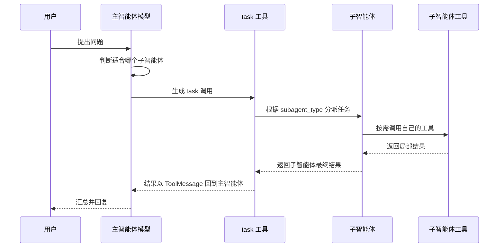

# 3 - Deep Research: Advanced Subagents and Asynchronous Execution

---

**Chapter Learning Objectives:**

- Master the basic syntax for configuring subagents using dictionaries.
- Be able to judge whether a capability is better implemented as a regular tool or split into a subagent.
- Understand the difference between synchronous streaming execution and asynchronous streaming execution, and be able to use `astream()` + `asyncio.gather()` to handle multiple tasks concurrently.
- Understand the design boundaries of nested subagents in DeepAgents.

**Study Suggestions:** The focus of this chapter is not "creating a few more assistants," but judging when a task is truly worth splitting. When reading the code, follow a three-step approach: first see what the subagent is responsible for, then see how it is registered with the main agent, and finally observe from the `stream()` output whether the main agent has delegated the task to it. For the asynchronous part, look at the scheduling results first, and then review the implementation details.

**Corresponding Code Branch:** `03-deepagents-subagents-async`

**References:**
DeepAgents Subagents: https://docs.langchain.com/oss/python/deepagents/subagents

---

In the previous two chapters, we have already run a minimal DeepAgent: the main agent can receive user questions, call the `internet_search` tool, and finally organize the results.

Chapter 1 covered the concept and design boundaries of subagents, and Chapter 2 covered how to identify tool calls in the `stream()` output and reserve the `task` branch. Starting from this chapter, we will formally write subagent configuration and scheduling code.

In real-world projects, a complex task often requires more than one tool. Taking "Deep Research" as an example, the complete project later will involve capabilities such as searching public information online, querying business databases, and retrieving from enterprise private knowledge bases. If all these capabilities are piled into a single main agent, the main agent will become very heavy: too many tools, long prompts, messy context, and the model will also be more likely to waver between different tasks.

Therefore, this chapter will split some capabilities into a few simple assistants: the main agent is responsible for judgment and dispatch, while subagents are responsible for their own small tasks.


This chapter mainly corresponds to three example files in the project:

| File                             | Topic             | Problem Solved                                        |
| -------------------------------- | ---------------- | ------------------------------------------------- |
| `3-dict-subagents-routing.py`    | Dictionary-style subagents   | How to register multiple assistants using `subagents=[...]`             |
| `4-async-subagents-streaming.py` | Asynchronous execution         | How to run concurrently using `astream()` and `asyncio.gather()` |
| `5-subagent-nesting-limits.py`   | Subagent nesting boundaries | Why regular dictionary subagents are not suitable for directly nesting subagents      |

---

## 1. First, Judge: Tool or Subagent

### 1.1 The Core Problem Subagents Solve

Chapter 1 already explained that subagents mainly solve the problems of context isolation, professional division of labor, and controllable parallelism. This chapter will not repeat the concepts, but instead will apply this judgment to code design.


The main agent first dispatches work through `task`. After the subagent receives an independent task, it completes its own reasoning and tool calls, and finally returns only the result to the main agent. In this way, the main agent does not have to carry all the details as it continues reasoning.

Before writing a subagent, ask a very practical question:

> Is this task worth splitting into a separate assistant?

Only if the answer is "yes" should you proceed to configure its `name`, `description`, `system_prompt`, and `tools`.

### 1.2 Tasks Suitable for Splitting into Subagents

Generally speaking, the following types of tasks are suitable for splitting into subagents.

| Scenario                 | Description                                   | Example                             |
| -------------------- | -------------------------------------- | -------------------------------- |
| Multi-step tasks with messy context | Many intermediate steps; the main agent is easily disrupted by large amounts of information | Deep research, multi-round search, multi-source information integration |
| Different professional domains | Different tasks require different knowledge and tools             | Financial analysis, legal retrieval, database queries   |
| Different model capabilities needed | Some tasks may require multimodal or stronger models       | Image understanding, long document analysis, code generation   |
| Main agent only coordinates | The main agent acts like a project manager, only responsible for dispatch and aggregation   | The Main Agent of "Deep Research"        |

The weather assistant, math assistant, and translation assistant in this chapter are very small teaching examples. In real projects, subagents usually look more like "web search assistants," "database query assistants," or "knowledge base retrieval assistants."

### 1.3 The Boundary Between Regular Tools and Subagents

Subagents are not always better in greater numbers. You can first use the following table to make a rough judgment.

| Task Type                     | More Suitable Form | Reason                                 |
| ---------------------------- | ------------ | ------------------------------------ |
| Can be completed with a single function call | Regular tool     | Low cost, short chain, more stable results           |
| Weather queries, simple calculations, format conversion | Regular tool     | Clear logical boundaries; no independent context needed       |
| Multi-step searching, reading, analysis, synthesis   | Subagent     | Requires independent prompts, independent context, and multi-step execution |
| Tasks with dedicated tools and complex strategies   | Subagent     | Easier to restrict tool permissions and easier to debug separately     |

For example: a user provides an English article and wants it first translated into Chinese and then summarized in Chinese. Although this task could be split into a "translation assistant" and a "summarization assistant," its semantics are very continuous, and the second step strongly depends on the output of the first step. After splitting, the main agent would also have to receive the intermediate result and dispatch again, which actually increases costs.

Therefore, before writing code, the more accurate judgment criterion is not "how many steps are there," but the following three questions:

- Do these steps require different professional capabilities?
- Can the contexts of these steps be isolated from each other?
- Are the benefits of splitting greater than the additional costs?

To summarize in one sentence: **Tools are suitable for deterministic small actions, while subagents are suitable for small tasks that require thinking.**

---

## 2. Configuring Subagents Using Dictionaries

### 2.1 Basic Fields of a Subagent

DeepAgents supports defining lightweight subagents using dictionaries. For more complex scenarios, you can also use `CompiledSubAgent` to wrap existing LangGraph / LangChain agent workflows.

- Dictionary subagent: configures a simple assistant.
- `CompiledSubAgent`: wraps a complete Agent / Graph into a subagent.

This chapter first explains the easiest dictionary approach. Chapter 4 will expand on `CompiledSubAgent`.

A minimal dictionary subagent usually contains the following fields:

| Field            | Purpose                                           | Required |
| --------------- | ---------------------------------------------- | -------- |
| `name`          | Subagent name, used when the main agent calls it             | Yes     |
| `description`   | Description of the subagent's responsibilities; the main agent relies on it to decide whether to call it     | Yes     |
| `system_prompt` | The subagent's own system prompt                       | Common     |
| `tools`         | List of tools available to the subagent                       | Common     |
| `model`         | Model used by the subagent; if omitted, usually inherits the main agent's model | Optional     |

Among these, the most critical are `name` and `description`.

`name` is the subagent's unique identifier. Later, when you see a `task` call in the streaming output, `subagent_type` will correspond to this name.

`description` is the basis for the main agent to determine task ownership. If the description is written vaguely, the main agent is likely to dispatch incorrectly.

### 2.2 Example with Three Assistants

Corresponding project file path: `deepsearch-agents/examples/3-dict-subagents-routing.py`

This case defines three simple assistants: a weather assistant, a math assistant, and a translation assistant.

```python
# 字典式子智能体的核心字段：
# name 是子智能体唯一标识，流式输出里的 subagent_type 会对应它；
# description 主要给主智能体看，用来判断什么时候应该调用该助手；
# system_prompt 是子智能体自己的角色和行为约束；
# tools 是该子智能体可用的工具列表，不填 model 时通常继承主智能体模型。
weather_agent = {
    "name": "weather_helper",
    "description": "用于查询天气信息。当用户询问天气时，请调用此助手。",
    "system_prompt": """
    你是一个天气查询助手。
    无论用户查询哪个城市，请统一回复：今天天气晴朗，温度25度。
    """,
    "tools": [],
}

math_agent = {
    "name": "math_helper",
    "description": "用于处理数学计算问题。当用户询问加减乘除、数字计算、算数题时，请调用此助手。",
    "system_prompt": """
    你是一个严谨的数学助手。
    请帮助用户完成数学计算，并给出清晰、准确的答案。
    """,
    "tools": [],
}

translate_agent = {
    "name": "translate_helper",
    "description": "用于处理中英互译任务。当用户需要中文和英文之间的翻译时，请调用此助手。",
    "system_prompt": """
    你是一个中英翻译助手。
    如果输入是中文，请翻译成英文；如果输入是英文，请翻译成中文。
    """,
    "tools": [],
}
```

This example deliberately keeps the three assistants very simple so that we can first understand how the main agent performs scheduling. In a real project, weather queries, simple calculations, and Chinese-English translation do not necessarily all need to be split into subagents; this chapter writes it this way mainly to demonstrate the following knowledge points:

- How to define subagents using dictionaries;
- How to register multiple subagents through `subagents=[...]`;
- How the main agent selects different subagents through the `task` tool;
- How to observe the subagent scheduling process in the `stream()` output.

### 2.3 Registering with the Main Agent

When creating the main agent, place these dictionaries into `subagents`.

```python
# 主智能体自己不挂普通工具，重点负责根据用户问题分派给合适的子智能体
main_agent = create_deep_agent(
    model=llm,
    tools=[],
    subagents=[weather_agent, math_agent, translate_agent],
    system_prompt="""
    你是一个负责统筹任务的主智能体。
    请根据用户需求选择合适的子智能体完成任务。
    你不直接执行天气查询、数学计算或翻译任务，而是通过子智能体完成。
    """,
)
```

There are two details here.

**First,** the main agent's `tools=[]` indicates that it does not directly call regular tools itself, but is mainly responsible for dispatching tasks.

**Second,** the system prompt must clearly state the main agent's boundary: it is not itself a weather assistant, math assistant, or translation assistant, but is responsible for handing tasks to the appropriate subagent.

---

## 3. Observing How the Main Agent Schedules Subagents

### 3.1 First Look at the Print Entry Point and Output Effect

We have already registered the subagents in `subagents` above. Next, do not rush to analyze the internal principles; first see where in the code the scheduling process is printed.

In `3-dict-subagents-routing.py`, `test_stream()` is executed twice at the end:

```python
test_stream("北京今天的天气怎么样？")
test_stream("请将'你是最棒的'翻译成英文。")
```

In other words, we do not only look at the final answer; instead, through `test_stream()`, we execute and print the main agent's key actions at the same time.

Run the file to verify that it succeeds:

```text
uv run examples/3-dict-subagents-routing.py

【model】决定调用子智能体weather_helper
【agent】调用了具体的工具task,返回结果为：今天天气晴朗，温度25度。...
【model】返回最终结果：今天北京的天气晴朗，温度是25度。
【model】决定调用子智能体translate_helper
【agent】调用了具体的工具task,返回结果为：You are the best....
【model】返回最终结果："你是最棒的" 翻译成英文是 "You are the best."
```

Taking the weather query set of outputs as an example, the three lines of logs correspond to three things:

| Output Fragment                                  | Meaning                                         |
| ----------------------------------------- | -------------------------------------------------- |
| `【model】决定调用子智能体weather_helper` | The main agent determines that this question should be handled by the weather assistant           |
| `【agent】调用了具体的工具task`           | DeepAgents executes `task`, that is, it actually calls the subagent   |
| `【model】返回最终结果`                   | After the main agent receives the subagent's result, it organizes the final reply to the user |

When analyzing the `task` tool call later, just keep this line in mind:

```text
用户问题 -> 主智能体选择子智能体 -> task 执行 -> 子智能体返回结果 -> 主智能体整理最终回复
```

### 3.2 Subagent Invocation Is Essentially a Task Tool Call

Now look at a key point: the main agent does not directly jump into a subagent to execute, but first makes a decision through the model.

In DeepAgents, when the main agent calls a subagent, it usually appears as a special tool call:

```python
tool_call["name"] == "task"
```

Its parameters explain two things:

- `subagent_type`: which subagent to call, corresponding to the `name` in the previous configuration.
- `description`: the specific task to hand to this subagent.

```python
{
    "name": "task",
    "args": {
        "subagent_type": "weather_helper",
        "description": "查询北京今天的天气情况。"
    }
}
```

That is to say, from the main agent's perspective, a subagent is a schedulable capability. It is not a regular Python function tool, but an Agent with an independent prompt, an independent toolset, and an independent context.



Therefore, a subagent is not "mysteriously invoked" out of nowhere. The main agent first asks the model to determine the next step, the model returns a `task` tool call, and DeepAgents then locates the corresponding subagent to execute based on `subagent_type`.

Here we need to add one easily confusing detail: **A subagent is not a regular tool, but from the main agent's perspective, it returns results like a tool.**

The reason is that when the main agent calls a sub-agent, it goes through the special tool `task`. After the sub-agent finishes executing, its result returns to the main agent side, usually appearing as a `ToolMessage`.

So in streaming output, you often see a three-stage process like the following:

```text
第 1 次 model 输出：主智能体决定调用 task，也就是决定分派子智能体
中间 tools 输出：task 执行完成，子智能体结果以 ToolMessage 形式返回
第 2 次 model 输出：主智能体基于子智能体结果，整理最终回复
```

If you count the inside of the sub-agent as well, it usually invokes the model once more when executing its own task. That is, for a simple flow of "main agent calls sub-agent and then answers," the common chain is:

```text
主智能体模型：判断调用哪个子智能体
子智能体模型：完成被分派的局部任务
主智能体模型：整合子智能体结果并输出最终答案
```

This is also why sub-agents are more expensive than ordinary tools: an ordinary tool is usually just a single function or API call, while a sub-agent itself goes through an Agent execution process.

### 3.3 How to identify tasks in streaming output

Chapter 2 already explained that `stream()` continuously produces output similar to the following `chunk`:

```python
{
    "model": {
        "messages": [...]
    }
}
```

This chapter focuses on the `tool_calls` of the last message in the `model` node. Both ordinary tool calls and sub-agent calls appear here, and the main difference lies in the tool name.

| Observation location            | Ordinary tool call                           | Sub-agent call                                     |
| ------------------- | -------------------------------------- | ------------------------------------------------ |
| `tool_call["name"]` | The tool's own name, for example `internet_search` | Fixed as `task`                                    |
| `tool_call["args"]` | Input parameters of the ordinary tool | Contains `subagent_type` and `description`            |
| Node where the result is returned    | `tools`                                | Also `tools`, because `task` itself appears as a tool result |

So in streaming parsing code, you only need to check whether the tool name is `task` to distinguish "calling an ordinary tool" from "dispatching a sub-agent":

```python
if tool_call["name"] == "task":
    print(f"调用子智能体：{tool_call['args']['subagent_type']}")
else:
    print(f"调用普通工具：{tool_call['name']}")
```

This is also the reason Chapter 2's streaming output parsing retained the `task` branch in advance. The example in Chapter 2 did not actually configure a sub-agent, so it was just a reserved entry point; after configuring `subagents` in this chapter, this branch truly takes effect.

### 3.4 Using stream to print the scheduling process

Corresponding project file path: `deepsearch-agents/examples/3-dict-subagents-routing.py`

In this case, observe the main agent's scheduling process through `stream()`.

```python
def test_stream(query):
    """
    同步流式执行一次用户问题，并打印主智能体的调度过程。

    stream() 会持续产出图节点状态，常见节点包括：
    - model：模型做出下一步决策，或生成最终回复；
    - tools：工具执行完成，子智能体的 task 结果也会从这里返回。
    """
    stream = main_agent.stream(
        {"messages": [{"role": "user", "content": query}]}
    )

    for chunk in stream:
        # chunk 是按节点名组织的字典，例如 {"model": {"messages": [...]}}
        for node_name, state in chunk.items():
            # DeepAgents 内部可能产出空状态或非消息状态，这里只解析消息类状态
            if state is None or "messages" not in state:
                continue

            messages = state["messages"]
            if messages and isinstance(messages, list):
                # 每个节点本次产出的最后一条消息，通常就是最值得观察的信息
                last_msg = messages[-1]

                if node_name == "model":
                    # model 节点的 tool_calls 表示模型决定下一步调用工具或子智能体
                    if last_msg.tool_calls:
                        for tool_call in last_msg.tool_calls:
                            if tool_call["name"] == "task":
                                # DeepAgents 用内置 task 工具表示“分派给某个子智能体”
                                print(
                                    f"【model】决定调用子智能体{tool_call['args']['subagent_type']}"
                                )
                            else:
                                print(
                                    f"【model】决定调用普通工具{tool_call['name']},传入的参数为：{tool_call['args']}"
                                )
                    elif last_msg.content:
                        # 没有 tool_calls 且 content 非空，通常就是主智能体整理后的最终回复
                        print(f"【model】返回最终结果：{last_msg.content}")
                elif node_name == "tools":
                    # tools 节点返回普通工具结果；task 子智能体执行完后也会以工具消息形式返回
                    name = last_msg.name
                    content = last_msg.content
                    print(
                        f"【agent】调用了具体的工具{name},返回结果为：{content[:100] + '...'}"
                    )
```

This code is very similar to the streaming parsing in Chapter 2, except that the focus here is on observing `task`. The `model` node is used to observe the main agent's decisions, and the `tools` node is used to observe the results returned after tools or sub-agents execute.

When the user asks "What is the weather like in Beijing today?", the main agent should choose `weather_helper`.

When the user asks "What is 100 + 200?", the main agent should choose `math_helper`.

When the user asks "Translate hello into Chinese", the main agent should choose `translate_helper`.

### 3.5 What happens if the description is poorly written

The main agent's choice of sub-agent mainly depends on each sub-agent's `description`. So the description should be as specific as possible.

A less ideal wording:

```python
"description": "这是一个助手。"
```

A better wording:

```python
"description": "用于处理数学计算问题。当用户询问加减乘除、数字计算、算数题时，请调用此助手。"
```

The latter clearly explains the calling scenario, making it easier for the main agent to make the right judgment.

---

## 4. Asynchronous execution: astream and concurrent processing

### 4.1 Why async is needed

Synchronous `stream()` can only handle one task at a time. If we test three questions in sequence, we have to wait for the first to finish before executing the second.

```text
任务 A 执行完成 -> 任务 B 执行完成 -> 任务 C 执行完成
```

In a real web service, multiple users may send requests at the same time. Each request may wait for the model, tools, or network searches. If everything is processed serially, backend throughput will be very poor.

This is when asynchronous execution is needed. DeepAgents provides `astream()`, which can be used with Python's `asyncio`. Note that async does not make a single task "think faster"; it solves the problem of multiple tasks waiting and progressing together.

### 4.2 Changing stream to astream

Corresponding project file path: `deepsearch-agents/examples/4-async-subagents-streaming.py`

In this case, the synchronous function is changed to an asynchronous function.

```python
async def test_stream(query):
    """
    异步流式执行一次用户问题，并打印主智能体的调度过程。

    和同步版相比，核心变化有三处：
    - def test_stream(...) 变为 async def test_stream(...)；
    - main_agent.stream(...) 变为 main_agent.astream(...)；
    - for chunk in stream 变为 async for chunk in stream。
    """
    # astream() 返回异步流对象，需要在 async 函数中用 async for 消费
    stream = main_agent.astream(
        {"messages": [{"role": "user", "content": query}]}
    )

    async for chunk in stream:
        # chunk 是按节点名组织的字典，例如 {"model": {"messages": [...]}}
        for node_name, state in chunk.items():
            # DeepAgents 内部可能产出空状态或非消息状态，这里只解析消息类状态
            if state is None or "messages" not in state:
                continue

            messages = state["messages"]
            if messages and isinstance(messages, list):
                # 每个节点本次产出的最后一条消息，通常就是最值得观察的信息
                last_msg = messages[-1]
                if node_name == "model" and last_msg.tool_calls:
                    # tool_calls 表示模型决定下一步调用工具或通过 task 分派子智能体
                    for tool_call in last_msg.tool_calls:
                        if tool_call["name"] == "task":
                            # task 是 DeepAgents 内置的子智能体分派入口
                            print(
                                f"【model】决定调用子智能体{tool_call['args']['subagent_type']}"
                            )
                        else:
                            print(
                                f"【model】决定调用普通工具{tool_call['name']},传入的参数为：{tool_call['args']}"
                            )
                elif node_name == "model" and last_msg.content:
                    # 没有 tool_calls 且 content 非空，通常就是主智能体整理后的最终回复
                    print(f"【model】返回最终结果：{last_msg.content}")
                elif node_name == "tools":
                    # tools 节点返回普通工具结果；task 子智能体执行完后也会以工具消息形式返回
                    name = last_msg.name
                    content = last_msg.content
                    print(
                        f"【agent】调用了具体的工具{name},返回结果为：{content[:100] + '...'}"
                    )
```

There are three main differences between synchronous and asynchronous writing:

| Synchronous writing                 | Asynchronous writing                     |
| ------------------------ | ---------------------------- |
| `def test_stream(...)`   | `async def test_stream(...)` |
| `for chunk in stream`    | `async for chunk in stream`  |
| `main_agent.stream(...)` | `main_agent.astream(...)`    |

### 4.3 Using asyncio.gather for concurrent execution

To start multiple tasks at the same time, you can use `asyncio.gather()`.

```python
async def batch_run():
    # 这里得到的是协程对象；传给 gather 后，会由事件循环并发调度
    task1 = test_stream("北京今天的天气怎么样？")
    task2 = test_stream("请将'你是最棒的'翻译成英文。")

    # 打印类型只是为了让初学者看到：调用 async 函数不会立刻执行，而是先返回 coroutine
    print(type(task1))
    print(type(task2))

    # gather 会等待两个协程都完成；哪个请求先拿到结果，就会先输出自己的流式片段
    await asyncio.gather(task1, task2)

asyncio.run(batch_run())
```

Execute the file to verify, successful:

```text
uv run examples/4-async-subagents-streaming.py

LangChainPendingDeprecationWarning: The default value of `allowed_objects` will change in a future version.
<class 'coroutine'>
<class 'coroutine'>
【model】决定调用子智能体weather_helper
【agent】调用了具体的工具task,返回结果为：今天天气晴朗，温度25度。...
【model】决定调用子智能体translate_helper
【model】返回最终结果：今天北京的天气晴朗，温度是25度。
【agent】调用了具体的工具task,返回结果为：You are the best....
【model】返回最终结果："你是最棒的" 翻译成英文是 "You are the best."
```

The execution here is no longer "task 1 completes before task 2 starts"; instead, the two tasks progress together. Whichever task gets the model or tool result first will output first.

Two details can also be seen from this output:

- After `test_stream(...)` is called, what returns first is `<class 'coroutine'>`, indicating that the async function does not immediately execute the full logic; instead, it first returns a coroutine object.
- The logs of the weather task and the translation task are interleaved. The weather assistant returned the tool result first, but the translation assistant's scheduling had already begun, which is exactly the effect of `asyncio.gather()` concurrent progression.

When building FastAPI interfaces later, async capability is very important, because web services are inherently multi-user, multi-request scenarios, and one agent task must not be allowed to block the entire service.

### 4.4 Supplement: asyncio.create_task

Besides passing coroutines directly to `asyncio.gather()`, there is another common approach in Python: `asyncio.create_task()`.

`create_task()` wraps a coroutine explicitly into a task and submits it to the event loop for scheduling.

```python
async def batch_run():
    task1 = asyncio.create_task(test_stream("北京今天的天气怎么样？"))
    task2 = asyncio.create_task(test_stream("请将'你是最棒的'翻译成英文。"))

    await asyncio.gather(task1, task2)

asyncio.run(batch_run())
```

This code is very similar in effect to the previous `gather()` example, both allowing two tasks to execute concurrently. The difference is:

| Approach                          | Suitable scenario                                       |
| ----------------------------- | ---------------------------------------------- |
| Pass coroutines directly to `gather()`       | Start multiple tasks at once and wait for all of them to complete         |
| First use `create_task()` to create tasks | When you need to start tasks first and later wait for, cancel, or manage their state |

You can understand it this way for now: **for simple concurrency, `gather()` is enough; use `create_task()` when you need more explicit task management.**

---

## 5. Boundaries of sub-agent nesting

### 5.1 Ordinary dictionary sub-agents are not suitable for further nesting

Corresponding project file path: `deepsearch-agents/examples/5-subagent-nesting-limits.py`

This case demonstrates a point that is easy to misunderstand: we might want to configure a hierarchical structure, such as CEO calling CTO, and CTO calling Coder.

The example roughly has the following structure:

```python
# 1. 底层 Coder：理想情况下，它应该只负责具体代码实现
coder_config = {
    "name": "Coder",
    "description": "高级 Python 工程师，负责接收具体的编码任务并实现代码。",
    "system_prompt": """
    你是一名高级 Python 工程师。
    你的职责是接收具体的编码任务，并给出对应的代码实现。
    """,
    "tools": [],
}

# 2. 中间层 CTO：理想情况下，它负责拆解任务，再委派给 Coder
cto_config = {
    "name": "CTO",
    "description": "技术总监，负责将战略需求转化为技术任务，并分配给工程师。",
    # system_prompt 可以约束 CTO 的角色，但不能让 dict 自动支持嵌套子智能体
    "system_prompt": """
    你是技术总监。
    你不直接编写代码。
    你的职责包括：
    1. 分析 CEO 的需求。
    2. 设计技术方案。
    3. 调用 Coder 子智能体完成具体的代码编写工作。
    """,
    "tools": [],
    # 关键边界：普通 dict 子智能体的标准字段里没有 subagents。
    # 这一行是“反例式演示”，用于观察底层是否忽略该字段，而不是推荐用法。
    "subagents": [coder_config],
}
```

But note here: the official configuration fields for ordinary dictionary-style sub-agents do not include `subagents`. In other words, directly stuffing `subagents` into a dictionary is not a recommended approach, and it may not necessarily be recognized by the underlying layer.

Execute the file to verify, and an excerpt of the output is as follows:

```text
uv run examples/5-subagent-nesting-limits.py

LangChainPendingDeprecationWarning: The default value of `allowed_objects` will change in a future version.
>>> 开始执行任务链...

>>> 最终结果：
{'PatchToolCallsMiddleware.before_agent': None}
{'model': {'messages': [AIMessage(
    content='',
    name='CEO',
    tool_calls=[
        {
            'name': 'task',
            'args': {
                'description': '开发一个贪吃蛇游戏，使用 Python 实现。请直接提供完整的代码字符串。',
                'subagent_type': 'CTO'
            },
            'type': 'tool_call'
        }
    ]
)]}}
{'TodoListMiddleware.after_model': None}
{'tools': {'messages': [ToolMessage(
    name='task',
    content='为了开发一个简单的贪吃蛇游戏，我们可以使用 Python 的 curses 库...'
)]}}
{'model': {'messages': [AIMessage(
    name='CEO',
    content='代码已准备好，这是一个使用 Python 和 curses 库实现的基础贪吃蛇游戏...'
)]}}
{'TodoListMiddleware.after_model': None}
```

There are two places in this output that are most worth examining.

**First,** the top-level CEO did call `task`, and `subagent_type` is `CTO`:

```text
'name': 'task'
'subagent_type': 'CTO'
```

This shows that the CEO -> CTO delegation at this level took effect.

**Second,** the subsequent output does not continue to show `subagent_type == "Coder"`. That is, although `cto_config` contains `"subagents": [coder_config]`, ordinary dictionary-style sub-agents did not stably form a two-level CTO -> Coder delegation.

The value of this example is not to tell you "you should nest this way," but to remind you: **dictionary-style sub-agents are suitable for lightweight division of labor, not for carrying complex hierarchical architectures.**

### 5.2 What to do if a complex hierarchy is needed

If you really need a more complex hierarchical structure, it is recommended to use `CompiledSubAgent`, which will be covered later in Chapter 4, or to encapsulate complex logic into an independent LangGraph graph and then attach it to DeepAgents as a sub-agent.

That is to say:

- Simple sub-agents: configure with a dictionary.
- Complex sub-agents: encapsulate with CompiledSubAgent.

In this chapter, focus first on mastering dictionary-style sub-agents and asynchronous execution. In the next chapter, we will look at how to integrate existing LangGraph / LangChain agents into DeepAgents.

---

**Chapter summary:**

In this chapter, we went from "should I use a tool or a sub-agent" to "how to configure, observe, and concurrently execute sub-agents." We first clarified that sub-agents are suitable for solving context expansion and professional division of labor, but simple tasks, semantically continuous tasks, and overly costly tasks are not recommended to be split.

Then we used `3-dict-subagents-routing.py` to learn about dictionary-style sub-agents: each sub-agent describes its responsibilities through `name`, `description`, `system_prompt`, and `tools`, and the main agent registers them through `subagents=[...]`.

Then we used `stream()` to observe how the main agent generates `task` calls and dispatches them to the corresponding assistants based on `subagent_type`. Finally, we used `4-async-subagents-streaming.py` to change synchronous execution to `astream()` asynchronous execution, and used `asyncio.gather()` to process multiple tasks concurrently.

**Please remember:** sub-agents are not meant to make the system complex, but to make the responsibilities of complex tasks clearer, the context cleaner, and the execution process easier to observe.
