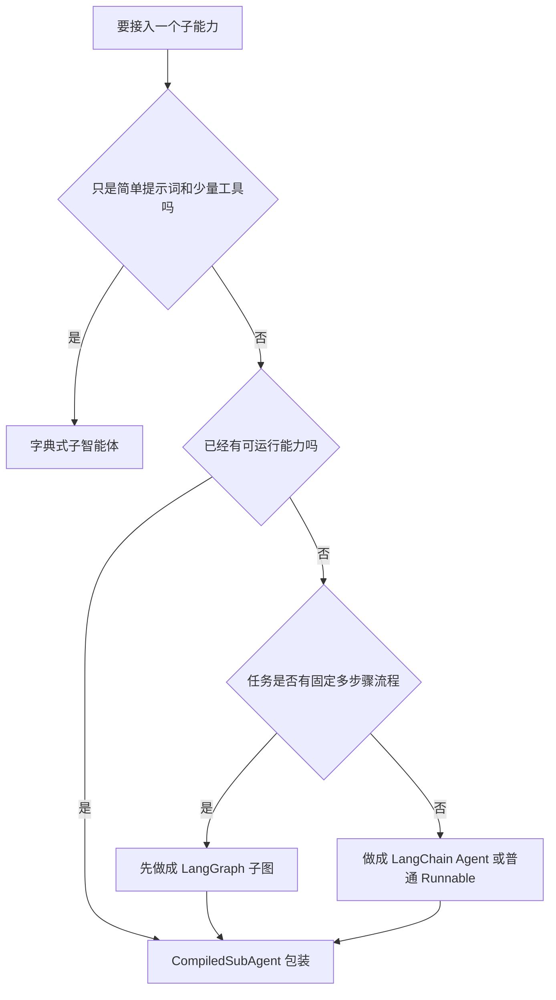

# 4 - Deep Research: Integrating LangGraph and LangChain

---

**Chapter learning objectives:**

- Understand why DeepAgents needs to reuse existing LangGraph / LangChain capabilities.
- Master the purpose and basic configuration of `CompiledSubAgent`.
- Understand why a LangGraph sub-agent must include an additive `messages` state field.
- Be able to judge whether a complex subtask should be delegated to LangGraph or to a LangChain Agent.

**Study suggestion:** This chapter is about "reusing existing capabilities," not relearning LangGraph or LangChain. While reading, focus on how `CompiledSubAgent` wraps existing graphs, agents, or runnables into sub-agents that DeepAgents can dispatch. If `StateGraph`, `add_messages`, conditional edges, `@tool`, and `create_agent()` are still unfamiliar, review the corresponding chapters first; otherwise, this chapter will seem like a thin layer of adapter glue.

**Corresponding code branch:** `04-deepagents-langgraph-langchain`

---

In the previous chapter, we learned about dictionary-style sub-agents. They are suitable for defining simple, lightweight assistants with clear responsibilities, such as weather assistants, math assistants, and translation assistants.

But in real projects, there are often existing capabilities already available:

- A workflow previously written with LangGraph;
- A tool-based Agent previously created with LangChain `create_agent()`;
- An already-encapsulated Runnable;
- Complex subtasks that require multi-node state transitions, conditional branching, or tool selection.

Rewriting all of these capabilities as dictionary-style sub-agents would be very costly and unnecessary. DeepAgents provides `CompiledSubAgent`, whose purpose is to wrap existing graphs, agents, or runnables into sub-agents that DeepAgents can dispatch.

This chapter corresponds to two example files:

| File                                    | Topic                  | Business meaning of this chapter's example                                 |
| --------------------------------------- | -------------- | -------------------------------------------------- |
| `6-langgraph-subagent-wrapper.py`       | LangGraph compatibility | Wrapping the "research task planning" LangGraph workflow as a sub-agent    |
| `7-langchain-agent-subagent-wrapper.py` | LangChain compatibility | Wrapping the "material retrieval" LangChain tool-based Agent as a sub-agent |

---

## 1. First, look at the overall relationship: DeepAgents handles dispatch

When studying this chapter, do not start by mixing LangGraph, LangChain, and DeepAgents together. Their roles in this chapter are very clearly divided:

```text
用户问题
  -> DeepAgents 主智能体
      -> 字典子智能体：适合简单助手
      -> CompiledSubAgent：适合复用已有复杂能力
            -> LangGraph 子图：适合多节点流程和状态流转
            -> LangChain Agent：适合工具选择和资料检索
```

**Figure 4-1 explanation:** The DeepAgents main agent acts like a dispatch layer. It does not need to care how many nodes are in the LangGraph subgraph, nor does it need to know which tool the LangChain Agent calls specifically. It only needs to know what task a sub-agent can complete and when it should delegate the task.

So the main thread of this chapter is really just one sentence:

> Existing LangGraph graphs or LangChain Agents do not need to be rewritten from scratch; they can be connected under the DeepAgents main agent through `CompiledSubAgent`.

Once you understand this, the two examples that follow will be much easier.

---

## 2. What is CompiledSubAgent

### 2.1 The difference between dictionary-style sub-agents and CompiledSubAgent

There are two common ways to configure sub-agents in DeepAgents.

| Method               | Suitable scenario     | Characteristics                                          |
| ------------------ | ------------ | --------------------------------------------- |
| Dictionary configuration           | Simple sub-agents | Simple syntax, suitable for configuring only prompts and tools              |
| `CompiledSubAgent` | Complex sub-agents | Can integrate existing LangGraph / LangChain / Runnable |

The dictionary approach is more like "directly declaring an assistant":

```python
weather_agent = {
    "name": "weather_helper",
    "description": "用于查询天气信息。",
    "system_prompt": "你是一个天气助手。",
    "tools": [],
}
```

`CompiledSubAgent` is more like "wrapping already-written capabilities in a layer and handing them over to DeepAgents for dispatch":

```python
sub_agent = CompiledSubAgent(
    name="research_planner_graph",
    description="用于把开放研究问题拆解成可执行的研究计划。",
    runnable=compiled_graph,
)
```

### 2.2 Three core parameters

The three most core parameters of `CompiledSubAgent` are:

| Parameter          | Description                                                              |
| ------------- | ----------------------------------------------------------------- |
| `name`        | Sub-agent name, used by the main agent to identify the sub-agent                          |
| `description` | Sub-agent capability description, used by the main agent to determine when to invoke it                    |
| `runnable`    | The object that actually executes the task, which can be a compiled LangGraph graph or a LangChain Agent |

In other words, `CompiledSubAgent` itself is not responsible for writing business logic. The business logic is in `runnable`; it only wraps that capability into a sub-agent that DeepAgents can recognize.

---

## 3. Integrating LangGraph: Research task planning subgraph

### 3.1 What problem does this example solve

Project file path: `deepsearch-agents/examples/6-langgraph-subagent-wrapper.py`

The LangGraph example in this section is a sub-capability close to the "Deep Research" scenario: a **research task planner**.

It does not simply return "I'm done"; instead, it simulates the following chain:

```text
用户提出研究问题
  -> DeepAgents 主智能体判断需要研究规划
  -> task 调用 research_planner_graph
  -> LangGraph 子图提取研究主题
  -> 条件边判断 quick / deep
  -> 生成普通计划或深度研究计划
  -> 汇总成最终规划结果
```

This section uses LangGraph knowledge points you have already learned:

| Usage in this chapter                  | Corresponding repository case                                                               |
| ------------------------- | -------------------------------------------------------------------------- |
| `messages + add_messages` | `案例与源码-3-LangGraph框架/03-state/reducers/StateReducer_AddMessages.py` |
| Conditional edges                    | `案例与源码-3-LangGraph框架/05-edge/Edge_Conditional.py`                   |
| Multi-node business flow              | `案例与源码-3-LangGraph框架/01-helloworld/LangGraphBiz.py`                 |

### 3.2 Why State must include messages

The most critical requirement for connecting a LangGraph subgraph to DeepAgents is: **the State must contain a `messages` field.**

```python
class ResearchPlanState(TypedDict):
    messages: Annotated[list, add_messages]
    topic: str
    depth: Literal["quick", "deep"]
    plan: list[str]
```

There are two key points here.

**First,** DeepAgents passes tasks to the subgraph through `messages`, and also reads the subgraph's returned results from `messages`.

**Second,** `messages` should be used together with `add_messages`. This way, new messages returned by nodes are appended to the original message list rather than overwriting historical messages.

If written as a normal:

```python
messages: list
```

Subsequent nodes can easily see only the last state, and the earlier user question, model dispatch, and intermediate results from the subgraph will all be lost.

Therefore, LangGraph subgraphs connected to DeepAgents generally need to keep this pattern:

```python
messages: Annotated[list, add_messages]
```

### 3.3 Define the research planning node

The first node is responsible for extracting the research topic from the task and determining the research depth.

```python
def extract_topic(state: ResearchPlanState):
    """从用户任务中提取研究主题，并判断是否需要深度研究。"""
    task = state["messages"][-1].content
    depth = "deep" if any(word in task for word in ["深度", "报告", "系统", "趋势"]) else "quick"
    topic = (
        task.replace("请", "")
        .replace("帮我", "")
        .replace("生成", "")
        .replace("一份", "")
        .strip("。 ")
    )
    print(f"【LangGraph】提取研究主题：{topic}")
    print(f"【LangGraph】判断研究深度：{depth}")
    return {
        "topic": topic,
        "depth": depth,
        "messages": [AIMessage(content=f"已识别研究主题：{topic}；研究深度：{depth}")],
    }
```

This example deliberately does not call a large language model; instead, it uses simple rules to simulate topic extraction and depth judgment. This way, you can clearly see the state transitions in LangGraph without being distracted by the uncertainty of model outputs.

### 3.4 Use conditional edges to choose a planning path

If the task is a normal query, it goes to `quick_plan`; if the task is deep research, it goes to `deep_plan`.

```python
def route_by_depth(state: ResearchPlanState):
    """条件边：根据研究深度选择普通规划或深度规划。"""
    return state["depth"]


workflow.add_conditional_edges(
    "extract_topic",
    route_by_depth,
    {
        "quick": "quick_plan",
        "deep": "deep_plan",
    },
)
```

This part corresponds to the conditional edges in the earlier LangGraph tutorial: after a node finishes executing, a routing function reads the current `state` and then decides the next step.

In the "Deep Research" project, such conditional edges are very common. For example:

- Whether the materials are sufficient; if not, continue searching;
- Whether the user's question requires a database query;
- Whether the retrieval results require cross-validation;
- Whether the report needs additional cases added.

### 3.5 Generate the plan and summarize results

The deep research planning node generates more complete execution steps:

```python
def build_deep_plan(state: ResearchPlanState):
    """深度研究规划：适合报告、趋势分析、行业调研等长链路任务。"""
    topic = state["topic"]
    plan = [
        f"明确「{topic}」的研究范围、时间窗口和核心问题",
        "搜索公开资料，优先收集权威媒体、机构报告和官方信息",
        "拆分技术、产业、公司案例、风险四个方向分别整理证据",
        "对不同来源的信息做交叉验证，记录冲突和缺口",
        "输出结构化研究报告：背景、现状、趋势、案例、风险、结论",
    ]
    print("【LangGraph】进入 deep_plan 节点")
    return {
        "plan": plan,
        "messages": [AIMessage(content="已生成深度研究计划。")],
    }
```

Finally, `finalize_plan()` summarizes `topic`, `depth`, and `plan` from the state into a single `AIMessage` and returns it to the DeepAgents main agent.

### 3.6 Wrap it as a CompiledSubAgent

After the LangGraph graph is compiled, it can be passed as `runnable` to `CompiledSubAgent`.

```python
compiled_graph = workflow.compile()

research_planner_graph = CompiledSubAgent(
    name="research_planner_graph",
    description="用于把开放研究问题拆解成可执行的研究计划，适合行业趋势、技术调研、报告规划等任务。",
    runnable=compiled_graph,
)
```

Finally, register it with the DeepAgents main agent:

```python
main_agent = create_deep_agent(
    model=llm,
    tools=[],
    subagents=[research_planner_graph],
    system_prompt="""
    你是深度研搜系统的主智能体。
    当用户需要研究规划、报告大纲、趋势调研步骤时，必须调用 research_planner_graph。
    你不自己编造研究计划，而是根据子智能体返回的计划整理最终回复。
    """,
)
```

### 3.7 Execution output

Run the file to verify; it succeeds:

The `tool_calls` generated by the main agent, the internal printing of the LangGraph subgraph, the `ToolMessage` returned by the subgraph, and the `AIMessage` finally organized by the main agent.

```text
tools@ToolsMacBook-Pro deepsearch-agents % uv run examples/6-langgraph-subagent-wrapper.py

/Users/tools/Desktop/agent/data-agent-study/deepsearch-agents/.venv/lib/python3.12/site-packages/langgraph/checkpoint/serde/encrypted.py:5:
LangChainPendingDeprecationWarning: The default value of `allowed_objects` will change in a future version.

{'PatchToolCallsMiddleware.before_agent': None}
{'model': {'messages': [AIMessage(content='', tool_calls=[
  {
    'name': 'task',
    'args': {
      'subagent_type': 'research_planner_graph',
      'description': '请为用户创建一份关于人工智能与机器人行业趋势的深度研究计划。这份计划应该包括但不限于：1. 行业现状概述 2. 关键技术进展 3. 主要市场参与者 4. 应用案例分析 5. 面临的挑战与机遇 6. 未来发展方向预测...'
    }
  }
])]}}
{'TodoListMiddleware.after_model': None}

【LangGraph】提取研究主题：为用户创建关于人工智能与机器人行业趋势的深度研究计划。这份计划应该包括但不限于：1. 行业现状概述 2. 关键技术进展 3. 主要市场参与者 4. 应用案例分析 5. 面临的挑战与机遇 6. 未来发展方向预测...
【LangGraph】判断研究深度：deep
【LangGraph】进入 deep_plan 节点
【LangGraph】汇总研究计划

{'tools': {'messages': [ToolMessage(content='研究主题：为用户创建关于人工智能与机器人行业趋势的深度研究计划...\\n研究深度：deep\\n\\n执行计划：\\n1. 明确研究范围、时间窗口和核心问题\\n2. 搜索公开资料，优先收集权威媒体、机构报告和官方信息\\n3. 拆分技术、产业、公司案例、风险四个方向分别整理证据\\n4. 对不同来源的信息做交叉验证，记录冲突和缺口\\n5. 输出结构化研究报告：背景、现状、趋势、案例、风险、结论') ]}}

{'model': {'messages': [AIMessage(content='为了完成关于人工智能与机器人行业趋势的深度研究计划，我们将按照以下步骤进行：\\n\\n1. **明确研究范围、时间窗口和核心问题**...\\n2. **搜索公开资料**...\\n3. **整理证据**...\\n4. **交叉验证信息**...\\n5. **撰写结构化研究报告**...')]}}
{'TodoListMiddleware.after_model': None}
```

The output above omits debug fields such as `token_usage` and `id`, retaining only the parts most suitable for readers to understand the execution chain. The `LangChainPendingDeprecationWarning` at the beginning is a dependency library notice and does not affect this example's execution.

This output can be understood in four parts:

| Output segment                               | Description                                                |
| -------------------------------------- | --------------------------------------------------- |
| `tool_calls -> research_planner_graph` | The main agent decides to invoke the LangGraph sub-agent through `task`     |
| `【LangGraph】提取研究主题...`         | Internal subgraph nodes are executing; this is LangGraph's own business flow |
| `ToolMessage(content='研究主题...')`   | The subgraph has finished executing, and the result is returned to the main agent as the `task` tool    |
| The final `AIMessage(content=...)`      | The main agent organizes the final reply based on the subgraph result                    |

The most important point here is that the DeepAgents main agent does not need to know how many nodes are inside the LangGraph subgraph; it only needs to know that there is a sub-agent called `research_planner_graph` that can complete "research planning."

---

## 4. Integrating LangChain: Material retrieval Agent

### 4.1 What problem does this example solve

Project file path: `deepsearch-agents/examples/7-langchain-agent-subagent-wrapper.py`

The LangChain Agent example in this section is a sub-capability close to the "Deep Research" scenario: a **material retrieval assistant**.

It is responsible for selecting the appropriate tool from its own tool set:

```text
用户问题
  -> DeepAgents 主智能体
  -> task 调用 research_retriever_agent
  -> LangChain Agent 判断该查公开资料还是内部知识库
  -> 调用 search_public_web / search_internal_knowledge_base
  -> 返回资料来源、关键发现和后续建议
```

This section uses LangChain knowledge points you have already learned:

| Usage in this chapter         | Corresponding repository case                                                         |
| ---------------- | -------------------------------------------------------------------- |
| `@tool` tool encapsulation | `案例与源码-2-LangChain框架/08-tools/QueryWeatherTool.py`            |
| `create_agent()` | `案例与源码-2-LangChain框架/12-agent/AgentSmartSelectV1.0.py`        |
| Structured result awareness   | `案例与源码-2-LangChain框架/05_parser/StructuredOutput_TypedDict.py` |

### 4.2 Define the material retrieval tools

The example does not directly call a real search engine or enterprise knowledge base; instead, it first uses two simulated tools to represent two types of data sources in real projects.

```python
@tool
def search_public_web(query: str) -> str:
    """
    检索公开网络资料。

    参数:
        query: 用户关注的研究主题或关键词。

    返回:
        模拟的公开资料摘要。真实项目中可以替换为 Tavily、搜索引擎 API 或爬虫服务。
    """
    print(f"【LangChain Tool】检索公开资料：{query}")
    return (
        "公开资料检索结果：\n"
        "1. 多家机构认为具身智能正在推动机器人从单点自动化走向通用任务执行。\n"
        "2. 机器人产业热点集中在大模型控制、灵巧手、低成本传感器和仿真训练。"
    )
```

The other tool simulates the enterprise's internal knowledge base:

```python
@tool
def search_internal_knowledge_base(query: str) -> str:
    """检索企业内部知识库。"""
    print(f"【LangChain Tool】检索内部知识库：{query}")
    return (
        "内部知识库检索结果：\n"
        "1. 历史项目复盘显示，客户最关注机器人方案的稳定性、部署周期和维护成本。\n"
        "2. 销售材料中高频卖点包括：多模态感知、自动任务分解、远程运维和持续学习。"
    )
```

The key here is not the simulated data itself, but the tool boundaries:

- The public materials tool is responsible for external trends;
- The internal knowledge base tool is responsible for enterprise experience;
- The LangChain Agent is responsible for deciding when to call which tool.

### 4.3 Create a LangChain Agent

Next, use `create_agent()` to create a regular LangChain Agent.

```python
research_retriever_agent = create_agent(
    model=llm,
    tools=[search_public_web, search_internal_knowledge_base],
    system_prompt="""
    你是资料检索助手，负责为深度研究任务收集资料。
    当用户需要行业公开信息时，调用 search_public_web。
    当用户需要企业内部经验、项目复盘或知识库内容时，调用 search_internal_knowledge_base。
    如果问题同时涉及公开趋势和内部经验，可以两个工具都调用。
    最后请用中文输出：资料来源、关键发现、后续建议。
    """,
)
```

This Agent itself can already call tools based on user questions. What DeepAgents needs to do is not rewrite it, but wrap it as a sub-agent.

### 4.4 Wrap it as a DeepAgents sub-agent

```python
research_retriever_subagent = CompiledSubAgent(
    name="research_retriever_agent",
    description="用于检索公开资料和企业内部知识库，适合为深度研究报告收集证据和背景信息。",
    runnable=research_retriever_agent,
)
```

Then register it with the DeepAgents main agent:

```python
deep_agent = create_deep_agent(
    model=llm,
    tools=[],
    system_prompt="""
    你是深度研搜系统的主智能体。
    当用户需要查找资料、收集证据、检索公开信息或内部知识库时，必须调用 research_retriever_agent。
    你不直接检索资料，只负责分派任务并整理子智能体返回的结果。
    """,
    subagents=[research_retriever_subagent],
)
```

Note the main agent's `tools=[]` here. That is, the public search tool and the internal knowledge base tool are not directly attached to the DeepAgents main agent, but to the LangChain sub-Agent.

This creates two layers of responsibility:

```text
DeepAgents 主智能体：决定是否需要资料检索
LangChain 子智能体：决定调用公开资料工具还是内部知识库工具
```

### 4.5 Execution output

Run the file to verify; it succeeds:

This output reflects the characteristics of a "tool-based Agent" even more than the LangGraph example: the main agent dispatches two `task` at once, and the LangChain Agent then calls the public materials tool and the internal knowledge base tool separately.

```text
tools@ToolsMacBook-Pro deepsearch-agents % uv run examples/7-langchain-agent-subagent-wrapper.py

/Users/tools/Desktop/agent/data-agent-study/deepsearch-agents/.venv/lib/python3.12/site-packages/langgraph/checkpoint/serde/encrypted.py:5:
LangChainPendingDeprecationWarning: The default value of `allowed_objects` will change in a future version.

{'PatchToolCallsMiddleware.before_agent': None}
{'model': {'messages': [AIMessage(content='', tool_calls=[
  {
    'name': 'task',
    'args': {
      'subagent_type': 'research_retriever_agent',
      'description': '检索公开资料以了解人工智能机器人行业的最新趋势。请收集关于技术进步、市场增长、主要参与者和未来预测的信息。'
    }
  },
  {
    'name': 'task',
    'args': {
      'subagent_type': 'research_retriever_agent',
      'description': '从内部知识库中检索我们公司在人工智能机器人领域的项目经验。请查找相关案例研究、已完成的项目文档以及任何与客户合作的成功故事。'
    }
  }
])]}}
{'TodoListMiddleware.after_model': None}

【LangChain Tool】检索公开资料：人工智能机器人行业的最新趋势 技术进步 市场增长 主要参与者 未来预测
【LangChain Tool】检索内部知识库：人工智能机器人 项目经验 案例研究 成功故事

{'tools': {'messages': [ToolMessage(content='资料来源：企业内部知识库\\n\\n关键发现：\\n1. 从历史项目复盘中了解到，客户在选择人工智能机器人方案时最重视的是系统的稳定性、部署所需时间以及长期维护的成本。\\n2. 销售材料里高频提及的产品卖点包括多模态感知、自动任务分解、远程运维、自我学习和优化能力。\\n3. 准备研究报告时，建议单独列出落地风险和缓解措施，并强调数据闭环。') ]}}

{'tools': {'messages': [ToolMessage(content='资料来源：公开网络\\n\\n关键发现：\\n1. 当前人工智能机器人行业正受到具身智能技术推动，机器人正在从单一任务走向更广泛的通用任务。\\n2. 产业热点包括大模型控制、灵巧手、低成本传感器和仿真训练。\\n3. 领先企业正在布局工业制造、仓储物流及家庭服务等场景。') ]}}

{'model': {'messages': [AIMessage(content='### 公开趋势检索结果\\n\\n从公开资料中，我们了解到人工智能机器人行业正经历以下关键发展...\\n\\n### 内部知识库项目经验总结\\n\\n根据我们的内部记录，关于人工智能机器人项目的几个重要发现如下...\\n\\n### 后续建议...')]}}
{'TodoListMiddleware.after_model': None}
```

The meaning of this output is:

| Output segment                              | Description                                                 |
| ------------------------------------- | ---------------------------------------------------- |
| `task -> research_retriever_agent`    | The DeepAgents main agent delegates the retrieval task to the LangChain Agent    |
| `【LangChain Tool】检索公开资料...`   | The LangChain Agent calls the public materials tool                   |
| `【LangChain Tool】检索内部知识库...` | The LangChain Agent calls the internal knowledge base tool                 |
| `ToolMessage(content=...)`            | The LangChain Agent's final result is returned to the DeepAgents main agent |
| The final `AIMessage(content=...)`     | The main agent organizes the final answer                                 |

In this example, the main agent generated two `task` calls at once: one to retrieve public trends, and one to retrieve internal experience. The one actually selecting and executing `search_public_web` and `search_internal_knowledge_base` is the encapsulated LangChain Agent.

---

## 5. How to Choose Between the Two Compatibility Approaches

### 5.1 When LangGraph Is a Good Fit

If a subtask has clear state transitions, multi-node processing, or conditional logic internally, LangGraph is recommended.

For example:

- Research question -> extract topics -> judge research depth -> generate plan -> summarize;
- Database query -> SQL generation -> SQL validation -> execution -> return results;
- Multi-route retrieval -> merge -> rank -> filter;
- Report generation -> reflect on gaps -> supplement materials -> regenerate.

These kinds of tasks are inherently graphs, so wrapping them as a LangGraph sub-agent is more natural.

### 5.2 When a LangChain Agent Is a Good Fit

If the subtask is more like "an agent that can choose its own tools," you can use a LangChain Agent.

For example:

- Select between a public search tool and an internal knowledge base tool based on the question;
- Select different APIs based on user input;
- An existing ReAct / Tool Calling Agent that needs to be reused;
- You want to isolate tool-selection details inside the sub-agent.

It does not necessarily need a complex graph structure. As long as it can run as a Runnable, it can be integrated through `CompiledSubAgent`.

### 5.3 Selection Recommendations

You can use the following table to make a quick decision.

| Question                         | Recommended Approach                 |
| ---------------------------- | ------------------------------------ |
| The subtask flow is fixed and has multiple steps   | LangGraph + `CompiledSubAgent`       |
| The subtask requires conditional branches and state transitions | LangGraph                            |
| The subtask is an existing LangChain Agent | LangChain Agent + `CompiledSubAgent` |
| The core of the subtask is tool selection         | LangChain Agent                      |
| The subtask is only a simple prompt and tools   | Dictionary-style sub-agent                     |



In the "Deep Research" project, the division of labor can be arranged like this:

```text
DeepAgents：总调度，决定下一步交给谁
LangGraph：承接流程型子任务，例如研究规划、报告生成流程、校验流程
LangChain Agent：承接工具型子任务，例如公开资料检索、知识库检索、API 查询
字典子智能体：承接简单、轻量、无需复杂流程的助手
```

### 5.4 Common Pitfalls

| Problem                                  | Suggestion                                                                 |
| ------------------------------------- | -------------------------------------------------------------------- |
| The LangGraph subgraph does not have the `messages` field    | When integrating with DeepAgents, you must keep `messages: Annotated[list, add_messages]` |
| Both the main agent and the sub-agent mount the same set of tools      | Try to let tools belong to the layer that actually executes the task, and keep the main agent focused on orchestration           |
| The `description` is written too broadly                | Clearly describe "what kind of task it is suitable for" so the main agent can select the right sub-agent more easily                   |
| The subtask is only a single deterministic function call            | Prefer making it a regular tool; there is no need to split it just for the sake of splitting                                 |
| Existing LangGraph / LangChain capabilities can be reused | Prefer wrapping them with `CompiledSubAgent` rather than building a duplicate set                       |

---

**Chapter Summary:**

This chapter covered how DeepAgents connects with the existing ecosystem.

Dictionary-style sub-agents are suitable for simple tasks, but if you already have a LangGraph graph or a LangChain Agent, you should not rewrite it from scratch. Instead, wrap it with `CompiledSubAgent`.

When making LangGraph compatible, pay special attention to the fact that the State must contain `messages`, and this field must be able to accumulate messages. This is because DeepAgents passes tasks to sub-agents through `messages` and also reads results through it.

When making LangChain compatible, the approach is more like "bringing in an existing tool-using agent": the tools remain attached to the LangChain Agent, while the DeepAgents main agent is only responsible for dispatching tasks through `task`.

**Please remember:** `CompiledSubAgent` is DeepAgents' adapter for connecting to external agent capabilities. It allows existing LangGraph / LangChain capabilities to continue to be reused.
