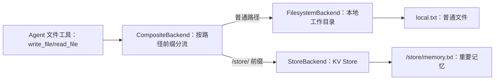

# 6 - Deep Research: Long-Term Memory and Backend Storage

---

**Chapter learning objectives:**

- Understand the role of Backend in DeepAgents: it is the connection layer between the Agent file system and long-term storage.
- Distinguish between short-term memory and long-term memory, and understand that the difference lies not in "how long it is stored" but in "what is stored."
- Distinguish the roles of `checkpointer`, `StateBackend`, `FilesystemBackend`, `StoreBackend`, and `CompositeBackend`.

**Study suggestion:** Backend is not just about "saving chat history"; it is more like a filing cabinet prepared for the Agent. When reading this chapter, compare the trade-offs behind several backends: storing in state, storing on disk, storing in a KV Store, and routing storage by path. Focus on how the Agent still works by reading and writing files, while the Backend determines where those files ultimately land and whether they can be reused across sessions.

**Corresponding code branch:** `06-deepagents-backends-memory`

**References:**
DeepAgents backend storage: https://docs.langchain.com/oss/python/deepagents/backends

---

## 1. Memory System and Backend Overview

### 1.1 From Interrupt Recovery to Long-Term Storage

In the human-agent collaboration discussed in the previous chapter, we used `checkpointer`. It is responsible for saving the paused state during a single execution so that execution can be resumed later.

However, `checkpointer` is not long-term memory. What it focuses on is: which step has this task reached? Where should execution resume after interruption?

Backend, on the other hand, focuses on a different question: where do the files written by the Agent, the materials generated, and the information that needs to be stored long-term ultimately go? For example, if a user asks the Agent to generate a report, that report can be saved to the local file system; if the user asks the Agent to record long-term preferences, those preferences can be saved to a database or KV Store; temporary intermediate files can exist only in memory.

### 1.2 The Difference Between Short-Term Memory and Long-Term Memory

The core difference between short-term memory and long-term memory is not that "one stores for a short time and the other for a long time," but rather that **what is stored is different**.

| Type | Mainly stores what | Typical use | Corresponding concept in this chapter |
| -------- | ---------------------------------------- | -------------------------- | -------------- |
| Short-term memory | The execution process, node state, and interrupt position of a single call | Human-agent collaboration interrupt recovery, resuming a workflow | `checkpointer` |
| Long-term memory | Results, files, and user preferences generated by one or more sessions | Sharing information across threads and sessions | `Backend` |

Therefore, even if short-term memory is stored in Redis or a database, as long as it stores "which step a single execution has reached," it is still short-term memory. Conversely, `InMemoryStore` also stores data in memory, but what it stores is file-like results such as `user_profile.txt`, so semantically it is an implementation of long-term memory.

In one sentence: **Short-term memory records the process, long-term memory records the results.**

### 1.3 The Role of Backend in DeepAgents


The Agent still reads and writes files through file system tools, but the files do not necessarily actually land in the same place. Backend sits between the "file tools" and the "real storage medium," responsible for mapping virtual file paths to State, local disk, Store, or a composite backend.

One thing needs to be clarified first: Backend is not "automatically saving all chat history." It is usually triggered by file tools.

| Agent behavior | Does Backend participate |
| ---------------------------------------------------------------------------- | -------------------- |
| Ordinary chat replies | Usually does not participate |
| Model internal thinking or planning | Will not automatically write to Backend |
| Calling file tools such as `ls`, `read_file`, `write_file`, `edit_file`, `glob`, `grep` | Handled by Backend |

In other words, only when the Agent explicitly performs file reads and writes will the Backend determine where those virtual files ultimately land. Ordinary Q&A that does not trigger file tools will not automatically settle into long-term memory.

This chapter focuses on the following four types of Backend:

| Backend | Storage location | Lifecycle | Suitable scenarios |
| ------------------- | ------------ | ------------------------------ | ------------------------------ |
| `StateBackend` | Current runtime state | Can be retained with checkpoints within the same `thread` | Default temporary files, intermediate results |
| `FilesystemBackend` | Local disk | Files persist indefinitely on the local machine | Local debugging, report generation, file inspection |
| `StoreBackend` | KV Store | Depends on Store implementation | Cross-thread sharing, long-term memory, production storage |
| `CompositeBackend` | Hybrid routing | Determined by routing | Different paths to different storage, production projects |

The following three code examples will demonstrate `FilesystemBackend`, `StoreBackend`, and `CompositeBackend` respectively. `StateBackend` is the default temporary backend and will be explained separately in Section 2, without a standalone example.

The official documentation also provides capabilities such as `LocalShellBackend`, Sandbox, and custom Backend, which lean more toward code execution, isolated environments, or enterprise extensions. This chapter only provides necessary pointers and does not elaborate on them.

Long-term memory, in the end, is not directly "grown into the model's brain." More precisely, information is first saved to Backend, and later when needed it is read back through file tools and re-enters the prompt or context, which is how the model appears to "remember previous information."

Corresponding to the code, this chapter mainly examines three examples:

| File | Topic | Description |
| ------------------------------------------ | ------------------- | -------------------------- |
| `10-filesystem-backend-memory.py` | `FilesystemBackend` | Write Agent files to a local directory |
| `11-store-backend-cross-session-memory.py` | `StoreBackend` | Map file operations to a KV Store |
| `12-composite-backend-routing.py` | `CompositeBackend` | Route to different storage based on path prefixes |

---

## 2. Core Concept Distinctions

### 2.1 checkpointer: Saving Short-Term Execution State

`checkpointer` primarily serves execution recovery in LangGraph / DeepAgents.

What it stores:

- Which node execution has currently reached;
- The state before interruption;
- Temporary execution context within the same `thread_id`;
- State needed for human-agent collaboration recovery.

A typical scenario is the human-agent collaboration from the previous chapter:

```text
第一次 invoke 命中高危工具
  -> checkpointer 保存暂停状态
  -> 人工审批
  -> 第二次 invoke 用相同 thread_id 恢复
```

### 2.2 The Difference Between InMemorySaver and InMemoryStore

Chapter 5 used `InMemorySaver`, and this chapter will use `InMemoryStore`. Their names are similar, and both can keep data in Python process memory, but their semantics are completely different.

| Object | Where used | What it stores | Memory type |
| --------------- | -------------- | ---------------------------------- | ------------------ |
| `InMemorySaver` | `checkpointer` | Agent execution process, interrupt position, recovery state | Short-term memory |
| `InMemoryStore` | `StoreBackend` | File-like results, user information, long-term preferences | An implementation of long-term memory |

So when judging whether a piece of "memory" is short-term or long-term, do not only look at whether it is stored in memory, but at what it stores.

### 2.3 Backend: Managing Files and Long-Term Information Storage

Backend focuses on the results of the Agent's file reads and writes.

What it stores:

- Markdown generated by the Agent;
- Memory files written by the Agent;
- Information that needs to be read across threads;
- File content that can land locally, in memory, or in a database.

They can be distinguished as follows:

| Comparison | checkpointer | Backend |
| -------- | ---------------------- | ---------------------------- |
| Main purpose | Save execution process state | Save files and long-term information |
| Lifecycle | Usually serves recovery within a single thread | Can exist across threads and sessions |
| Typical use | Human-agent collaboration interrupt recovery | Report files, user profiles, long-term memory |
| Focus | Agent execution state | Agent file system |

### 2.4 StateBackend: The Default Temporary File Backend

`StateBackend` can be understood as DeepAgents' default file storage approach. It keeps file content in the current Agent's runtime state and is suitable for saving temporary files and intermediate processes.

It and `StoreBackend` may both look like "there is something in memory," but the distinction is crucial:

- `StateBackend` follows the execution state of the current `thread`. When used with checkpoints, it can continue to be accessed across multiple calls within the same `thread`;
- `StateBackend` is not suitable for sharing long-term memory across `thread`, users, or services;
- `StoreBackend` depends on an external `store` object. As long as that `store` is not released, it can be read across `thread_id`;
- If `store` is replaced with a persistent Store such as Redis or Postgres, it can further support long-term memory across processes and services.

Therefore, `StateBackend` is not suitable for saving information that needs to be reused across sessions, such as user profiles, historical reports, and long-term preferences. It is more like temporary scratch paper within the same execution thread, suitable for intermediate files and staged results.

Let us pause here for this section: `checkpointer` manages workflow recovery, `Backend` manages file destinations, and `StateBackend` is the default temporary destination. The following three code cases put files into local storage, Store, and hybrid routing respectively.

---

## 3. FilesystemBackend: Local File Storage

### 3.1 Use Cases

During local development and debugging, we often want files generated by the Agent to actually appear in the project directory, so that they can be opened and inspected directly.

Corresponding project file path: `deepsearch-agents/examples/10-filesystem-backend-memory.py`

### 3.2 Preparing a Local Working Directory

In the example, `Path` creates a working directory:

```python
from pathlib import Path

# 准备本地工作目录
# Agent 写入的文件最终会落到这个目录中，便于本地调试和查看结果
workspace_dir = Path("./agent_workspace").resolve()
workspace_dir.mkdir(parents=True, exist_ok=True)
```

This directory is the actual location on the host machine to which the Agent file system is mapped.

### 3.3 Creating a FilesystemBackend

```python
from deepagents.backends import FilesystemBackend

# FilesystemBackend 把 DeepAgents 的文件系统操作映射到本地磁盘
# root_dir 是真实存储目录
# virtual_mode=True 表示开启虚拟沙箱，限制 Agent 只能在 root_dir 范围内读写
file_backend = FilesystemBackend(
    root_dir=workspace_dir,
    virtual_mode=True,
)
```

There are two key parameters here:

| Parameter | Description |
| ------------------- | --------------------------------------------- |
| `root_dir` | The actual local directory where files are stored |
| `virtual_mode=True` | Enable virtual sandbox mode, restricting the Agent to only access the specified directory |

`virtual_mode=True` is very important. It prevents the Agent from arbitrarily reading or writing files outside the project.

### 3.4 Registering with DeepAgent

When creating the Agent, pass the Backend in.

```python
# 这里把 backend 指定为 file_backend
# Agent 内置文件工具产生的文件读写，会交给 FilesystemBackend 处理
main_agent = create_deep_agent(
    model=llm,
    tools=[],
    backend=file_backend,
    system_prompt="""
    你是一个智能助手，可以使用文件工具进行文件读写
    只有在用户明确要求创建或写入文件时，才可以创建文件
    """,
)
```

This way, when the user explicitly requests file creation, the Agent's built-in file system tools will write the content to the `agent_workspace` directory.

The example also deliberately makes two calls to observe whether the prompt constraints take effect:

```python
# 第一次请求只是查询介绍，没有明确要求写文件
# 用来观察 Agent 是否会遵守提示词，不主动创建文件
result_1 = main_agent.invoke(
    {
        "messages": [
            {
                "role": "user",
                "content": "帮我查询下 Python 语言的介绍",
            }
        ]
    }
)

# 第二次请求明确要求把内容写入 java.txt
# 此时 Agent 可以调用文件工具，FilesystemBackend 会把文件保存到 agent_workspace
result_2 = main_agent.invoke(
    {
        "messages": [
            {
                "role": "user",
                "content": "帮我查询下 Java 语言的介绍，并写到 java.txt 文件中",
            }
        ]
    }
)
```

### 3.5 Running the FilesystemBackend Example

Execute the file to verify. Success:

```text
uv run examples/10-filesystem-backend-memory.py

第 1 次调用：用户没有明确要求创建文件
最终结果：Python 是一种高级编程语言......广泛应用于 Web 开发、科学计算、数据分析、人工智能与机器学习等领域。

第 2 次调用：用户明确要求创建文件
最终结果：这是写入到 `java.txt` 文件中的 Java 语言简介内容：
Java 是一种广泛使用的面向对象的编程语言......适用于桌面、移动、Web 和企业级应用等。
```

When reading this output, it is enough to grasp the following phenomena:

| Output snippet | Meaning |
| --------------------------------------- | --------------------------------------------------------------- |
| `第 1 次调用：用户没有明确要求创建文件` | Just ordinary Q&A; the Agent should not proactively create files |
| `第 2 次调用：用户明确要求创建文件` | The user explicitly requests writing to `java.txt`, which is when the file tools are used |
| `这是写入到 java.txt 文件中的...` | `FilesystemBackend` has mapped the Agent's file-writing action to the local working directory |

### 3.6 Applicable Scenarios and Limitations

Situations suitable for using `FilesystemBackend`:

- Local development and debugging;
- Needing to directly inspect files generated by the Agent;
- Generate deliverables such as Markdown, TXT, and PDF files;
- The project has not yet integrated a database or object storage.

Unsuitable scenarios:

- Multi-machine deployment;
- Multi-user shared long-term memory;
- Files that require highly reliable persistence;
- Scenarios requiring permission isolation and unified storage governance.

In addition, `FilesystemBackend` allows the Agent to read from and write to real local files, so extra caution is required in production environments:

- Do not place `.env`, API keys, or credential files in directories accessible to the Agent;
- File modifications are persistent, and accidental writes or deletions may not be easy to recover;
- For web services, multi-tenant systems, and scenarios that process untrusted input, directly exposing the host file system is not recommended;
- For high-risk writes, human approval from Chapter 5 can be combined so that actions are reviewed before execution.

---

## 4. StoreBackend: KV Store Storage

### 4.1 Problems Solved by StoreBackend

`FilesystemBackend` is suitable for local debugging, but in production environments it may not be appropriate to write files to local disk. For example, if a service is deployed across multiple machines, a user's first request may land on machine A while the next request lands on machine B, making local files difficult to share.

In this case, `StoreBackend` can be used. It maps the Agent's file operations into Key-Value storage.

The term `KV Store` here does not specifically refer to Redis or MySQL, but generally refers to "key-value storage": using one key to locate one value.

In `StoreBackend`, it can be understood as follows:

```text
key   = 文件路径
value = 文件内容
```

For example, when the Agent writes `user_profile.txt`, the underlying storage may actually save it as:

```text
key = /user_profile.txt
value = {'content': 'Name: 乌萨奇\nAge: 16', 'encoding': 'utf-8', ...}
```

`StoreBackend` itself is more like an adapter: it is responsible for converting "file reads and writes" into "Store reads and writes." Where the data is actually stored depends on what `store` is passed in.

| Store type      | Actual storage location         |
| --------------- | -------------------- |
| `InMemoryStore` | Current Python process memory |
| Redis Store     | Redis                |
| Postgres Store  | Postgres database      |
| Custom Store    | An enterprise's own storage system   |

The example in this chapter uses `InMemoryStore`, so the data is stored in the current Python process memory and will be lost after the program exits. If true persistence is needed in a production environment, it can be replaced with Redis, Postgres, or other supported Store implementations.

### 4.2 Creating a Store

Corresponding project file path: `deepsearch-agents/examples/11-store-backend-cross-session-memory.py`

This case uses LangGraph's in-memory Store.

```python
from langgraph.store.memory import InMemoryStore

# InMemoryStore 是教学用内存 Store，进程重启后数据会丢失
# 生产环境可以替换成 RedisStore、数据库 Store 或其他持久化 Store
store = InMemoryStore()
```

Using `InMemoryStore` is convenient for teaching, but it is lost after restart. In production, it can be replaced with external storage such as Redis or Postgres.

### 4.3 Using StoreBackend When Creating the Agent

```python
from deepagents.backends import StoreBackend

# StoreBackend 会把文件路径映射成 Store 中的 key，把文件内容映射成 value
# 这里要求 Agent 把用户重要信息写入 user_profile.txt
# 底层实际不会写本地文件，而是写入上面的 store
main_agent = create_deep_agent(
    model=llm,
    backend=StoreBackend,
    store=store,
    system_prompt="""
    你是一个智能助手
    当用户提供重要个人信息时，请保存到 user_profile.txt
    当用户询问个人信息时，请从 user_profile.txt 中读取
    """,
)
```

The `backend=StoreBackend` here indicates that file system operations are routed through the Store.

`store=store` indicates the specific Store instance where data is stored.

### 4.4 Namespace Controls Memory Isolation Scope

`StoreBackend` can share information across `thread_id`, but in production environments all users cannot share the same memory. In real implementations, `namespace` must be used to control the isolation scope.

It can first be understood as follows:

| namespace design     | Memory sharing scope               | Suitable scenarios           |
| ------------------ | -------------------------- | ------------------ |
| Isolated by user         | Different sessions of the same user share   | User preferences, personal profile |
| Isolated by assistant         | Users under the same assistant share     | Public instructions, team knowledge |
| Isolated by thread     | Shared only within the current session         | Session drafts, temporary materials |
| User + thread combination | A specific session for the same user is stored independently | More fine-grained session memory |

For the sake of demonstration, the example in this chapter does not expand on the `namespace` configuration. In a real multi-user system, it is recommended to explicitly set the isolation scope to avoid mixing memories from different users.

### 4.5 Verifying Long-Term Memory Across thread_id

The example uses two different `thread_id` values to simulate two different threads or sessions:

```python
# 使用两个不同 thread_id 模拟跨线程或跨会话
# Backend 保存的是长期文件数据，不依赖同一个 thread_id 才能读取
config_a = {"configurable": {"thread_id": "thread-a"}}
config_b = {"configurable": {"thread_id": "thread-b"}}
```

On the first execution, thread A writes user information:

```python
result_a = main_agent.invoke(
    {
        "messages": [
            {
                "role": "user",
                "content": "我是乌萨奇，我今年 16 岁",
            }
        ]
    },
    config=config_a,
)
```

After writing, the underlying Store can be read directly to observe exactly what `StoreBackend` has stored:

```python
# 直接读取 Store，观察 StoreBackend 写入的底层数据
# DeepAgents 文件系统默认使用 filesystem 命名空间保存文件式内容
items = store.search(("filesystem",))
for item in items:
    print(f"key = {item.key}")
    print(f"value = {item.value}")
```

On the second execution, thread B reads the same user information:

```python
# 第二次执行：线程 B 读取同一份用户信息
# 这说明 Backend 存储和 checkpointer 的线程状态不是一回事
result_b = main_agent.invoke(
    {
        "messages": [
            {
                "role": "user",
                "content": "我叫什么，我的年龄是多少",
            }
        ]
    },
    config=config_b,
)
```

The most important phenomenon in this example is that information written by `thread-a` can also be read by `thread-b`. This shows that the Backend stores long-term file data, not the single-thread pause state saved by `checkpointer` in the previous chapter.

### 4.6 Running the StoreBackend Example

Execute the file to verify; it succeeds:

```text
uv run examples/11-store-backend-cross-session-memory.py

第一次回复结果：我已经记录了你的名字乌萨奇和年龄16岁。

读取 Store 中保存的用户信息
key = /user_profile.txt
value = {'content': 'Name: 乌萨奇\nAge: 16', 'encoding': 'utf-8', ...}

第二次回复结果：您的名字是乌萨奇，您的年龄是16岁。
```

The meaning of this output is as follows:

| Output snippet                              | Meaning                                                      |
| ------------------------------------- | --------------------------------------------------------------- |
| `第一次回复结果：我已经记录...`       | Thread A writes `user_profile.txt` based on the user information                      |
| `key = /user_profile.txt`             | `StoreBackend` maps the file path into a key in the Store                  |
| `Name: 乌萨奇\nAge: 16`               | The file content is stored as the value in the Store                               |
| `第二次回复结果：您的名字是乌萨奇...` | Thread B can read the information written by thread A, indicating that the memory has been shared across `thread_id` |

### 4.7 Why File Paths Are Still Used

You may wonder: since everything is stored in a KV Store, why do we still write file names like `user_profile.txt`?

The reason is that DeepAgents' file system abstraction still uses "paths" as the unified identifier. Even if the underlying layer is not the local file system, the path can serve as the Key.

For example:

```text
user_profile.txt
```

This can be understood as the key in the KV Store; the file content is the value.

The benefit of this design is that regardless of whether the underlying layer is local files, memory, or a database, the Agent can always maintain a unified "read file, write file" experience when operating.

---

## 5. CompositeBackend: Hybrid Storage Strategy

### 5.1 Use Cases for Hybrid Storage

In real projects, different files have different storage requirements.

For example:

- Temporary reports can be written to a local directory;
- Long-term user preferences should be written to the Store;
- Intermediate processes can remain in State;
- Important memories need to be preserved across sessions.

Writing everything to one place is not flexible enough. `CompositeBackend` can route different files to different Backends based on path prefixes.

### 5.2 Defining the CompositeBackend Factory Function

Corresponding project file path: `deepsearch-agents/examples/12-composite-backend-routing.py`

This case defines a factory function:

```python
from pathlib import Path

from deepagents.backends import CompositeBackend, FilesystemBackend, StoreBackend
from langgraph.store.memory import InMemoryStore


# Store 用来保存 /store/ 路径下的重要记忆
# 这里使用 InMemoryStore 便于教学观察，生产环境可以替换成持久化 Store
store = InMemoryStore()


def create_composite_backend(runtime):
    """
    创建混合 Backend

    create_deep_agent 会把 runtime 传入这个工厂函数
    StoreBackend 需要 runtime 才能连接到 Agent 配置中的 store
    """
    workspace_dir = Path("./agent_workspace").resolve()
    workspace_dir.mkdir(parents=True, exist_ok=True)

    # 默认后端：普通文件写入本地工作目录
    fs_backend = FilesystemBackend(
        root_dir=workspace_dir,
        virtual_mode=True,
    )

    # Store 后端：重要记忆写入 Key-Value Store
    store_backend = StoreBackend(runtime)

    # 路由规则：
    # 普通路径，例如 local.txt，走 default 的 FilesystemBackend
    # /store/ 开头的路径，例如 /store/memory.txt，走 StoreBackend
    return CompositeBackend(
        default=fs_backend,
        routes={
            "/store/": store_backend,
        },
    )
```

There are two routing rules here:

| Path                 | Backend                |
| -------------------- | ------------------- |
| Normal paths             | `FilesystemBackend` |
| Paths starting with `/store/` | `StoreBackend`      |

In other words:

```text
local.txt              -> 写到本地文件系统
/store/memory.txt     -> 写到 Store
```

### 5.3 Registering with the Agent

When creating the Agent, pass the factory function to `backend`.

```python
agent = create_deep_agent(
    model=llm,
    store=store,
    backend=create_composite_backend,
    tools=[],
    system_prompt="""
    你是一个智能助手
    普通文件请直接写入文件名，例如 local.txt
    重要记忆请写入 /store/ 目录，例如 /store/memory.txt
    """,
)
```

Note that what is passed here is the function `create_composite_backend`, not an already created Backend object. This is the approach used in the current project example, making it easier to correspond with the `StoreBackend(runtime)` routing code above.

### 5.4 Path Prefixes and Route Stripping

`CompositeBackend` selects the backend based on the route prefix and then strips the prefix.

For example, when the Agent writes:

```text
/store/memory.txt
```

During route determination, this matches `/store/`, so the content is passed to `StoreBackend`. When it actually enters the Store, the Key may become:

```text
/memory.txt
```

When using it, just remember that the path prefix is used for routing, and the Backend handles the mapping during actual storage. From the perspective of the Agent's virtual file system, it can still be understood as a path like `/store/...`; however, after entering the underlying Store, the actual key may already have had the route prefix removed.



At the end of the example, the Store contents are printed using `store.search(("filesystem",))` to confirm that the important memory under the `/store/` path has indeed entered the Store:

```python
# CompositeBackend 命中 /store/ 路由后，会把内容交给 StoreBackend
# 进入 Store 时，路由前缀可能会被剥离，因此可以直接打印 item 观察实际 key 和 value
items = store.search(("filesystem",))
for item in items:
    print(item)
```

### 5.5 Running the CompositeBackend Example

Execute the file to verify; it succeeds:

```text
uv run examples/12-composite-backend-routing.py

=== 测试混合存储 ===
用户指令：1 创建本地文件 local.txt，内容为 本地文件
2 创建记忆文件 /store/memory.txt，内容为 重要记忆

Agent 回复：已完成以下任务：
1. 创建了本地文件 `local.txt`，内容为“本地文件”。
2. 创建了记忆文件 `/store/memory.txt`，内容为“重要记忆”。

=== 验证 Store 存储 ===
Item(namespace=['filesystem'], key='/memory.txt', value={'content': '重要记忆', ...})
```

The most critical part of this output is the last line:

| Output snippet                             | Meaning                                     |
| ------------------------------------ | ---------------------------------------------- |
| `local.txt`                          | The normal path matches the default backend and writes `FilesystemBackend` |
| `/store/memory.txt`                  | The `/store/` prefix matches the Store route                  |
| `key='/memory.txt'`                  | When entering the Store, the route prefix `/store/` is stripped       |
| `value={'content': '重要记忆', ...}` | The important memory was indeed saved to the Store                  |

This example verifies the core value of `CompositeBackend`: the same Agent continues to work by "writing files," but different paths can enter different storage backends. Ordinary deliverables are stored locally, while long-term memories go into the Store.

---

**Chapter Summary:**

At this point, the most important threads of this chapter have been connected.

`checkpointer` is responsible for short-term execution recovery, while the Backend is responsible for file and long-term information storage. These two solve different problems and should not be conflated. Short-term memory records a single execution process, while long-term memory records results that can be reused later.

The Backend also does not automatically save all chat content. Only when the Agent calls file tools to read from or write to content does the Backend decide where those files are ultimately stored.

`StateBackend` is the default temporary file backend, suitable for intermediate files and temporary results within the same `thread`, but not suitable for long-term memory across users or threads.

`FilesystemBackend` writes Agent files to a local directory, suitable for debugging and report generation; when using it, control the accessible directories to avoid exposing keys, configuration files, or other sensitive materials.

`StoreBackend` maps file-style operations to a KV Store, suitable for cross-thread sharing and long-term memory; in production environments, use `namespace` to control isolation scope among users, assistants, or sessions.

`CompositeBackend` performs routing through path prefixes, allowing different files to enter different storage locations, making it a more production-ready approach.

**One-sentence summary:** Short-term memory records the process, while long-term memory records the results; the Backend lets the Agent continue working in a "file" manner, but files can ultimately be flexibly stored in state, local disk, a KV Store, or hybrid storage.
