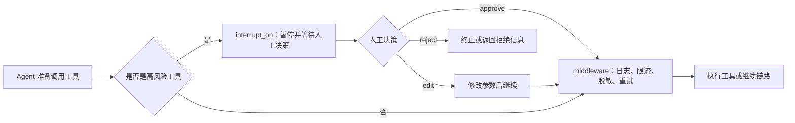

# 7 - Deep Research: Middleware Mechanisms and Skills Configuration

---

**Chapter Goals:**

- Understand where middleware sits in the Agent execution chain: it doesn't handle specific business logic, but rather governance of the chain.
- Master three commonly used middleware types: context summarization, model call limiting, and tool call limiting.
- Distinguish the roles of `thread_limit`, `run_limit`, and `exit_behavior`.
- Understand how middleware works with `interrupt_on`, sub-agents, and WebSocket progress push.

**Study Suggestions:** First understand middleware as checkpoints on the Agent execution chain: before model calls, before tool calls, and before context is fed in, you can observe or modify behavior at these points. When reading code, focus on how it performs logging, parameter adjustment, call count limiting, and risk interception. For the Skills section, first look at how it is loaded as a reusable specification; don't confuse it with tools or sub-agents.

**Corresponding Code Branch:** `07-deepagents-middleware-governance`

**References:**
LangChain Built-in Middleware: https://docs.langchain.com/oss/python/langchain/middleware/built-in

---

## 1. What Problems Does Middleware Solve First

### 1.1 Understanding Middleware in One Sentence

The English term for middleware is `Middleware`. It is not the object that ultimately executes business logic, but rather a layer of processing logic that sits between the "caller" and the "callee".

In a typical web project, middleware might sit at: `客户端请求 -> 中间件 -> 接口函数`

In an Agent project, it might sit at:

```text
Agent -> 中间件 -> 模型
Agent -> 中间件 -> 工具
Agent -> 中间件 -> 子智能体
```

Therefore, middleware is not a concept unique to DeepAgents. DeepAgents is built on top of LangChain / LangGraph, and many of the capabilities used in this chapter also come from LangChain's Agent Middleware system. In one sentence: **Tools are responsible for doing things, middleware is responsible for managing things.**

### 1.2 Where Can It Intercept

Middleware doesn't only take effect at the "tool call" point. LangChain's Agent Middleware can be inserted into different stages of Agent execution.

| Stage                         | What it can do                                                       | How this chapter handles it |
| ----------------------------- | -------------------------------------------------------------------- | --------------------------- |
| Before/after model calls      | Limit call count, switch models, retry, record costs                 | Key topic                   |
| Before/after tool calls       | Record logs, permission checks, rewrite parameters, wrap results     | Key topic                   |
| Before context enters model   | Summarization compression, sensitive information handling            | Core concepts explained     |
| Before/after final response   | Unified formatting, finalization handling                            | Brief mention only          |
| In sub-agent's own chain      | Set separate limits, logs, or permission rules                       | Configuration approach      |


This chapter focuses on model call limiting and tool call middleware, because they are the easiest to observe and are most commonly used for cost control, logging, and governing tool execution chains.

### 1.3 Common Capabilities

| Capability              | Description                                                             | Typical scenarios                                  |
| ----------------------- | ----------------------------------------------------------------------- | -------------------------------------------------- |
| Logging & tracing       | Record when models, tools, and sub-agents are called                   | Troubleshooting Agent execution                    |
| Parameter rewriting     | Modify parameters before the actual tool call                          | Uniform defaults, parameter desensitization        |
| Result rewriting        | Uniformly wrap results after tool returns                              | Unified output format, sensitive content filtering |
| Call limiting           | Limit model or tool call counts                                        | Prevent infinite loops, save tokens                |
| Context compression     | Summarize overly long conversation history or intermediate processes   | Prevent overflowing the context window             |
| Permission & auth       | Check user permissions before calling high-risk tools                  | Paid features and sensitive operations in enterprise systems |
| Early termination/raise | Proactively stop execution after threshold, or hand off to upper-layer exception handling | Call count exceeded, process errors                |

For enterprise-grade agents, the three most commonly used are:

- **Context compression**: avoid multi-turn conversations and long-chain tasks from overflowing the context window.
- **Model call count limiting**: prevent the Agent from endlessly thinking and retrying.
- **Tool call count limiting**: prevent a tool from being called repeatedly, causing loops or runaway costs.

### 1.4 Why Multi-Agent Systems Need Middleware Even More

As discussed in previous chapters, multi-agent systems can "divide and conquer," but they also amplify two problems:

- Multiple Agents calling each other incurs higher token costs;
- Agent decisions are uncertain and prone to repetitive planning or loops.

For example, the main Agent discovers insufficient information and calls the web assistant; the web assistant searches and returns incomplete results; the main Agent continues calling; if the prompts or tool designs are poor, this chain can keep looping.

The value of middleware is to add engineering boundaries to such systems:

```text
可以调用模型，但要有次数上限；
可以调用工具，但某个工具不能无限调用；
上下文可以增长，但到阈值前要先摘要压缩；
达到限制后，要么正常结束，要么抛出异常交给业务层处理。
```

### 1.5 Overview of LangChain Built-in Middleware

| Engineering Problem        | Representative Middleware                                                    | What it solves                                                           |
| -------------------------- | ---------------------------------------------------------------------------- | ------------------------------------------------------------------------- |
| Context too long           | `SummarizationMiddleware`                                                    | Automatically summarize old messages, retain key context                 |
| Uncontrolled call counts   | `ModelCallLimitMiddleware`, `ToolCallLimitMiddleware`                        | Limit model or tool call counts, prevent loops and cost overruns         |
| High-risk action approval  | `HumanInTheLoopMiddleware`                                                   | Pause before actions like sending emails, dropping tables, writing files, and wait for human confirmation |
| Privacy & sensitive info   | `PIIMiddleware`                                                              | Mask, hide, or block emails, phone numbers, credit cards, etc.           |
| Failure recovery           | `ModelRetryMiddleware`, `ModelFallbackMiddleware`, `ToolRetryMiddleware`     | Retry on model or external tool failures, switch to backup models if needed |
| Too many tools to choose   | `LLMToolSelectorMiddleware`                                                  | When the tool list is very long, first filter out tools relevant to the current task |
| Task planning assistance   | `TodoListMiddleware`                                                         | Add to-do list capability to the Agent to help with multi-step tasks     |

For now, just know the names and purposes. This chapter will expand on context summarization, model call limiting, tool call limiting, and how to use `@wrap_tool_call` to wrap a single tool call yourself.

---

## 2. Middleware Configuration in DeepAgents

### 2.1 Main Agent Configuration

When creating a DeepAgent, you can pass in a list via the `middleware` parameter.

```python
from deepagents import create_deep_agent
from langchain.agents.middleware import ModelCallLimitMiddleware
from langgraph.checkpoint.memory import InMemorySaver

# checkpointer 用来记录同一条线程的执行状态
# thread_id 也是 thread_limit 判断“同一个会话线程”的依据
checkpointer = InMemorySaver()
thread_config = {"configurable": {"thread_id": "erdaye"}}

main_agent = create_deep_agent(
    model=llm,
    tools=[delete_database, delete_file, select_database],
    checkpointer=checkpointer,
    system_prompt="回答使用中文，调用对应的工具实现对应的功能！",
    middleware=[
        ModelCallLimitMiddleware(
            thread_limit=1,  # 同一个 thread_id 下累计最多调用 1 次模型
            run_limit=1,  # 当前这次 invoke 内最多调用 1 次模型
            exit_behavior="error",  # 超限后抛出异常，便于后端统一捕获处理
        )
    ],
    # 本章重点是 middleware 调用限制，因此这里关闭人工审批拦截
    interrupt_on={
        "delete_database": False,
        "delete_file": False,
        "select_database": False,
    },
)
```

This code means: add a model call limiting middleware to the main Agent. Whenever the main Agent needs to call a model, it will first pass through this middleware.

`middleware` is a list, so multiple middleware instances can be configured at once:

```python
main_agent = create_deep_agent(
    model=llm,
    tools=[...],
    middleware=[
        middleware_a,
        middleware_b,
        middleware_c,
    ],
)
```

It's not recommended to configure multiple instances of the same type of limit. For example, if you place two `ModelCallLimitMiddleware` at the same time, it's hard to tell later which rule triggered the limit during troubleshooting. A clearer approach: configure only one instance per type, and specify the threshold and over-limit behavior clearly.

### 2.2 Sub-Agent Configuration

A sub-agent is essentially an independent Agent configuration, so it can also configure `middleware`.

Common fields for dictionary-style sub-agents:

```python
db_agent = {
    "name": "db_helper",
    "description": "负责数据库查询任务。",
    "system_prompt": "你是一个专业的数据库查询助手。",
    "tools": [query_table, query_schema],
    "middleware": [
        # 子智能体自己的中间件
    ],
}
```

Two layers need to be distinguished here:

| Configuration location                        | Scope of impact                          |
| --------------------------------------------- | ---------------------------------------- |
| `create_deep_agent(... middleware=...)`     | Affects the main Agent's execution chain |
| `middleware` in the sub-agent dictionary | Affects that sub-agent's own chain       |

In the "Deep Research" project, if a particular sub-agent is prone to looping — for example, the database assistant repeatedly generating SQL and repeatedly querying — you can add tool or model call limits to just the database assistant.

---

## 3. Context Summarization: SummarizationMiddleware

### 3.1 Applicable Problems

A model's context window is not infinite. When there are many conversation turns, or when the Agent's execution process is very long, `messages` will accumulate a large amount of historical messages, tool results, and intermediate processes. The most crude approach is to discard old messages, but this can easily lose critical context.

A more reasonable approach: before the context becomes too long, hand a portion of historical messages to the model to summarize into a short digest, then put the digest back into the context. This is the role of summarization middleware.

### 3.2 Core Parameters

Summarization middleware typically involves three parameters.

| Parameter    | Description                                                      |
| ------------ | ---------------------------------------------------------------- |
| `model` | Which model to use for summarization compression             |
| `trigger` | When to trigger summarization, e.g., token count, message count, context ratio |
| `keep` | How much recent context to retain after summarization, to avoid losing the latest messages |

Example code:

```python
from langchain.agents.middleware import SummarizationMiddleware

summary_middleware = SummarizationMiddleware(
    model=llm,
    trigger=("tokens", 4000),  # 消息累计到约 4000 token 时触发摘要
    keep=("messages", 20),  # 摘要后保留最近 20 条原始消息
)

main_agent = create_deep_agent(
    model=llm,
    tools=[...],
    middleware=[summary_middleware],
)
```

`trigger=("tokens", 4000)` should not be set equal to the model's maximum context length. For example, if the model supports a maximum of 8000 tokens, don't set it to 8000 before compressing, because by the time you actually reach the limit, it may already be too late to send content to the summarization model.

A safer approach is to set it to two-thirds or three-quarters of the maximum context length.

Old documentation may show parameter names like `max_tokens_before_summary` and `messages_to_keep`. In LangChain 1.x, it is more recommended to use `trigger` and `keep`, which provide more consistent expression.

### 3.3 Which Tasks to Place It In

Summarization middleware is suitable for long tasks, such as:

- Multi-turn deep search;
- Multiple web retrievals;
- Multiple database queries;
- Tasks that require continuously revising reports;
- Tasks where sub-agents return relatively long content.

It's not meant to "make answers look better," but rather to ensure the Agent retains key context over long chains. For short tasks, don't rush to add summarization; for long tasks, plan for summarization in advance.

---

## 4. Model Call Limiting: ModelCallLimitMiddleware

### 4.1 What Does It Limit

Every time an Agent "thinks about the next step," it may call the model. In a normal task, a few model calls are reasonable: first understand the task, decide to call a tool, look at the tool result, then organize the final answer.

But if the prompts are unclear or tool results are unstable, the Agent may keep repeating:

```text
调用模型 -> 决定调用工具 -> 工具结果不满意 -> 再调用模型 -> 再调用工具
```

Model call limiting sets an upper bound on this chain.

### 4.2 thread_limit and run_limit

The example code uses two limits:

```python
ModelCallLimitMiddleware(
    thread_limit=1,  # 同一个 thread_id 下累计最多调用 1 次模型
    run_limit=1,  # 当前这次 invoke 内最多调用 1 次模型
    exit_behavior="error",  # 超限后抛出异常
)
```

Their differences are as follows:

| Parameter      | Meaning                                                     | How to understand it                                 |
| -------------- | ----------------------------------------------------------- | ---------------------------------------------------- |
| `thread_limit` | Cumulative model call count limit under the same `thread_id` | Total quota for one client or one session thread |
| `run_limit` | Model call count limit within a single execution           | Maximum model calls for the current request         |

To use `thread_limit`, you need a stable `thread_id`, and usually also need to configure `checkpointer`. Otherwise, the framework has no reliable place to record "how many model calls this thread has already made."

In a web project, one browser session usually corresponds to one stable `thread_id`. The server can both group multi-turn tasks into the same session chain and know which frontend connection the current execution result should be pushed to.

It can be understood this way:

```text
thread_limit 管一整条会话线程；
run_limit 管这一次 invoke / stream。
```

The teaching example sets both values to `1`, in order to trigger the limit quickly. Real projects should not blindly copy this; they should set values based on how many model calls a normal task typically needs.

For example, deep search tasks typically go through "understand question -> search -> read results -> search again -> summarize answer." If `run_limit` is only set to 1 or 2, normal tasks can easily be misjudged as abnormal.

### 4.3 exit_behavior: end or error

After the limit is reached, the middleware needs to decide how to handle it. There are two common values:

| Value      | Behavior                       | Suitable scenario                               |
| --------- | -------------------------- | -------------------------------------- |
| `"end"`   | End normally and return a limit notice | When the notice content can be shown directly to users               |
| `"error"` | Raise an exception                   | When the backend needs to catch the exception uniformly and return a standard error format |

In enterprise-grade backends, using `"error"` is more recommended.

The reason is that `"end"` is a "normal business return," so the frontend may display it as an ordinary answer; while `"error"` can be handled uniformly by the API layer and return a fixed format:

```json
{
  "code": "MODEL_CALL_LIMIT",
  "message": "本次任务模型调用次数过多，请缩小问题范围后重试"
}
```

This makes frontend-backend collaboration clearer.

### 4.4 Code Example

Below is the core part of the model invocation limit in the teaching code:

```python
import os

from deepagents import create_deep_agent
from dotenv import find_dotenv, load_dotenv
from langchain.agents.middleware import ModelCallLimitMiddleware
from langchain.chat_models import init_chat_model
from langgraph.checkpoint.memory import InMemorySaver

load_dotenv(find_dotenv())

llm = init_chat_model(
    model=os.getenv("LLM_QWEN_MAX"),
    model_provider="openai",
)

# checkpointer 用来记录同一条线程的执行状态
# thread_id 也是 thread_limit 判断“同一个会话线程”的依据
checkpointer = InMemorySaver()
thread_config = {"configurable": {"thread_id": "erdaye"}}

main_agent = create_deep_agent(
    model=llm,
    tools=[delete_database, delete_file, select_database],
    checkpointer=checkpointer,
    system_prompt="回答使用中文，调用对应的工具实现对应的功能！",
    middleware=[
        ModelCallLimitMiddleware(
            thread_limit=1,  # 同一个 thread_id 下累计最多调用 1 次模型
            run_limit=1,  # 当前这次 invoke 内最多调用 1 次模型
            exit_behavior="error",  # 超限后抛出异常，便于后端统一捕获处理
        )
    ],
    # 本章重点是 middleware 调用限制，因此这里关闭人工审批拦截
    # 如果要演示危险动作审批，可以把高风险工具配置为 True 或 allowed_decisions
    interrupt_on={
        "delete_database": False,
        "delete_file": False,
        "select_database": False,
    },
)

# 这个请求通常需要多次“模型规划 -> 工具调用 -> 模型整理结果”
# run_limit=1 会让示例更容易触发模型调用上限
result = main_agent.invoke(
    {
        "messages": [
            {
                "role": "user",
                "content": "先查询product表的数据！再删除user表，最后，删除zhaoweifeng.txt文件",
            }
        ]
    },
    config=thread_config,
)

print(f"最终结果{result['messages'][-1].content}")
```

The `thread_id` in `thread_config` is critical. It lets the middleware know which thread the current invocation belongs to, and it also allows checkpoints, human-in-the-loop collaboration, and WebSocket push notifications to revolve around the same conversation.

### 4.5 Analysis of Runtime Results

When running `13-model-call-limit-middleware.py`, you can focus on two things.

First, the tool was indeed invoked:

```text
调用了select_database工具。查询了product表数据
调用了删除了delete_database工具。删除了user表
调用了删除了delete_file工具。删除了zhaoweifeng.txt文件
```

Second, after the tool invocation ends, the Agent still needs to call the model again to organize the next step or generate the final answer. Because the example sets both `thread_limit` and `run_limit` to `1`, this new model invocation is intercepted by the middleware during the `before_model` phase:

```text
ModelCallLimitExceededError:
Model call limits exceeded: thread limit (1/1), run limit (1/1)
During task with name 'ModelCallLimitMiddleware.before_model'
```

This shows that `ModelCallLimitMiddleware` limits "model invocation counts," not "tool invocation counts." So you will see that the tool has already executed, but an exception is still raised when subsequent model invocations exceed the limit.

---

## 5. Tool Invocation Limits: ToolCallLimitMiddleware

### 5.1 Differences from Model Invocation Limits

A model invocation limit governs the "number of thoughts," while a tool invocation limit governs the "number of actions."

For example, a database assistant can call:

- a tool to query database table names;
- a tool to query table structures;
- a tool to execute SQL.

If tools are not limited, the Agent may repeatedly query table structures and repeatedly execute similar SQL. Tools such as databases, web search, and RAG already have cost or performance pressure of their own, so they need limits even more.

### 5.2 Global Limits and Per-Tool Limits

Tool invocation limits can be divided into two categories:

| Limit type   | Description                         |
| ---------- | ---------------------------- |
| Global limit   | Maximum total number of invocations across all tools |
| Per-tool limit | Maximum number of invocations for a specified tool   |

Illustrative code:

```python
from langchain.agents.middleware import ToolCallLimitMiddleware

global_tool_limit = ToolCallLimitMiddleware(
    thread_limit=10,  # 同一条会话线程里，所有工具累计最多调用 10 次
    run_limit=5,  # 当前这次 invoke 内，所有工具最多调用 5 次
)

search_tool_limit = ToolCallLimitMiddleware(
    tool_name="search_web",  # 只限制 search_web 这个工具
    run_limit=3,  # 当前这次 invoke 内最多搜索 3 次
    exit_behavior="error",  # 超限后直接抛异常，交给业务层处理
)

sql_tool_limit = ToolCallLimitMiddleware(
    tool_name="execute_sql",  # 只限制 execute_sql 这个工具
    run_limit=2,  # 当前这次 invoke 内最多执行 2 次 SQL
    exit_behavior="error",
)
```

This configuration can be read as:

- Within the same thread, the total number of all tool invocations is at most 10;
- Within a single execution, the total number of all tool invocations is at most 5;
- Within a single execution, `search_web` can be invoked at most 3 times;
- Within a single execution, `execute_sql` can be invoked at most 2 times;
- When a specified tool exceeds its limit, an exception is raised.

As with model invocation limits, as long as you use `thread_limit`, you must ensure that the same conversation has a stable `thread_id`, and configure a checkpoint that can preserve thread state.

The `exit_behavior` for tool invocation limits has one more common option than model invocation limits: `"continue"`.

| Value         | Behavior                                             | Suitable scenario                       |
| ------------ | ------------------------------------------------ | ------------------------------ |
| `"continue"` | Block this tool invocation and return the error to the Agent as a tool message | When you want the Agent to handle it in another way  |
| `"error"`    | Raise an exception immediately                                       | Unified backend capture and unified error structure |
| `"end"`      | End the current execution immediately                                 | When a clear termination notice is needed in a single-tool scenario   |

Then put them together into the `middleware` list:

```python
main_agent = create_deep_agent(
    model=llm,
    tools=[search_web, execute_sql],
    middleware=[
        global_tool_limit,
        search_tool_limit,
        sql_tool_limit,
    ],
)
```

This is an engineering illustration built on the same middleware mechanism. Its configuration method is the same as `ModelCallLimitMiddleware`: both are placed into the `middleware` list.

### 5.3 How to Set Thresholds

Thresholds should not be set arbitrarily based on intuition. It is recommended to first observe the normal task chain.

For example, "query drug information in the database and generate a PDF" may require:

1. Query what tables exist;
2. Query the target table structure;
3. Execute SQL;
4. Generate Markdown;
5. Convert to PDF.

If a normal chain invokes about 5 tools, then `run_limit` can be set slightly larger, such as 8 or 10. If it is set too small, normal tasks will be mistakenly affected; if it is set too large, it will not stop loops.

A commonly used engineering approach is: `正常调用次数 + 适当冗余 = 限制阈值`.

---

## 6. Custom Tool Middleware: @wrap_tool_call

### 6.1 When Customization Is Needed

The summarization, model invocation limits, and tool invocation limits discussed earlier are all ready-made middleware. They can be configured directly, but the logic is predefined by the framework.

In actual development, more granular requirements often arise:

- Log before invoking a tool;
- Check user permissions before invoking a tool;
- Rewrite parameters uniformly before invoking a tool;
- Filter sensitive results after invoking a tool;
- Wrap results into a unified format after invoking a tool;
- Convert failures into business-readable error messages.

These kinds of logic are suitable for custom middleware.

In LangChain Agent Middleware, tool invocation middleware can be defined using the `@wrap_tool_call` decorator. Its name can be understood by breaking it down:

```text
wrap_tool_call = 包住一次工具调用
```

In other words, when the Agent originally intended to call the tool directly, it now first hands this tool invocation to your function. Your function can do some things before the tool executes, and it can also do some things after the tool executes.

### 6.2 Minimal Example

Corresponding file path in the project: `deepsearch-agents/examples/14-custom-tool-call-middleware.py`

```python
from langchain.agents.middleware import wrap_tool_call


@wrap_tool_call
def log_tool_call(request, handler):
    """
    工具调用中间件：在目标工具执行前后打印调用信息
    """
    print("--------进入了工具中间件----------")
    print(f"request : {request}")  # 本次工具调用请求，包含工具名、工具参数等信息
    print(f"handler : {handler}")  # 真正执行目标工具的调用器

    # 前置增强：这里可以记录日志、做权限校验，或者改写 request 中的工具参数
    # handler(request) 是真正执行目标工具的关键步骤；不调用它，工具就会被中间件拦住
    result = handler(request)

    # 后置增强：这里可以包装返回结果、做敏感信息过滤，或者记录工具耗时
    print("--------退出工具中间件----------")
    print(f"result:{result}")

    return result
```

This function has two fixed parameters:

| Parameter      | Role                                             |
| --------- | ------------------------------------------------ |
| `request` | The current tool invocation request, containing information such as the tool name and tool parameters |
| `handler` | The invoker that actually executes the target tool                         |

The most critical line is:

```python
result = handler(request)
```

It means: continue executing the tool that was originally going to be invoked. Without this line, the middleware blocks the tool invocation, and the subsequent tool will not actually execute. This characteristic can also be useful sometimes. For example, when a permission check fails, you can skip calling the real tool and directly return a business error message. But when you are just starting out, remember this first: if you want the tool to execute normally, you must call `handler(request)`.

### 6.3 request, handler, and handler(request)

Without middleware, the Agent calling a tool can be abstracted as:

```text
Agent -> 工具调用器(handler) + 工具参数(request) -> Tool -> 返回结果
```

With middleware, the Agent no longer calls the tool directly. Instead, it hands the "invoker" and the "parameters" to the middleware:

```text
Agent -> 中间件(request, handler) -> handler(request) -> Tool -> result -> Agent
```

Therefore, the middleware can see both the parameters before the invocation and the result after the invocation.

This provides two extension points:

| Position                    | What can be done                               |
| ----------------------- | ---------------------------------------- |
| Before `handler(request)` | Pre-enhancement: logging, permissions, parameter rewriting           |
| After `handler(request)` | Post-enhancement: result wrapping, sensitive-word filtering, format conversion |

If you want to see the tool name and parameters, you usually get them from `request.tool_call`:

```python
@wrap_tool_call
def monitor_tool(request, handler):
    tool_name = request.tool_call["name"]
    tool_args = request.tool_call["args"]

    print(f"准备调用工具: {tool_name}")
    print(f"工具参数: {tool_args}")

    result = handler(request)

    print(f"工具调用完成: {tool_name}")
    return result
```

This structure is very similar to middleware in web frameworks and around-advice in AOP: the target function is still there, but the invocation path first passes through this layer of logic you wrote.

### 6.4 Configuring into DeepAgent

After defining the middleware, you also need to configure it into the Agent's `middleware` list.

```python
from deepagents import create_deep_agent
from langgraph.checkpoint.memory import InMemorySaver

# 自定义中间件和框架内置中间件一样，
# 都需要放到 middleware 列表里才会生效
deep_agent = create_deep_agent(
    model=llm,
    tools=[add_numbers],
    checkpointer=InMemorySaver(),
    middleware=[log_tool_call],
    system_prompt="你是一个计算器助手，使用add_numbers工具完成加法计算，回答仅返回计算结果。",
)
```

As long as the Agent invokes `add_numbers`, it will pass through `log_tool_call`.

The complete test entry is as follows:

```python
if __name__ == "__main__":
    # 使用固定 thread_id，便于把一次测试调用归到同一个会话线程
    thread_config = {"configurable": {"thread_id": "middleware_test_1"}}

    result = deep_agent.invoke(
        {"messages": [{"role": "user", "content": "帮我计算 100 + 200 的结果"}]},
        config=thread_config,
    )

    print("\n=== 最终回复 ===")
    print(result["messages"][-1].content)
```

Whether it is middleware provided by LangChain or middleware you write yourself using `@wrap_tool_call`, it only takes effect when placed into the `middleware` list.

### 6.5 Analysis of Runtime Results

When running `14-custom-tool-call-middleware.py`, the output is very long, so you do not need to read it word by word. Focus on three types of information.

First, `request` is a `ToolCallRequest`, and the most critical part inside it is `tool_call`:

```text
ToolCallRequest(
  tool_call={
    'name': 'add_numbers',
    'args': {'a': 100, 'b': 200},
    'id': 'call_...',
    'type': 'tool_call'
  },
  ...
)
```

This shows that the middleware can obtain the tool name, tool parameters, and tool invocation ID. In real projects, logging, permission, and parameter protection usually read values from here.

Second, `handler` is the invoker that actually executes the target tool:

```text
handler : <function ToolNode._run_one.<locals>.execute at ...>
```

Therefore, `handler(request)` is not an ordinary print statement, but the key action that "continues executing the add_numbers tool." The tool log in the output also confirms this:

```text
[工具执行] 100 + 200 = 300
```

Third, `result` usually contains the tool return content, the tool name, and `tool_call_id`:

```text
result:content='300' name='add_numbers' tool_call_id='call_...'

=== 最终回复 ===
300
```

This is why post-enhancement often reads `result.content`: it is the content that the tool actually returns to the Agent. In real projects, you can hand over `tool_call["name"]`, `tool_call["args"]`, `result.content`, elapsed time, and exception information to the monitoring module in a unified way.

### 6.6 Engineering Use Cases

Custom tool middleware is suitable for "unified logic that all tools must pass through."

For example, in the "Deep Research" project, the following scenarios can be considered later:

| Scenario         | What the middleware can do                           |
| ------------ | ------------------------------------------ |
| Tool invocation logging | Record tool name, parameters, elapsed time, and return summary           |
| Permission control     | Some tools can only be invoked by logged-in users or enterprise users     |
| Parameter protection     | Prevent the model from passing dangerous paths or dangerous SQL             |
| Result desensitization     | Hide sensitive fields such as phone numbers and ID card numbers in database results |
| Frontend progress push | Push status to WebSocket when a tool starts and ends      |

The advantage of middleware is centralized processing. Otherwise, if logging, permission, and exception wrapping are written in every tool, the code becomes very scattered.

Later, after entering the hands-on phase of the "Deep Research" project, the frontend needs to see task progress in real time, such as "searching the web," "querying the database," and "generating the report." This kind of state is not suitable to be scattered across individual tools. It is more appropriate for tool middleware to uniformly collect the tool name, parameters, start time, end time, and exception information, and then hand them to the backend monitoring module, which pushes them to the frontend via WebSocket. This enables both real-time progress display and the ability to preserve an inspectable execution chain.

But do not stuff all business logic into middleware either. You can distinguish according to this standard:

| Logic type                                   | Better placed where   |
| ------------------------------------------ | ---------------- |
| The core business of a specific tool                     | Inside the tool function     |
| Logging, permissions, desensitization, and exception wrapping needed by all tools | Custom tool middleware |
| Whether high-risk actions are allowed to execute and require human confirmation       | `interrupt_on`   |
| Invocation counts, context length, and cost boundaries             | Ready-made limit middleware |

After layering in this way, tools handle business actions, middleware handles execution-chain governance, and human-in-the-loop collaboration handles approval of dangerous actions. Responsibilities become clearer.

---

## 7. Middleware and Human-in-the-Loop Collaboration, Progress Push

### 7.1 Differences Between middleware and interrupt_on

The previous chapter covered `interrupt_on`, which also intercepts before tool execution. But its goal is different from middleware:

| Capability           | Focus                     | Typical use                         |
| -------------- | -------------------------- | -------------------------------- |
| `interrupt_on` | Whether a particular tool requires human approval   | Deleting files, deleting tables, sending emails       |
| `middleware`   | Add rules or restrictions uniformly across the call chain | Logging, rate limiting, compression, permissions, result processing |

`interrupt_on` is more like "dangerous action approval." `middleware` is more like "execution chain governance."



### 7.2 Combined Configuration Example

In the teaching example, `create_deep_agent` configures `checkpointer`, `middleware`, and `interrupt_on` at the same time.

```python
main_agent = create_deep_agent(
    model=llm,
    tools=[delete_database, delete_file, select_database],
    checkpointer=checkpointer,
    middleware=[
        ModelCallLimitMiddleware(
            thread_limit=1,
            run_limit=1,
            exit_behavior="error",
        )
    ],
    interrupt_on={
        "delete_database": False,
        "delete_file": False,
        "select_database": False,
    },
)
```

In this example, `interrupt_on` is set to `False`, which means no manual approval for now, with the focus on testing model call restrictions.

In a real project, they can be combined like this:

```python
main_agent = create_deep_agent(
    model=llm,
    tools=[delete_database, delete_file, select_database],
    checkpointer=checkpointer,
    middleware=[
        ModelCallLimitMiddleware(
            run_limit=8,
            exit_behavior="error",
        )
    ],
    interrupt_on={
        "delete_database": True,
        "delete_file": True,
    },
)
```

This way, it can prevent the model from making repeated calls while also blocking truly high-risk deletion actions.

### 7.3 Relationship with WebSocket Progress Push

Middleware itself is not the same as WebSocket, but it is very suitable as a collection point for progress events.

For example, tool middleware can record events at these moments:

```text
准备调用工具 -> 推送 tool_started
工具返回结果 -> 推送 tool_finished
工具抛出异常 -> 推送 tool_failed
```

The WebSocket layer is responsible for sending events to the frontend; the middleware is responsible for finding these events in the Agent execution chain. The two responsibilities are separated, which will be easier to maintain in later project practice.

Here we will again use the stable `thread_id`: when creating a task over HTTP, return `thread_id`, and the frontend then uses this `thread_id` to establish a WebSocket connection, so the server can push progress from the same Agent chain to the corresponding user.

---

## 8. Engineering Usage Recommendations

### 8.1 Observe First, Then Set Limits

When first integrating middleware, it is not recommended to set restrictions too rigidly right from the start.

A safer path is:

1. First use logs or monitoring to observe how many model calls and tool calls a normal task makes;
2. Identify the call count range for common tasks;
3. Then set `run_limit` and `thread_limit`;
4. Provide unified prompts for abnormal tasks that exceed the threshold.

Otherwise, it is easy to end up in a situation where a user asks a slightly more complex question and the Agent is interrupted by the limit before it can finish.

### 8.2 Set Limits by Sub-Agent Layer

Do not use the same set of limits for all Agents.

| Agent | Recommended Limit Strategy |
| -------------- | ---------------------------------- |
| Web search assistant | Limit the number of search tool calls to avoid repeated searching |
| Database query assistant | Limit the number of SQL executions to avoid repeated trial and error |
| RAG assistant | Limit the number of knowledge base Q&A calls to avoid long-chain loops |
| Main agent | Limit the overall number of model calls to control total cost |

This is also the reason why multi-agent projects need "layered governance."

### 8.3 Unified Exception Handling

If the project will later integrate with a frontend, it is recommended that the backend uniformly catch exceptions thrown by middleware and then return a standard structure to the frontend.

This way, the frontend can clearly distinguish:

- Normal answer;
- Model call count limit exceeded;
- Tool call count limit exceeded;
- Manual approval rejected;
- Business tool exception.

Otherwise, everything is mixed into ordinary text, making it difficult for the frontend to build stable interactions.

### 8.4 Desensitization, Retry, and Fallback

This chapter focuses on "limits," but real projects cannot rely on limits alone. Referring to the official built-in middleware, production environments usually add three more types of capabilities:

| Capability | Middleware to Consider | Use Case |
| ------------ | ------------------------------------------------- | -------------------------------------------------- |
| Sensitive information handling | `PIIMiddleware` | Mask or block email addresses, phone numbers, ID numbers, etc. |
| Model failure recovery | `ModelRetryMiddleware`, `ModelFallbackMiddleware` | Retry or switch to a backup model when the model times out, is rate-limited, or the service is unavailable |
| Tool failure recovery | `ToolRetryMiddleware` | Retry occasional failures of external tools such as search, web scraping, and RAG queries |

One boundary to keep in mind here: not all tools are suitable for retries. Tools such as search and reading web pages, where "calling once more is not a big deal," can be retried; tools with side effects such as deleting files, deleting databases, sending emails, or deducting payments should not be automatically retried lightly and are better handled through manual approval or business idempotency design.

---

## 9. Skill Configuration in DeepAgents

The previous chapters have covered tools, sub-agents, Backend, and middleware. DeepAgents also has another commonly used extension capability: `skills`.

The complete concept of Skills will not be expanded here; the full fundamentals are in [Chapter 27: Agent Skills and AI Coding Tool Practice](../27-Skills%E6%8A%80%E8%83%BD%E4%B8%8EAI%E7%BC%96%E7%A8%8B%E5%B7%A5%E5%85%B7%E5%AE%9E%E8%B7%B5.md). This section only addresses one engineering problem: **in DeepAgents, how to mount a Skill directory onto an Agent.**

### 9.1 The Role of FilesystemBackend

When DeepAgents reads Skills, it essentially needs to access a folder.

As mentioned earlier when discussing Backend, `FilesystemBackend` can map the Agent's filesystem to a local directory. When configuring Skills, you also need to first tell the Agent where the skills folder is.

The core chain of this example is: user request -> Agent reads Skill metadata -> loads `SKILL.md` on demand -> generates a reply according to the skill rules.

The example starts by loading environment variables and initializing the model:

```python
from pathlib import Path

from deepagents import create_deep_agent
from deepagents.backends import FilesystemBackend
from dotenv import find_dotenv, load_dotenv
from langchain.chat_models import init_chat_model

load_dotenv(find_dotenv())

llm = init_chat_model(model="qwen-max", model_provider="openai")
```

### 9.2 Creating FilesystemBackend

Skill files need to be exposed to the Agent through the Backend. In the example, the directory where the current Python file is located is used as the root directory, and subsequent `skills` paths are resolved relative to it.

```python
# Skill 文件需要通过 Backend 暴露给 Agent
# 当前文件在 examples/ 下，所以 current_dir 指向 examples/
current_dir = Path(__file__).parent.resolve()

file_backend = FilesystemBackend(
    # Agent 能访问的文件系统根目录
    root_dir=current_dir,
    # 开启虚拟沙箱，限制 Agent 只能在这个根目录下访问文件
    virtual_mode=True,
)
```

This code means:

| Configuration | Meaning |
| ---------------------- | --------------------------------------------------- |
| `root_dir=current_dir` | Use the directory where the current example file is located as the filesystem root directory |
| `virtual_mode=True` | Enable the virtual sandbox to restrict the Agent to accessing files only under this root directory |

### 9.3 Registering the skills Parameter

Next, configure both `backend` and `skills` in `create_deep_agent`.

```python
# skills=["skills"] 表示加载 current_dir/skills 目录下的技能包
# 每个技能包至少需要一个 SKILL.md，模型会先读取元数据，再按需读取完整技能说明
main_agent = create_deep_agent(
    model=llm,
    backend=file_backend,
    skills=[
        "skills",
    ],
    system_prompt="你是一个智能助手，可以使用 SKILL 技能",
)
```

Here, `"skills"` is the directory name relative to `file_backend.root_dir`.

If the local structure is:

```text
examples/
  15-skills-from-filesystem.py
  skills/
    emoji-translator/
      SKILL.md
    code-reviewer/
      SKILL.md
```

Then `skills=["skills"]` means: go to the `examples/skills` directory to find skills.

Here, three path concepts need to be distinguished:

| Concept | Example | Description |
| -------------- | ------------------- | -------------------------------------------- |
| Physical path | `examples/skills/` | The directory on the local disk where the Skill is actually stored |
| Backend root directory | `examples/` | The location pointed to by `FilesystemBackend(root_dir=...)` |
| Agent configuration path | `skills=["skills"]` | The Skill directory relative to the Backend root directory |

In other words, `skills=["skills"]` is not just any string; it lets the Agent search for the `skills/` directory in the filesystem it can access through the Backend.

Taking `emoji-translator/SKILL.md` as an example, the metadata at the beginning of the file roughly looks like this:

```markdown
---
name: emoji-translator
description: 当用户明确要求把自然语言翻译成 Emoji、把 Emoji 解释成文字，或要求“表情翻译/emoji 翻译”时使用。
---
```

Here, `description` is very important. DeepAgents first determines whether it needs to load the full `SKILL.md` based on the Skill metadata, so the clearer the description, the easier it is for the model to trigger the correct skill in the appropriate scenario.

### 9.4 Execution Call Example

```python
# 这句话明确要求使用“表情翻译技能”，便于触发 emoji-translator/SKILL.md。
query = "我早上起床晚了，赶公交车差点摔倒，还好最后到了公司。请你只用表情翻译技能。"

# DeepAgents 沿用 messages 输入结构，最终回复在 messages 最后一条。
result = main_agent.invoke(
    {
        "messages": [
            {
                "role": "user",
                "content": query,
            }
        ]
    }
)

print(f"最终输出结果：{result['messages'][-1].content}")
```

If `description` of `emoji-translator` is written clearly, the model will output an emoji combination according to the rules in `emoji-translator/SKILL.md`.

Run the following in the root directory of the example code repository:

```bash
uv run examples/15-skills-from-filesystem.py
```

The key output is roughly:

```text
最终输出结果：🛌⏰🏃‍♀️🚌💨🏢
```

This result shows that the `emoji-translator` skill has been triggered: the user's input of "woke up late, caught the bus, arrived at the company" was converted into the corresponding emoji sequence.

### 9.5 Configuration Notes

When using DeepAgents Skills, keep these points in mind:

| Note | Description |
| ---------------------- | ---------------------------------------------------- |
| Configure `backend` first | Without a filesystem Backend, the Agent does not know where to look for Skills |
| `skills` is a directory name | It is the skill directory relative to `FilesystemBackend.root_dir` |
| Align the folder name with `name` | The skill folder name is recommended to be equal to `name` in `SKILL.md` |
| `description` should be clear | It determines when the model loads that Skill |
| Use progressive loading | First look at the YAML metadata, then read the full `SKILL.md` on demand |
| More Skills is not always better | Too many skills with overlapping functions reduce trigger stability |

The experience shared in the teaching material is: do not stuff in too many Skills at once, especially not Skills with overlapping functions. The model is not a human plugin manager; when there are too many skills, it also has difficulty choosing.

### 9.6 Common Troubleshooting

If a Skill does not trigger as expected, check the following directions:

| Symptom | Troubleshooting Direction |
| --------------------------- | ----------------------------------------------------- |
| Agent is completely unaware the Skill exists | Check whether `FilesystemBackend` is configured and whether the `skills` path is correct |
| Skill directory exists but does not trigger | Check whether `description` clearly states the trigger scenarios |
| Wrong Skill triggered | Check whether the descriptions of multiple Skills are too similar and whether their responsibilities overlap |
| Resources or scripts not found | Check whether the relative paths in `SKILL.md` match the Skill directory structure |
| Unstable output format | Check whether `SKILL.md` clearly specifies input boundaries, execution steps, and the final output format |

One thing to remember here: Skills are not an automatic plugin system; they mainly rely on metadata and prompts to let the model decide "when to use which capability."

---

**Chapter Summary:**

Middleware is a very important layer in Agent engineering. It does not directly complete business tasks, but instead uniformly governs the execution chain.

The key points to master in this chapter are:

| Knowledge Point | Conclusion |
| ------------------ | ---------------------------------------------------- |
| Position of middleware | Between the Agent and the model, tools, and sub-agents |
| Common built-in middleware | This chapter focuses on summary compression, model call limits, and tool call limits |
| Official extension directions | Also includes desensitization, retry, fallback, manual approval, tool filtering, etc. |
| Custom tool middleware | Use `@wrap_tool_call` to wrap tool calls |
| `handler(request)` | Continue executing the target tool inside custom middleware |
| `thread_limit` | Limit the cumulative calls under the same `thread_id` |
| `run_limit` | Limit calls within a single execution |
| `exit_behavior` | After exceeding the limit, choose to continue, end normally, or raise an exception |
| Configuration location | Both main agents and sub-agents can be configured |
| Skills configuration | Expose the Skill directory through the Backend, then register it with the `skills` parameter |

Starting from the next chapter, we will officially enter the "Deep Research" project practice, combining the previously learned sub-agents, tools, Backend, middleware, and Skill configuration to build a complete enterprise-level multi-agent application.
