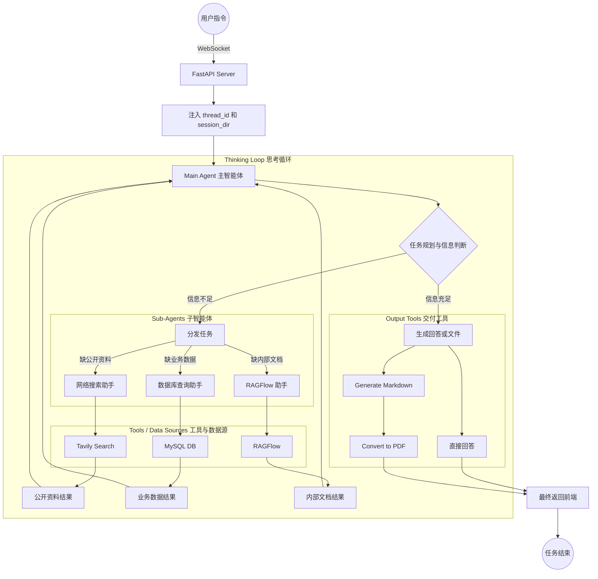

# 8 - Deep Research: Project Overview and Engineering Initialization

---

**Chapter Objectives:**

- Understand what problems the "Deep Research" project aims to solve, and how it differs from ordinary Q&A and ordinary RAG.
- Develop an initial impression of the project's overall architecture: 1 main agent, 3 expert sub-agents, and 9 core tools.
- Understand the roles of `thread_id`, `session_dir`, and WebSocket in frontend-backend interaction.

**Study Suggestion:** This chapter serves as the engineering map of the Deep Research project. It is recommended to draw a chain as you read: the frontend initiates a task, the main agent decomposes and schedules it, helpers such as web search, database, and RAGFlow each do their part, and progress is pushed back to the frontend. For the engineering initialization section, there is no need to memorize the directory structure; first understand which segment of the chain each type of file supports.

**Corresponding Code Branch:** `09-deepsearch-core-config`

---

## 1. Chapter Introduction

### 1.1 First Look at the End Goal

The "Deep Research" project will provide a page similar to a research assistant. Users can enter research tasks and also upload files. The backend agent will search the web, query databases, or query private knowledge bases as needed, and finally organize an answer or generate a file.


There are two entry points: one is text input, and the other is file attachment upload. This also reminds us that the backend cannot just handle a single prompt; it must also handle uploaded files, session directories, execution progress, and final deliverable outputs.

### 1.2 What This Chapter Does and Does Not Cover

This chapter belongs to project initialization and aims to accomplish the following:

1. Understand the project goals and overall architecture.
2. Open the [deepsearch-agents](https://github.com/didilili/deepsearch-agents) repository and synchronize dependencies via `uv`.
3. Understand the relationship among frontend tasks, backend services, and WebSocket progress push.
4. Understand the project directory structure and know where subsequent code should be placed.

The main agent, sub-agents, and specific tools will be further developed in subsequent chapters. This chapter focuses on getting a clear view of the project map.

---

## 2. What Problem Does the Project Solve

### 2.1 Why Ordinary Q&A Is Not Enough

The ordinary LLM Q&A chain is very simple: `用户提问 -> 模型根据已有知识回答`

This approach is suitable for common-sense Q&A, text rewriting, and simple summarization. However, "search" and "research" in enterprises are usually not that simple, because much of the information is not in the model's parameters.

For example:

- Drug information, sales data, and inventory data in company databases;
- Internal policies, product documentation, and training materials;
- Latest news, policies, and web resources;
- Files temporarily uploaded by the user during the current session;
- The final deliverable may need to be a Markdown or PDF report.

If we rely solely on the model's own answers, it will easily encounter two problems: **not knowing the latest information**, or **fabricating content that seems plausible but has no basis**. Therefore, what this project aims to do is not "make the model think longer," but to give the model the ability to look up information from different places.

### 2.2 Where Exactly Does the "Depth" Lie

The "depth" here does not refer to a more complex interface or longer prompts, but rather **more information sources and an iterative search process**.

This project mainly integrates five types of information sources:

| Information Source     | Suitable for Solving What Problems                        | How It Is Handled in the Project                         |
| ---------------------- | --------------------------------------------------------- | -------------------------------------------------------- |
| Model's own knowledge  | General knowledge, simple explanations, existing common sense | The main agent answers directly or participates in comprehensive analysis |
| Web search             | Latest public information, web content, external information | Web search helper, using Tavily under the hood              |
| Database               | Enterprise business data, such as drug tables and sales tables | Database query helper, responsible for querying tables, structures, and executing SQL |
| RAG knowledge base     | Internal enterprise documents, policies, private knowledge bases | RAGFlow helper, responsible for interacting with the knowledge base assistant |
| Uploaded files         | PDF, Word, Excel, text, and other files uploaded by the user in the current session | The main agent reads them through a file reading tool     |

There are two points that are easy to confuse:

- The model is not a sub-agent. It is a foundational capability shared by both the main agent and sub-agents.
- Uploaded files are also not a sub-agent. They are more like a tool in the main agent's hands, used to read materials from the current session.

### 2.3 Think of It as a "Deep Search Researcher"

This project is not a chatting search box, but rather a DeepAgents-based "deep search researcher."

It simulates the process a person goes through when doing research:

```text
先理解问题
  -> 判断还缺哪些信息
  -> 去不同来源搜索或查询
  -> 阅读返回结果
  -> 判断信息是否足够
  -> 不够就继续查
  -> 足够后整理回答或生成文件
```

For example, suppose the user asks:

```text
从数据库中查询药品信息，并生成 PDF 文件。
```

Behind this sentence, the following actions may occur:

1. The main agent determines that this is a database query task and that a file needs to be generated in the end.
2. The main agent calls the database query helper.
3. The database helper first checks what tables exist, then looks at the drug table structure and data preview.
4. The database helper executes the appropriate SQL and returns the drug information.
5. The main agent organizes the results into Markdown.
6. The main agent then calls the Markdown-to-PDF tool.
7. The frontend continuously displays progress such as "querying tables," "generating Markdown," and "converting to PDF."

This is the difference between Deep Research and a single ordinary Q&A: it does not just answer one sentence, but organizes a series of observable and reusable task steps around the goal.

---

## 3. Overall Architecture: One Main Agent with Three Sub-agents

### 3.1 The Main Agent Is Responsible for Overall Coordination

The project adopts a typical hierarchical multi-agent architecture from DeepAgents, namely the Orchestrator-Workers pattern discussed earlier.

The main agent acts like a team leader, responsible for:

- Understanding what the user really wants;
- Decomposing tasks and determining what information is needed;
- Deciding whether to call the web search helper;
- Deciding whether to call the database query helper;
- Deciding whether to call the RAGFlow helper;
- Reading uploaded files when necessary;
- Aggregating results and generating the final answer, Markdown, or PDF.

It should not do everything by itself. The more the main agent behaves like someone who "does everything personally," the harder the system is to maintain; the more it behaves like "a person who assigns tasks," the clearer the project structure becomes.

### 3.2 Three Expert Sub-agents

This project initially plans three sub-agents:

| Sub-agent       | Responsibilities                                                 | Typical Tools               |
| --------------- | ---------------------------------------------------------------- | --------------------------- |
| Web search helper   | Query public web resources, suitable for the latest information, public web pages, and external knowledge | Tavily search tool        |
| Database query helper | Query enterprise business databases, read table names, table structures, data previews, and execute SQL | List tables, inspect structure, execute SQL |
| RAGFlow helper   | Query the enterprise internal knowledge base, first fetch available assistants, then ask the knowledge base questions | Create session, ask the knowledge base |

The relationship between the main agent and sub-agents can be understood as follows:

```text
用户问题
  -> 主智能体分析任务
  -> 分派给网络 / 数据库 / RAGFlow 子智能体
  -> 子智能体返回结果
  -> 主智能体继续判断是否还要查
  -> 信息足够后生成最终结果
```

### 3.3 The Thinking Loop: Plan, Dispatch, Collect, and Re-evaluate

The core of this project is not "hard-coding a fixed process," but allowing the main agent to continuously judge whether the information is sufficient during execution.



There are three key points to grasp from this diagram:

- FastAPI is responsible for handling WebSocket requests and injecting contexts such as `thread_id` and `session_dir` into subsequent execution;
- The main agent runs in a thinking loop, first planning the task, then judging whether the information is sufficient, and only dispatching to the corresponding sub-agent when it is insufficient;
- The results from sub-agents return to the main agent, which then decides the next step. Therefore, it does not "search once and end," but can search, read, reflect, and search again, and finally generate an answer, Markdown, or PDF.

### 3.4 Four Agents and Nine Tools

The entire project can be summarized in one sentence: **4 agents, 9 tools.**

The four agents are:

| Type      | Name           | Role                                               |
| --------- | -------------- | -------------------------------------------------- |
| Main agent | Main Agent     | Understand tasks, plan steps, schedule helpers, aggregate results, generate deliverables |
| Sub-agent | Web search helper   | Query public web resources                                   |
| Sub-agent | Database query helper | Query business databases                                     |
| Sub-agent | RAGFlow helper   | Query the enterprise internal knowledge base                                 |

The nine tools, broken down by ownership:

| Owner           | Number of Tools | Tool Contents                                     |
| --------------- | --------------- | -------------------------------------------- |
| Main agent       | 3     | Read uploaded files, generate Markdown, convert Markdown to PDF |
| Web search helper   | 1     | Tavily web search                              |
| Database query helper | 3     | Get table names, get table structure and data preview, execute SQL     |
| RAGFlow helper   | 2     | Get available helpers or sessions, ask knowledge base helper questions         |

For now, just establish the division of labor; there is no need to memorize the specific code of each tool right away. When actually writing tools in later chapters, come back to this table to see who it belongs to and what problem it solves.


### 3.5 The Project's Tool System

Looking further at the code level, tools not only need to be known by "who they belong to," but also by what they will likely be named and what they will be responsible for. That way, later when seeing tool function names, it will not feel unexpected.

Common tools for the main agent:

| Tool Name                  | Purpose                             |
| ----------------------- | -------------------------------- |
| `upload_file_read_tool` | Read the content of files uploaded by the user in the current session       |
| `generate_markdown`     | Write the final result as a standard Markdown document |
| `convert_md_to_pdf`     | Convert a Markdown file to PDF       |

Web search helper tools:

| Tool Name            | Purpose                                                     |
| ----------------- | -------------------------------------------------------- |
| `internet_search` | Query public internet information based on Tavily, suitable for the latest materials and multi-angle retrieval |

Database query helper tools:

| Tool Name              | Purpose                                             |
| ------------------- | ------------------------------------------------ |
| `list_sql_tables`   | List available tables in the database                             |
| `get_table_data`    | Read table structure and partial data preview to help the model understand what is in the table |
| `execute_sql_query` | Execute the SQL query generated or organized by the model                  |

RAGFlow knowledge base helper tools:

| Tool Name               | Purpose                                       |
| -------------------- | ------------------------------------------ |
| `get_assistant_list` | Get the available knowledge base helpers in RAGFlow            |
| `create_ask_delete`  | Create a session, ask the knowledge base questions, and clean up the session after completion |

For now, just have an impression of these names. Later, when writing the specific tool files, we will go through the function parameters, return values, and exception handling one by one.

### 3.6 Tech Stack Overview

This project involves quite a few technologies, which can be understood across five layers: "agents, interfaces, data sources, file processing, and engineering support."

| Layer       | Technology                                               | Role in the Project                                       |
| ---------- | -------------------------------------------------- | ---------------------------------------------------- |
| Agent framework | DeepAgents, LangChain, LangGraph, `langchain-core` | Organize the main agent, sub-agents, tool calls, and thinking loops           |
| Model interface | OpenAI-compatible API, `init_chat_model`                 | Uniformly create LLM objects for all agents to use                 |
| Web service   | FastAPI, Uvicorn                                   | Provide backend interfaces such as task submission, file upload, and download               |
| Real-time communication   | WebSocket                                          | Push the Agent execution process to the frontend in real time                      |
| Parameter validation   | Pydantic, `typing-extensions`                      | Define request parameters, status structures, or tool inputs, and provide type compatibility |
| Web Search   | Tavily Search API                                  | Queries public Internet information and returns structured search results             |
| Private Knowledge Base | RAGFlow, `ragflow_sdk`                             | Connects to enterprise internal knowledge bases and queries private document content                 |
| Database     | MySQL, `mysql-connector-python`                    | Queries business data, table structures, and SQL results                      |
| File Processing   | File IO, python-docx, pypdf, pandas, ReportLab     | Generates reports, reads uploaded files, or parses document content                 |
| Environment Configuration   | `python-dotenv`                                    | Reads model, search, database, and RAGFlow connection configuration from `.env`  |
| HTTP Requests  | `requests`                                         | Performs external service connectivity checks, or directly accesses HTTP interfaces when needed   |
| Async Execution   | `asyncio`, `ContextVar`                            | Supports concurrent request isolation and passing context across steps                   |
| Path Management   | `pathlib`, `shutil`                                | Handles path concatenation, file moving, and archiving of uploaded files                 |

The three most important things at the current stage are: DeepAgents handles "how agents are organized," FastAPI + WebSocket handles "how the frontend and backend communicate," and `ContextVar` + session directories handle "how multi-user tasks avoid cross-talk."

---

## 4. Frontend-Backend Interaction and Real-Time Progress

### 4.1 Why Plain HTTP Alone Is Not Enough

Plain HTTP is more like this:

```text
客户端请求一次 -> 服务端处理完 -> 返回一次响应
```

But agent tasks often cannot be completed in a single step. For example, a task like "query the database and generate a PDF" might go through:

1. Create the session directory for this run;
2. Call the database assistant;
3. Query table names;
4. Query table structures and sample data;
5. Execute SQL;
6. Generate Markdown;
7. Convert to PDF;
8. Return the final file.

If the frontend receives no feedback at all, users will think the system is stuck. A more reasonable experience is: every time the backend completes a stage, it pushes the progress to the frontend.

Therefore, this project requires WebSocket.

### 4.2 thread_id and session_dir

From the frontend to the backend, two values are particularly critical:

| Name          | Problem it solves                         | How to understand it          |
| ------------- | ---------------------------------- | --------------------- |
| `thread_id`   | Which frontend connection should receive the current task's progress | The identity ID of this conversation task |
| `session_dir` | Which directory the files generated by the current task should be placed in | The working folder for this task  |

The complete chain can be viewed like this:

```text
前端发起任务
  -> 后端创建 thread_id 和 session_dir
  -> 把它们写入当前请求上下文
  -> Agent 和工具执行时随时读取上下文
  -> monitor 根据 thread_id 把进度推给对应前端
  -> 文件工具根据 session_dir 写入当前会话目录
```

If these two values are not handled well, "cross-talk" occurs: User A's task progress is pushed to User B, or files generated by User A are written into User B's directory.

### 4.3 WebSocket Handles Real-Time Push

The general WebSocket flow is:

```text
前端提交任务 -> 后端返回 thread_id
前端用 thread_id 建立 WebSocket 连接
Agent 执行过程中不断 report
monitor 根据 thread_id 找到对应 WebSocket
把执行进度推送给对应前端
```


Focus on the four swimlanes: Browser, Server main event loop, Monitor manager, and background Agent. The frontend does not wait until the Agent has fully finished to receive messages; instead, it receives monitoring events one by one while the Agent is executing tools or calling assistants.

### 4.4 What context.py and monitor.py Manage Respectively

These two files are easy to mix up, so you can initially distinguish them like this:

| File                 | What it is responsible for                                       | One-sentence memory             |
| -------------------- | ---------------------------------------------- | ---------------------- |
| `app/api/context.py` | Saves the current task's `thread_id` and `session_dir`    | Who I am, and where my folder is |
| `app/api/monitor.py` | Pushes events such as tool calls, assistant calls, and final results to the frontend | What I am currently doing       |

In other words, `context.py` is responsible for saving identity, while `monitor.py` is responsible for reporting progress externally. Later, when writing tools, as long as a tool calls `monitor.report_tool(...)`, the frontend has the opportunity to see the execution process.

---

## 5. Project Directory Structure and Dependency Preparation

### 5.1 Synchronizing Dependencies

The repository already includes `pyproject.toml`, `uv.lock`, the basic directory structure, and initialization code, so you do not need to run `uv init` from scratch.

Regarding the installation of `uv`, project initialization, and the basic usage of `uv add` and `uv sync`, these have already been covered in "[3 - Shopkeeper Data Q&A: Development Environment and Basic Service Preparation](../%E5%AE%9E%E6%88%98%E9%A1%B9%E7%9B%AE-%E7%94%B5%E5%95%86%E9%97%AE%E6%95%B0/3-%E5%BC%80%E5%8F%91%E7%8E%AF%E5%A2%83%E4%B8%8E%E5%9F%BA%E7%A1%80%E6%9C%8D%E5%8A%A1%E5%87%86%E5%A4%87.md#_2-creating-the-backend-project-and-using-uv)," so this section will not repeat them and will only explain the dependency synchronization steps for this project.

This project uses `uv` to manage Python dependencies. After obtaining the repository, enter the `deepsearch-agents` root directory and execute:

```bash
uv add -r requirements.txt
uv sync
```

These two commands are respectively responsible for "bringing dependencies into project management" and "synchronizing the local virtual environment":

| Command                         | Purpose                                                                                |
| ---------------------------- | ----------------------------------------------------------------------------------- |
| `uv add -r requirements.txt` | Reads `requirements.txt`, writes the dependencies into `pyproject.toml`, and updates `uv.lock`              |
| `uv sync`                    | Creates or updates `.venv` based on `pyproject.toml` and `uv.lock`, keeping the local environment consistent with the project declaration |

Therefore, `pip install -r requirements.txt` is no longer used as the primary installation method here. `requirements.txt` can be viewed as a dependency list organized by responsibility; what actually handles dependency declaration, locking, and environment synchronization is `uv`.

After synchronization is complete, you can use the following command to briefly confirm that the environment is available:

```bash
uv run python -V
uv run python -c "import deepagents, langchain, fastapi, ragflow_sdk; print('ok')"
```

If the Python version and `ok` output normally, it means the backend dependencies have been synchronized successfully.

### 5.2 Project Directory Structure

```text
deepsearch-agents/
├── app/                    # 后端业务代码主目录
│   ├── agent/              # 模型初始化、提示词加载、主智能体和子智能体组装逻辑
│   │   ├── llm.py          # 统一创建大模型对象
│   │   ├── prompts.py      # 读取 app/prompt/prompts.yml
│   │   ├── main_agent.py   # 后续章节补充：主智能体组装入口
│   │   └── subagents/      # 后续章节补充：网络、数据库、RAGFlow 子智能体
│   ├── api/                # FastAPI、WebSocket、上下文隔离和执行过程监控相关代码
│   │   ├── context.py      # 保存 thread_id 和 session_dir 上下文
│   │   ├── monitor.py      # 推送工具调用、助手调用和任务结果
│   │   └── server.py       # 后续章节补充：FastAPI 服务入口
│   ├── prompt/             # YAML 提示词配置，让提示词和 Python 逻辑分开维护
│   │   └── prompts.yml     # 主智能体和子智能体提示词配置
│   ├── tools/              # 后续章节补充：Agent 可调用工具，例如搜索、查库、生成文件
│   ├── utils/              # 普通 Python 工具函数，给后端代码或 Agent Tool 内部调用
│   │   ├── path_utils.py   # 统一解析上传文件、输出文件和会话目录路径
│   │   └── word_converter.py # Markdown 转 PDF 的底层转换工具
│   ├── output/             # 运行时生成：存放 Markdown、PDF 等任务产物
│   └── updated/            # 运行时生成：存放用户上传文件
├── examples/               # 前面章节学习 DeepAgents API 时用到的示例代码
├── .env.example            # 环境变量示例
├── .env                    # 本地真实配置，不提交仓库
├── .python-version         # Python 版本提示
├── pyproject.toml          # 项目依赖声明
└── uv.lock                 # 依赖锁定文件
```

Here we need to distinguish between two types of "tools":

| Type         | Who it is for     | Examples                                     |
| ------------ | ---------- | ---------------------------------------- |
| Agent Tool   | For the model to call | Web search, database queries, file reading, report generation   |
| Python Utils | For code to call | Path resolution, underlying conversion functions for Markdown to PDF |

`app/utils/` is not something the model can call directly. It is more like the backend code's own toolbox; later, an Agent Tool can call these ordinary functions internally. For example, the `convert_md_to_pdf` Agent Tool can call `app/utils/word_converter.py`, but what the model sees is the tool function; it does not need to care about how Markdown is parsed underneath, how ReportLab is called, or how paths are handled.

---

**Chapter Summary:**

Up to this point, we have first completed the project overview and project initialization layer. By now you should already understand:

- Why "Deep Research" is not plain Q&A, but a multi-source, multi-step research-oriented agent project;
- The relationship between the main agent, web search assistant, database query assistant, and RAGFlow assistant;
- Why frontend tasks require `thread_id`, `session_dir`, and WebSocket progress push;
- How the [deepsearch-agents](https://github.com/didilili/deepsearch-agents) repository synchronizes dependencies, and what responsibilities the main directories each carry.

The next chapter, "[Basic Modules and Model Configuration](9-%E5%9F%BA%E7%A1%80%E6%A8%A1%E5%9D%97%E4%B8%8E%E6%A8%A1%E5%9E%8B%E9%85%8D%E7%BD%AE.md)," will continue into the specific code: `.env`, `context.py`, `monitor.py`, `path_utils.py`, `word_converter.py`, `llm.py`, and prompt configuration.
