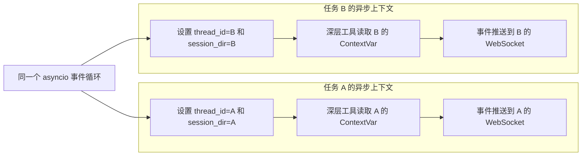

# 9 - Deep Research: Foundational Modules and Model Configuration

---

**This chapter's goals:**

- Prepare `.env` to separate model, search, database, RAGFlow, and other configuration out of the code.
- Understand how `ContextVar` stores the current task's `thread_id` and `session_dir` to prevent cross-talk between concurrent user requests.
- Understand how `monitor.py` pushes tool calls, assistant calls, and task results to the frontend.
- Become familiar with the responsibilities of the two general utility modules `path_utils.py` and `word_converter.py`, where `word_converter.py` uses ReportLab to generate PDFs.
- Complete the model and prompt configuration group consisting of `agent/llm.py`, `prompt/prompts.yml`, and `agent/prompts.py`.

**Study suggestion:** This chapter looks at the project's foundation, not scattered utility functions. You can trace the flow of "configuration entry -> request context -> real-time progress -> file utilities -> model and prompts" and ask yourself as you read: who creates this module, who calls it, and which chain will be affected if something goes wrong. Once you clearly see where these foundational modules sit, the main agent code later will feel much lighter.

**Corresponding code branch:** `09-deepsearch-core-config`

---

The previous chapter provided an overall understanding of the "Deep Research" project: what problem the project solves, how the main agent and sub-agents coordinate, why the frontend and backend need `thread_id` and real-time progress, and how to prepare the repository directory and dependencies.

This chapter continues from there, but does not rush into web search, database queries, or RAGFlow tools. We will first prepare the foundational modules that these tools rely on:

| Module                      | What problem it solves                                       |
| ------------------------- | -------------------------------------------------- |
| `.env`                    | Centralized management of model, search, database, RAGFlow, and other configuration       |
| `api/context.py`          | Save the current task identity and session directory within a single request chain         |
| `api/monitor.py`          | Push tool calls, assistant calls, and final results to the frontend           |
| `utils/path_utils.py`     | Unified resolution of file paths passed by models, tools, and users             |
| `utils/word_converter.py` | Provide low-level Markdown-to-PDF conversion based on ReportLab |
| `agent/llm.py`            | Unified creation of large language model objects                                 |
| `prompt/prompts.yml`      | Manage main agent and sub-agent prompts with YAML               |
| `agent/prompts.py`        | Read prompt configuration from YAML for use when assembling agents       |

You can think of this chapter as the "foundation before business tools." Once these modules are written clearly, adding tools, sub-agents, and APIs later will not require repeatedly handling configuration, paths, context, and model initialization in every file.

---

## 1. Configuration Entry: .env

### 1.1 .env Configuration

Project file path: `deepsearch-agents/.env`. You need to copy `deepsearch-agents/.env.example`, name it `.env`, and then replace the placeholder values with your actual configuration.

```dotenv
# LLM 配置
OPENAI_BASE_URL=https://dashscope.aliyuncs.com/compatible-mode/v1
OPENAI_API_KEY=你的大模型_API_KEY
LLM_QWEN_MAX=qwen-max

# Tavily 配置
# 在 https://app.tavily.com/ 注册账号，然后创建API KEY
TAVILY_API_KEY=你的_TAVILY_API_KEY

# RAGFlow 配置
RAGFLOW_API_URL=http://your-ragflow-host
RAGFLOW_API_KEY=ragflow-your-api-key

# MySQL 配置
MYSQL_USER=root
MYSQL_PASSWORD=root
MYSQL_DATABASE=pharma_db
MYSQL_HOST=localhost
MYSQL_PORT=3306
```

At this stage, the model configuration is the top priority to get working. MySQL and RAGFlow can remain placeholders for now and be filled in with real values when you write the corresponding tools later.

---

## 2. Request Context: api/context.py

### 2.1 What problem it solves

The project is an asynchronous web service, so multiple user requests may be executing at the same time. If global variables are used to store the current user's `thread_id` or session directory, data can be overwritten.

A typical problem is:

```text
用户 A 的任务还没结束
用户 B 的任务进来了
全局变量被 B 覆盖
用户 A 的进度被推送给 B
```

There is another detail to note here: asynchronous web services like FastAPI typically handle requests concurrently based on `asyncio`. Multiple user requests do not necessarily correspond to multiple threads; they are very likely multiple `asyncio Task` alternating execution within the same thread.

If you have never encountered "coroutines" before, you can think of them as: **a piece of code that can pause midway, wait for others to finish their work, and then continue executing**.

Here is an example closer to actual usage. Suppose you are asking a question in Doubao:

```text
帮我总结一篇文章。
```

The backend probably goes through a process like this:

```text
收到你的问题
  -> 记录你的会话 ID
  -> 调用大模型
  -> 等模型返回
  -> 整理结果
  -> 返回给你
```

The "call the large model" step usually requires some waiting. The server will not simply wait idly; it pauses your current request, turns to process another user's question, and then switches back to continue your task once the model result returns.

So the real situation is probably more like this:

```text
同一个服务器线程里：

任务 A：你向豆包提问
  -> 调用模型，等待中，先暂停

任务 B：另一个用户也向豆包提问
  -> 开始处理
  -> 调用模型，等待中，也暂停

任务 A：模型返回了
  -> 继续处理你的结果

任务 B：模型返回了
  -> 继续处理另一个用户的结果
```

Here, "Task A / Task B" can be roughly understood as two asynchronous tasks. They may execute alternately within the same thread, but each task must remember its own identity: Task A must remember your `thread_id` and `session_dir`, and Task B must remember another user's `thread_id` and `session_dir`.

Therefore, you cannot simply rely on "thread isolation" to store request data:

| Approach              | Why it is unsuitable or suitable                                    |
| ----------------- | ----------------------------------------------------- |
| Global variables          | All requests share one value; later requests overwrite earlier ones        |
| `threading.local` | Only isolates threads, cannot isolate multiple `asyncio Task` in the same thread |
| `ContextVar`      | Isolates the current asynchronous context, suitable for storing each request's own context data  |

`ContextVar` is a context variable designed for asynchronous programming in Python 3.7+. You can initially understand it as "a local variable within the current asynchronous task context (a coroutine-level local variable)": within the same request chain, deeper functions can access the value set earlier; when another request comes in, it gets its own value.

The core code is as follows. In a real project, in addition to storing values, the token returned by `set()` is kept so that the context can be restored cleanly after the task ends:

```python
"""
请求上下文管理模块

负责在异步请求链路中保存当前任务的 thread_id 和 session_dir
工具、智能体和监控模块可以在深层调用中读取这些值，而不需要层层传参
"""

from contextvars import ContextVar, Token
from typing import Optional

# ContextVar 是协程级上下文变量，适合 FastAPI 这类异步 Web 服务
# 它可以避免多个并发请求共用全局变量时出现 thread_id 或 session_dir 串台
_session_dir_ctx: ContextVar[Optional[str]] = ContextVar(
    "session_dir",
    default=None,
)
_thread_id_ctx: ContextVar[Optional[str]] = ContextVar(
    "thread_id",
    default=None,
)
```

These two variables store:

| Context        | Purpose                                    |
| ------------- | --------------------------------------- |
| `session_dir` | Session directory for files generated by the current task              |
| `thread_id`   | Frontend connection and agent execution thread corresponding to the current task |

Commonly used functions are:

```python
def set_session_context(path: str) -> Token[Optional[str]]:
    """
    设置当前请求链路的会话目录

    :param path: 当前任务的工作目录
    :return: reset 时需要使用的上下文 token
    """
    return _session_dir_ctx.set(path)


def get_session_context() -> Optional[str]:
    """
    获取当前请求链路的会话目录

    :return: 当前任务工作目录；未设置时返回 None
    """
    return _session_dir_ctx.get()


def set_thread_context(thread_id: str) -> Token[Optional[str]]:
    """
    设置当前请求链路的线程 ID

    :param thread_id: 前端连接和 Agent 执行共用的任务 ID
    :return: reset 时需要使用的上下文 token
    """
    return _thread_id_ctx.set(thread_id)


def get_thread_context() -> Optional[str]:
    """
    获取当前请求链路的线程 ID

    :return: 当前任务 ID；未设置时返回 None
    """
    return _thread_id_ctx.get()


def reset_session_context(
    session_token: Token[Optional[str]],
    thread_token: Optional[Token[Optional[str]]] = None,
) -> None:
    """
    恢复请求上下文，避免本次任务信息残留到后续请求

    :param session_token: set_session_context 返回的 token
    :param thread_token: set_thread_context 返回的 token
    """
    _session_dir_ctx.reset(session_token)
    if thread_token is not None:
        _thread_id_ctx.reset(thread_token)
```

Here, `set` returns a token. At the end of the task, using the token with `reset` can restore the context to the state before entering the task. This action is important because the web service runs continuously, and context from a previous request must not leak into the next request.

From a concurrency perspective, the role of `ContextVar` is to let Task A and Task B each proceed with their own context:



---

## 3. Real-Time Progress: api/monitor.py

### 3.1 What monitor.py is responsible for

`monitor.py` is responsible for uniformly wrapping events during agent execution and pushing them to the frontend.

Common events include:

| Method                 | Purpose                     |
| -------------------- | ------------------------ |
| `report_tool`        | Report that execution of a tool has started     |
| `report_assistant`   | Report that a sub-agent is being called |
| `report_task_result` | Report the task's final result         |
| `report_session_dir` | Report the current session output directory     |

Internally, it first constructs a unified message, then sends it to the target based on the `thread_id` in the current context. In this way, tool functions do not need to know about the frontend connection object; they only need to call methods like `monitor.report_tool(...)`:

```python
def _emit(
    self,
    event_type: str,
    message: str,
    data: Optional[dict[str, Any]] = None,
) -> None:
    """
    构造统一监控事件，并尝试推送到当前 thread_id 对应的前端连接

    :param event_type: 事件类型，例如 tool_start、assistant_call
    :param message: 面向前端展示的事件说明
    :param data: 附加结构化数据
    """
    payload = {
        "type": "monitor_event",
        "event": event_type,
        "message": message,
        "data": data or {},
        "timestamp": datetime.datetime.now().isoformat(),
    }

    if self.websocket_manager:
        try:
            # thread_id 来自 ContextVar，确保事件只推给当前任务对应的前端连接
            thread_id = get_thread_context()
            manager_loop = self.websocket_manager.loop

            if manager_loop and thread_id:
                self._send_to_websocket(payload, thread_id, manager_loop)
        except Exception as e:
            print(f"[Monitor] WebSocket send failed: {e}")

    # DeepAgents 脚本调试时，如果运行时暴露了 stream_writer，也同步写入流式输出
    if hasattr(builtins, "runtime") and hasattr(builtins.runtime, "stream_writer"):
        try:
            builtins.runtime.stream_writer(payload)
        except Exception:
            pass

    # 控制台保底输出，便于无前端场景下观察执行过程
    print(f"\n[Monitor:{event_type}] {message}")
```

There is another easily overlooked point here: the agent execution logic and the WebSocket manager are not necessarily in the same event loop. The real code checks the current event loop, and if it is cross-thread or cross-loop, it uses `asyncio.run_coroutine_threadsafe` to deliver the send task back to the loop where the WebSocket resides:

```python
def _send_to_websocket(
    self,
    payload: dict[str, Any],
    thread_id: str,
    manager_loop: asyncio.AbstractEventLoop,
) -> None:
    """
    将监控事件投递到 WebSocket 所在事件循环

    FastAPI 的 WebSocket 必须在创建它的事件循环中发送消息
    如果当前代码已经在同一个循环里，直接 create_task；否则使用线程安全投递
    """
    try:
        current_loop = asyncio.get_running_loop()
    except RuntimeError:
        current_loop = None

    coroutine = self.websocket_manager.send_to_thread(payload, thread_id)
    if current_loop and current_loop == manager_loop:
        # 已经在 WebSocket 所属事件循环中，直接创建异步任务即可
        current_loop.create_task(coroutine)
    else:
        # 不在同一个事件循环中时，线程安全地投递到 manager_loop
        asyncio.run_coroutine_threadsafe(coroutine, manager_loop)
```

Finally, `ConnectionManager` stores the frontend connection. It uses `thread_id` as the dictionary key, so even when multiple tasks are executing concurrently, events can still be sent back to their respective pages:

```python
class ConnectionManager:
    """
    WebSocket 连接管理器

    active_connections 使用 thread_id 作为 key，保证监控事件只推送给对应任务的前端连接
    """

    def __init__(self) -> None:
        self.active_connections: dict[str, WebSocket] = {}
        # WebSocket 发送必须回到创建连接的事件循环，因此启动时需要显式绑定 loop
        self.loop: Optional[asyncio.AbstractEventLoop] = None

    def set_loop(self, loop: asyncio.AbstractEventLoop) -> None:
        """记录 FastAPI/WebSocket 所在的事件循环，供后台线程安全投递消息"""
        self.loop = loop

    async def connect(self, websocket: WebSocket, thread_id: str) -> None:
        """接受 WebSocket 连接，并按 thread_id 保存"""
        await websocket.accept()
        self.active_connections[thread_id] = websocket

    async def send_to_thread(self, message: dict[str, Any], thread_id: str) -> None:
        """向指定 thread_id 对应的前端连接发送 JSON 消息"""
        if thread_id in self.active_connections:
            websocket = self.active_connections[thread_id]
            await websocket.send_json(message)
```

Here, `set_loop()` is very important. Agent tasks may be placed into background threads for execution, while the WebSocket connection belongs to FastAPI's event loop. A background thread cannot directly `await websocket.send_json(...)`, so the monitoring module first obtains `manager.loop` and then uses `asyncio.run_coroutine_threadsafe(...)` to deliver the send action back to the correct event loop.

This is how `context.py` and `monitor.py` work together: the former provides the current task identity, and the latter sends messages back to the correct frontend page based on that identity.

---

## 4. Basic File Utilities: utils/

In this chapter, we will also become familiar with two `utils` files.

### 4.1 path_utils.py: Unified Path Resolution

In an agent project, the model may return various paths:

```text
/workspace/report.md
/mnt/data/report.md
output/report.md
session_xxx/report.md
updated/upload/file.pdf
```

These paths may not be directly usable on the current machine, so unified resolution is needed. `path_utils.py` is mainly responsible for cleaning virtual paths, recognizing the upload directory, joining the current session directory, and preventing files from being written to places they should not go.

The two parameters of `resolve_path(filename, session_dir)` can be understood as follows:

| Parameter          | Meaning                                                 |
| ------------- | ---------------------------------------------------- |
| `filename`    | File name or path passed by the model, tool, or user                  |
| `session_dir` | Session directory for the current task, used to isolate files generated and read by different tasks |

The core functionality can be summarized into four things:

1. Clean common virtual path prefixes returned by models, such as `/workspace`, `/mnt/data`, and `/home/user`.
2. Recognize the `updated/` upload directory and resolve it first according to the real upload path under the project root.
3. Combine `session_dir` to handle relative and absolute paths, so that normal task artifacts are placed in the current session directory as much as possible.
4. Prevent repeated path nesting, such as `session_123/session_123/report.md`.

The following set of scenarios explains it thoroughly. Assume the current environment is Windows, the project root is `D:/Project`, and the current session directory is `D:/Project/output/session_123`:

| Scenario                   | Input `filename`                                       | Core processing                                                 | Resolved result                                          |
| ---------------------- | ----------------------------------------------------- | -------------------------------------------------------- | ------------------------------------------------- |
| Virtual path cleaning           | `/workspace/report.md`                                | Strip `/workspace`, then join to the session directory                        | `D:/Project/output/session_123/report.md`         |
| Upload directory handling           | `abc/updated/upload/file.pdf`                         | Extract the path after `updated/` and resolve it based on the project root             | `D:/Project/updated/upload/file.pdf`              |
| No session directory             | `sub/test.md`                                         | No `session_dir`, resolve directly based on the current working directory               | `D:/Project/sub/test.md`                          |
| Absolute path within session         | `D:/Project/output/session_123/sub/report.md`         | Confirm it is within the session directory, check for nesting, then return                     | `D:/Project/output/session_123/sub/report.md`     |
| Absolute path outside session         | `D:/OtherDir/file.md`                                 | Not within the session directory, keep the real absolute path                         | `D:/OtherDir/file.md`                             |
| Windows Unix-style path  | `/sub/test.md`                                        | On Windows, `/sub/test.md` has no drive letter, so treat it as a relative path within the session | `D:/Project/output/session_123/sub/test.md`       |
| Path nesting protection           | `D:/Project/output/session_123/session_123/report.md` | Detect consecutive `session_123` and correct to a file under the session directory             | `D:/Project/output/session_123/report.md`         |
| Relative path containing session name       | `session_123/report.md`                               | Avoid joining the session directory twice, keep only the file name                       | `D:/Project/output/session_123/report.md`         |
| Relative path containing output prefix | `output/report.md`                                    | Avoid nesting `output` into the session directory again, keep only the file name             | `D:/Project/output/session_123/report.md`         |
| Ordinary relative path           | `sub1/sub2/test.md`                                   | Directly appended to the current session directory                                     | `D:/Project/output/session_123/sub1/sub2/test.md` |
| Virtual path plus upload directory     | `/mnt/data/updated/doc.md`                            | First strip `/mnt/data`, then trigger `updated/` processing               | `D:/Project/updated/doc.md`                       |

If running on Linux, `/home/user/test.md` will first be stripped of `/home/user`, then appended to the Linux session directory, for example `/data/session_123/test.md`. So this is not simply a matter of judging "does it start with `/`", but rather needs to be considered together with the operating system, virtual path prefix, and `session_dir`.

The core code can be understood in four steps: first clean up any virtual prefix the model may generate, then prioritize recognizing the upload directory, then handle absolute paths, and finally converge ordinary relative paths into the current session directory:

```python
import os
from pathlib import Path
from typing import Optional


def resolve_path(filename: str, session_dir: Optional[str] = None) -> str:
    """
    解析文件路径，并尽量把任务产物限制在当前会话目录中

    :param filename: 模型、工具或用户传入的文件名/路径
    :param session_dir: 当前任务的会话目录
    :return: 解析后的绝对路径
    """
    path = Path(filename)
    path_str = filename.replace("\\", "/")

    # 大模型常返回 /workspace、/mnt/data 这类沙箱路径，本地项目需要先剥离虚拟前缀
    for prefix in ["/workspace", "/mnt/data", "/home/user"]:
        if path_str.startswith(prefix):
            cleaned = path_str[len(prefix) :].lstrip("/")
            path = Path(cleaned)
            path_str = str(path).replace("\\", "/")
            break

    # updated/ 用于存放用户上传文件，应优先按项目根目录下的真实上传路径解析
    if "updated/" in path_str:
        idx = path_str.find("updated/")
        relative_part = path_str[idx:]
        return str(Path(relative_part).resolve())

    # 未传入会话目录时，只做普通路径解析，适合脚本调试场景
    if not session_dir:
        return str(path.resolve())

    session_path = Path(session_dir).resolve()
    session_name = session_path.name
    is_unix_abs = path_str.startswith("/")

    if path.is_absolute() or (os.name == "nt" and is_unix_abs):
        # Windows 下 "/xxx" 没有盘符，按会话目录内的相对路径处理
        if os.name == "nt" and is_unix_abs and not path.drive:
            full_path = session_path / path_str.lstrip("/")
        else:
            full_path = path.resolve()

        try:
            if session_path in full_path.parents or full_path == session_path:
                return _fix_nested_session_path(full_path, session_path, session_name)
        except Exception:
            pass

        # 真实绝对路径且不在 session_dir 中时保持原样，避免误改外部资源路径
        return str(full_path)

    parts = path.parts

    # 避免模型把 session 名或 output 前缀重复拼到当前会话目录里
    if session_name in parts:
        return str(session_path / path.name)

    if parts and parts[0] == "output":
        return str(session_path / path.name)

    return str(session_path / path)


def _fix_nested_session_path(
    full_path: Path,
    session_path: Path,
    session_name: str,
) -> str:
    """
    修正 session_xxx/session_xxx/file.md 这类重复嵌套路径
    """
    parts = full_path.parts
    for index in range(len(parts) - 1):
        if parts[index] == session_name and parts[index + 1] == session_name:
            return str(session_path / full_path.name)
    return str(full_path)
```

### 4.2 word_converter.py: Markdown to PDF

This file is responsible for converting Markdown to PDF. The current code no longer relies on local Microsoft Word, but instead uses `ReportLab` to generate PDFs directly, making it easier to run on macOS, Linux, and Windows.

The core idea can be understood as follows:

```text
读取 Markdown
  -> 解析标题、列表、表格、代码块等常见 Markdown 结构
  -> 转成 ReportLab 的 Paragraph、Table、Spacer 等 story 元素
  -> 注册中文字体，避免中文乱码
  -> 生成 PDF 文件
```

The actual code makes `reportlab` an optional import: if the dependency is not installed in the environment, importing the module itself will not fail immediately; only when the conversion function is actually called will it return a prompt.

```python
import html
import logging
import re
from pathlib import Path

try:
    from reportlab.lib import colors
    from reportlab.lib.enums import TA_CENTER, TA_LEFT
    from reportlab.lib.pagesizes import A4
    from reportlab.lib.styles import ParagraphStyle, getSampleStyleSheet
    from reportlab.lib.units import cm
    from reportlab.pdfbase import pdfmetrics
    from reportlab.pdfbase.cidfonts import UnicodeCIDFont
    from reportlab.platypus import (
        Paragraph,
        Preformatted,
        SimpleDocTemplate,
        Spacer,
        Table,
        TableStyle,
    )
except ImportError:
    # 缺少 reportlab 时仍允许模块被导入，方便其它代码正常启动
    SimpleDocTemplate = None


logger = logging.getLogger(__name__)


def convert_md_to_pdf(md_abs_path: Path, pdf_abs_path: Path) -> str:
    """
    将 Markdown 文件转换为 PDF

    :param md_abs_path: Markdown 文件绝对路径
    :param pdf_abs_path: 输出 PDF 文件绝对路径
    :return: 转换结果说明
    """
    if SimpleDocTemplate is None:
        return "缺少依赖库，请安装 reportlab"

    # 读取智能体生成的 Markdown 报告
    with open(md_abs_path, "r", encoding="utf-8") as f:
        md_content = f.read()

    # 确保输出目录存在，避免 doc.build 写文件时报路径不存在
    pdf_abs_path.parent.mkdir(parents=True, exist_ok=True)

    try:
        _register_fonts()
        doc = SimpleDocTemplate(
            str(pdf_abs_path),
            pagesize=A4,
            rightMargin=2 * cm,
            leftMargin=2 * cm,
            topMargin=2 * cm,
            bottomMargin=2 * cm,
        )
        styles = _build_styles()
        story = _markdown_to_story(md_content, styles)
        doc.build(story)
        return f"成功将 Markdown 转换为 PDF: {pdf_abs_path}"
    except Exception as e:
        logger.exception("Markdown 转 PDF 失败")
        return f"Markdown 转 PDF 失败: {str(e)}"
```

The most critical thing here is not every individual ReportLab parameter, but rather the two layers of protection:

1. `SimpleDocTemplate is None`: returns a readable prompt when dependencies are missing, without causing the entire service to fail at startup.
2. `pdf_abs_path.parent.mkdir(...)`: creates the output directory first, then generates the PDF, avoiding conversion failures caused by a nonexistent session directory.

For the underlying parsing functions, you can start by understanding them at the name level; you do not need to fully digest them all at once:

```python
def _register_fonts() -> None:
    """注册中文 CID 字体，优先保证中文内容能正常显示"""
    pdfmetrics.registerFont(UnicodeCIDFont("STSong-Light"))


def _markdown_to_story(md_content: str, styles: dict[str, ParagraphStyle]) -> list:
    """
    把 Markdown 文本解析成 ReportLab story 元素

    story 可以理解成 PDF 页面里的内容队列：
    标题、正文、代码块、表格都会被依次放进去，最后交给 doc.build 生成 PDF。
    """
    ...


def _format_inline(text: str) -> str:
    """处理行内加粗、代码等简单 Markdown 样式，并做 HTML 转义"""
    ...
```

So the responsibility of this utility file is very clear: it does not care how the agent generates reports, nor how the frontend downloads files; it is only responsible for converting an already existing `.md` file into `.pdf`.

---

## 5. Model and Prompt Configuration

### 5.1 agent/llm.py: Unified Creation of Model Objects

Corresponding project file path: `deepsearch-agents/app/agent/llm.py`

The core code is as follows:

```python
"""
大模型初始化模块

负责从 .env 中读取模型配置，并创建项目统一复用的模型对象
后续主智能体和子智能体都从这里导入 model，避免在多个文件里重复加载环境变量
"""

import os

from dotenv import find_dotenv, load_dotenv
from langchain.chat_models import init_chat_model

# find_dotenv 会从当前目录向上查找 .env，适合脚本和 Web 服务从不同入口启动的场景
load_dotenv(find_dotenv())

# 使用 OpenAI 兼容协议接入模型；具体模型名由 .env 中的 LLM_QWEN_MAX 控制
model = init_chat_model(
    model=os.getenv("LLM_QWEN_MAX"),
    model_provider="openai",
)
```

There are two points here that need to be understood:

- `find_dotenv()` will search upward from the current path for `.env`, which is more robust than only searching in the current directory.
- `model_provider="openai"` means using the OpenAI-compatible protocol, and does not mean that only official OpenAI models can be called.

When creating the main agent or sub-agents later, it can be directly reused:

```python
from app.agent.llm import model
```

In this way, model configuration is maintained in one place, without needing to re-read `.env` in every file.

### 5.2 prompt/prompts.yml: Taking Prompts Out of the Code

Both the main agent and sub-agents need prompts. If they are all written in Python files, it will be very difficult to maintain later.

Therefore, this project places the following types of content into YAML:

- The system prompt of the main agent;
- The names of sub-agents;
- The descriptions of sub-agents;
- The system prompts of the sub-agents themselves.

The initial structure is as follows:

```yaml
# 主智能体配置：负责理解用户任务、规划步骤、调度子智能体并汇总最终结果
main_agent:
  system_prompt: |
    你是沃华医药公司的智能团队负责人，负责协调三个专家助手完成复杂研究任务
    当前章节先保留基础占位提示词，后续会随着工具和子智能体实现逐步完善

# 子智能体配置：description 给主智能体判断是否调用，system_prompt 给子智能体约束执行方式
sub_agents:
  tavily:
    name: "网络搜索助手"
    description: |
      当任务需要查询互联网公开资料、最新信息、政策新闻或外部网页内容时使用
    system_prompt: |
      你是一个专业的网络信息查询助手，负责基于用户目标检索公开网络资料

  db:
    name: "数据库查询助手"
    description: |
      当任务需要查询业务数据库、读取表结构、查看样例数据或执行 SQL 时使用
    system_prompt: |
      你是一个专业的数据库查询助手，负责安全、准确地查询业务数据库

  ragflow:
    name: "RAGFlow 助手"
    description: |
      当任务需要查询企业内部知识库、制度文档、产品资料或私有知识内容时使用
    system_prompt: |
      你是一个专业的 RAGFlow 知识库助手，负责从企业知识库中检索相关信息
```

Here the main agent's prompt still retains a basic placeholder, but the sub-agents' `description` has already been written as much as possible in terms of "when to use it". This is more suitable for the main agent to make routing decisions than simply writing "responsible for web search" or "responsible for database queries".

### 5.3 The Difference Between name, description, and system_prompt

These three fields in the sub-agent configuration should not be confused:

| Field            | For whom             | Purpose                     |
| --------------- | ------------------ | ------------------------ |
| `name`          | Framework and main agent     | Sub-agent name             |
| `description`   | Main agent           | Determines when to call this assistant |
| `system_prompt` | Sub-agent's own model | Constrains how this assistant completes tasks |

`description` is especially important. It is not just casually saying "this is an assistant"; rather, it tells the main agent when it should be called.

A clearer way of writing it should be close to:

```text
当用户问题需要联网查询最新公开资料时，调用网络搜索助手。
当用户问题需要查询药品数据库、表结构或执行 SQL 时，调用数据库查询助手。
当用户问题需要查询企业内部知识库或制度文档时，调用 RAGFlow 助手。
```

Whether the main agent can choose the right assistant has a great deal to do with how clearly these descriptions are written.

### 5.4 agent/prompts.py: Reading YAML Configuration

Corresponding project file path: `deepsearch-agents/app/agent/prompts.py`

First write a loading function:

```python
"""
提示词配置加载模块

负责读取 app/prompt/prompts.yml 中的主智能体和子智能体配置
后续组装 DeepAgent 时，可以直接复用 main_agent_content 和 sub_agents_content
"""

from pathlib import Path
from typing import Any

import yaml


def load_yaml(file_path: Path) -> dict[str, Any]:
    """
    加载 YAML 配置文件

    :param file_path: YAML 文件路径
    :return: YAML 解析后的字典
    """
    with open(file_path, "r", encoding="utf-8") as f:
        # safe_load 只按数据解析 YAML，避免 yaml.load 可能触发的对象构造风险
        return yaml.safe_load(f)
```

Here `yaml.safe_load()` is used instead of `yaml.load()`. A simple understanding: `safe_load()` reads YAML purely as data and does not execute any Python object construction logic that may be hidden inside, making it more suitable for reading configuration files.

Then find the project root path and the YAML file:

```python
# 当前文件位于 app/agent/prompts.py，parents[1] 即 app 目录
app_root_path = Path(__file__).parents[1]
yaml_file_path = app_root_path / "prompt" / "prompts.yml"
```

If the current file is: `deepsearch-agents/app/agent/prompts.py`

Then:

```python
Path(__file__).parents[0]  # deepsearch-agents/app/agent
Path(__file__).parents[1]  # deepsearch-agents/app
Path(__file__).parents[2]  # deepsearch-agents
```

So here `parents[1]` is used to get the `app/` directory, and then `app/prompt/prompts.yml` is assembled. `.env`, `pyproject.toml`, `examples/` are all still under the `deepsearch-agents` root directory, at the same level as `app/`.

Finally, separate the main agent and sub-agent configurations:

```python
prompt_yaml_content = load_yaml(yaml_file_path)

# 主智能体提示词配置
main_agent_content = prompt_yaml_content["main_agent"]

# 子智能体配置集合，包含 name、description 和 system_prompt
sub_agents_content = prompt_yaml_content["sub_agents"]

# 当前学习阶段可以临时打印，确认 YAML 是否被正确读取；生产代码中可以去掉
print(sub_agents_content)
```

Run this module from the `deepsearch-agents` root directory:

```bash
uv run python -m app.agent.prompts
```

The terminal will print the `sub_agents` configuration from YAML. For ease of reading, the dictionary structure is shown below with line breaks; the field contents are consistent with the actual output:

```text
{
  'tavily': {
    'name': '网络搜索助手',
    'description': '当任务需要查询互联网公开资料、最新信息、政策新闻或外部网页内容时使用\n',
    'system_prompt': '你是一个专业的网络信息查询助手，负责基于用户目标检索公开网络资料\n'
  },
  'db': {
    'name': '数据库查询助手',
    'description': '当任务需要查询业务数据库、读取表结构、查看样例数据或执行 SQL 时使用\n',
    'system_prompt': '你是一个专业的数据库查询助手，负责安全、准确地查询业务数据库\n'
  },
  'ragflow': {
    'name': 'RAGFlow 助手',
    'description': '当任务需要查询企业内部知识库、制度文档、产品资料或私有知识内容时使用\n',
    'system_prompt': '你是一个专业的 RAGFlow 知识库助手，负责从企业知识库中检索相关信息\n'
  }
}
```

This shows that `prompts.py` has successfully read `app/prompt/prompts.yml` and separated the sub-agent configuration into Python dictionaries.

When creating the main agent later, you can use:

```python
main_agent_content["system_prompt"]
```

When creating sub-agents, you can use:

```python
sub_agents_content["tavily"]["name"]
sub_agents_content["tavily"]["description"]
sub_agents_content["tavily"]["system_prompt"]
```

In this way, prompts and code are separated. When changing prompts, you only modify YAML; when changing agent assembly logic, you only modify Python.

### 5.5 How to Read | and > in YAML

Prompts are often multi-line text, so you will see `|` in YAML:

```yaml
system_prompt: |
  第一行提示词
  第二行提示词
  - 可以保留列表结构
```

`|` preserves line breaks and is suitable for writing system prompts, steps, and lists.

Another way of writing it is `>`:

```yaml
description: >
  第一行描述
  第二行描述
```

`>` usually folds most line breaks into spaces, making it more suitable for ordinary paragraph descriptions. When writing `system_prompt`, if you want to preserve paragraph breaks and formatting, give priority to using `|`.

---

## 6. Basic Verification Commands

The code in this chapter has not yet been connected to the complete interface, but you can first use a few lightweight commands to confirm that the basic modules have no obvious problems.

Run from the `deepsearch-agents` root directory:

```bash
uv run python -m py_compile app/agent/llm.py app/agent/prompts.py app/api/context.py app/api/monitor.py app/utils/path_utils.py app/utils/word_converter.py
```

Verify whether YAML can be read:

```bash
uv run python -c "import yaml; yaml.safe_load(open('app/prompt/prompts.yml', encoding='utf-8')); print('yaml ok')"
```

Verify prompt loading:

```bash
uv run python -m app.agent.prompts
```

Verify the basic behavior of `ContextVar`:

```bash
uv run python -c "from app.api.context import set_session_context, get_session_context, set_thread_context, get_thread_context, reset_session_context; s=set_session_context('/tmp/session-a'); t=set_thread_context('thread-a'); assert get_session_context() == '/tmp/session-a'; assert get_thread_context() == 'thread-a'; reset_session_context(s, t); assert get_session_context() is None; assert get_thread_context() is None; print('context ok')"
```

Verify Markdown to PDF:

```bash
uv run python -c "from pathlib import Path; from app.utils.word_converter import convert_md_to_pdf; md=Path('/tmp/test.md'); pdf=Path('/tmp/test.pdf'); md.write_text('# 测试标题\n\n这是中文内容\n\n| 名称 | 值 |\n| --- | --- |\n| A | 100 |\n', encoding='utf-8'); print(convert_md_to_pdf(md, pdf))"
```

These commands can prove that syntax, configuration reading, context variables, and the basic PDF generation pipeline have no obvious problems. The actual Agent scheduling, database queries, web search, and RAGFlow calls will be integrated and verified in later chapters after the corresponding tools are written.

---

**Chapter Summary:**

At this point, the basic modules and model configuration are ready. You can use this checklist to review the route covered in this chapter:

```text
1. 准备 .env，集中管理模型、搜索、数据库和 RAGFlow 配置
2. 使用 ContextVar 保存 thread_id 和 session_dir
3. 使用 monitor.py 把工具和助手执行过程推送给前端
4. 使用 path_utils.py 统一解析上传文件、输出文件和会话目录路径
5. 使用 word_converter.py 把 Markdown 报告转换成 PDF
6. 使用 agent/llm.py 统一创建模型对象
7. 使用 prompts.yml 和 prompts.py 管理主智能体与子智能体提示词
```

The next chapter will begin adding real business capabilities: the web search sub-agent and the Tavily tool.
