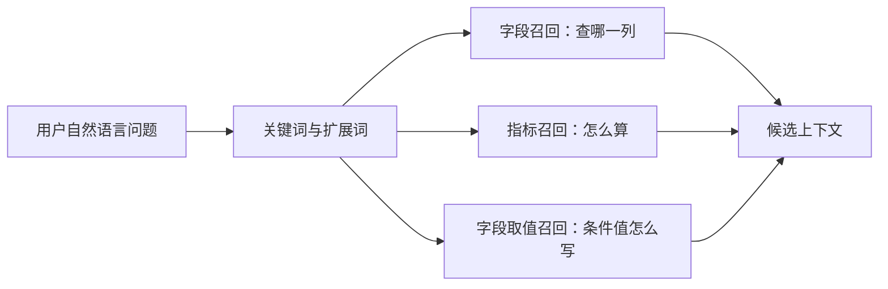

# 11 - Shopkeeper Data Q&A: Keyword Extraction and Multi-Route Retrieval

---

**Chapter objectives:**

- Understand why the data Q&A agent first extracts keywords before proceeding to three-route retrieval over fields, metrics, and field values.
- Master what `DataAgentState` and `DataAgentContext` each store during the retrieval stage.
- Understand this minimal LCEL chain: `PromptTemplate | llm | JsonOutputParser`.
- Master the common pattern shared by field retrieval and metric retrieval: `关键词 -> Embedding -> Qdrant -> 去重`.
- Master the special pattern for field value retrieval: `关键词 -> Elasticsearch -> ValueInfo -> 去重`.

**Study advice:** This is where the data Q&A agent begins to fill in business logic. First see how a user question becomes keywords, then see why keywords need expansion, and finally look at field, metric, and field value retrieval separately. The three routes look similar in code, but their responsibilities differ: fields find columns, metrics find calculation definitions, and field values help write real values for filter conditions.

**Corresponding code branch:** `11-agent-keyword-multi-recall`

---

## 1. Where this chapter fits in the data Q&A pipeline

In the previous chapter, we built the skeleton of the data Q&A agent's `LangGraph` workflow, but many nodes are still empty shells that at most output a progress message.

Starting from this chapter, we will formally fill in business logic for the first few nodes. Let's bring the workflow back:

```text
用户问题
  -> extract_keywords
  -> recall_column / recall_metric / recall_value
  -> merge_retrieved_info
  -> filter_table / filter_metric
  -> add_extra_context
  -> generate_sql
  -> validate_sql
  -> correct_sql 或 run_sql
```

This chapter implements the first four nodes:

```text
extract_keywords  # 从用户问题里抽取关键词
recall_column     # 根据关键词召回可能相关的字段信息
recall_metric     # 根据关键词召回可能相关的指标信息
recall_value      # 根据关键词召回可能相关的字段真实取值
```

Take this question as an example:

```text
统计华北地区的销售总额
```

It contains at least three types of information:

- `销售总额`: may be a business metric, such as `GMV`, transaction amount, or total order amount;
- `华北地区`: may be a real value in a database field, such as `华北`;
- `地区`: may correspond to a dimension field, such as `dim_region.region_name`.

If we only retrieve fields, the model may know that "region" is related to `region_name`, but it may still not know:

- whether the project has already defined the `GMV` metric;
- whether `销售总额` should directly use a field or go through a metric definition;
- whether the region field in the database actually stores `华北` or `华北地区`.

Therefore, after leaving `extract_keywords`, the workflow enters three retrieval routes in parallel:

```text
extract_keywords
  -> recall_column  # 字段信息召回
  -> recall_metric  # 指标信息召回
  -> recall_value   # 字段取值召回
```

By the end of this chapter, the state will contain three retrieval results:

```text
retrieved_column_infos
retrieved_metric_infos
retrieved_value_infos
```

Chapter 13 will merge these three results into table schema context and metric context that the LLM can actually use.

---

## 2. What each of the three retrieval routes solves

Words in natural language questions do not all belong to the same level. Let's look at a few examples first:

```text
统计华北地区销售总额
查询黄金会员客单价
统计数码品类 GMV
最近三个月在职实习生的转正情况如何
```

These questions mix metrics, fields, field values, time ranges, and audience labels. The data Q&A agent cannot simply treat them as ordinary keywords. Instead, it should try to distinguish what role each plays in SQL generation.

### 2.1 Fields: solving "which column to query"

Field retrieval solves the problem of which fields in the data warehouse correspond to concepts in the user's spoken language.

For example, if the user says:

```text
统计华北地区的销售总额
```

When generating SQL later, the model at least needs to know:

- "Region" may be related to `dim_region.region_name`;
- "Total sales" may be related to `fact_order.order_amount`;
- Which table each field belongs to;
- The field type, field role, field description, and field aliases.

This information comes from the field vector index built in Chapter 9, that is, `column_info_collection` in `Qdrant`.

Therefore, field retrieval answers: **Which table fields might be involved in this question?**

### 2.2 Metrics: solving "how to calculate"

`销售总额`, `客单价`, `GMV`, and `转正率` are more like metrics. A metric is not an ordinary field; it usually has a business definition, for example:

- Metric name: `GMV`
- Metric description: total transaction amount of all orders
- Metric aliases: transaction amount, GMV, total sales
- Dependent fields: `fact_order.order_amount`

Metric retrieval solves the problem of finding an already defined metric when the user says "total sales", "transaction amount", or "GMV", and bringing the metric's dependent fields into subsequent context.

Therefore, metric retrieval answers: **How should the measurement target in this question be calculated?**

### 2.3 Field values: solving "how to write the condition value"

`华北`, `黄金会员`, `数码`, `在职`, and `实习生` are more like real field values.

Field value retrieval solves the problem of knowing what values actually exist in the database when the user says "North China region".

For example, what may actually be needed in SQL is:

```sql
where dim_region.region_name = '华北'
```

If the model writes:

```sql
where dim_region.region_name = '华北地区'
```

The SQL syntax may be completely correct, but the result may be empty because the real database does not necessarily store the exact expression the user said.

Therefore, field value retrieval answers: **Values in filter conditions should be written as closely as possible to actual values in the database.**

### 2.4 Division of labor among the three retrieval routes



The key point of this diagram is the "division of labor among three routes", not "three sets of models". Fields, metrics, and field values play different roles when they enter SQL, so the retrieval routes must also be designed separately.

| Retrieval route | Problem solved | Retrieval target | Technical implementation |
| ------------ | ------------------------------ | ------------ | ------------------------ |
| Field retrieval | Which field does "region" resemble? | `ColumnInfo` | `Qdrant` vector retrieval |
| Metric retrieval | Which metric does "total sales" resemble? | `MetricInfo` | `Qdrant` vector retrieval |
| Field value retrieval | What is the real database value for "North China region"? | `ValueInfo` | `Elasticsearch` full-text retrieval |

Fields and metrics both use vector retrieval because they mainly match semantic similarity. For example, "total sales" and `GMV` are literally different but semantically close.

Field values use full-text retrieval because field values are often short text, enumerated values, names, or tags. This scenario focuses more on matching actual text and on the `column_id/value` in matched documents.

---

## 3. Completing State, Context, and graph structure

As explained in the previous chapter, data passed between nodes relies on `DataAgentState`, and runtime tools are stored in `DataAgentContext`. The retrieval stage uses both types at the same time.

### 3.1 DataAgentState: storing business intermediate results

This chapter requires at least five types of state:

- `query`: the user's original question;
- `keywords`: extracted keywords;
- `retrieved_column_infos`: retrieved field information;
- `retrieved_metric_infos`: retrieved metric information;
- `retrieved_value_infos`: retrieved field values.

Corresponding project file path: `shopkeeper-agent/app/agent/state.py`

```python
from typing import TypedDict

from app.entities.column_info import ColumnInfo
from app.entities.metric_info import MetricInfo
from app.entities.value_info import ValueInfo


class DataAgentState(TypedDict):
    """一次问数链路中的核心状态"""

    query: str  # 用户输入的查询
    keywords: list[str]  # 抽取的关键词
    retrieved_column_infos: list[ColumnInfo]  # 检索到的字段信息
    retrieved_metric_infos: list[MetricInfo]  # 检索到的指标信息
    retrieved_value_infos: list[ValueInfo]  # 检索到的取值信息
    error: str  # 校验 SQL 时出现的错误信息
```

The most important part here is the three `retrieved_*` fields. The three retrieval nodes each write their own results back, and the `merge_retrieved_info` in Chapter 12 reads them all together.

### 3.2 DataAgentContext: storing runtime tools

Retrieval nodes need to access external systems:

- Field retrieval needs the `Qdrant` field repository and `Embedding` client;
- Metric retrieval needs the `Qdrant` metric repository and `Embedding` client;
- Field value retrieval needs the `Elasticsearch` field value repository.

These objects are not business intermediate results and should not be stuffed into `state`. They are tools used during node execution, so they belong in `DataAgentContext`.

Corresponding project file path: `shopkeeper-agent/app/agent/context.py`

```python
from typing import TypedDict

from langchain_huggingface import HuggingFaceEndpointEmbeddings

from app.repositories.es.value_es_repository import ValueESRepository
from app.repositories.qdrant.column_qdrant_repository import ColumnQdrantRepository
from app.repositories.qdrant.metric_qdrant_repository import MetricQdrantRepository


class DataAgentContext(TypedDict):
    """LangGraph Runtime 中传递的上下文对象"""

    # 字段向量仓储，负责根据向量从 Qdrant 检索候选字段
    column_qdrant_repository: ColumnQdrantRepository
    # Embedding 客户端，字段召回和指标召回都会复用
    embedding_client: HuggingFaceEndpointEmbeddings
    # 指标向量仓储，负责从 Qdrant 检索候选指标
    metric_qdrant_repository: MetricQdrantRepository
    # 字段取值仓储，负责从 Elasticsearch 检索真实字段值
    value_es_repository: ValueESRepository
```

This exactly reflects the division of labor described in Chapter 10:

```text
业务中间结果 -> state
运行时依赖   -> runtime.context
```

### 3.3 Connecting the three retrieval routes in graph.py

Corresponding project file path: `shopkeeper-agent/app/agent/graph.py`

```python
# 注册节点：每个节点负责问数链路中的一个清晰步骤
graph_builder.add_node("extract_keywords", extract_keywords)
graph_builder.add_node("recall_column", recall_column)
graph_builder.add_node("recall_value", recall_value)
graph_builder.add_node("recall_metric", recall_metric)

# 从用户问题开始，先抽取关键词作为后续检索的基础
graph_builder.add_edge(START, "extract_keywords")

# 关键词抽取后并行进入三类召回，分别面向字段、字段值和业务指标
graph_builder.add_edge("extract_keywords", "recall_column")
graph_builder.add_edge("extract_keywords", "recall_value")
graph_builder.add_edge("extract_keywords", "recall_metric")

# 三路召回都完成后，再进入统一的信息合并节点
graph_builder.add_edge("recall_column", "merge_retrieved_info")
graph_builder.add_edge("recall_value", "merge_retrieved_info")
graph_builder.add_edge("recall_metric", "merge_retrieved_info")
```

The meaning of this graph structure is simple:

```text
关键词抽取完成后，三路召回可以并行执行；
三路召回都完成后，再进入 merge_retrieved_info。
```

The "parallel" here does not emphasize that three pieces of code necessarily run simultaneously on physical threads. Rather, from the perspective of graph structure, they have no dependency on each other. As long as `extract_keywords` writes `keywords`, all three retrieval routes meet the conditions to run.

---

## 4. Implementing the keyword extraction node


`extract_keywords` is the first node in this chapter. What it does is straightforward:

```text
读取 state["query"]
  -> 使用 jieba 提取关键词
  -> 按词性过滤无关词
  -> 把原始 query 加入关键词列表
  -> 去重
  -> 返回 {"keywords": keywords}
```

Corresponding project file path: `shopkeeper-agent/app/agent/nodes/extract_keywords.py`

```python
import jieba.analyse
from langgraph.runtime import Runtime

from app.agent.context import DataAgentContext
from app.agent.state import DataAgentState
from app.core.log import logger


async def extract_keywords(state: DataAgentState, runtime: Runtime[DataAgentContext]):
    writer = runtime.stream_writer
    # 通过 stream_writer 输出节点进度，方便本地调试或前端展示 Agent 执行状态
    writer("抽取关键词")

    query = state["query"]

    # 只保留更可能承载业务含义的词性，减少“的、帮我、一下”这类无检索价值的噪声
    allow_pos = (
        "n",   # 名词: 商品、订单、销售额
        "nr",  # 人名: 张三、李四
        "ns",  # 地名: 华北、北京、上海
        "nt",  # 机构团体名: 门店、品牌、渠道
        "nz",  # 其他专有名词: SKU、GMV、AOV
        "v",   # 动词: 统计、对比、查询
        "vn",  # 名动词: 销售、成交、退款
        "a",   # 形容词: 新增、有效、活跃
        "an",  # 名形词: 可用、有效、异常
        "eng", # 英文: GMV、SKU、ROI
        "i",   # 成语或习用语，避免遗漏整体表达
        "l",   # 常用固定短语，例如“销售总额”
    )

    # extract_tags 会基于 TF-IDF 抽取关键词，并按 allowPOS 做词性过滤
    keywords = jieba.analyse.extract_tags(query, allowPOS=allow_pos)

    # 保留原始问题作为兜底检索入口，避免关键词切分不准时丢掉完整语义
    keywords = list(set(keywords + [query]))
    logger.info(f"抽取关键词: {keywords}")
    return {"keywords": keywords}
```

### 4.1 What jieba does here

`jieba` is essentially a Chinese word segmentation tool. It can split a piece of Chinese text into words and also provides keyword extraction capabilities.

Repository address: https://github.com/fxsjy/jieba

This project uses:

```python
jieba.analyse.extract_tags(query, allowPOS=allow_pos)
```

`extract_tags(...)` can extract keywords from text. Here, `topK` is not explicitly specified, so the default value is used. What really deserves attention is `allowPOS`. `POS` refers to part of speech, and `allowPOS` means: keep only words with the specified parts of speech.

Why filter by part of speech?

Because the subsequent keywords are not used for text display, but as search conditions for field, metric, and value retrieval. If words such as "的", "一下", and "帮我", which have no business retrieval value, are also included, noise will increase.

The parts of speech retained in this project can be roughly divided into several categories:

- Nouns and proper nouns: usually may correspond to fields, business objects, or metric concepts;
- Place names and organization names: may correspond to dimensions such as regions, stores, or organizations;
- English: may correspond to metric or field aliases such as `GMV` and `AOV`;
- Verbs and verbal nouns: sometimes help understand statistical actions or business behaviors;
- Common fixed phrases: some business phrases may be more meaningful as a whole.

Of course, keyword extraction is not perfect semantic understanding. It only provides the first batch of entry points for subsequent retrieval. Therefore, the code also adds the original question:

```python
keywords = list(set(keywords + [query]))
```

This line of code does two things at once:

- `keywords + [query]`: adds the original question to the keyword list;
- `set(...)`: removes duplicate keywords.

Keeping the original question is a fallback strategy. If word segmentation or keyword extraction misses an important expression, the complete question can still serve as a retrieval entry point.

### 4.2 What to look at when testing keyword extraction

In the test entry point of `graph.py`, the initial state needs to include `query`:

```python
state = DataAgentState(query="统计华北地区的销售总额")
```

After execution, the `extract_keywords` node will output streaming progress:

```text
抽取关键词
```

You will see content similar to this in the logs:

```text
抽取关键词: ['统计华北地区的销售总额', '华北地区', '销售总额', '统计']
```

The actual order may not be exactly the same, because the code uses `set` for deduplication, and sets do not guarantee order. There is no need to worry about the order here. Focus on two things:

- Whether business-related words such as "华北地区" and "销售总额" were extracted;
- Whether the original question was also retained as a fallback retrieval entry point.

If you see some regex warnings from within `jieba` at runtime, there is usually no need to worry about them first. As long as the node can return keywords normally, such warnings generally do not affect the main thread of this tutorial.

---

## 5. Common Preparation Before Retrieval: LLM, Prompts, and LCEL

All three retrieval routes use "keyword expansion":

```text
字段召回：让模型补充字段相关表达
指标召回：让模型补充指标相关表达
字段取值召回：让模型补充可能出现在字段值里的表达
```

This step does not ask the large language model to generate SQL. Instead, it performs a lighter task: **generate a set of business phrases that are better suited for retrieval based on the user's question.**

### 5.1 Unified LLM Wrapper

The retrieval nodes use a large language model, and the later filtering, SQL generation, and SQL correction steps also use one. Therefore, the project does not initialize the model repeatedly in every node. Instead, it creates a separate `llm.py` to create and export the `llm` object centrally.

Corresponding project file path: `shopkeeper-agent/app/agent/llm.py`

```python
from langchain.chat_models import init_chat_model

from app.conf.app_config import app_config

# 统一从配置读取模型三件套，节点只复用 llm，不重复初始化模型连接
llm = init_chat_model(
    model=app_config.llm.model_name,
    # 硅基流动等服务兼容 OpenAI 协议时，可以使用 openai provider 接入
    model_provider="openai",
    base_url=app_config.llm.base_url,
    api_key=app_config.llm.api_key,
    # 召回扩展、SQL 生成更看重稳定性，所以这里关闭随机发散
    temperature=0,
)

if __name__ == "__main__":
    # 单独运行本文件时，用一个最小请求验证模型名、密钥和 base_url 是否配置正确
    print(llm.invoke("你好").content)
```

This approach has two advantages:

- The node code is cleaner and only focuses on its own business logic.
- If you later need to change the model, API key, or endpoint, you only need to modify the configuration and the initialization location.

### 5.2 The Three Essentials for Model Invocation and SiliconFlow

In Chapter 10, "LangChain Quick Start and HelloWorld", we already encountered the three essentials for invoking a large language model:

```text
API Key   -> 你是谁，用来鉴权
模型名    -> 你要调用哪个模型
Base URL  -> 请求发到哪个服务入口
```

This project uses the model service provided by **SiliconFlow**, and the model is `Pro/zai-org/GLM-5.1`.

The entry points for SiliconFlow are as follows:

- SiliconFlow official website: <https://www.siliconflow.cn/>
- API Key management page: <https://cloud.siliconflow.cn/me/account/ak>

You need to register for the model service platform yourself and create your own `API Key` on the platform. Without a usable model name, `API Key`, and `Base URL`, the subsequent steps such as `llm.invoke(...)`, keyword expansion, field retrieval, and SQL generation cannot actually run.

This information is uniformly written in the `llm` configuration item of `app_config.yaml`:

```yaml
llm:
  model_name: Pro/zai-org/GLM-5.1
  # 从本地 .env 读取，避免把真实密钥写进仓库
  api_key: ${oc.env:LLM_API_KEY}
  base_url: https://api.siliconflow.cn/v1
```

Here, `LLM_API_KEY` should be stored in your local `.env` file. When writing tutorials or committing code, it is not recommended to commit the real `API Key` directly to a public repository.

`model_provider="openai"` does not necessarily mean that only the official OpenAI service can be used. Many model service providers are compatible with the OpenAI interface format, so here it can be integrated through the OpenAI protocol. In actual projects, if a provider is not compatible with the OpenAI protocol, adjust it according to that specific provider.

After configuration, you can run `llm.py` separately to confirm that the model service is working:

```bash
uv run python -m app.agent.llm
```

If the configuration is correct, you will see output similar to the following:

```text
你好！很高兴见到你。我是GLM，Z.ai训练的大语言模型。

今天我能为你做些什么？无论是回答问题、提供信息，还是进行日常交流，我都很乐意帮助你。
```

Seeing this kind of response means that the `model_name`, `api_key`, and `base_url` configurations are effective, and the subsequent retrieval nodes have a foundation to continue running.

### 5.3 temperature and token

`temperature=0` is intended to make the model output more stable. Tasks such as data Q&A retrieval and SQL generation place more emphasis on determinism and do not want the model to be overly divergent.

Before understanding `temperature`, let's first look at the basic process of how a large language model generates text. A large language model does not "think up" the entire answer at once and then output it. Instead, it continuously predicts the next `token` based on the current context. `token` can be roughly understood as the smallest unit of text processed by the model, which could be a Chinese character, part of a word, an English word, or a punctuation mark.

At each generation step, the model calculates a probability distribution over a large number of candidate `token` in its vocabulary based on the existing context, and then selects the next `token` from these candidates.

Why does the same question sometimes yield different answers? The reason is that sampling is usually involved during generation. The model does not necessarily always choose the `token` with the highest probability; it may sample from a set of candidate tokens according to their probabilities. Parameters like `top_k` and `top_p` control "which candidate tokens to sample from", while `temperature` is more like adjusting the smoothness of the probability distribution.

The lower the temperature, the more dominant the highest-probability candidate becomes, making the model output more stable and conservative. The higher the temperature, the easier it is for originally lower-probability candidates to be selected, making the output more divergent and creative. When writing articles or doing creative brainstorming, you can appropriately increase the temperature. But for tasks such as data Q&A, field retrieval, and SQL generation, accuracy and reproducibility are more important, so here `temperature` is set to `0`.

### 5.4 Centralized Prompt Management

The project does not write prompts directly into Python nodes. Instead, it places them centrally in the `prompts/` directory and loads them through `prompt_loader.py`.

Corresponding project file path: `shopkeeper-agent/app/prompt/prompt_loader.py`

```python
from pathlib import Path


def load_prompt(name: str) -> str:
    """读取指定名称的 prompt 模板内容"""

    # app/prompt/prompt_loader.py 向上两级回到项目根目录，再进入 prompts 目录
    prompt_path = Path(__file__).parents[2] / "prompts" / f"{name}.prompt"
    return prompt_path.read_text(encoding="utf-8")
```

A relative path such as `prompts/xxx.prompt` is not used here because relative paths are affected by the current working directory of the program. If you start the script from a different directory, the path may not be found.

This chapter uses three prompt files, which are placed in the prompts folder under the project root directory:

```text
extend_keywords_for_column_recall.prompt
extend_keywords_for_metric_recall.prompt
extend_keywords_for_value_recall.prompt
```

Their outputs are all required to be JSON arrays. This allows the model output to be parsed directly into a Python list using `JsonOutputParser` without needing extra cleanup of explanatory text.

### 5.5 Minimal LCEL Chain

In all three retrieval routes, you will see this similar piece of code:

```python
prompt = PromptTemplate(
    template=load_prompt("extend_keywords_for_column_recall"),
    input_variables=["query"],
)
output_parser = JsonOutputParser()
chain = prompt | llm | output_parser

result = await chain.ainvoke({"query": query})
```

Here, `prompt | llm | output_parser` is the actual usage of LCEL in this project, as discussed in Chapter 15, "LCEL and Chained Invocation".

First, let's review: many components in LangChain can be considered `Runnable`, that is, "runnable components". Since they can all be executed and composed, they can be connected using the `|` pipe operator. The simplest understanding is that the output of the previous step becomes the input of the next step.

Therefore, this chain is not three unrelated lines of code, but a continuous small pipeline:

- `PromptTemplate` is responsible for filling variables into the prompt.
- `llm` is responsible for generating the model output based on the prompt.
- `JsonOutputParser` is responsible for parsing the model output into a data structure that is easier for the program to handle.

This is somewhat similar to the `LangGraph` discussed in Chapter 10: they both describe "how steps are connected". The difference is that `LCEL` is better suited for expressing a shorter model invocation chain, such as "prompt -> model -> parser", while `LangGraph` is better suited for expressing a complete agent flow, such as multiple nodes, parallel retrieval, conditional branching, and streaming progress output.

---

## 6. Field Information Retrieval: recall_column


The goal of field retrieval is to find a batch of potentially relevant `ColumnInfo`. Its complete flow is as follows:

```text
读取 query 和 keywords
  -> 使用 LLM 扩展“字段召回”关键词
  -> 合并原始关键词和扩展关键词
  -> 对每个关键词做 Embedding
  -> 查询 Qdrant 字段 collection
  -> 将 payload 还原为 ColumnInfo
  -> 按 column_id 去重
  -> 写入 state["retrieved_column_infos"]
```

Corresponding project file path: `shopkeeper-agent/app/agent/nodes/recall_column.py`

```python
from langchain_core.output_parsers import JsonOutputParser
from langchain_core.prompts import PromptTemplate
from langgraph.runtime import Runtime

from app.agent.context import DataAgentContext
from app.agent.llm import llm
from app.agent.state import DataAgentState
from app.core.log import logger
from app.entities.column_info import ColumnInfo
from app.prompt.prompt_loader import load_prompt


async def recall_column(state: DataAgentState, runtime: Runtime[DataAgentContext]):
    writer = runtime.stream_writer
    writer("召回字段信息")

    # state 保存图内业务中间结果：原始问题和上游抽取出的关键词
    keywords = state["keywords"]
    query = state["query"]
    # context 保存外部运行时工具：向量仓储和 Embedding 客户端
    column_qdrant_repository = runtime.context["column_qdrant_repository"]
    embedding_client = runtime.context["embedding_client"]

    # 用 LLM 把用户问法扩展成“字段语义”列表，例如“销售总额”可扩展出“销售金额”
    prompt = PromptTemplate(
        template=load_prompt("extend_keywords_for_column_recall"),
        input_variables=["query"],
    )
    output_parser = JsonOutputParser()
    chain = prompt | llm | output_parser

    result = await chain.ainvoke({"query": query})

    # 原始关键词和 LLM 扩展词一起参与召回；set 去重，避免重复请求同一关键词
    keywords = set(keywords + result)

    # 用字段 id 做唯一键，因为多个关键词、同一字段的多个向量点都可能命中同一个字段
    column_info_map: dict[str, ColumnInfo] = {}
    for keyword in keywords:
        # 查询词必须先转成向量，才能和第 9 章写入 Qdrant 的字段向量做相似度检索
        embedding = await embedding_client.aembed_query(keyword)
        current_column_infos: list[ColumnInfo] = await column_qdrant_repository.search(
            embedding
        )
        for column_info in current_column_infos:
            if column_info.id not in column_info_map:
                column_info_map[column_info.id] = column_info

    # 写回 state 的是去重后的 ColumnInfo 列表，不暴露 Qdrant 原始 point 结构
    retrieved_column_infos: list[ColumnInfo] = list(column_info_map.values())

    logger.info(f"检索到字段信息：{list(column_info_map.keys())}")
    return {"retrieved_column_infos": retrieved_column_infos}
```

In this code, there are four key points that truly belong to field retrieval.

### 6.1 Why Field Retrieval Needs Keyword Expansion

`extract_keywords` obtains the original keywords from the user's question, for example:

```text
统计华北地区的销售总额
销售总额
华北地区
```

But the field metadata does not necessarily use these colloquial expressions. For example, "total sales" might be written in the fields as:

```text
order_amount
订单金额
成交金额
销售金额
```

Therefore, `recall_column` first performs a semantic expansion using the field retrieval prompt:

```python
prompt = PromptTemplate(
    template=load_prompt("extend_keywords_for_column_recall"),
    input_variables=["query"],
)
output_parser = JsonOutputParser()
chain = prompt | llm | output_parser

result = await chain.ainvoke({"query": query})
```

The emphasis of the field retrieval prompt is not to have the model generate SQL, but to have the model output phrases that are more like "field concepts". For example, the model might output:

```json
["地区", "销售金额", "订单金额"]
```

Then combine the original keywords and the expanded terms:

```python
keywords = set(keywords + result)
```

The advantage of this approach is that it retains the user's original words as a fallback while supplementing expressions that are closer to the field metadata, making the retrieval range more stable.

### 6.2 How Keywords Become Field Candidates

Field information was written into `Qdrant` in Chapter 9. At write time, field names, field descriptions, and field aliases were all converted into vectors. At query time, keywords must also be converted into vectors so that similarity search can be performed in the same vector space.

```python
for keyword in keywords:
    embedding = await embedding_client.aembed_query(keyword)
    current_column_infos: list[ColumnInfo] = await column_qdrant_repository.search(
        embedding
    )
```

This small section is the core of field retrieval:

```text
关键词文本
  -> Embedding 向量
  -> Qdrant 相似度搜索
  -> ColumnInfo payload
```

The current code processes keywords one by one. The number of keywords is usually small, so this approach is the most intuitive and makes it easy to debug which keyword retrieved which fields.

If the number of keywords increases later, you can change Embedding to batch processing to reduce the number of Embedding requests:

```python
keyword_list = list(keywords)
embeddings: list[list[float]] = await embedding_client.aembed_documents(
    keyword_list
)

column_info_map: dict[str, ColumnInfo] = {}

for keyword, embedding in zip(keyword_list, embeddings):
    current_column_infos: list[ColumnInfo] = await column_qdrant_repository.search(
        embedding
    )
    for column_info in current_column_infos:
        if column_info.id not in column_info_map:
            column_info_map[column_info.id] = column_info
```

This is only an optional optimization. This chapter first adopts one-by-one processing to clearly explain the retrieval flow.

### 6.3 Why Deduplicate by Field ID

`recall_column` does not directly append every field found to the list. Instead, it uses `column_info_map` to deduplicate by field `id`:

```python
column_info_map: dict[str, ColumnInfo] = {}

for column_info in current_column_infos:
    if column_info.id not in column_info_map:
        column_info_map[column_info.id] = column_info
```

Deduplication is absolutely necessary here because there are at least two sources of duplication.

First, multiple keywords may retrieve the same field. For example, if the user asks "calculate the total sales in the Northeast region and the North China region", both "Northeast region" and "North China region" may retrieve the region field. Without deduplication, the same field would appear repeatedly in the subsequent context.

Second, the same keyword may hit multiple vector points for the same field. In Chapter 9, when building the field vector index, a field is not written as just one point. Instead, it is split into multiple points by field name, field description, and field alias. For example, the same field `dim_region.region_name` may correspond to:

```text
region_name
地区名称
区域
大区
```

The payloads of all these points point to the same `ColumnInfo`. If one keyword hits multiple of these points at the same time, the returned field information will also be duplicated.

Therefore, here you cannot simply `extend` to the list. Instead, you must first use the field `id` as a unique key, and finally extract the values from the dictionary:

```python
retrieved_column_infos: list[ColumnInfo] = list(column_info_map.values())
```

The field candidate set written back to `state` in this way is the deduplicated result.

### 6.4 Repository Only Handles Querying and Restoring Field Entities

The logic that actually queries `Qdrant` for field retrieval is encapsulated in the Repository.

Corresponding project file path: `shopkeeper-agent/app/repositories/qdrant/column_qdrant_repository.py`

```python
async def search(
    self, embedding: list[float], score_threshold: float = 0.6, limit: int = 20
) -> list[ColumnInfo]:
    """按向量相似度检索字段元数据，并还原为 ColumnInfo 实体"""

    result = await self.client.query_points(
        collection_name=self.collection_name,
        query=embedding,
        limit=limit,
        score_threshold=score_threshold,
    )
    # Qdrant 只保存字段元数据 payload，业务层继续使用 ColumnInfo
    return [ColumnInfo(**point.payload) for point in result.points]
```

The responsibility here is very restrained: the node is responsible for organizing the retrieval flow, and the Repository is responsible for hiding the `Qdrant` query details. The caller only needs to pass in the keyword vector and get back a `list[ColumnInfo]`.

The meanings of the parameters are as follows:

- `collection_name`: the field vector collection, which is `column_info_collection` here.
- `query=embedding`: uses the keyword vector for similarity search.
- `score_threshold=0.6`: filters out results with similarity that is too low.
- `limit=20`: returns a maximum of 20 candidate fields per query.

In Chapter 9, when building the field vector index, the complete field information was already written into `Qdrant` as the payload. Therefore, after hitting a vector point here, you can directly use: `ColumnInfo(**point.payload)` to restore the payload into the `ColumnInfo` used by the business layer.

---

## 7. Metric Information Retrieval: recall_metric


The logic of metric retrieval is very similar to field retrieval, except that the retrieval target is changed from the field collection to the metric collection.

The overall flow is as follows:

```text
读取 query 和 keywords
  -> 使用 LLM 扩展“指标召回”关键词
  -> 合并原始关键词和扩展关键词
  -> 对每个关键词做 Embedding
  -> 查询 Qdrant 指标 collection
  -> 将 payload 还原为 MetricInfo
  -> 按 metric_id 去重
  -> 写入 state["retrieved_metric_infos"]
```

### 7.1 Why Expand Metric Keywords

The user's question may not directly contain the metric names used in the system.

For example, the user asks:

```text
统计华北地区的销售总额
```

The metadata may define:

```text
GMV
成交额
交易额
```

If you only use `销售总额` for retrieval, the recall may or may not be stable. Therefore, the project first uses an LLM to expand indicator keywords.

Prompt file path:

```text
shopkeeper-agent/prompts/extend_keywords_for_metric_recall.prompt
```

The core constraints of this prompt are:

- Only generate indicator retrieval keywords;
- Do not output field names, table names, SQL, specific values, or entity instances;
- Prioritize generating stable, abstract, reusable indicator concept phrases;
- If the user explicitly mentions an indicator such as `GMV/DAU/MAU`, preserve the original expression and may supplement it with synonyms.

This step is not about having the LLM answer the question, but about having it generate query terms that are better suited for "indicator vector recall."

### 7.2 recall_metric Core Code

Project file path: `shopkeeper-agent/app/agent/nodes/recall_metric.py`

```python
from langchain_core.output_parsers import JsonOutputParser
from langchain_core.prompts import PromptTemplate
from langgraph.runtime import Runtime

from app.agent.context import DataAgentContext
from app.agent.llm import llm
from app.agent.state import DataAgentState
from app.entities.metric_info import MetricInfo
from app.prompt.prompt_loader import load_prompt
from app.core.log import logger


async def recall_metric(state: DataAgentState, runtime: Runtime[DataAgentContext]):
    writer = runtime.stream_writer
    writer("召回指标信息")

    query = state["query"]
    keywords = state["keywords"]
    embedding_client = runtime.context["embedding_client"]
    metric_qdrant_repository = runtime.context["metric_qdrant_repository"]

    # 指标扩展关注“怎么算”，例如销售总额可扩展成 GMV、成交额、交易额
    prompt = PromptTemplate(
        template=load_prompt("extend_keywords_for_metric_recall"),
        input_variables=["query"],
    )
    output_parser = JsonOutputParser()
    chain = prompt | llm | output_parser

    result = await chain.ainvoke({"query": query})
    keywords = set(keywords + result)

    metric_info_map: dict[str, MetricInfo] = {}
    for keyword in keywords:
        embedding = await embedding_client.aembed_query(keyword)
        current_metric_infos: list[MetricInfo] = await metric_qdrant_repository.search(
            embedding
        )
        for metric_info in current_metric_infos:
            if metric_info.id not in metric_info_map:
                metric_info_map[metric_info.id] = metric_info

    retrieved_metric_infos: list[MetricInfo] = list(metric_info_map.values())

    logger.info(f"检索到指标信息：{list(metric_info_map.keys())}")
    return {"retrieved_metric_infos": retrieved_metric_infos}
```

This code is almost identical in structure to `recall_column`:

```text
PromptTemplate -> LLM -> JsonOutputParser
关键词 -> Embedding -> Qdrant -> 去重
```

The differences are:

- The prompt is replaced with `extend_keywords_for_metric_recall`;
- The Repository is replaced with `metric_qdrant_repository`;
- The return results are replaced with `retrieved_metric_infos`;
- The deduplication target is changed from `ColumnInfo` to `MetricInfo`.

### 7.3 MetricQdrantRepository.search

Project file path: `shopkeeper-agent/app/repositories/qdrant/metric_qdrant_repository.py`

```python
class MetricQdrantRepository:
    collection_name = "metric_info_collection"

    def __init__(self, client: AsyncQdrantClient):
        self.client = client

    async def search(
        self,
        embedding: list[float],
        score_threshold: float = 0.6,
        limit: int = 20,
    ) -> list[MetricInfo]:
        result = await self.client.query_points(
            collection_name=self.collection_name,
            query=embedding,
            limit=limit,
            score_threshold=score_threshold,
        )
        return [MetricInfo(**point.payload) for point in result.points]
```

This Repository method has a single responsibility: **given a vector, it returns a batch of `MetricInfo` from the indicator collection.**

Indicator entity file: `shopkeeper-agent/app/entities/metric_info.py`

```python
from dataclasses import dataclass


@dataclass
class MetricInfo:
    id: str
    name: str
    description: str
    relevant_columns: list[str]
    alias: list[str]
```

The most important thing to note here is `relevant_columns`. In Chapter 12, when merging recall information, the fields that an indicator depends on will be supplemented into the table field context based on the matched indicator.

---

## 8. Field Value Recall: recall_value


Field value recall and indicator recall have different goals.

Indicator recall looks for "business concepts," while field value recall looks for "values that actually exist in the database." Therefore, it does not require Embedding, nor does it query Qdrant; instead, it queries the `Elasticsearch` field value index that was built earlier.

The overall process is as follows:

```text
读取 query 和 keywords
  -> 使用 LLM 扩展“字段取值”关键词
  -> 合并原始关键词和扩展关键词
  -> 对每个关键词查询 Elasticsearch
  -> 将命中的 _source 还原为 ValueInfo
  -> 按 value_id 去重
  -> 写入 state["retrieved_value_infos"]
```

### 8.1 Why Field Values Also Need Keyword Expansion

Field values are not always a complete word from the user's original sentence.

For example:

```text
最近三个月在职实习生的转正情况如何？
```

The field values that may need to be recalled in this sentence include:

```text
在职
实习生
转正
最近三个月
```

They may respectively correspond to information such as employee status, employee type, probation status, and time range.

Prompt file path:

```text
shopkeeper-agent/prompts/extend_keywords_for_value_recall.prompt
```

The core constraints of this prompt are:

- Only output content at the field value level;
- It is forbidden to output field names, table names, indicators, SQL, or complete sentences;
- You may output enumeration values, business entities, time-semantic terms, roles, groups, or labels;
- Do not introduce business concepts that do not appear in the user's question.

Its goal is completely different from indicator keyword expansion:

```text
指标扩展：围绕“度量目标”
取值扩展：围绕“可能出现在字段值里的候选值”
```

### 8.2 recall_value Core Code

Project file path: `shopkeeper-agent/app/agent/nodes/recall_value.py`

```python
from langchain_core.output_parsers import JsonOutputParser
from langchain_core.prompts import PromptTemplate
from langgraph.runtime import Runtime

from app.agent.context import DataAgentContext
from app.agent.llm import llm
from app.agent.state import DataAgentState
from app.entities.value_info import ValueInfo
from app.prompt.prompt_loader import load_prompt
from app.core.log import logger


async def recall_value(state: DataAgentState, runtime: Runtime[DataAgentContext]):
    writer = runtime.stream_writer
    writer("召回字段取值")

    query = state["query"]
    keywords = state["keywords"]
    # 字段取值走 Elasticsearch，不需要 embedding_client
    value_es_repository = runtime.context["value_es_repository"]

    # 取值扩展关注“真实值”，例如华北地区可扩展出华北
    prompt = PromptTemplate(
        template=load_prompt("extend_keywords_for_value_recall"),
        input_variables=["query"],
    )
    output_parser = JsonOutputParser()
    chain = prompt | llm | output_parser

    result = await chain.ainvoke({"query": query})
    keywords = set(keywords + result)

    value_infos_map: dict[str, ValueInfo] = {}
    for keyword in keywords:
        # 直接用关键词查 Elasticsearch 字段值索引
        current_value_infos: list[ValueInfo] = await value_es_repository.search(keyword)

        for current_value_info in current_value_infos:
            if current_value_info.id not in value_infos_map:
                value_infos_map[current_value_info.id] = current_value_info

    retrieved_value_infos: list[ValueInfo] = list(value_infos_map.values())
    logger.info(f"检索到字段取值：{list(value_infos_map.keys())}")
    return {"retrieved_value_infos": retrieved_value_infos}
```

Comparing with `recall_metric`, you will find that the differences are concentrated:

```text
recall_metric:
  keyword -> embedding -> Qdrant -> MetricInfo

recall_value:
  keyword -> Elasticsearch match query -> ValueInfo
```

That is, field value recall does not require `embedding_client`.

### 8.3 ValueInfo Structure

Field value entity file: `shopkeeper-agent/app/entities/value_info.py`

```python
from dataclasses import dataclass


@dataclass
class ValueInfo:
    id: str
    value: str
    column_id: str
```

All three fields are critical:

- `id`: the unique identifier of the field value, used for deduplication;
- `value`: the actual field value, for example `华北`;
- `column_id`: which field this value belongs to, for example `dim_region.region_name`.

In Chapter 13, when merging recall information, the corresponding field will be found based on `column_id`, and then `value` will be supplemented into the field's example values. In this way, when generating SQL later, the model not only knows that it "should filter by region," but also knows that "the region field contains the real value `华北`."

### 8.4 ValueESRepository.search

The logic that actually queries ES for field value recall is encapsulated in `ValueESRepository`.

Project file path: `shopkeeper-agent/app/repositories/es/value_es_repository.py`

First, look at the index structure:

```python
class ValueESRepository:
    index_name = "value_index"
    index_mappings = {
        "dynamic": False,
        "properties": {
            "id": {"type": "keyword"},
            "value": {
                "type": "text",
                "analyzer": "ik_max_word",
                "search_analyzer": "ik_max_word",
            },
            "column_id": {"type": "keyword"},
        },
    }
```

The field design here is relatively straightforward:

- `id` uses `keyword` because it is an exact identifier;
- `column_id` uses `keyword` because it is also an exact identifier;
- `value` uses `text` and configures `ik_max_word` because it needs to participate in Chinese full-text retrieval.

Next, look at the query method:

```python
async def search(
    self,
    keyword: str,
    score_threshold: float = 0.6,
    limit: int = 20,
) -> list[ValueInfo]:
    resp = await self.client.search(
        index=self.index_name,
        query={
            "match": {
                "value": keyword,
            }
        },
        size=limit,
        min_score=score_threshold,
    )
    return [ValueInfo(**hit["_source"]) for hit in resp["hits"]["hits"]]
```

The `match` query means: use the current keyword to match the `value` field in `value_index`.

The general structure of the ES return results can be understood as:

```text
resp
  -> hits
    -> hits
      -> [
           {
             "_score": 1.23,
             "_source": {
               "id": "...",
               "value": "华北",
               "column_id": "dim_region.region_name"
             }
           }
         ]
```

The data that truly belongs to our business is in `_source`, so at the end we use:

```python
ValueInfo(**hit["_source"])
```

to restore `_source` to a `ValueInfo` object.

### 8.5 Why Field Values Do Not Use Vector Retrieval

After reading this far, you may have a question: fields and indicators both use `Qdrant`, so why not also use vector retrieval for field values?

There are three main reasons.

First, field values are usually very short.

```text
华北
数码
在职
黄金会员
```

After vectorizing this kind of short text, the discriminability in semantic space is not necessarily stable. Many values are not conceptual explanations, but rather an enumeration value, tag, or name.

Second, field values require "real matches" more.

Field recall and indicator recall can tolerate "semantic similarity" because there is filtering and merging later. But field values will affect the `where` condition in SQL, and the closer they are to the real database values, the better.

Third, field value recall needs to bring back `column_id`.

We not only want to know that the term `华北` exists, but also want to know which field it belongs to. The `_source` in the ES document will be brought back directly:

```text
value     -> 华北
column_id -> dim_region.region_name
```

This is very important for merging field examples in Chapter 12.

Therefore, this project adopts the following combination:

```text
字段/指标：语义召回优先 -> Qdrant
字段取值：真实文本匹配优先 -> Elasticsearch
```

---

## 9. Run the Complete Pipeline and Verify

At this point, the four nodes in this chapter have been connected:

```text
用户输入 query
  -> extract_keywords
      -> jieba 抽关键词
      -> 加入原始 query
      -> 写入 state["keywords"]

  -> recall_column
      -> LLM 扩展字段召回关键词
      -> Embedding
      -> Qdrant 检索 ColumnInfo
      -> 写入 state["retrieved_column_infos"]

  -> recall_metric
      -> LLM 扩展指标召回关键词
      -> Embedding
      -> Qdrant 检索 MetricInfo
      -> 写入 state["retrieved_metric_infos"]

  -> recall_value
      -> LLM 扩展字段取值关键词
      -> Elasticsearch 检索 ValueInfo
      -> 写入 state["retrieved_value_infos"]
```

The current test entry for `graph.py` is as follows.

Project file path: `shopkeeper-agent/app/agent/graph.py`

```python
if __name__ == "__main__":

    async def test():
        """本地调试关键词抽取和三路召回链路"""

        # 字段/指标召回依赖 Qdrant 和 Embedding，字段取值召回依赖 Elasticsearch
        qdrant_client_manager.init()
        embedding_client_manager.init()
        es_client_manager.init()

        column_qdrant_repository = ColumnQdrantRepository(qdrant_client_manager.client)
        metric_qdrant_repository = MetricQdrantRepository(qdrant_client_manager.client)
        value_es_repository = ValueESRepository(es_client_manager.client)

        # 当前只需要传入原始问题，后续节点会逐步把 keywords 和召回结果写回 state
        state = DataAgentState(query="统计华北地区的销售总额")
        context = DataAgentContext(
            column_qdrant_repository=column_qdrant_repository,
            embedding_client=embedding_client_manager.client,
            metric_qdrant_repository=metric_qdrant_repository,
            value_es_repository=value_es_repository,
        )

        # stream_mode="custom" 会接收各节点通过 runtime.stream_writer 写出的进度信息
        async for chunk in graph.astream(
            input=state, context=context, stream_mode="custom"
        ):
            print(chunk)

        # 关闭显式创建的异步客户端，避免本地调试时连接资源悬挂
        await qdrant_client_manager.close()
        await es_client_manager.close()

    asyncio.run(test())
```

Run from the backend project root directory:

```bash
uv run python -m app.agent.graph
```

An actual run output is as follows:

```text
(shopkeeper-agent) tools@ToolsMacBook-Pro shopkeeper-agent % uv run python -m app.agent.graph

Building prefix dict from the default dictionary ...
Loading model from cache /var/folders/h_/jqjj5k9n3dz2_0d76h88nk2m0000gn/T/jieba.cache
Loading model cost 0.247 seconds.
Prefix dict has been built successfully.
2026-04-26 21:08:50.544 | INFO     | request_id - 1 | app.agent.nodes.extract_keywords:extract_keywords:46 - 抽取关键词: ['华北地区', '统计华北地区的销售总额', '统计', '销售总额']
抽取关键词
召回字段信息
召回指标信息
召回字段取值
2026-04-26 21:09:02.805 | INFO     | request_id - 1 | app.agent.nodes.recall_column:recall_column:64 - 检索到字段信息：['fact_order.order_quantity', 'fact_order.order_amount', 'dim_region.region_name', 'dim_region.province', 'dim_region.country', 'dim_region.region_id', 'fact_order.region_id', 'dim_date.year', 'dim_date.month', 'dim_date.date_id', 'fact_order.date_id']
2026-04-26 21:09:04.855 | INFO     | request_id - 1 | app.agent.nodes.recall_value:recall_value:51 - 检索到字段取值：['dim_region.region_name.华北']
2026-04-26 21:09:07.551 | INFO     | request_id - 1 | app.agent.nodes.recall_metric:recall_metric:56 - 检索到指标信息：['GMV', 'AOV']
合并召回信息
过滤指标信息
过滤表信息
添加额外上下文
生成SQL
校验SQL
执行SQL
```

The focus here is not on the final SQL, but on observing whether the three types of results enter the pipeline:

- Whether `抽取关键词` is output;
- Whether it enters `召回字段信息`, `召回指标信息`, `召回字段取值`;
- Whether the recall results for fields, indicators, and field values appear in the logs.

Taking "Calculate the total sales amount in North China" as an example, the ideal recall results should include:

- Fields related to region, such as `region_name`, `province`;
- Fields related to sales amount, such as `order_amount`;
- Indicators related to total sales, such as `GMV`, transaction amount;
- Real values related to region conditions, such as `华北`.

At the same time, some temporarily irrelevant fields or indicators may also be recalled. This is normal. The current strategy in the recall phase is to first ensure that not too much is missed, and then let the subsequent merging and filtering nodes continue to compress the context.

---

**Chapter Summary:**

This chapter completed the first set of business nodes for the Data Q&A Agent: **keyword extraction and multi-route retrieval**.

The entire chapter can be compressed into the following pipeline:

```text
query
  -> jieba 抽取关键词
  -> 保留原始 query 兜底
  -> LLM 分别扩展字段、指标、字段取值召回关键词
  -> 字段关键词 Embedding 后查 Qdrant，得到 ColumnInfo
  -> 指标关键词 Embedding 后查 Qdrant，得到 MetricInfo
  -> 字段取值关键词查 Elasticsearch，得到 ValueInfo
  -> 三路结果写回 DataAgentState
```

At this point, the agent is already able to recall a batch of potentially relevant fields, indicators, and real field values from natural language questions such as "Calculate the total sales amount in North China." What Chapter 12 will do is merge these scattered results into structured context that is more suitable for SQL generation.
