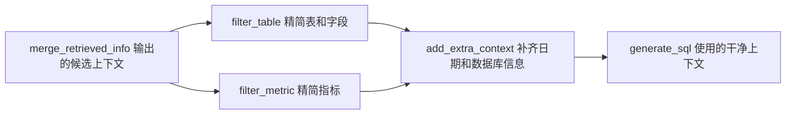

# 13 - Shopkeeper Data Q&A: Information Filtering and Completion Before SQL Generation

---

**Chapter learning objectives:**

- Understand why tables, fields, and metrics still need further filtering after retrieved information is merged.
- Master how `filter_table` enables the large language model to select the necessary tables and fields from candidate table structures.
- Master how `filter_metric` enables the large language model to select the necessary metrics from candidate metrics.
- Understand why `table_infos` and `metric_infos` should be converted into YAML before being placed into the prompt.
- Understand how `add_extra_context` supplements the current date, day of the week, quarter, database dialect, and version.

**Study suggestion:** This chapter is the quality gate before SQL generation. First look at how the filtering nodes make the context merged in the previous chapter shorter and more accurate, and then look at how the extra context node supplements information that the model cannot know on its own, such as the current date, database type, and project constraints. After reading, you should be able to explain clearly: which information should be removed and which information must be added.

**Corresponding code branch:** `13-agent-filter-extra-context`

---

## 1. This Chapter's Position in the Q&A Pipeline

The previous chapter completed `merge_retrieved_info`, organizing the retrieval results from three routes—fields, metrics, and field values—into two core context items:

```text
table_infos   # 按表组织好的表结构上下文
metric_infos  # 整理后的指标上下文
```

However, "organized" here does not yet mean "precise enough."

The retrieval stage is usually conservative: it is better to keep more candidates than to miss key tables, fields, or metrics. This improves recall, but it also introduces noise. The three nodes implemented in this chapter perform the final round of preparation before SQL generation:

```text
filter_table       # 过滤表和字段
filter_metric      # 过滤指标
add_extra_context  # 添加日期、数据库等额外上下文
```

Placing them back into the complete pipeline, their positions look like this:

```text
用户问题
  -> extract_keywords
  -> recall_column / recall_metric / recall_value
  -> merge_retrieved_info
  -> filter_table / filter_metric
  -> add_extra_context
  -> generate_sql
```


In simple terms:

```text
filter_table / filter_metric -> 把业务上下文筛干净
add_extra_context            -> 把运行环境信息补完整
```

---

## 2. Why Filtering Is Still Needed After Merging

Take the test question from the previous chapter as an example:

```text
统计华北地区的销售总额
```

After merging, the following may appear in `table_infos`:

```text
fact_order   # 订单事实表，需要
dim_region   # 地区维度表，需要
dim_date     # 日期维度表，当前问题可能不需要
```

`fact_order` and `dim_region` are reasonable, because we need to calculate total sales and filter by region. However, `dim_date` is not necessarily needed for this question, because the user did not mention a time range.

The same applies to fields and metrics. A table that should be kept may contain many fields that are temporarily not needed; the previous chapter may have retrieved `GMV` and `AOV`, but when the user asks about "total sales," what is really needed is usually `GMV`, not the average order value `AOV`.

If all of this redundant information is handed over to the SQL generation model, two problems arise:

- Context noise increases, making the model more likely to choose the wrong tables, fields, or metrics;
- The prompt becomes longer, and the token cost of calling the large language model also increases.

Therefore, a round of fine filtering is needed here:

```text
召回阶段：宁可多一点，避免漏掉
合并阶段：把候选整理成结构化上下文
过滤阶段：删掉明显无关项，减少干扰
生成阶段：基于更干净的上下文生成 SQL
```

This step is not meant to make the model "know more," but to keep the model "less distracted by irrelevant information."

---

## 3. First Look at the Division of Work Among the Three Nodes

The three nodes in this chapter are all preparing for SQL generation, but their responsibilities differ:



Filtering is not re-retrieval; instead, after retrieval and merging, it compresses "possibly relevant" context into "what is really needed for this SQL query."

| Node                | Target               | Output               | Role                           |
| ------------------- | -------------------- | ---------------------- | ------------------------------ |
| `filter_table`      | `table_infos`        | Filtered tables and fields       | Keep the schema truly needed for this query  |
| `filter_metric`     | `metric_infos`       | Filtered metrics           | Keep the business metrics truly needed for this query |
| `add_extra_context` | Current date, database connection | `date_info`, `db_info` | Supplement relative time and SQL dialect information    |

They can be understood as two types of actions:

```text
过滤：filter_table、filter_metric
补全：add_extra_context
```

The filtering nodes process business context, which comes from the metadata knowledge base; the completion node processes runtime environment context, which comes from program runtime and the actual data warehouse connection.

---

## 4. Why Convert Context into YAML

In a Python program, `table_infos` and `metric_infos` are objects such as lists and dictionaries. They cannot be handed to the large language model directly "as objects"; they must first be converted into text.

There are two common approaches:

```text
Python 对象 -> JSON 字符串
Python 对象 -> YAML 字符串
```

This project chooses YAML:

```python
yaml.dump(table_infos, allow_unicode=True, sort_keys=False)
```

This has several benefits:

- The hierarchical structure is clear, making tables, fields, and field attributes easier to read;
- `allow_unicode=True` allows Chinese to display normally instead of being converted to Unicode escapes;
- `sort_keys=False` preserves the original field order and does not reorder them alphabetically;
- Once placed into the prompt, it is more suitable for model reading than the default printed form of Python objects.

For example, after `table_infos` is converted into YAML, it looks more like this:

```yaml
- name: fact_order
  role: fact
  description: 订单事实表
  columns:
    - name: order_amount
      type: decimal
      role: measure
      examples: []
      description: 订单金额
      alias:
        - 成交金额
        - 销售金额
- name: dim_region
  role: dimension
  description: 地区维度表
  columns:
    - name: region_name
      type: string
      role: dimension
      examples:
        - 华北
      description: 地区名称
      alias:
        - 大区
```

This format is friendlier to both humans and models. Both `filter_table` and `filter_metric` later use this approach to convert structured objects into readable text within the prompt.

---

## 5. Table Filtering Node: filter_table


`filter_table` reads what was generated in the previous chapter: `state["table_infos"]`

The rough content provided to the large language model includes:

- User question `query`
- Candidate tables and field information `table_infos`

The model needs to return a simple JSON object indicating "which tables to keep, and which fields to keep within each table."

For example:

```json
{
  "fact_order": ["order_amount", "region_id"],
  "dim_region": ["region_id", "region_name"]
}
```

The meaning of this result is:

- Keep `fact_order`, retaining only `order_amount` and `region_id` within it;
- Keep `dim_region`, retaining only `region_id` and `region_name` within it;
- Discard all other tables and fields.

Here the model is deliberately asked to return a "selection result" rather than the complete filtered table structure.

The reason is practical: the full `table_infos` has a relatively deep hierarchy, including table names, table roles, table descriptions, field types, field roles, example values, aliases, and more. Asking the model to rewrite this entire structure verbatim increases the probability of errors.

A more stable approach is: **let the model only do multiple-choice, returning table names and field names; the actual trimming is done by the program.**

### 5.1 What the filter_table Prompt Focuses On

Corresponding prompt path in the project: `shopkeeper-agent/prompts/filter_table_info.prompt`

The positioning of this prompt is to have the model play the role of a query planning expert and select, from the candidate tables and fields, the parts that are necessary to answer the current question.

The core rules can be summarized as follows:

- Only select from candidate tables and candidate fields;
- Do not add tables, do not add fields, and do not modify field names;
- Every retained table must have at least one selected field;
- Whether a field is kept depends on whether it is actually used in this query;
- If multiple tables are selected, keep the primary/foreign key fields required by `join`;
- Output only a JSON object, with no explanatory text.

The output format is fixed as:

```json
{{
    "表名1":["字段1", "字段2", "..."],
    "表名2":["字段1", "字段2", "..."]
}}
```

This design leverages the model's semantic judgment while avoiding having the model rewrite complex structures.

### 5.2 Core Code of filter_table

Corresponding file path in the project: `app/agent/nodes/filter_table.py`

```python
import yaml
from langchain_core.output_parsers import JsonOutputParser
from langchain_core.prompts import PromptTemplate
from langgraph.runtime import Runtime

from app.agent.context import DataAgentContext
from app.agent.llm import llm
from app.agent.state import DataAgentState, TableInfoState
from app.core.log import logger
from app.prompt.prompt_loader import load_prompt


async def filter_table(state: DataAgentState, runtime: Runtime[DataAgentContext]):
    """根据用户问题裁剪候选表结构上下文"""

    writer = runtime.stream_writer
    writer("过滤表信息")

    query = state["query"]
    table_infos: list[TableInfoState] = state["table_infos"]

    # table_infos 是嵌套结构，转成 YAML 后更适合放进提示词，也保留中文字段说明
    prompt = PromptTemplate(
        template=load_prompt("filter_table_info"),
        input_variables=["query", "table_infos"],
    )
    # filter_table_info prompt 要求模型只输出 JSON 对象：表名 -> 字段名列表
    output_parser = JsonOutputParser()
    # LCEL 管道：填充提示词 -> 调用模型 -> 解析 JSON
    chain = prompt | llm | output_parser

    result = await chain.ainvoke(
        {
            "query": query,
            "table_infos": yaml.dump(table_infos, allow_unicode=True, sort_keys=False),
        }
    )
    # 模型只负责选择，程序根据选择结果从原始 TableInfoState 中裁剪，避免模型重写复杂结构出错
    filtered_table_infos: list[TableInfoState] = []
    for table_info in table_infos:
        if table_info["name"] in result:
            table_info["columns"] = [
                column_info
                for column_info in table_info["columns"]
                if column_info["name"] in result[table_info["name"]]
            ]
            filtered_table_infos.append(table_info)

    logger.info(
        f"过滤后的表信息：{[filtered_table_info['name'] for filtered_table_info in filtered_table_infos]}"
    )
    return {"table_infos": filtered_table_infos}
```

This code can be broken down into four steps.

Step 1: read the user question and the merged table structure from the previous chapter:

```python
query = state["query"]
table_infos: list[TableInfoState] = state["table_infos"]
```

Step 2: build a minimal LCEL chain:

```python
chain = prompt | llm | output_parser
```

`JsonOutputParser` is used here because the prompt requires the model to output only a JSON object. After parsing, `result` is a Python dictionary.

Step 3: serialize `table_infos` into YAML and pass it to the model:

```python
yaml.dump(table_infos, allow_unicode=True, sort_keys=False)
```

Step 4: trim the original table structure according to the dictionary returned by the model.

Here, elements are not directly `remove` on `table_infos` during iteration. Deleting elements while iterating over a list can easily cause index shifts and lead to skipped processing. A more stable approach is to create a new list:

```python
filtered_table_infos: list[TableInfoState] = []
```

Tables that need to be kept are then appended.

Field filtering uses a list comprehension:

```python
table_info["columns"] = [
    column_info
    for column_info in table_info["columns"]
    if column_info["name"] in result[table_info["name"]]
]
```

Finally, return:

```python
return {"table_infos": filtered_table_infos}
```

Returning the same key overwrites `state["table_infos"]`, so subsequent nodes read the filtered table structure.

---

## 6. Metric Filtering Node: filter_metric


The goal of `filter_metric` is similar to `filter_table`, except that it processes metrics.

The merged `metric_infos` from the previous chapter may contain multiple candidate metrics:

```text
GMV
AOV
订单数
退款金额
```

These metrics may all be somewhat related to the user question, but not all of them necessarily need to enter the final SQL generation.

For example, if the user asks:

```text
统计华北地区的销售总额
```

The most directly relevant metric here is total sales, that is, the `GMV` or transaction amount definition. `AOV` is average order value and usually should not be kept.

Therefore, `filter_metric` has the large language model select the metrics that are truly needed from the candidate metrics based on the user question. The model output is a JSON array:

```json
["GMV"]
```

If the current question does not require any metrics, an empty array is also allowed:

```json
[]
```

This "allowed to be empty" is important. Otherwise, the model might force-pick a metric just to produce output, which would pollute the subsequent SQL generation.

### 6.1 What the filter_metric Prompt Focuses On

Corresponding prompt path in the project: `shopkeeper-agent/prompts/filter_metric_info.prompt`

The core constraints of this prompt are:

- Only select from candidate metrics;
- Do not add metrics, and do not modify metric meanings;
- Only keep metrics that are actually used in this question for measurement, statistics, comparison, or result calculation;
- Fields used only for filtering, grouping, or range restriction are not considered metrics;
- If none of the candidate metrics fit, return an empty array;
- Output only a JSON array, with no explanatory text.

A simple example:

```text
用户问题：在职实习生有哪些？
候选指标：实习生人数、在职人数
输出：[]
```

Because this question is more like querying detail objects rather than calculating metrics. The prompt explicitly allows an empty array precisely to prevent the model from forcibly picking a metric.

### 6.2 Core Code of filter_metric

Corresponding file path in the project: `app/agent/nodes/filter_metric.py`

```python
import yaml
from langchain_core.output_parsers import JsonOutputParser
from langchain_core.prompts import PromptTemplate
from langgraph.runtime import Runtime

from app.agent.context import DataAgentContext
from app.agent.llm import llm
from app.agent.state import DataAgentState, MetricInfoState
from app.core.log import logger
from app.prompt.prompt_loader import load_prompt


async def filter_metric(state: DataAgentState, runtime: Runtime[DataAgentContext]):
    """根据用户问题裁剪候选指标上下文"""

    writer = runtime.stream_writer
    writer("过滤指标信息")

    query = state["query"]
    metric_infos: list[MetricInfoState] = state["metric_infos"]

    # metric_infos 转成 YAML 后作为候选项交给模型，模型只需要返回被选中的指标名称
    prompt = PromptTemplate(
        template=load_prompt("filter_metric_info"),
        input_variables=["query", "metric_infos"],
    )
    # filter_metric_info prompt 要求模型只输出 JSON 数组
    output_parser = JsonOutputParser()
    # LCEL 管道：填充提示词 -> 调用模型 -> 解析 JSON
    chain = prompt | llm | output_parser

    result = await chain.ainvoke(
        {
            "query": query,
            "metric_infos": yaml.dump(
                metric_infos, allow_unicode=True, sort_keys=False
            ),
        }
    )
    # 用模型返回的指标名称过滤原始结构，保留描述 依赖字段 别名等完整上下文
    filtered_metric_infos = [
        metric_info
        for metric_info in metric_infos
        if metric_info["name"] in result
    ]

    logger.info(
        f"过滤后的指标信息：{[filtered_metric_info['name'] for filtered_metric_info in filtered_metric_infos]}"
    )
    return {"metric_infos": filtered_metric_infos}
```

This code is shorter than `filter_table` because metrics do not have the "table -> field" nesting hierarchy.

The model returns a list of metric names, for example:

```python
["GMV"]
```

The program only needs to keep the metrics whose names appear in `result`:

```python
filtered_metric_infos = [
    metric_info
    for metric_info in metric_infos
    if metric_info["name"] in result
]
```

Finally, overwrite the original state in the same way:

```python
return {"metric_infos": filtered_metric_infos}
```

---

## 7. Parallel Relationship of Filtering Nodes in the Graph

Both `filter_table` and `filter_metric` depend on the result of `merge_retrieved_info`, but they have no dependency on each other.

Therefore, in `graph.py`, they branch out from the same node:

Corresponding file path in the project: `shopkeeper-agent/app/agent/graph.py`

```python
graph_builder.add_edge("merge_retrieved_info", "filter_table")
graph_builder.add_edge("merge_retrieved_info", "filter_metric")

graph_builder.add_edge("filter_table", "add_extra_context")
graph_builder.add_edge("filter_metric", "add_extra_context")
```

This means:

```text
merge_retrieved_info 完成
  -> filter_table 和 filter_metric 都可以执行
  -> 两者都完成后，再进入 add_extra_context
```

The "parallel" here is from the perspective of graph structure: neither has a sequential dependency on the other, and both perform fine filtering on the merged result.

---

## 8. Extra Context Node: add_extra_context


After table and metric filtering are complete, the business context is already fairly clean. However, SQL generation still requires some external information that does not belong to the table structure.

For example, when a user asks:

```text
统计今年华北地区的销售总额
统计本季度 GMV
查询上个月订单量
```

These questions all contain relative time expressions:

```text
今年
本季度
上个月
```

For the model to convert them into SQL conditions, it must know the current date.

Another example is that SQL dialects vary across databases. MySQL, PostgreSQL, Hive, and ClickHouse differ in date functions, pagination syntax, type conversion, and more. Telling the model the database dialect and version before generating SQL reduces the probability of it producing incompatible syntax.

Therefore, `add_extra_context` supplements two types of information:

```text
date_info  # 当前日期、星期、季度
db_info    # 数据库方言、数据库版本
```

### 8.1 Completing State and Context

Corresponding project file path: `shopkeeper-agent/app/agent/state.py`

```python
class DateInfoState(TypedDict):
    date: str
    weekday: str
    quarter: str


class DBInfoState(TypedDict):
    dialect: str
    version: str


class DataAgentState(TypedDict):
    # 前面章节已有字段省略...

    date_info: DateInfoState  # 当前日期 星期和季度信息
    db_info: DBInfoState  # 数据库方言和版本信息
```

`DateInfoState` and `DBInfoState` define the structures of the two contexts. After adding `date_info` and `db_info` to `DataAgentState`, the subsequent `generate_sql` node can read them reliably.

`add_extra_context` also needs to access the data warehouse database to query the database version and dialect, so `DataAgentContext` must contain `dw_mysql_repository`.

Corresponding project file path: `shopkeeper-agent/app/agent/context.py`

```python
from app.repositories.mysql.dw.dw_mysql_repository import DWMySQLRepository


class DataAgentContext(TypedDict):
    # 前面章节已有字段省略...

    dw_mysql_repository: DWMySQLRepository
```

What is used here is `DWMySQLRepository`, not `MetaMySQLRepository`.

The reason is:

- `Meta MySQL` stores metadata such as tables, fields, and metrics;
- `DW MySQL` simulates the real data warehouse, and SQL will ultimately be validated and executed there;
- The database dialect and version should be based on the database where SQL is actually executed.

### 8.2 add_extra_context Core Code

Corresponding project file path: `shopkeeper-agent/app/agent/nodes/add_extra_context.py`

```python
from datetime import date

from langgraph.runtime import Runtime

from app.agent.context import DataAgentContext
from app.agent.state import DataAgentState, DateInfoState, DBInfoState
from app.core.log import logger


async def add_extra_context(state: DataAgentState, runtime: Runtime[DataAgentContext]):
    """补齐 SQL 生成所需的日期和数据库环境信息"""

    dw_mysql_repository = runtime.context["dw_mysql_repository"]

    # 当前日期信息会帮助模型处理“今天 本月 本季度 最近 N 天”等相对时间表达
    today = date.today()
    date_str = today.strftime("%Y-%m-%d")
    weekday = today.strftime("%A")
    quarter = f"Q{(today.month - 1) // 3 + 1}"
    date_info = DateInfoState(date=date_str, weekday=weekday, quarter=quarter)

    # 数据库方言和版本会影响函数名 日期运算 limit 语法等 SQL 细节
    db = await dw_mysql_repository.get_db_info()
    db_info = DBInfoState(**db)
    logger.info(f"数据库信息：{db_info}")
    logger.info(f"日期信息：{date_info}")
    return {"date_info": date_info, "db_info": db_info}
```

This code does two things.

First, it generates the current date information:

```python
today = date.today()
date_str = today.strftime("%Y-%m-%d")
weekday = today.strftime("%A")
quarter = f"Q{(today.month - 1) // 3 + 1}"
```

`date_str` is a date string, for example:

```text
2026-04-27
```

`weekday` is the day of the week, for example:

```text
Monday
```

`quarter` is the quarter. For example, April belongs to the second quarter:

```text
Q2
```

There is a small detail to note in the quarter calculation:

```python
(today.month - 1) // 3 + 1
```

It cannot be written directly as:

```python
today.month // 3 + 1
```

Because if March is directly used with `3 // 3 + 1`, it would be calculated as the second quarter. Only by subtracting 1 first and then performing integer division by 3 can it be ensured that January, February, and March all belong to `Q1`.

Second, it queries the database information:

```python
db = await dw_mysql_repository.get_db_info()
db_info = DBInfoState(**db)
```

`get_db_info()` returns a dictionary:

```python
{"dialect": "mysql", "version": "8.0.x"}
```

The field names happen to correspond to `DBInfoState`, so it can be created using `**db` unpacking.

---

## 9. How DWMySQLRepository Obtains Database Information

Corresponding project file path: `shopkeeper-agent/app/repositories/mysql/dw/dw_mysql_repository.py`

```python
from sqlalchemy import text
from sqlalchemy.ext.asyncio import AsyncSession


class DWMySQLRepository:
    """负责查询数仓真实表结构和字段样例值"""

    def __init__(self, session: AsyncSession):
        self.session = session

    async def get_db_info(self):
        """读取当前数仓数据库的方言和版本，供 SQL 生成提示词使用"""

        sql = "select version()"
        result = await self.session.execute(text(sql))
        version = result.scalar()

        # dialect 来自 SQLAlchemy 当前绑定的数据库方言，例如 mysql
        dialect = self.session.bind.dialect.name
        return {"dialect": dialect, "version": version}
```

Two pieces of information are obtained here.

First, the database version:

```sql
select version()
```

This SQL statement returns the current database version in MySQL. Because the result has only one row and one column, the code directly uses:

```python
version = result.scalar()
```

`scalar()` is suitable for retrieving a single value and is more intuitive than `fetchall()[0][0]`.

Second, the database dialect:

```python
dialect = self.session.bind.dialect.name
```

This project uses SQLAlchemy to manage database connections. `dialect.name` can retrieve the database type corresponding to the current connection, for example:

```text
mysql
postgresql
```

In real enterprise projects, the data warehouse type is often relatively fixed, such as long-term use of Hive, ClickHouse, or Doris. In such cases, the dialect and version can also be written directly in the configuration rather than being queried dynamically every time. This project obtains them dynamically to keep the tutorial code more complete and to allow automatic updates when the local environment changes.

---

## 10. Passing the DW Repository in graph.py

Because `add_extra_context` reads:

```python
runtime.context["dw_mysql_repository"]
```

Therefore, when testing the workflow locally, it is necessary to initialize the DW database connection and put `DWMySQLRepository` into `context`.

Corresponding project file path: `shopkeeper-agent/app/agent/graph.py`

```python
meta_mysql_client_manager.init()
dw_mysql_client_manager.init()

async with (
    meta_mysql_client_manager.session_factory() as meta_session,
    dw_mysql_client_manager.session_factory() as dw_session,
):
    meta_mysql_repository = MetaMySQLRepository(meta_session)
    dw_mysql_repository = DWMySQLRepository(dw_session)

    context = DataAgentContext(
        column_qdrant_repository=column_qdrant_repository,
        embedding_client=embedding_client_manager.client,
        metric_qdrant_repository=metric_qdrant_repository,
        value_es_repository=value_es_repository,
        meta_mysql_repository=meta_mysql_repository,
        dw_mysql_repository=dw_mysql_repository,
    )
```

Both `meta_mysql_repository` and `dw_mysql_repository` are created here:

- Merging retrieved information requires querying the metadata database, so `meta_mysql_repository` is used;
- Adding extra context, subsequent validation, and SQL execution require the data warehouse, so `dw_mysql_repository` is used.

---

## 11. Running Verification

Run the following in the backend project root directory:

```bash
uv run python -m app.agent.graph
```

The test question can still be:

```python
state = DataAgentState(query="统计华北地区的销售总额")
```

The streaming output should show node progress similar to the following. Because the three-route retrieval, table filtering, and metric filtering are parallel branches, the actual printing order may vary slightly.


In the logs, you can focus on three types of results.

First, the filtered table information. For "Calculate the total sales amount for North China," the ideal result is to retain:

```text
fact_order
dim_region
```

If `dim_date` was brought in during the merge stage, it should normally be removed after filtering because the current question has no time condition.

Second, the filtered metric information. The ideal result is to retain:

```text
GMV
```

If `AOV` was retrieved in the previous chapter, it should normally be filtered out here.

Third, the extra context. The log should show something like:

```text
数据库信息：{'dialect': 'mysql', 'version': '8.0.45'}
日期信息：{'date': '2026-04-27', 'weekday': 'Monday', 'quarter': 'Q2'}
```

The actual date will be based on the day the workflow is run.

---

## 12. Several Points That Are Easy to Confuse

### 12.1 Filtering Is Not Regenerating Context

The filtering nodes do not ask the large language model to regenerate a complete `table_infos` or `metric_infos`.

They only ask the model to return a "retention list," and then the program prunes the original structures. This reduces the probability of errors when the model outputs complex JSON.

### 12.2 Table Filtering Also Filters Fields

The result of `filter_table` is not a simple list of table names, but rather:

```json
{
  "fact_order": ["order_amount", "region_id"]
}
```

Therefore, it can remove an entirely irrelevant table as well as remove irrelevant fields within a retained table.

### 12.3 Metric Filtering Allows Returning an Empty Array

Not all questions require business metrics.

For example:

```text
查询华北地区有哪些门店
```

This question is more like a detail query or entity query, and it may not necessarily need metrics such as `GMV` or `订单数`. Allowing `filter_metric` to return `[]` prevents the model from forcibly selecting an irrelevant metric just to "appear to have a result."

### 12.4 Do Not Delete Elements While Iterating Over a List

When filtering tables, it is not recommended to iterate over `table_infos` while calling `remove` to delete elements.

A more stable approach is to create a new `filtered_table_infos` and append the tables that need to be retained. The field list can also be generated as a new list using a list comprehension.

### 12.5 Extra Context Is Not Business Metadata

`table_infos` and `metric_infos` belong to business context.

`date_info` and `db_info` belong to runtime environment context. They do not come from the metadata knowledge base, but they affect whether SQL can be generated and executed correctly.

---

**Chapter Summary:**
This chapter completed the final set of context preparation nodes before SQL generation.

The entire chapter can be compressed into the following chain:

```text
table_infos / metric_infos
  -> filter_table：保留必要表和字段
  -> filter_metric：保留必要指标
  -> add_extra_context：补充日期和数据库信息
  -> 更适合 SQL 生成的完整上下文
```

At this point, the agent already possesses fairly clean table structures, metric definitions, field example values, the current date, and database environment information. In the next chapter, on top of this context, the large language model can formally generate SQL and then continue with validation, correction, and execution.
