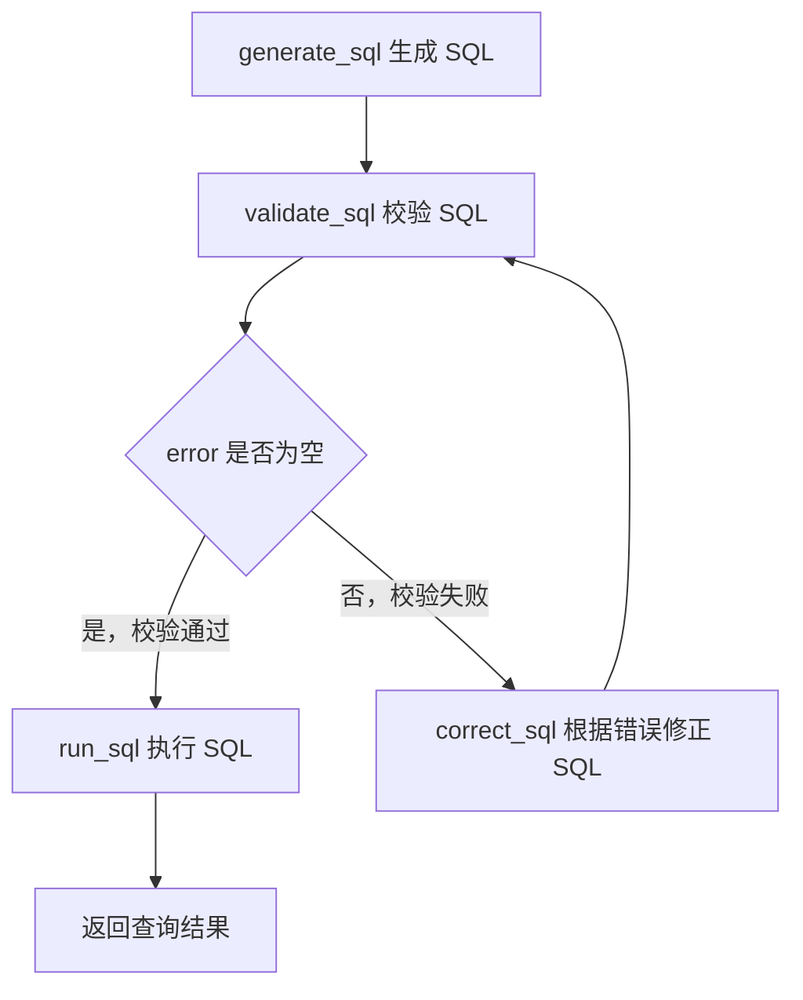

# 14 - Shopkeeper Data Q&A: SQL Generation and Execution Closed Loop

---

**Chapter Learning Objectives:**

- Understand what context the agent has prepared before SQL generation.
- Understand why SQL cannot be executed immediately after generation, and instead must first be validated using `EXPLAIN`.
- Complete an end-to-end test that takes the data Q&A agent from a natural language question all the way to SQL query results.

**Study Advice:** In this chapter, focus on the closed loop rather than just the generation prompt. The complete sequence is: generate SQL, validate SQL, correct it if necessary, and finally execute the query. Pay special attention to how the conditional branch decides whether to go to correction or execution, and how error messages are brought back to the model for correction. Once this path runs through, the data Q&A agent truly moves from "understanding the question" to "getting the query results."

**Corresponding Code Branch:** `14-agent-sql-loop`

---

## 1. Where This Chapter Fits in the Data Q&A Pipeline

The previous chapters have completed the preparation work before SQL generation:

```text
用户问题
  -> extract_keywords
  -> recall_column / recall_metric / recall_value
  -> merge_retrieved_info
  -> filter_table / filter_metric
  -> add_extra_context
```

At this point, the agent no longer has only a raw user question; it now has a relatively complete set of context for SQL generation.

This chapter completes the final four nodes:

```text
generate_sql  # 生成 SQL
validate_sql  # 校验 SQL
correct_sql   # 校正 SQL
run_sql       # 执行 SQL
```


---

## 2. What Is Already Available Before SQL Generation

Before generating SQL, the most important types of information in `state` are as follows:

```text
query         # 用户原始问题
table_infos   # 可使用的表、字段、字段类型、字段描述、示例值
metric_infos  # 可参考的业务指标、指标口径、依赖字段
date_info     # 当前日期、星期、季度
db_info       # 当前数据库方言和版本
```

They each solve different problems.

`query` tells the model "what the user actually asked":

```text
统计华北地区的销售总额
```

`table_infos` tells the model "what tables and fields are available in the database":

```yaml
- name: fact_order
  role: fact
  description: 订单事实表
  columns:
    - name: order_amount
      type: decimal
      role: measure
      description: 订单金额
- name: dim_region
  role: dimension
  description: 地区维度表
  columns:
    - name: region_name
      type: varchar
      role: dimension
      examples:
        - 华北
```

`metric_infos` tells the model "how the business metrics are calculated":

```yaml
- name: GMV
  description: 所有订单成交金额总和
  relevant_columns:
    - fact_order.order_amount
  alias:
    - 销售总额
    - 成交额
```

`date_info` and `db_info` supplement information that the model cannot determine on its own:

```yaml
date_info:
  date: "2026-04-27"
  weekday: "Monday"
  quarter: "Q2"

db_info:
  dialect: mysql
  version: 8.0.44
```

Without this context, the model could still produce a statement that "looks like SQL," but that SQL would likely use the wrong table, wrong fields, wrong metric definitions, or even be incompatible with the current database version.

Therefore, the focus of this chapter is not to let the model improvise freely, but to have the model generate SQL within the constraints assembled earlier.

---

## 3. Generate SQL: generate_sql


The responsibility of `generate_sql` is very simple: **generate a candidate SQL statement and write it into `state["sql"]`.**

It is not responsible for validation, nor for execution.

### 3.1 What the Prompt Focuses On

Corresponding prompt path in the project: `shopkeeper-agent/prompts/generate_sql.prompt`

This prompt has five core inputs:

```text
table_infos
metric_infos
date_info
db_info
query
```

The most critical constraint is: **the output must contain only the plain text of a single complete SQL statement**.

It is important to note that many LLMs habitually output Markdown code blocks when writing code:

````markdown
```sql
select ...
```
````

However, after the project obtains the SQL, it needs to pass it directly to the database for validation and execution. If the SQL string contains Markdown code block markers, the database will not recognize these symbols and will raise a syntax error.

Therefore, the prompt must explicitly require:

````text
不要解释
不要 Markdown 代码块
不要 ```sql
只输出 SQL 本身
````

### 3.2 Core Code

Corresponding file path in the project: `shopkeeper-agent/app/agent/nodes/generate_sql.py`

```python
async def generate_sql(state: DataAgentState, runtime: Runtime[DataAgentContext]):
    writer = runtime.stream_writer
    writer("生成SQL")

    # 这些上下文都由前置节点准备完成，模型只在给定表、字段、指标口径范围内生成 SQL
    table_infos = state["table_infos"]
    metric_infos = state["metric_infos"]
    date_info = state["date_info"]
    db_info = state["db_info"]
    query = state["query"]

    prompt = PromptTemplate(
        template=load_prompt("generate_sql"),
        input_variables=["table_infos", "metric_infos", "date_info", "db_info", "query"],
    )

    # 生成 SQL 只需要一段纯文本，所以这里使用 StrOutputParser
    output_parser = StrOutputParser()
    chain = prompt | llm | output_parser

    result = await chain.ainvoke(
        {
            # YAML 更适合放进提示词：保留嵌套结构、顺序和中文说明，方便模型理解表字段关系
            "table_infos": yaml.dump(table_infos, allow_unicode=True, sort_keys=False),
            "metric_infos": yaml.dump(metric_infos, allow_unicode=True, sort_keys=False),
            "date_info": yaml.dump(date_info, allow_unicode=True, sort_keys=False),
            "db_info": yaml.dump(db_info, allow_unicode=True, sort_keys=False),
            "query": query,
        }
    )

    logger.info(f"生成的SQL：{result}")
    return {"sql": result}
```

There are two points worth noting in this code.

First, the structured context is first converted into YAML:

```python
yaml.dump(table_infos, allow_unicode=True, sort_keys=False)
```

`allow_unicode=True` preserves Chinese characters, and `sort_keys=False` preserves the original field order. Compared to directly converting Python objects into strings, YAML is better suited for insertion into prompts.

Second, the output parser uses `StrOutputParser`, not `JsonOutputParser`. This is because this node only needs a single SQL string, not a JSON object.

---

## 4. Validate SQL: validate_sql

After generating SQL, it cannot be executed directly. Even with the context provided, the LLM can still make mistakes. Common errors include:

- Incorrect table name;
- Incorrect field name;
- Incorrect field alias;
- Incomplete `join` conditions;
- Aggregate functions not matching `group by`;
- SQL dialect not matching the current database;
- Using tables or fields that were not provided in the prompt.

A more robust approach is to first let the database check whether this SQL can be parsed, that is, execute:

```sql
explain <generated_sql>
```

`EXPLAIN` is originally used to view SQL execution plans, but here we mainly leverage its side effect: **letting the database parse the SQL in advance.**

If the SQL references a field that does not exist, the database will directly report an error, for example:

```text
Unknown column 'd.region_name1' in 'where clause'
```

This error message is very useful. Later, `correct_sql` can pass it together with the original SQL to the LLM, allowing the model to make evidence-based corrections.

### 4.1 validate_sql Core Code

Corresponding file path in the project: `shopkeeper-agent/app/agent/nodes/validate_sql.py`

```python
async def validate_sql(state: DataAgentState, runtime: Runtime[DataAgentContext]):
    writer = runtime.stream_writer
    writer("校验SQL")

    # 读取 generate_sql 写入状态的 SQL。
    sql = state["sql"]

    # SQL 可用性必须交给真实数仓判断，这里从运行时 context 中取 DW Repository。
    dw_mysql_repository: DWMySQLRepository = runtime.context["dw_mysql_repository"]

    try:
        # validate 内部使用 explain <sql>，只关心数据库能否成功解析这条 SQL。
        await dw_mysql_repository.validate(sql)
        logger.info("SQL语法正确")
        return {"error": None}
    except Exception as e:
        # 不直接抛异常，而是把错误信息写入 state，交给条件边判断。
        logger.info(f"SQL语法错误：{str(e)}")
        return {"error": str(e)}
```

When validation fails, the node does not directly throw an exception. Instead, it converts the error into a string and writes it into the state:

```python
return {"error": str(e)}
```

This is done so that LangGraph's conditional branch can handle it.

In other words, `validate_sql` is only responsible for determining whether the SQL has a problem; it does not decide where to go next. Whether the next step goes to `run_sql` or `correct_sql` is determined by the graph structure.

### 4.2 DWMySQLRepository.validate

Corresponding file path in the project: `shopkeeper-agent/app/repositories/mysql/dw/dw_mysql_repository.py`

```python
async def validate(self, sql: str):
    # 用 explain 让数据库解析 SQL，提前发现语法、表名、字段名等问题。
    sql = f"explain {sql}"
    await self.session.execute(text(sql))
```

There is no need to care about the return value of `EXPLAIN` here, because the only thing that matters is: **can this SQL be parsed normally by the database?**

If it can be parsed, `execute` finishes normally; if it cannot be parsed, `execute` raises an exception. The upper-level `validate_sql` catches the exception and then writes the error message into `state["error"]`.

---

## 5. Using Conditional Branches to Decide Between Correction and Execution

After `validate_sql` writes to `error`, the graph structure must decide the next step based on it.



This is the core closed loop of this chapter: instead of blindly executing after a single generation, first validate; if validation fails, bring the error message back to the model so it can revise the SQL based on the actual error.

Corresponding file path in the project: `shopkeeper-agent/app/agent/graph.py`

```python
graph_builder.add_edge("generate_sql", "validate_sql")

graph_builder.add_conditional_edges(
    source="validate_sql",
    path=lambda state: "run_sql" if state["error"] is None else "correct_sql",
    path_map={"run_sql": "run_sql", "correct_sql": "correct_sql"},
)

graph_builder.add_edge("correct_sql", "run_sql")
graph_builder.add_edge("run_sql", END)
```

The logic it expresses is:

```text
generate_sql
  -> validate_sql
       -> 校验通过 -> run_sql -> END
       -> 校验失败 -> correct_sql -> run_sql -> END
```

There is one detail worth noting here: in the current project code, after `correct_sql` it directly proceeds to `run_sql`, and does not return to `validate_sql` again.

In other words, the current implementation is a simplified version:

```text
生成 SQL -> 校验一次 -> 如果失败则校正一次 -> 执行
```

In a production-grade system, this is typically expanded into a loop with a retry limit:

```text
生成 SQL -> 校验 -> 校正 -> 再校验 -> 最多重试 N 次 -> 执行或返回失败
```

This chapter follows the current code implementation and does not expand further on multi-round retries.

---

## 6. Correct SQL: correct_sql

The responsibility of `correct_sql` is: **when SQL validation fails, revise the SQL based on the error message.**

It does not regenerate a completely different SQL statement. Instead, it fixes the problems that prevent the SQL from executing while preserving the original business semantics as much as possible.

### 6.1 What the Correction Prompt Focuses On

Corresponding prompt path in the project: `shopkeeper-agent/prompts/correct_sql.prompt`

The focus of this prompt is not "free reinvention," but "minimal necessary repair."

The core rules can be summarized as follows:

- Must strictly base corrections on SQL execution error information;
- Must not change the original business semantics;
- Must not add, remove, or replace statistical metrics, statistical dimensions, filter conditions, or time ranges;
- Only tables and fields that actually exist in the context may be used;
- If metric calculations are involved, continue to follow the business definitions in the metric information;
- The corrected SQL must still be a single query SQL statement;
- The output must still be plain text SQL, without Markdown code blocks.

The correction node requires more context than `generate_sql`. In addition to the original question, table schemas, metrics, dates, and database information, it also needs:

```text
sql    # 待纠正的错误 SQL
error  # 数据库返回的错误信息
```

Why can't we pass only `error`?

Because the error message only tells the model "what went wrong," but it cannot fully tell the model "what the user originally wanted to query, which tables and fields are available, and what the metric definitions are." If only the error message is passed, the model might fix the syntax but lose the business meaning.

### 6.2 correct_sql Core Code

Corresponding file path in the project: `shopkeeper-agent/app/agent/nodes/correct_sql.py`

```python
async def correct_sql(state: DataAgentState, runtime: Runtime[DataAgentContext]):
    writer = runtime.stream_writer
    writer("校正SQL")

    # 校正 SQL 仍然需要完整上下文，避免模型只根据报错修语法却改丢业务语义
    table_infos = state["table_infos"]
    metric_infos = state["metric_infos"]
    date_info = state["date_info"]
    db_info = state["db_info"]
    query = state["query"]

    # sql 是待修正的候选 SQL，error 是数据库 explain 返回的具体错误信息
    sql = state["sql"]
    error = state["error"]

    prompt = PromptTemplate(
        template=load_prompt("correct_sql"),
        input_variables=[
            "table_infos",
            "metric_infos",
            "date_info",
            "db_info",
            "query",
            "sql",
            "error",
        ],
    )

    output_parser = StrOutputParser()
    chain = prompt | llm | output_parser

    result = await chain.ainvoke(
        {
            # 与生成节点保持一致，用 YAML 向模型提供稳定、可读的结构化上下文
            "table_infos": yaml.dump(table_infos, allow_unicode=True, sort_keys=False),
            "metric_infos": yaml.dump(metric_infos, allow_unicode=True, sort_keys=False),
            "date_info": yaml.dump(date_info, allow_unicode=True, sort_keys=False),
            "db_info": yaml.dump(db_info, allow_unicode=True, sort_keys=False),
            "query": query,
            "sql": sql,
            "error": error,
        }
    )

    logger.info(f"校正后的SQL：{result}")
    return {"sql": result}
```

The overall structure is very similar to `generate_sql`:

```text
准备上下文
  -> 加载提示词
  -> PromptTemplate | llm | StrOutputParser
  -> 写回 state["sql"]
```

The difference is that `correct_sql` additionally passes `sql` and `error`. What it returns in the end is still:

```python
return {"sql": result}
```

That is, overwrite the original erroneous SQL with the corrected SQL.

---

## 7. Execute SQL: run_sql

`run_sql` is the final node of the current workflow. Its responsibility is: **execute the final SQL and obtain the query results.**

Corresponding file path in the project: `shopkeeper-agent/app/agent/nodes/run_sql.py`

```python
async def run_sql(state: DataAgentState, runtime: Runtime[DataAgentContext]):
    writer = runtime.stream_writer
    writer("执行SQL")

    # 这里拿到的是 generate_sql 生成的 SQL，
    # 或 correct_sql 修正后覆盖进去的 SQL。
    sql = state["sql"]
    dw_mysql_repository = runtime.context["dw_mysql_repository"]

    result = await dw_mysql_repository.run(sql)

    logger.info(f"SQL执行结果：{result}")
```

This code is very short because the actual database access is encapsulated in `DWMySQLRepository`.

Note that in the current implementation, `run_sql` executes the SQL and writes the results to the log, but it has not yet returned `result` to `DataAgentState`. Therefore, in this chapter's local testing, the query results are primarily confirmed through the logs. Later, when moving into API encapsulation, if the final results need to be returned to the frontend, result output will need to be supplemented at the interface layer or in the execution node.

Here, the file names and function names used in the current project are used consistently:

```text
run_sql.py
run_sql(...)
```

Avoid confusing them with the verbal description "execute SQL."

### 7.1 DWMySQLRepository.run

Corresponding file path in the project: `shopkeeper-agent/app/repositories/mysql/dw/dw_mysql_repository.py`

```python
async def run(self, sql: str) -> list[dict]:
    result = await self.session.execute(text(sql))
    return [dict(row) for row in result.mappings().fetchall()]
```

Two things are done here.

First, execute the SQL:

```python
result = await self.session.execute(text(sql))
```

Second, convert the query results into a list of dictionaries:

```python
return [dict(row) for row in result.mappings().fetchall()]
```

Why convert to `list[dict]`?

Because query results usually need to be returned to the frontend. The frontend can more easily consume the following structure:

```json
[
  {
    "gmv": 41099.5
  }
]
```

rather than SQLAlchemy's internal `Row` or `RowMapping` objects.

---

## 8. Completing the State Fields

This chapter adds two key state fields:

```python
class DataAgentState(TypedDict):
    # 省略前面已经讲过的字段...

    sql: str    # 生成或校正后的 SQL
    error: str  # 校验 SQL 时出现的错误信息
```

They are read and written by different nodes:

| Field    | Written by                        | Read by                                   | Purpose                   |
| ------- | ----------------------------- | ---------------------------------------- | ---------------------- |
| `sql`   | `generate_sql`, `correct_sql` | `validate_sql`, `correct_sql`, `run_sql` | Stores the candidate or corrected SQL |
| `error` | `validate_sql`                | `graph` conditional branch, `correct_sql`          | Stores SQL validation errors      |

The flow can be understood as follows:

```text
generate_sql 写入 sql
  -> validate_sql 读取 sql，并写入 error
  -> graph 根据 error 判断分支
  -> correct_sql 读取 sql 和 error，并覆盖 sql
  -> run_sql 读取最终 sql
```

Here, `error` is typed as `str`, but when validation passes, it returns:

```python
{"error": None}
```

If stricter typing is desired, this can be changed in later code to:

```python
error: str | None
```

This chapter keeps the current code structure unchanged.

---

## 9. End-to-End Testing

Run from the project root directory:

```bash
uv run python -m app.agent.graph
```

When running the test, do not only watch the final result. It is more advisable to observe in node order:

```text
抽取关键词
召回字段信息
召回字段取值
召回指标信息
合并召回信息
过滤表信息
过滤指标信息
添加额外上下文
生成SQL
校验SQL
执行SQL
```

If the generated SQL has a problem, the path will include an extra intermediate step:

```text
校正SQL
```

In the logs, focus on three types of information:

```text
生成的SQL：SELECT SUM(fact_order.order_amount) ...
SQL语法正确
SQL执行结果：[{'SUM(fact_order.order_amount)': 41099.5}]
```

If the result is output normally, it means the core chain from a natural language question to SQL query results has been successfully run through.

The reason the result field name here is `SUM(fact_order.order_amount)` is that the SQL actually generated at this point does not set an alias for the aggregate expression. If the SQL were written as `SELECT SUM(fact_order.order_amount) AS gmv ...`, the key in the returned result would become `gmv`.

Below is an actual run log.

```text
(shopkeeper-agent-backend) tools@ToolsMacBook-Pro shopkeeper-agent % uv run python -m app.agent.graph

2026-04-27 17:29:31.699 | INFO     | request_id - 1 | app.agent.nodes.extract_keywords:extract_keywords:46 - 抽取关键词: ['销售总额', '华北地区', '统计', '统计华北地区的销售总额']
抽取关键词
召回字段信息
召回指标信息
召回字段取值
2026-04-27 17:29:46.676 | INFO     | request_id - 1 | app.agent.nodes.recall_column:recall_column:64 - 检索到字段信息：['dim_region.region_name', 'fact_order.order_amount', 'fact_order.order_quantity', 'dim_region.province', 'dim_region.country', 'dim_region.region_id', 'fact_order.region_id', 'dim_date.year', 'dim_date.month', 'dim_date.date_id', 'fact_order.date_id']
2026-04-27 17:29:48.781 | INFO     | request_id - 1 | app.agent.nodes.recall_value:recall_value:59 - 检索到字段取值：['dim_region.region_name.华北']
2026-04-27 17:29:50.668 | INFO     | request_id - 1 | app.agent.nodes.recall_metric:recall_metric:64 - 检索到指标信息：['GMV', 'AOV']
合并召回信息
2026-04-27 17:29:51.164 | INFO     | request_id - 1 | app.agent.nodes.merge_retrieved_info:merge_retrieved_info:137 - 合并后的表信息：['dim_region', 'fact_order', 'dim_date']
2026-04-27 17:29:51.164 | INFO     | request_id - 1 | app.agent.nodes.merge_retrieved_info:merge_retrieved_info:138 - 合并后的指标信息：['GMV', 'AOV']
过滤指标信息
过滤表信息
2026-04-27 17:29:57.605 | INFO     | request_id - 1 | app.agent.nodes.filter_metric:filter_metric:52 - 过滤后的指标信息：['GMV']
2026-04-27 17:29:59.346 | INFO     | request_id - 1 | app.agent.nodes.filter_table:filter_table:56 - 过滤后的表信息：['dim_region', 'fact_order']
添加额外上下文
2026-04-27 17:29:59.419 | INFO     | request_id - 1 | app.agent.nodes.add_extra_context:add_extra_context:35 - 数据库信息：{'dialect': 'mysql', 'version': '8.0.45'}
2026-04-27 17:29:59.419 | INFO     | request_id - 1 | app.agent.nodes.add_extra_context:add_extra_context:36 - 日期信息：{'date': '2026-04-27', 'weekday': 'Monday', 'quarter': 'Q2'}
生成SQL
2026-04-27 17:30:11.243 | INFO     | request_id - 1 | app.agent.nodes.generate_sql:generate_sql:56 - 生成的SQL：SELECT SUM(fact_order.order_amount) FROM fact_order JOIN dim_region ON fact_order.region_id = dim_region.region_id WHERE dim_region.region_name = '华北'
校验SQL
/* select#1 */ select sum(`dw`.`fact_order`.`order_amount`) AS `SUM(fact_order.order_amount)` from `dw`.`fact_order` join `dw`.`dim_region` where ((`dw`.`dim_region`.`region_id` = `dw`.`fact_order`.`region_id`) and (`dw`.`dim_region`.`region_name` = '华北'))
2026-04-27 17:30:11.326 | INFO     | request_id - 1 | app.agent.nodes.validate_sql:validate_sql:28 - SQL语法正确
执行SQL
2026-04-27 17:30:11.335 | INFO     | request_id - 1 | app.agent.nodes.run_sql:run_sql:26 - SQL执行结果：[{'SUM(fact_order.order_amount)': 41099.5}]
```

From this log, you can see several things:

- During the retrieval stage, fields, field values, and metrics were found first, with the metrics retrieved including `GMV` and `AOV`;
- During the filtering stage, the metrics were narrowed down to `GMV`, and the tables were narrowed down to `dim_region` and `fact_order`;
- `generate_sql` generated a SQL statement that filters by `dim_region.region_name = '华北'` and aggregates `fact_order.order_amount`;
- `validate_sql` passed validation through `EXPLAIN`;
- `run_sql` ultimately found the result `41099.5`.

---

## 10. Common Troubleshooting

### 10.1 SQL Output Contains a Markdown Code Block

If you see something like this in the logs:

````markdown
```sql
SELECT ...
```
````

it means the model did not strictly follow the output format required by the prompt.

You should first check whether `generate_sql.prompt` and `correct_sql.prompt` explicitly state:

```text
输出必须仅包含一条完整 SQL 语句的纯文本
```

Because this string will later be passed directly to the database, it must not contain Markdown symbols.

### 10.2 Unknown column Error During Validation

This usually means the model used a nonexistent field, or the field alias was written incorrectly.

The recommended troubleshooting order is:

```text
先看 table_infos 是否包含正确字段
再看 filter_table 是否误删了关键字段
再看 generate_sql 是否写错字段名或别名
```

If `error` can enter `correct_sql` normally, the model has a chance to correct itself based on the error information.

### 10.3 Validation Passes but the Result Is Empty

Passing validation only means the SQL syntax, table names, and field names are generally fine; it does not necessarily mean the business result is correct.

If the result is empty, focus on checking the following:

- Whether the field values in the filter conditions match the actual values in the database;
- Whether the time conditions are too narrow;
- Whether the metric definition includes additional filter conditions;
- Whether the table join conditions are filtering out the data.

These kinds of problems usually require revisiting the field value retrieval, metric retrieval, and table structure context.

### 10.4 Still Fails After Correction

In the current project code, after `correct_sql`, it proceeds directly to `run_sql` and does not validate again.

Therefore, if the corrected SQL still has problems, the execution stage may still report an error.

If you want to make it more robust later, you can change the graph structure to a loop with a retry count:

```text
validate_sql -> correct_sql -> validate_sql
```

At the same time, add a retry counter in `state` to avoid infinite loops.

---

**Chapter Summary:**

This chapter completed the final core chain of the data Q&A agent:

```text
generate_sql -> validate_sql -> correct_sql -> run_sql
```

Their responsibilities can be compressed into one sentence:

```text
generate_sql 负责生成候选 SQL
validate_sql 负责用数据库提前检查 SQL
correct_sql 负责根据错误信息修复 SQL
run_sql 负责执行最终 SQL 并拿到查询结果
```

At this point, the backend core chain of "Shopkeeper Data Q&A" has progressed completely from a natural language question to database query results.

However, to truly turn it into a product, you still need to handle API encapsulation, result return formats, exception fallbacks, and frontend display. The following chapters will continue to add API capabilities on top of this core chain.
