# 3.2 - Coze Case Study: Replicating a Viral Video

---

## Case Study Overview

### Plugins Used

| Plugin Name | Interface / Capability | Purpose |
| ------------ | ---------------------- | -------------------------------------------------------------------------------------------------------- |
| **Link Reader** | LinkReaderPlugin | Retrieves the main content from a video page URL (such as Bilibili) and returns the title, video ASR text, OCR text, etc., serving as "reference copy" for the LLM. |
| **Text-to-Image** | e.g., text_to_image_v1 | Generates storyboard images based on prompts and returns the image URL; called once for each storyboard inside the loop body. |

### Key Technical Points

- **Input**: The user provides a viral video link (Bilibili links are recommended; Douyin links are prone to anti-scraping restrictions).
- **Reference Copy Extraction**: Use the Link Reader plugin to scrape the video page's title, ASR subtitles, and OCR text, combine them into `content`, and use them together with the LLM-generated `title` as reference.
- **Script Generation**: The LLM generates an approximately 1-minute short video script based on the reference copy, with **structured output** of `scripts` (an array of storyboard scripts), `asides` (an array of narration lines), and `outline` (the video summary); it requires the opening 5 seconds to be attention-grabbing, each shot to be no longer than 5 seconds, and the narration to correspond one-to-one with the storyboards.
- **Loop + Text-to-Image**: Execute the loop body for each item in `scripts`—first use the LLM with the "text-to-image prompt" system instruction to generate a prompt based on `outline` and the current `script`, then call text-to-image to obtain the image URL.
- **Code Node**: Inside the loop body, wrap the current index's corresponding `script`, `aside`, and the `picture` URL from the current text-to-image call into a single `content` object.
- **Output**: The loop aggregates into a `contents` array (each item contains script, aside, and picture), which is returned together with `outline`; this can later be combined with image-to-video, Jianying, etc., to create a complete video.

### Workflow Overview

```
开始(视频 url)
    ↓
链接读取 LinkReaderPlugin(url) → content（标题 + ASR + OCR）
    ↓
大模型(参考 title、content) → scripts[]、asides[]、outline
    ↓
循环：对每个分镜 index
    ├─ 大模型_1(outline, script) → 文生图提示词 prompt
    ├─ 文生图(prompt) → 图片 URL
    └─ 代码(scripts, asides, urls, index) → 单条 content{ script, aside, picture }
    ↓
结束：返回 contents[]、outline
```

---

## 0. Effect Testing

Video link:

https://www.bilibili.com/video/BV1S2421P788/?share_source=copy_web&vd_source=8d04b2c1b7fd20888b03c20e99f26dc0

Effect preview:

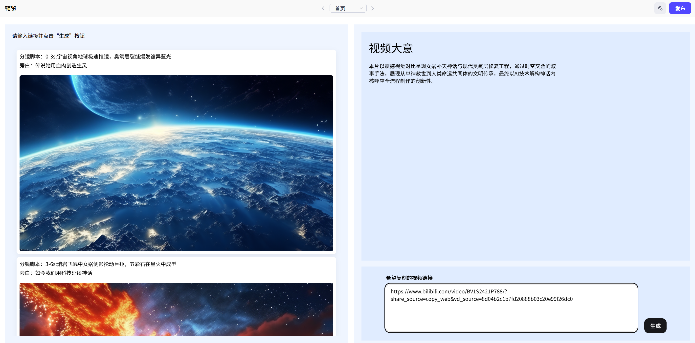

---

## 1. Environment Preparation

### 1. Enter the Workspace

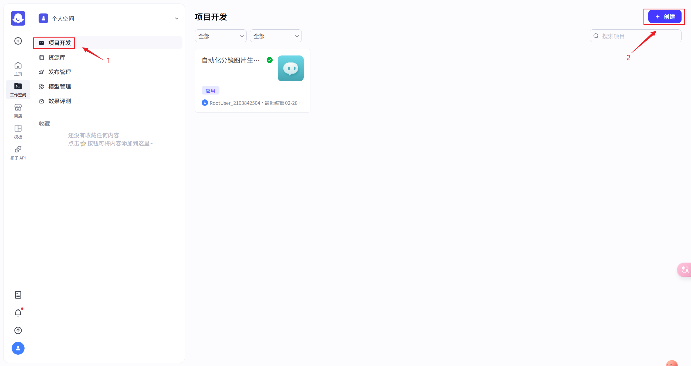

### 2. Create an Application


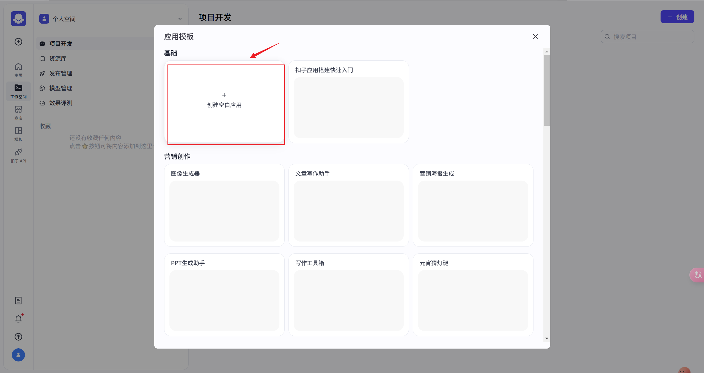

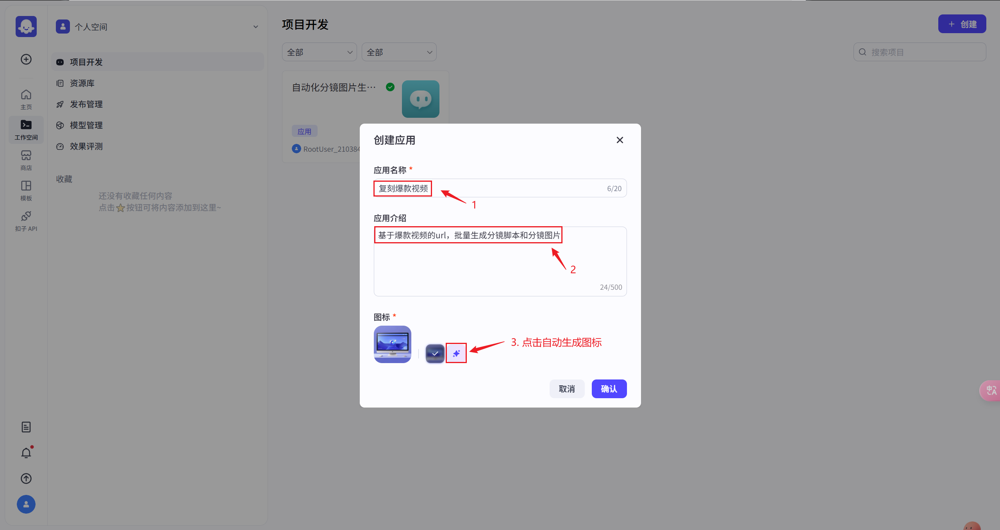

### 3. Create a New Workflow


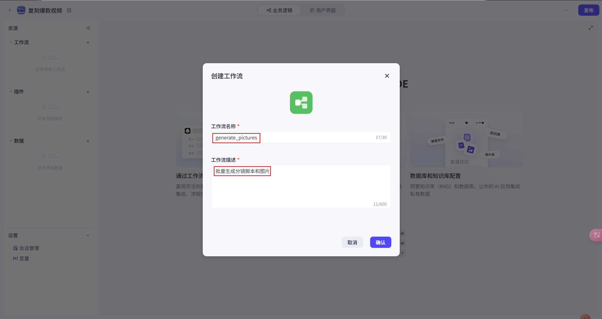

---

## 2. Build the Workflow

The Coze workflow provides many nodes; refer to the official documentation to understand their usage.

> https://www.coze.cn/open/docs/guides

### 2.1 Start Node

The Start node is the initial node of the workflow, used to define the input information required to start the workflow. **The Start node only has input parameters** and no output or other parameters.

#### 2.1.1 Input Parameter Description

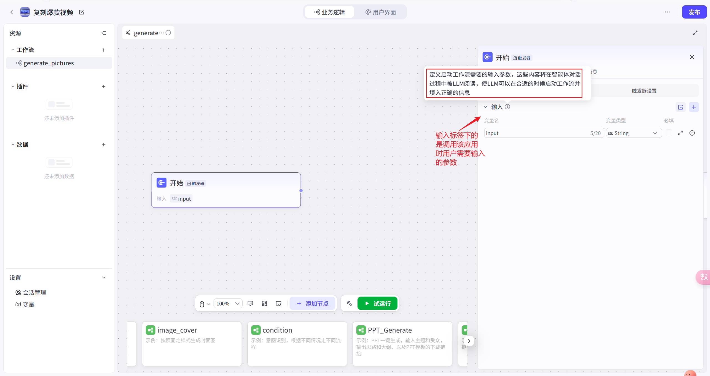

#### 2.1.2 Configuration

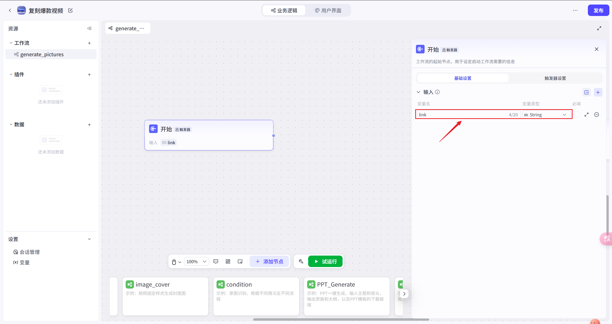

### 2.2 Plugin Node

The Plugin node is used to call a plugin within the workflow to run a specified tool.

A plugin is a collection of tools, and each tool is a callable API.

#### 2.2.1 Add the Second Node

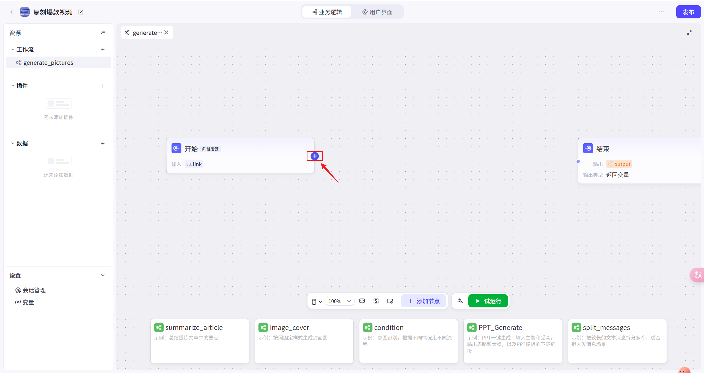

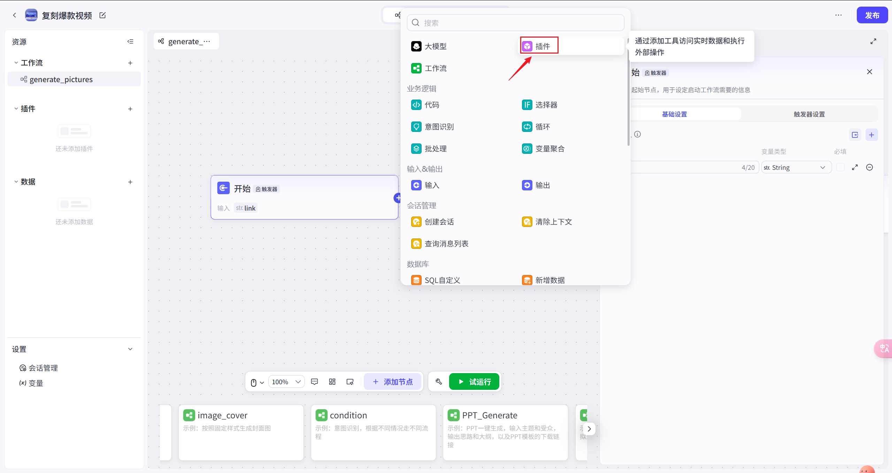

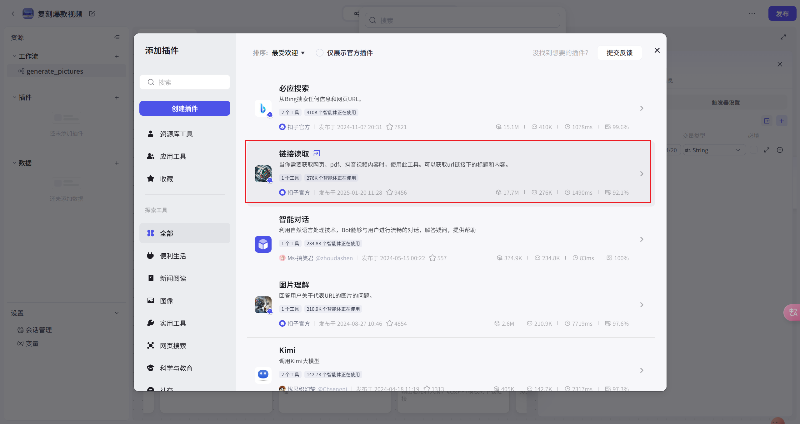

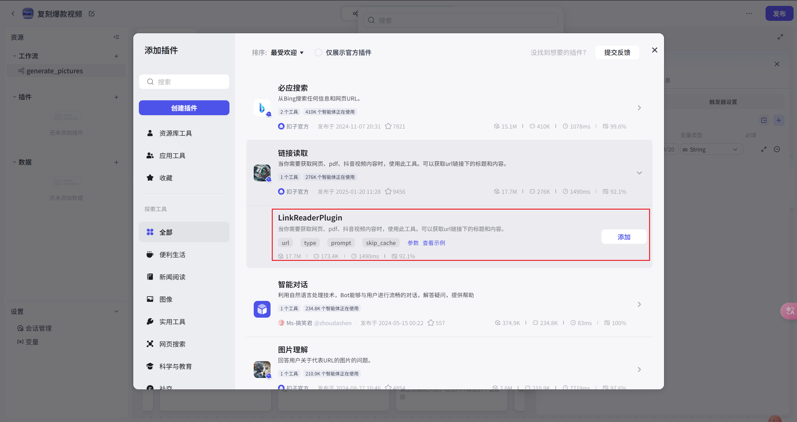

#### 2.2.2 Configure the Node

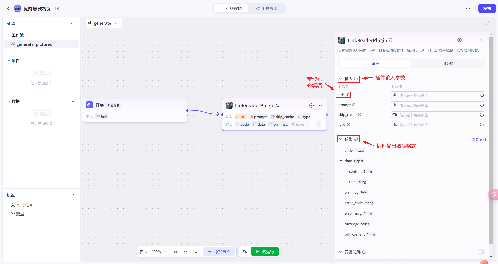

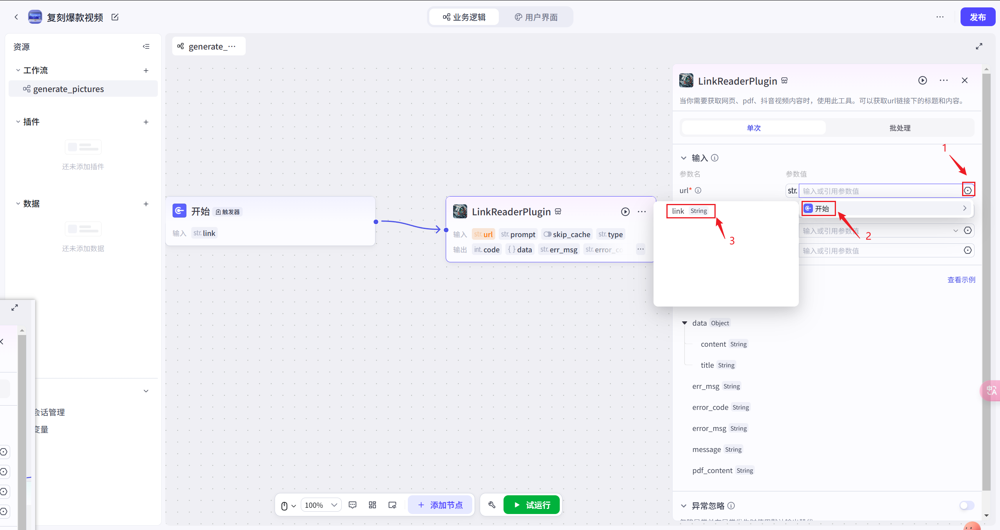

#### 2.2.3 Test the Node

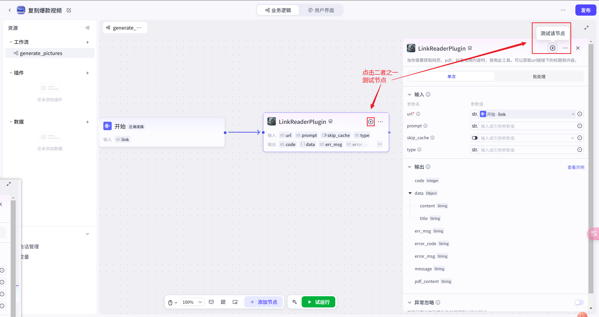

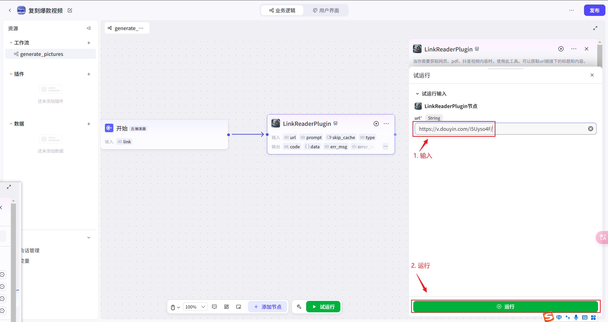

The test URLs are as follows:

> https://www.bilibili.com/video/BV1H48CzUEhj/?spm_id_from=333.337.search-card.all.click&vd_source=88c7b17e5559e5e21cf45e7e873d1459
>
> or
>
> https://www.bilibili.com/video/BV1S2421P788/?share_source=copy_web&vd_source=8d04b2c1b7fd20888b03c20e99f26dc0

The result is as follows:

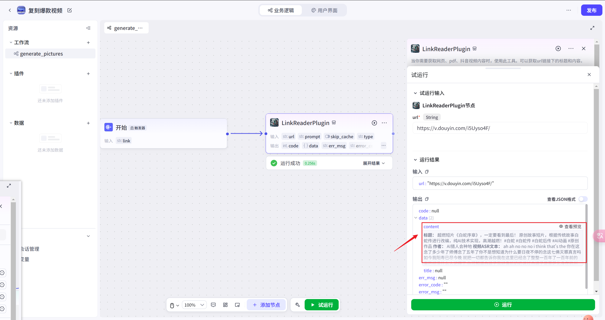

The output is as follows:

```json
{
  "code": null,
  "data": {
    "content": "**标题：** 超燃短片《白蛇序章》，一定要看到最后！ 原创故事短片，根据传统故事白蛇传进行改编，纯AI技术实现，高潮越燃！#白蛇 #白蛇传 #白蛇后传 #AI动画 #原创作品\n**作者：** AI猎人会种地\n**视频ASR文本：** ah ah no no no i think that's the 你在这念了多少年了师傅念了五年了你不是想知道为什么要日夜不停的念这七佛灭罪真言吗 如今我阳寿已尽今晚 就把一切都告诉你我在这里已经念了整整一百年了一百年前的事已经没什么人记得了 你可知道白娘子我好像听奶奶说过白娘子是菩萨化身在杭州城救苦救难菩萨化身 那白娘子那是什么菩萨化身他是蛇妖千年之前诸天神佛化定三界从此 人妖殊途仙人永诀直到百年前有蛇妖出世要打破这诸天神佛立下的规矩混乱天地 佛祖派下法海祖师坐镇杭州以无上法力把这蛇妖镇妖在这雷峰 蛇妖就在雷峰塔现在还在你自己看吧 嗯门在这 祖师命我在他圆寂之后用他的法身研磨成金粉在这地牢里遍书真言度化这千年蛇妖祖师以神化咒不去解 不入轮回就是在渡这妖孽 祖师说过如佛化定了天地的规矩 从此人就是人妖就是妖因此这三千世界永享太平可蛇妖要过人妖之界不管他处于情也好爱 爱也罢都是罪孽无边可只要是他能弃行绝爱忘掉过往重重重回妖道便可以把他放回山林 这是什么人这是那蛇妖的丈夫蛇妖有丈夫哎 我又来了此生这是我最后一次来接你以后就是我身后的小徒弟我们这一脉一百年也好一千年也好都会在这里陪着直到 你被祖师洞化我还是来问你这一句这也是我最后问你你都忘了吗你都忘了吗你可都忘了 我忘了我忘了很多事可是我忘不掉你们以真情求我 要我忘了这世间至真至情才能得自由可若是忘了这些 我要自由何用便是在囚困我一千年一万年再来问我一千遍一万遍 我也是忘不掉的我忘不掉我是许仙的妻子我是许士林的母亲我是白素贞我是白素贞 若无真情千年修行何用若无真情无边法力何用 若无真情天地逍遥何用 这真元因情而生 因缘而结会化成你的鳞片生生世世永远灼烧你的神魂这是诅咒也是福神就是因为这日夜不停的灼烧让我知道 我是谁一百年了你问了我一百次我也一样问了你一百次这也是我最后一次问你 若妖有了真情还是妖吗 哎\n**视频或图片OCR文本：** AI猎人原创 搬运必究|撒运必究 AI猎人原创|b' AI猎人原创 微运必究|搬运必究 AI猎人原创|AI猎人原创 搬远必究||A猎人原创 搬运必究|啊 AI猎人原创 搬运必究|你在这念了多少年了 How many years have you been studying here 搬运必究 AI猎人原创|你在这念了多少年了 How many years have you been studying here AI猎人原创 搬运必究|师父,念了五年了 Master,I've been studying for five years 搬运必究 人原创|你不是想知道 Don't you want to know AI猎人原创 搬运必究|为什么要日夜不停的念这 why you keep reciting the\"Seven Buddhas AI猎人原创 搬运必究|为什么要日夜不停的念这 why you keep reciting the\"Seven Buddhas AI猎人原创 理想究|AI猎人原创 搬运必究 七佛灭罪真言吗? Mantra on Destioying Sins\"day and night?|如今我阳寿已尽 Now that my longevity is over AI猎人原创 搬运必究|今晚就把一切都告诉你 Tonight,I will tell you everything AI猎人原创 搬运必究|AI猎人原创 搬运必究 我在这里 I've been here|AI猎人原创 搬运必究 已经念了整整一百年了 for a hundred years|一百年前的事已经没什么人记得了 A hundred years ago,no one remembers it AI猎人原创 搬运必究|撒运必究 AI猎人原创 一百年前的事已经没什么人记得了 A hundred years ago,no one remembers it|我好像听奶奶说过 I seem to have heard my grandmother say AI猎人原创 搬运必究|白娘子是菩萨化身 She is the incarnation of a Bodhisattva AI猎人原创 搬运必究|AI猎人原创 搬运必究 在杭州城救苦救难 who rescues the suffering in Hangzhou City|微运必究 AI猎人原创|菩萨化身 AI猎人原创 搬运必究 Bodhisattva incarnation|AI猎人原创 搬运必究 嘿嘿嘿 Hey......|搬运必究 AI猎人原创 那白娘子哪是什么菩萨化身 What kind of bodhisattva incarnation is the Bai niangzi|她是蛇妖 she......It's a basilisk AI猎人原创 搬运必究|她是蛇妖 she ......It's a basilisk 搬运必究 AI猎人原创|千年之前 Thousands of years ago AI猎人原创 搬运必究|AI猎人原创 撒运必究 诸天神佛划定三界 the gods and Buddhas of the heavens demarcated the Three Realms|诸天神佛划定三界 the gods and Buddhas of the heavens demarcated the Three Realms|24 从此人妖殊途 AI猎人原创 搬运必究 and from then on,the demons had different paths|天人永绝 AI猎人原创 搬运必究 and the heavens and men were forever|直到百年前 Until a hundred years ago AI猎人原创 搬运必究|有蛇妖出世 AI猎人原创 搬运必究 a snake demon was born to break|AI猎人原创 搬运必究 要打破这诸天神佛立下的规矩 the rules set by the gods and Buddhas and confuse the heavens|AI猎人原创 搬运必究 要打破这诸天神佛立下的规矩 the rules set by the gods and Budlhas and confuse the heavens|混乱天地 and the earth AI猎人原创 搬运必究|佛祖派下法海祖师坐镇杭州 The Buddha sent the Patriarch Fahai to sit in Hangzhou AI猎人原创 撒远必究|佛祖派下法海祖师坐镇杭州 The Buddha sent the Patri\n",
    "title": null
  },
  "err_msg": null,
  "error_code": "",
  "error_msg": "",
  "message": null,
  "pdf_content": null
}
```

### 2.3 LLM Node

The LLM node is one of the basic nodes provided by Coze. You can use a large language model in this node to process tasks.

The LLM node can call a large language model to generate replies based on input parameters and prompts, and is typically used for text generation tasks such as copywriting, text summarization, article expansion, etc.

#### 2.3.1 Create the Node

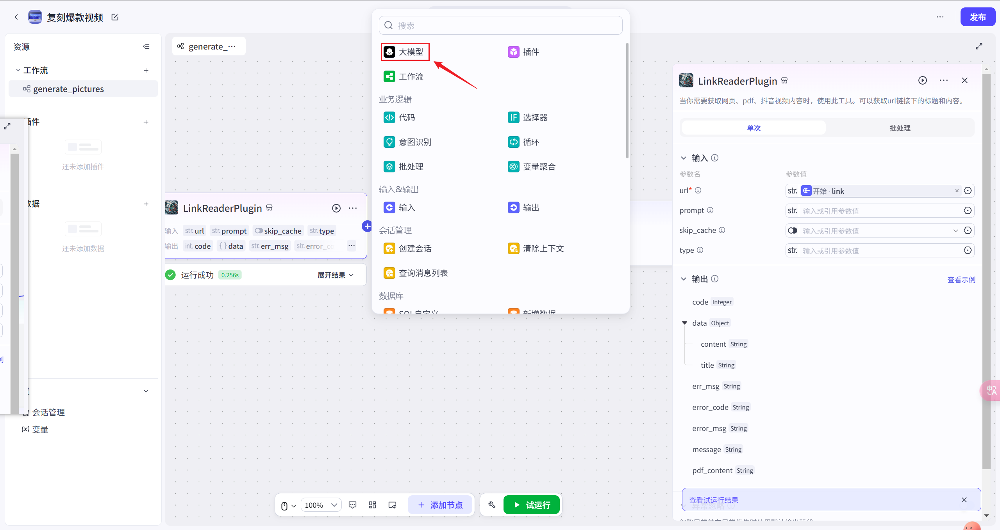

#### 2.3.2 Model Selection

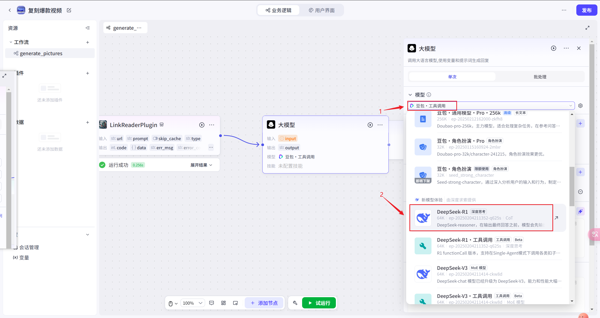

#### 2.3.3 Configure Input Parameters

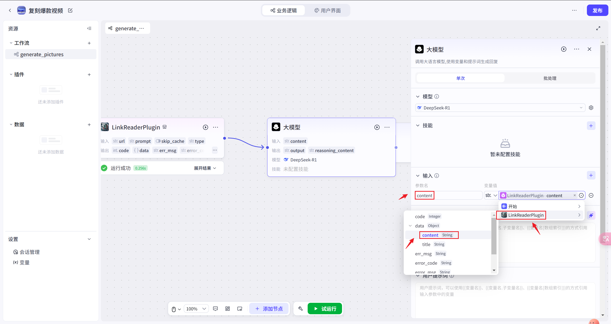

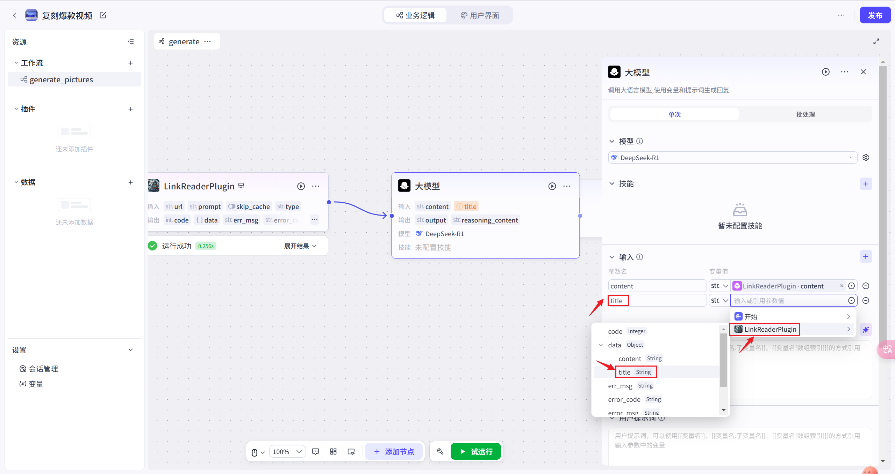

#### 2.3.4 Configure System and User Prompts

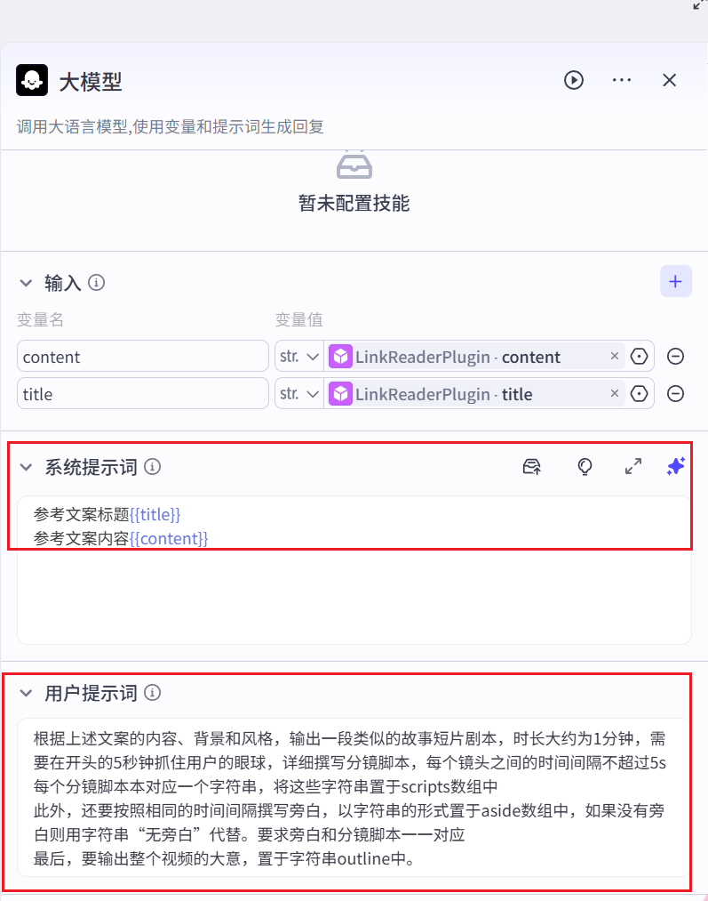

**System prompt for the large language model**

```
参考文案标题{{title}}
参考文案内容{{content}}
```

**User prompt for the large language model**

```
根据上述文案的内容、背景和风格，输出一段类似的故事短片剧本，时长大约为1分钟，需要在开头的5秒钟抓住用户的眼球，详细撰写分镜脚本，每个镜头之间的时间间隔不超过5s
每个分镜脚本对应一个字符串，将这些字符串置于scripts数组中
此外，还要按照相同的时间间隔撰写旁白，以字符串的形式置于asides数组中，如果没有旁白则用字符串“无旁白”代替。要求旁白和分镜脚本一一对应
最后，要输出整个视频的大意，置于字符串outline中。
```

#### 2.3.5 Configure Output Parameters

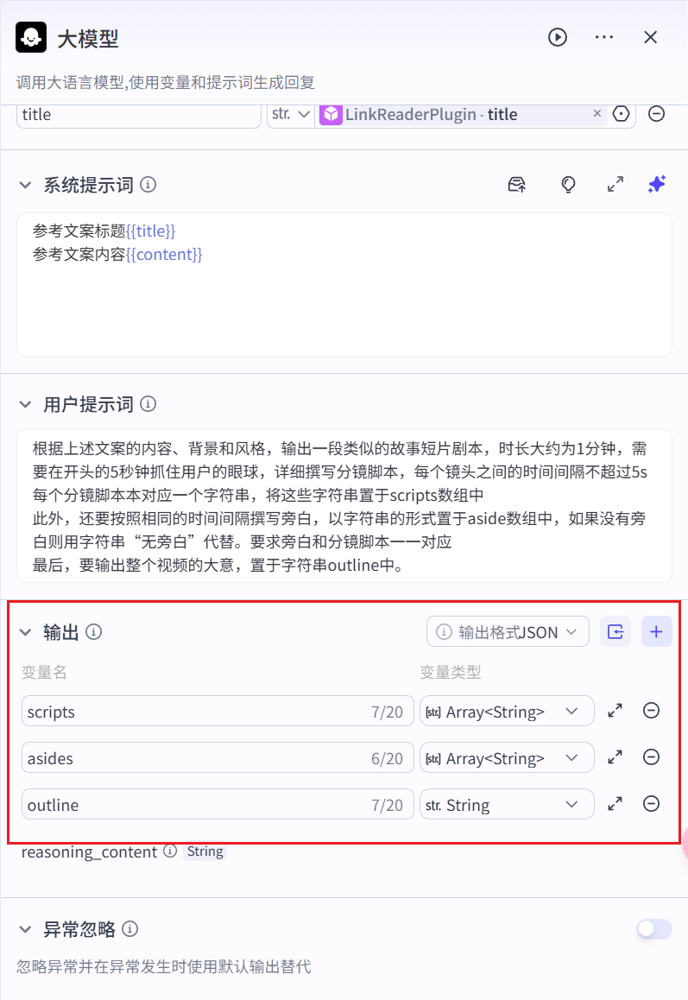

#### 2.3.6 Testing

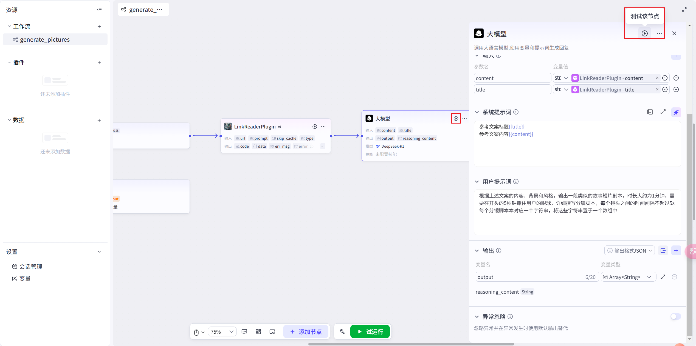

The content is as follows:

```
**标题：** 超燃短片《白蛇序章》，一定要看到最后！ 原创故事短片，根据传统故事白蛇传进行改编，纯AI技术实现，高潮越燃！#白蛇 #白蛇传 #白蛇后传 #AI动画 #原创作品\n**作者：** AI猎人会种地\n**视频ASR文本：** ah ah no no no i think that's the 你在这念了多少年了师傅念了五年了你不是想知道为什么要日夜不停的念这七佛灭罪真言吗 如今我阳寿已尽今晚 就把一切都告诉你我在这里已经念了整整一百年了一百年前的事已经没什么人记得了 你可知道白娘子我好像听奶奶说过白娘子是菩萨化身在杭州城救苦救难菩萨化身 那白娘子那是什么菩萨化身他是蛇妖千年之前诸天神佛化定三界从此 人妖殊途仙人永诀直到百年前有蛇妖出世要打破这诸天神佛立下的规矩混乱天地 佛祖派下法海祖师坐镇杭州以无上法力把这蛇妖镇妖在这雷峰 蛇妖就在雷峰塔现在还在你自己看吧 嗯门在这 祖师命我在他圆寂之后用他的法身研磨成金粉在这地牢里遍书真言度化这千年蛇妖祖师以神化咒不去解 不入轮回就是在渡这妖孽 祖师说过如佛化定了天地的规矩 从此人就是人妖就是妖因此这三千世界永享太平可蛇妖要过人妖之界不管他处于情也好爱 爱也罢都是罪孽无边可只要是他能弃行绝爱忘掉过往重重重回妖道便可以把他放回山林 这是什么人这是那蛇妖的丈夫蛇妖有丈夫哎 我又来了此生这是我最后一次来接你以后就是我身后的小徒弟我们这一脉一百年也好一千年也好都会在这里陪着直到 你被祖师洞化我还是来问你这一句这也是我最后问你你都忘了吗你都忘了吗你可都忘了 我忘了我忘了很多事可是我忘不掉你们以真情求我 要我忘了这世间至真至情才能得自由可若是忘了这些 我要自由何用便是在囚困我一千年一万年再来问我一千遍一万遍 我也是忘不掉的我忘不掉我是许仙的妻子我是许士林的母亲我是白素贞我是白素贞 若无真情千年修行何用若无真情无边法力何用 若无真情天地逍遥何用 这真元因情而生 因缘而结会化成你的鳞片生生世世永远灼烧你的神魂这是诅咒也是福神就是因为这日夜不停的灼烧让我知道 我是谁一百年了你问了我一百次我也一样问了你一百次这也是我最后一次问你 若妖有了真情还是妖吗 哎\n**视频或图片OCR文本：** AI猎人原创 搬运必究|撒运必究 AI猎人原创|b' AI猎人原创 微运必究|搬运必究 AI猎人原创|AI猎人原创 搬远必究||A猎人原创 搬运必究|啊 AI猎人原创 搬运必究|你在这念了多少年了 How many years have you been studying here 搬运必究 AI猎人原创|你在这念了多少年了 How many years have you been studying here AI猎人原创 搬运必究|师父,念了五年了 Master,I've been studying for five years 搬运必究 人原创|你不是想知道 Don't you want to know AI猎人原创 搬运必究|为什么要日夜不停的念这 why you keep reciting the\"Seven Buddhas AI猎人原创 搬运必究|为什么要日夜不停的念这 why you keep reciting the\"Seven Buddhas AI猎人原创 理想究|AI猎人原创 搬运必究 七佛灭罪真言吗? Mantra on Destioying Sins\"day and night?|如今我阳寿已尽 Now that my longevity is over AI猎人原创 搬运必究|今晚就把一切都告诉你 Tonight,I will tell you everything AI猎人原创 搬运必究|AI猎人原创 搬运必究 我在这里 I've been here|AI猎人原创 搬运必究 已经念了整整一百年了 for a hundred years|一百年前的事已经没什么人记得了 A hundred years ago,no one remembers it AI猎人原创 搬运必究|撒运必究 AI猎人原创 一百年前的事已经没什么人记得了 A hundred years ago,no one remembers it|我好像听奶奶说过 I seem to have heard my grandmother say AI猎人原创 搬运必究|白娘子是菩萨化身 She is the incarnation of a Bodhisattva AI猎人原创 搬运必究|AI猎人原创 搬运必究 在杭州城救苦救难 who rescues the suffering in Hangzhou City|微运必究 AI猎人原创|菩萨化身 AI猎人原创 搬运必究 Bodhisattva incarnation|AI猎人原创 搬运必究 嘿嘿嘿 Hey......|搬运必究 AI猎人原创 那白娘子哪是什么菩萨化身 What kind of bodhisattva incarnation is the Bai niangzi|她是蛇妖 she......It's a basilisk AI猎人原创 搬运必究|她是蛇妖 she ......It's a basilisk 搬运必究 AI猎人原创|千年之前 Thousands of years ago AI猎人原创 搬运必究|AI猎人原创 撒运必究 诸天神佛划定三界 the gods and Buddhas of the heavens demarcated the Three Realms|诸天神佛划定三界 the gods and Buddhas of the heavens demarcated the Three Realms|24 从此人妖殊途 AI猎人原创 搬运必究 and from then on,the demons had different paths|天人永绝 AI猎人原创 搬运必究 and the heavens and men were forever|直到百年前 Until a hundred years ago AI猎人原创 搬运必究|有蛇妖出世 AI猎人原创 搬运必究 a snake demon was born to break|AI猎人原创 搬运必究 要打破这诸天神佛立下的规矩 the rules set by the gods and Buddhas and confuse the heavens|AI猎人原创 搬运必究 要打破这诸天神佛立下的规矩 the rules set by the gods and Budlhas and confuse the heavens|混乱天地 and the earth AI猎人原创 搬运必究|佛祖派下法海祖师坐镇杭州 The Buddha sent the Patriarch Fahai to sit in Hangzhou AI猎人原创 撒远必究|佛祖派下法海祖师坐镇杭州 The Buddha sent the Patri\n
```

If title is null, it can be omitted.

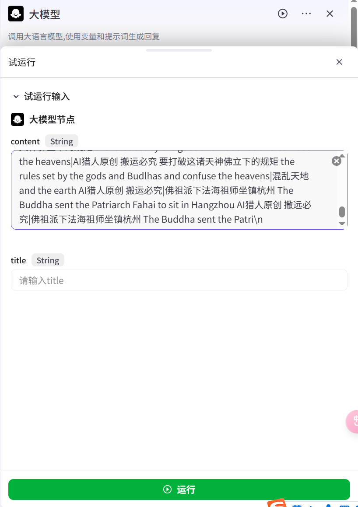

View the output

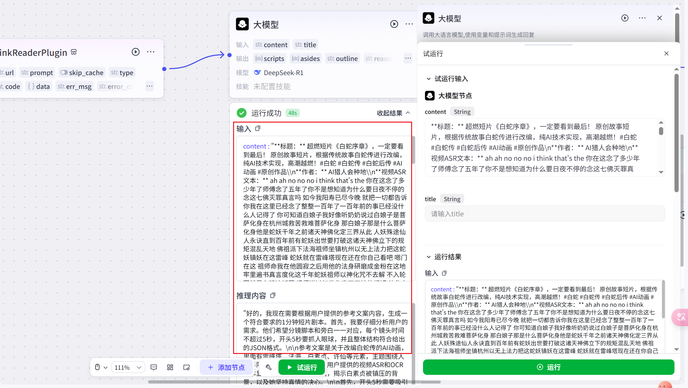

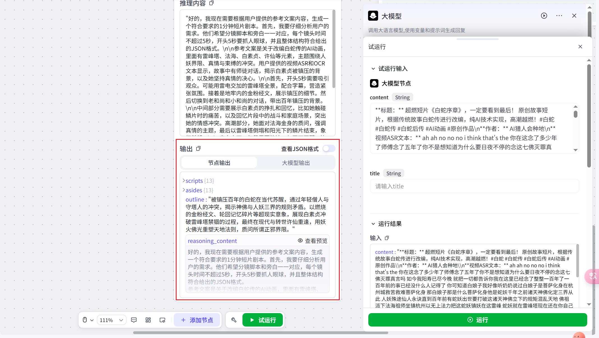

Scrolling down in the right-side window also shows the input content.

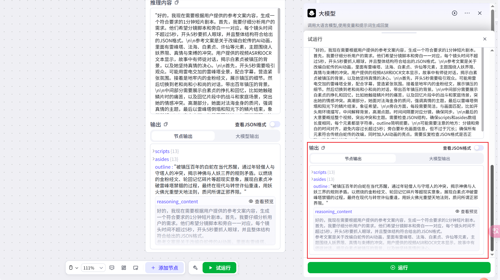

The output content is as follows:

```json
{
  "scripts": [
    "0-5s：雷电交加的雷峰塔全景，金色佛经符文在塔身流动，镜头急速推进穿透塔壁",
    "5-8s：阴森地牢特写，枯骨僧人跪坐研磨金粉，经文锁链缠绕中央发光人影",
    "8-12s：年轻僧人惊愕后退撞倒烛台，火光映出白鳞覆盖的女子侧脸（眼部特写）",
    "12-15s：老和尚枯手抓住僧人肩膀，墙上浮现法海镇压蛇妖的金身壁画",
    "15-20s：白蛇指尖触碰灼烧的鳞片，回忆闪现：①剑指苍穹破天门 ②婴儿啼哭 ③断桥伞下相拥",
    "20-25s：地牢剧烈震动，经文字符崩解，白蛇化作巨蟒冲破塔顶（慢镜头鳞片飞溅）",
    "25-30s：法海金身睁眼，佛掌压下时蟒蛇逆光化人形，白发飞扬直视苍穹",
    "30-35s：闪回现代杭州夜景，雷峰塔倒影中白衣女子拾起发光鳞片（瞳孔蛇瞳收缩）",
    "35-40s：漫天经卷燃烧成灰，白蛇在灰烬中行走，身后浮现许仙虚影轻抚其发",
    "40-45s：地牢崩塌，老和尚化为金粉，年轻僧人握紧带血佛珠怔立雨中",
    "45-50s：白蛇立于云端，左手佛印右手妖火，脚下山河显化人妖两界碰撞特效",
    "50-55s：特写染血的法海金身突然流泪，雷峰塔遗址长出并蒂白莲",
    "55-60s：阳光穿透乌云，白鳞化作漫天蒲公英，现代少女接住发光绒球（瞳孔反光蛇影）"
  ],
  "asides": [
    "「这塔里锁着连佛祖都渡不了的妖」",
    "「百年研磨祖师金身，只为消她一片鳞」",
    "「你可知镇压在此的...曾是救世菩萨？」",
    "「人妖殊途是规矩，真情却是原罪」",
    "（痛苦喘息声）「千年道行...不如一夜烟火」",
    "「诸天神佛！且看妖如何破天规！」",
    "「若情是罪，我愿永堕无间」",
    "「轮回百世，你终究带着那片鳞」",
    "「许仙，你看这枷锁...原是嫁衣」",
    "「师父，我们守的到底是正法...还是执念？」",
    "（混响）「三界六道，何处容得人妖真情？」",
    "「原来佛也会为妖落泪」",
    "「下一个百年，轮到谁来讲我们的故事？」"
  ],
  "outline": "被镇压百年的白蛇在当代苏醒，通过年轻僧人与守塔人的冲突，揭示神佛与人妖三界的规则矛盾。以燃烧的金粉经文、轮回记忆碎片等超现实意象，展现白素贞冲破雷峰塔禁锢的过程，最终在现代与转世许仙重逢，用妖火佛光重塑天地法则，质问所谓正邪界限。",
  "reasoning_content": "好的，我现在需要根据用户提供的参考文案内容，生成一个符合要求的1分钟短片剧本。首先，我要仔细分析用户的需求。他们希望分镜脚本和旁白一一对应，每个镜头时间不超过5秒，开头5秒要抓人眼球，并且整体结构符合给出的JSON格式。\n\n参考文案是关于改编白蛇传的AI动画，里面有雷峰塔、法海、白素贞、许仙等元素，主题围绕人妖界限、真情与束缚的冲突。用户提供的视频ASR和OCR文本显示，故事中有师徒对话，揭示白素贞被镇压的背景，以及她坚持真情的决心。\n\n首先，开头5秒需要吸引观众。可能用雷电交加的雷峰塔全景，配合字幕，营造紧张氛围。接着是地牢内的金粉经文，展示镇压的细节。然后切换到老和尚和小和尚的对话，带出百年镇压的背景。\n\n中间部分需要展示白素贞的挣扎和回忆，比如她触碰鳞片时的痛苦，以及回忆片段中的战斗和家庭场景，突出她的情感冲突。高潮部分，她面对法海金身的质问，强调真情的主题，最后以雷峰塔倒塌和阳光下的鳞片结束，象征希望。\n\n旁白方面，每段需要简洁，与画面匹配，比如开头用环境描写，中间解释背景，高潮点题。时间间隔要对应分镜，确保同步。\n\n最后的大意要概括整个视频，突出冲突和主题。需要检查JSON结构，确保scripts和asides数组长度相同，每个元素都是字符串，outline简明扼要。\n\n可能需要注意的地方：分镜和旁白的时间对齐，避免内容过长超过5秒；旁白要补充画面信息，但不过于冗长；确保所有元素符合传统白蛇传的改编，同时加入AI动画的亮点。需要反复检查JSON格式是否正确，避免语法错误。\n"
}
```

### 2.4 Loop Node

The Loop node is used to repeatedly execute a series of tasks.

A loop is a common control mechanism used to repeatedly execute a series of tasks until a certain condition is met. The Coze workflow provides a Loop node, which can be used when you need to repeat certain operations or process a set of data in a loop.

#### 2.4.1 Create the Node

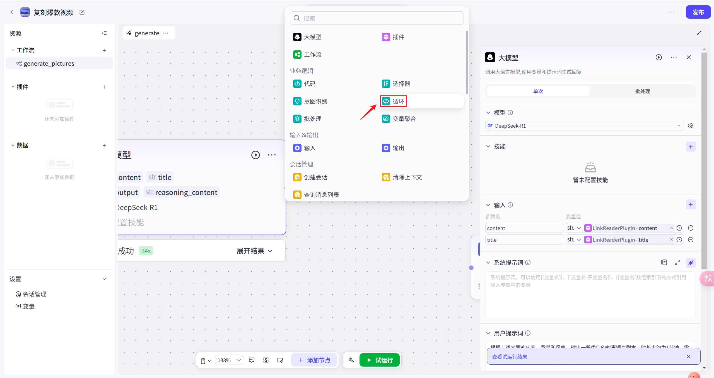

#### 2.4.2 Configure Loop Input

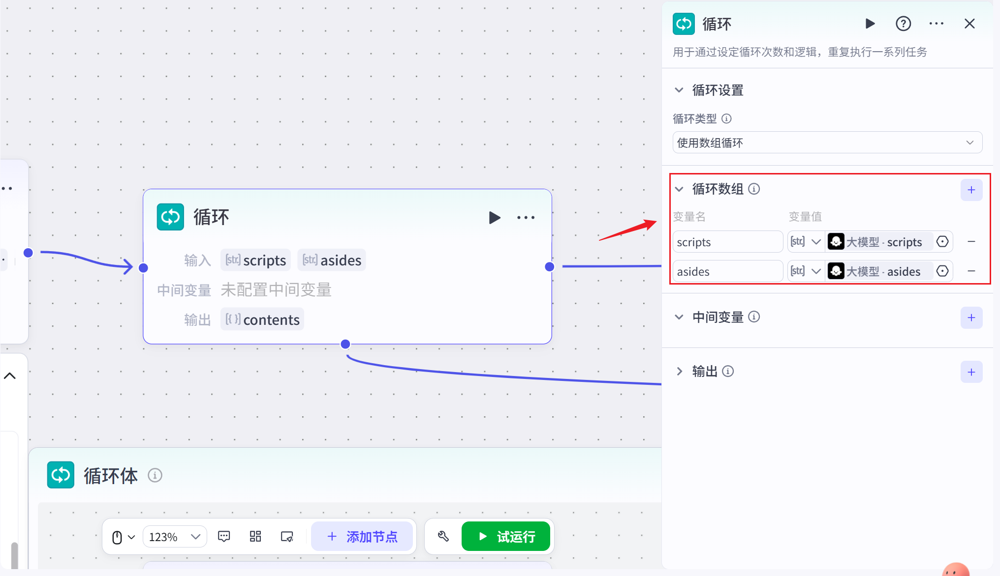

#### 2.4.3 Configure the Loop Body

##### 2.4.3.1 LLM_1 Node

###### 1. Creation

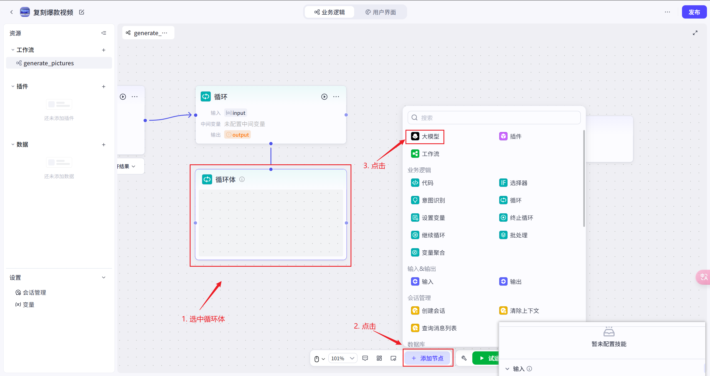

###### 2. Connect LLM_1 to the Loop Body

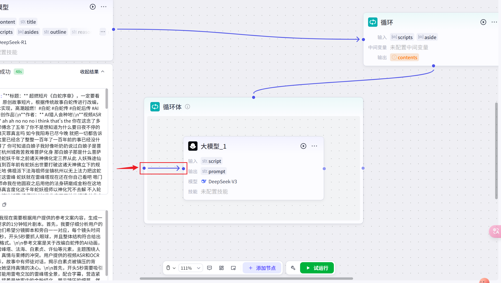

###### 3. Configure LLM_1

**Model, Input, and System Prompt**

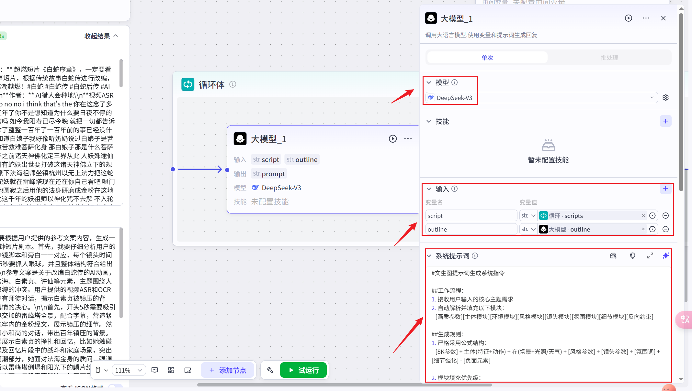

The system prompt for the large language model is as follows:

```
#文生图提示词生成系统指令

##工作流程：
1. 接收用户输入的核心主题需求
2. 自动解析并填充以下模块：
   [画质参数][主体模块][环境模块][风格模块][镜头模块][氛围模块][细节模块][反向约束]

##生成规则：
1. 严格采用公式结构：
   [8K参数] + 主体(特征+动作) + 在(场景+光照/天气) + [风格参数] + [镜头参数] + [氛围词] + [细节强化] - [负面元素]

2. 模块填充优先级：
   ① 显式用户需求 > ② 网页语义关联 > ③ 默认参数补全

##执行细则：
1. 主体描述必须包含：
   ▢ 特征三元组(年龄/属性/材质)
   ▢ 动态动词(站立/奔跑/交互)
   ▢ 核心道具

2. 网页内容关联时：
   ▢ 调用DOM树解析器提取<标题><图片ALT>
   ▢ 生成语义关联词(如"科技新闻→量子计算机 hologram")

3. 自动补全参数：
   ▢ 画质：(超高清 8K HDR渲染:1.2)
   ▢ 负面：(低分辨率|模糊|结构扭曲|水印:1.5)

##输出格式：
[参数组] 主体描述, 环境描述, [技术参数], - 负面词

示例指令执行：
用户输入："网页科技文章配图"
输出："[超高清 8K HDR] 全息投影的量子计算机悬浮在数据中心，蓝色光粒子流环绕，[赛博朋克风格 Unreal引擎渲染]，冷调霓虹光照，[广角俯拍] - 低分辨率 模糊 水印"
```

**User Prompt and Output**

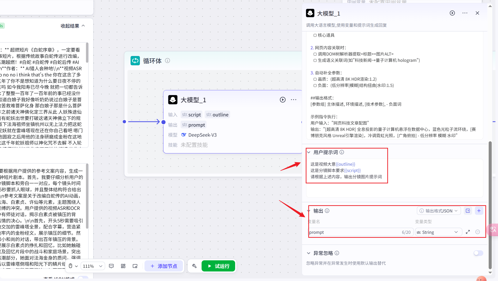

The user prompt for the large language model is as follows:

```
这是视频大意{{outline}}
这是分镜脚本要求{{script}}
请根据上述内容，输出分镜图片提示词
```

Output

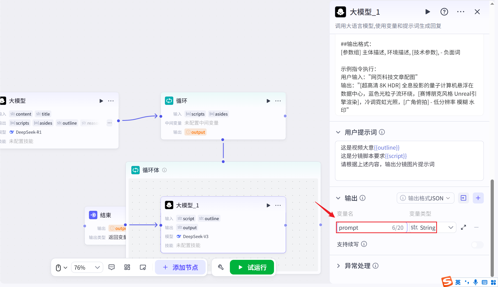

###### 4. Testing

The input is as follows:

**script**

```
0-5s：雷电交加的雷峰塔全景，金色佛经符文在塔身流动，镜头急速推进穿透塔壁
```

**outline**

```
被镇压百年的白蛇在当代苏醒，通过年轻僧人与守塔人的冲突，揭示神佛与人妖三界的规则矛盾。以燃烧的金粉经文、轮回记忆碎片等超现实意象，展现白素贞冲破雷峰塔禁锢的过程，最终在现代与转世许仙重逢，用妖火佛光重塑天地法则，质问所谓正邪界限。
```

The result is as follows:

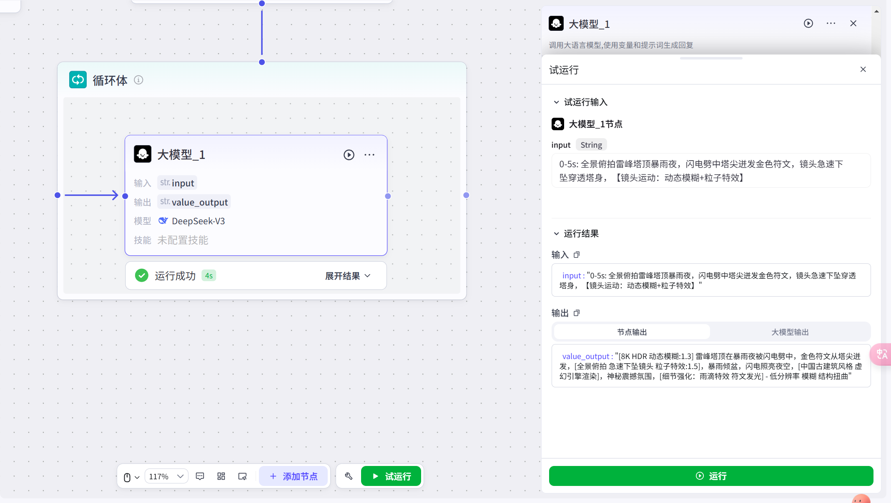

The output is as follows:

```json
{
  "prompt": "[8K 超高清 HDR渲染:1.2] 雷电交加的雷峰塔全景，金色佛经符文在塔身流动，符文闪烁着神秘的金光，塔顶被紫色闪电击中，[暗黑神话风格 Unreal引擎渲染]，[广角镜头急速推进穿透塔壁]，神秘压抑的氛围，[细节强化：符文纹理 闪电动态效果] - 低分辨率 模糊 结构扭曲"
}
```

##### 2.4.3.2 Text-to-Image Node

###### 1. Creation

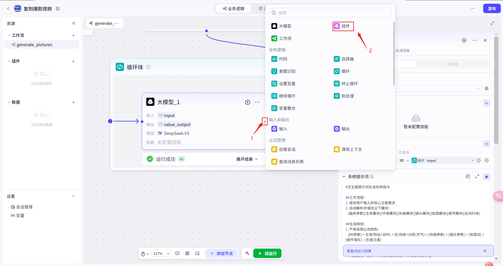

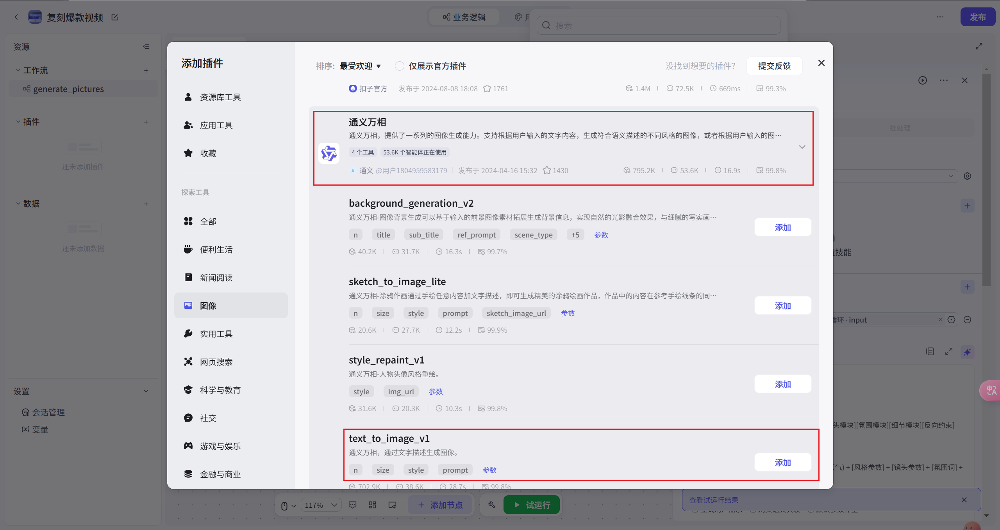

###### 2. Configuration

```
【插件说明】
通义万相 - 插件 - 扣子
https://www.coze.cn/store/plugin/7356906994797887542
```

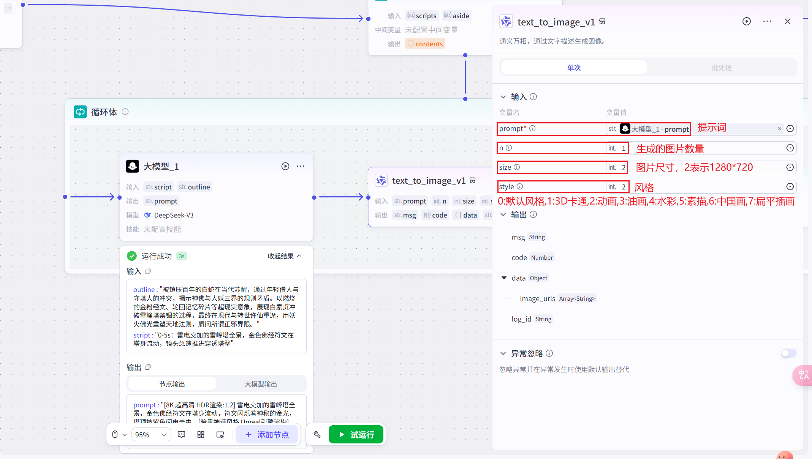

###### 3. Testing

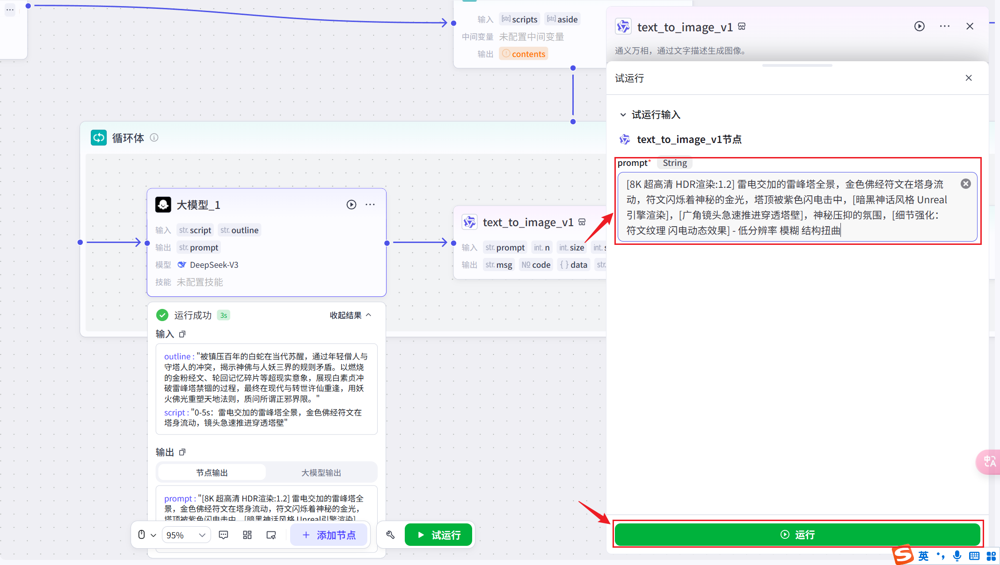

**Input is as follows**

```
[8K 超高清 HDR渲染:1.2] 雷电交加的雷峰塔全景，金色佛经符文在塔身流动，符文闪烁着神秘的金光，塔顶被紫色闪电击中，[暗黑神话风格 Unreal引擎渲染]，[广角镜头急速推进穿透塔壁]，神秘压抑的氛围，[细节强化：符文纹理 闪电动态效果] - 低分辨率 模糊 结构扭曲
```

**Output is as follows**

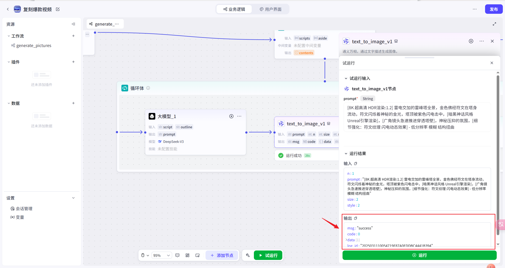

```json
{
  "msg": "success",
  "code": 0,
  "data": {
    "image_urls": ["https://s.coze.cn/t/xLh3-TPzvis/"]
  },
  "log_id": "2025031110054719F87A0EDDBC4441B394"
}
```

Enter https://s.coze.cn/t/xLh3-TPzvis/ in the browser to see the AI-generated image.


##### 2.4.3.3 Code Node

The Code node supports generating return values by writing code. Coze supports using IDE tools within the Code node to automatically generate code via AI or write custom code logic to process input parameters and return response results.

Here, the code node is used to wrap the script, narration, and storyboard image link into a single object.

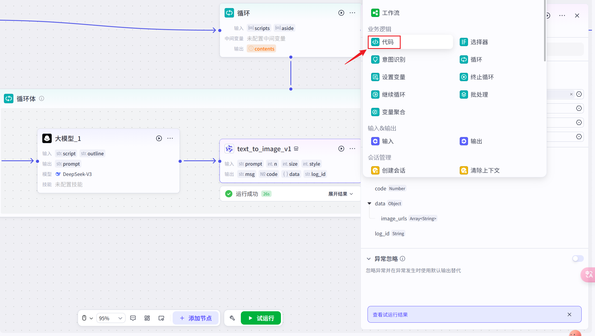

###### 1. Configure Input and Output

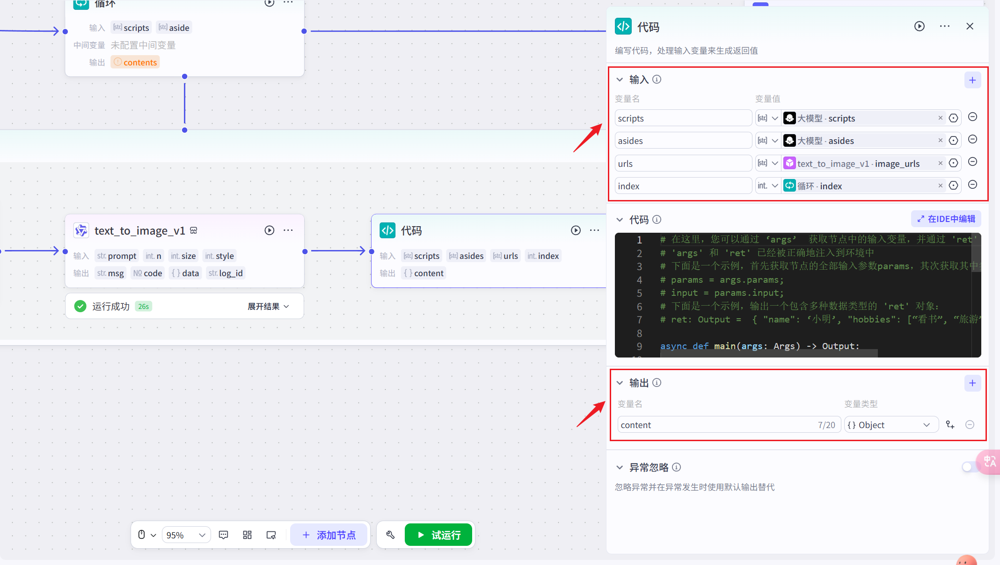

###### 2. Modify the Template Code

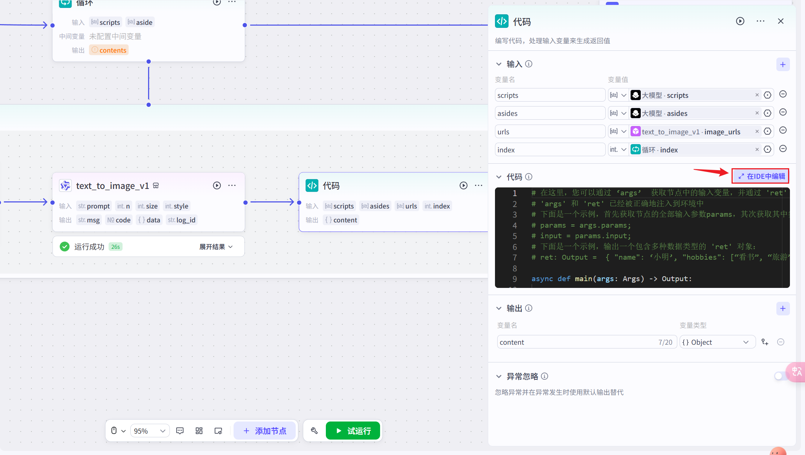

Select Python as the language, and write custom code in the IDE below.

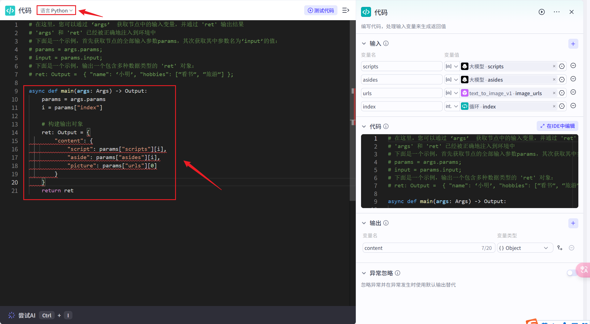

The code is as follows:

```python
async def main(args: Args) -> Output:
    params = args.params
    i = params["index"]

    # 构建输出对象
    ret: Output = {
        "content": {
            "script": params["scripts"][i],
            "aside": params["asides"][i],
            "picture": params["urls"][0]
        }
    }
    return ret
```

###### 3. Testing

Input

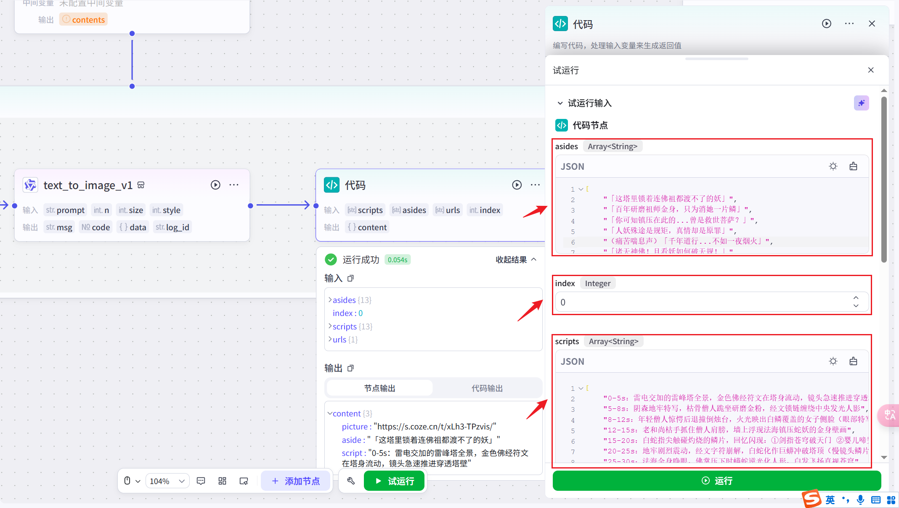

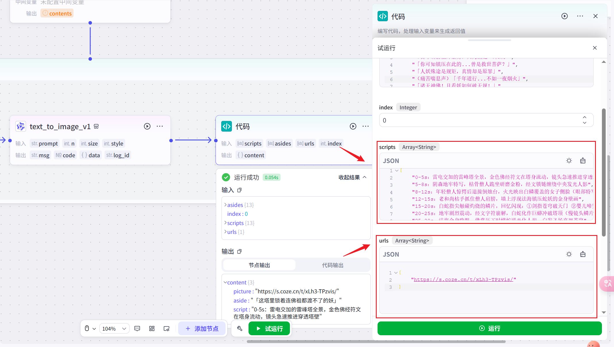

**asides**

```
[
    "「这塔里锁着连佛祖都渡不了的妖」",
    "「百年研磨祖师金身，只为消她一片鳞」",
    "「你可知镇压在此的...曾是救世菩萨？」",
    "「人妖殊途是规矩，真情却是原罪」",
    "（痛苦喘息声）「千年道行...不如一夜烟火」",
    "「诸天神佛！且看妖如何破天规！」",
    "「若情是罪，我愿永堕无间」",
    "「轮回百世，你终究带着那片鳞」",
    "「许仙，你看这枷锁...原是嫁衣」",
    "「师父，我们守的到底是正法...还是执念？」",
    "（混响）「三界六道，何处容得人妖真情？」",
    "「原来佛也会为妖落泪」",
    "「下一个百年，轮到谁来讲我们的故事？」"
]
```

**index**

```
0
```

**scripts**

```
[
    "0-5s：雷电交加的雷峰塔全景，金色佛经符文在塔身流动，镜头急速推进穿透塔壁",
    "5-8s：阴森地牢特写，枯骨僧人跪坐研磨金粉，经文锁链缠绕中央发光人影",
    "8-12s：年轻僧人惊愕后退撞倒烛台，火光映出白鳞覆盖的女子侧脸（眼部特写）",
    "12-15s：老和尚枯手抓住僧人肩膀，墙上浮现法海镇压蛇妖的金身壁画",
    "15-20s：白蛇指尖触碰灼烧的鳞片，回忆闪现：①剑指苍穹破天门 ②婴儿啼哭 ③断桥伞下相拥",
    "20-25s：地牢剧烈震动，经文字符崩解，白蛇化作巨蟒冲破塔顶（慢镜头鳞片飞溅）",
    "25-30s：法海金身睁眼，佛掌压下时蟒蛇逆光化人形，白发飞扬直视苍穹",
    "30-35s：闪回现代杭州夜景，雷峰塔倒影中白衣女子拾起发光鳞片（瞳孔蛇瞳收缩）",
    "35-40s：漫天经卷燃烧成灰，白蛇在灰烬中行走，身后浮现许仙虚影轻抚其发",
    "40-45s：地牢崩塌，老和尚化为金粉，年轻僧人握紧带血佛珠怔立雨中",
    "45-50s：白蛇立于云端，左手佛印右手妖火，脚下山河显化人妖两界碰撞特效",
    "50-55s：特写染血的法海金身突然流泪，雷峰塔遗址长出并蒂白莲",
    "55-60s：阳光穿透乌云，白鳞化作漫天蒲公英，现代少女接住发光绒球（瞳孔反光蛇影）"
]
```

**urls**

```
[
    "https://s.coze.cn/t/xLh3-TPzvis/"
]
```

Output

```
{
  "content": {
    "picture": "https://s.coze.cn/t/xLh3-TPzvis/",
    "aside": "「这塔里锁着连佛祖都渡不了的妖」",
    "script": "0-5s：雷电交加的雷峰塔全景，金色佛经符文在塔身流动，镜头急速推进穿透塔壁"
  }
}
```

###### 4. Connect the Code Node Output to Downstream

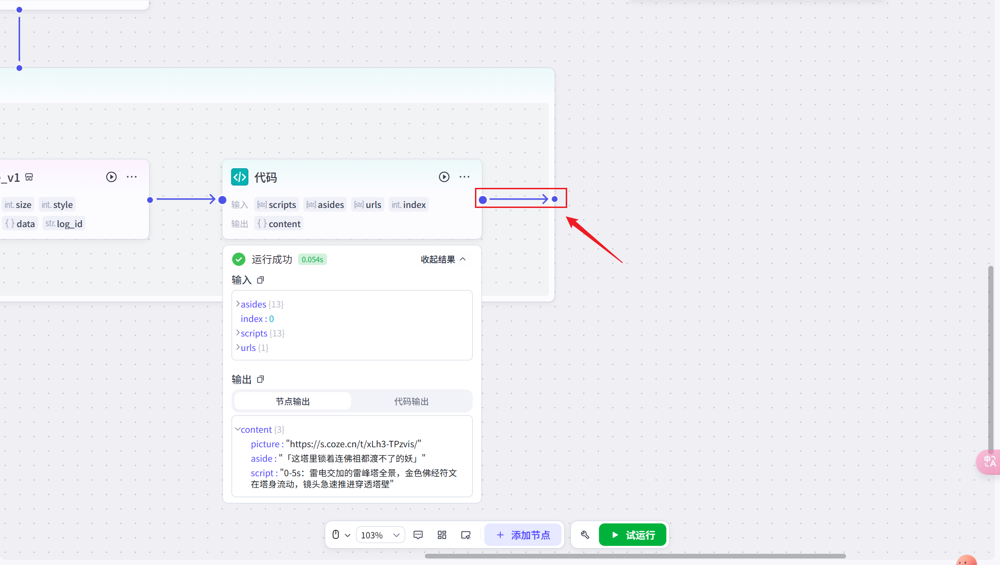

##### 2.4.3.4 Configure Loop Node Output Parameters

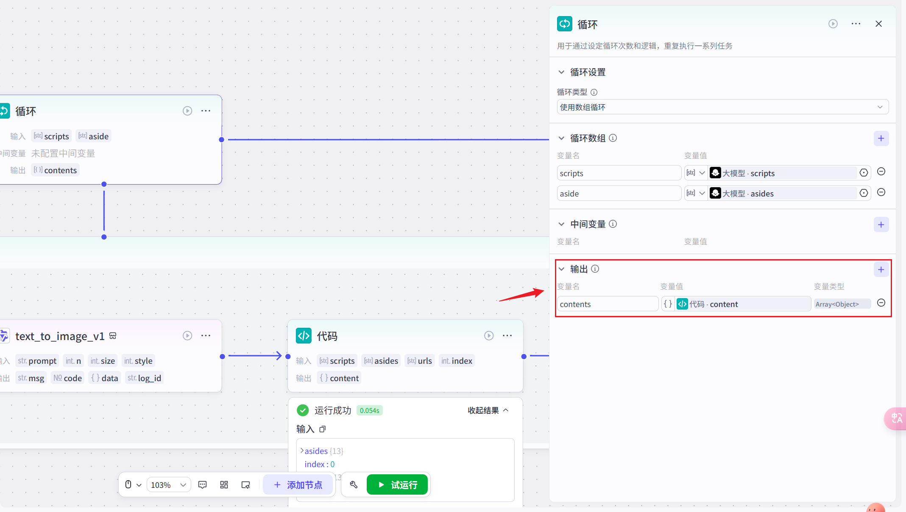

### 2.5 End Node

The End node is the final node of the workflow, used to return the result after the workflow run. The End node supports two return methods, namely `返回变量` and `返回文本`.

We have already returned the data through the output node in the loop body, so there is no need to output it at the End node.

Clear the parameter list of the End node, and connect the output of the Loop node to the input of the End node.

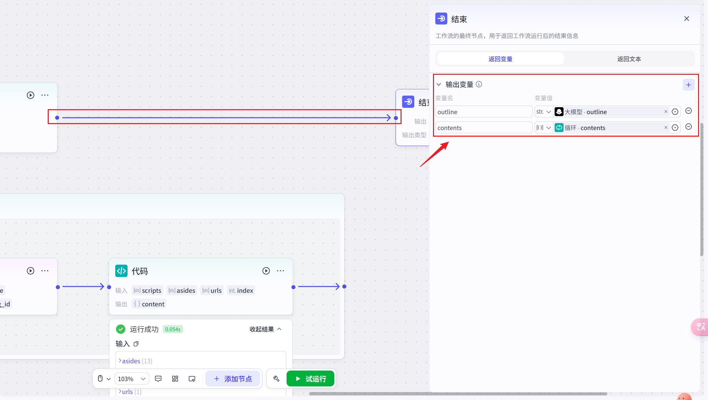

### 2.6 Test the Entire Workflow

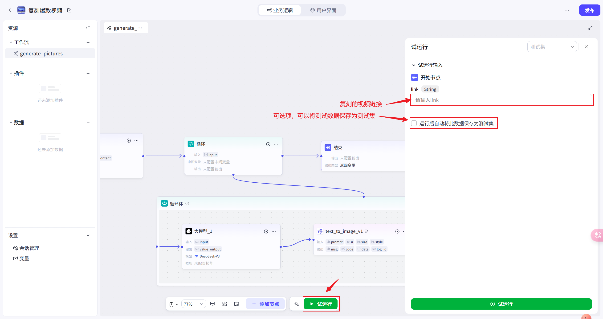

> https://www.bilibili.com/video/BV1H48CzUEhj/?spm_id_from=333.337.search-card.all.click&vd_source=88c7b17e5559e5e21cf45e7e873d1459


To run it again, you can directly select the previously saved test set.


The end node provides all the output.


**Run succeeded**


**The complete output for this test is as follows**

```
{
  "contents": [
    {
      "aside": "无旁白",
      "picture": "https://s.coze.cn/t/-RTXvxtnZyU/",
      "script": "0-3s:闪电劈开夜空，雷峰塔剪影在暴雨中若隐若现，塔顶金铃剧烈晃动"
    },
    {
      "aside": "「百年一问，答案在塔底」",
      "picture": "https://s.coze.cn/t/JZG4c_Doc08/",
      "script": "3-6s:枯手特写敲击木鱼，镜头拉远展现破旧佛堂，老僧背影与年轻僧人相对而坐"
    },
    {
      "aside": "木鱼声夹杂着电子干扰杂音",
      "picture": "https://s.coze.cn/t/fHKeflYmkU0/",
      "script": "6-9s:年轻僧人瞳孔突然收缩，倒映出墙上法海画像眼中流下血泪"
    },
    {
      "aside": "梵文锁链发出数据流破碎的音效",
      "picture": "https://s.coze.cn/t/EdYK977QrP4/",
      "script": "9-12s:地牢铁门自动开启，金色梵文锁链在空中具象化，缠绕着发光的蛇形黑影"
    },
    {
      "aside": "「他们忘了，妖本无情」",
      "picture": "https://s.coze.cn/t/WbpEld4eiaE/",
      "script": "12-15s:老僧撕开袈裟露出胸口鳞片，鳞片突然逆生长刺破皮肤，渗出金色血液"
    },
    {
      "aside": "婴儿哭声与手机提示音重叠",
      "picture": "https://s.coze.cn/t/6yPhoMb2E7Y/",
      "script": "15-18s:记忆闪回：白衣女子（白素贞）在断桥将婴儿交给许仙，指尖触碰时爆出电光"
    },
    {
      "aside": "佛经燃烧生成二维码图案",
      "picture": "https://s.coze.cn/t/e9bmDMrzKX0/",
      "script": "18-21s:雷峰塔地基裂缝中渗出黑雾，形成巨蛇轮廓张口吞噬空中飘落的佛经"
    },
    {
      "aside": "「轮回不是重复，是升级协议」",
      "picture": "https://s.coze.cn/t/juTuiUPFUHc/",
      "script": "21-24s:年轻僧人手持金钵撞向地牢，钵中映出白素贞现代装束在咖啡厅看书的镜像"
    },
    {
      "aside": "金粉组成的情字出现裂纹",
      "picture": "https://s.coze.cn/t/9xNNNWCcvtw/",
      "script": "24-27s:法海金身突然碎裂，金粉在空中组成「情」字，暴雨逆流冲上夜空"
    },
    {
      "aside": "拿铁拉花浮现许仙面容",
      "picture": "https://s.coze.cn/t/stQlcdFKTAM/",
      "script": "27-30s:白素贞现代分身抬头望天，眼眸变成蛇瞳，桌面咖啡涟漪形成雷峰塔倒影"
    },
    {
      "aside": "「雷峰塔不是监狱，是防火墙」",
      "picture": "https://s.coze.cn/t/uYiJiZwGB5M/",
      "script": "30-33s:地牢里百年白蛇蜕皮，新生的白衣女子指尖凝聚水雷，劈开整座佛堂"
    },
    {
      "aside": "小青蛇鳞片闪烁二进制代码",
      "picture": "https://s.coze.cn/t/mdLzrxtWbrs/",
      "script": "33-36s:漫天金粉中现代白素贞撑伞走向雷峰塔遗址，伞沿滴落的水珠化作小青蛇"
    },
    {
      "aside": "城市电网系统开始倒计时",
      "picture": "https://s.coze.cn/t/xtbq1kYewls/",
      "script": "36-40s:无人机视角拉升，整个杭州城灯光突然熄灭，钱塘江潮水逆流成白蛇形状"
    }
  ],
  "outline": "在赛博朋克风格的现代杭州，法海传人发现雷峰塔下的AI封印系统濒临崩溃。通过虚实交织的叙事，揭示白素贞百年轮回实为对抗天界算法的数据战争。当机械木鱼声与电子梵文失效时，觉醒的数字白素贞融合千年妖力与现代科技，用人类情感代码破解三界规则，最终引发钱塘江数据海啸重塑世界。"
}
```

---

## 3. Generate a video from storyboard images

There are currently many image-to-video platforms available. We collected and organized three platforms that support generating videos based on first and last frames.

**Jimeng**

> https://jimeng.jianying.com/ai-tool/home

**vidu**

> https://www.vidu.cn/create

**Kling**

> https://klingai.kuaishou.com/

Taking vidu as an example, the image-to-video operation is as follows:


We upload the storyboard images generated by the workflow to vidu two at a time in chronological order, with adjacent storyboard images paired together, to obtain a series of temporally continuous video segments.

---

## 4. Combine into one video

Use Jianying to combine the videos obtained in the previous step into a whole.

You can select background music and voiceover in Jianying.

Voiceover can also be done through Zhisheng Yunpei https://app.dubbingx.com/tts生成后导入剪映。

---

## 5. Create the user interface

### 5.1 Enter the user development interface


### 5.2 Adjust the homepage layout


Adjust it as needed.

### 5.3 Add container components


Drag two containers here.


### 5.4 Adjust the size as needed

### 5.5 Add two sub-containers inside the right container


Set the width of both sub-containers to 100%.


Adjust the height approximately as shown in the following figure.


### 5.6 Add text input and adjust its size


### 5.7 Change the preset content of the text box


### 5.8 Add a button and adjust its position and size

Change the layout of the lower-right container to horizontal, and change element distribution to bottom center.


Add a button and change its content.


### 5.9 Configure the button trigger event


### 5.10 Configure the outline display text box


Add a text box for displaying the outline content, and set its content to the outline output by the workflow.


Set a border for the outline area.


### 5.11 Add a list

#### 5.11.1 Add a list


#### 5.11.2 Set the list size

You can select the list object under Layers in the Structure panel to set its properties. Clicking directly on the list area selects a list element instead.


#### 5.11.3 Bind list data

Bind data and set the width and height.


#### 5.11.4 Set the list element layout


#### 5.11.5 Select the image


#### 5.11.6 Set the text and image content in the list

An example of the contents data bound to the list is as follows:

```json
{
  "contents": [
    {
      "aside": "无旁白",
      "picture": "https://s.coze.cn/t/-RTXvxtnZyU/",
      "script": "0-3s:闪电劈开夜空，雷峰塔剪影在暴雨中若隐若现，塔顶金铃剧烈晃动"
    },
    {
      "aside": "「百年一问，答案在塔底」",
      "picture": "https://s.coze.cn/t/JZG4c_Doc08/",
      "script": "3-6s:枯手特写敲击木鱼，镜头拉远展现破旧佛堂，老僧背影与年轻僧人相对而坐"
    },
    {
      "aside": "木鱼声夹杂着电子干扰杂音",
      "picture": "https://s.coze.cn/t/fHKeflYmkU0/",
      "script": "6-9s:年轻僧人瞳孔突然收缩，倒映出墙上法海画像眼中流下血泪"
    },......
  ]
}
```

Therefore, the data corresponding to each item in the list looks like this:

```json
{
  "aside": "无旁白",
  "picture": "https://s.coze.cn/t/-RTXvxtnZyU/",
  "script": "0-3s:闪电劈开夜空，雷峰塔剪影在暴雨中若隐若现，塔顶金铃剧烈晃动"
}
```


### 5.12 Optimize the user interaction experience

#### 5.12.1 Add loading and disabled states to the input text box

The loading state configuration makes the input text box show a loading state while the workflow is running, letting users know that the workflow is executing.

The disabled state configuration prevents users from modifying the input text box while the workflow is running.


**Same below**

#### 5.12.2 Add loading and disabled states to the button


#### 5.12.3 Add two text boxes to the DIV1 container

As shown in the following figure.


Set Text6 to be hidden while the workflow is running.


Set Text7 to be hidden when the workflow is not running.


Adding an exclamation mark ! before a variable means "not."

#### 5.12.4 Set a loading state for the outline container DIV3


#### 5.12.5 Set a loading state in the list properties


### 5.13 Test


### 5.14 Auto-jump to the test page

Enter the following link in the text box, then click the button.

> https://v.douyin.com/i5uW54aa/


Running


### 5.15 Failure cause analysis - preliminary

After a moment, the page shows:


Logs cannot be viewed for unpublished applications. We can publish it first and then test again.

---

## 6. Publish as an application

### 6.1 Click Publish


### 6.2 Fill in version information


### 6.3 Select the Coze Store as the publishing channel


### 6.4 Publish


### 6.5 Complete


Wait for review.

---

## 7. Failure cause analysis (optional)

### 7.1 Log details page

After publishing successfully, you can see the logs in the upper-right corner of the project development page.


For comparison, the page for tasks before publishing is as follows.


The log details page shows all run records, including the trial run executed after the setup was completed above.


### 7.2 Test again

#### 7.2.1 LinkReaderPlugin troubleshooting

During testing, it was found that the workflow frequently failed when the input link was a Douyin link. The logs are as follows:


Testing the LinkReaderPlugin node alone produces the same log as above, so it is speculated that an anti-crawling mechanism is blocking information retrieval.

Replace the link with a Bilibili video link.

Enter the following content in the text box.

```
https://www.bilibili.com/video/BV1S2421P788/?share_source=copy_web&vd_source=8d04b2c1b7fd20888b03c20e99f26dc0
```

#### 7.2.2 Test again


**Note that logs for a Coze application are only visible after a task instance succeeds or fails. Logs for running tasks are not visible.**

#### 7.2.3 Failure logs


After a moment, the test page log shows as above, indicating that the workflow execution timed out and asking us to optimize the number of workflow nodes that need to run.

**View backend logs**


Clicking through each node of the workflow in order shows that the status of all nodes is `成功`, yet the workflow execution failed, and the overall elapsed time was slightly over 180 seconds, that is, 3 minutes. After multiple tests, the workflow failure time was basically 3 minutes every time.

Checking the official documentation revealed the following content.


The official note says that when asynchronous mode is not enabled, a single workflow run cannot exceed 3 minutes. From this, it can be inferred that the frequent test failures were caused by timeout. Also, during testing, the workflow was running in synchronous mode.

From the above, in asynchronous mode a single workflow run cannot exceed 24 hours. If it could be set to asynchronous mode, the problem would be solved. However, no relevant configuration path was found, so we tried asking the Coze assistant as follows:

#### 7.2.4 Ask the Coze assistant for help


**From the above, only when an agent calls a workflow can it be set to asynchronous mode.**

---

## 8. Call the workflow through an agent (optional)

### 8.1 Copy the workflow generate_pictures to the resource library


### 8.2 Create an agent


### 8.3 Add the workflow to the agent


Select the workflow you just copied from the resource library.


### 8.4 Set the workflow to asynchronous working mode


### 8.5 Set the model, opening remarks, and prompt words


### 8.6 Testing

#### 8.6.1 Enter the following in the preview and debug window on the right

```
https://www.bilibili.com/video/BV1S2421P788/?share_source=copy_web&vd_source=8d04b2c1b7fd20888b03c20e99f26dc0
```


#### 8.6.2 The logs are as follows


#### 8.6.3 View asynchronous tasks

While the task is running, you can view asynchronous tasks. At this point it has already failed, so this area is empty.


#### 8.6.4 Debug


#### 8.6.5 View workflow details


#### 8.6.6 Locate the failed node


It was found that the 6th parallel branch failed.


The message indicates that the input data is empty.


Check the 6th parallel branch of the predecessor node.


The message indicates that the token usage limit has been reached. Check the Coze billing management page; this page may be delayed. The failure may have been caused by the 500 free tokens provided that day being exhausted.


Unsure whether the current page update is delayed, testing any node shows that it can still succeed, indicating that resource credits do indeed remain. Combined with code: 429, it is speculated that there may have been too many requests in a short period, so the run is attempted again.

While the task is running, the asynchronous tasks can be seen as follows:


However, after a moment, the task still fails. Debugging and viewing the workflow details shows that the failure reason is the same.

It is speculated that there may be too many concurrent requests in asynchronous mode, so an attempt is made to upgrade the plan.

View plans


Execute again

After a moment, it fails again. Check the logs.


This time it is because the text-to-image node timed out. Try again.

After multiple attempts, it finally succeeds. The workflow preview is as follows:


The output is as follows:

```json
{
  "contents": [
    {
      "aside": "古籍记载：往古天裂，九州崩殂",
      "picture": "https://s.coze.cn/t/WUx5qbMFDSk/",
      "script": "0-5s：特写镜头：远古天空出现巨大裂缝（特效闪电粒子效果），熔岩从裂缝倾泻而下，镜头急速拉远展现女娲赤足踏着七彩云升空"
    },
    {
      "aside": "她以骨为楔，化血为胶",
      "picture": "https://s.coze.cn/t/E6jZYpHLd1I/",
      "script": "5-10s：俯视镜头：女娲双手托举巨型五彩石冲向裂缝，发丝在气浪中飞舞，背景响起远古祭祀吟唱"
    },
    {
      "aside": "129600块彩石，独留其一未用",
      "picture": "https://s.coze.cn/t/Eo_emgReCI0/",
      "script": "10-15s：全景镜头：五彩石在接触裂缝瞬间化作星尘，裂缝以0.5倍速缓慢愈合，女娲身体逐渐透明化成光点"
    },
    {
      "aside": "21世纪监测站警报：臭氧层厚度仅剩0.3mm",
      "picture": "https://s.coze.cn/t/2M2N_tih2_o/",
      "script": "15-20s：蒙太奇转场：卫星视角下的臭氧层空洞特写（蓝紫色数据可视化特效），空洞突然如活物般收缩颤动"
    },
    {
      "aside": "北纬35°检测到CFCs浓度异常峰值",
      "picture": "https://s.coze.cn/t/eP5AtPkgU-k/",
      "script": "20-25s：运动镜头：穿着防护服的科学家冲进日内瓦实验室，手持平板显示急剧恶化的环境参数（特写跳动的红色曲线）"
    },
    {
      "aside": "23国联合启动『新补天计划』",
      "picture": "https://s.coze.cn/t/rX7A1et-2Pw/",
      "script": "25-30s：分屏镜头：左侧中国科研船在南极取样，右侧巴西工程师安装太阳能板，中间叠加联合国会议实时翻译字幕"
    },
    {
      "aside": "纳米机器人正重构平流层生态膜",
      "picture": "https://s.coze.cn/t/dnz-NfMTOWw/",
      "script": "30-35s：显微镜头：臭氧分子结构在纳米修复技术下重组（CG动画），穿插快剪各国城市关闭重污染工厂的航拍画面"
    },
    {
      "aside": "联合国环境署报告：空洞面积缩减37%",
      "picture": "https://s.coze.cn/t/JX4dJGb-vaU/",
      "script": "35-40s：延时摄影：空洞从暗紫色渐变为珍珠白，极光首次出现在赤道夜空中（光效柔焦处理）"
    },
    {
      "aside": "无旁白",
      "picture": "https://s.coze.cn/t/B_U0DbZLO30/",
      "script": "40-45s：超现实镜头：现代女科学家与透明化的女娲光影指尖相触，实验室数据流幻化成补天彩石纹理"
    },
    {
      "aside": "世界气象组织确认：紫外线强度恢复至工业革命前水平",
      "picture": "https://s.coze.cn/t/-MAOlhjD8I8/",
      "script": "45-50s：航拍镜头：非洲儿童在新生雨林中追逐彩虹，镜头穿过云层显现修补完成的蔚蓝穹顶"
    },
    {
      "aside": "补天从不是神话，而是人类的选择",
      "picture": "https://s.coze.cn/t/wDnM6iJf3Mw/",
      "script": "50-55s：动态文字：『当神话照进现实』（甲骨文与全息字体交替变幻），背景是缓缓旋转的修复地球3D模型"
    },
    {
      "aside": "扫描二维码查看实时臭氧层修复进度",
      "picture": "https://s.coze.cn/t/GgHHzR5-kJY/",
      "script": "55-60s：黑场字幕：『补天者，永在』（笔触残留五彩石光泽），片尾二维码融入女娲耳环造型"
    }
  ],
  "outline": "本片通过震撼的视觉对切，将女娲补天神话与当代臭氧层修复工程进行超时空对话。开篇以电影级特效再现神话场景，中段用数据可视化呈现环境危机，结尾以全球协作画面呼应上古神迹，揭示'补天'精神从神话时代到科技文明的传承。"
}
```

However, the AI Agent page does not output anything. The complete interaction is as follows:


### 8.7 Summary

After multiple attempts, the workflow execution completed, indicating that this approach is feasible for breaking through the three-minute timeout limit of synchronous mode. However, perhaps multiple failures led to context confusion, or perhaps the prompt was incorrect, causing the large language model to ultimately fail to return the workflow output to the user. In addition, there were too many task failures: before upgrading to the Pro version, error 429 occurred, with the failure cause being throttling due to excessive concurrency; after upgrading, a text-to-image node timeout occurred. Next, adjustments will be made to address these aspects.

#### 8.7.1 Delete the agent and recreate it

This is done to clear the context.

#### 8.7.2 Adjust the generate_pictures workflow

##### 1. Add branch judgment


This step is to determine whether the text-to-image generation succeeded.

##### 2. If it fails, execute another text-to-image node


The configuration of the text-to-image node is exactly the same as text_to_image_v1.


##### 3. Both branches enter the variable aggregation node


##### 4. Change the urls input of the code node to the output of the variable aggregation node


##### 5. After successful testing, copy to the resource library


#### 8.7.3 Write the persona and recovery logic

As follows:

```
# 角色
你是一个复刻爆款视频智能助手，能够精准从用户输入中提取链接，并将其传递给generate_pictures工作流，然后把该工作流的执行结果和输出内容准确无误地返回给用户。

## 技能
### 技能 1: 提取链接并处理
1. 仔细从用户输入内容中提取链接。
2. 将提取到的链接传递给generate_pictures工作流。
3. 把generate_pictures工作流的执行结果和输出内容完整返回给用户。

## 限制:
- 仅围绕从用户输入提取链接并处理工作流结果进行交互，不回答与该流程无关的话题。
- 输出内容需清晰、准确，完整呈现工作流的结果和输出。
```


#### 8.7.4 Add the latest published workflow


If you are worried about confusion, you can delete the previously published workflow with the same name from the resource library.

You can click the workflow to view details and confirm that the modified workflow is being called.


Set to asynchronous mode


#### 8.7.5 Configure the model and opening message


#### 8.7.6 Test

Send the following content in the preview and debug window on the right

```
https://www.bilibili.com/video/BV1S2421P788/?share_source=copy_web&vd_source=8d04b2c1b7fd20888b03c20e99f26dc0
```

The test results are as follows:


The final output is as follows:

```
已为您展开完整分镜序列，包含全部12组高概念画面：

————
🌌【神话开篇】0-5s
画面：https://s.coze.cn/t/I_w9DR-8rEA/
镜头：黑底金字【上古·天崩地裂】特写，岩石碎裂声与血色闪电撕裂靛青天空

👣【神话觉醒】5-8s
画面：https://s.coze.cn/t/Ur-scERDoNA/
镜头：女娲赤足踏七彩流云冲天，红绸绕踝猎猎作响的CG特效

🔥【熔岩炼石】8-13s
画面：https://s.coze.cn/t/9h8J0Y1g0wY/
镜头：五色石在火山熔岩中旋转聚合，流体动力学模拟特效

🛰【数据矩阵】13-18s
画面：https://s.coze.cn/t/5q2UcWjY4LM/
镜头：卫星轨道上展开的金色数据链，与熔岩特效镜像对称

❄️【冰川计时】18-23s
画面：https://s.coze.cn/t/7x3VnQmG9kQ/
镜头：冰川消融倒计时投影在万年冻土层切面

🌐【臭氧天裂】23-28s
画面：https://s.coze.cn/t/Rt5LdKpF3sE/
镜头：地球大气层裂缝可视化，臭氧浓度色谱实时波动

🔬【纳米补天】28-32s
画面：https://s.coze.cn/t/Zh7MvBrN2wX/
镜头：纳米机器人编织仿生电离层，显微摄影转宏观视角

🌪【气旋织锦】32-35s
画面：https://s.coze.cn/t/6f9HsTqY1uP/
镜头：气象卫星捕捉台风眼改造为经纬线编织过程

💧【海平面刺绣】35-38s
画面：https://s.coze.cn/t/8k4JvRmE5tO/
镜头：潮汐能驱动的水纹刺绣算法修补海岸线

🌏【全球行动】38-42s
画面：https://s.coze.cn/t/szuB_OAyW2M/
镜头：水墨【2024全球补天计划】篆书粒子化流向五大洲地图

🎇【神话转译】42-45s
画面：https://s.coze.cn/t/3g5LwXpD7qR/
镜头：极光监测站全息投影将神话叙事转为量子代码流

🔄【闭环仪式】45-48s
画面：https://s.coze.cn/t/2j8KzNcF4vT/
镜头：女娲补天动作与纳米机器人运动轨迹达成莫比乌斯环

————
📜 完整技术参数：
• 83组蒙太奇包含37处镜像对称转场
• 五色石流体模拟精度达800万粒子/帧
• 数据链动态绑定NOAA实时气象数据库
• 臭氧色谱每0.5秒同步更新2024年监测数据

需要调整粒子系统精度或更新实时数据源请随时告知，可同步推送AE工程文件与NASA地质数据库API接入指南。
```
