# 3.5 - Dify Case Study: Customer Complaint Classification Assistant

---

## Case Study Overview

### Tools / Nodes Used

| Type | Name / Capability | Purpose |
| ------------ | ----------- | -------------------------------------------------------------------- |
| **Node** | Start | Receives user feedback content (e.g., `feedback`) as workflow input. |
| **Node** | Question Classifier | Calls the LLM to select the first-level and second-level categories from a preset question list that best match the user's query. |
| **Node** | Summary Assistant | Calls the LLM to generate a brief summary based on the first-level/second-level category names and the user's question. |
| **Built-in Tool** | DingTalk Group Message | Sends the summary and other content to a specified group via the DingTalk group robot; requires configuring Webhook and signing secret. |

### Technical Highlights

- **Input**: The user fills in feedback content in the "Start" node (`feedback`).
- **Two-level Classification**: The Question Classifier (configurable for two levels) calls the LLM to select the most matching first-level and second-level categories from the preset list, and outputs `class_name` and other variables for downstream use.
- **Summary Generation**: The Summary Assistant injects the upstream first-level/second-level category names and the user's question into the system prompt, requiring the LLM to output only the summary content; connects to upstream outputs through `/` or variable references.
- **DingTalk Push**: Uses Dify's built-in DingTalk group robot tool; fill in the `access_token` from the Webhook and the signing secret in the tool; note that the ACCESS TOKEN should be the value of the **access_token** parameter in the Webhook URL.

### Workflow Overview

```
开始(feedback：用户反馈)
    ↓
问题分类器(两级) → 一级 class_name、二级 class_name
    ↓
总结助手(一级分类名, 二级分类名, feedback) → 总结文本
    ↓
钉钉群消息工具(总结等) → 发送到钉钉群
    ↓
结束
```

---

## 1. Feature Overview

Here we build a message feedback workflow that uses a DingTalk group robot. It classifies and breaks down the user's text question, analyzes it, and then sends it to the group via the DingTalk group robot.

The overall configuration of the workflow is shown below.

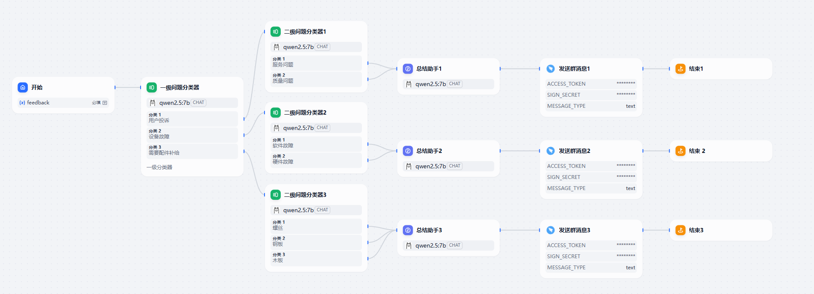

---

## 2. Implementation Details

### 2.1 Start

Create a blank application.

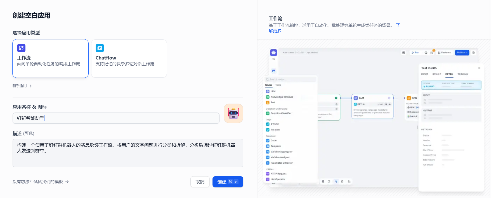

Next, begin editing the workflow.

The workflow starts here. We add our own specified input content in the input fields.

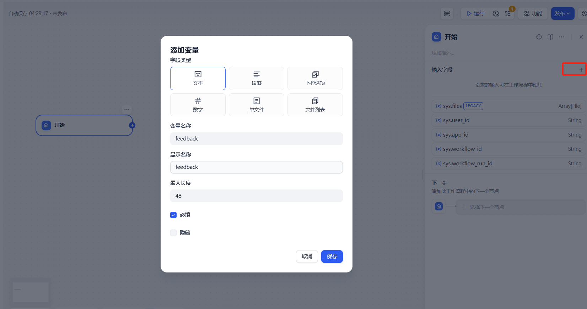

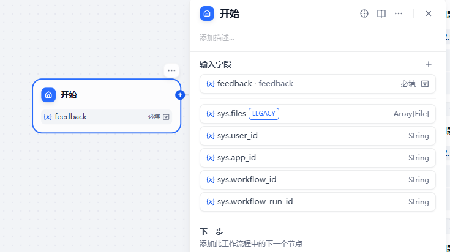

### 2.2 Question Classifier

A two-level Question Classifier is used here. The Question Classifier calls the LLM to select the entry from the question list that best matches the user's query, and then enters the branch corresponding to that entry.

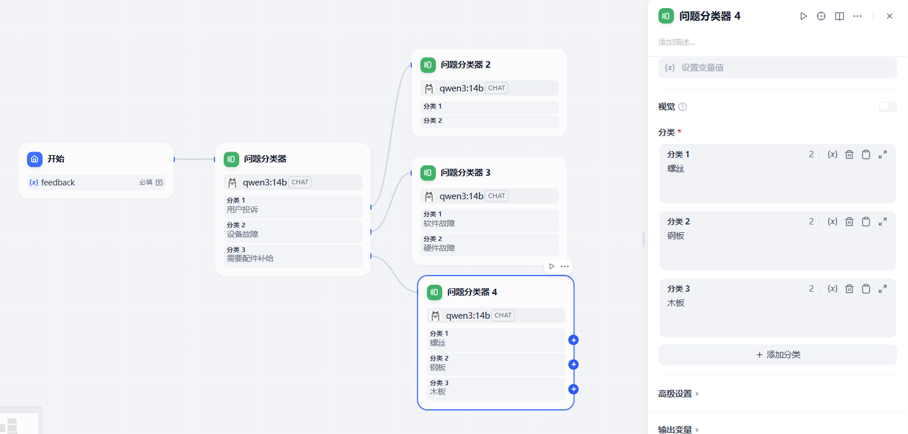

### 2.3 Summary Assistant

This is the downstream node of the Question Classifier. It injects the two-level category names and the initial question into the system prompt and requests a summary (when entering variables, type **/** to bring up variable suggestions).

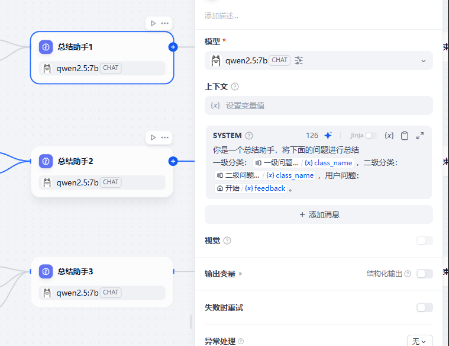

```
你是一个总结助手，将下面的问题进行总结
一级分类：{{#1763188881440.class_name#}}，二级分类：{{#1763189022754.class_name#}}，用户问题：{{#1763188813397.feedback#}}
```

### 2.4 DingTalk Group Message Tool

First, add the DingTalk group robot tool in Dify's tools.

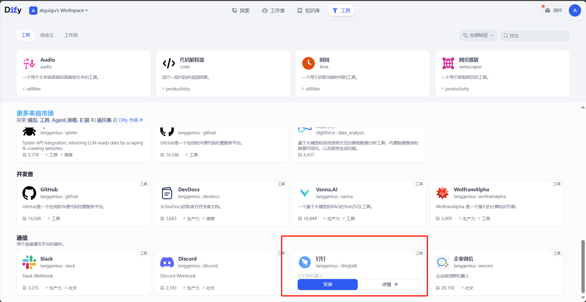

You need to use the PC version of DingTalk to create a group robot. First, create a group within an organization where you are an administrator, then create a robot in that group.

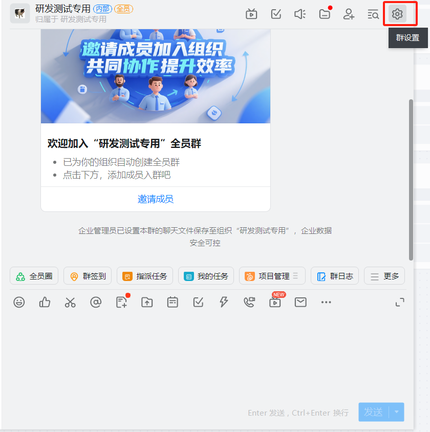

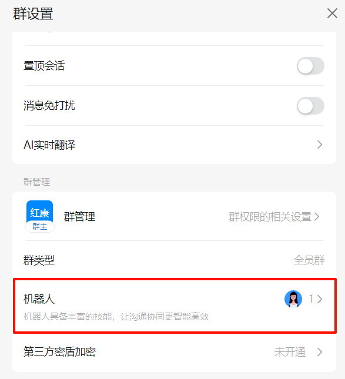

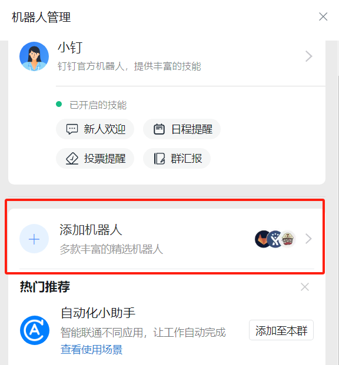

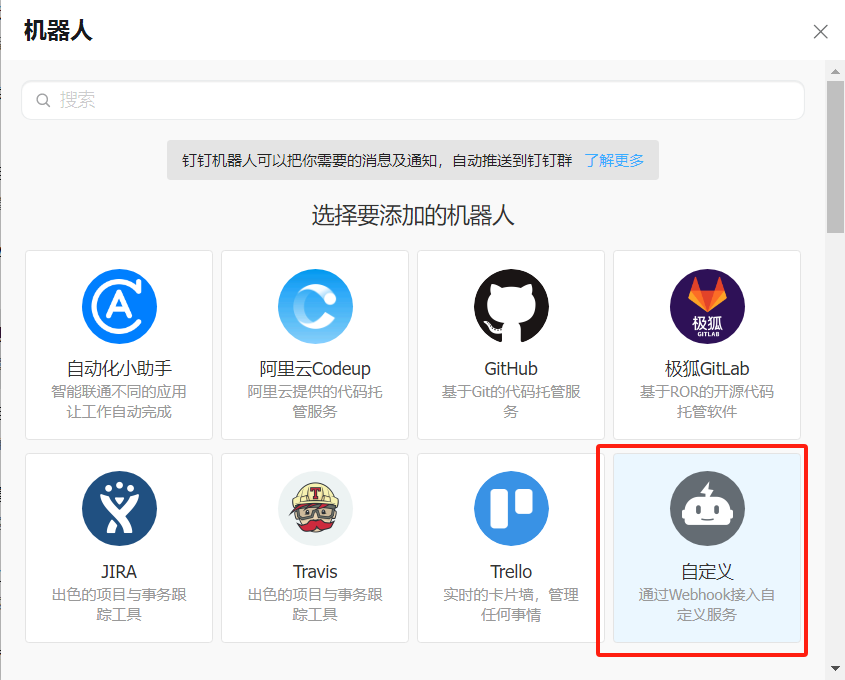

Save the signing secret; it will be needed for later configuration.

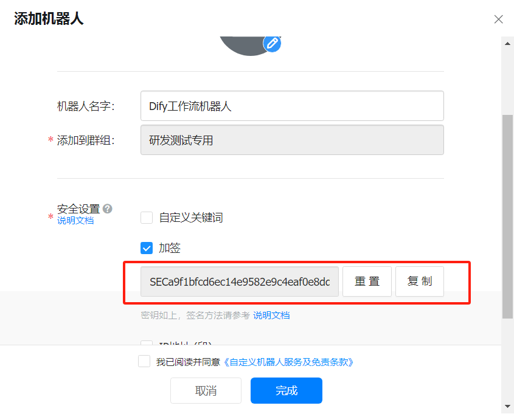

```
SEC_YOUR_DINGTALK_SIGNING_SECRET

https://oapi.dingtalk.com/robot/send?access_token=YOUR_ACCESS_TOKEN
```

Save the Webhook; it will be needed for later configuration.

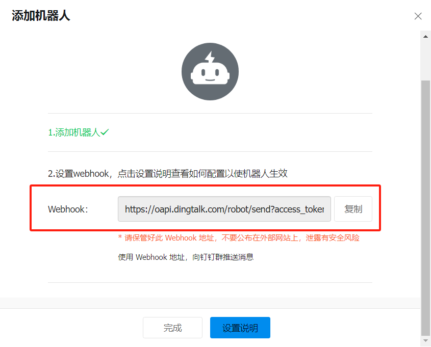

After creation, fill in the `access_token` value from the Webhook in the "ACCESS TOKEN" field of the DingTalk robot tool, and enter the previously saved signing secret in the "Signing Secret" field.

> **Note**: The ACCESS TOKEN must be the value of the **access_token** parameter in the Webhook.
>
> https://oapi.dingtalk.com/robot/send?access_token=**YOUR_ACCESS_TOKEN**

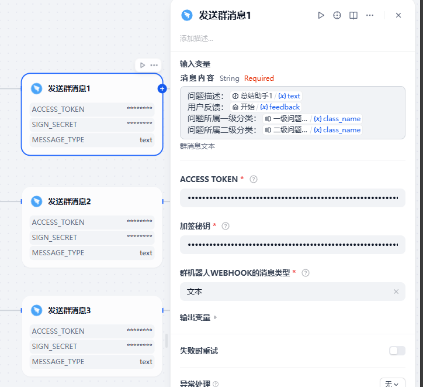

---

## 3. Testing

Click Run, enter the initial feedback information, and start the run.

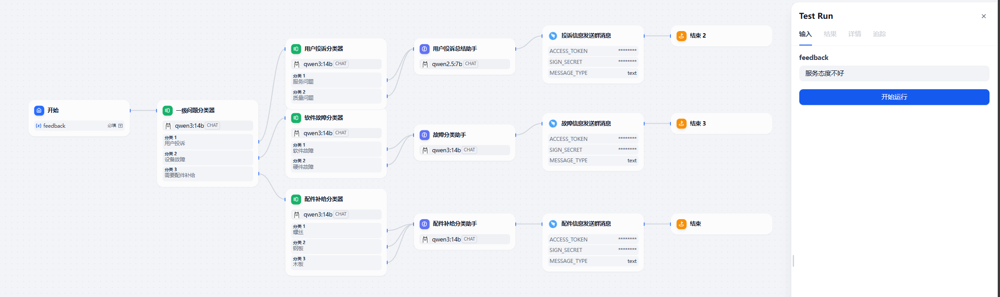

The run succeeds.

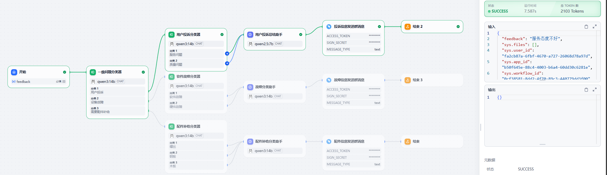

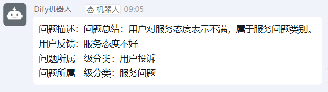
